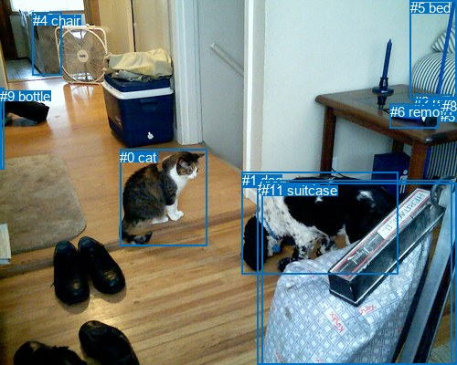
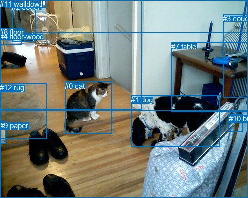

# 图片 0314：2327640.jpg

随机样本序号：220。图片 SHA256：`95ad20d361c8ca796a19e3543c102e9eaa221b871492b6f0894ae9cef6e18fa6`。

红色框表示人，蓝色框表示其他物体。两个模式分别保留自身框编号，可依据位置比较对应对象。

## 自动检测框与输出

人的框编号：`[]`。状态：`no_person`。

### 自动检测全部物体框

| 编号 | 类别 | 是否为人 | 检测分数 | 像素坐标 xyxy |
|---|---|---|---|---|
| 0 | cat | False | 0.9980 | 131.2, 163.8, 226.9, 269.8 |
| 1 | dog | False | 0.9951 | 264.9, 188.9, 435.2, 300.4 |
| 2 | remote | False | 0.9260 | 453.2, 103.0, 493.2, 117.0 |
| 3 | remote | False | 0.7306 | 481.9, 119.5, 500.0, 127.3 |
| 4 | chair | False | 0.6825 | 35.9, 13.6, 67.3, 82.7 |
| 5 | bed | False | 0.5656 | 448.9, 0.0, 499.9, 109.8 |
| 6 | remote | False | 0.5317 | 427.0, 113.8, 479.1, 140.2 |
| 7 | remote | False | 0.5265 | 481.6, 112.3, 500.0, 126.1 |
| 8 | remote | False | 0.4917 | 484.2, 108.3, 499.7, 121.8 |
| 9 | bottle | False | 0.4846 | 0.2, 97.0, 4.9, 185.3 |
| 10 | couch | False | 0.3685 | 282.0, 197.3, 494.2, 399.4 |
| 11 | suitcase | False | 0.3562 | 286.3, 200.2, 500.0, 400.0 |

### 自动检测 Top50 人相关候选

评分物体对：0；人相关物体对：0；输出关系：0。

| 排名 | 主语编号与类别 | 关系 | 宾语编号与类别 | 类型 | 人与人 | 排序分数 | 原始融合 logit |
|---|---|---|---|---|---|---|---|

### 自动检测逐条人相关 GT 核验

本图没有人相关 GT，R@50 无分母；预测候选继续展示。

## 真实框与输出

人的框编号：`[]`。

### 真实框全部物体框

| 编号 | 类别 | 是否为人 | 检测分数 | 像素坐标 xyxy |
|---|---|---|---|---|
| 0 | cat | False | GT | 131.0, 165.0, 225.0, 270.0 |
| 1 | dog | False | GT | 264.0, 193.0, 443.0, 296.0 |
| 2 | couch | False | GT | 24.0, 6.0, 72.0, 84.0 |
| 3 | couch | False | GT | 449.0, 29.0, 500.0, 197.0 |
| 4 | floor-wood | False | GT | 0.0, 65.0, 500.0, 400.0 |
| 5 | wall-wood | False | GT | 0.0, 0.0, 286.0, 221.0 |
| 6 | window | False | GT | 11.0, 0.0, 92.0, 15.0 |
| 7 | table | False | GT | 345.0, 85.0, 500.0, 227.0 |
| 8 | floor | False | GT | 0.0, 56.0, 44.0, 90.0 |
| 9 | paper | False | GT | 0.0, 245.0, 12.0, 290.0 |
| 10 | building | False | GT | 461.0, 231.0, 490.0, 266.0 |
| 11 | wall | False | GT | 0.0, 0.0, 500.0, 224.0 |
| 12 | rug | False | GT | 0.0, 168.0, 95.0, 280.0 |

### 真实框 Top50 人相关候选

评分物体对：0；人相关物体对：0；输出关系：0。

| 排名 | 主语编号与类别 | 关系 | 宾语编号与类别 | 类型 | 人与人 | 排序分数 | 原始融合 logit |
|---|---|---|---|---|---|---|---|

### 真实框逐条人相关 GT 核验

本图没有人相关 GT，R@50 无分母；预测候选继续展示。

## 全部人相关 GT

| 主语编号与类别 | 关系 | 宾语编号与类别 |
|---|---|---|

原始记录、全部人相关物体对的两项预测与分项分数见 [逐图证据 JSON](../evidence/cases/0314.json)。全部56类 logits 保留于本机 HOR/output/random500/logits/。

<!-- HOR_COMPLETE_RESULTS -->

## 六组条件的完整输出对照

以下保留同一图片三种框与候选模式、两种谓词输出规则的全部 Top50。框编号各自在所属模式内解释。

### 自动检测框完整枚举：空间与语义各保留一个谓词

| 排名 | 主语编号与类别 | 谓词 | 宾语编号与类别 | 分组 | 排序分数 | predicate logit | pair logit |
|---|---|---|---|---|---|---|---|

没有人相关 GT，本条件的召回率无分母。

### 自动检测框完整枚举：每对只保留一个谓词

| 排名 | 主语编号与类别 | 谓词 | 宾语编号与类别 | 分组 | 排序分数 | predicate logit | pair logit |
|---|---|---|---|---|---|---|---|

没有人相关 GT，本条件的召回率无分母。

### 真实框完整枚举：空间与语义各保留一个谓词

| 排名 | 主语编号与类别 | 谓词 | 宾语编号与类别 | 分组 | 排序分数 | predicate logit | pair logit |
|---|---|---|---|---|---|---|---|

没有人相关 GT，本条件的召回率无分母。

### 真实框完整枚举：每对只保留一个谓词

| 排名 | 主语编号与类别 | 谓词 | 宾语编号与类别 | 分组 | 排序分数 | predicate logit | pair logit |
|---|---|---|---|---|---|---|---|

没有人相关 GT，本条件的召回率无分母。

### 真实框400候选：空间与语义各保留一个谓词

| 排名 | 主语编号与类别 | 谓词 | 宾语编号与类别 | 分组 | 排序分数 | predicate logit | pair logit |
|---|---|---|---|---|---|---|---|

没有人相关 GT，本条件的召回率无分母。

### 真实框400候选：每对只保留一个谓词

| 排名 | 主语编号与类别 | 谓词 | 宾语编号与类别 | 分组 | 排序分数 | predicate logit | pair logit |
|---|---|---|---|---|---|---|---|

没有人相关 GT，本条件的召回率无分母。
