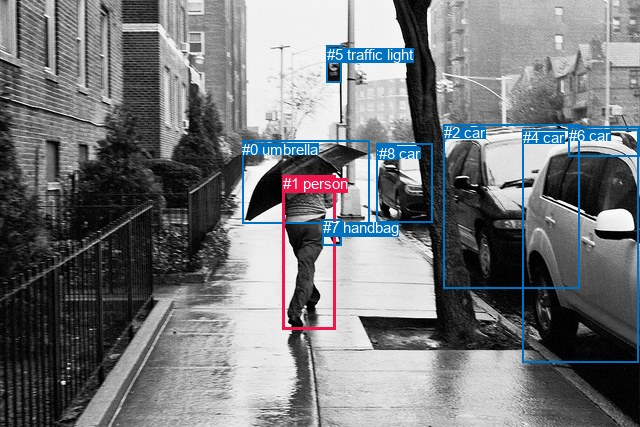
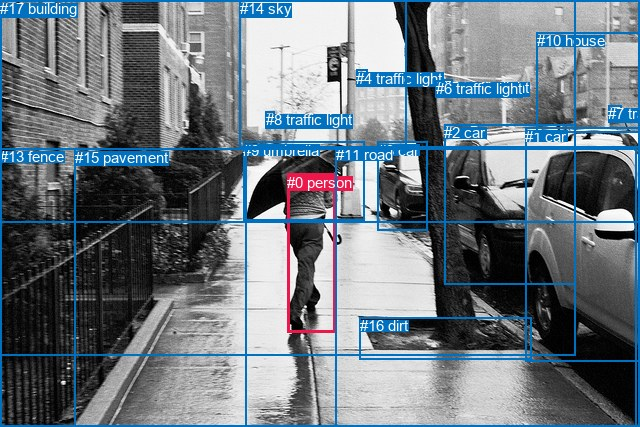

# 图片 0316：2327752.jpg

随机样本序号：219。图片 SHA256：`b2130d3995cec29cba8e38bc79c6a835406aa4906758ee90059e615f00079367`。

红色框表示人，蓝色框表示其他物体。两个模式分别保留自身框编号，可依据位置比较对应对象。

## 自动检测框与输出

人的框编号：`[1]`。状态：`ok`。

### 自动检测全部物体框

| 编号 | 类别 | 是否为人 | 检测分数 | 像素坐标 xyxy |
|---|---|---|---|---|
| 0 | umbrella | False | 0.9991 | 242.2, 140.7, 369.4, 223.2 |
| 1 | person | True | 0.9974 | 282.9, 175.3, 336.0, 329.5 |
| 2 | car | False | 0.9946 | 443.6, 124.4, 579.4, 288.8 |
| 3 | car | False | 0.9918 | 377.0, 143.8, 432.0, 222.8 |
| 4 | car | False | 0.9893 | 522.5, 129.2, 638.5, 362.8 |
| 5 | traffic light | False | 0.8323 | 326.7, 45.8, 341.0, 82.8 |
| 6 | car | False | 0.7616 | 568.9, 127.0, 640.0, 156.1 |
| 7 | handbag | False | 0.3710 | 322.7, 219.2, 342.0, 245.4 |
| 8 | car | False | 0.3634 | 378.7, 144.9, 396.2, 159.8 |

### 自动检测 Top50 人相关候选

评分物体对：72；人相关物体对：16；输出关系：32。

| 排名 | 主语编号与类别 | 关系 | 宾语编号与类别 | 类型 | 人与人 | 排序分数 | 原始融合 logit |
|---|---|---|---|---|---|---|---|
| 1 | #1 person | holding | #0 umbrella | semantic | False | 0.99129 | 4.7347 |
| 2 | #1 person | carrying | #7 handbag | semantic | False | 0.96016 | 3.1822 |
| 3 | #1 person | in | #0 umbrella | spatial | False | 0.85805 | 1.7992 |
| 4 | #7 handbag | on | #1 person | spatial | False | 0.84100 | 1.6657 |
| 5 | #1 person | in | #7 handbag | spatial | False | 0.74891 | 1.0928 |
| 6 | #0 umbrella | over | #1 person | spatial | False | 0.60785 | 0.4383 |
| 7 | #1 person | beside | #2 car | spatial | False | 0.54337 | 0.1739 |
| 8 | #1 person | walking on | #2 car | semantic | False | 0.48342 | -0.0663 |
| 9 | #1 person | walking on | #4 car | semantic | False | 0.42483 | -0.3030 |
| 10 | #0 umbrella | carrying | #1 person | semantic | False | 0.41678 | -0.3360 |
| 11 | #2 car | beside | #1 person | spatial | False | 0.39952 | -0.4075 |
| 12 | #5 traffic light | over | #1 person | spatial | False | 0.38428 | -0.4714 |
| 13 | #1 person | walking on | #3 car | semantic | False | 0.37298 | -0.5195 |
| 14 | #1 person | beside | #4 car | spatial | False | 0.33801 | -0.6722 |
| 15 | #3 car | beside | #1 person | spatial | False | 0.29795 | -0.8571 |
| 16 | #7 handbag | holding | #1 person | semantic | False | 0.29732 | -0.8601 |
| 17 | #4 car | beside | #1 person | spatial | False | 0.28127 | -0.9382 |
| 18 | #1 person | beside | #3 car | spatial | False | 0.26827 | -1.0034 |
| 19 | #1 person | walking on | #5 traffic light | semantic | False | 0.25763 | -1.0583 |
| 20 | #2 car | parked on | #1 person | semantic | False | 0.15259 | -1.7144 |
| 21 | #4 car | parked on | #1 person | semantic | False | 0.14264 | -1.7936 |
| 22 | #5 traffic light | holding | #1 person | semantic | False | 0.10336 | -2.1605 |
| 23 | #1 person | beside | #5 traffic light | spatial | False | 0.10003 | -2.1969 |
| 24 | #3 car | parked on | #1 person | semantic | False | 0.05433 | -2.8568 |
| 25 | #1 person | walking on | #8 car | semantic | False | 0.01878 | -3.9561 |
| 26 | #1 person | in | #8 car | spatial | False | 0.01479 | -4.1992 |
| 27 | #1 person | walking on | #6 car | semantic | False | 0.01028 | -4.5668 |
| 28 | #8 car | beside | #1 person | spatial | False | 0.00645 | -5.0370 |
| 29 | #6 car | parked on | #1 person | semantic | False | 0.00286 | -5.8556 |
| 30 | #8 car | looking at | #1 person | semantic | False | 0.00241 | -6.0237 |
| 31 | #1 person | in front of | #6 car | spatial | False | 0.00221 | -6.1111 |
| 32 | #6 car | beside | #1 person | spatial | False | 0.00175 | -6.3464 |

### 自动检测逐条人相关 GT 核验

R@50：50.00%；命中 1/2。

| GT 主语编号 | GT 关系 | GT 宾语编号 | 结果阶段 | 匹配预测主语编号 | 匹配预测宾语编号 |
|---|---|---|---|---|---|
| 0 | holding | 9 | hit50 | [1] | [0] |
| 0 | walking on | 15 | endpoint_missing_or_wrong_class | [1] | [] |

## 真实框与输出

人的框编号：`[0]`。

### 真实框全部物体框

| 编号 | 类别 | 是否为人 | 检测分数 | 像素坐标 xyxy |
|---|---|---|---|---|
| 0 | person | True | GT | 287.0, 174.0, 335.0, 333.0 |
| 1 | car | False | GT | 525.0, 128.0, 640.0, 362.0 |
| 2 | car | False | GT | 444.0, 124.0, 575.0, 284.0 |
| 3 | car | False | GT | 378.0, 142.0, 428.0, 231.0 |
| 4 | traffic light | False | GT | 356.0, 70.0, 367.0, 85.0 |
| 5 | traffic light | False | GT | 443.0, 79.0, 453.0, 94.0 |
| 6 | traffic light | False | GT | 436.0, 80.0, 444.0, 94.0 |
| 7 | traffic light | False | GT | 608.0, 105.0, 622.0, 115.0 |
| 8 | traffic light | False | GT | 266.0, 111.0, 274.0, 120.0 |
| 9 | umbrella | False | GT | 243.0, 142.0, 364.0, 221.0 |
| 10 | house | False | GT | 537.0, 32.0, 640.0, 132.0 |
| 11 | road | False | GT | 336.0, 146.0, 640.0, 427.0 |
| 12 | tree | False | GT | 0.0, 0.0, 576.0, 355.0 |
| 13 | fence | False | GT | 0.0, 148.0, 246.0, 427.0 |
| 14 | sky | False | GT | 240.0, 0.0, 407.0, 147.0 |
| 15 | pavement | False | GT | 75.0, 149.0, 637.0, 427.0 |
| 16 | dirt | False | GT | 360.0, 317.0, 532.0, 359.0 |
| 17 | building | False | GT | 0.0, 0.0, 640.0, 222.0 |

### 真实框 Top50 人相关候选

评分物体对：306；人相关物体对：34；输出关系：50。

| 排名 | 主语编号与类别 | 关系 | 宾语编号与类别 | 类型 | 人与人 | 排序分数 | 原始融合 logit |
|---|---|---|---|---|---|---|---|
| 1 | #0 person | holding | #9 umbrella | semantic | False | 0.99053 | 4.6500 |
| 2 | #0 person | walking on | #15 pavement | semantic | False | 0.98763 | 4.3797 |
| 3 | #0 person | on | #15 pavement | spatial | False | 0.91598 | 2.3890 |
| 4 | #0 person | in | #12 tree | spatial | False | 0.89613 | 2.1550 |
| 5 | #0 person | walking on | #12 tree | semantic | False | 0.85509 | 1.7751 |
| 6 | #0 person | walking on | #11 road | semantic | False | 0.83770 | 1.6412 |
| 7 | #0 person | in | #9 umbrella | spatial | False | 0.81395 | 1.4759 |
| 8 | #9 umbrella | carrying | #0 person | semantic | False | 0.74836 | 1.0899 |
| 9 | #0 person | walking on | #16 dirt | semantic | False | 0.69996 | 0.8471 |
| 10 | #0 person | walking on | #17 building | semantic | False | 0.64236 | 0.5856 |
| 11 | #9 umbrella | over | #0 person | spatial | False | 0.62658 | 0.5176 |
| 12 | #0 person | in | #17 building | spatial | False | 0.61393 | 0.4639 |
| 13 | #0 person | walking on | #13 fence | semantic | False | 0.59744 | 0.3948 |
| 14 | #13 fence | beside | #0 person | spatial | False | 0.56043 | 0.2429 |
| 15 | #0 person | beside | #13 fence | spatial | False | 0.48622 | -0.0551 |
| 16 | #0 person | on | #11 road | spatial | False | 0.41311 | -0.3511 |
| 17 | #0 person | on | #16 dirt | spatial | False | 0.27711 | -0.9588 |
| 18 | #0 person | beside | #2 car | spatial | False | 0.26479 | -1.0212 |
| 19 | #3 car | beside | #0 person | spatial | False | 0.22952 | -1.2110 |
| 20 | #12 tree | beside | #0 person | spatial | False | 0.17122 | -1.5770 |
| 21 | #14 sky | over | #0 person | spatial | False | 0.16443 | -1.6256 |
| 22 | #0 person | holding | #14 sky | semantic | False | 0.16096 | -1.6511 |
| 23 | #2 car | beside | #0 person | spatial | False | 0.15171 | -1.7213 |
| 24 | #16 dirt | beside | #0 person | spatial | False | 0.14564 | -1.7692 |
| 25 | #1 car | beside | #0 person | spatial | False | 0.12492 | -1.9467 |
| 26 | #17 building | beside | #0 person | spatial | False | 0.11944 | -1.9977 |
| 27 | #0 person | beside | #1 car | spatial | False | 0.11432 | -2.0473 |
| 28 | #0 person | beside | #3 car | spatial | False | 0.10167 | -2.1788 |
| 29 | #0 person | walking on | #2 car | semantic | False | 0.08285 | -2.4043 |
| 30 | #0 person | walking on | #3 car | semantic | False | 0.06945 | -2.5951 |
| 31 | #0 person | in | #14 sky | spatial | False | 0.05013 | -2.9416 |
| 32 | #13 fence | holding | #0 person | semantic | False | 0.04944 | -2.9563 |
| 33 | #3 car | parked on | #0 person | semantic | False | 0.04805 | -2.9862 |
| 34 | #0 person | walking on | #1 car | semantic | False | 0.04529 | -3.0484 |
| 35 | #12 tree | looking at | #0 person | semantic | False | 0.04395 | -3.0798 |
| 36 | #15 pavement | in | #0 person | spatial | False | 0.04172 | -3.1341 |
| 37 | #2 car | parked on | #0 person | semantic | False | 0.03714 | -3.2554 |
| 38 | #11 road | beside | #0 person | spatial | False | 0.03530 | -3.3080 |
| 39 | #1 car | parked on | #0 person | semantic | False | 0.03404 | -3.3457 |
| 40 | #15 pavement | holding | #0 person | semantic | False | 0.03376 | -3.3542 |
| 41 | #14 sky | holding | #0 person | semantic | False | 0.02029 | -3.8773 |
| 42 | #4 traffic light | over | #0 person | spatial | False | 0.01994 | -3.8947 |
| 43 | #0 person | holding | #8 traffic light | semantic | False | 0.01967 | -3.9087 |
| 44 | #17 building | holding | #0 person | semantic | False | 0.01699 | -4.0579 |
| 45 | #8 traffic light | beside | #0 person | spatial | False | 0.01669 | -4.0763 |
| 46 | #16 dirt | looking at | #0 person | semantic | False | 0.01612 | -4.1115 |
| 47 | #0 person | holding | #4 traffic light | semantic | False | 0.01194 | -4.4159 |
| 48 | #0 person | in | #8 traffic light | spatial | False | 0.01131 | -4.4710 |
| 49 | #5 traffic light | over | #0 person | spatial | False | 0.01011 | -4.5840 |
| 50 | #6 traffic light | over | #0 person | spatial | False | 0.00984 | -4.6119 |

### 真实框逐条人相关 GT 核验

R@50：100.00%；命中 2/2。

| GT 主语编号 | GT 关系 | GT 宾语编号 | 结果阶段 | 匹配预测主语编号 | 匹配预测宾语编号 |
|---|---|---|---|---|---|
| 0 | holding | 9 | hit50 | [0] | [9] |
| 0 | walking on | 15 | hit50 | [0] | [15] |

## 全部人相关 GT

| 主语编号与类别 | 关系 | 宾语编号与类别 |
|---|---|---|
| #0 person | holding | #9 umbrella |
| #0 person | walking on | #15 pavement |

原始记录、全部人相关物体对的两项预测与分项分数见 [逐图证据 JSON](../evidence/cases/0316.json)。全部56类 logits 保留于本机 HOR/output/random500/logits/。

<!-- HOR_COMPLETE_RESULTS -->

## 六组条件的完整输出对照

以下保留同一图片三种框与候选模式、两种谓词输出规则的全部 Top50。框编号各自在所属模式内解释。

### 自动检测框完整枚举：空间与语义各保留一个谓词

| 排名 | 主语编号与类别 | 谓词 | 宾语编号与类别 | 分组 | 排序分数 | predicate logit | pair logit |
|---|---|---|---|---|---|---|---|
| 1 | #1 person | holding | #0 umbrella | semantic | 0.9912912 | 4.1473832 | 0.5872910 |
| 2 | #1 person | carrying | #7 handbag | semantic | 0.9601575 | 3.2640409 | -0.0818776 |
| 3 | #1 person | in | #0 umbrella | spatial | 0.8580486 | 1.2118845 | 0.5872910 |
| 4 | #7 handbag | on | #1 person | spatial | 0.8409999 | 2.2712774 | -0.6055906 |
| 5 | #1 person | in | #7 handbag | spatial | 0.7489148 | 1.1747103 | -0.0818776 |
| 6 | #0 umbrella | over | #1 person | spatial | 0.6078485 | 1.2644920 | -0.8262145 |
| 7 | #1 person | beside | #2 car | spatial | 0.5433678 | 1.3416519 | -1.1677437 |
| 8 | #1 person | walking on | #2 car | semantic | 0.4834217 | 1.1014061 | -1.1677437 |
| 9 | #1 person | walking on | #4 car | semantic | 0.4248341 | 0.7463465 | -1.0493062 |
| 10 | #0 umbrella | carrying | #1 person | semantic | 0.4167830 | 0.4902210 | -0.8262145 |
| 11 | #2 car | beside | #1 person | spatial | 0.3995200 | 1.2718415 | -1.6793070 |
| 12 | #5 traffic light | over | #1 person | spatial | 0.3842823 | 1.0331955 | -1.5046067 |
| 13 | #1 person | walking on | #3 car | semantic | 0.3729753 | 1.0126238 | -1.5320976 |
| 14 | #1 person | beside | #4 car | spatial | 0.3380059 | 0.3771129 | -1.0493062 |
| 15 | #3 car | beside | #1 person | spatial | 0.2979484 | 0.5510106 | -1.4080973 |
| 16 | #7 handbag | holding | #1 person | semantic | 0.2973177 | -0.2545133 | -0.6055906 |
| 17 | #4 car | beside | #1 person | spatial | 0.2812665 | 0.6390009 | -1.5771888 |
| 18 | #1 person | beside | #3 car | spatial | 0.2682677 | 0.5286684 | -1.5320976 |
| 19 | #1 person | walking on | #5 traffic light | semantic | 0.2576328 | 0.6485043 | -1.7068127 |
| 20 | #2 car | parked on | #1 person | semantic | 0.1525876 | -0.0351419 | -1.6793070 |
| 21 | #4 car | parked on | #1 person | semantic | 0.1426372 | -0.2163682 | -1.5771888 |
| 22 | #5 traffic light | holding | #1 person | semantic | 0.1033563 | -0.6558700 | -1.5046067 |
| 23 | #1 person | beside | #5 traffic light | spatial | 0.1000283 | -0.4900975 | -1.7068127 |
| 24 | #3 car | parked on | #1 person | semantic | 0.0543319 | -1.4486835 | -1.4080973 |
| 25 | #1 person | walking on | #8 car | semantic | 0.0187777 | -2.0867121 | -1.8694143 |
| 26 | #1 person | in | #8 car | spatial | 0.0147855 | -2.3297968 | -1.8694143 |
| 27 | #1 person | walking on | #6 car | semantic | 0.0102839 | -2.7344337 | -1.8324058 |
| 28 | #8 car | beside | #1 person | spatial | 0.0064516 | -3.5379872 | -1.4989667 |
| 29 | #6 car | parked on | #1 person | semantic | 0.0028557 | -3.9247942 | -1.9307854 |
| 30 | #8 car | looking at | #1 person | semantic | 0.0024149 | -4.5247078 | -1.4989667 |
| 31 | #1 person | in front of | #6 car | spatial | 0.0022132 | -4.2786970 | -1.8324058 |
| 32 | #6 car | beside | #1 person | spatial | 0.0017499 | -4.4156642 | -1.9307854 |

GT 命中：1/2，R@50=50.00%。

| GT主语 | GT谓词 | GT宾语 | 结果阶段 | 匹配主语框 | 匹配宾语框 |
|---|---|---|---|---|---|
| 0 | holding | 9 | hit50 | [1] | [0] |
| 0 | walking on | 15 | endpoint_missing_or_wrong_class | [1] | [] |

### 自动检测框完整枚举：每对只保留一个谓词

| 排名 | 主语编号与类别 | 谓词 | 宾语编号与类别 | 分组 | 排序分数 | predicate logit | pair logit |
|---|---|---|---|---|---|---|---|
| 1 | #1 person | holding | #0 umbrella | single | 0.9912912 | 4.1473832 | 0.5872910 |
| 2 | #1 person | carrying | #7 handbag | single | 0.9601575 | 3.2640409 | -0.0818776 |
| 3 | #7 handbag | on | #1 person | single | 0.8409999 | 2.2712774 | -0.6055906 |
| 4 | #0 umbrella | over | #1 person | single | 0.6078485 | 1.2644920 | -0.8262145 |
| 5 | #1 person | beside | #2 car | single | 0.5433678 | 1.3416519 | -1.1677437 |
| 6 | #1 person | walking on | #4 car | single | 0.4248341 | 0.7463465 | -1.0493062 |
| 7 | #2 car | beside | #1 person | single | 0.3995200 | 1.2718415 | -1.6793070 |
| 8 | #5 traffic light | over | #1 person | single | 0.3842823 | 1.0331955 | -1.5046067 |
| 9 | #1 person | walking on | #3 car | single | 0.3729753 | 1.0126238 | -1.5320976 |
| 10 | #3 car | beside | #1 person | single | 0.2979484 | 0.5510106 | -1.4080973 |
| 11 | #4 car | beside | #1 person | single | 0.2812665 | 0.6390009 | -1.5771888 |
| 12 | #1 person | walking on | #5 traffic light | single | 0.2576328 | 0.6485043 | -1.7068127 |
| 13 | #1 person | walking on | #8 car | single | 0.0187777 | -2.0867121 | -1.8694143 |
| 14 | #1 person | walking on | #6 car | single | 0.0102839 | -2.7344337 | -1.8324058 |
| 15 | #8 car | beside | #1 person | single | 0.0064516 | -3.5379872 | -1.4989667 |
| 16 | #6 car | parked on | #1 person | single | 0.0028557 | -3.9247942 | -1.9307854 |

GT 命中：1/2，R@50=50.00%。

| GT主语 | GT谓词 | GT宾语 | 结果阶段 | 匹配主语框 | 匹配宾语框 |
|---|---|---|---|---|---|
| 0 | holding | 9 | hit50 | [1] | [0] |
| 0 | walking on | 15 | endpoint_missing_or_wrong_class | [1] | [] |

### 真实框完整枚举：空间与语义各保留一个谓词

| 排名 | 主语编号与类别 | 谓词 | 宾语编号与类别 | 分组 | 排序分数 | predicate logit | pair logit |
|---|---|---|---|---|---|---|---|
| 1 | #0 person | holding | #9 umbrella | semantic | 0.9905289 | 4.0388350 | 0.6111583 |
| 2 | #0 person | walking on | #15 pavement | semantic | 0.9876257 | 4.4866652 | -0.1069850 |
| 3 | #0 person | on | #15 pavement | spatial | 0.9159829 | 2.4959626 | -0.1069850 |
| 4 | #0 person | in | #12 tree | spatial | 0.8961331 | 2.7722178 | -0.6172388 |
| 5 | #0 person | walking on | #12 tree | semantic | 0.8550866 | 2.3923049 | -0.6172388 |
| 6 | #0 person | walking on | #11 road | semantic | 0.8377025 | 2.4013786 | -0.7601469 |
| 7 | #0 person | in | #9 umbrella | spatial | 0.8139511 | 0.8647323 | 0.6111583 |
| 8 | #9 umbrella | carrying | #0 person | semantic | 0.7483627 | 1.8864341 | -0.7965353 |
| 9 | #0 person | walking on | #16 dirt | semantic | 0.6999627 | 1.7424097 | -0.8952897 |
| 10 | #0 person | walking on | #17 building | semantic | 0.6423552 | 1.4354200 | -0.8498187 |
| 11 | #9 umbrella | over | #0 person | spatial | 0.6265777 | 1.3140984 | -0.7965353 |
| 12 | #0 person | in | #17 building | spatial | 0.6139281 | 1.3136730 | -0.8498187 |
| 13 | #0 person | walking on | #13 fence | semantic | 0.5974361 | 1.5798278 | -1.1850345 |
| 14 | #13 fence | beside | #0 person | spatial | 0.5604339 | 1.2830887 | -1.0401654 |
| 15 | #0 person | beside | #13 fence | spatial | 0.4862235 | 1.1299148 | -1.1850345 |
| 16 | #0 person | on | #11 road | spatial | 0.4131135 | 0.4090376 | -0.7601469 |
| 17 | #0 person | on | #16 dirt | spatial | 0.2771144 | -0.0635309 | -0.8952897 |
| 18 | #0 person | beside | #2 car | spatial | 0.2647874 | 0.1358914 | -1.1571240 |
| 19 | #3 car | beside | #0 person | spatial | 0.2295229 | 0.1610532 | -1.3720604 |
| 20 | #12 tree | beside | #0 person | spatial | 0.1712170 | -0.2517381 | -1.3252888 |
| 21 | #14 sky | over | #0 person | spatial | 0.1644324 | -0.2359848 | -1.3896270 |
| 22 | #0 person | holding | #14 sky | semantic | 0.1609645 | 0.2148209 | -1.8658903 |
| 23 | #2 car | beside | #0 person | spatial | 0.1517085 | -0.0498676 | -1.6713955 |
| 24 | #16 dirt | beside | #0 person | spatial | 0.1456439 | -0.2247405 | -1.5444428 |
| 25 | #1 car | beside | #0 person | spatial | 0.1249183 | -0.4104486 | -1.5362091 |
| 26 | #17 building | beside | #0 person | spatial | 0.1194443 | -0.8593893 | -1.1383140 |
| 27 | #0 person | beside | #1 car | spatial | 0.1143204 | -1.0389535 | -1.0083961 |
| 28 | #0 person | beside | #3 car | spatial | 0.1016698 | -0.7074440 | -1.4713638 |
| 29 | #0 person | walking on | #2 car | semantic | 0.0828487 | -1.2471328 | -1.1571240 |
| 30 | #0 person | walking on | #3 car | semantic | 0.0694513 | -1.1237853 | -1.4713638 |
| 31 | #0 person | in | #14 sky | spatial | 0.0501327 | -1.0757585 | -1.8658903 |
| 32 | #13 fence | holding | #0 person | semantic | 0.0494415 | -1.9160943 | -1.0401654 |
| 33 | #3 car | parked on | #0 person | semantic | 0.0480518 | -1.6141701 | -1.3720604 |
| 34 | #0 person | walking on | #1 car | semantic | 0.0452864 | -2.0400074 | -1.0083961 |
| 35 | #12 tree | looking at | #0 person | semantic | 0.0439492 | -1.7544889 | -1.3252888 |
| 36 | #15 pavement | in | #0 person | spatial | 0.0417227 | -1.3956525 | -1.7384396 |
| 37 | #2 car | parked on | #0 person | semantic | 0.0371350 | -1.5839567 | -1.6713955 |
| 38 | #11 road | beside | #0 person | spatial | 0.0352967 | -1.3693955 | -1.9386368 |
| 39 | #1 car | parked on | #0 person | semantic | 0.0340361 | -1.8094964 | -1.5362091 |
| 40 | #15 pavement | holding | #0 person | semantic | 0.0337564 | -1.6158051 | -1.7384396 |
| 41 | #14 sky | holding | #0 person | semantic | 0.0202867 | -2.4876680 | -1.3896270 |
| 42 | #4 traffic light | over | #0 person | spatial | 0.0199437 | -2.3042293 | -1.5904689 |
| 43 | #0 person | holding | #8 traffic light | semantic | 0.0196724 | -1.9005542 | -2.0081151 |
| 44 | #17 building | holding | #0 person | semantic | 0.0169908 | -2.9196348 | -1.1383140 |
| 45 | #8 traffic light | beside | #0 person | spatial | 0.0166862 | -2.5318387 | -1.5445100 |
| 46 | #16 dirt | looking at | #0 person | semantic | 0.0161184 | -2.5670993 | -1.5444428 |
| 47 | #0 person | holding | #4 traffic light | semantic | 0.0119399 | -2.3352542 | -2.0805998 |
| 48 | #0 person | in | #8 traffic light | spatial | 0.0113062 | -2.4629207 | -2.0081151 |
| 49 | #5 traffic light | over | #0 person | spatial | 0.0101112 | -2.5261354 | -2.0578153 |
| 50 | #6 traffic light | over | #0 person | spatial | 0.0098350 | -2.5762448 | -2.0356774 |

GT 命中：2/2，R@50=100.00%。

| GT主语 | GT谓词 | GT宾语 | 结果阶段 | 匹配主语框 | 匹配宾语框 |
|---|---|---|---|---|---|
| 0 | holding | 9 | hit50 | [0] | [9] |
| 0 | walking on | 15 | hit50 | [0] | [15] |

### 真实框完整枚举：每对只保留一个谓词

| 排名 | 主语编号与类别 | 谓词 | 宾语编号与类别 | 分组 | 排序分数 | predicate logit | pair logit |
|---|---|---|---|---|---|---|---|
| 1 | #0 person | holding | #9 umbrella | single | 0.9905289 | 4.0388350 | 0.6111583 |
| 2 | #0 person | walking on | #15 pavement | single | 0.9876257 | 4.4866652 | -0.1069850 |
| 3 | #0 person | in | #12 tree | single | 0.8961331 | 2.7722178 | -0.6172388 |
| 4 | #0 person | walking on | #11 road | single | 0.8377025 | 2.4013786 | -0.7601469 |
| 5 | #9 umbrella | carrying | #0 person | single | 0.7483627 | 1.8864341 | -0.7965353 |
| 6 | #0 person | walking on | #16 dirt | single | 0.6999627 | 1.7424097 | -0.8952897 |
| 7 | #0 person | walking on | #17 building | single | 0.6423552 | 1.4354200 | -0.8498187 |
| 8 | #0 person | walking on | #13 fence | single | 0.5974361 | 1.5798278 | -1.1850345 |
| 9 | #13 fence | beside | #0 person | single | 0.5604339 | 1.2830887 | -1.0401654 |
| 10 | #0 person | beside | #2 car | single | 0.2647874 | 0.1358914 | -1.1571240 |
| 11 | #3 car | beside | #0 person | single | 0.2295229 | 0.1610532 | -1.3720604 |
| 12 | #12 tree | beside | #0 person | single | 0.1712170 | -0.2517381 | -1.3252888 |
| 13 | #14 sky | over | #0 person | single | 0.1644324 | -0.2359848 | -1.3896270 |
| 14 | #0 person | holding | #14 sky | single | 0.1609645 | 0.2148209 | -1.8658903 |
| 15 | #2 car | beside | #0 person | single | 0.1517085 | -0.0498676 | -1.6713955 |
| 16 | #16 dirt | beside | #0 person | single | 0.1456439 | -0.2247405 | -1.5444428 |
| 17 | #1 car | beside | #0 person | single | 0.1249183 | -0.4104486 | -1.5362091 |
| 18 | #17 building | beside | #0 person | single | 0.1194443 | -0.8593893 | -1.1383140 |
| 19 | #0 person | beside | #1 car | single | 0.1143204 | -1.0389535 | -1.0083961 |
| 20 | #0 person | beside | #3 car | single | 0.1016698 | -0.7074440 | -1.4713638 |
| 21 | #15 pavement | in | #0 person | single | 0.0417227 | -1.3956525 | -1.7384396 |
| 22 | #11 road | beside | #0 person | single | 0.0352967 | -1.3693955 | -1.9386368 |
| 23 | #4 traffic light | over | #0 person | single | 0.0199437 | -2.3042293 | -1.5904689 |
| 24 | #0 person | holding | #8 traffic light | single | 0.0196724 | -1.9005542 | -2.0081151 |
| 25 | #8 traffic light | beside | #0 person | single | 0.0166862 | -2.5318387 | -1.5445100 |
| 26 | #0 person | holding | #4 traffic light | single | 0.0119399 | -2.3352542 | -2.0805998 |
| 27 | #5 traffic light | over | #0 person | single | 0.0101112 | -2.5261354 | -2.0578153 |
| 28 | #6 traffic light | over | #0 person | single | 0.0098350 | -2.5762448 | -2.0356774 |
| 29 | #0 person | looking at | #10 house | single | 0.0074909 | -2.6432700 | -2.2432747 |
| 30 | #7 traffic light | looking at | #0 person | single | 0.0049527 | -3.3905122 | -1.9123520 |
| 31 | #10 house | beside | #0 person | single | 0.0042694 | -3.3197393 | -2.1322699 |
| 32 | #0 person | holding | #7 traffic light | single | 0.0034376 | -3.6034470 | -2.0661025 |
| 33 | #0 person | holding | #6 traffic light | single | 0.0030509 | -3.0489221 | -2.7403431 |
| 34 | #0 person | holding | #5 traffic light | single | 0.0027233 | -3.1056013 | -2.7975907 |

GT 命中：2/2，R@50=100.00%。

| GT主语 | GT谓词 | GT宾语 | 结果阶段 | 匹配主语框 | 匹配宾语框 |
|---|---|---|---|---|---|
| 0 | holding | 9 | hit50 | [0] | [9] |
| 0 | walking on | 15 | hit50 | [0] | [15] |

### 真实框400候选：空间与语义各保留一个谓词

| 排名 | 主语编号与类别 | 谓词 | 宾语编号与类别 | 分组 | 排序分数 | predicate logit | pair logit |
|---|---|---|---|---|---|---|---|
| 1 | #0 person | holding | #9 umbrella | semantic | 0.9909720 | 4.0872006 | 0.6111583 |
| 2 | #0 person | walking on | #15 pavement | semantic | 0.9876257 | 4.4866652 | -0.1069850 |
| 3 | #0 person | on | #15 pavement | spatial | 0.9159829 | 2.4959626 | -0.1069850 |
| 4 | #0 person | in | #12 tree | spatial | 0.8916852 | 2.7253103 | -0.6172388 |
| 5 | #0 person | walking on | #12 tree | semantic | 0.8550866 | 2.3923049 | -0.6172388 |
| 6 | #0 person | walking on | #11 road | semantic | 0.8377025 | 2.4013786 | -0.7601469 |
| 7 | #0 person | in | #9 umbrella | spatial | 0.8139511 | 0.8647323 | 0.6111583 |
| 8 | #9 umbrella | carrying | #0 person | semantic | 0.7483627 | 1.8864341 | -0.7965353 |
| 9 | #0 person | walking on | #16 dirt | semantic | 0.6999627 | 1.7424097 | -0.8952897 |
| 10 | #0 person | walking on | #17 building | semantic | 0.6423552 | 1.4354200 | -0.8498187 |
| 11 | #9 umbrella | over | #0 person | spatial | 0.6265777 | 1.3140984 | -0.7965353 |
| 12 | #0 person | in | #17 building | spatial | 0.6131412 | 1.3103542 | -0.8498187 |
| 13 | #0 person | walking on | #13 fence | semantic | 0.5967117 | 1.5768170 | -1.1850345 |
| 14 | #13 fence | beside | #0 person | spatial | 0.5530367 | 1.2531133 | -1.0401654 |
| 15 | #0 person | beside | #13 fence | spatial | 0.4862235 | 1.1299148 | -1.1850345 |
| 16 | #0 person | on | #11 road | spatial | 0.4177766 | 0.4282393 | -0.7601469 |
| 17 | #0 person | on | #16 dirt | spatial | 0.2765694 | -0.0662532 | -0.8952897 |
| 18 | #0 person | beside | #2 car | spatial | 0.2647761 | 0.1358337 | -1.1571240 |
| 19 | #3 car | beside | #0 person | spatial | 0.2242675 | 0.1310921 | -1.3720604 |
| 20 | #12 tree | beside | #0 person | spatial | 0.1712088 | -0.2517958 | -1.3252888 |
| 21 | #14 sky | over | #0 person | spatial | 0.1638882 | -0.2399511 | -1.3896270 |
| 22 | #0 person | holding | #14 sky | semantic | 0.1578233 | 0.1913762 | -1.8658903 |
| 23 | #2 car | beside | #0 person | spatial | 0.1517058 | -0.0498891 | -1.6713955 |
| 24 | #16 dirt | beside | #0 person | spatial | 0.1456403 | -0.2247696 | -1.5444428 |
| 25 | #1 car | beside | #0 person | spatial | 0.1249219 | -0.4104152 | -1.5362091 |
| 26 | #17 building | beside | #0 person | spatial | 0.1178772 | -0.8743734 | -1.1383140 |
| 27 | #0 person | beside | #1 car | spatial | 0.1098278 | -1.0841050 | -1.0083961 |
| 28 | #0 person | beside | #3 car | spatial | 0.1016737 | -0.7074008 | -1.4713638 |
| 29 | #0 person | walking on | #2 car | semantic | 0.0818256 | -1.2606733 | -1.1571240 |
| 30 | #0 person | walking on | #3 car | semantic | 0.0694513 | -1.1237853 | -1.4713638 |
| 31 | #0 person | in | #14 sky | spatial | 0.0501327 | -1.0757585 | -1.8658903 |
| 32 | #13 fence | holding | #0 person | semantic | 0.0493721 | -1.9175713 | -1.0401654 |
| 33 | #3 car | parked on | #0 person | semantic | 0.0480515 | -1.6141775 | -1.3720604 |
| 34 | #12 tree | looking at | #0 person | semantic | 0.0439418 | -1.7546632 | -1.3252888 |
| 35 | #0 person | walking on | #1 car | semantic | 0.0434370 | -2.0836389 | -1.0083961 |
| 36 | #15 pavement | in | #0 person | spatial | 0.0417227 | -1.3956525 | -1.7384396 |
| 37 | #2 car | parked on | #0 person | semantic | 0.0371348 | -1.5839643 | -1.6713955 |
| 38 | #11 road | beside | #0 person | spatial | 0.0352984 | -1.3693430 | -1.9386368 |
| 39 | #1 car | parked on | #0 person | semantic | 0.0345337 | -1.7944658 | -1.5362091 |
| 40 | #15 pavement | holding | #0 person | semantic | 0.0337625 | -1.6156206 | -1.7384396 |
| 41 | #14 sky | holding | #0 person | semantic | 0.0202354 | -2.4902530 | -1.3896270 |
| 42 | #4 traffic light | over | #0 person | spatial | 0.0199178 | -2.3055515 | -1.5904689 |
| 43 | #0 person | holding | #8 traffic light | semantic | 0.0193598 | -1.9168925 | -2.0081151 |
| 44 | #8 traffic light | beside | #0 person | spatial | 0.0169339 | -2.5168509 | -1.5445100 |
| 45 | #17 building | holding | #0 person | semantic | 0.0167778 | -2.9324646 | -1.1383140 |
| 46 | #16 dirt | looking at | #0 person | semantic | 0.0161170 | -2.5671866 | -1.5444428 |
| 47 | #0 person | holding | #4 traffic light | semantic | 0.0119590 | -2.3336387 | -2.0805998 |
| 48 | #0 person | in | #8 traffic light | spatial | 0.0111073 | -2.4808700 | -2.0081151 |
| 49 | #5 traffic light | over | #0 person | spatial | 0.0099878 | -2.5385370 | -2.0578153 |
| 50 | #6 traffic light | over | #0 person | spatial | 0.0098093 | -2.5788889 | -2.0356774 |

GT 命中：2/2，R@50=100.00%。

| GT主语 | GT谓词 | GT宾语 | 结果阶段 | 匹配主语框 | 匹配宾语框 |
|---|---|---|---|---|---|
| 0 | holding | 9 | hit50 | [0] | [9] |
| 0 | walking on | 15 | hit50 | [0] | [15] |

### 真实框400候选：每对只保留一个谓词

| 排名 | 主语编号与类别 | 谓词 | 宾语编号与类别 | 分组 | 排序分数 | predicate logit | pair logit |
|---|---|---|---|---|---|---|---|
| 1 | #0 person | holding | #9 umbrella | single | 0.9909720 | 4.0872006 | 0.6111583 |
| 2 | #0 person | walking on | #15 pavement | single | 0.9876257 | 4.4866652 | -0.1069850 |
| 3 | #0 person | in | #12 tree | single | 0.8916852 | 2.7253103 | -0.6172388 |
| 4 | #0 person | walking on | #11 road | single | 0.8377025 | 2.4013786 | -0.7601469 |
| 5 | #9 umbrella | carrying | #0 person | single | 0.7483627 | 1.8864341 | -0.7965353 |
| 6 | #0 person | walking on | #16 dirt | single | 0.6999627 | 1.7424097 | -0.8952897 |
| 7 | #0 person | walking on | #17 building | single | 0.6423552 | 1.4354200 | -0.8498187 |
| 8 | #0 person | walking on | #13 fence | single | 0.5967117 | 1.5768170 | -1.1850345 |
| 9 | #13 fence | beside | #0 person | single | 0.5530367 | 1.2531133 | -1.0401654 |
| 10 | #0 person | beside | #2 car | single | 0.2647761 | 0.1358337 | -1.1571240 |
| 11 | #3 car | beside | #0 person | single | 0.2242675 | 0.1310921 | -1.3720604 |
| 12 | #12 tree | beside | #0 person | single | 0.1712088 | -0.2517958 | -1.3252888 |
| 13 | #14 sky | over | #0 person | single | 0.1638882 | -0.2399511 | -1.3896270 |
| 14 | #0 person | holding | #14 sky | single | 0.1578233 | 0.1913762 | -1.8658903 |
| 15 | #2 car | beside | #0 person | single | 0.1517058 | -0.0498891 | -1.6713955 |
| 16 | #16 dirt | beside | #0 person | single | 0.1456403 | -0.2247696 | -1.5444428 |
| 17 | #1 car | beside | #0 person | single | 0.1249219 | -0.4104152 | -1.5362091 |
| 18 | #17 building | beside | #0 person | single | 0.1178772 | -0.8743734 | -1.1383140 |
| 19 | #0 person | beside | #1 car | single | 0.1098278 | -1.0841050 | -1.0083961 |
| 20 | #0 person | beside | #3 car | single | 0.1016737 | -0.7074008 | -1.4713638 |
| 21 | #15 pavement | in | #0 person | single | 0.0417227 | -1.3956525 | -1.7384396 |
| 22 | #11 road | beside | #0 person | single | 0.0352984 | -1.3693430 | -1.9386368 |
| 23 | #4 traffic light | over | #0 person | single | 0.0199178 | -2.3055515 | -1.5904689 |
| 24 | #0 person | holding | #8 traffic light | single | 0.0193598 | -1.9168925 | -2.0081151 |
| 25 | #8 traffic light | beside | #0 person | single | 0.0169339 | -2.5168509 | -1.5445100 |
| 26 | #0 person | holding | #4 traffic light | single | 0.0119590 | -2.3336387 | -2.0805998 |
| 27 | #5 traffic light | over | #0 person | single | 0.0099878 | -2.5385370 | -2.0578153 |
| 28 | #6 traffic light | over | #0 person | single | 0.0098093 | -2.5788889 | -2.0356774 |
| 29 | #0 person | looking at | #10 house | single | 0.0074925 | -2.6430521 | -2.2432747 |
| 30 | #7 traffic light | looking at | #0 person | single | 0.0048789 | -3.4056015 | -1.9123520 |
| 31 | #10 house | beside | #0 person | single | 0.0043336 | -3.3047514 | -2.1322699 |
| 32 | #0 person | holding | #7 traffic light | single | 0.0034376 | -3.6034470 | -2.0661025 |
| 33 | #0 person | holding | #6 traffic light | single | 0.0030419 | -3.0518763 | -2.7403431 |
| 34 | #0 person | holding | #5 traffic light | single | 0.0027313 | -3.1026471 | -2.7975907 |

GT 命中：2/2，R@50=100.00%。

| GT主语 | GT谓词 | GT宾语 | 结果阶段 | 匹配主语框 | 匹配宾语框 |
|---|---|---|---|---|---|
| 0 | holding | 9 | hit50 | [0] | [9] |
| 0 | walking on | 15 | hit50 | [0] | [15] |
