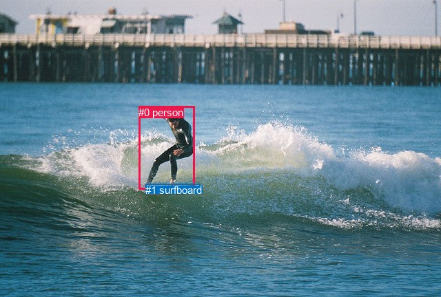
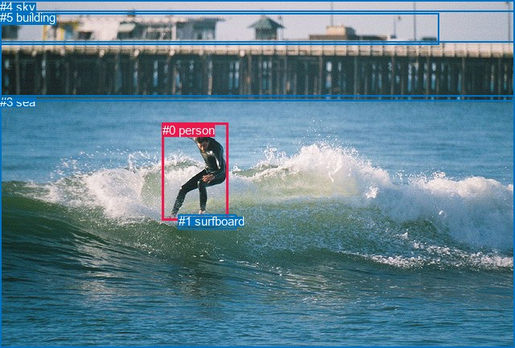

# 图片 0323：2328089.jpg

随机样本序号：128。图片 SHA256：`ae5de19a43ae50fe4b201a98fd8380dfdf6457011b3dca1fd112b8ce3a5c6bfa`。

红色框表示人，蓝色框表示其他物体。两个模式分别保留自身框编号，可依据位置比较对应对象。

## 自动检测框与输出

人的框编号：`[0]`。状态：`ok`。

### 自动检测全部物体框

| 编号 | 类别 | 是否为人 | 检测分数 | 像素坐标 xyxy |
|---|---|---|---|---|
| 0 | person | True | 0.9997 | 201.1, 154.9, 283.0, 275.0 |
| 1 | surfboard | False | 0.9869 | 211.4, 267.7, 290.5, 280.2 |

### 自动检测 Top50 人相关候选

评分物体对：2；人相关物体对：2；输出关系：4。

| 排名 | 主语编号与类别 | 关系 | 宾语编号与类别 | 类型 | 人与人 | 排序分数 | 原始融合 logit |
|---|---|---|---|---|---|---|---|
| 1 | #0 person | riding | #1 surfboard | semantic | False | 0.98644 | 4.2871 |
| 2 | #0 person | on | #1 surfboard | spatial | False | 0.57802 | 0.3147 |
| 3 | #1 surfboard | in | #0 person | spatial | False | 0.00127 | -6.6658 |
| 4 | #1 surfboard | holding | #0 person | semantic | False | 0.00039 | -7.8559 |

### 自动检测逐条人相关 GT 核验

R@50：25.00%；命中 1/4。

| GT 主语编号 | GT 关系 | GT 宾语编号 | 结果阶段 | 匹配预测主语编号 | 匹配预测宾语编号 |
|---|---|---|---|---|---|
| 0 | on | 1 | hit50 | [0] | [1] |
| 0 | standing on | 1 | wrong_predicate | [0] | [1] |
| 0 | playing | 1 | wrong_predicate | [0] | [1] |
| 0 | in front of | 5 | endpoint_missing_or_wrong_class | [0] | [] |

## 真实框与输出

人的框编号：`[0]`。

### 真实框全部物体框

| 编号 | 类别 | 是否为人 | 检测分数 | 像素坐标 xyxy |
|---|---|---|---|---|
| 0 | person | True | GT | 202.0, 153.0, 283.0, 274.0 |
| 1 | surfboard | False | GT | 222.0, 266.0, 294.0, 284.0 |
| 2 | house | False | GT | 0.0, 17.0, 545.0, 56.0 |
| 3 | sea | False | GT | 0.0, 118.0, 640.0, 432.0 |
| 4 | sky | False | GT | 0.0, 0.0, 640.0, 52.0 |
| 5 | building | False | GT | 0.0, 13.0, 640.0, 126.0 |

### 真实框 Top50 人相关候选

评分物体对：30；人相关物体对：10；输出关系：20。

| 排名 | 主语编号与类别 | 关系 | 宾语编号与类别 | 类型 | 人与人 | 排序分数 | 原始融合 logit |
|---|---|---|---|---|---|---|---|
| 1 | #0 person | riding | #1 surfboard | semantic | False | 0.99203 | 4.8238 |
| 2 | #0 person | in | #3 sea | spatial | False | 0.98421 | 4.1327 |
| 3 | #0 person | on | #1 surfboard | spatial | False | 0.98165 | 3.9795 |
| 4 | #0 person | riding | #3 sea | semantic | False | 0.89062 | 2.0970 |
| 5 | #3 sea | beside | #0 person | spatial | False | 0.40029 | -0.4042 |
| 6 | #4 sky | over | #0 person | spatial | False | 0.29192 | -0.8861 |
| 7 | #0 person | in | #4 sky | spatial | False | 0.28196 | -0.9348 |
| 8 | #1 surfboard | in | #0 person | spatial | False | 0.23953 | -1.1553 |
| 9 | #0 person | in front of | #5 building | spatial | False | 0.20874 | -1.3325 |
| 10 | #1 surfboard | holding | #0 person | semantic | False | 0.19020 | -1.4487 |
| 11 | #3 sea | catching | #0 person | semantic | False | 0.16791 | -1.6005 |
| 12 | #5 building | looking at | #0 person | semantic | False | 0.15409 | -1.7029 |
| 13 | #5 building | beside | #0 person | spatial | False | 0.14681 | -1.7598 |
| 14 | #0 person | looking at | #5 building | semantic | False | 0.09494 | -2.2547 |
| 15 | #0 person | playing | #4 sky | semantic | False | 0.06221 | -2.7131 |
| 16 | #2 house | looking at | #0 person | semantic | False | 0.05063 | -2.9312 |
| 17 | #4 sky | flying over | #0 person | semantic | False | 0.03772 | -3.2391 |
| 18 | #0 person | in | #2 house | spatial | False | 0.03266 | -3.3884 |
| 19 | #2 house | over | #0 person | spatial | False | 0.02577 | -3.6324 |
| 20 | #0 person | looking at | #2 house | semantic | False | 0.01728 | -4.0405 |

### 真实框逐条人相关 GT 核验

R@50：50.00%；命中 2/4。

| GT 主语编号 | GT 关系 | GT 宾语编号 | 结果阶段 | 匹配预测主语编号 | 匹配预测宾语编号 |
|---|---|---|---|---|---|
| 0 | on | 1 | hit50 | [0] | [1] |
| 0 | standing on | 1 | wrong_predicate | [0] | [1] |
| 0 | playing | 1 | wrong_predicate | [0] | [1] |
| 0 | in front of | 5 | hit50 | [0] | [5] |

## 全部人相关 GT

| 主语编号与类别 | 关系 | 宾语编号与类别 |
|---|---|---|
| #0 person | on | #1 surfboard |
| #0 person | standing on | #1 surfboard |
| #0 person | playing | #1 surfboard |
| #0 person | in front of | #5 building |

原始记录、全部人相关物体对的两项预测与分项分数见 [逐图证据 JSON](../evidence/cases/0323.json)。全部56类 logits 保留于本机 HOR/output/random500/logits/。

<!-- HOR_COMPLETE_RESULTS -->

## 六组条件的完整输出对照

以下保留同一图片三种框与候选模式、两种谓词输出规则的全部 Top50。框编号各自在所属模式内解释。

### 自动检测框完整枚举：空间与语义各保留一个谓词

| 排名 | 主语编号与类别 | 谓词 | 宾语编号与类别 | 分组 | 排序分数 | predicate logit | pair logit |
|---|---|---|---|---|---|---|---|
| 1 | #0 person | riding | #1 surfboard | semantic | 0.9864416 | 3.8627028 | 0.4243923 |
| 2 | #0 person | on | #1 surfboard | spatial | 0.5780242 | -0.1097245 | 0.4243923 |
| 3 | #1 surfboard | in | #0 person | spatial | 0.0012721 | -5.8471951 | -0.8186417 |
| 4 | #1 surfboard | holding | #0 person | semantic | 0.0003873 | -7.0372152 | -0.8186417 |

GT 命中：1/4，R@50=25.00%。

| GT主语 | GT谓词 | GT宾语 | 结果阶段 | 匹配主语框 | 匹配宾语框 |
|---|---|---|---|---|---|
| 0 | on | 1 | hit50 | [0] | [1] |
| 0 | standing on | 1 | wrong_predicate | [0] | [1] |
| 0 | playing | 1 | wrong_predicate | [0] | [1] |
| 0 | in front of | 5 | endpoint_missing_or_wrong_class | [0] | [] |

### 自动检测框完整枚举：每对只保留一个谓词

| 排名 | 主语编号与类别 | 谓词 | 宾语编号与类别 | 分组 | 排序分数 | predicate logit | pair logit |
|---|---|---|---|---|---|---|---|
| 1 | #0 person | riding | #1 surfboard | single | 0.9864416 | 3.8627028 | 0.4243923 |
| 2 | #1 surfboard | in | #0 person | single | 0.0012721 | -5.8471951 | -0.8186417 |

GT 命中：0/4，R@50=0.00%。

| GT主语 | GT谓词 | GT宾语 | 结果阶段 | 匹配主语框 | 匹配宾语框 |
|---|---|---|---|---|---|
| 0 | on | 1 | wrong_predicate | [0] | [1] |
| 0 | standing on | 1 | wrong_predicate | [0] | [1] |
| 0 | playing | 1 | wrong_predicate | [0] | [1] |
| 0 | in front of | 5 | endpoint_missing_or_wrong_class | [0] | [] |

### 真实框完整枚举：空间与语义各保留一个谓词

| 排名 | 主语编号与类别 | 谓词 | 宾语编号与类别 | 分组 | 排序分数 | predicate logit | pair logit |
|---|---|---|---|---|---|---|---|
| 1 | #0 person | riding | #1 surfboard | semantic | 0.9920279 | 4.4215713 | 0.4022398 |
| 2 | #0 person | in | #3 sea | spatial | 0.9842130 | 3.9980063 | 0.1346488 |
| 3 | #0 person | on | #1 surfboard | spatial | 0.9816474 | 3.5772204 | 0.4022398 |
| 4 | #0 person | riding | #3 sea | semantic | 0.8906157 | 1.9623976 | 0.1346488 |
| 5 | #3 sea | beside | #0 person | spatial | 0.4002925 | 0.5592799 | -0.9635264 |
| 6 | #4 sky | over | #0 person | spatial | 0.2919166 | 0.0955901 | -0.9816837 |
| 7 | #0 person | in | #4 sky | spatial | 0.2819582 | 0.2883444 | -1.2231133 |
| 8 | #1 surfboard | in | #0 person | spatial | 0.2395289 | -0.3172445 | -0.8380197 |
| 9 | #0 person | in front of | #5 building | spatial | 0.2087445 | -0.1135101 | -1.2189999 |
| 10 | #1 surfboard | holding | #0 person | semantic | 0.1901975 | -0.6107078 | -0.8380197 |
| 11 | #3 sea | catching | #0 person | semantic | 0.1679138 | -0.6369586 | -0.9635264 |
| 12 | #5 building | looking at | #0 person | semantic | 0.1540865 | -1.1896076 | -0.5132953 |
| 13 | #5 building | beside | #0 person | spatial | 0.1468143 | -1.2465131 | -0.5132953 |
| 14 | #0 person | looking at | #5 building | semantic | 0.0949432 | -1.0357192 | -1.2189999 |
| 15 | #0 person | playing | #4 sky | semantic | 0.0622070 | -1.4899478 | -1.2231133 |
| 16 | #2 house | looking at | #0 person | semantic | 0.0506350 | -2.0394835 | -0.8916675 |
| 17 | #4 sky | flying over | #0 person | semantic | 0.0377213 | -2.2573950 | -0.9816837 |
| 18 | #0 person | in | #2 house | spatial | 0.0326591 | -1.8363593 | -1.5520694 |
| 19 | #2 house | over | #0 person | spatial | 0.0257709 | -2.7407317 | -0.8916675 |
| 20 | #0 person | looking at | #2 house | semantic | 0.0172841 | -2.4884663 | -1.5520694 |

GT 命中：2/4，R@50=50.00%。

| GT主语 | GT谓词 | GT宾语 | 结果阶段 | 匹配主语框 | 匹配宾语框 |
|---|---|---|---|---|---|
| 0 | on | 1 | hit50 | [0] | [1] |
| 0 | standing on | 1 | wrong_predicate | [0] | [1] |
| 0 | playing | 1 | wrong_predicate | [0] | [1] |
| 0 | in front of | 5 | hit50 | [0] | [5] |

### 真实框完整枚举：每对只保留一个谓词

| 排名 | 主语编号与类别 | 谓词 | 宾语编号与类别 | 分组 | 排序分数 | predicate logit | pair logit |
|---|---|---|---|---|---|---|---|
| 1 | #0 person | riding | #1 surfboard | single | 0.9920279 | 4.4215713 | 0.4022398 |
| 2 | #0 person | in | #3 sea | single | 0.9842130 | 3.9980063 | 0.1346488 |
| 3 | #3 sea | beside | #0 person | single | 0.4002925 | 0.5592799 | -0.9635264 |
| 4 | #4 sky | over | #0 person | single | 0.2919166 | 0.0955901 | -0.9816837 |
| 5 | #0 person | in | #4 sky | single | 0.2819582 | 0.2883444 | -1.2231133 |
| 6 | #1 surfboard | in | #0 person | single | 0.2395289 | -0.3172445 | -0.8380197 |
| 7 | #0 person | in front of | #5 building | single | 0.2087445 | -0.1135101 | -1.2189999 |
| 8 | #5 building | looking at | #0 person | single | 0.1540865 | -1.1896076 | -0.5132953 |
| 9 | #2 house | looking at | #0 person | single | 0.0506350 | -2.0394835 | -0.8916675 |
| 10 | #0 person | in | #2 house | single | 0.0326591 | -1.8363593 | -1.5520694 |

GT 命中：1/4，R@50=25.00%。

| GT主语 | GT谓词 | GT宾语 | 结果阶段 | 匹配主语框 | 匹配宾语框 |
|---|---|---|---|---|---|
| 0 | on | 1 | wrong_predicate | [0] | [1] |
| 0 | standing on | 1 | wrong_predicate | [0] | [1] |
| 0 | playing | 1 | wrong_predicate | [0] | [1] |
| 0 | in front of | 5 | hit50 | [0] | [5] |

### 真实框400候选：空间与语义各保留一个谓词

| 排名 | 主语编号与类别 | 谓词 | 宾语编号与类别 | 分组 | 排序分数 | predicate logit | pair logit |
|---|---|---|---|---|---|---|---|
| 1 | #0 person | riding | #1 surfboard | semantic | 0.9920279 | 4.4215713 | 0.4022398 |
| 2 | #0 person | in | #3 sea | spatial | 0.9842130 | 3.9980063 | 0.1346488 |
| 3 | #0 person | on | #1 surfboard | spatial | 0.9816474 | 3.5772204 | 0.4022398 |
| 4 | #0 person | riding | #3 sea | semantic | 0.8876740 | 1.9325504 | 0.1346488 |
| 5 | #3 sea | beside | #0 person | spatial | 0.4002925 | 0.5592799 | -0.9635264 |
| 6 | #4 sky | over | #0 person | spatial | 0.2976222 | 0.1230373 | -0.9816837 |
| 7 | #0 person | in | #4 sky | spatial | 0.2812868 | 0.2850256 | -1.2231133 |
| 8 | #1 surfboard | in | #0 person | spatial | 0.2401339 | -0.3139257 | -0.8380197 |
| 9 | #0 person | in front of | #5 building | spatial | 0.2086433 | -0.1141229 | -1.2189999 |
| 10 | #1 surfboard | holding | #0 person | semantic | 0.1939501 | -0.5865250 | -0.8380197 |
| 11 | #3 sea | catching | #0 person | semantic | 0.1679138 | -0.6369586 | -0.9635264 |
| 12 | #5 building | looking at | #0 person | semantic | 0.1560579 | -1.1745617 | -0.5132953 |
| 13 | #5 building | beside | #0 person | spatial | 0.1486980 | -1.2315543 | -0.5132953 |
| 14 | #0 person | looking at | #5 building | semantic | 0.0936286 | -1.0511134 | -1.2189999 |
| 15 | #0 person | playing | #4 sky | semantic | 0.0629474 | -1.4773259 | -1.2231133 |
| 16 | #2 house | looking at | #0 person | semantic | 0.0506517 | -2.0391352 | -0.8916675 |
| 17 | #4 sky | flying over | #0 person | semantic | 0.0382713 | -2.2423496 | -0.9816837 |
| 18 | #0 person | in | #2 house | spatial | 0.0321564 | -1.8523905 | -1.5520694 |
| 19 | #2 house | over | #0 person | spatial | 0.0257709 | -2.7407317 | -0.8916675 |
| 20 | #0 person | looking at | #2 house | semantic | 0.0163050 | -2.5477774 | -1.5520694 |

GT 命中：2/4，R@50=50.00%。

| GT主语 | GT谓词 | GT宾语 | 结果阶段 | 匹配主语框 | 匹配宾语框 |
|---|---|---|---|---|---|
| 0 | on | 1 | hit50 | [0] | [1] |
| 0 | standing on | 1 | wrong_predicate | [0] | [1] |
| 0 | playing | 1 | wrong_predicate | [0] | [1] |
| 0 | in front of | 5 | hit50 | [0] | [5] |

### 真实框400候选：每对只保留一个谓词

| 排名 | 主语编号与类别 | 谓词 | 宾语编号与类别 | 分组 | 排序分数 | predicate logit | pair logit |
|---|---|---|---|---|---|---|---|
| 1 | #0 person | riding | #1 surfboard | single | 0.9920279 | 4.4215713 | 0.4022398 |
| 2 | #0 person | in | #3 sea | single | 0.9842130 | 3.9980063 | 0.1346488 |
| 3 | #3 sea | beside | #0 person | single | 0.4002925 | 0.5592799 | -0.9635264 |
| 4 | #4 sky | over | #0 person | single | 0.2976222 | 0.1230373 | -0.9816837 |
| 5 | #0 person | in | #4 sky | single | 0.2812868 | 0.2850256 | -1.2231133 |
| 6 | #1 surfboard | in | #0 person | single | 0.2401339 | -0.3139257 | -0.8380197 |
| 7 | #0 person | in front of | #5 building | single | 0.2086433 | -0.1141229 | -1.2189999 |
| 8 | #5 building | looking at | #0 person | single | 0.1560579 | -1.1745617 | -0.5132953 |
| 9 | #2 house | looking at | #0 person | single | 0.0506517 | -2.0391352 | -0.8916675 |
| 10 | #0 person | in | #2 house | single | 0.0321564 | -1.8523905 | -1.5520694 |

GT 命中：1/4，R@50=25.00%。

| GT主语 | GT谓词 | GT宾语 | 结果阶段 | 匹配主语框 | 匹配宾语框 |
|---|---|---|---|---|---|
| 0 | on | 1 | wrong_predicate | [0] | [1] |
| 0 | standing on | 1 | wrong_predicate | [0] | [1] |
| 0 | playing | 1 | wrong_predicate | [0] | [1] |
| 0 | in front of | 5 | hit50 | [0] | [5] |
