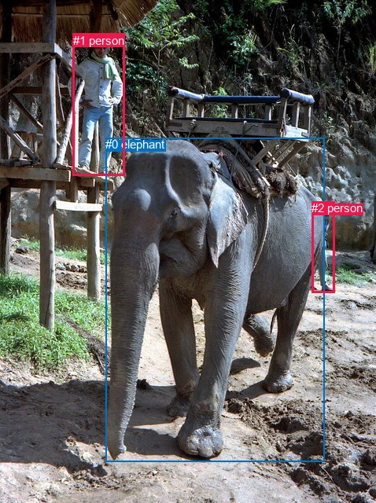
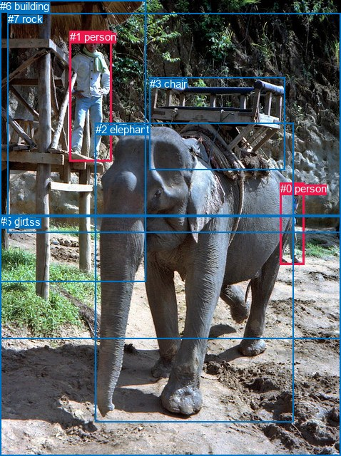

# 图片 0325：2328153.jpg

随机样本序号：184。图片 SHA256：`d86467a75ad39f01f62aa5335f77430f3f769e40da2f76d2dee08544470ade53`。

红色框表示人，蓝色框表示其他物体。两个模式分别保留自身框编号，可依据位置比较对应对象。

## 自动检测框与输出

人的框编号：`[1, 2]`。状态：`ok`。

### 自动检测全部物体框

| 编号 | 类别 | 是否为人 | 检测分数 | 像素坐标 xyxy |
|---|---|---|---|---|
| 0 | elephant | False | 0.9997 | 134.0, 175.2, 412.2, 587.4 |
| 1 | person | True | 0.9981 | 92.9, 42.6, 159.0, 223.0 |
| 2 | person | True | 0.9945 | 396.0, 256.4, 425.2, 372.5 |

### 自动检测 Top50 人相关候选

评分物体对：6；人相关物体对：6；输出关系：12。

| 排名 | 主语编号与类别 | 关系 | 宾语编号与类别 | 类型 | 人与人 | 排序分数 | 原始融合 logit |
|---|---|---|---|---|---|---|---|
| 1 | #2 person | beside | #0 elephant | spatial | False | 0.98157 | 3.9751 |
| 2 | #2 person | walking on | #0 elephant | semantic | False | 0.97481 | 3.6557 |
| 3 | #1 person | looking at | #0 elephant | semantic | False | 0.97163 | 3.5337 |
| 4 | #0 elephant | beside | #2 person | spatial | False | 0.96291 | 3.2566 |
| 5 | #0 elephant | walking on | #2 person | semantic | False | 0.95541 | 3.0646 |
| 6 | #1 person | beside | #0 elephant | spatial | False | 0.91497 | 2.3758 |
| 7 | #2 person | looking at | #1 person | semantic | True | 0.86438 | 1.8521 |
| 8 | #0 elephant | walking on | #1 person | semantic | False | 0.83901 | 1.6509 |
| 9 | #0 elephant | beside | #1 person | spatial | False | 0.83882 | 1.6495 |
| 10 | #2 person | beside | #1 person | spatial | True | 0.64146 | 0.5817 |
| 11 | #1 person | looking at | #2 person | semantic | True | 0.61042 | 0.4491 |
| 12 | #1 person | in front of | #2 person | spatial | True | 0.09094 | -2.3022 |

### 自动检测逐条人相关 GT 核验

R@50：33.33%；命中 1/3。

| GT 主语编号 | GT 关系 | GT 宾语编号 | 结果阶段 | 匹配预测主语编号 | 匹配预测宾语编号 |
|---|---|---|---|---|---|
| 1 | looking at | 2 | hit50 | [1] | [0] |
| 1 | standing on | 6 | endpoint_missing_or_wrong_class | [1] | [] |
| 2 | in front of | 0 | wrong_predicate | [0] | [2] |

## 真实框与输出

人的框编号：`[0, 1]`。

### 真实框全部物体框

| 编号 | 类别 | 是否为人 | 检测分数 | 像素坐标 xyxy |
|---|---|---|---|---|
| 0 | person | True | GT | 393.0, 256.0, 427.0, 371.0 |
| 1 | person | True | GT | 98.0, 43.0, 157.0, 227.0 |
| 2 | elephant | False | GT | 134.0, 173.0, 412.0, 592.0 |
| 3 | chair | False | GT | 210.0, 109.0, 400.0, 239.0 |
| 4 | grass | False | GT | 0.0, 303.0, 478.0, 475.0 |
| 5 | dirt | False | GT | 0.0, 302.0, 478.0, 640.0 |
| 6 | building | False | GT | 0.0, 0.0, 205.0, 395.0 |
| 7 | rock | False | GT | 11.0, 18.0, 478.0, 327.0 |

### 真实框 Top50 人相关候选

评分物体对：56；人相关物体对：26；输出关系：50。

| 排名 | 主语编号与类别 | 关系 | 宾语编号与类别 | 类型 | 人与人 | 排序分数 | 原始融合 logit |
|---|---|---|---|---|---|---|---|
| 1 | #1 person | standing on | #6 building | semantic | False | 0.98755 | 4.3732 |
| 2 | #0 person | walking on | #5 dirt | semantic | False | 0.98430 | 4.1382 |
| 3 | #1 person | looking at | #2 elephant | semantic | False | 0.98231 | 4.0172 |
| 4 | #0 person | walking on | #4 grass | semantic | False | 0.97938 | 3.8607 |
| 5 | #1 person | leaning on | #6 building | spatial | False | 0.96931 | 3.4527 |
| 6 | #0 person | walking on | #2 elephant | semantic | False | 0.95442 | 3.0416 |
| 7 | #0 person | beside | #2 elephant | spatial | False | 0.94615 | 2.8662 |
| 8 | #0 person | walking on | #7 rock | semantic | False | 0.92436 | 2.5031 |
| 9 | #1 person | beside | #2 elephant | spatial | False | 0.91050 | 2.3198 |
| 10 | #0 person | on | #5 dirt | spatial | False | 0.88123 | 2.0041 |
| 11 | #0 person | on | #4 grass | spatial | False | 0.87660 | 1.9607 |
| 12 | #0 person | walking on | #6 building | semantic | False | 0.83254 | 1.6038 |
| 13 | #0 person | in | #7 rock | spatial | False | 0.78888 | 1.3182 |
| 14 | #1 person | standing on | #5 dirt | semantic | False | 0.70212 | 0.8574 |
| 15 | #1 person | leaning on | #7 rock | spatial | False | 0.69471 | 0.8223 |
| 16 | #1 person | standing on | #7 rock | semantic | False | 0.68474 | 0.7757 |
| 17 | #0 person | looking at | #1 person | semantic | True | 0.66488 | 0.6851 |
| 18 | #1 person | standing on | #3 chair | semantic | False | 0.65897 | 0.6587 |
| 19 | #0 person | beside | #6 building | spatial | False | 0.64306 | 0.5887 |
| 20 | #1 person | standing on | #4 grass | semantic | False | 0.60239 | 0.4154 |
| 21 | #1 person | on | #3 chair | spatial | False | 0.53437 | 0.1377 |
| 22 | #2 elephant | beside | #0 person | spatial | False | 0.44875 | -0.2057 |
| 23 | #1 person | on | #5 dirt | spatial | False | 0.42626 | -0.2971 |
| 24 | #1 person | on | #4 grass | spatial | False | 0.37349 | -0.5173 |
| 25 | #1 person | looking at | #0 person | semantic | True | 0.32590 | -0.7268 |
| 26 | #7 rock | beside | #1 person | spatial | False | 0.31997 | -0.7539 |
| 27 | #2 elephant | beside | #1 person | spatial | False | 0.30585 | -0.8196 |
| 28 | #6 building | beside | #1 person | spatial | False | 0.27463 | -0.9713 |
| 29 | #0 person | beside | #3 chair | spatial | False | 0.26003 | -1.0458 |
| 30 | #0 person | walking on | #3 chair | semantic | False | 0.23216 | -1.1962 |
| 31 | #0 person | beside | #1 person | spatial | True | 0.17708 | -1.5362 |
| 32 | #1 person | beside | #0 person | spatial | True | 0.15569 | -1.6907 |
| 33 | #6 building | holding | #1 person | semantic | False | 0.12638 | -1.9334 |
| 34 | #2 elephant | walking on | #0 person | semantic | False | 0.10205 | -2.1746 |
| 35 | #2 elephant | looking at | #1 person | semantic | False | 0.07588 | -2.4997 |
| 36 | #7 rock | beside | #0 person | spatial | False | 0.07473 | -2.5162 |
| 37 | #3 chair | beside | #1 person | spatial | False | 0.06678 | -2.6372 |
| 38 | #6 building | beside | #0 person | spatial | False | 0.05675 | -2.8108 |
| 39 | #4 grass | beside | #1 person | spatial | False | 0.05371 | -2.8689 |
| 40 | #4 grass | beside | #0 person | spatial | False | 0.04449 | -3.0669 |
| 41 | #7 rock | looking at | #1 person | semantic | False | 0.04226 | -3.1207 |
| 42 | #3 chair | holding | #1 person | semantic | False | 0.02784 | -3.5530 |
| 43 | #5 dirt | in | #0 person | spatial | False | 0.01387 | -4.2642 |
| 44 | #7 rock | looking at | #0 person | semantic | False | 0.01143 | -4.4596 |
| 45 | #5 dirt | in | #1 person | spatial | False | 0.01091 | -4.5071 |
| 46 | #3 chair | beside | #0 person | spatial | False | 0.00949 | -4.6476 |
| 47 | #4 grass | holding | #0 person | semantic | False | 0.00876 | -4.7291 |
| 48 | #4 grass | holding | #1 person | semantic | False | 0.00850 | -4.7592 |
| 49 | #5 dirt | holding | #0 person | semantic | False | 0.00724 | -4.9206 |
| 50 | #6 building | holding | #0 person | semantic | False | 0.00572 | -5.1580 |

### 真实框逐条人相关 GT 核验

R@50：66.67%；命中 2/3。

| GT 主语编号 | GT 关系 | GT 宾语编号 | 结果阶段 | 匹配预测主语编号 | 匹配预测宾语编号 |
|---|---|---|---|---|---|
| 1 | looking at | 2 | hit50 | [1] | [2] |
| 1 | standing on | 6 | hit50 | [1] | [6] |
| 2 | in front of | 0 | wrong_predicate | [2] | [0] |

## 全部人相关 GT

| 主语编号与类别 | 关系 | 宾语编号与类别 |
|---|---|---|
| #1 person | looking at | #2 elephant |
| #1 person | standing on | #6 building |
| #2 elephant | in front of | #0 person |

原始记录、全部人相关物体对的两项预测与分项分数见 [逐图证据 JSON](../evidence/cases/0325.json)。全部56类 logits 保留于本机 HOR/output/random500/logits/。

<!-- HOR_COMPLETE_RESULTS -->

## 六组条件的完整输出对照

以下保留同一图片三种框与候选模式、两种谓词输出规则的全部 Top50。框编号各自在所属模式内解释。

### 自动检测框完整枚举：空间与语义各保留一个谓词

| 排名 | 主语编号与类别 | 谓词 | 宾语编号与类别 | 分组 | 排序分数 | predicate logit | pair logit |
|---|---|---|---|---|---|---|---|
| 1 | #2 person | beside | #0 elephant | spatial | 0.9815678 | 3.7075849 | 0.2674700 |
| 2 | #2 person | walking on | #0 elephant | semantic | 0.9748087 | 3.3882709 | 0.2674700 |
| 3 | #1 person | looking at | #0 elephant | semantic | 0.9716323 | 3.3355079 | 0.1982176 |
| 4 | #0 elephant | beside | #2 person | spatial | 0.9629110 | 4.3657184 | -1.1090794 |
| 5 | #0 elephant | walking on | #2 person | semantic | 0.9554076 | 4.1736550 | -1.1090794 |
| 6 | #1 person | beside | #0 elephant | spatial | 0.9149657 | 2.1776152 | 0.1982176 |
| 7 | #2 person | looking at | #1 person | semantic | 0.8643763 | 2.3659635 | -0.5138388 |
| 8 | #0 elephant | walking on | #1 person | semantic | 0.8390113 | 2.5908184 | -0.9399290 |
| 9 | #0 elephant | beside | #1 person | spatial | 0.8388207 | 2.5894084 | -0.9399290 |
| 10 | #2 person | beside | #1 person | spatial | 0.6414596 | 1.0955439 | -0.5138388 |
| 11 | #1 person | looking at | #2 person | semantic | 0.6104172 | 1.3351912 | -0.8861247 |
| 12 | #1 person | in front of | #2 person | spatial | 0.0909374 | -1.4161177 | -0.8861247 |

GT 命中：1/3，R@50=33.33%。

| GT主语 | GT谓词 | GT宾语 | 结果阶段 | 匹配主语框 | 匹配宾语框 |
|---|---|---|---|---|---|
| 1 | looking at | 2 | hit50 | [1] | [0] |
| 1 | standing on | 6 | endpoint_missing_or_wrong_class | [1] | [] |
| 2 | in front of | 0 | wrong_predicate | [0] | [2] |

### 自动检测框完整枚举：每对只保留一个谓词

| 排名 | 主语编号与类别 | 谓词 | 宾语编号与类别 | 分组 | 排序分数 | predicate logit | pair logit |
|---|---|---|---|---|---|---|---|
| 1 | #2 person | beside | #0 elephant | single | 0.9815678 | 3.7075849 | 0.2674700 |
| 2 | #1 person | looking at | #0 elephant | single | 0.9716323 | 3.3355079 | 0.1982176 |
| 3 | #0 elephant | beside | #2 person | single | 0.9629110 | 4.3657184 | -1.1090794 |
| 4 | #2 person | looking at | #1 person | single | 0.8643763 | 2.3659635 | -0.5138388 |
| 5 | #0 elephant | walking on | #1 person | single | 0.8390113 | 2.5908184 | -0.9399290 |
| 6 | #1 person | looking at | #2 person | single | 0.6104172 | 1.3351912 | -0.8861247 |

GT 命中：1/3，R@50=33.33%。

| GT主语 | GT谓词 | GT宾语 | 结果阶段 | 匹配主语框 | 匹配宾语框 |
|---|---|---|---|---|---|
| 1 | looking at | 2 | hit50 | [1] | [0] |
| 1 | standing on | 6 | endpoint_missing_or_wrong_class | [1] | [] |
| 2 | in front of | 0 | wrong_predicate | [0] | [2] |

### 真实框完整枚举：空间与语义各保留一个谓词

| 排名 | 主语编号与类别 | 谓词 | 宾语编号与类别 | 分组 | 排序分数 | predicate logit | pair logit |
|---|---|---|---|---|---|---|---|
| 1 | #1 person | standing on | #6 building | semantic | 0.9875460 | 4.1770892 | 0.1960956 |
| 2 | #0 person | walking on | #5 dirt | semantic | 0.9842992 | 4.2308812 | -0.0926625 |
| 3 | #1 person | looking at | #2 elephant | semantic | 0.9823143 | 3.8476472 | 0.1695094 |
| 4 | #0 person | walking on | #4 grass | semantic | 0.9793801 | 3.9961734 | -0.1355090 |
| 5 | #1 person | leaning on | #6 building | spatial | 0.9693120 | 3.2566175 | 0.1960956 |
| 6 | #0 person | walking on | #2 elephant | semantic | 0.9544172 | 2.8075476 | 0.2340209 |
| 7 | #0 person | beside | #2 elephant | spatial | 0.9461523 | 2.6322222 | 0.2340209 |
| 8 | #0 person | walking on | #7 rock | semantic | 0.9243597 | 2.6059270 | -0.1028151 |
| 9 | #1 person | beside | #2 elephant | spatial | 0.9104996 | 2.1502414 | 0.1695094 |
| 10 | #0 person | on | #5 dirt | spatial | 0.8812260 | 2.0967536 | -0.0926625 |
| 11 | #0 person | on | #4 grass | spatial | 0.8766050 | 2.0961747 | -0.1355090 |
| 12 | #0 person | walking on | #6 building | semantic | 0.8325438 | 2.2057090 | -0.6019442 |
| 13 | #0 person | in | #7 rock | spatial | 0.7888771 | 1.4209857 | -0.1028151 |
| 14 | #1 person | standing on | #5 dirt | semantic | 0.7021206 | 1.4798932 | -0.6224765 |
| 15 | #1 person | leaning on | #7 rock | spatial | 0.6947150 | 1.2419877 | -0.4197320 |
| 16 | #1 person | standing on | #7 rock | semantic | 0.6847448 | 1.1953955 | -0.4197320 |
| 17 | #0 person | looking at | #1 person | semantic | 0.6648811 | 1.2135630 | -0.5284401 |
| 18 | #1 person | standing on | #3 chair | semantic | 0.6589724 | 1.3501391 | -0.6914209 |
| 19 | #0 person | beside | #6 building | spatial | 0.6430608 | 1.1906180 | -0.6019442 |
| 20 | #1 person | standing on | #4 grass | semantic | 0.6023874 | 1.1789799 | -0.7635574 |
| 21 | #1 person | on | #3 chair | spatial | 0.5343726 | 0.8291283 | -0.6914209 |
| 22 | #2 elephant | beside | #0 person | spatial | 0.4487473 | 0.9173679 | -1.1231011 |
| 23 | #1 person | on | #5 dirt | spatial | 0.4262643 | 0.3253675 | -0.6224765 |
| 24 | #1 person | on | #4 grass | spatial | 0.3734874 | 0.2462726 | -0.7635574 |
| 25 | #1 person | looking at | #0 person | semantic | 0.3259038 | 0.1358566 | -0.8626273 |
| 26 | #7 rock | beside | #1 person | spatial | 0.3199679 | 0.1362381 | -0.8901573 |
| 27 | #2 elephant | beside | #1 person | spatial | 0.3058465 | 0.1350241 | -0.9546339 |
| 28 | #6 building | beside | #1 person | spatial | 0.2746269 | -0.1004725 | -0.8708000 |
| 29 | #0 person | beside | #3 chair | spatial | 0.2600334 | -0.1339469 | -0.9118483 |
| 30 | #0 person | walking on | #3 chair | semantic | 0.2321592 | -0.2843108 | -0.9118483 |
| 31 | #0 person | beside | #1 person | spatial | 0.1770836 | -1.0077927 | -0.5284401 |
| 32 | #1 person | beside | #0 person | spatial | 0.1556900 | -0.8280258 | -0.8626273 |
| 33 | #6 building | holding | #1 person | semantic | 0.1263763 | -1.0625854 | -0.8708000 |
| 34 | #2 elephant | walking on | #0 person | semantic | 0.1020503 | -1.0515468 | -1.1231011 |
| 35 | #2 elephant | looking at | #1 person | semantic | 0.0758789 | -1.5450699 | -0.9546339 |
| 36 | #7 rock | beside | #0 person | spatial | 0.0747305 | -1.1882823 | -1.3279146 |
| 37 | #3 chair | beside | #1 person | spatial | 0.0667811 | -1.1887453 | -1.4484752 |
| 38 | #6 building | beside | #0 person | spatial | 0.0567450 | -0.9797292 | -1.8310394 |
| 39 | #4 grass | beside | #1 person | spatial | 0.0537110 | -1.4274945 | -1.4414358 |
| 40 | #4 grass | beside | #0 person | spatial | 0.0444946 | -1.5475702 | -1.5193019 |
| 41 | #7 rock | looking at | #1 person | semantic | 0.0422614 | -2.2305446 | -0.8901573 |
| 42 | #3 chair | holding | #1 person | semantic | 0.0278411 | -2.1045310 | -1.4484752 |
| 43 | #5 dirt | in | #0 person | spatial | 0.0138687 | -2.6033850 | -1.6607726 |
| 44 | #7 rock | looking at | #0 person | semantic | 0.0114344 | -3.1317132 | -1.3279146 |
| 45 | #5 dirt | in | #1 person | spatial | 0.0109101 | -2.9200161 | -1.5870821 |
| 46 | #3 chair | beside | #0 person | spatial | 0.0094932 | -2.8883367 | -1.7593029 |
| 47 | #4 grass | holding | #0 person | semantic | 0.0087569 | -3.2098107 | -1.5193019 |
| 48 | #4 grass | holding | #1 person | semantic | 0.0084997 | -3.3177524 | -1.4414358 |
| 49 | #5 dirt | holding | #0 person | semantic | 0.0072420 | -3.2598155 | -1.6607726 |
| 50 | #6 building | holding | #0 person | semantic | 0.0057201 | -3.3269944 | -1.8310394 |

GT 命中：2/3，R@50=66.67%。

| GT主语 | GT谓词 | GT宾语 | 结果阶段 | 匹配主语框 | 匹配宾语框 |
|---|---|---|---|---|---|
| 1 | looking at | 2 | hit50 | [1] | [2] |
| 1 | standing on | 6 | hit50 | [1] | [6] |
| 2 | in front of | 0 | wrong_predicate | [2] | [0] |

### 真实框完整枚举：每对只保留一个谓词

| 排名 | 主语编号与类别 | 谓词 | 宾语编号与类别 | 分组 | 排序分数 | predicate logit | pair logit |
|---|---|---|---|---|---|---|---|
| 1 | #1 person | standing on | #6 building | single | 0.9875460 | 4.1770892 | 0.1960956 |
| 2 | #0 person | walking on | #5 dirt | single | 0.9842992 | 4.2308812 | -0.0926625 |
| 3 | #1 person | looking at | #2 elephant | single | 0.9823143 | 3.8476472 | 0.1695094 |
| 4 | #0 person | walking on | #4 grass | single | 0.9793801 | 3.9961734 | -0.1355090 |
| 5 | #0 person | walking on | #2 elephant | single | 0.9544172 | 2.8075476 | 0.2340209 |
| 6 | #0 person | walking on | #7 rock | single | 0.9243597 | 2.6059270 | -0.1028151 |
| 7 | #0 person | walking on | #6 building | single | 0.8325438 | 2.2057090 | -0.6019442 |
| 8 | #1 person | standing on | #5 dirt | single | 0.7021206 | 1.4798932 | -0.6224765 |
| 9 | #1 person | leaning on | #7 rock | single | 0.6947150 | 1.2419877 | -0.4197320 |
| 10 | #0 person | looking at | #1 person | single | 0.6648811 | 1.2135630 | -0.5284401 |
| 11 | #1 person | standing on | #3 chair | single | 0.6589724 | 1.3501391 | -0.6914209 |
| 12 | #1 person | standing on | #4 grass | single | 0.6023874 | 1.1789799 | -0.7635574 |
| 13 | #2 elephant | beside | #0 person | single | 0.4487473 | 0.9173679 | -1.1231011 |
| 14 | #1 person | looking at | #0 person | single | 0.3259038 | 0.1358566 | -0.8626273 |
| 15 | #7 rock | beside | #1 person | single | 0.3199679 | 0.1362381 | -0.8901573 |
| 16 | #2 elephant | beside | #1 person | single | 0.3058465 | 0.1350241 | -0.9546339 |
| 17 | #6 building | beside | #1 person | single | 0.2746269 | -0.1004725 | -0.8708000 |
| 18 | #0 person | beside | #3 chair | single | 0.2600334 | -0.1339469 | -0.9118483 |
| 19 | #7 rock | beside | #0 person | single | 0.0747305 | -1.1882823 | -1.3279146 |
| 20 | #3 chair | beside | #1 person | single | 0.0667811 | -1.1887453 | -1.4484752 |
| 21 | #6 building | beside | #0 person | single | 0.0567450 | -0.9797292 | -1.8310394 |
| 22 | #4 grass | beside | #1 person | single | 0.0537110 | -1.4274945 | -1.4414358 |
| 23 | #4 grass | beside | #0 person | single | 0.0444946 | -1.5475702 | -1.5193019 |
| 24 | #5 dirt | in | #0 person | single | 0.0138687 | -2.6033850 | -1.6607726 |
| 25 | #5 dirt | in | #1 person | single | 0.0109101 | -2.9200161 | -1.5870821 |
| 26 | #3 chair | beside | #0 person | single | 0.0094932 | -2.8883367 | -1.7593029 |

GT 命中：2/3，R@50=66.67%。

| GT主语 | GT谓词 | GT宾语 | 结果阶段 | 匹配主语框 | 匹配宾语框 |
|---|---|---|---|---|---|
| 1 | looking at | 2 | hit50 | [1] | [2] |
| 1 | standing on | 6 | hit50 | [1] | [6] |
| 2 | in front of | 0 | wrong_predicate | [2] | [0] |

### 真实框400候选：空间与语义各保留一个谓词

| 排名 | 主语编号与类别 | 谓词 | 宾语编号与类别 | 分组 | 排序分数 | predicate logit | pair logit |
|---|---|---|---|---|---|---|---|
| 1 | #1 person | standing on | #6 building | semantic | 0.9875460 | 4.1770892 | 0.1960956 |
| 2 | #0 person | walking on | #5 dirt | semantic | 0.9842526 | 4.2278714 | -0.0926625 |
| 3 | #1 person | looking at | #2 elephant | semantic | 0.9823264 | 3.8483443 | 0.1695094 |
| 4 | #0 person | walking on | #4 grass | semantic | 0.9793801 | 3.9961734 | -0.1355090 |
| 5 | #1 person | leaning on | #6 building | spatial | 0.9693120 | 3.2566175 | 0.1960956 |
| 6 | #0 person | looking at | #2 elephant | semantic | 0.9555968 | 2.8350039 | 0.2340209 |
| 7 | #0 person | beside | #2 elephant | spatial | 0.9476592 | 2.6621976 | 0.2340209 |
| 8 | #0 person | walking on | #7 rock | semantic | 0.9241489 | 2.6029162 | -0.1028151 |
| 9 | #1 person | beside | #2 elephant | spatial | 0.9104996 | 2.1502414 | 0.1695094 |
| 10 | #0 person | on | #5 dirt | spatial | 0.8812260 | 2.0967536 | -0.0926625 |
| 11 | #0 person | on | #4 grass | spatial | 0.8766050 | 2.0961747 | -0.1355090 |
| 12 | #0 person | walking on | #6 building | semantic | 0.8325438 | 2.2057090 | -0.6019442 |
| 13 | #0 person | in | #7 rock | spatial | 0.7883239 | 1.4176669 | -0.1028151 |
| 14 | #1 person | standing on | #5 dirt | semantic | 0.7021206 | 1.4798932 | -0.6224765 |
| 15 | #1 person | leaning on | #7 rock | spatial | 0.6947150 | 1.2419877 | -0.4197320 |
| 16 | #1 person | standing on | #7 rock | semantic | 0.6847448 | 1.1953955 | -0.4197320 |
| 17 | #0 person | looking at | #1 person | semantic | 0.6647258 | 1.2128658 | -0.5284401 |
| 18 | #1 person | standing on | #3 chair | semantic | 0.6538422 | 1.3273921 | -0.6914209 |
| 19 | #0 person | beside | #6 building | spatial | 0.6499113 | 1.2205935 | -0.6019442 |
| 20 | #1 person | standing on | #4 grass | semantic | 0.5951583 | 1.1488886 | -0.7635574 |
| 21 | #1 person | on | #3 chair | spatial | 0.5370811 | 0.8400178 | -0.6914209 |
| 22 | #2 elephant | beside | #0 person | spatial | 0.4413014 | 0.8872190 | -1.1231011 |
| 23 | #1 person | on | #5 dirt | spatial | 0.4262643 | 0.3253675 | -0.6224765 |
| 24 | #1 person | on | #4 grass | spatial | 0.3626559 | 0.1997023 | -0.7635574 |
| 25 | #1 person | looking at | #0 person | semantic | 0.3257505 | 0.1351590 | -0.8626273 |
| 26 | #7 rock | beside | #1 person | spatial | 0.3199553 | 0.1361804 | -0.8901573 |
| 27 | #2 elephant | beside | #1 person | spatial | 0.3058527 | 0.1350532 | -0.9546339 |
| 28 | #6 building | beside | #1 person | spatial | 0.2746269 | -0.1004725 | -0.8708000 |
| 29 | #0 person | beside | #3 chair | spatial | 0.2658708 | -0.1038260 | -0.9118483 |
| 30 | #0 person | walking on | #3 chair | semantic | 0.2326963 | -0.2813001 | -0.9118483 |
| 31 | #0 person | beside | #1 person | spatial | 0.1770836 | -1.0077927 | -0.5284401 |
| 32 | #1 person | beside | #0 person | spatial | 0.1517735 | -0.8581314 | -0.8626273 |
| 33 | #6 building | holding | #1 person | semantic | 0.1240511 | -1.0838139 | -0.8708000 |
| 34 | #2 elephant | walking on | #0 person | semantic | 0.1006799 | -1.0665925 | -1.1231011 |
| 35 | #2 elephant | looking at | #1 person | semantic | 0.0758789 | -1.5450699 | -0.9546339 |
| 36 | #7 rock | beside | #0 person | spatial | 0.0757780 | -1.1732297 | -1.3279146 |
| 37 | #3 chair | beside | #1 person | spatial | 0.0677240 | -1.1737139 | -1.4484752 |
| 38 | #6 building | beside | #0 person | spatial | 0.0559468 | -0.9947422 | -1.8310394 |
| 39 | #4 grass | beside | #1 person | spatial | 0.0537073 | -1.4275670 | -1.4414358 |
| 40 | #4 grass | beside | #0 person | spatial | 0.0444928 | -1.5476136 | -1.5193019 |
| 41 | #7 rock | looking at | #1 person | semantic | 0.0422614 | -2.2305446 | -0.8901573 |
| 42 | #3 chair | holding | #1 person | semantic | 0.0278711 | -2.1034231 | -1.4484752 |
| 43 | #5 dirt | in | #0 person | spatial | 0.0140113 | -2.5930066 | -1.6607726 |
| 44 | #7 rock | looking at | #0 person | semantic | 0.0116893 | -3.1094065 | -1.3279146 |
| 45 | #5 dirt | in | #1 person | spatial | 0.0109101 | -2.9200161 | -1.5870821 |
| 46 | #3 chair | beside | #0 person | spatial | 0.0098535 | -2.8507228 | -1.7593029 |
| 47 | #4 grass | holding | #0 person | semantic | 0.0087030 | -3.2160411 | -1.5193019 |
| 48 | #4 grass | holding | #1 person | semantic | 0.0084919 | -3.3186755 | -1.4414358 |
| 49 | #5 dirt | holding | #0 person | semantic | 0.0073295 | -3.2477241 | -1.6607726 |
| 50 | #5 dirt | holding | #1 person | semantic | 0.0057891 | -3.5588915 | -1.5870821 |

GT 命中：2/3，R@50=66.67%。

| GT主语 | GT谓词 | GT宾语 | 结果阶段 | 匹配主语框 | 匹配宾语框 |
|---|---|---|---|---|---|
| 1 | looking at | 2 | hit50 | [1] | [2] |
| 1 | standing on | 6 | hit50 | [1] | [6] |
| 2 | in front of | 0 | wrong_predicate | [2] | [0] |

### 真实框400候选：每对只保留一个谓词

| 排名 | 主语编号与类别 | 谓词 | 宾语编号与类别 | 分组 | 排序分数 | predicate logit | pair logit |
|---|---|---|---|---|---|---|---|
| 1 | #1 person | standing on | #6 building | single | 0.9875460 | 4.1770892 | 0.1960956 |
| 2 | #0 person | walking on | #5 dirt | single | 0.9842526 | 4.2278714 | -0.0926625 |
| 3 | #1 person | looking at | #2 elephant | single | 0.9823264 | 3.8483443 | 0.1695094 |
| 4 | #0 person | walking on | #4 grass | single | 0.9793801 | 3.9961734 | -0.1355090 |
| 5 | #0 person | looking at | #2 elephant | single | 0.9555968 | 2.8350039 | 0.2340209 |
| 6 | #0 person | walking on | #7 rock | single | 0.9241489 | 2.6029162 | -0.1028151 |
| 7 | #0 person | walking on | #6 building | single | 0.8325438 | 2.2057090 | -0.6019442 |
| 8 | #1 person | standing on | #5 dirt | single | 0.7021206 | 1.4798932 | -0.6224765 |
| 9 | #1 person | leaning on | #7 rock | single | 0.6947150 | 1.2419877 | -0.4197320 |
| 10 | #0 person | looking at | #1 person | single | 0.6647258 | 1.2128658 | -0.5284401 |
| 11 | #1 person | standing on | #3 chair | single | 0.6538422 | 1.3273921 | -0.6914209 |
| 12 | #1 person | standing on | #4 grass | single | 0.5951583 | 1.1488886 | -0.7635574 |
| 13 | #2 elephant | beside | #0 person | single | 0.4413014 | 0.8872190 | -1.1231011 |
| 14 | #1 person | looking at | #0 person | single | 0.3257505 | 0.1351590 | -0.8626273 |
| 15 | #7 rock | beside | #1 person | single | 0.3199553 | 0.1361804 | -0.8901573 |
| 16 | #2 elephant | beside | #1 person | single | 0.3058527 | 0.1350532 | -0.9546339 |
| 17 | #6 building | beside | #1 person | single | 0.2746269 | -0.1004725 | -0.8708000 |
| 18 | #0 person | beside | #3 chair | single | 0.2658708 | -0.1038260 | -0.9118483 |
| 19 | #7 rock | beside | #0 person | single | 0.0757780 | -1.1732297 | -1.3279146 |
| 20 | #3 chair | beside | #1 person | single | 0.0677240 | -1.1737139 | -1.4484752 |
| 21 | #6 building | beside | #0 person | single | 0.0559468 | -0.9947422 | -1.8310394 |
| 22 | #4 grass | beside | #1 person | single | 0.0537073 | -1.4275670 | -1.4414358 |
| 23 | #4 grass | beside | #0 person | single | 0.0444928 | -1.5476136 | -1.5193019 |
| 24 | #5 dirt | in | #0 person | single | 0.0140113 | -2.5930066 | -1.6607726 |
| 25 | #5 dirt | in | #1 person | single | 0.0109101 | -2.9200161 | -1.5870821 |
| 26 | #3 chair | beside | #0 person | single | 0.0098535 | -2.8507228 | -1.7593029 |

GT 命中：2/3，R@50=66.67%。

| GT主语 | GT谓词 | GT宾语 | 结果阶段 | 匹配主语框 | 匹配宾语框 |
|---|---|---|---|---|---|
| 1 | looking at | 2 | hit50 | [1] | [2] |
| 1 | standing on | 6 | hit50 | [1] | [6] |
| 2 | in front of | 0 | wrong_predicate | [2] | [0] |
