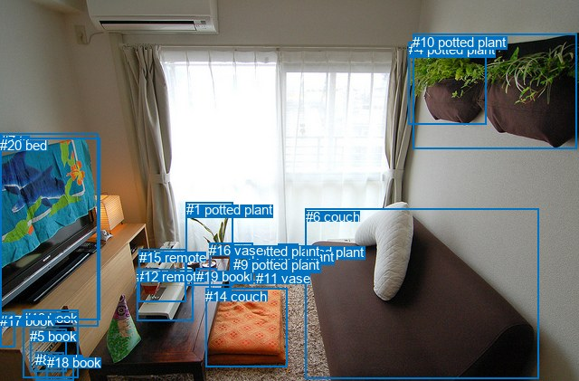
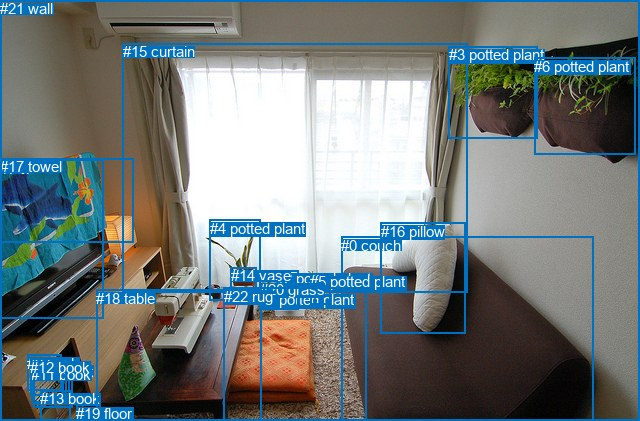

# 图片 0339：2328737.jpg

随机样本序号：17。图片 SHA256：`66afd33bb79d40a43a8486acafb399b524a6c49b17f694aa1daa8f697aec70a1`。

红色框表示人，蓝色框表示其他物体。两个模式分别保留自身框编号，可依据位置比较对应对象。

## 自动检测框与输出

人的框编号：`[]`。状态：`no_person`。

### 自动检测全部物体框

| 编号 | 类别 | 是否为人 | 检测分数 | 像素坐标 xyxy |
|---|---|---|---|---|
| 0 | potted plant | False | 0.9920 | 307.3, 270.0, 329.8, 305.8 |
| 1 | potted plant | False | 0.9892 | 205.5, 223.1, 257.9, 315.6 |
| 2 | potted plant | False | 0.9685 | 273.7, 275.4, 300.5, 311.8 |
| 3 | potted plant | False | 0.9412 | 257.8, 268.6, 279.7, 313.7 |
| 4 | potted plant | False | 0.9192 | 451.8, 46.1, 537.1, 137.4 |
| 5 | book | False | 0.8969 | 33.4, 363.4, 73.7, 410.8 |
| 6 | couch | False | 0.8251 | 337.9, 230.6, 595.4, 418.5 |
| 7 | tv | False | 0.8020 | 1.0, 147.2, 108.8, 360.4 |
| 8 | book | False | 0.7714 | 39.5, 389.3, 70.2, 420.2 |
| 9 | potted plant | False | 0.7592 | 258.2, 284.2, 274.8, 312.0 |
| 10 | potted plant | False | 0.6302 | 456.4, 37.8, 638.0, 164.1 |
| 11 | vase | False | 0.5036 | 283.0, 299.2, 294.4, 309.5 |
| 12 | remote | False | 0.4993 | 151.2, 297.1, 213.0, 354.9 |
| 13 | book | False | 0.4895 | 26.0, 342.7, 86.0, 417.9 |
| 14 | couch | False | 0.4618 | 227.2, 318.6, 317.5, 405.2 |
| 15 | remote | False | 0.4354 | 153.9, 275.9, 205.1, 333.4 |
| 16 | vase | False | 0.4220 | 231.3, 268.3, 255.7, 320.6 |
| 17 | book | False | 0.4066 | 0.0, 345.6, 16.8, 383.8 |
| 18 | book | False | 0.3682 | 51.8, 392.1, 81.2, 420.6 |
| 19 | book | False | 0.3581 | 216.7, 296.9, 239.2, 309.4 |
| 20 | bed | False | 0.3537 | 0.0, 152.5, 110.9, 353.2 |

### 自动检测 Top50 人相关候选

评分物体对：0；人相关物体对：0；输出关系：0。

| 排名 | 主语编号与类别 | 关系 | 宾语编号与类别 | 类型 | 人与人 | 排序分数 | 原始融合 logit |
|---|---|---|---|---|---|---|---|

### 自动检测逐条人相关 GT 核验

本图没有人相关 GT，R@50 无分母；预测候选继续展示。

## 真实框与输出

人的框编号：`[]`。

### 真实框全部物体框

| 编号 | 类别 | 是否为人 | 检测分数 | 像素坐标 xyxy |
|---|---|---|---|---|
| 0 | couch | False | GT | 341.0, 237.0, 593.0, 421.0 |
| 1 | potted plant | False | GT | 259.0, 291.0, 275.0, 309.0 |
| 2 | potted plant | False | GT | 276.0, 270.0, 299.0, 309.0 |
| 3 | potted plant | False | GT | 449.0, 46.0, 538.0, 138.0 |
| 4 | potted plant | False | GT | 210.0, 220.0, 261.0, 301.0 |
| 5 | potted plant | False | GT | 310.0, 273.0, 330.0, 304.0 |
| 6 | potted plant | False | GT | 534.0, 58.0, 635.0, 155.0 |
| 7 | tv | False | GT | 0.0, 160.0, 103.0, 319.0 |
| 8 | book | False | GT | 34.0, 364.0, 70.0, 405.0 |
| 9 | book | False | GT | 27.0, 355.0, 61.0, 391.0 |
| 10 | book | False | GT | 34.0, 363.0, 73.0, 408.0 |
| 11 | book | False | GT | 31.0, 366.0, 64.0, 402.0 |
| 12 | book | False | GT | 30.0, 359.0, 66.0, 396.0 |
| 13 | book | False | GT | 40.0, 390.0, 70.0, 421.0 |
| 14 | vase | False | GT | 231.0, 267.0, 257.0, 301.0 |
| 15 | curtain | False | GT | 123.0, 43.0, 468.0, 293.0 |
| 16 | pillow | False | GT | 381.0, 223.0, 466.0, 334.0 |
| 17 | towel | False | GT | 0.0, 158.0, 133.0, 242.0 |
| 18 | table | False | GT | 96.0, 290.0, 261.0, 421.0 |
| 19 | floor | False | GT | 76.0, 405.0, 100.0, 421.0 |
| 20 | grass | False | GT | 260.0, 281.0, 278.0, 304.0 |
| 21 | wall | False | GT | 0.0, 0.0, 640.0, 421.0 |
| 22 | rug | False | GT | 224.0, 288.0, 367.0, 421.0 |

### 真实框 Top50 人相关候选

评分物体对：0；人相关物体对：0；输出关系：0。

| 排名 | 主语编号与类别 | 关系 | 宾语编号与类别 | 类型 | 人与人 | 排序分数 | 原始融合 logit |
|---|---|---|---|---|---|---|---|

### 真实框逐条人相关 GT 核验

本图没有人相关 GT，R@50 无分母；预测候选继续展示。

## 全部人相关 GT

| 主语编号与类别 | 关系 | 宾语编号与类别 |
|---|---|---|

原始记录、全部人相关物体对的两项预测与分项分数见 [逐图证据 JSON](../evidence/cases/0339.json)。全部56类 logits 保留于本机 HOR/output/random500/logits/。

<!-- HOR_COMPLETE_RESULTS -->

## 六组条件的完整输出对照

以下保留同一图片三种框与候选模式、两种谓词输出规则的全部 Top50。框编号各自在所属模式内解释。

### 自动检测框完整枚举：空间与语义各保留一个谓词

| 排名 | 主语编号与类别 | 谓词 | 宾语编号与类别 | 分组 | 排序分数 | predicate logit | pair logit |
|---|---|---|---|---|---|---|---|

没有人相关 GT，本条件的召回率无分母。

### 自动检测框完整枚举：每对只保留一个谓词

| 排名 | 主语编号与类别 | 谓词 | 宾语编号与类别 | 分组 | 排序分数 | predicate logit | pair logit |
|---|---|---|---|---|---|---|---|

没有人相关 GT，本条件的召回率无分母。

### 真实框完整枚举：空间与语义各保留一个谓词

| 排名 | 主语编号与类别 | 谓词 | 宾语编号与类别 | 分组 | 排序分数 | predicate logit | pair logit |
|---|---|---|---|---|---|---|---|

没有人相关 GT，本条件的召回率无分母。

### 真实框完整枚举：每对只保留一个谓词

| 排名 | 主语编号与类别 | 谓词 | 宾语编号与类别 | 分组 | 排序分数 | predicate logit | pair logit |
|---|---|---|---|---|---|---|---|

没有人相关 GT，本条件的召回率无分母。

### 真实框400候选：空间与语义各保留一个谓词

| 排名 | 主语编号与类别 | 谓词 | 宾语编号与类别 | 分组 | 排序分数 | predicate logit | pair logit |
|---|---|---|---|---|---|---|---|

没有人相关 GT，本条件的召回率无分母。

### 真实框400候选：每对只保留一个谓词

| 排名 | 主语编号与类别 | 谓词 | 宾语编号与类别 | 分组 | 排序分数 | predicate logit | pair logit |
|---|---|---|---|---|---|---|---|

没有人相关 GT，本条件的召回率无分母。
