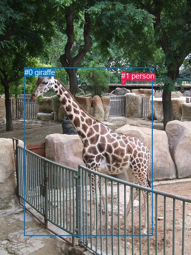
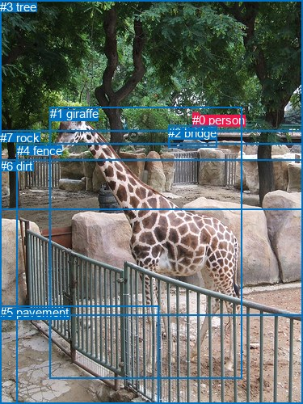

# 图片 0343：2328966.jpg

随机样本序号：318。图片 SHA256：`45f0c3ff2c7a8ff6ea3b6ae2f697e1e1254a729675d2d1c38439e36aae8c7f1b`。

红色框表示人，蓝色框表示其他物体。两个模式分别保留自身框编号，可依据位置比较对应对象。

## 自动检测框与输出

人的框编号：`[1]`。状态：`ok`。

### 自动检测全部物体框

| 编号 | 类别 | 是否为人 | 检测分数 | 像素坐标 xyxy |
|---|---|---|---|---|
| 0 | giraffe | False | 0.9992 | 47.9, 132.6, 299.4, 462.8 |
| 1 | person | True | 0.7035 | 238.0, 140.2, 245.3, 165.6 |

### 自动检测 Top50 人相关候选

评分物体对：2；人相关物体对：2；输出关系：4。

| 排名 | 主语编号与类别 | 关系 | 宾语编号与类别 | 类型 | 人与人 | 排序分数 | 原始融合 logit |
|---|---|---|---|---|---|---|---|
| 1 | #1 person | looking at | #0 giraffe | semantic | False | 0.93751 | 2.7083 |
| 2 | #1 person | on | #0 giraffe | spatial | False | 0.05555 | -2.8334 |
| 3 | #0 giraffe | beside | #1 person | spatial | False | 0.04114 | -3.1489 |
| 4 | #0 giraffe | looking at | #1 person | semantic | False | 0.00532 | -5.2316 |

### 自动检测逐条人相关 GT 核验

本图没有人相关 GT，R@50 无分母；预测候选继续展示。

## 真实框与输出

人的框编号：`[0]`。

### 真实框全部物体框

| 编号 | 类别 | 是否为人 | 检测分数 | 像素坐标 xyxy |
|---|---|---|---|---|
| 0 | person | True | GT | 238.0, 140.0, 246.0, 161.0 |
| 1 | giraffe | False | GT | 62.0, 132.0, 299.0, 468.0 |
| 2 | bridge | False | GT | 208.0, 156.0, 268.0, 183.0 |
| 3 | tree | False | GT | 0.0, 0.0, 375.0, 259.0 |
| 4 | fence | False | GT | 21.0, 178.0, 375.0, 500.0 |
| 5 | pavement | False | GT | 0.0, 378.0, 196.0, 500.0 |
| 6 | dirt | False | GT | 0.0, 197.0, 375.0, 390.0 |
| 7 | rock | False | GT | 0.0, 162.0, 375.0, 391.0 |

### 真实框 Top50 人相关候选

评分物体对：56；人相关物体对：14；输出关系：28。

| 排名 | 主语编号与类别 | 关系 | 宾语编号与类别 | 类型 | 人与人 | 排序分数 | 原始融合 logit |
|---|---|---|---|---|---|---|---|
| 1 | #0 person | riding | #2 bridge | semantic | False | 0.98781 | 4.3945 |
| 2 | #0 person | on | #2 bridge | spatial | False | 0.97378 | 3.6146 |
| 3 | #0 person | looking at | #1 giraffe | semantic | False | 0.96670 | 3.3684 |
| 4 | #0 person | in | #3 tree | spatial | False | 0.90961 | 2.3088 |
| 5 | #0 person | walking on | #3 tree | semantic | False | 0.82531 | 1.5527 |
| 6 | #2 bridge | holding | #0 person | semantic | False | 0.72483 | 0.9685 |
| 7 | #0 person | walking on | #7 rock | semantic | False | 0.62059 | 0.4920 |
| 8 | #2 bridge | on | #0 person | spatial | False | 0.60147 | 0.4116 |
| 9 | #0 person | walking on | #6 dirt | semantic | False | 0.49307 | -0.0277 |
| 10 | #0 person | walking on | #4 fence | semantic | False | 0.43073 | -0.2789 |
| 11 | #0 person | in | #7 rock | spatial | False | 0.38241 | -0.4793 |
| 12 | #0 person | on | #6 dirt | spatial | False | 0.30711 | -0.8137 |
| 13 | #0 person | on | #1 giraffe | spatial | False | 0.23650 | -1.1720 |
| 14 | #0 person | in | #4 fence | spatial | False | 0.21138 | -1.3166 |
| 15 | #0 person | walking on | #5 pavement | semantic | False | 0.19864 | -1.3948 |
| 16 | #1 giraffe | looking at | #0 person | semantic | False | 0.13661 | -1.8438 |
| 17 | #0 person | on | #5 pavement | spatial | False | 0.07786 | -2.4718 |
| 18 | #1 giraffe | in | #0 person | spatial | False | 0.06135 | -2.7278 |
| 19 | #3 tree | in | #0 person | spatial | False | 0.02741 | -3.5692 |
| 20 | #3 tree | holding | #0 person | semantic | False | 0.01696 | -4.0598 |
| 21 | #6 dirt | beside | #0 person | spatial | False | 0.01333 | -4.3042 |
| 22 | #7 rock | beside | #0 person | spatial | False | 0.01288 | -4.3391 |
| 23 | #4 fence | beside | #0 person | spatial | False | 0.00707 | -4.9441 |
| 24 | #4 fence | holding | #0 person | semantic | False | 0.00361 | -5.6208 |
| 25 | #7 rock | holding | #0 person | semantic | False | 0.00348 | -5.6558 |
| 26 | #6 dirt | holding | #0 person | semantic | False | 0.00330 | -5.7098 |
| 27 | #5 pavement | beside | #0 person | spatial | False | 0.00221 | -6.1108 |
| 28 | #5 pavement | holding | #0 person | semantic | False | 0.00122 | -6.7097 |

### 真实框逐条人相关 GT 核验

本图没有人相关 GT，R@50 无分母；预测候选继续展示。

## 全部人相关 GT

| 主语编号与类别 | 关系 | 宾语编号与类别 |
|---|---|---|

原始记录、全部人相关物体对的两项预测与分项分数见 [逐图证据 JSON](../evidence/cases/0343.json)。全部56类 logits 保留于本机 HOR/output/random500/logits/。

<!-- HOR_COMPLETE_RESULTS -->

## 六组条件的完整输出对照

以下保留同一图片三种框与候选模式、两种谓词输出规则的全部 Top50。框编号各自在所属模式内解释。

### 自动检测框完整枚举：空间与语义各保留一个谓词

| 排名 | 主语编号与类别 | 谓词 | 宾语编号与类别 | 分组 | 排序分数 | predicate logit | pair logit |
|---|---|---|---|---|---|---|---|
| 1 | #1 person | looking at | #0 giraffe | semantic | 0.9375121 | 3.0982637 | -0.3900067 |
| 2 | #1 person | on | #0 giraffe | spatial | 0.0555453 | -2.4434028 | -0.3900067 |
| 3 | #0 giraffe | beside | #1 person | spatial | 0.0411361 | -1.5429332 | -1.6059294 |
| 4 | #0 giraffe | looking at | #1 person | semantic | 0.0053163 | -3.6257126 | -1.6059294 |

没有人相关 GT，本条件的召回率无分母。

### 自动检测框完整枚举：每对只保留一个谓词

| 排名 | 主语编号与类别 | 谓词 | 宾语编号与类别 | 分组 | 排序分数 | predicate logit | pair logit |
|---|---|---|---|---|---|---|---|
| 1 | #1 person | looking at | #0 giraffe | single | 0.9375121 | 3.0982637 | -0.3900067 |
| 2 | #0 giraffe | beside | #1 person | single | 0.0411361 | -1.5429332 | -1.6059294 |

没有人相关 GT，本条件的召回率无分母。

### 真实框完整枚举：空间与语义各保留一个谓词

| 排名 | 主语编号与类别 | 谓词 | 宾语编号与类别 | 分组 | 排序分数 | predicate logit | pair logit |
|---|---|---|---|---|---|---|---|
| 1 | #0 person | riding | #2 bridge | semantic | 0.9878058 | 4.1284785 | 0.2660506 |
| 2 | #0 person | on | #2 bridge | spatial | 0.9737781 | 3.3485379 | 0.2660506 |
| 3 | #0 person | looking at | #1 giraffe | semantic | 0.9667026 | 3.7537789 | -0.3853680 |
| 4 | #0 person | in | #3 tree | spatial | 0.9096056 | 2.6157923 | -0.3069639 |
| 5 | #0 person | walking on | #3 tree | semantic | 0.8253097 | 1.8597083 | -0.3069639 |
| 6 | #2 bridge | holding | #0 person | semantic | 0.7248298 | 0.9625211 | 0.0060259 |
| 7 | #0 person | walking on | #7 rock | semantic | 0.6205853 | 1.1014199 | -0.6093866 |
| 8 | #2 bridge | on | #0 person | spatial | 0.6014688 | 0.4055629 | 0.0060259 |
| 9 | #0 person | walking on | #6 dirt | semantic | 0.4930726 | 0.7794476 | -0.8071588 |
| 10 | #0 person | walking on | #4 fence | semantic | 0.4307290 | 0.4364300 | -0.7153074 |
| 11 | #0 person | in | #7 rock | spatial | 0.3824104 | 0.1300569 | -0.6093866 |
| 12 | #0 person | on | #6 dirt | spatial | 0.3071102 | -0.0065055 | -0.8071588 |
| 13 | #0 person | on | #1 giraffe | spatial | 0.2364961 | -0.7866187 | -0.3853680 |
| 14 | #0 person | in | #4 fence | spatial | 0.2113799 | -0.6013203 | -0.7153074 |
| 15 | #0 person | walking on | #5 pavement | semantic | 0.1986403 | -0.1202374 | -1.2745770 |
| 16 | #1 giraffe | looking at | #0 person | semantic | 0.1366066 | -0.2470284 | -1.5967370 |
| 17 | #0 person | on | #5 pavement | spatial | 0.0778620 | -1.1971805 | -1.2745770 |
| 18 | #1 giraffe | in | #0 person | spatial | 0.0613550 | -1.1310236 | -1.5967370 |
| 19 | #3 tree | in | #0 person | spatial | 0.0274061 | -2.4189169 | -1.1502832 |
| 20 | #3 tree | holding | #0 person | semantic | 0.0169597 | -2.9095242 | -1.1502832 |
| 21 | #6 dirt | beside | #0 person | spatial | 0.0133317 | -2.8404098 | -1.4637792 |
| 22 | #7 rock | beside | #0 person | spatial | 0.0128808 | -2.8013806 | -1.5376695 |
| 23 | #4 fence | beside | #0 person | spatial | 0.0070747 | -3.2981014 | -1.6460246 |
| 24 | #4 fence | holding | #0 person | semantic | 0.0036086 | -3.9748094 | -1.6460246 |
| 25 | #7 rock | holding | #0 person | semantic | 0.0034849 | -4.1181545 | -1.5376695 |
| 26 | #6 dirt | holding | #0 person | semantic | 0.0033023 | -4.2460423 | -1.4637792 |
| 27 | #5 pavement | beside | #0 person | spatial | 0.0022139 | -3.8764734 | -2.2343116 |
| 28 | #5 pavement | holding | #0 person | semantic | 0.0012175 | -4.4754033 | -2.2343116 |

没有人相关 GT，本条件的召回率无分母。

### 真实框完整枚举：每对只保留一个谓词

| 排名 | 主语编号与类别 | 谓词 | 宾语编号与类别 | 分组 | 排序分数 | predicate logit | pair logit |
|---|---|---|---|---|---|---|---|
| 1 | #0 person | riding | #2 bridge | single | 0.9878058 | 4.1284785 | 0.2660506 |
| 2 | #0 person | looking at | #1 giraffe | single | 0.9667026 | 3.7537789 | -0.3853680 |
| 3 | #0 person | in | #3 tree | single | 0.9096056 | 2.6157923 | -0.3069639 |
| 4 | #2 bridge | holding | #0 person | single | 0.7248298 | 0.9625211 | 0.0060259 |
| 5 | #0 person | walking on | #7 rock | single | 0.6205853 | 1.1014199 | -0.6093866 |
| 6 | #0 person | walking on | #6 dirt | single | 0.4930726 | 0.7794476 | -0.8071588 |
| 7 | #0 person | walking on | #4 fence | single | 0.4307290 | 0.4364300 | -0.7153074 |
| 8 | #0 person | walking on | #5 pavement | single | 0.1986403 | -0.1202374 | -1.2745770 |
| 9 | #1 giraffe | looking at | #0 person | single | 0.1366066 | -0.2470284 | -1.5967370 |
| 10 | #3 tree | in | #0 person | single | 0.0274061 | -2.4189169 | -1.1502832 |
| 11 | #6 dirt | beside | #0 person | single | 0.0133317 | -2.8404098 | -1.4637792 |
| 12 | #7 rock | beside | #0 person | single | 0.0128808 | -2.8013806 | -1.5376695 |
| 13 | #4 fence | beside | #0 person | single | 0.0070747 | -3.2981014 | -1.6460246 |
| 14 | #5 pavement | beside | #0 person | single | 0.0022139 | -3.8764734 | -2.2343116 |

没有人相关 GT，本条件的召回率无分母。

### 真实框400候选：空间与语义各保留一个谓词

| 排名 | 主语编号与类别 | 谓词 | 宾语编号与类别 | 分组 | 排序分数 | predicate logit | pair logit |
|---|---|---|---|---|---|---|---|
| 1 | #0 person | riding | #2 bridge | semantic | 0.9878088 | 4.1287227 | 0.2660506 |
| 2 | #0 person | on | #2 bridge | spatial | 0.9737781 | 3.3485379 | 0.2660506 |
| 3 | #0 person | looking at | #1 giraffe | semantic | 0.9666800 | 3.7530818 | -0.3853680 |
| 4 | #0 person | in | #3 tree | spatial | 0.9096056 | 2.6157923 | -0.3069639 |
| 5 | #0 person | walking on | #3 tree | semantic | 0.8213710 | 1.8326278 | -0.3069639 |
| 6 | #2 bridge | holding | #0 person | semantic | 0.7236497 | 0.9566126 | 0.0060259 |
| 7 | #0 person | walking on | #7 rock | semantic | 0.6141884 | 1.0743394 | -0.6093866 |
| 8 | #2 bridge | on | #0 person | spatial | 0.6014688 | 0.4055629 | 0.0060259 |
| 9 | #0 person | walking on | #6 dirt | semantic | 0.4998423 | 0.8065281 | -0.8071588 |
| 10 | #0 person | walking on | #4 fence | semantic | 0.4167694 | 0.3792577 | -0.7153074 |
| 11 | #0 person | in | #7 rock | spatial | 0.3816269 | 0.1267381 | -0.6093866 |
| 12 | #0 person | on | #6 dirt | spatial | 0.3123797 | 0.0181413 | -0.8071588 |
| 13 | #0 person | on | #1 giraffe | spatial | 0.2364961 | -0.7866187 | -0.3853680 |
| 14 | #0 person | in | #4 fence | spatial | 0.2058642 | -0.6347303 | -0.7153074 |
| 15 | #0 person | walking on | #5 pavement | semantic | 0.2029862 | -0.0931568 | -1.2745770 |
| 16 | #1 giraffe | looking at | #0 person | semantic | 0.1366477 | -0.2466798 | -1.5967370 |
| 17 | #0 person | on | #5 pavement | spatial | 0.0783520 | -1.1903744 | -1.2745770 |
| 18 | #1 giraffe | in | #0 person | spatial | 0.0611641 | -1.1343424 | -1.5967370 |
| 19 | #3 tree | in | #0 person | spatial | 0.0277093 | -2.4076049 | -1.1502832 |
| 20 | #3 tree | holding | #0 person | semantic | 0.0169474 | -2.9102631 | -1.1502832 |
| 21 | #7 rock | beside | #0 person | spatial | 0.0130727 | -2.7863984 | -1.5376695 |
| 22 | #6 dirt | beside | #0 person | spatial | 0.0128461 | -2.8780093 | -1.4637792 |
| 23 | #4 fence | beside | #0 person | spatial | 0.0071813 | -3.2830412 | -1.6460246 |
| 24 | #4 fence | holding | #0 person | semantic | 0.0036631 | -3.9597638 | -1.6460246 |
| 25 | #7 rock | holding | #0 person | semantic | 0.0034900 | -4.1166773 | -1.5376695 |
| 26 | #6 dirt | holding | #0 person | semantic | 0.0032241 | -4.2700877 | -1.4637792 |
| 27 | #5 pavement | beside | #0 person | spatial | 0.0021566 | -3.9027598 | -2.2343116 |
| 28 | #5 pavement | holding | #0 person | semantic | 0.0012030 | -4.4874258 | -2.2343116 |

没有人相关 GT，本条件的召回率无分母。

### 真实框400候选：每对只保留一个谓词

| 排名 | 主语编号与类别 | 谓词 | 宾语编号与类别 | 分组 | 排序分数 | predicate logit | pair logit |
|---|---|---|---|---|---|---|---|
| 1 | #0 person | riding | #2 bridge | single | 0.9878088 | 4.1287227 | 0.2660506 |
| 2 | #0 person | looking at | #1 giraffe | single | 0.9666800 | 3.7530818 | -0.3853680 |
| 3 | #0 person | in | #3 tree | single | 0.9096056 | 2.6157923 | -0.3069639 |
| 4 | #2 bridge | holding | #0 person | single | 0.7236497 | 0.9566126 | 0.0060259 |
| 5 | #0 person | walking on | #7 rock | single | 0.6141884 | 1.0743394 | -0.6093866 |
| 6 | #0 person | walking on | #6 dirt | single | 0.4998423 | 0.8065281 | -0.8071588 |
| 7 | #0 person | walking on | #4 fence | single | 0.4167694 | 0.3792577 | -0.7153074 |
| 8 | #0 person | walking on | #5 pavement | single | 0.2029862 | -0.0931568 | -1.2745770 |
| 9 | #1 giraffe | looking at | #0 person | single | 0.1366477 | -0.2466798 | -1.5967370 |
| 10 | #3 tree | in | #0 person | single | 0.0277093 | -2.4076049 | -1.1502832 |
| 11 | #7 rock | beside | #0 person | single | 0.0130727 | -2.7863984 | -1.5376695 |
| 12 | #6 dirt | beside | #0 person | single | 0.0128461 | -2.8780093 | -1.4637792 |
| 13 | #4 fence | beside | #0 person | single | 0.0071813 | -3.2830412 | -1.6460246 |
| 14 | #5 pavement | beside | #0 person | single | 0.0021566 | -3.9027598 | -2.2343116 |

没有人相关 GT，本条件的召回率无分母。
