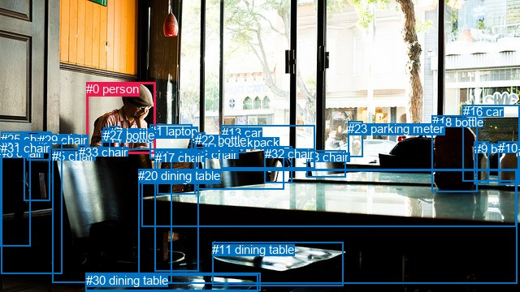
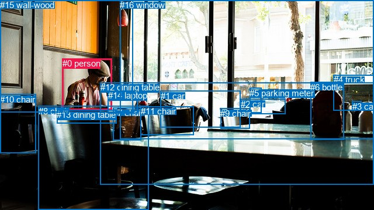

# 图片 0361：2329834.jpg

随机样本序号：427。图片 SHA256：`259fb73d152522fb39114a5f861e97a8bebae0c0c4811f37efa233dd276b4d4f`。

红色框表示人，蓝色框表示其他物体。两个模式分别保留自身框编号，可依据位置比较对应对象。

## 自动检测框与输出

人的框编号：`[0]`。状态：`ok`。

### 自动检测全部物体框

| 编号 | 类别 | 是否为人 | 检测分数 | 像素坐标 xyxy |
|---|---|---|---|---|
| 0 | person | True | 0.9964 | 106.3, 101.3, 191.8, 189.5 |
| 1 | laptop | False | 0.9896 | 184.3, 153.1, 236.5, 195.1 |
| 2 | chair | False | 0.9874 | 240.5, 181.7, 349.9, 233.6 |
| 3 | chair | False | 0.9854 | 377.3, 185.1, 425.4, 218.5 |
| 4 | chair | False | 0.9851 | 193.2, 183.2, 240.4, 239.1 |
| 5 | chair | False | 0.9451 | 64.4, 183.8, 211.7, 348.7 |
| 6 | dining table | False | 0.9444 | 174.5, 209.5, 635.4, 279.3 |
| 7 | bottle | False | 0.9321 | 134.7, 155.2, 147.2, 188.5 |
| 8 | chair | False | 0.9098 | 0.0, 180.2, 37.7, 303.9 |
| 9 | bottle | False | 0.9041 | 583.8, 175.0, 601.7, 226.6 |
| 10 | bottle | False | 0.8918 | 613.2, 174.5, 639.6, 227.7 |
| 11 | dining table | False | 0.8876 | 261.3, 298.8, 422.1, 352.2 |
| 12 | bottle | False | 0.8724 | 240.0, 163.3, 251.3, 186.0 |
| 13 | car | False | 0.8317 | 272.9, 154.7, 387.9, 207.6 |
| 14 | bottle | False | 0.8157 | 125.9, 161.6, 135.4, 189.4 |
| 15 | chair | False | 0.8111 | 29.4, 163.0, 61.5, 247.3 |
| 16 | car | False | 0.8067 | 569.9, 129.4, 639.8, 223.1 |
| 17 | chair | False | 0.7281 | 190.6, 185.6, 245.0, 334.6 |
| 18 | bottle | False | 0.7195 | 531.8, 142.3, 587.6, 236.6 |
| 19 | backpack | False | 0.6463 | 251.5, 166.8, 302.6, 188.1 |
| 20 | dining table | False | 0.6441 | 170.4, 208.0, 636.8, 349.5 |
| 21 | chair | False | 0.6089 | 33.7, 162.5, 62.7, 197.7 |
| 22 | bottle | False | 0.5993 | 239.6, 163.7, 252.1, 223.5 |
| 23 | parking meter | False | 0.5899 | 428.5, 150.0, 446.8, 193.4 |
| 24 | chair | False | 0.5831 | 105.2, 338.8, 318.0, 360.0 |
| 25 | chair | False | 0.5610 | 1.2, 162.9, 32.0, 173.7 |
| 26 | bottle | False | 0.5307 | 637.7, 178.1, 640.0, 226.0 |
| 27 | bottle | False | 0.5182 | 127.4, 157.7, 133.4, 175.7 |
| 28 | chair | False | 0.4938 | 0.0, 172.8, 30.1, 187.6 |
| 29 | chair | False | 0.4746 | 47.2, 163.6, 63.1, 182.7 |
| 30 | dining table | False | 0.4349 | 105.7, 336.5, 320.9, 358.9 |
| 31 | chair | False | 0.3763 | 1.3, 174.0, 76.9, 337.5 |
| 32 | chair | False | 0.3665 | 325.6, 180.7, 359.9, 225.2 |
| 33 | chair | False | 0.3505 | 96.7, 178.5, 110.1, 190.7 |

### 自动检测 Top50 人相关候选

评分物体对：1122；人相关物体对：66；输出关系：50。

| 排名 | 主语编号与类别 | 关系 | 宾语编号与类别 | 类型 | 人与人 | 排序分数 | 原始融合 logit |
|---|---|---|---|---|---|---|---|
| 1 | #0 person | holding | #7 bottle | semantic | False | 0.98298 | 4.0561 |
| 2 | #0 person | drinking | #14 bottle | semantic | False | 0.98086 | 3.9366 |
| 3 | #0 person | holding | #27 bottle | semantic | False | 0.97700 | 3.7491 |
| 4 | #0 person | drinking | #33 chair | semantic | False | 0.94892 | 2.9218 |
| 5 | #0 person | sitting on | #5 chair | semantic | False | 0.93580 | 2.6793 |
| 6 | #0 person | looking at | #1 laptop | semantic | False | 0.93567 | 2.6773 |
| 7 | #0 person | sitting on | #15 chair | semantic | False | 0.91106 | 2.3267 |
| 8 | #0 person | sitting on | #4 chair | semantic | False | 0.89185 | 2.1098 |
| 9 | #0 person | on | #1 laptop | spatial | False | 0.86257 | 1.8368 |
| 10 | #0 person | sitting on | #31 chair | semantic | False | 0.81561 | 1.4869 |
| 11 | #0 person | on | #7 bottle | spatial | False | 0.81274 | 1.4679 |
| 12 | #0 person | on | #27 bottle | spatial | False | 0.80772 | 1.4353 |
| 13 | #0 person | sitting on | #20 dining table | semantic | False | 0.78209 | 1.2779 |
| 14 | #0 person | on | #14 bottle | spatial | False | 0.77287 | 1.2246 |
| 15 | #0 person | sitting on | #17 chair | semantic | False | 0.75708 | 1.1367 |
| 16 | #0 person | sitting on | #8 chair | semantic | False | 0.70543 | 0.8733 |
| 17 | #0 person | sitting on | #6 dining table | semantic | False | 0.68061 | 0.7566 |
| 18 | #0 person | on | #5 chair | spatial | False | 0.67001 | 0.7082 |
| 19 | #0 person | on | #33 chair | spatial | False | 0.63006 | 0.5325 |
| 20 | #0 person | leaning on | #4 chair | spatial | False | 0.62478 | 0.5099 |
| 21 | #0 person | beside | #20 dining table | spatial | False | 0.60778 | 0.4380 |
| 22 | #0 person | leaning on | #15 chair | spatial | False | 0.55666 | 0.2276 |
| 23 | #23 parking meter | looking at | #0 person | semantic | False | 0.54025 | 0.1613 |
| 24 | #0 person | on | #6 dining table | spatial | False | 0.52092 | 0.0837 |
| 25 | #7 bottle | on | #0 person | spatial | False | 0.49733 | -0.0107 |
| 26 | #0 person | sitting on | #21 chair | semantic | False | 0.48897 | -0.0441 |
| 27 | #1 laptop | beside | #0 person | spatial | False | 0.43600 | -0.2574 |
| 28 | #0 person | in | #17 chair | spatial | False | 0.40482 | -0.3854 |
| 29 | #27 bottle | on | #0 person | spatial | False | 0.38371 | -0.4738 |
| 30 | #0 person | in | #31 chair | spatial | False | 0.35272 | -0.6071 |
| 31 | #14 bottle | on | #0 person | spatial | False | 0.35118 | -0.6139 |
| 32 | #13 car | beside | #0 person | spatial | False | 0.34087 | -0.6594 |
| 33 | #0 person | sitting on | #28 chair | semantic | False | 0.34063 | -0.6605 |
| 34 | #0 person | sitting on | #2 chair | semantic | False | 0.26776 | -1.0060 |
| 35 | #0 person | looking at | #13 car | semantic | False | 0.26117 | -1.0399 |
| 36 | #14 bottle | holding | #0 person | semantic | False | 0.25606 | -1.0665 |
| 37 | #7 bottle | holding | #0 person | semantic | False | 0.23773 | -1.1652 |
| 38 | #0 person | sitting on | #29 chair | semantic | False | 0.22183 | -1.2550 |
| 39 | #0 person | wearing | #32 chair | semantic | False | 0.22107 | -1.2594 |
| 40 | #0 person | beside | #13 car | spatial | False | 0.21785 | -1.2782 |
| 41 | #0 person | leaning on | #21 chair | spatial | False | 0.20484 | -1.3563 |
| 42 | #33 chair | on | #0 person | spatial | False | 0.20294 | -1.3680 |
| 43 | #0 person | leaning on | #8 chair | spatial | False | 0.18228 | -1.5010 |
| 44 | #0 person | wearing | #19 backpack | semantic | False | 0.17576 | -1.5454 |
| 45 | #21 chair | beside | #0 person | spatial | False | 0.17514 | -1.5497 |
| 46 | #33 chair | holding | #0 person | semantic | False | 0.15527 | -1.6938 |
| 47 | #0 person | looking at | #16 car | semantic | False | 0.14844 | -1.7469 |
| 48 | #5 chair | in front of | #0 person | spatial | False | 0.14489 | -1.7753 |
| 49 | #0 person | on | #29 chair | spatial | False | 0.13484 | -1.8588 |
| 50 | #0 person | in | #2 chair | spatial | False | 0.12989 | -1.9019 |

### 自动检测逐条人相关 GT 核验

R@50：33.33%；命中 1/3。

| GT 主语编号 | GT 关系 | GT 宾语编号 | 结果阶段 | 匹配预测主语编号 | 匹配预测宾语编号 |
|---|---|---|---|---|---|
| 0 | looking at | 14 | hit50 | [0] | [1] |
| 0 | in front of | 15 | endpoint_missing_or_wrong_class | [0] | [] |
| 0 | beside | 16 | endpoint_missing_or_wrong_class | [0] | [] |

## 真实框与输出

人的框编号：`[0]`。

### 真实框全部物体框

| 编号 | 类别 | 是否为人 | 检测分数 | 像素坐标 xyxy |
|---|---|---|---|---|
| 0 | person | True | GT | 107.0, 100.0, 192.0, 188.0 |
| 1 | car | False | GT | 275.0, 156.0, 412.0, 219.0 |
| 2 | car | False | GT | 412.0, 170.0, 489.0, 196.0 |
| 3 | car | False | GT | 603.0, 174.0, 619.0, 181.0 |
| 4 | truck | False | GT | 571.0, 128.0, 640.0, 189.0 |
| 5 | parking meter | False | GT | 427.0, 151.0, 447.0, 194.0 |
| 6 | bottle | False | GT | 531.0, 141.0, 588.0, 240.0 |
| 7 | chair | False | GT | 193.0, 185.0, 241.0, 241.0 |
| 8 | chair | False | GT | 66.0, 182.0, 255.0, 360.0 |
| 9 | chair | False | GT | 377.0, 186.0, 428.0, 221.0 |
| 10 | chair | False | GT | 0.0, 162.0, 62.0, 262.0 |
| 11 | chair | False | GT | 241.0, 182.0, 332.0, 231.0 |
| 12 | dining table | False | GT | 172.0, 141.0, 640.0, 316.0 |
| 13 | dining table | False | GT | 97.0, 188.0, 199.0, 211.0 |
| 14 | laptop | False | GT | 185.0, 155.0, 236.0, 194.0 |
| 15 | wall-wood | False | GT | 0.0, 0.0, 227.0, 192.0 |
| 16 | window | False | GT | 205.0, 0.0, 640.0, 239.0 |

### 真实框 Top50 人相关候选

评分物体对：272；人相关物体对：32；输出关系：50。

| 排名 | 主语编号与类别 | 关系 | 宾语编号与类别 | 类型 | 人与人 | 排序分数 | 原始融合 logit |
|---|---|---|---|---|---|---|---|
| 1 | #0 person | sitting on | #13 dining table | semantic | False | 0.97729 | 3.7618 |
| 2 | #0 person | leaning on | #15 wall-wood | spatial | False | 0.97536 | 3.6785 |
| 3 | #0 person | sitting on | #10 chair | semantic | False | 0.96304 | 3.2603 |
| 4 | #0 person | looking at | #14 laptop | semantic | False | 0.94365 | 2.8181 |
| 5 | #0 person | sitting on | #8 chair | semantic | False | 0.94110 | 2.7713 |
| 6 | #0 person | on | #13 dining table | spatial | False | 0.92616 | 2.5292 |
| 7 | #0 person | sitting on | #7 chair | semantic | False | 0.88461 | 2.0368 |
| 8 | #0 person | on | #14 laptop | spatial | False | 0.87850 | 1.9783 |
| 9 | #0 person | sitting on | #12 dining table | semantic | False | 0.80894 | 1.4431 |
| 10 | #0 person | standing on | #15 wall-wood | semantic | False | 0.79259 | 1.3406 |
| 11 | #0 person | looking at | #16 window | semantic | False | 0.74542 | 1.0743 |
| 12 | #15 wall-wood | beside | #0 person | spatial | False | 0.72535 | 0.9712 |
| 13 | #0 person | on | #12 dining table | spatial | False | 0.69616 | 0.8291 |
| 14 | #0 person | leaning on | #10 chair | spatial | False | 0.69460 | 0.8217 |
| 15 | #0 person | on | #8 chair | spatial | False | 0.68654 | 0.7840 |
| 16 | #0 person | on | #7 chair | spatial | False | 0.58460 | 0.3417 |
| 17 | #14 laptop | beside | #0 person | spatial | False | 0.57497 | 0.3022 |
| 18 | #0 person | beside | #16 window | spatial | False | 0.57268 | 0.2928 |
| 19 | #10 chair | beside | #0 person | spatial | False | 0.53293 | 0.1319 |
| 20 | #13 dining table | in front of | #0 person | spatial | False | 0.30960 | -0.8020 |
| 21 | #5 parking meter | looking at | #0 person | semantic | False | 0.29781 | -0.8577 |
| 22 | #0 person | sitting on | #11 chair | semantic | False | 0.21037 | -1.3227 |
| 23 | #8 chair | in front of | #0 person | spatial | False | 0.20136 | -1.3778 |
| 24 | #1 car | beside | #0 person | spatial | False | 0.19910 | -1.3919 |
| 25 | #7 chair | beside | #0 person | spatial | False | 0.15676 | -1.6825 |
| 26 | #0 person | looking at | #1 car | semantic | False | 0.15511 | -1.6951 |
| 27 | #13 dining table | holding | #0 person | semantic | False | 0.14375 | -1.7845 |
| 28 | #15 wall-wood | holding | #0 person | semantic | False | 0.14057 | -1.8105 |
| 29 | #0 person | sitting on | #9 chair | semantic | False | 0.11243 | -2.0661 |
| 30 | #12 dining table | in front of | #0 person | spatial | False | 0.09501 | -2.2539 |
| 31 | #10 chair | holding | #0 person | semantic | False | 0.09332 | -2.2737 |
| 32 | #0 person | in | #11 chair | spatial | False | 0.08411 | -2.3878 |
| 33 | #14 laptop | sitting on | #0 person | semantic | False | 0.08336 | -2.3975 |
| 34 | #0 person | looking at | #4 truck | semantic | False | 0.08278 | -2.4051 |
| 35 | #0 person | in | #1 car | spatial | False | 0.07482 | -2.5149 |
| 36 | #0 person | looking at | #5 parking meter | semantic | False | 0.07391 | -2.5282 |
| 37 | #11 chair | in front of | #0 person | spatial | False | 0.04099 | -3.1525 |
| 38 | #8 chair | holding | #0 person | semantic | False | 0.03519 | -3.3112 |
| 39 | #7 chair | holding | #0 person | semantic | False | 0.03398 | -3.3474 |
| 40 | #0 person | looking at | #2 car | semantic | False | 0.03040 | -3.4625 |
| 41 | #2 car | beside | #0 person | spatial | False | 0.02825 | -3.5379 |
| 42 | #0 person | in front of | #4 truck | spatial | False | 0.02341 | -3.7307 |
| 43 | #5 parking meter | beside | #0 person | spatial | False | 0.02135 | -3.8253 |
| 44 | #9 chair | beside | #0 person | spatial | False | 0.01985 | -3.8996 |
| 45 | #0 person | in | #2 car | spatial | False | 0.01636 | -4.0966 |
| 46 | #0 person | in | #9 chair | spatial | False | 0.01626 | -4.1029 |
| 47 | #1 car | looking at | #0 person | semantic | False | 0.01417 | -4.2422 |
| 48 | #16 window | beside | #0 person | spatial | False | 0.01319 | -4.3151 |
| 49 | #0 person | in | #5 parking meter | spatial | False | 0.01312 | -4.3201 |
| 50 | #6 bottle | in front of | #0 person | spatial | False | 0.01287 | -4.3399 |

### 真实框逐条人相关 GT 核验

R@50：66.67%；命中 2/3。

| GT 主语编号 | GT 关系 | GT 宾语编号 | 结果阶段 | 匹配预测主语编号 | 匹配预测宾语编号 |
|---|---|---|---|---|---|
| 0 | looking at | 14 | hit50 | [0] | [14] |
| 0 | in front of | 15 | wrong_predicate | [0] | [15] |
| 0 | beside | 16 | hit50 | [0] | [16] |

## 全部人相关 GT

| 主语编号与类别 | 关系 | 宾语编号与类别 |
|---|---|---|
| #0 person | looking at | #14 laptop |
| #0 person | in front of | #15 wall-wood |
| #0 person | beside | #16 window |

原始记录、全部人相关物体对的两项预测与分项分数见 [逐图证据 JSON](../evidence/cases/0361.json)。全部56类 logits 保留于本机 HOR/output/random500/logits/。

<!-- HOR_COMPLETE_RESULTS -->

## 六组条件的完整输出对照

以下保留同一图片三种框与候选模式、两种谓词输出规则的全部 Top50。框编号各自在所属模式内解释。

### 自动检测框完整枚举：空间与语义各保留一个谓词

| 排名 | 主语编号与类别 | 谓词 | 宾语编号与类别 | 分组 | 排序分数 | predicate logit | pair logit |
|---|---|---|---|---|---|---|---|
| 1 | #0 person | holding | #7 bottle | semantic | 0.9829790 | 3.8228364 | 0.2333007 |
| 2 | #0 person | drinking | #14 bottle | semantic | 0.9808589 | 3.8563638 | 0.0802250 |
| 3 | #0 person | holding | #27 bottle | semantic | 0.9770034 | 3.5101075 | 0.2390387 |
| 4 | #0 person | drinking | #33 chair | semantic | 0.9489157 | 3.0041189 | -0.0822777 |
| 5 | #0 person | sitting on | #5 chair | semantic | 0.9357960 | 3.2923203 | -0.6129881 |
| 6 | #0 person | looking at | #1 laptop | semantic | 0.9356710 | 2.8357015 | -0.1584467 |
| 7 | #0 person | sitting on | #15 chair | semantic | 0.9110641 | 2.9914079 | -0.6647105 |
| 8 | #0 person | sitting on | #4 chair | semantic | 0.8918534 | 2.5731354 | -0.4633214 |
| 9 | #0 person | on | #1 laptop | spatial | 0.8625662 | 1.9952159 | -0.1584467 |
| 10 | #0 person | sitting on | #31 chair | semantic | 0.8156050 | 2.3384132 | -0.8515627 |
| 11 | #0 person | on | #7 bottle | spatial | 0.8127414 | 1.2346220 | 0.2333007 |
| 12 | #0 person | on | #27 bottle | spatial | 0.8077192 | 1.1962190 | 0.2390387 |
| 13 | #0 person | sitting on | #20 dining table | semantic | 0.7820922 | 1.8478441 | -0.5699439 |
| 14 | #0 person | on | #14 bottle | spatial | 0.7728674 | 1.1443486 | 0.0802250 |
| 15 | #0 person | sitting on | #17 chair | semantic | 0.7570757 | 1.9201403 | -0.7834269 |
| 16 | #0 person | sitting on | #8 chair | semantic | 0.7054257 | 1.9351940 | -1.0619239 |
| 17 | #0 person | sitting on | #6 dining table | semantic | 0.6806052 | 1.4506660 | -0.6941112 |
| 18 | #0 person | on | #5 chair | spatial | 0.6700097 | 1.3212171 | -0.6129881 |
| 19 | #0 person | on | #33 chair | spatial | 0.6300605 | 0.6147542 | -0.0822777 |
| 20 | #0 person | leaning on | #4 chair | spatial | 0.6247808 | 0.9732118 | -0.4633214 |
| 21 | #0 person | beside | #20 dining table | spatial | 0.6077793 | 1.0079308 | -0.5699439 |
| 22 | #0 person | leaning on | #15 chair | spatial | 0.5566608 | 0.8923316 | -0.6647105 |
| 23 | #23 parking meter | looking at | #0 person | semantic | 0.5402482 | 1.5009875 | -1.3396455 |
| 24 | #0 person | on | #6 dining table | spatial | 0.5209191 | 0.7778368 | -0.6941112 |
| 25 | #7 bottle | on | #0 person | spatial | 0.4973253 | 0.3319421 | -0.3426409 |
| 26 | #0 person | sitting on | #21 chair | semantic | 0.4889673 | 0.6111469 | -0.6552848 |
| 27 | #1 laptop | beside | #0 person | spatial | 0.4359996 | 0.5867109 | -0.8441246 |
| 28 | #0 person | in | #17 chair | spatial | 0.4048197 | 0.3980045 | -0.7834269 |
| 29 | #27 bottle | on | #0 person | spatial | 0.3837112 | -0.1217151 | -0.3521106 |
| 30 | #0 person | in | #31 chair | spatial | 0.3527186 | 0.2444520 | -0.8515627 |
| 31 | #14 bottle | on | #0 person | spatial | 0.3511790 | -0.2432384 | -0.3706222 |
| 32 | #13 car | beside | #0 person | spatial | 0.3408735 | 0.4945002 | -1.1539042 |
| 33 | #0 person | sitting on | #28 chair | semantic | 0.3406326 | 0.2470474 | -0.9075241 |
| 34 | #0 person | sitting on | #2 chair | semantic | 0.2677632 | 0.5087919 | -1.5147929 |
| 35 | #0 person | looking at | #13 car | semantic | 0.2611746 | 0.6096463 | -1.6495187 |
| 36 | #14 bottle | holding | #0 person | semantic | 0.2560610 | -0.6959214 | -0.3706222 |
| 37 | #7 bottle | holding | #0 person | semantic | 0.2377281 | -0.8225348 | -0.3426409 |
| 38 | #0 person | sitting on | #29 chair | semantic | 0.2218307 | -0.8152227 | -0.4398069 |
| 39 | #0 person | wearing | #32 chair | semantic | 0.2210703 | -0.0812469 | -1.1781936 |
| 40 | #0 person | beside | #13 car | spatial | 0.2178513 | 0.3712869 | -1.6495187 |
| 41 | #0 person | leaning on | #21 chair | spatial | 0.2048413 | -0.7010214 | -0.6552848 |
| 42 | #33 chair | on | #0 person | spatial | 0.2029408 | -0.8857546 | -0.4822600 |
| 43 | #0 person | leaning on | #8 chair | spatial | 0.1822830 | -0.4390321 | -1.0619239 |
| 44 | #0 person | wearing | #19 backpack | semantic | 0.1757562 | -0.6251445 | -0.9202238 |
| 45 | #21 chair | beside | #0 person | spatial | 0.1751361 | -1.0252905 | -0.5243647 |
| 46 | #33 chair | holding | #0 person | semantic | 0.1552735 | -1.2115648 | -0.4822600 |
| 47 | #0 person | looking at | #16 car | semantic | 0.1484356 | -0.8557603 | -0.8911633 |
| 48 | #5 chair | in front of | #0 person | spatial | 0.1448878 | -0.8330250 | -0.9422485 |
| 49 | #0 person | on | #29 chair | spatial | 0.1348441 | -1.4189832 | -0.4398069 |
| 50 | #0 person | in | #2 chair | spatial | 0.1298898 | -0.3871403 | -1.5147929 |

GT 命中：1/3，R@50=33.33%。

| GT主语 | GT谓词 | GT宾语 | 结果阶段 | 匹配主语框 | 匹配宾语框 |
|---|---|---|---|---|---|
| 0 | looking at | 14 | hit50 | [0] | [1] |
| 0 | in front of | 15 | endpoint_missing_or_wrong_class | [0] | [] |
| 0 | beside | 16 | endpoint_missing_or_wrong_class | [0] | [] |

### 自动检测框完整枚举：每对只保留一个谓词

| 排名 | 主语编号与类别 | 谓词 | 宾语编号与类别 | 分组 | 排序分数 | predicate logit | pair logit |
|---|---|---|---|---|---|---|---|
| 1 | #0 person | holding | #7 bottle | single | 0.9829790 | 3.8228364 | 0.2333007 |
| 2 | #0 person | drinking | #14 bottle | single | 0.9808589 | 3.8563638 | 0.0802250 |
| 3 | #0 person | holding | #27 bottle | single | 0.9770034 | 3.5101075 | 0.2390387 |
| 4 | #0 person | drinking | #33 chair | single | 0.9489157 | 3.0041189 | -0.0822777 |
| 5 | #0 person | sitting on | #5 chair | single | 0.9357960 | 3.2923203 | -0.6129881 |
| 6 | #0 person | looking at | #1 laptop | single | 0.9356710 | 2.8357015 | -0.1584467 |
| 7 | #0 person | sitting on | #15 chair | single | 0.9110641 | 2.9914079 | -0.6647105 |
| 8 | #0 person | sitting on | #4 chair | single | 0.8918534 | 2.5731354 | -0.4633214 |
| 9 | #0 person | sitting on | #31 chair | single | 0.8156050 | 2.3384132 | -0.8515627 |
| 10 | #0 person | sitting on | #20 dining table | single | 0.7820922 | 1.8478441 | -0.5699439 |
| 11 | #0 person | sitting on | #17 chair | single | 0.7570757 | 1.9201403 | -0.7834269 |
| 12 | #0 person | sitting on | #8 chair | single | 0.7054257 | 1.9351940 | -1.0619239 |
| 13 | #0 person | sitting on | #6 dining table | single | 0.6806052 | 1.4506660 | -0.6941112 |
| 14 | #23 parking meter | looking at | #0 person | single | 0.5402482 | 1.5009875 | -1.3396455 |
| 15 | #7 bottle | on | #0 person | single | 0.4973253 | 0.3319421 | -0.3426409 |
| 16 | #0 person | sitting on | #21 chair | single | 0.4889673 | 0.6111469 | -0.6552848 |
| 17 | #1 laptop | beside | #0 person | single | 0.4359996 | 0.5867109 | -0.8441246 |
| 18 | #27 bottle | on | #0 person | single | 0.3837112 | -0.1217151 | -0.3521106 |
| 19 | #14 bottle | on | #0 person | single | 0.3511790 | -0.2432384 | -0.3706222 |
| 20 | #13 car | beside | #0 person | single | 0.3408735 | 0.4945002 | -1.1539042 |
| 21 | #0 person | sitting on | #28 chair | single | 0.3406326 | 0.2470474 | -0.9075241 |
| 22 | #0 person | sitting on | #2 chair | single | 0.2677632 | 0.5087919 | -1.5147929 |
| 23 | #0 person | looking at | #13 car | single | 0.2611746 | 0.6096463 | -1.6495187 |
| 24 | #0 person | sitting on | #29 chair | single | 0.2218307 | -0.8152227 | -0.4398069 |
| 25 | #0 person | wearing | #32 chair | single | 0.2210703 | -0.0812469 | -1.1781936 |
| 26 | #33 chair | on | #0 person | single | 0.2029408 | -0.8857546 | -0.4822600 |
| 27 | #0 person | wearing | #19 backpack | single | 0.1757562 | -0.6251445 | -0.9202238 |
| 28 | #21 chair | beside | #0 person | single | 0.1751361 | -1.0252905 | -0.5243647 |
| 29 | #0 person | looking at | #16 car | single | 0.1484356 | -0.8557603 | -0.8911633 |
| 30 | #5 chair | in front of | #0 person | single | 0.1448878 | -0.8330250 | -0.9422485 |
| 31 | #0 person | sitting on | #25 chair | single | 0.1237610 | -1.2365162 | -0.7207701 |
| 32 | #0 person | looking at | #12 bottle | single | 0.1175984 | -1.1900222 | -0.8253493 |
| 33 | #0 person | sitting on | #3 chair | single | 0.1158039 | -0.4615908 | -1.5711899 |
| 34 | #29 chair | beside | #0 person | single | 0.1129413 | -1.5659120 | -0.4951309 |
| 35 | #20 dining table | in front of | #0 person | single | 0.1103455 | -0.4968901 | -1.5903265 |
| 36 | #0 person | sitting on | #24 chair | single | 0.1095914 | -0.7504542 | -1.3444672 |
| 37 | #0 person | looking at | #23 parking meter | single | 0.1092789 | -0.5667019 | -1.5314257 |
| 38 | #4 chair | beside | #0 person | single | 0.1040573 | -1.1892655 | -0.9636692 |
| 39 | #0 person | sitting on | #30 dining table | single | 0.0996884 | -0.8196654 | -1.3810260 |
| 40 | #28 chair | beside | #0 person | single | 0.0967005 | -1.6425135 | -0.5919214 |
| 41 | #25 chair | beside | #0 person | single | 0.0932579 | -1.7011709 | -0.5733184 |
| 42 | #31 chair | beside | #0 person | single | 0.0922720 | -1.5520809 | -0.7341233 |
| 43 | #6 dining table | in front of | #0 person | single | 0.0877815 | -0.4476590 | -1.8933700 |
| 44 | #19 backpack | beside | #0 person | single | 0.0827139 | -1.4779222 | -0.9281101 |
| 45 | #15 chair | beside | #0 person | single | 0.0790940 | -1.8831422 | -0.5715793 |
| 46 | #0 person | sitting on | #22 bottle | single | 0.0712423 | -1.4938180 | -1.0739424 |
| 47 | #8 chair | beside | #0 person | single | 0.0684377 | -1.8690507 | -0.7418882 |
| 48 | #26 bottle | looking at | #0 person | single | 0.0674709 | -1.0831776 | -1.5430272 |
| 49 | #32 chair | beside | #0 person | single | 0.0531864 | -1.6541400 | -1.2251604 |
| 50 | #17 chair | in front of | #0 person | single | 0.0408775 | -1.9794023 | -1.1760361 |

GT 命中：1/3，R@50=33.33%。

| GT主语 | GT谓词 | GT宾语 | 结果阶段 | 匹配主语框 | 匹配宾语框 |
|---|---|---|---|---|---|
| 0 | looking at | 14 | hit50 | [0] | [1] |
| 0 | in front of | 15 | endpoint_missing_or_wrong_class | [0] | [] |
| 0 | beside | 16 | endpoint_missing_or_wrong_class | [0] | [] |

### 真实框完整枚举：空间与语义各保留一个谓词

| 排名 | 主语编号与类别 | 谓词 | 宾语编号与类别 | 分组 | 排序分数 | predicate logit | pair logit |
|---|---|---|---|---|---|---|---|
| 1 | #0 person | sitting on | #13 dining table | semantic | 0.9772857 | 3.6353574 | 0.1264251 |
| 2 | #0 person | leaning on | #15 wall-wood | spatial | 0.9753624 | 4.2154479 | -0.5369126 |
| 3 | #0 person | sitting on | #10 chair | semantic | 0.9630420 | 4.0235229 | -0.7632082 |
| 4 | #0 person | looking at | #14 laptop | semantic | 0.9436474 | 2.9637365 | -0.1456134 |
| 5 | #0 person | sitting on | #8 chair | semantic | 0.9411049 | 3.4096808 | -0.6383845 |
| 6 | #0 person | on | #13 dining table | spatial | 0.9261630 | 2.4027643 | 0.1264251 |
| 7 | #0 person | sitting on | #7 chair | semantic | 0.8846098 | 2.5280056 | -0.4911782 |
| 8 | #0 person | on | #14 laptop | spatial | 0.8784975 | 2.1238923 | -0.1456134 |
| 9 | #0 person | sitting on | #12 dining table | semantic | 0.8089405 | 2.1186819 | -0.6755413 |
| 10 | #0 person | standing on | #15 wall-wood | semantic | 0.7925850 | 1.8774910 | -0.5369126 |
| 11 | #0 person | looking at | #16 window | semantic | 0.7454183 | 2.0587983 | -0.9844748 |
| 12 | #15 wall-wood | beside | #0 person | spatial | 0.7253513 | 1.8788424 | -0.9076787 |
| 13 | #0 person | on | #12 dining table | spatial | 0.6961565 | 1.5046029 | -0.6755413 |
| 14 | #0 person | leaning on | #10 chair | spatial | 0.6946006 | 1.5849247 | -0.7632082 |
| 15 | #0 person | on | #8 chair | spatial | 0.6865406 | 1.4223800 | -0.6383845 |
| 16 | #0 person | on | #7 chair | spatial | 0.5846002 | 0.8328648 | -0.4911782 |
| 17 | #14 laptop | beside | #0 person | spatial | 0.5749711 | 1.1575775 | -0.8554149 |
| 18 | #0 person | beside | #16 window | spatial | 0.5726750 | 1.2772484 | -0.9844748 |
| 19 | #10 chair | beside | #0 person | spatial | 0.5329341 | 0.7917261 | -0.6597989 |
| 20 | #13 dining table | in front of | #0 person | spatial | 0.3096041 | 0.0024080 | -0.8043787 |
| 21 | #5 parking meter | looking at | #0 person | semantic | 0.2978134 | 0.4822431 | -1.3399749 |
| 22 | #0 person | sitting on | #11 chair | semantic | 0.2103663 | 0.2139044 | -1.5366232 |
| 23 | #8 chair | in front of | #0 person | spatial | 0.2013607 | -0.4148107 | -0.9630008 |
| 24 | #1 car | beside | #0 person | spatial | 0.1990998 | -0.0214062 | -1.3705238 |
| 25 | #7 chair | beside | #0 person | spatial | 0.1567599 | -0.7095547 | -0.9729816 |
| 26 | #0 person | looking at | #1 car | semantic | 0.1551072 | 0.0662603 | -1.7613534 |
| 27 | #13 dining table | holding | #0 person | semantic | 0.1437539 | -0.9800763 | -0.8043787 |
| 28 | #15 wall-wood | holding | #0 person | semantic | 0.1405745 | -0.9028478 | -0.9076787 |
| 29 | #0 person | sitting on | #9 chair | semantic | 0.1124321 | -0.5187531 | -1.5473822 |
| 30 | #12 dining table | in front of | #0 person | spatial | 0.0950099 | -0.3630524 | -1.8908911 |
| 31 | #10 chair | holding | #0 person | semantic | 0.0933236 | -1.6139140 | -0.6597989 |
| 32 | #0 person | in | #11 chair | spatial | 0.0841077 | -0.8511772 | -1.5366232 |
| 33 | #14 laptop | sitting on | #0 person | semantic | 0.0833646 | -1.5420711 | -0.8554149 |
| 34 | #0 person | looking at | #4 truck | semantic | 0.0827820 | -1.4561906 | -0.9489444 |
| 35 | #0 person | in | #1 car | spatial | 0.0748195 | -0.7535574 | -1.7613534 |
| 36 | #0 person | looking at | #5 parking meter | semantic | 0.0739063 | -0.9956489 | -1.5325280 |
| 37 | #11 chair | in front of | #0 person | spatial | 0.0409946 | -1.5188084 | -1.6336471 |
| 38 | #8 chair | holding | #0 person | semantic | 0.0351891 | -2.3481953 | -0.9630008 |
| 39 | #7 chair | holding | #0 person | semantic | 0.0339809 | -2.3744042 | -0.9729816 |
| 40 | #0 person | looking at | #2 car | semantic | 0.0303987 | -1.8648629 | -1.5976223 |
| 41 | #2 car | beside | #0 person | spatial | 0.0282521 | -2.0200274 | -1.5179009 |
| 42 | #0 person | in front of | #4 truck | spatial | 0.0234146 | -2.7817574 | -0.9489444 |
| 43 | #5 parking meter | beside | #0 person | spatial | 0.0213471 | -2.4852853 | -1.3399749 |
| 44 | #9 chair | beside | #0 person | spatial | 0.0198472 | -2.2299724 | -1.6696712 |
| 45 | #0 person | in | #2 car | spatial | 0.0163569 | -2.4989917 | -1.5976223 |
| 46 | #0 person | in | #9 chair | spatial | 0.0162566 | -2.5554812 | -1.5473822 |
| 47 | #1 car | looking at | #0 person | semantic | 0.0141728 | -2.8716340 | -1.3705238 |
| 48 | #16 window | beside | #0 person | spatial | 0.0131886 | -2.7602987 | -1.5548307 |
| 49 | #0 person | in | #5 parking meter | spatial | 0.0131236 | -2.7876036 | -1.5325280 |
| 50 | #6 bottle | in front of | #0 person | spatial | 0.0128700 | -2.6868529 | -1.6530521 |

GT 命中：2/3，R@50=66.67%。

| GT主语 | GT谓词 | GT宾语 | 结果阶段 | 匹配主语框 | 匹配宾语框 |
|---|---|---|---|---|---|
| 0 | looking at | 14 | hit50 | [0] | [14] |
| 0 | in front of | 15 | wrong_predicate | [0] | [15] |
| 0 | beside | 16 | hit50 | [0] | [16] |

### 真实框完整枚举：每对只保留一个谓词

| 排名 | 主语编号与类别 | 谓词 | 宾语编号与类别 | 分组 | 排序分数 | predicate logit | pair logit |
|---|---|---|---|---|---|---|---|
| 1 | #0 person | sitting on | #13 dining table | single | 0.9772857 | 3.6353574 | 0.1264251 |
| 2 | #0 person | leaning on | #15 wall-wood | single | 0.9753624 | 4.2154479 | -0.5369126 |
| 3 | #0 person | sitting on | #10 chair | single | 0.9630420 | 4.0235229 | -0.7632082 |
| 4 | #0 person | looking at | #14 laptop | single | 0.9436474 | 2.9637365 | -0.1456134 |
| 5 | #0 person | sitting on | #8 chair | single | 0.9411049 | 3.4096808 | -0.6383845 |
| 6 | #0 person | sitting on | #7 chair | single | 0.8846098 | 2.5280056 | -0.4911782 |
| 7 | #0 person | sitting on | #12 dining table | single | 0.8089405 | 2.1186819 | -0.6755413 |
| 8 | #0 person | looking at | #16 window | single | 0.7454183 | 2.0587983 | -0.9844748 |
| 9 | #15 wall-wood | beside | #0 person | single | 0.7253513 | 1.8788424 | -0.9076787 |
| 10 | #14 laptop | beside | #0 person | single | 0.5749711 | 1.1575775 | -0.8554149 |
| 11 | #10 chair | beside | #0 person | single | 0.5329341 | 0.7917261 | -0.6597989 |
| 12 | #13 dining table | in front of | #0 person | single | 0.3096041 | 0.0024080 | -0.8043787 |
| 13 | #5 parking meter | looking at | #0 person | single | 0.2978134 | 0.4822431 | -1.3399749 |
| 14 | #0 person | sitting on | #11 chair | single | 0.2103663 | 0.2139044 | -1.5366232 |
| 15 | #8 chair | in front of | #0 person | single | 0.2013607 | -0.4148107 | -0.9630008 |
| 16 | #1 car | beside | #0 person | single | 0.1990998 | -0.0214062 | -1.3705238 |
| 17 | #7 chair | beside | #0 person | single | 0.1567599 | -0.7095547 | -0.9729816 |
| 18 | #0 person | looking at | #1 car | single | 0.1551072 | 0.0662603 | -1.7613534 |
| 19 | #0 person | sitting on | #9 chair | single | 0.1124321 | -0.5187531 | -1.5473822 |
| 20 | #12 dining table | in front of | #0 person | single | 0.0950099 | -0.3630524 | -1.8908911 |
| 21 | #0 person | looking at | #4 truck | single | 0.0827820 | -1.4561906 | -0.9489444 |
| 22 | #0 person | looking at | #5 parking meter | single | 0.0739063 | -0.9956489 | -1.5325280 |
| 23 | #11 chair | in front of | #0 person | single | 0.0409946 | -1.5188084 | -1.6336471 |
| 24 | #0 person | looking at | #2 car | single | 0.0303987 | -1.8648629 | -1.5976223 |
| 25 | #2 car | beside | #0 person | single | 0.0282521 | -2.0200274 | -1.5179009 |
| 26 | #9 chair | beside | #0 person | single | 0.0198472 | -2.2299724 | -1.6696712 |
| 27 | #16 window | beside | #0 person | single | 0.0131886 | -2.7602987 | -1.5548307 |
| 28 | #6 bottle | in front of | #0 person | single | 0.0128700 | -2.6868529 | -1.6530521 |
| 29 | #4 truck | beside | #0 person | single | 0.0095339 | -3.2872772 | -1.3560407 |
| 30 | #0 person | looking at | #3 car | single | 0.0070495 | -3.9788740 | -0.9688478 |
| 31 | #0 person | looking at | #6 bottle | single | 0.0060820 | -3.3979533 | -1.6983666 |
| 32 | #3 car | in front of | #0 person | single | 0.0029844 | -4.3529754 | -1.4584017 |

GT 命中：1/3，R@50=33.33%。

| GT主语 | GT谓词 | GT宾语 | 结果阶段 | 匹配主语框 | 匹配宾语框 |
|---|---|---|---|---|---|
| 0 | looking at | 14 | hit50 | [0] | [14] |
| 0 | in front of | 15 | wrong_predicate | [0] | [15] |
| 0 | beside | 16 | wrong_predicate | [0] | [16] |

### 真实框400候选：空间与语义各保留一个谓词

| 排名 | 主语编号与类别 | 谓词 | 宾语编号与类别 | 分组 | 排序分数 | predicate logit | pair logit |
|---|---|---|---|---|---|---|---|
| 1 | #0 person | sitting on | #13 dining table | semantic | 0.9772857 | 3.6353574 | 0.1264251 |
| 2 | #0 person | leaning on | #15 wall-wood | spatial | 0.9753624 | 4.2154479 | -0.5369126 |
| 3 | #0 person | sitting on | #10 chair | semantic | 0.9651253 | 4.0837054 | -0.7632082 |
| 4 | #0 person | looking at | #14 laptop | semantic | 0.9436474 | 2.9637365 | -0.1456134 |
| 5 | #0 person | sitting on | #8 chair | semantic | 0.9411049 | 3.4096808 | -0.6383845 |
| 6 | #0 person | on | #13 dining table | spatial | 0.9261630 | 2.4027643 | 0.1264251 |
| 7 | #0 person | sitting on | #7 chair | semantic | 0.8846098 | 2.5280056 | -0.4911782 |
| 8 | #0 person | on | #14 laptop | spatial | 0.8784975 | 2.1238923 | -0.1456134 |
| 9 | #0 person | sitting on | #12 dining table | semantic | 0.8121747 | 2.1397443 | -0.6755413 |
| 10 | #0 person | standing on | #15 wall-wood | semantic | 0.7913751 | 1.8701468 | -0.5369126 |
| 11 | #0 person | looking at | #16 window | semantic | 0.7510865 | 2.0888901 | -0.9844748 |
| 12 | #15 wall-wood | beside | #0 person | spatial | 0.7253628 | 1.8789001 | -0.9076787 |
| 13 | #0 person | leaning on | #10 chair | spatial | 0.7011535 | 1.6160049 | -0.7632082 |
| 14 | #0 person | on | #12 dining table | spatial | 0.6961565 | 1.5046029 | -0.6755413 |
| 15 | #0 person | on | #8 chair | spatial | 0.6865406 | 1.4223800 | -0.6383845 |
| 16 | #0 person | beside | #16 window | spatial | 0.5800081 | 1.3072815 | -0.9844748 |
| 17 | #0 person | on | #7 chair | spatial | 0.5772745 | 0.8027730 | -0.4911782 |
| 18 | #14 laptop | beside | #0 person | spatial | 0.5749852 | 1.1576352 | -0.8554149 |
| 19 | #10 chair | beside | #0 person | spatial | 0.5329413 | 0.7917552 | -0.6597989 |
| 20 | #13 dining table | in front of | #0 person | spatial | 0.3096205 | 0.0024848 | -0.8043787 |
| 21 | #5 parking meter | looking at | #0 person | semantic | 0.3040704 | 0.5119858 | -1.3399749 |
| 22 | #0 person | sitting on | #11 chair | semantic | 0.2054113 | 0.1838131 | -1.5366232 |
| 23 | #1 car | beside | #0 person | spatial | 0.1990947 | -0.0214386 | -1.3705238 |
| 24 | #8 chair | in front of | #0 person | spatial | 0.1966376 | -0.4444427 | -0.9630008 |
| 25 | #0 person | looking at | #1 car | semantic | 0.1551072 | 0.0662603 | -1.7613534 |
| 26 | #7 chair | beside | #0 person | spatial | 0.1528322 | -0.7395771 | -0.9729816 |
| 27 | #13 dining table | holding | #0 person | semantic | 0.1439358 | -0.9785993 | -0.8043787 |
| 28 | #15 wall-wood | holding | #0 person | semantic | 0.1435216 | -0.8786650 | -0.9076787 |
| 29 | #0 person | sitting on | #9 chair | semantic | 0.1115343 | -0.5277820 | -1.5473822 |
| 30 | #12 dining table | in front of | #0 person | spatial | 0.0950230 | -0.3628993 | -1.8908911 |
| 31 | #10 chair | holding | #0 person | semantic | 0.0934486 | -1.6124368 | -0.6597989 |
| 32 | #0 person | looking at | #4 truck | semantic | 0.0839181 | -1.4413195 | -0.9489444 |
| 33 | #14 laptop | sitting on | #0 person | semantic | 0.0837102 | -1.5375566 | -0.8554149 |
| 34 | #0 person | in | #11 chair | spatial | 0.0819433 | -0.8796089 | -1.5366232 |
| 35 | #0 person | in | #1 car | spatial | 0.0748195 | -0.7535574 | -1.7613534 |
| 36 | #0 person | looking at | #5 parking meter | semantic | 0.0728831 | -1.0106945 | -1.5325280 |
| 37 | #11 chair | in front of | #0 person | spatial | 0.0415780 | -1.5040689 | -1.6336471 |
| 38 | #8 chair | holding | #0 person | semantic | 0.0351640 | -2.3489339 | -0.9630008 |
| 39 | #7 chair | holding | #0 person | semantic | 0.0338840 | -2.3773584 | -0.9729816 |
| 40 | #0 person | looking at | #2 car | semantic | 0.0303936 | -1.8650374 | -1.5976223 |
| 41 | #2 car | beside | #0 person | spatial | 0.0282521 | -2.0200274 | -1.5179009 |
| 42 | #0 person | in front of | #4 truck | spatial | 0.0237540 | -2.7670183 | -0.9489444 |
| 43 | #5 parking meter | beside | #0 person | spatial | 0.0216625 | -2.4702976 | -1.3399749 |
| 44 | #9 chair | beside | #0 person | spatial | 0.0198478 | -2.2299435 | -1.6696712 |
| 45 | #0 person | in | #2 car | spatial | 0.0163569 | -2.4989917 | -1.5976223 |
| 46 | #0 person | in | #9 chair | spatial | 0.0158599 | -2.5805943 | -1.5473822 |
| 47 | #1 car | looking at | #0 person | semantic | 0.0140705 | -2.8789825 | -1.3705238 |
| 48 | #16 window | beside | #0 person | spatial | 0.0133850 | -2.7453113 | -1.5548307 |
| 49 | #6 bottle | in front of | #0 person | spatial | 0.0130546 | -2.6724200 | -1.6530521 |
| 50 | #0 person | in | #5 parking meter | spatial | 0.0129437 | -2.8015862 | -1.5325280 |

GT 命中：2/3，R@50=66.67%。

| GT主语 | GT谓词 | GT宾语 | 结果阶段 | 匹配主语框 | 匹配宾语框 |
|---|---|---|---|---|---|
| 0 | looking at | 14 | hit50 | [0] | [14] |
| 0 | in front of | 15 | wrong_predicate | [0] | [15] |
| 0 | beside | 16 | hit50 | [0] | [16] |

### 真实框400候选：每对只保留一个谓词

| 排名 | 主语编号与类别 | 谓词 | 宾语编号与类别 | 分组 | 排序分数 | predicate logit | pair logit |
|---|---|---|---|---|---|---|---|
| 1 | #0 person | sitting on | #13 dining table | single | 0.9772857 | 3.6353574 | 0.1264251 |
| 2 | #0 person | leaning on | #15 wall-wood | single | 0.9753624 | 4.2154479 | -0.5369126 |
| 3 | #0 person | sitting on | #10 chair | single | 0.9651253 | 4.0837054 | -0.7632082 |
| 4 | #0 person | looking at | #14 laptop | single | 0.9436474 | 2.9637365 | -0.1456134 |
| 5 | #0 person | sitting on | #8 chair | single | 0.9411049 | 3.4096808 | -0.6383845 |
| 6 | #0 person | sitting on | #7 chair | single | 0.8846098 | 2.5280056 | -0.4911782 |
| 7 | #0 person | sitting on | #12 dining table | single | 0.8121747 | 2.1397443 | -0.6755413 |
| 8 | #0 person | looking at | #16 window | single | 0.7510865 | 2.0888901 | -0.9844748 |
| 9 | #15 wall-wood | beside | #0 person | single | 0.7253628 | 1.8789001 | -0.9076787 |
| 10 | #14 laptop | beside | #0 person | single | 0.5749852 | 1.1576352 | -0.8554149 |
| 11 | #10 chair | beside | #0 person | single | 0.5329413 | 0.7917552 | -0.6597989 |
| 12 | #13 dining table | in front of | #0 person | single | 0.3096205 | 0.0024848 | -0.8043787 |
| 13 | #5 parking meter | looking at | #0 person | single | 0.3040704 | 0.5119858 | -1.3399749 |
| 14 | #0 person | sitting on | #11 chair | single | 0.2054113 | 0.1838131 | -1.5366232 |
| 15 | #1 car | beside | #0 person | single | 0.1990947 | -0.0214386 | -1.3705238 |
| 16 | #8 chair | in front of | #0 person | single | 0.1966376 | -0.4444427 | -0.9630008 |
| 17 | #0 person | looking at | #1 car | single | 0.1551072 | 0.0662603 | -1.7613534 |
| 18 | #7 chair | beside | #0 person | single | 0.1528322 | -0.7395771 | -0.9729816 |
| 19 | #0 person | sitting on | #9 chair | single | 0.1115343 | -0.5277820 | -1.5473822 |
| 20 | #12 dining table | in front of | #0 person | single | 0.0950230 | -0.3628993 | -1.8908911 |
| 21 | #0 person | looking at | #4 truck | single | 0.0839181 | -1.4413195 | -0.9489444 |
| 22 | #0 person | looking at | #5 parking meter | single | 0.0728831 | -1.0106945 | -1.5325280 |
| 23 | #11 chair | in front of | #0 person | single | 0.0415780 | -1.5040689 | -1.6336471 |
| 24 | #0 person | looking at | #2 car | single | 0.0303936 | -1.8650374 | -1.5976223 |
| 25 | #2 car | beside | #0 person | single | 0.0282521 | -2.0200274 | -1.5179009 |
| 26 | #9 chair | beside | #0 person | single | 0.0198478 | -2.2299435 | -1.6696712 |
| 27 | #16 window | beside | #0 person | single | 0.0133850 | -2.7453113 | -1.5548307 |
| 28 | #6 bottle | in front of | #0 person | single | 0.0130546 | -2.6724200 | -1.6530521 |
| 29 | #4 truck | beside | #0 person | single | 0.0096768 | -3.2722604 | -1.3560407 |
| 30 | #0 person | looking at | #3 car | single | 0.0070495 | -3.9788740 | -0.9688478 |
| 31 | #0 person | looking at | #6 bottle | single | 0.0061724 | -3.3831148 | -1.6983666 |
| 32 | #3 car | in front of | #0 person | single | 0.0029680 | -4.3585024 | -1.4584017 |

GT 命中：1/3，R@50=33.33%。

| GT主语 | GT谓词 | GT宾语 | 结果阶段 | 匹配主语框 | 匹配宾语框 |
|---|---|---|---|---|---|
| 0 | looking at | 14 | hit50 | [0] | [14] |
| 0 | in front of | 15 | wrong_predicate | [0] | [15] |
| 0 | beside | 16 | wrong_predicate | [0] | [16] |
