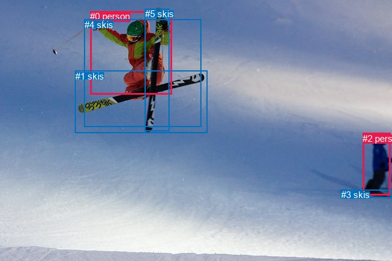
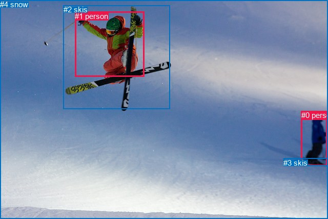

# 图片 0368：2330400.jpg

随机样本序号：197。图片 SHA256：`309105454f28c30038cce8c44d48300b626548477957b3d056bfacf9da3127e4`。

红色框表示人，蓝色框表示其他物体。两个模式分别保留自身框编号，可依据位置比较对应对象。

## 自动检测框与输出

人的框编号：`[0, 2]`。状态：`ok`。

### 自动检测全部物体框

| 编号 | 类别 | 是否为人 | 检测分数 | 像素坐标 xyxy |
|---|---|---|---|---|
| 0 | person | True | 0.9994 | 147.4, 18.1, 280.9, 154.6 |
| 1 | skis | False | 0.9984 | 122.6, 115.8, 338.0, 217.3 |
| 2 | person | True | 0.9965 | 592.1, 217.8, 637.5, 319.9 |
| 3 | skis | False | 0.7465 | 556.9, 310.2, 639.7, 323.8 |
| 4 | skis | False | 0.4747 | 138.0, 31.9, 328.1, 207.2 |
| 5 | skis | False | 0.3856 | 236.6, 14.2, 276.3, 214.0 |

### 自动检测 Top50 人相关候选

评分物体对：30；人相关物体对：18；输出关系：36。

| 排名 | 主语编号与类别 | 关系 | 宾语编号与类别 | 类型 | 人与人 | 排序分数 | 原始融合 logit |
|---|---|---|---|---|---|---|---|
| 1 | #2 person | wearing | #3 skis | semantic | False | 0.99158 | 4.7690 |
| 2 | #0 person | holding | #5 skis | semantic | False | 0.97914 | 3.8489 |
| 3 | #0 person | wearing | #1 skis | semantic | False | 0.97680 | 3.7403 |
| 4 | #2 person | on | #3 skis | spatial | False | 0.95105 | 2.9667 |
| 5 | #0 person | wearing | #4 skis | semantic | False | 0.90735 | 2.2817 |
| 6 | #4 skis | wearing | #0 person | semantic | False | 0.89773 | 2.1722 |
| 7 | #0 person | on | #1 skis | spatial | False | 0.83717 | 1.6373 |
| 8 | #0 person | on | #5 skis | spatial | False | 0.83111 | 1.5935 |
| 9 | #0 person | on | #4 skis | spatial | False | 0.75733 | 1.1381 |
| 10 | #4 skis | in | #0 person | spatial | False | 0.72150 | 0.9519 |
| 11 | #3 skis | on | #2 person | spatial | False | 0.51827 | 0.0731 |
| 12 | #2 person | wearing | #1 skis | semantic | False | 0.48754 | -0.0498 |
| 13 | #0 person | wearing | #3 skis | semantic | False | 0.37630 | -0.5053 |
| 14 | #5 skis | on | #0 person | spatial | False | 0.36402 | -0.5579 |
| 15 | #1 skis | on | #0 person | spatial | False | 0.26523 | -1.0190 |
| 16 | #3 skis | wearing | #2 person | semantic | False | 0.13287 | -1.8758 |
| 17 | #2 person | looking at | #4 skis | semantic | False | 0.12564 | -1.9400 |
| 18 | #2 person | on | #1 skis | spatial | False | 0.12182 | -1.9753 |
| 19 | #5 skis | holding | #0 person | semantic | False | 0.11653 | -2.0257 |
| 20 | #2 person | looking at | #0 person | semantic | True | 0.06494 | -2.6671 |
| 21 | #2 person | on | #4 skis | spatial | False | 0.04181 | -3.1319 |
| 22 | #0 person | on | #3 skis | spatial | False | 0.03777 | -3.2378 |
| 23 | #1 skis | wearing | #0 person | semantic | False | 0.03600 | -3.2876 |
| 24 | #0 person | in | #2 person | spatial | True | 0.02284 | -3.7561 |
| 25 | #2 person | wearing | #5 skis | semantic | False | 0.02264 | -3.7653 |
| 26 | #2 person | in | #0 person | spatial | True | 0.02141 | -3.8223 |
| 27 | #4 skis | in | #2 person | spatial | False | 0.01707 | -4.0533 |
| 28 | #0 person | looking at | #2 person | semantic | True | 0.00926 | -4.6726 |
| 29 | #2 person | on | #5 skis | spatial | False | 0.00876 | -4.7290 |
| 30 | #1 skis | on | #2 person | spatial | False | 0.00829 | -4.7841 |
| 31 | #3 skis | on | #0 person | spatial | False | 0.00532 | -5.2300 |
| 32 | #4 skis | wearing | #2 person | semantic | False | 0.00517 | -5.2593 |
| 33 | #5 skis | on | #2 person | spatial | False | 0.00403 | -5.5094 |
| 34 | #1 skis | holding | #2 person | semantic | False | 0.00182 | -6.3063 |
| 35 | #3 skis | wearing | #0 person | semantic | False | 0.00099 | -6.9156 |
| 36 | #5 skis | holding | #2 person | semantic | False | 0.00092 | -6.9883 |

### 自动检测逐条人相关 GT 核验

R@50：40.00%；命中 2/5。

| GT 主语编号 | GT 关系 | GT 宾语编号 | 结果阶段 | 匹配预测主语编号 | 匹配预测宾语编号 |
|---|---|---|---|---|---|
| 0 | wearing | 3 | hit50 | [2] | [3] |
| 0 | going down | 4 | endpoint_missing_or_wrong_class | [2] | [] |
| 1 | wearing | 2 | hit50 | [0] | [4] |
| 1 | holding | 2 | wrong_predicate | [0] | [4] |
| 1 | jumping over | 4 | endpoint_missing_or_wrong_class | [0] | [] |

## 真实框与输出

人的框编号：`[0, 1]`。

### 真实框全部物体框

| 编号 | 类别 | 是否为人 | 检测分数 | 像素坐标 xyxy |
|---|---|---|---|---|
| 0 | person | True | GT | 588.0, 216.0, 639.0, 323.0 |
| 1 | person | True | GT | 146.0, 23.0, 281.0, 149.0 |
| 2 | skis | False | GT | 124.0, 10.0, 332.0, 212.0 |
| 3 | skis | False | GT | 553.0, 309.0, 640.0, 324.0 |
| 4 | snow | False | GT | 0.0, 0.0, 640.0, 427.0 |

### 真实框 Top50 人相关候选

评分物体对：20；人相关物体对：14；输出关系：28。

| 排名 | 主语编号与类别 | 关系 | 宾语编号与类别 | 类型 | 人与人 | 排序分数 | 原始融合 logit |
|---|---|---|---|---|---|---|---|
| 1 | #0 person | wearing | #3 skis | semantic | False | 0.99116 | 4.7200 |
| 2 | #0 person | on | #3 skis | spatial | False | 0.98601 | 4.2552 |
| 3 | #0 person | in | #4 snow | spatial | False | 0.96032 | 3.1865 |
| 4 | #2 skis | wearing | #1 person | semantic | False | 0.95523 | 3.0603 |
| 5 | #1 person | holding | #2 skis | semantic | False | 0.94593 | 2.8619 |
| 6 | #0 person | standing on | #4 snow | semantic | False | 0.93840 | 2.7235 |
| 7 | #1 person | on | #2 skis | spatial | False | 0.90763 | 2.2851 |
| 8 | #2 skis | in | #1 person | spatial | False | 0.88768 | 2.0672 |
| 9 | #1 person | in | #4 snow | spatial | False | 0.85269 | 1.7559 |
| 10 | #1 person | going down | #4 snow | semantic | False | 0.71220 | 0.9061 |
| 11 | #3 skis | on | #0 person | spatial | False | 0.61225 | 0.4568 |
| 12 | #0 person | looking at | #2 skis | semantic | False | 0.60910 | 0.4435 |
| 13 | #0 person | wearing | #1 person | semantic | True | 0.43655 | -0.2552 |
| 14 | #0 person | on | #2 skis | spatial | False | 0.40806 | -0.3720 |
| 15 | #1 person | wearing | #3 skis | semantic | False | 0.18966 | -1.4522 |
| 16 | #0 person | in | #1 person | spatial | True | 0.18328 | -1.4943 |
| 17 | #3 skis | wearing | #0 person | semantic | False | 0.16719 | -1.6057 |
| 18 | #1 person | on | #0 person | spatial | True | 0.15876 | -1.6675 |
| 19 | #4 snow | in | #0 person | spatial | False | 0.13836 | -1.8290 |
| 20 | #2 skis | holding | #0 person | semantic | False | 0.13262 | -1.8780 |
| 21 | #2 skis | on | #0 person | spatial | False | 0.12261 | -1.9680 |
| 22 | #1 person | on | #3 skis | spatial | False | 0.10187 | -2.1766 |
| 23 | #1 person | playing with | #0 person | semantic | True | 0.08540 | -2.3711 |
| 24 | #4 snow | beside | #1 person | spatial | False | 0.03554 | -3.3008 |
| 25 | #4 snow | holding | #0 person | semantic | False | 0.03092 | -3.4448 |
| 26 | #3 skis | on | #1 person | spatial | False | 0.02868 | -3.5225 |
| 27 | #4 snow | holding | #1 person | semantic | False | 0.00683 | -4.9793 |
| 28 | #3 skis | wearing | #1 person | semantic | False | 0.00469 | -5.3574 |

### 真实框逐条人相关 GT 核验

R@50：40.00%；命中 2/5。

| GT 主语编号 | GT 关系 | GT 宾语编号 | 结果阶段 | 匹配预测主语编号 | 匹配预测宾语编号 |
|---|---|---|---|---|---|
| 0 | wearing | 3 | hit50 | [0] | [3] |
| 0 | going down | 4 | wrong_predicate | [0] | [4] |
| 1 | wearing | 2 | wrong_predicate | [1] | [2] |
| 1 | holding | 2 | hit50 | [1] | [2] |
| 1 | jumping over | 4 | wrong_predicate | [1] | [4] |

## 全部人相关 GT

| 主语编号与类别 | 关系 | 宾语编号与类别 |
|---|---|---|
| #0 person | wearing | #3 skis |
| #0 person | going down | #4 snow |
| #1 person | wearing | #2 skis |
| #1 person | holding | #2 skis |
| #1 person | jumping over | #4 snow |

原始记录、全部人相关物体对的两项预测与分项分数见 [逐图证据 JSON](../evidence/cases/0368.json)。全部56类 logits 保留于本机 HOR/output/random500/logits/。

<!-- HOR_COMPLETE_RESULTS -->

## 六组条件的完整输出对照

以下保留同一图片三种框与候选模式、两种谓词输出规则的全部 Top50。框编号各自在所属模式内解释。

### 自动检测框完整枚举：空间与语义各保留一个谓词

| 排名 | 主语编号与类别 | 谓词 | 宾语编号与类别 | 分组 | 排序分数 | predicate logit | pair logit |
|---|---|---|---|---|---|---|---|
| 1 | #2 person | wearing | #3 skis | semantic | 0.9915826 | 3.8006692 | 0.9683333 |
| 2 | #0 person | holding | #5 skis | semantic | 0.9791405 | 3.8098426 | 0.0390212 |
| 3 | #0 person | wearing | #1 skis | semantic | 0.9768034 | 3.3954930 | 0.3447874 |
| 4 | #2 person | on | #3 skis | spatial | 0.9510471 | 1.9983721 | 0.9683333 |
| 5 | #0 person | wearing | #4 skis | semantic | 0.9073483 | 2.4897485 | -0.2080700 |
| 6 | #4 skis | wearing | #0 person | semantic | 0.8977264 | 2.6543417 | -0.4821273 |
| 7 | #0 person | on | #1 skis | spatial | 0.8371716 | 1.2925448 | 0.3447874 |
| 8 | #0 person | on | #5 skis | spatial | 0.8311076 | 1.5544758 | 0.0390212 |
| 9 | #0 person | on | #4 skis | spatial | 0.7573274 | 1.3461528 | -0.2080700 |
| 10 | #4 skis | in | #0 person | spatial | 0.7214992 | 1.4340377 | -0.4821273 |
| 11 | #3 skis | on | #2 person | spatial | 0.5182734 | 1.0059972 | -0.9328711 |
| 12 | #2 person | wearing | #1 skis | semantic | 0.4875404 | 0.6453071 | -0.6951559 |
| 13 | #0 person | wearing | #3 skis | semantic | 0.3763010 | 0.1074233 | -0.6127018 |
| 14 | #5 skis | on | #0 person | spatial | 0.3640222 | 0.2674727 | -0.8254214 |
| 15 | #1 skis | on | #0 person | spatial | 0.2652264 | -0.0903211 | -0.9286576 |
| 16 | #3 skis | wearing | #2 person | semantic | 0.1328672 | -0.9429710 | -0.9328711 |
| 17 | #2 person | looking at | #4 skis | semantic | 0.1256429 | -1.4785905 | -0.4614548 |
| 18 | #2 person | on | #1 skis | spatial | 0.1218227 | -1.2801259 | -0.6951559 |
| 19 | #5 skis | holding | #0 person | semantic | 0.1165290 | -1.2002966 | -0.8254214 |
| 20 | #2 person | looking at | #0 person | semantic | 0.0649401 | -2.1158235 | -0.5513214 |
| 21 | #2 person | on | #4 skis | spatial | 0.0418085 | -2.6704922 | -0.4614548 |
| 22 | #0 person | on | #3 skis | spatial | 0.0377684 | -2.6250801 | -0.6127018 |
| 23 | #1 skis | wearing | #0 person | semantic | 0.0359988 | -2.3589509 | -0.9286576 |
| 24 | #0 person | in | #2 person | spatial | 0.0228414 | -2.2399178 | -1.5161577 |
| 25 | #2 person | wearing | #5 skis | semantic | 0.0226374 | -2.8647184 | -0.9005352 |
| 26 | #2 person | in | #0 person | spatial | 0.0214081 | -3.2710235 | -0.5513214 |
| 27 | #4 skis | in | #2 person | spatial | 0.0170690 | -2.5384524 | -1.5148251 |
| 28 | #0 person | looking at | #2 person | semantic | 0.0092609 | -3.1564879 | -1.5161577 |
| 29 | #2 person | on | #5 skis | spatial | 0.0087583 | -3.8284261 | -0.9005352 |
| 30 | #1 skis | on | #2 person | spatial | 0.0082925 | -3.3502250 | -1.4338468 |
| 31 | #3 skis | on | #0 person | spatial | 0.0053248 | -3.7805099 | -1.4495375 |
| 32 | #4 skis | wearing | #2 person | semantic | 0.0051723 | -3.7444329 | -1.5148251 |
| 33 | #5 skis | on | #2 person | spatial | 0.0040324 | -3.8510315 | -1.6583275 |
| 34 | #1 skis | holding | #2 person | semantic | 0.0018214 | -4.8724980 | -1.4338468 |
| 35 | #3 skis | wearing | #0 person | semantic | 0.0009912 | -5.4660964 | -1.4495375 |
| 36 | #5 skis | holding | #2 person | semantic | 0.0009218 | -5.3299460 | -1.6583275 |

GT 命中：2/5，R@50=40.00%。

| GT主语 | GT谓词 | GT宾语 | 结果阶段 | 匹配主语框 | 匹配宾语框 |
|---|---|---|---|---|---|
| 0 | wearing | 3 | hit50 | [2] | [3] |
| 0 | going down | 4 | endpoint_missing_or_wrong_class | [2] | [] |
| 1 | wearing | 2 | hit50 | [0] | [4] |
| 1 | holding | 2 | wrong_predicate | [0] | [4] |
| 1 | jumping over | 4 | endpoint_missing_or_wrong_class | [0] | [] |

### 自动检测框完整枚举：每对只保留一个谓词

| 排名 | 主语编号与类别 | 谓词 | 宾语编号与类别 | 分组 | 排序分数 | predicate logit | pair logit |
|---|---|---|---|---|---|---|---|
| 1 | #2 person | wearing | #3 skis | single | 0.9915826 | 3.8006692 | 0.9683333 |
| 2 | #0 person | holding | #5 skis | single | 0.9791405 | 3.8098426 | 0.0390212 |
| 3 | #0 person | wearing | #1 skis | single | 0.9768034 | 3.3954930 | 0.3447874 |
| 4 | #0 person | wearing | #4 skis | single | 0.9073483 | 2.4897485 | -0.2080700 |
| 5 | #4 skis | wearing | #0 person | single | 0.8977264 | 2.6543417 | -0.4821273 |
| 6 | #3 skis | on | #2 person | single | 0.5182734 | 1.0059972 | -0.9328711 |
| 7 | #2 person | wearing | #1 skis | single | 0.4875404 | 0.6453071 | -0.6951559 |
| 8 | #0 person | wearing | #3 skis | single | 0.3763010 | 0.1074233 | -0.6127018 |
| 9 | #5 skis | on | #0 person | single | 0.3640222 | 0.2674727 | -0.8254214 |
| 10 | #1 skis | on | #0 person | single | 0.2652264 | -0.0903211 | -0.9286576 |
| 11 | #2 person | looking at | #4 skis | single | 0.1256429 | -1.4785905 | -0.4614548 |
| 12 | #2 person | looking at | #0 person | single | 0.0649401 | -2.1158235 | -0.5513214 |
| 13 | #0 person | in | #2 person | single | 0.0228414 | -2.2399178 | -1.5161577 |
| 14 | #2 person | wearing | #5 skis | single | 0.0226374 | -2.8647184 | -0.9005352 |
| 15 | #4 skis | in | #2 person | single | 0.0170690 | -2.5384524 | -1.5148251 |
| 16 | #1 skis | on | #2 person | single | 0.0082925 | -3.3502250 | -1.4338468 |
| 17 | #3 skis | on | #0 person | single | 0.0053248 | -3.7805099 | -1.4495375 |
| 18 | #5 skis | on | #2 person | single | 0.0040324 | -3.8510315 | -1.6583275 |

GT 命中：2/5，R@50=40.00%。

| GT主语 | GT谓词 | GT宾语 | 结果阶段 | 匹配主语框 | 匹配宾语框 |
|---|---|---|---|---|---|
| 0 | wearing | 3 | hit50 | [2] | [3] |
| 0 | going down | 4 | endpoint_missing_or_wrong_class | [2] | [] |
| 1 | wearing | 2 | hit50 | [0] | [4] |
| 1 | holding | 2 | wrong_predicate | [0] | [4] |
| 1 | jumping over | 4 | endpoint_missing_or_wrong_class | [0] | [] |

### 真实框完整枚举：空间与语义各保留一个谓词

| 排名 | 主语编号与类别 | 谓词 | 宾语编号与类别 | 分组 | 排序分数 | predicate logit | pair logit |
|---|---|---|---|---|---|---|---|
| 1 | #0 person | wearing | #3 skis | semantic | 0.9911634 | 3.7094989 | 1.0104753 |
| 2 | #0 person | on | #3 skis | spatial | 0.9860085 | 3.2447410 | 1.0104753 |
| 3 | #0 person | in | #4 snow | spatial | 0.9603214 | 2.9912548 | 0.1952007 |
| 4 | #2 skis | wearing | #1 person | semantic | 0.9552273 | 3.5175071 | -0.4571573 |
| 5 | #1 person | holding | #2 skis | semantic | 0.9459286 | 3.1784744 | -0.3166142 |
| 6 | #0 person | standing on | #4 snow | semantic | 0.9383994 | 2.5283027 | 0.1952007 |
| 7 | #1 person | on | #2 skis | spatial | 0.9076321 | 2.6016736 | -0.3166142 |
| 8 | #2 skis | in | #1 person | spatial | 0.8876789 | 2.5244055 | -0.4571573 |
| 9 | #1 person | in | #4 snow | spatial | 0.8526913 | 2.3040333 | -0.5481660 |
| 10 | #1 person | going down | #4 snow | semantic | 0.7121983 | 1.4542508 | -0.5481660 |
| 11 | #3 skis | on | #0 person | spatial | 0.6122541 | 1.3613572 | -0.9045599 |
| 12 | #0 person | looking at | #2 skis | semantic | 0.6091046 | 0.8797703 | -0.4362203 |
| 13 | #0 person | wearing | #1 person | semantic | 0.4365522 | 0.3173833 | -0.5725499 |
| 14 | #0 person | on | #2 skis | spatial | 0.4080579 | 0.0642204 | -0.4362203 |
| 15 | #1 person | wearing | #3 skis | semantic | 0.1896634 | -0.6273270 | -0.8248721 |
| 16 | #0 person | in | #1 person | spatial | 0.1832816 | -0.9217207 | -0.5725499 |
| 17 | #3 skis | wearing | #0 person | semantic | 0.1671902 | -0.7011132 | -0.9045599 |
| 18 | #1 person | on | #0 person | spatial | 0.1587601 | -0.0876555 | -1.5798268 |
| 19 | #4 snow | in | #0 person | spatial | 0.1383588 | -0.8059895 | -1.0229987 |
| 20 | #2 skis | holding | #0 person | semantic | 0.1326175 | -0.4166965 | -1.4613146 |
| 21 | #2 skis | on | #0 person | spatial | 0.1226082 | -0.5066447 | -1.4613146 |
| 22 | #1 person | on | #3 skis | spatial | 0.1018670 | -1.3517776 | -0.8248721 |
| 23 | #1 person | playing with | #0 person | semantic | 0.0854041 | -0.7912617 | -1.5798268 |
| 24 | #4 snow | beside | #1 person | spatial | 0.0355433 | -1.8786609 | -1.4221511 |
| 25 | #4 snow | holding | #0 person | semantic | 0.0309246 | -2.4217913 | -1.0229987 |
| 26 | #3 skis | on | #1 person | spatial | 0.0286778 | -1.9168870 | -1.6056495 |
| 27 | #4 snow | holding | #1 person | semantic | 0.0068321 | -3.5571198 | -1.4221511 |
| 28 | #3 skis | wearing | #1 person | semantic | 0.0046909 | -3.7517726 | -1.6056495 |

GT 命中：2/5，R@50=40.00%。

| GT主语 | GT谓词 | GT宾语 | 结果阶段 | 匹配主语框 | 匹配宾语框 |
|---|---|---|---|---|---|
| 0 | wearing | 3 | hit50 | [0] | [3] |
| 0 | going down | 4 | wrong_predicate | [0] | [4] |
| 1 | wearing | 2 | wrong_predicate | [1] | [2] |
| 1 | holding | 2 | hit50 | [1] | [2] |
| 1 | jumping over | 4 | wrong_predicate | [1] | [4] |

### 真实框完整枚举：每对只保留一个谓词

| 排名 | 主语编号与类别 | 谓词 | 宾语编号与类别 | 分组 | 排序分数 | predicate logit | pair logit |
|---|---|---|---|---|---|---|---|
| 1 | #0 person | wearing | #3 skis | single | 0.9911634 | 3.7094989 | 1.0104753 |
| 2 | #0 person | in | #4 snow | single | 0.9603214 | 2.9912548 | 0.1952007 |
| 3 | #2 skis | wearing | #1 person | single | 0.9552273 | 3.5175071 | -0.4571573 |
| 4 | #1 person | holding | #2 skis | single | 0.9459286 | 3.1784744 | -0.3166142 |
| 5 | #1 person | in | #4 snow | single | 0.8526913 | 2.3040333 | -0.5481660 |
| 6 | #3 skis | on | #0 person | single | 0.6122541 | 1.3613572 | -0.9045599 |
| 7 | #0 person | looking at | #2 skis | single | 0.6091046 | 0.8797703 | -0.4362203 |
| 8 | #0 person | wearing | #1 person | single | 0.4365522 | 0.3173833 | -0.5725499 |
| 9 | #1 person | wearing | #3 skis | single | 0.1896634 | -0.6273270 | -0.8248721 |
| 10 | #1 person | on | #0 person | single | 0.1587601 | -0.0876555 | -1.5798268 |
| 11 | #4 snow | in | #0 person | single | 0.1383588 | -0.8059895 | -1.0229987 |
| 12 | #2 skis | holding | #0 person | single | 0.1326175 | -0.4166965 | -1.4613146 |
| 13 | #4 snow | beside | #1 person | single | 0.0355433 | -1.8786609 | -1.4221511 |
| 14 | #3 skis | on | #1 person | single | 0.0286778 | -1.9168870 | -1.6056495 |

GT 命中：2/5，R@50=40.00%。

| GT主语 | GT谓词 | GT宾语 | 结果阶段 | 匹配主语框 | 匹配宾语框 |
|---|---|---|---|---|---|
| 0 | wearing | 3 | hit50 | [0] | [3] |
| 0 | going down | 4 | wrong_predicate | [0] | [4] |
| 1 | wearing | 2 | wrong_predicate | [1] | [2] |
| 1 | holding | 2 | hit50 | [1] | [2] |
| 1 | jumping over | 4 | wrong_predicate | [1] | [4] |

### 真实框400候选：空间与语义各保留一个谓词

| 排名 | 主语编号与类别 | 谓词 | 宾语编号与类别 | 分组 | 排序分数 | predicate logit | pair logit |
|---|---|---|---|---|---|---|---|
| 1 | #0 person | wearing | #3 skis | semantic | 0.9911634 | 3.7094989 | 1.0104753 |
| 2 | #0 person | on | #3 skis | spatial | 0.9860085 | 3.2447410 | 1.0104753 |
| 3 | #0 person | in | #4 snow | spatial | 0.9623120 | 3.0447993 | 0.1952007 |
| 4 | #2 skis | wearing | #1 person | semantic | 0.9552273 | 3.5175071 | -0.4571573 |
| 5 | #1 person | holding | #2 skis | semantic | 0.9434007 | 3.1301088 | -0.3166142 |
| 6 | #0 person | standing on | #4 snow | semantic | 0.9383994 | 2.5283027 | 0.1952007 |
| 7 | #1 person | on | #2 skis | spatial | 0.9076321 | 2.6016736 | -0.3166142 |
| 8 | #2 skis | in | #1 person | spatial | 0.8876789 | 2.5244055 | -0.4571573 |
| 9 | #1 person | in | #4 snow | spatial | 0.8518556 | 2.2973957 | -0.5481660 |
| 10 | #1 person | going down | #4 snow | semantic | 0.7121983 | 1.4542508 | -0.5481660 |
| 11 | #3 skis | on | #0 person | spatial | 0.6122541 | 1.3613572 | -0.9045599 |
| 12 | #0 person | looking at | #2 skis | semantic | 0.6020839 | 0.8503761 | -0.4362203 |
| 13 | #0 person | wearing | #1 person | semantic | 0.4365522 | 0.3173833 | -0.5725499 |
| 14 | #0 person | on | #2 skis | spatial | 0.4080579 | 0.0642204 | -0.4362203 |
| 15 | #1 person | wearing | #3 skis | semantic | 0.1859684 | -0.6515503 | -0.8248721 |
| 16 | #0 person | in | #1 person | spatial | 0.1835301 | -0.9200613 | -0.5725499 |
| 17 | #3 skis | wearing | #0 person | semantic | 0.1671902 | -0.7011132 | -0.9045599 |
| 18 | #1 person | on | #0 person | spatial | 0.1562125 | -0.1068568 | -1.5798268 |
| 19 | #4 snow | in | #0 person | spatial | 0.1415816 | -0.7792170 | -1.0229987 |
| 20 | #2 skis | holding | #0 person | semantic | 0.1329577 | -0.4137421 | -1.4613146 |
| 21 | #2 skis | on | #0 person | spatial | 0.1237845 | -0.4957552 | -1.4613146 |
| 22 | #1 person | on | #3 skis | spatial | 0.1004988 | -1.3668230 | -0.8248721 |
| 23 | #1 person | playing with | #0 person | semantic | 0.0854041 | -0.7912617 | -1.5798268 |
| 24 | #4 snow | beside | #1 person | spatial | 0.0360610 | -1.8636656 | -1.4221511 |
| 25 | #4 snow | holding | #0 person | semantic | 0.0313170 | -2.4087768 | -1.0229987 |
| 26 | #3 skis | on | #1 person | spatial | 0.0278790 | -1.9459572 | -1.6056495 |
| 27 | #4 snow | holding | #1 person | semantic | 0.0069095 | -3.5457671 | -1.4221511 |
| 28 | #3 skis | wearing | #1 person | semantic | 0.0045388 | -3.7848918 | -1.6056495 |

GT 命中：2/5，R@50=40.00%。

| GT主语 | GT谓词 | GT宾语 | 结果阶段 | 匹配主语框 | 匹配宾语框 |
|---|---|---|---|---|---|
| 0 | wearing | 3 | hit50 | [0] | [3] |
| 0 | going down | 4 | wrong_predicate | [0] | [4] |
| 1 | wearing | 2 | wrong_predicate | [1] | [2] |
| 1 | holding | 2 | hit50 | [1] | [2] |
| 1 | jumping over | 4 | wrong_predicate | [1] | [4] |

### 真实框400候选：每对只保留一个谓词

| 排名 | 主语编号与类别 | 谓词 | 宾语编号与类别 | 分组 | 排序分数 | predicate logit | pair logit |
|---|---|---|---|---|---|---|---|
| 1 | #0 person | wearing | #3 skis | single | 0.9911634 | 3.7094989 | 1.0104753 |
| 2 | #0 person | in | #4 snow | single | 0.9623120 | 3.0447993 | 0.1952007 |
| 3 | #2 skis | wearing | #1 person | single | 0.9552273 | 3.5175071 | -0.4571573 |
| 4 | #1 person | holding | #2 skis | single | 0.9434007 | 3.1301088 | -0.3166142 |
| 5 | #1 person | in | #4 snow | single | 0.8518556 | 2.2973957 | -0.5481660 |
| 6 | #3 skis | on | #0 person | single | 0.6122541 | 1.3613572 | -0.9045599 |
| 7 | #0 person | looking at | #2 skis | single | 0.6020839 | 0.8503761 | -0.4362203 |
| 8 | #0 person | wearing | #1 person | single | 0.4365522 | 0.3173833 | -0.5725499 |
| 9 | #1 person | wearing | #3 skis | single | 0.1859684 | -0.6515503 | -0.8248721 |
| 10 | #1 person | on | #0 person | single | 0.1562125 | -0.1068568 | -1.5798268 |
| 11 | #4 snow | in | #0 person | single | 0.1415816 | -0.7792170 | -1.0229987 |
| 12 | #2 skis | holding | #0 person | single | 0.1329577 | -0.4137421 | -1.4613146 |
| 13 | #4 snow | beside | #1 person | single | 0.0360610 | -1.8636656 | -1.4221511 |
| 14 | #3 skis | on | #1 person | single | 0.0278790 | -1.9459572 | -1.6056495 |

GT 命中：2/5，R@50=40.00%。

| GT主语 | GT谓词 | GT宾语 | 结果阶段 | 匹配主语框 | 匹配宾语框 |
|---|---|---|---|---|---|
| 0 | wearing | 3 | hit50 | [0] | [3] |
| 0 | going down | 4 | wrong_predicate | [0] | [4] |
| 1 | wearing | 2 | wrong_predicate | [1] | [2] |
| 1 | holding | 2 | hit50 | [1] | [2] |
| 1 | jumping over | 4 | wrong_predicate | [1] | [4] |
