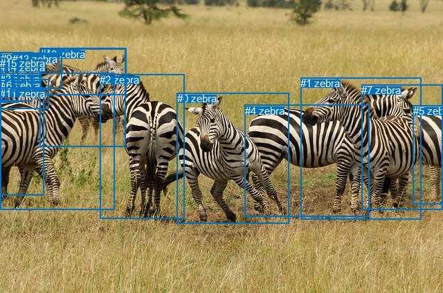
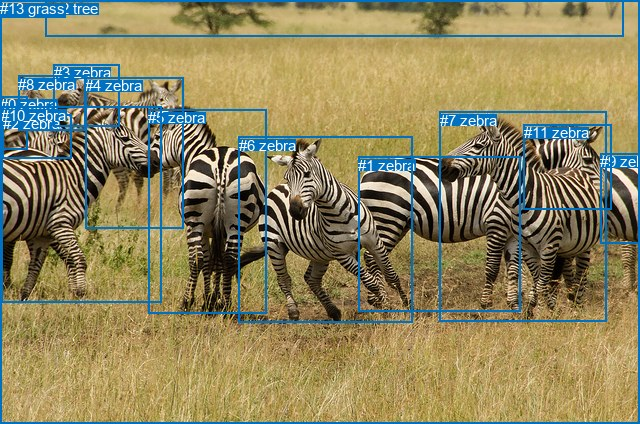

# 图片 0371：2330556.jpg

随机样本序号：168。图片 SHA256：`9675e520965a741d41778599430395ad68c2446d597e80235961e042730639f8`。

红色框表示人，蓝色框表示其他物体。两个模式分别保留自身框编号，可依据位置比较对应对象。

## 自动检测框与输出

人的框编号：`[]`。状态：`no_person`。

### 自动检测全部物体框

| 编号 | 类别 | 是否为人 | 检测分数 | 像素坐标 xyxy |
|---|---|---|---|---|
| 0 | zebra | False | 0.9994 | 255.8, 134.3, 417.6, 323.5 |
| 1 | zebra | False | 0.9993 | 434.5, 112.3, 608.7, 317.6 |
| 2 | zebra | False | 0.9992 | 144.1, 107.2, 267.0, 316.4 |
| 3 | zebra | False | 0.9989 | 0.0, 105.8, 165.5, 303.7 |
| 4 | zebra | False | 0.9774 | 353.8, 152.0, 533.1, 313.6 |
| 5 | zebra | False | 0.9678 | 596.8, 152.1, 640.0, 295.1 |
| 6 | zebra | False | 0.9437 | 0.7, 114.9, 70.1, 157.1 |
| 7 | zebra | False | 0.9025 | 522.0, 122.4, 640.0, 303.3 |
| 8 | zebra | False | 0.8402 | 58.2, 69.2, 182.1, 137.3 |
| 9 | zebra | False | 0.8386 | 0.8, 75.8, 46.5, 146.3 |
| 10 | zebra | False | 0.8147 | 57.8, 70.3, 181.2, 212.8 |
| 11 | zebra | False | 0.6291 | 0.0, 126.6, 63.0, 282.9 |
| 12 | zebra | False | 0.6125 | 18.3, 75.7, 47.3, 132.2 |
| 13 | zebra | False | 0.5259 | 18.3, 76.7, 89.9, 128.8 |
| 14 | zebra | False | 0.5040 | 0.0, 89.3, 26.8, 148.2 |
| 15 | zebra | False | 0.4632 | 0.0, 83.2, 8.5, 145.6 |

### 自动检测 Top50 人相关候选

评分物体对：0；人相关物体对：0；输出关系：0。

| 排名 | 主语编号与类别 | 关系 | 宾语编号与类别 | 类型 | 人与人 | 排序分数 | 原始融合 logit |
|---|---|---|---|---|---|---|---|

### 自动检测逐条人相关 GT 核验

本图没有人相关 GT，R@50 无分母；预测候选继续展示。

## 真实框与输出

人的框编号：`[]`。

### 真实框全部物体框

| 编号 | 类别 | 是否为人 | 检测分数 | 像素坐标 xyxy |
|---|---|---|---|---|
| 0 | zebra | False | GT | 0.0, 96.0, 28.0, 149.0 |
| 1 | zebra | False | GT | 358.0, 157.0, 520.0, 312.0 |
| 2 | zebra | False | GT | 3.0, 115.0, 71.0, 159.0 |
| 3 | zebra | False | GT | 54.0, 64.0, 120.0, 127.0 |
| 4 | zebra | False | GT | 85.0, 77.0, 184.0, 229.0 |
| 5 | zebra | False | GT | 148.0, 109.0, 267.0, 314.0 |
| 6 | zebra | False | GT | 239.0, 137.0, 413.0, 323.0 |
| 7 | zebra | False | GT | 440.0, 112.0, 607.0, 321.0 |
| 8 | zebra | False | GT | 18.0, 76.0, 85.0, 130.0 |
| 9 | zebra | False | GT | 600.0, 153.0, 640.0, 243.0 |
| 10 | zebra | False | GT | 1.0, 107.0, 161.0, 303.0 |
| 11 | zebra | False | GT | 524.0, 124.0, 612.0, 209.0 |
| 12 | tree | False | GT | 45.0, 0.0, 623.0, 36.0 |
| 13 | grass | False | GT | 0.0, 0.0, 640.0, 424.0 |

### 真实框 Top50 人相关候选

评分物体对：0；人相关物体对：0；输出关系：0。

| 排名 | 主语编号与类别 | 关系 | 宾语编号与类别 | 类型 | 人与人 | 排序分数 | 原始融合 logit |
|---|---|---|---|---|---|---|---|

### 真实框逐条人相关 GT 核验

本图没有人相关 GT，R@50 无分母；预测候选继续展示。

## 全部人相关 GT

| 主语编号与类别 | 关系 | 宾语编号与类别 |
|---|---|---|

原始记录、全部人相关物体对的两项预测与分项分数见 [逐图证据 JSON](../evidence/cases/0371.json)。全部56类 logits 保留于本机 HOR/output/random500/logits/。

<!-- HOR_COMPLETE_RESULTS -->

## 六组条件的完整输出对照

以下保留同一图片三种框与候选模式、两种谓词输出规则的全部 Top50。框编号各自在所属模式内解释。

### 自动检测框完整枚举：空间与语义各保留一个谓词

| 排名 | 主语编号与类别 | 谓词 | 宾语编号与类别 | 分组 | 排序分数 | predicate logit | pair logit |
|---|---|---|---|---|---|---|---|

没有人相关 GT，本条件的召回率无分母。

### 自动检测框完整枚举：每对只保留一个谓词

| 排名 | 主语编号与类别 | 谓词 | 宾语编号与类别 | 分组 | 排序分数 | predicate logit | pair logit |
|---|---|---|---|---|---|---|---|

没有人相关 GT，本条件的召回率无分母。

### 真实框完整枚举：空间与语义各保留一个谓词

| 排名 | 主语编号与类别 | 谓词 | 宾语编号与类别 | 分组 | 排序分数 | predicate logit | pair logit |
|---|---|---|---|---|---|---|---|

没有人相关 GT，本条件的召回率无分母。

### 真实框完整枚举：每对只保留一个谓词

| 排名 | 主语编号与类别 | 谓词 | 宾语编号与类别 | 分组 | 排序分数 | predicate logit | pair logit |
|---|---|---|---|---|---|---|---|

没有人相关 GT，本条件的召回率无分母。

### 真实框400候选：空间与语义各保留一个谓词

| 排名 | 主语编号与类别 | 谓词 | 宾语编号与类别 | 分组 | 排序分数 | predicate logit | pair logit |
|---|---|---|---|---|---|---|---|

没有人相关 GT，本条件的召回率无分母。

### 真实框400候选：每对只保留一个谓词

| 排名 | 主语编号与类别 | 谓词 | 宾语编号与类别 | 分组 | 排序分数 | predicate logit | pair logit |
|---|---|---|---|---|---|---|---|

没有人相关 GT，本条件的召回率无分母。
