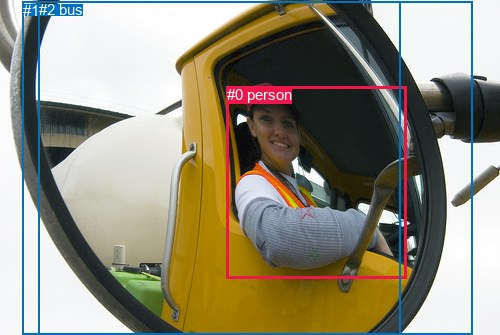
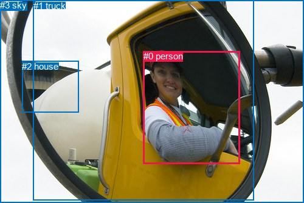

# 图片 0374：2330610.jpg

随机样本序号：493。图片 SHA256：`261ba1b81c768f47b8452cd8fc7866a354a69c336a927032486d129b8684eb44`。

红色框表示人，蓝色框表示其他物体。两个模式分别保留自身框编号，可依据位置比较对应对象。

## 自动检测框与输出

人的框编号：`[0]`。状态：`ok`。

### 自动检测全部物体框

| 编号 | 类别 | 是否为人 | 检测分数 | 像素坐标 xyxy |
|---|---|---|---|---|
| 0 | person | True | 0.9757 | 226.8, 86.2, 406.3, 278.6 |
| 1 | car | False | 0.5581 | 22.7, 1.8, 472.3, 334.6 |
| 2 | bus | False | 0.3735 | 38.6, 1.2, 400.0, 334.3 |

### 自动检测 Top50 人相关候选

评分物体对：6；人相关物体对：4；输出关系：8。

| 排名 | 主语编号与类别 | 关系 | 宾语编号与类别 | 类型 | 人与人 | 排序分数 | 原始融合 logit |
|---|---|---|---|---|---|---|---|
| 1 | #0 person | in | #1 car | spatial | False | 0.96763 | 3.3975 |
| 2 | #0 person | in | #2 bus | spatial | False | 0.96476 | 3.3097 |
| 3 | #0 person | riding | #2 bus | semantic | False | 0.94424 | 2.8293 |
| 4 | #0 person | wearing | #1 car | semantic | False | 0.94252 | 2.7972 |
| 5 | #1 car | in front of | #0 person | spatial | False | 0.41268 | -0.3529 |
| 6 | #2 bus | in front of | #0 person | spatial | False | 0.36970 | -0.5335 |
| 7 | #1 car | carrying | #0 person | semantic | False | 0.19519 | -1.4166 |
| 8 | #2 bus | carrying | #0 person | semantic | False | 0.13804 | -1.8317 |

### 自动检测逐条人相关 GT 核验

R@50：0.00%；命中 0/2。

| GT 主语编号 | GT 关系 | GT 宾语编号 | 结果阶段 | 匹配预测主语编号 | 匹配预测宾语编号 |
|---|---|---|---|---|---|
| 0 | in | 1 | endpoint_missing_or_wrong_class | [0] | [] |
| 0 | driving | 1 | endpoint_missing_or_wrong_class | [0] | [] |

## 真实框与输出

人的框编号：`[0]`。

### 真实框全部物体框

| 编号 | 类别 | 是否为人 | 检测分数 | 像素坐标 xyxy |
|---|---|---|---|---|
| 0 | person | True | GT | 236.0, 84.0, 394.0, 270.0 |
| 1 | truck | False | GT | 55.0, 1.0, 418.0, 331.0 |
| 2 | house | False | GT | 36.0, 101.0, 129.0, 185.0 |
| 3 | sky | False | GT | 0.0, 0.0, 500.0, 335.0 |

### 真实框 Top50 人相关候选

评分物体对：12；人相关物体对：6；输出关系：12。

| 排名 | 主语编号与类别 | 关系 | 宾语编号与类别 | 类型 | 人与人 | 排序分数 | 原始融合 logit |
|---|---|---|---|---|---|---|---|
| 1 | #0 person | in | #3 sky | spatial | False | 0.97692 | 3.7453 |
| 2 | #0 person | in | #1 truck | spatial | False | 0.96713 | 3.3816 |
| 3 | #0 person | wearing | #1 truck | semantic | False | 0.96543 | 3.3294 |
| 4 | #0 person | wearing | #3 sky | semantic | False | 0.95301 | 3.0097 |
| 5 | #0 person | sitting on | #2 house | semantic | False | 0.81524 | 1.4844 |
| 6 | #0 person | beside | #2 house | spatial | False | 0.70825 | 0.8869 |
| 7 | #2 house | beside | #0 person | spatial | False | 0.43564 | -0.2589 |
| 8 | #1 truck | carrying | #0 person | semantic | False | 0.42186 | -0.3152 |
| 9 | #3 sky | in front of | #0 person | spatial | False | 0.40057 | -0.4031 |
| 10 | #1 truck | in front of | #0 person | spatial | False | 0.32755 | -0.7193 |
| 11 | #2 house | holding | #0 person | semantic | False | 0.13919 | -1.8221 |
| 12 | #3 sky | holding | #0 person | semantic | False | 0.08365 | -2.3937 |

### 真实框逐条人相关 GT 核验

R@50：50.00%；命中 1/2。

| GT 主语编号 | GT 关系 | GT 宾语编号 | 结果阶段 | 匹配预测主语编号 | 匹配预测宾语编号 |
|---|---|---|---|---|---|
| 0 | in | 1 | hit50 | [0] | [1] |
| 0 | driving | 1 | wrong_predicate | [0] | [1] |

## 全部人相关 GT

| 主语编号与类别 | 关系 | 宾语编号与类别 |
|---|---|---|
| #0 person | in | #1 truck |
| #0 person | driving | #1 truck |

原始记录、全部人相关物体对的两项预测与分项分数见 [逐图证据 JSON](../evidence/cases/0374.json)。全部56类 logits 保留于本机 HOR/output/random500/logits/。

<!-- HOR_COMPLETE_RESULTS -->

## 六组条件的完整输出对照

以下保留同一图片三种框与候选模式、两种谓词输出规则的全部 Top50。框编号各自在所属模式内解释。

### 自动检测框完整枚举：空间与语义各保留一个谓词

| 排名 | 主语编号与类别 | 谓词 | 宾语编号与类别 | 分组 | 排序分数 | predicate logit | pair logit |
|---|---|---|---|---|---|---|---|
| 1 | #0 person | in | #1 car | spatial | 0.9676274 | 3.2988048 | 0.0987294 |
| 2 | #0 person | in | #2 bus | spatial | 0.9647611 | 3.2589803 | 0.0507508 |
| 3 | #0 person | riding | #2 bus | semantic | 0.9442375 | 2.7785263 | 0.0507508 |
| 4 | #0 person | wearing | #1 car | semantic | 0.9425218 | 2.6984239 | 0.0987294 |
| 5 | #1 car | in front of | #0 person | spatial | 0.4126780 | 0.6601219 | -1.0130274 |
| 6 | #2 bus | in front of | #0 person | spatial | 0.3696983 | 0.5342426 | -1.0677538 |
| 7 | #1 car | carrying | #0 person | semantic | 0.1951914 | -0.4035964 | -1.0130274 |
| 8 | #2 bus | carrying | #0 person | semantic | 0.1380403 | -0.7639089 | -1.0677538 |

GT 命中：0/2，R@50=0.00%。

| GT主语 | GT谓词 | GT宾语 | 结果阶段 | 匹配主语框 | 匹配宾语框 |
|---|---|---|---|---|---|
| 0 | in | 1 | endpoint_missing_or_wrong_class | [0] | [] |
| 0 | driving | 1 | endpoint_missing_or_wrong_class | [0] | [] |

### 自动检测框完整枚举：每对只保留一个谓词

| 排名 | 主语编号与类别 | 谓词 | 宾语编号与类别 | 分组 | 排序分数 | predicate logit | pair logit |
|---|---|---|---|---|---|---|---|
| 1 | #0 person | in | #1 car | single | 0.9676274 | 3.2988048 | 0.0987294 |
| 2 | #0 person | in | #2 bus | single | 0.9647611 | 3.2589803 | 0.0507508 |
| 3 | #1 car | in front of | #0 person | single | 0.4126780 | 0.6601219 | -1.0130274 |
| 4 | #2 bus | in front of | #0 person | single | 0.3696983 | 0.5342426 | -1.0677538 |

GT 命中：0/2，R@50=0.00%。

| GT主语 | GT谓词 | GT宾语 | 结果阶段 | 匹配主语框 | 匹配宾语框 |
|---|---|---|---|---|---|
| 0 | in | 1 | endpoint_missing_or_wrong_class | [0] | [] |
| 0 | driving | 1 | endpoint_missing_or_wrong_class | [0] | [] |

### 真实框完整枚举：空间与语义各保留一个谓词

| 排名 | 主语编号与类别 | 谓词 | 宾语编号与类别 | 分组 | 排序分数 | predicate logit | pair logit |
|---|---|---|---|---|---|---|---|
| 1 | #0 person | in | #3 sky | spatial | 0.9769171 | 3.5191779 | 0.2261343 |
| 2 | #0 person | in | #1 truck | spatial | 0.9671252 | 3.3187175 | 0.0629040 |
| 3 | #0 person | wearing | #1 truck | semantic | 0.9654254 | 3.2665443 | 0.0629040 |
| 4 | #0 person | wearing | #3 sky | semantic | 0.9530112 | 2.7835813 | 0.2261343 |
| 5 | #0 person | sitting on | #2 house | semantic | 0.8152352 | 2.5609255 | -1.0765324 |
| 6 | #0 person | beside | #2 house | spatial | 0.7082535 | 1.9634490 | -1.0765324 |
| 7 | #2 house | beside | #0 person | spatial | 0.4356404 | 0.6110191 | -0.8698936 |
| 8 | #1 truck | carrying | #0 person | semantic | 0.4218575 | 0.8542113 | -1.1693640 |
| 9 | #3 sky | in front of | #0 person | spatial | 0.4005729 | 0.4317980 | -0.8348768 |
| 10 | #1 truck | in front of | #0 person | spatial | 0.3275541 | 0.4500957 | -1.1693640 |
| 11 | #2 house | holding | #0 person | semantic | 0.1391851 | -0.9521811 | -0.8698936 |
| 12 | #3 sky | holding | #0 person | semantic | 0.0836549 | -1.5588167 | -0.8348768 |

GT 命中：1/2，R@50=50.00%。

| GT主语 | GT谓词 | GT宾语 | 结果阶段 | 匹配主语框 | 匹配宾语框 |
|---|---|---|---|---|---|
| 0 | in | 1 | hit50 | [0] | [1] |
| 0 | driving | 1 | wrong_predicate | [0] | [1] |

### 真实框完整枚举：每对只保留一个谓词

| 排名 | 主语编号与类别 | 谓词 | 宾语编号与类别 | 分组 | 排序分数 | predicate logit | pair logit |
|---|---|---|---|---|---|---|---|
| 1 | #0 person | in | #3 sky | single | 0.9769171 | 3.5191779 | 0.2261343 |
| 2 | #0 person | in | #1 truck | single | 0.9671252 | 3.3187175 | 0.0629040 |
| 3 | #0 person | sitting on | #2 house | single | 0.8152352 | 2.5609255 | -1.0765324 |
| 4 | #2 house | beside | #0 person | single | 0.4356404 | 0.6110191 | -0.8698936 |
| 5 | #1 truck | carrying | #0 person | single | 0.4218575 | 0.8542113 | -1.1693640 |
| 6 | #3 sky | in front of | #0 person | single | 0.4005729 | 0.4317980 | -0.8348768 |

GT 命中：1/2，R@50=50.00%。

| GT主语 | GT谓词 | GT宾语 | 结果阶段 | 匹配主语框 | 匹配宾语框 |
|---|---|---|---|---|---|
| 0 | in | 1 | hit50 | [0] | [1] |
| 0 | driving | 1 | wrong_predicate | [0] | [1] |

### 真实框400候选：空间与语义各保留一个谓词

| 排名 | 主语编号与类别 | 谓词 | 宾语编号与类别 | 分组 | 排序分数 | predicate logit | pair logit |
|---|---|---|---|---|---|---|---|
| 1 | #0 person | in | #3 sky | spatial | 0.9770663 | 3.5258145 | 0.2261343 |
| 2 | #0 person | in | #1 truck | spatial | 0.9671252 | 3.3187175 | 0.0629040 |
| 3 | #0 person | wearing | #1 truck | semantic | 0.9654254 | 3.2665443 | 0.0629040 |
| 4 | #0 person | wearing | #3 sky | semantic | 0.9530112 | 2.7835813 | 0.2261343 |
| 5 | #0 person | sitting on | #2 house | semantic | 0.8120416 | 2.5398636 | -1.0765324 |
| 6 | #0 person | beside | #2 house | spatial | 0.7082474 | 1.9634199 | -1.0765324 |
| 7 | #1 truck | carrying | #0 person | semantic | 0.4286425 | 0.8819723 | -1.1693640 |
| 8 | #2 house | beside | #0 person | spatial | 0.4282996 | 0.5811014 | -0.8698936 |
| 9 | #3 sky | in front of | #0 person | spatial | 0.4006463 | 0.4321041 | -0.8348768 |
| 10 | #1 truck | in front of | #0 person | spatial | 0.3210944 | 0.4206171 | -1.1693640 |
| 11 | #2 house | holding | #0 person | semantic | 0.1395395 | -0.9492269 | -0.8698936 |
| 12 | #3 sky | holding | #0 person | semantic | 0.0835417 | -1.5602937 | -0.8348768 |

GT 命中：1/2，R@50=50.00%。

| GT主语 | GT谓词 | GT宾语 | 结果阶段 | 匹配主语框 | 匹配宾语框 |
|---|---|---|---|---|---|
| 0 | in | 1 | hit50 | [0] | [1] |
| 0 | driving | 1 | wrong_predicate | [0] | [1] |

### 真实框400候选：每对只保留一个谓词

| 排名 | 主语编号与类别 | 谓词 | 宾语编号与类别 | 分组 | 排序分数 | predicate logit | pair logit |
|---|---|---|---|---|---|---|---|
| 1 | #0 person | in | #3 sky | single | 0.9770663 | 3.5258145 | 0.2261343 |
| 2 | #0 person | in | #1 truck | single | 0.9671252 | 3.3187175 | 0.0629040 |
| 3 | #0 person | sitting on | #2 house | single | 0.8120416 | 2.5398636 | -1.0765324 |
| 4 | #1 truck | carrying | #0 person | single | 0.4286425 | 0.8819723 | -1.1693640 |
| 5 | #2 house | beside | #0 person | single | 0.4282996 | 0.5811014 | -0.8698936 |
| 6 | #3 sky | in front of | #0 person | single | 0.4006463 | 0.4321041 | -0.8348768 |

GT 命中：1/2，R@50=50.00%。

| GT主语 | GT谓词 | GT宾语 | 结果阶段 | 匹配主语框 | 匹配宾语框 |
|---|---|---|---|---|---|
| 0 | in | 1 | hit50 | [0] | [1] |
| 0 | driving | 1 | wrong_predicate | [0] | [1] |
