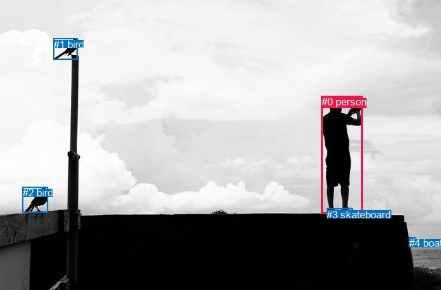
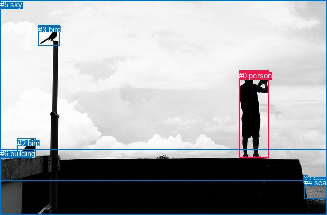

# 图片 0377：2330880.jpg

随机样本序号：346。图片 SHA256：`dbbd71bdca1e21d52a9e0ec34d0ed68141e45ab804e67d5adefa392b00378b98`。

红色框表示人，蓝色框表示其他物体。两个模式分别保留自身框编号，可依据位置比较对应对象。

## 自动检测框与输出

人的框编号：`[0]`。状态：`ok`。

### 自动检测全部物体框

| 编号 | 类别 | 是否为人 | 检测分数 | 像素坐标 xyxy |
|---|---|---|---|---|
| 0 | person | True | 0.9995 | 466.8, 139.1, 526.8, 310.3 |
| 1 | bird | False | 0.9988 | 77.8, 55.7, 112.0, 86.2 |
| 2 | bird | False | 0.9986 | 32.7, 271.4, 69.9, 308.9 |
| 3 | skateboard | False | 0.5023 | 474.5, 302.5, 511.1, 310.7 |
| 4 | boat | False | 0.4877 | 593.6, 344.3, 602.6, 351.1 |

### 自动检测 Top50 人相关候选

评分物体对：20；人相关物体对：8；输出关系：16。

| 排名 | 主语编号与类别 | 关系 | 宾语编号与类别 | 类型 | 人与人 | 排序分数 | 原始融合 logit |
|---|---|---|---|---|---|---|---|
| 1 | #0 person | wearing | #3 skateboard | semantic | False | 0.99197 | 4.8168 |
| 2 | #0 person | looking at | #2 bird | semantic | False | 0.98720 | 4.3456 |
| 3 | #0 person | looking at | #1 bird | semantic | False | 0.98238 | 4.0209 |
| 4 | #0 person | looking at | #4 boat | semantic | False | 0.94889 | 2.9212 |
| 5 | #0 person | on | #3 skateboard | spatial | False | 0.92367 | 2.4933 |
| 6 | #0 person | in front of | #4 boat | spatial | False | 0.87059 | 1.9062 |
| 7 | #3 skateboard | on | #0 person | spatial | False | 0.67590 | 0.7350 |
| 8 | #4 boat | looking at | #0 person | semantic | False | 0.65444 | 0.6386 |
| 9 | #4 boat | beside | #0 person | spatial | False | 0.44737 | -0.2113 |
| 10 | #0 person | beside | #2 bird | spatial | False | 0.42937 | -0.2844 |
| 11 | #3 skateboard | sitting on | #0 person | semantic | False | 0.37257 | -0.5212 |
| 12 | #1 bird | flying over | #0 person | semantic | False | 0.34682 | -0.6331 |
| 13 | #0 person | beside | #1 bird | spatial | False | 0.31899 | -0.7584 |
| 14 | #1 bird | over | #0 person | spatial | False | 0.26253 | -1.0329 |
| 15 | #2 bird | looking at | #0 person | semantic | False | 0.14764 | -1.7532 |
| 16 | #2 bird | beside | #0 person | spatial | False | 0.08416 | -2.3871 |

### 自动检测逐条人相关 GT 核验

R@50：0.00%；命中 0/1。

| GT 主语编号 | GT 关系 | GT 宾语编号 | 结果阶段 | 匹配预测主语编号 | 匹配预测宾语编号 |
|---|---|---|---|---|---|
| 0 | standing on | 6 | endpoint_missing_or_wrong_class | [0] | [] |

## 真实框与输出

人的框编号：`[0]`。

### 真实框全部物体框

| 编号 | 类别 | 是否为人 | 检测分数 | 像素坐标 xyxy |
|---|---|---|---|---|
| 0 | person | True | GT | 467.0, 139.0, 526.0, 310.0 |
| 1 | boat | False | GT | 594.0, 344.0, 602.0, 351.0 |
| 2 | bird | False | GT | 34.0, 272.0, 70.0, 308.0 |
| 3 | bird | False | GT | 75.0, 49.0, 118.0, 91.0 |
| 4 | sea | False | GT | 595.0, 349.0, 640.0, 389.0 |
| 5 | sky | False | GT | 0.0, 0.0, 640.0, 354.0 |
| 6 | building | False | GT | 0.0, 292.0, 640.0, 421.0 |

### 真实框 Top50 人相关候选

评分物体对：42；人相关物体对：12；输出关系：24。

| 排名 | 主语编号与类别 | 关系 | 宾语编号与类别 | 类型 | 人与人 | 排序分数 | 原始融合 logit |
|---|---|---|---|---|---|---|---|
| 1 | #0 person | standing on | #6 building | semantic | False | 0.99301 | 4.9557 |
| 2 | #0 person | looking at | #5 sky | semantic | False | 0.98147 | 3.9694 |
| 3 | #0 person | looking at | #2 bird | semantic | False | 0.97711 | 3.7540 |
| 4 | #0 person | on | #6 building | spatial | False | 0.96714 | 3.3820 |
| 5 | #0 person | looking at | #3 bird | semantic | False | 0.95927 | 3.1592 |
| 6 | #0 person | looking at | #4 sea | semantic | False | 0.91730 | 2.4063 |
| 7 | #0 person | looking at | #1 boat | semantic | False | 0.90832 | 2.2933 |
| 8 | #0 person | beside | #2 bird | spatial | False | 0.86513 | 1.8586 |
| 9 | #0 person | beside | #1 boat | spatial | False | 0.80427 | 1.4132 |
| 10 | #0 person | beside | #4 sea | spatial | False | 0.75248 | 1.1119 |
| 11 | #0 person | beside | #5 sky | spatial | False | 0.64932 | 0.6161 |
| 12 | #1 boat | looking at | #0 person | semantic | False | 0.60936 | 0.4446 |
| 13 | #0 person | beside | #3 bird | spatial | False | 0.60322 | 0.4189 |
| 14 | #5 sky | over | #0 person | spatial | False | 0.57042 | 0.2836 |
| 15 | #6 building | beside | #0 person | spatial | False | 0.49135 | -0.0346 |
| 16 | #2 bird | looking at | #0 person | semantic | False | 0.47797 | -0.0882 |
| 17 | #2 bird | beside | #0 person | spatial | False | 0.43144 | -0.2760 |
| 18 | #6 building | holding | #0 person | semantic | False | 0.42400 | -0.3064 |
| 19 | #3 bird | beside | #0 person | spatial | False | 0.33741 | -0.6749 |
| 20 | #3 bird | looking at | #0 person | semantic | False | 0.23618 | -1.1737 |
| 21 | #4 sea | beside | #0 person | spatial | False | 0.18789 | -1.4638 |
| 22 | #1 boat | beside | #0 person | spatial | False | 0.15373 | -1.7057 |
| 23 | #5 sky | holding | #0 person | semantic | False | 0.05452 | -2.8531 |
| 24 | #4 sea | looking at | #0 person | semantic | False | 0.01580 | -4.1315 |

### 真实框逐条人相关 GT 核验

R@50：100.00%；命中 1/1。

| GT 主语编号 | GT 关系 | GT 宾语编号 | 结果阶段 | 匹配预测主语编号 | 匹配预测宾语编号 |
|---|---|---|---|---|---|
| 0 | standing on | 6 | hit50 | [0] | [6] |

## 全部人相关 GT

| 主语编号与类别 | 关系 | 宾语编号与类别 |
|---|---|---|
| #0 person | standing on | #6 building |

原始记录、全部人相关物体对的两项预测与分项分数见 [逐图证据 JSON](../evidence/cases/0377.json)。全部56类 logits 保留于本机 HOR/output/random500/logits/。

<!-- HOR_COMPLETE_RESULTS -->

## 六组条件的完整输出对照

以下保留同一图片三种框与候选模式、两种谓词输出规则的全部 Top50。框编号各自在所属模式内解释。

### 自动检测框完整枚举：空间与语义各保留一个谓词

| 排名 | 主语编号与类别 | 谓词 | 宾语编号与类别 | 分组 | 排序分数 | predicate logit | pair logit |
|---|---|---|---|---|---|---|---|
| 1 | #0 person | wearing | #3 skateboard | semantic | 0.9919724 | 4.0195775 | 0.7972341 |
| 2 | #0 person | looking at | #2 bird | semantic | 0.9872016 | 3.5511355 | 0.7944165 |
| 3 | #0 person | looking at | #1 bird | semantic | 0.9823788 | 3.1743522 | 0.8465221 |
| 4 | #0 person | looking at | #4 boat | semantic | 0.9488859 | 3.2228127 | -0.3015844 |
| 5 | #0 person | on | #3 skateboard | spatial | 0.9236690 | 1.6960406 | 0.7972341 |
| 6 | #0 person | in front of | #4 boat | spatial | 0.8705884 | 2.2077560 | -0.3015844 |
| 7 | #3 skateboard | on | #0 person | spatial | 0.6759040 | 1.6640072 | -0.9289957 |
| 8 | #4 boat | looking at | #0 person | semantic | 0.6544361 | 1.4068789 | -0.7682827 |
| 9 | #4 boat | beside | #0 person | spatial | 0.4473666 | 0.5569663 | -0.7682827 |
| 10 | #0 person | beside | #2 bird | spatial | 0.4293689 | -1.0788429 | 0.7944165 |
| 11 | #3 skateboard | sitting on | #0 person | semantic | 0.3725660 | 0.4077716 | -0.9289957 |
| 12 | #1 bird | flying over | #0 person | semantic | 0.3468156 | 0.6297369 | -1.2628032 |
| 13 | #0 person | beside | #1 bird | spatial | 0.3189943 | -1.6049194 | 0.8465221 |
| 14 | #1 bird | over | #0 person | spatial | 0.2625267 | 0.2299261 | -1.2628032 |
| 15 | #2 bird | looking at | #0 person | semantic | 0.1476384 | -0.4331546 | -1.3200901 |
| 16 | #2 bird | beside | #0 person | spatial | 0.0841620 | -1.0670066 | -1.3200901 |

GT 命中：0/1，R@50=0.00%。

| GT主语 | GT谓词 | GT宾语 | 结果阶段 | 匹配主语框 | 匹配宾语框 |
|---|---|---|---|---|---|
| 0 | standing on | 6 | endpoint_missing_or_wrong_class | [0] | [] |

### 自动检测框完整枚举：每对只保留一个谓词

| 排名 | 主语编号与类别 | 谓词 | 宾语编号与类别 | 分组 | 排序分数 | predicate logit | pair logit |
|---|---|---|---|---|---|---|---|
| 1 | #0 person | wearing | #3 skateboard | single | 0.9919724 | 4.0195775 | 0.7972341 |
| 2 | #0 person | looking at | #2 bird | single | 0.9872016 | 3.5511355 | 0.7944165 |
| 3 | #0 person | looking at | #1 bird | single | 0.9823788 | 3.1743522 | 0.8465221 |
| 4 | #0 person | looking at | #4 boat | single | 0.9488859 | 3.2228127 | -0.3015844 |
| 5 | #3 skateboard | on | #0 person | single | 0.6759040 | 1.6640072 | -0.9289957 |
| 6 | #4 boat | looking at | #0 person | single | 0.6544361 | 1.4068789 | -0.7682827 |
| 7 | #1 bird | flying over | #0 person | single | 0.3468156 | 0.6297369 | -1.2628032 |
| 8 | #2 bird | looking at | #0 person | single | 0.1476384 | -0.4331546 | -1.3200901 |

GT 命中：0/1，R@50=0.00%。

| GT主语 | GT谓词 | GT宾语 | 结果阶段 | 匹配主语框 | 匹配宾语框 |
|---|---|---|---|---|---|
| 0 | standing on | 6 | endpoint_missing_or_wrong_class | [0] | [] |

### 真实框完整枚举：空间与语义各保留一个谓词

| 排名 | 主语编号与类别 | 谓词 | 宾语编号与类别 | 分组 | 排序分数 | predicate logit | pair logit |
|---|---|---|---|---|---|---|---|
| 1 | #0 person | standing on | #6 building | semantic | 0.9930059 | 4.6848683 | 0.2707969 |
| 2 | #0 person | looking at | #5 sky | semantic | 0.9814656 | 4.5068660 | -0.5374448 |
| 3 | #0 person | looking at | #2 bird | semantic | 0.9771124 | 2.9595528 | 0.7944492 |
| 4 | #0 person | on | #6 building | spatial | 0.9671380 | 3.1112266 | 0.2707969 |
| 5 | #0 person | looking at | #3 bird | semantic | 0.9592711 | 2.3039293 | 0.8553061 |
| 6 | #0 person | looking at | #4 sea | semantic | 0.9173027 | 2.9559579 | -0.5497062 |
| 7 | #0 person | looking at | #1 boat | semantic | 0.9083191 | 2.6047330 | -0.3114521 |
| 8 | #0 person | beside | #2 bird | spatial | 0.8651305 | 1.0641232 | 0.7944492 |
| 9 | #0 person | beside | #1 boat | spatial | 0.8042663 | 1.7246275 | -0.3114521 |
| 10 | #0 person | beside | #4 sea | spatial | 0.7524787 | 1.6615825 | -0.5497062 |
| 11 | #0 person | beside | #5 sky | spatial | 0.6493210 | 1.1535006 | -0.5374448 |
| 12 | #1 boat | looking at | #0 person | semantic | 0.6093610 | 1.2164612 | -0.7718341 |
| 13 | #0 person | beside | #3 bird | spatial | 0.6032165 | -0.4364204 | 0.8553061 |
| 14 | #5 sky | over | #0 person | spatial | 0.5704221 | 1.9489141 | -1.6653404 |
| 15 | #6 building | beside | #0 person | spatial | 0.4913484 | 0.5265284 | -0.5611383 |
| 16 | #2 bird | looking at | #0 person | semantic | 0.4779741 | 1.2254162 | -1.3135767 |
| 17 | #2 bird | beside | #0 person | spatial | 0.4314445 | 1.0376167 | -1.3135767 |
| 18 | #6 building | holding | #0 person | semantic | 0.4239995 | 0.2547622 | -0.5611383 |
| 19 | #3 bird | beside | #0 person | spatial | 0.3374074 | 0.5842819 | -1.2591515 |
| 20 | #3 bird | looking at | #0 person | semantic | 0.2361840 | 0.0854359 | -1.2591515 |
| 21 | #4 sea | beside | #0 person | spatial | 0.1878916 | -0.9519906 | -0.5117782 |
| 22 | #1 boat | beside | #0 person | spatial | 0.1537270 | -0.9338295 | -0.7718341 |
| 23 | #5 sky | holding | #0 person | semantic | 0.0545202 | -1.1877809 | -1.6653404 |
| 24 | #4 sea | looking at | #0 person | semantic | 0.0158050 | -3.6197209 | -0.5117782 |

GT 命中：1/1，R@50=100.00%。

| GT主语 | GT谓词 | GT宾语 | 结果阶段 | 匹配主语框 | 匹配宾语框 |
|---|---|---|---|---|---|
| 0 | standing on | 6 | hit50 | [0] | [6] |

### 真实框完整枚举：每对只保留一个谓词

| 排名 | 主语编号与类别 | 谓词 | 宾语编号与类别 | 分组 | 排序分数 | predicate logit | pair logit |
|---|---|---|---|---|---|---|---|
| 1 | #0 person | standing on | #6 building | single | 0.9930059 | 4.6848683 | 0.2707969 |
| 2 | #0 person | looking at | #5 sky | single | 0.9814656 | 4.5068660 | -0.5374448 |
| 3 | #0 person | looking at | #2 bird | single | 0.9771124 | 2.9595528 | 0.7944492 |
| 4 | #0 person | looking at | #3 bird | single | 0.9592711 | 2.3039293 | 0.8553061 |
| 5 | #0 person | looking at | #4 sea | single | 0.9173027 | 2.9559579 | -0.5497062 |
| 6 | #0 person | looking at | #1 boat | single | 0.9083191 | 2.6047330 | -0.3114521 |
| 7 | #1 boat | looking at | #0 person | single | 0.6093610 | 1.2164612 | -0.7718341 |
| 8 | #5 sky | over | #0 person | single | 0.5704221 | 1.9489141 | -1.6653404 |
| 9 | #6 building | beside | #0 person | single | 0.4913484 | 0.5265284 | -0.5611383 |
| 10 | #2 bird | looking at | #0 person | single | 0.4779741 | 1.2254162 | -1.3135767 |
| 11 | #3 bird | beside | #0 person | single | 0.3374074 | 0.5842819 | -1.2591515 |
| 12 | #4 sea | beside | #0 person | single | 0.1878916 | -0.9519906 | -0.5117782 |

GT 命中：1/1，R@50=100.00%。

| GT主语 | GT谓词 | GT宾语 | 结果阶段 | 匹配主语框 | 匹配宾语框 |
|---|---|---|---|---|---|
| 0 | standing on | 6 | hit50 | [0] | [6] |

### 真实框400候选：空间与语义各保留一个谓词

| 排名 | 主语编号与类别 | 谓词 | 宾语编号与类别 | 分组 | 排序分数 | predicate logit | pair logit |
|---|---|---|---|---|---|---|---|
| 1 | #0 person | standing on | #6 building | semantic | 0.9933148 | 4.7303624 | 0.2707969 |
| 2 | #0 person | looking at | #5 sky | semantic | 0.9814656 | 4.5068660 | -0.5374448 |
| 3 | #0 person | looking at | #2 bird | semantic | 0.9770967 | 2.9588556 | 0.7944492 |
| 4 | #0 person | on | #6 building | spatial | 0.9671380 | 3.1112266 | 0.2707969 |
| 5 | #0 person | looking at | #3 bird | semantic | 0.9592983 | 2.3046265 | 0.8553061 |
| 6 | #0 person | looking at | #4 sea | semantic | 0.9173027 | 2.9559579 | -0.5497062 |
| 7 | #0 person | looking at | #1 boat | semantic | 0.9057823 | 2.5746422 | -0.3114521 |
| 8 | #0 person | beside | #2 bird | spatial | 0.8651372 | 1.0641809 | 0.7944492 |
| 9 | #0 person | beside | #1 boat | spatial | 0.8042617 | 1.7245984 | -0.3114521 |
| 10 | #0 person | beside | #4 sea | spatial | 0.7524734 | 1.6615534 | -0.5497062 |
| 11 | #0 person | beside | #5 sky | spatial | 0.6493275 | 1.1535296 | -0.5374448 |
| 12 | #1 boat | looking at | #0 person | semantic | 0.6094438 | 1.2168093 | -0.7718341 |
| 13 | #0 person | beside | #3 bird | spatial | 0.6032165 | -0.4364204 | 0.8553061 |
| 14 | #5 sky | over | #0 person | spatial | 0.5691259 | 1.9436259 | -1.6653404 |
| 15 | #6 building | beside | #0 person | spatial | 0.4913340 | 0.5264707 | -0.5611383 |
| 16 | #2 bird | looking at | #0 person | semantic | 0.4853128 | 1.2548108 | -1.3135767 |
| 17 | #2 bird | beside | #0 person | spatial | 0.4314445 | 1.0376167 | -1.3135767 |
| 18 | #6 building | holding | #0 person | semantic | 0.4173861 | 0.2276254 | -0.5611383 |
| 19 | #3 bird | beside | #0 person | spatial | 0.3374074 | 0.5842819 | -1.2591515 |
| 20 | #3 bird | looking at | #0 person | semantic | 0.2309225 | 0.0560417 | -1.2591515 |
| 21 | #4 sea | beside | #0 person | spatial | 0.1856065 | -0.9670362 | -0.5117782 |
| 22 | #1 boat | beside | #0 person | spatial | 0.1537260 | -0.9338369 | -0.7718341 |
| 23 | #5 sky | holding | #0 person | semantic | 0.0534362 | -1.2090096 | -1.6653404 |
| 24 | #4 sea | looking at | #0 person | semantic | 0.0156887 | -3.6272218 | -0.5117782 |

GT 命中：1/1，R@50=100.00%。

| GT主语 | GT谓词 | GT宾语 | 结果阶段 | 匹配主语框 | 匹配宾语框 |
|---|---|---|---|---|---|
| 0 | standing on | 6 | hit50 | [0] | [6] |

### 真实框400候选：每对只保留一个谓词

| 排名 | 主语编号与类别 | 谓词 | 宾语编号与类别 | 分组 | 排序分数 | predicate logit | pair logit |
|---|---|---|---|---|---|---|---|
| 1 | #0 person | standing on | #6 building | single | 0.9933148 | 4.7303624 | 0.2707969 |
| 2 | #0 person | looking at | #5 sky | single | 0.9814656 | 4.5068660 | -0.5374448 |
| 3 | #0 person | looking at | #2 bird | single | 0.9770967 | 2.9588556 | 0.7944492 |
| 4 | #0 person | looking at | #3 bird | single | 0.9592983 | 2.3046265 | 0.8553061 |
| 5 | #0 person | looking at | #4 sea | single | 0.9173027 | 2.9559579 | -0.5497062 |
| 6 | #0 person | looking at | #1 boat | single | 0.9057823 | 2.5746422 | -0.3114521 |
| 7 | #1 boat | looking at | #0 person | single | 0.6094438 | 1.2168093 | -0.7718341 |
| 8 | #5 sky | over | #0 person | single | 0.5691259 | 1.9436259 | -1.6653404 |
| 9 | #6 building | beside | #0 person | single | 0.4913340 | 0.5264707 | -0.5611383 |
| 10 | #2 bird | looking at | #0 person | single | 0.4853128 | 1.2548108 | -1.3135767 |
| 11 | #3 bird | beside | #0 person | single | 0.3374074 | 0.5842819 | -1.2591515 |
| 12 | #4 sea | beside | #0 person | single | 0.1856065 | -0.9670362 | -0.5117782 |

GT 命中：1/1，R@50=100.00%。

| GT主语 | GT谓词 | GT宾语 | 结果阶段 | 匹配主语框 | 匹配宾语框 |
|---|---|---|---|---|---|
| 0 | standing on | 6 | hit50 | [0] | [6] |
