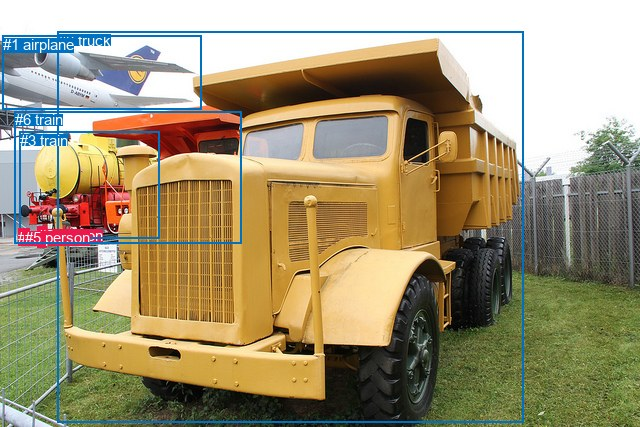
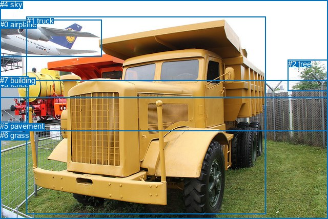

# 图片 0380：2331151.jpg

随机样本序号：343。图片 SHA256：`edcce591803494f25d75b861d799a3df9b664069773fcab5bbfbd7937058d417`。

红色框表示人，蓝色框表示其他物体。两个模式分别保留自身框编号，可依据位置比较对应对象。

## 自动检测框与输出

人的框编号：`[2, 4, 5]`。状态：`ok`。

### 自动检测全部物体框

| 编号 | 类别 | 是否为人 | 检测分数 | 像素坐标 xyxy |
|---|---|---|---|---|
| 0 | truck | False | 0.9964 | 57.8, 31.6, 523.1, 422.8 |
| 1 | airplane | False | 0.9742 | 2.8, 35.8, 201.7, 109.4 |
| 2 | person | True | 0.9226 | 37.7, 226.8, 46.5, 248.0 |
| 3 | train | False | 0.8999 | 19.5, 131.7, 159.2, 238.9 |
| 4 | person | True | 0.7371 | 18.1, 228.8, 23.8, 244.0 |
| 5 | person | True | 0.6627 | 24.7, 228.6, 29.8, 243.5 |
| 6 | train | False | 0.5079 | 14.8, 111.2, 241.5, 243.9 |

### 自动检测 Top50 人相关候选

评分物体对：42；人相关物体对：30；输出关系：50。

| 排名 | 主语编号与类别 | 关系 | 宾语编号与类别 | 类型 | 人与人 | 排序分数 | 原始融合 logit |
|---|---|---|---|---|---|---|---|
| 1 | #2 person | walking on | #6 train | semantic | False | 0.97099 | 3.5106 |
| 2 | #2 person | walking on | #3 train | semantic | False | 0.96818 | 3.4153 |
| 3 | #5 person | walking on | #6 train | semantic | False | 0.96099 | 3.2043 |
| 4 | #5 person | walking on | #3 train | semantic | False | 0.94947 | 2.9334 |
| 5 | #4 person | walking on | #6 train | semantic | False | 0.94876 | 2.9186 |
| 6 | #4 person | walking on | #3 train | semantic | False | 0.92675 | 2.5378 |
| 7 | #2 person | beside | #3 train | spatial | False | 0.87621 | 1.9570 |
| 8 | #2 person | looking at | #0 truck | semantic | False | 0.87392 | 1.9361 |
| 9 | #5 person | walking on | #4 person | semantic | True | 0.86864 | 1.8890 |
| 10 | #4 person | walking on | #5 person | semantic | True | 0.85736 | 1.7935 |
| 11 | #2 person | beside | #6 train | spatial | False | 0.85066 | 1.7398 |
| 12 | #5 person | looking at | #0 truck | semantic | False | 0.83264 | 1.6045 |
| 13 | #4 person | looking at | #0 truck | semantic | False | 0.81415 | 1.4772 |
| 14 | #5 person | beside | #3 train | spatial | False | 0.80267 | 1.4031 |
| 15 | #5 person | beside | #6 train | spatial | False | 0.78804 | 1.3131 |
| 16 | #4 person | beside | #6 train | spatial | False | 0.76239 | 1.1658 |
| 17 | #4 person | beside | #3 train | spatial | False | 0.75719 | 1.1373 |
| 18 | #0 truck | parked on | #4 person | semantic | False | 0.65114 | 0.6240 |
| 19 | #0 truck | parked on | #5 person | semantic | False | 0.58962 | 0.3624 |
| 20 | #5 person | walking on | #2 person | semantic | True | 0.56899 | 0.2777 |
| 21 | #2 person | looking at | #1 airplane | semantic | False | 0.54364 | 0.1750 |
| 22 | #5 person | looking at | #1 airplane | semantic | False | 0.54200 | 0.1684 |
| 23 | #4 person | looking at | #1 airplane | semantic | False | 0.52728 | 0.1092 |
| 24 | #2 person | beside | #0 truck | spatial | False | 0.50045 | 0.0018 |
| 25 | #2 person | walking on | #5 person | semantic | True | 0.48457 | -0.0617 |
| 26 | #2 person | walking on | #4 person | semantic | True | 0.46323 | -0.1473 |
| 27 | #4 person | beside | #5 person | spatial | True | 0.44061 | -0.2387 |
| 28 | #5 person | beside | #0 truck | spatial | False | 0.41728 | -0.3340 |
| 29 | #4 person | beside | #0 truck | spatial | False | 0.40847 | -0.3703 |
| 30 | #4 person | walking on | #2 person | semantic | True | 0.40107 | -0.4010 |
| 31 | #5 person | beside | #4 person | spatial | True | 0.36972 | -0.5334 |
| 32 | #0 truck | parked on | #2 person | semantic | False | 0.36455 | -0.5557 |
| 33 | #6 train | parked on | #4 person | semantic | False | 0.32074 | -0.7504 |
| 34 | #2 person | beside | #5 person | spatial | True | 0.26767 | -1.0065 |
| 35 | #6 train | in | #4 person | spatial | False | 0.24462 | -1.1275 |
| 36 | #3 train | parked on | #4 person | semantic | False | 0.21674 | -1.2848 |
| 37 | #5 person | beside | #2 person | spatial | True | 0.21418 | -1.2999 |
| 38 | #6 train | in | #5 person | spatial | False | 0.20645 | -1.3465 |
| 39 | #6 train | parked on | #5 person | semantic | False | 0.20566 | -1.3513 |
| 40 | #2 person | beside | #4 person | spatial | True | 0.18750 | -1.4663 |
| 41 | #0 truck | in | #4 person | spatial | False | 0.17469 | -1.5528 |
| 42 | #0 truck | in | #5 person | spatial | False | 0.15624 | -1.6865 |
| 43 | #3 train | in | #4 person | spatial | False | 0.15465 | -1.6986 |
| 44 | #1 airplane | flying over | #4 person | semantic | False | 0.15323 | -1.7095 |
| 45 | #4 person | beside | #2 person | spatial | True | 0.14320 | -1.7890 |
| 46 | #3 train | in | #5 person | spatial | False | 0.13815 | -1.8308 |
| 47 | #3 train | parked on | #5 person | semantic | False | 0.13622 | -1.8471 |
| 48 | #0 truck | in | #2 person | spatial | False | 0.13217 | -1.8819 |
| 49 | #6 train | in | #2 person | spatial | False | 0.12431 | -1.9522 |
| 50 | #1 airplane | over | #4 person | spatial | False | 0.11866 | -2.0052 |

### 自动检测逐条人相关 GT 核验

本图没有人相关 GT，R@50 无分母；预测候选继续展示。

## 真实框与输出

人的框编号：`[]`。

### 真实框全部物体框

| 编号 | 类别 | 是否为人 | 检测分数 | 像素坐标 xyxy |
|---|---|---|---|---|
| 0 | airplane | False | GT | 0.0, 39.0, 199.0, 111.0 |
| 1 | truck | False | GT | 52.0, 32.0, 519.0, 417.0 |
| 2 | tree | False | GT | 562.0, 116.0, 640.0, 177.0 |
| 3 | fence | False | GT | 0.0, 156.0, 640.0, 427.0 |
| 4 | sky | False | GT | 0.0, 0.0, 640.0, 190.0 |
| 5 | pavement | False | GT | 0.0, 237.0, 55.0, 273.0 |
| 6 | grass | False | GT | 0.0, 255.0, 640.0, 427.0 |
| 7 | building | False | GT | 0.0, 148.0, 56.0, 242.0 |

### 真实框 Top50 人相关候选

评分物体对：0；人相关物体对：0；输出关系：0。

| 排名 | 主语编号与类别 | 关系 | 宾语编号与类别 | 类型 | 人与人 | 排序分数 | 原始融合 logit |
|---|---|---|---|---|---|---|---|

### 真实框逐条人相关 GT 核验

本图没有人相关 GT，R@50 无分母；预测候选继续展示。

## 全部人相关 GT

| 主语编号与类别 | 关系 | 宾语编号与类别 |
|---|---|---|

原始记录、全部人相关物体对的两项预测与分项分数见 [逐图证据 JSON](../evidence/cases/0380.json)。全部56类 logits 保留于本机 HOR/output/random500/logits/。

<!-- HOR_COMPLETE_RESULTS -->

## 六组条件的完整输出对照

以下保留同一图片三种框与候选模式、两种谓词输出规则的全部 Top50。框编号各自在所属模式内解释。

### 自动检测框完整枚举：空间与语义各保留一个谓词

| 排名 | 主语编号与类别 | 谓词 | 宾语编号与类别 | 分组 | 排序分数 | predicate logit | pair logit |
|---|---|---|---|---|---|---|---|
| 1 | #2 person | walking on | #6 train | semantic | 0.9709868 | 3.6561522 | -0.1455871 |
| 2 | #2 person | walking on | #3 train | semantic | 0.9681808 | 3.4635892 | -0.0482396 |
| 3 | #5 person | walking on | #6 train | semantic | 0.9609948 | 3.5959687 | -0.3916940 |
| 4 | #5 person | walking on | #3 train | semantic | 0.9494721 | 3.2349019 | -0.3015218 |
| 5 | #4 person | walking on | #6 train | semantic | 0.9487571 | 3.4274640 | -0.5088903 |
| 6 | #4 person | walking on | #3 train | semantic | 0.9267501 | 2.9550633 | -0.4172568 |
| 7 | #2 person | beside | #3 train | spatial | 0.8762121 | 2.0052786 | -0.0482396 |
| 8 | #2 person | looking at | #0 truck | semantic | 0.8739201 | 2.3151941 | -0.3791207 |
| 9 | #5 person | walking on | #4 person | semantic | 0.8686387 | 1.9860802 | -0.0971047 |
| 10 | #4 person | walking on | #5 person | semantic | 0.8573560 | 1.9860668 | -0.1925659 |
| 11 | #2 person | beside | #6 train | spatial | 0.8506603 | 1.8853765 | -0.1455871 |
| 12 | #5 person | looking at | #0 truck | semantic | 0.8326437 | 2.1986642 | -0.5941833 |
| 13 | #4 person | looking at | #0 truck | semantic | 0.8141522 | 2.1675272 | -0.6903076 |
| 14 | #5 person | beside | #3 train | spatial | 0.8026715 | 1.7045975 | -0.3015218 |
| 15 | #5 person | beside | #6 train | spatial | 0.7880372 | 1.7048287 | -0.3916940 |
| 16 | #4 person | beside | #6 train | spatial | 0.7623937 | 1.6747379 | -0.5088903 |
| 17 | #4 person | beside | #3 train | spatial | 0.7571922 | 1.5546036 | -0.4172568 |
| 18 | #0 truck | parked on | #4 person | semantic | 0.6511364 | 1.7072148 | -1.0831766 |
| 19 | #0 truck | parked on | #5 person | semantic | 0.5896161 | 1.3763866 | -1.0140080 |
| 20 | #5 person | walking on | #2 person | semantic | 0.5689892 | 0.5988865 | -0.3211582 |
| 21 | #2 person | looking at | #1 airplane | semantic | 0.5436403 | 0.7318845 | -0.5568780 |
| 22 | #5 person | looking at | #1 airplane | semantic | 0.5419957 | 0.8307867 | -0.6624073 |
| 23 | #4 person | looking at | #1 airplane | semantic | 0.5272758 | 0.8283467 | -0.7191350 |
| 24 | #2 person | beside | #0 truck | spatial | 0.5004522 | 0.3809295 | -0.3791207 |
| 25 | #2 person | walking on | #5 person | semantic | 0.4845701 | -0.0224929 | -0.0392464 |
| 26 | #2 person | walking on | #4 person | semantic | 0.4632325 | -0.1127667 | -0.0345690 |
| 27 | #4 person | beside | #5 person | spatial | 0.4406077 | -0.0461302 | -0.1925659 |
| 28 | #5 person | beside | #0 truck | spatial | 0.4172760 | 0.2602177 | -0.5941833 |
| 29 | #4 person | beside | #0 truck | spatial | 0.4084655 | 0.3199949 | -0.6903076 |
| 30 | #4 person | walking on | #2 person | semantic | 0.4010746 | 0.0030823 | -0.4040720 |
| 31 | #5 person | beside | #4 person | spatial | 0.3697221 | -0.4363046 | -0.0971047 |
| 32 | #0 truck | parked on | #2 person | semantic | 0.3645500 | 0.2939100 | -0.8495796 |
| 33 | #6 train | parked on | #4 person | semantic | 0.3207445 | -0.2463832 | -0.5039692 |
| 34 | #2 person | beside | #5 person | spatial | 0.2676654 | -0.9672532 | -0.0392464 |
| 35 | #6 train | in | #4 person | spatial | 0.2446174 | -0.6235600 | -0.5039692 |
| 36 | #3 train | parked on | #4 person | semantic | 0.2167354 | -0.8481317 | -0.4366613 |
| 37 | #5 person | beside | #2 person | spatial | 0.2141818 | -0.9787424 | -0.3211582 |
| 38 | #6 train | in | #5 person | spatial | 0.2064451 | -0.8429410 | -0.5035470 |
| 39 | #6 train | parked on | #5 person | semantic | 0.2056608 | -0.8477352 | -0.5035470 |
| 40 | #2 person | beside | #4 person | spatial | 0.1875035 | -1.4317448 | -0.0345690 |
| 41 | #0 truck | in | #4 person | spatial | 0.1746852 | -0.4696031 | -1.0831766 |
| 42 | #0 truck | in | #5 person | spatial | 0.1562365 | -0.6724935 | -1.0140080 |
| 43 | #3 train | in | #4 person | spatial | 0.1546544 | -1.2618911 | -0.4366613 |
| 44 | #1 airplane | flying over | #4 person | semantic | 0.1532302 | -1.3743718 | -0.3351157 |
| 45 | #4 person | beside | #2 person | spatial | 0.1431999 | -1.3848910 | -0.4040720 |
| 46 | #3 train | in | #5 person | spatial | 0.1381468 | -1.3878717 | -0.4428963 |
| 47 | #3 train | parked on | #5 person | semantic | 0.1362175 | -1.4041717 | -0.4428963 |
| 48 | #0 truck | in | #2 person | spatial | 0.1321730 | -1.0323012 | -0.8495796 |
| 49 | #6 train | in | #2 person | spatial | 0.1243111 | -1.4192076 | -0.5330156 |
| 50 | #1 airplane | over | #4 person | spatial | 0.1186631 | -1.6700361 | -0.3351157 |

没有人相关 GT，本条件的召回率无分母。

### 自动检测框完整枚举：每对只保留一个谓词

| 排名 | 主语编号与类别 | 谓词 | 宾语编号与类别 | 分组 | 排序分数 | predicate logit | pair logit |
|---|---|---|---|---|---|---|---|
| 1 | #2 person | walking on | #6 train | single | 0.9709868 | 3.6561522 | -0.1455871 |
| 2 | #2 person | walking on | #3 train | single | 0.9681808 | 3.4635892 | -0.0482396 |
| 3 | #5 person | walking on | #6 train | single | 0.9609948 | 3.5959687 | -0.3916940 |
| 4 | #5 person | walking on | #3 train | single | 0.9494721 | 3.2349019 | -0.3015218 |
| 5 | #4 person | walking on | #6 train | single | 0.9487571 | 3.4274640 | -0.5088903 |
| 6 | #4 person | walking on | #3 train | single | 0.9267501 | 2.9550633 | -0.4172568 |
| 7 | #2 person | looking at | #0 truck | single | 0.8739201 | 2.3151941 | -0.3791207 |
| 8 | #5 person | walking on | #4 person | single | 0.8686387 | 1.9860802 | -0.0971047 |
| 9 | #4 person | walking on | #5 person | single | 0.8573560 | 1.9860668 | -0.1925659 |
| 10 | #5 person | looking at | #0 truck | single | 0.8326437 | 2.1986642 | -0.5941833 |
| 11 | #4 person | looking at | #0 truck | single | 0.8141522 | 2.1675272 | -0.6903076 |
| 12 | #0 truck | parked on | #4 person | single | 0.6511364 | 1.7072148 | -1.0831766 |
| 13 | #0 truck | parked on | #5 person | single | 0.5896161 | 1.3763866 | -1.0140080 |
| 14 | #5 person | walking on | #2 person | single | 0.5689892 | 0.5988865 | -0.3211582 |
| 15 | #2 person | looking at | #1 airplane | single | 0.5436403 | 0.7318845 | -0.5568780 |
| 16 | #5 person | looking at | #1 airplane | single | 0.5419957 | 0.8307867 | -0.6624073 |
| 17 | #4 person | looking at | #1 airplane | single | 0.5272758 | 0.8283467 | -0.7191350 |
| 18 | #2 person | walking on | #5 person | single | 0.4845701 | -0.0224929 | -0.0392464 |
| 19 | #2 person | walking on | #4 person | single | 0.4632325 | -0.1127667 | -0.0345690 |
| 20 | #4 person | walking on | #2 person | single | 0.4010746 | 0.0030823 | -0.4040720 |
| 21 | #0 truck | parked on | #2 person | single | 0.3645500 | 0.2939100 | -0.8495796 |
| 22 | #6 train | parked on | #4 person | single | 0.3207445 | -0.2463832 | -0.5039692 |
| 23 | #3 train | parked on | #4 person | single | 0.2167354 | -0.8481317 | -0.4366613 |
| 24 | #6 train | in | #5 person | single | 0.2064451 | -0.8429410 | -0.5035470 |
| 25 | #1 airplane | flying over | #4 person | single | 0.1532302 | -1.3743718 | -0.3351157 |
| 26 | #3 train | in | #5 person | single | 0.1381468 | -1.3878717 | -0.4428963 |
| 27 | #6 train | in | #2 person | single | 0.1243111 | -1.4192076 | -0.5330156 |
| 28 | #1 airplane | over | #5 person | single | 0.0917371 | -1.9228222 | -0.3697852 |
| 29 | #1 airplane | over | #2 person | single | 0.0838398 | -1.9236112 | -0.4676723 |
| 30 | #3 train | in | #2 person | single | 0.0805047 | -1.9390557 | -0.4964539 |

没有人相关 GT，本条件的召回率无分母。

### 真实框完整枚举：空间与语义各保留一个谓词

| 排名 | 主语编号与类别 | 谓词 | 宾语编号与类别 | 分组 | 排序分数 | predicate logit | pair logit |
|---|---|---|---|---|---|---|---|

没有人相关 GT，本条件的召回率无分母。

### 真实框完整枚举：每对只保留一个谓词

| 排名 | 主语编号与类别 | 谓词 | 宾语编号与类别 | 分组 | 排序分数 | predicate logit | pair logit |
|---|---|---|---|---|---|---|---|

没有人相关 GT，本条件的召回率无分母。

### 真实框400候选：空间与语义各保留一个谓词

| 排名 | 主语编号与类别 | 谓词 | 宾语编号与类别 | 分组 | 排序分数 | predicate logit | pair logit |
|---|---|---|---|---|---|---|---|

没有人相关 GT，本条件的召回率无分母。

### 真实框400候选：每对只保留一个谓词

| 排名 | 主语编号与类别 | 谓词 | 宾语编号与类别 | 分组 | 排序分数 | predicate logit | pair logit |
|---|---|---|---|---|---|---|---|

没有人相关 GT，本条件的召回率无分母。
