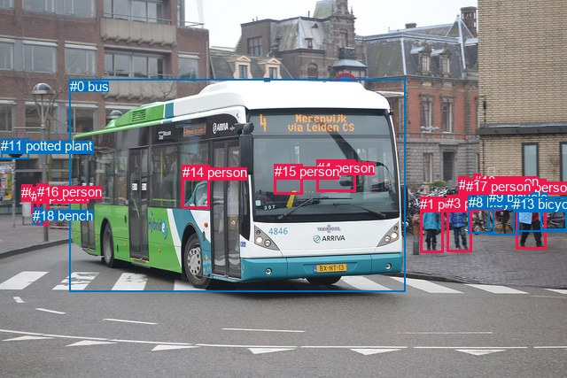
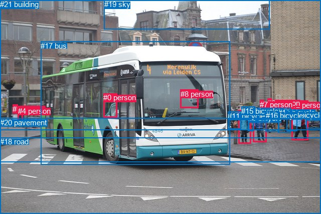

# 图片 0382：2331166.jpg

随机样本序号：491。图片 SHA256：`51af6bee62011f2031b93e7039c81bf8ad65d484146ac8f2541a530d410644a0`。

红色框表示人，蓝色框表示其他物体。两个模式分别保留自身框编号，可依据位置比较对应对象。

## 自动检测框与输出

人的框编号：`[1, 2, 3, 4, 6, 7, 10, 12, 14, 15, 16, 17]`。状态：`ok`。

### 自动检测全部物体框

| 编号 | 类别 | 是否为人 | 检测分数 | 像素坐标 xyxy |
|---|---|---|---|---|
| 0 | bus | False | 0.9997 | 78.8, 89.1, 457.4, 329.3 |
| 1 | person | True | 0.9966 | 474.4, 222.2, 500.2, 286.0 |
| 2 | person | True | 0.9966 | 582.8, 202.9, 616.4, 281.4 |
| 3 | person | True | 0.9945 | 504.3, 220.8, 532.4, 284.7 |
| 4 | person | True | 0.9778 | 357.9, 180.8, 401.4, 216.6 |
| 5 | bicycle | False | 0.9410 | 610.9, 222.9, 640.0, 259.2 |
| 6 | person | True | 0.9271 | 24.3, 208.7, 36.0, 228.0 |
| 7 | person | True | 0.8841 | 35.2, 212.8, 45.0, 241.5 |
| 8 | bicycle | False | 0.8648 | 528.7, 219.8, 557.6, 263.4 |
| 9 | bicycle | False | 0.7401 | 551.7, 214.3, 585.9, 265.2 |
| 10 | person | True | 0.7181 | 534.9, 196.0, 542.3, 215.9 |
| 11 | potted plant | False | 0.7172 | 1.3, 156.2, 32.4, 179.6 |
| 12 | person | True | 0.7125 | 517.8, 199.8, 529.7, 219.4 |
| 13 | bicycle | False | 0.6337 | 579.3, 222.3, 639.2, 261.2 |
| 14 | person | True | 0.6052 | 205.9, 186.3, 236.1, 235.9 |
| 15 | person | True | 0.5417 | 309.9, 185.2, 341.5, 219.3 |
| 16 | person | True | 0.4363 | 41.6, 208.0, 54.3, 254.2 |
| 17 | person | True | 0.4103 | 525.6, 202.1, 533.2, 213.8 |
| 18 | bench | False | 0.3650 | 37.0, 234.7, 47.9, 253.1 |

### 自动检测 Top50 人相关候选

评分物体对：342；人相关物体对：300；输出关系：50。

| 排名 | 主语编号与类别 | 关系 | 宾语编号与类别 | 类型 | 人与人 | 排序分数 | 原始融合 logit |
|---|---|---|---|---|---|---|---|
| 1 | #4 person | driving on | #0 bus | semantic | False | 0.98930 | 4.5272 |
| 2 | #15 person | driving on | #0 bus | semantic | False | 0.98125 | 3.9577 |
| 3 | #16 person | holding | #18 bench | semantic | False | 0.97642 | 3.7237 |
| 4 | #2 person | pushing | #5 bicycle | semantic | False | 0.97599 | 3.7050 |
| 5 | #7 person | pushing | #18 bench | semantic | False | 0.97031 | 3.4868 |
| 6 | #0 bus | carrying | #15 person | semantic | False | 0.96959 | 3.4622 |
| 7 | #14 person | riding | #0 bus | semantic | False | 0.96919 | 3.4485 |
| 8 | #0 bus | carrying | #4 person | semantic | False | 0.96754 | 3.3948 |
| 9 | #2 person | pushing | #13 bicycle | semantic | False | 0.96306 | 3.2609 |
| 10 | #3 person | pushing | #8 bicycle | semantic | False | 0.95403 | 3.0328 |
| 11 | #0 bus | carrying | #14 person | semantic | False | 0.94021 | 2.7552 |
| 12 | #12 person | wearing | #17 person | semantic | True | 0.93635 | 2.6885 |
| 13 | #2 person | walking on | #0 bus | semantic | False | 0.93550 | 2.6744 |
| 14 | #2 person | beside | #0 bus | spatial | False | 0.92659 | 2.5354 |
| 15 | #16 person | on | #18 bench | spatial | False | 0.91536 | 2.3809 |
| 16 | #15 person | in | #0 bus | spatial | False | 0.91525 | 2.3795 |
| 17 | #4 person | in | #0 bus | spatial | False | 0.90839 | 2.2942 |
| 18 | #14 person | beside | #0 bus | spatial | False | 0.89183 | 2.1095 |
| 19 | #7 person | on | #18 bench | spatial | False | 0.88637 | 2.0542 |
| 20 | #2 person | in | #13 bicycle | spatial | False | 0.88163 | 2.0080 |
| 21 | #2 person | pushing | #9 bicycle | semantic | False | 0.85733 | 1.7933 |
| 22 | #16 person | holding | #7 person | semantic | True | 0.84025 | 1.6601 |
| 23 | #0 bus | beside | #14 person | spatial | False | 0.81426 | 1.4780 |
| 24 | #7 person | carrying | #6 person | semantic | True | 0.79657 | 1.3650 |
| 25 | #6 person | walking on | #18 bench | semantic | False | 0.78752 | 1.3100 |
| 26 | #16 person | walking on | #0 bus | semantic | False | 0.78701 | 1.3070 |
| 27 | #0 bus | beside | #15 person | spatial | False | 0.78407 | 1.2896 |
| 28 | #12 person | in | #17 person | spatial | True | 0.75801 | 1.1418 |
| 29 | #0 bus | beside | #4 person | spatial | False | 0.75132 | 1.1056 |
| 30 | #7 person | walking on | #0 bus | semantic | False | 0.74803 | 1.0881 |
| 31 | #16 person | beside | #0 bus | spatial | False | 0.73440 | 1.0170 |
| 32 | #16 person | walking on | #6 person | semantic | True | 0.69458 | 0.8216 |
| 33 | #2 person | beside | #5 bicycle | spatial | False | 0.69122 | 0.8058 |
| 34 | #7 person | beside | #0 bus | spatial | False | 0.67974 | 0.7526 |
| 35 | #1 person | beside | #0 bus | spatial | False | 0.67802 | 0.7447 |
| 36 | #6 person | on | #18 bench | spatial | False | 0.66593 | 0.6898 |
| 37 | #7 person | walking on | #16 person | semantic | True | 0.65791 | 0.6540 |
| 38 | #6 person | walking on | #0 bus | semantic | False | 0.62064 | 0.4923 |
| 39 | #6 person | beside | #0 bus | spatial | False | 0.61463 | 0.4668 |
| 40 | #10 person | looking at | #0 bus | semantic | False | 0.59173 | 0.3711 |
| 41 | #7 person | in | #6 person | spatial | True | 0.58865 | 0.3584 |
| 42 | #1 person | walking on | #0 bus | semantic | False | 0.57345 | 0.2959 |
| 43 | #0 bus | beside | #2 person | spatial | False | 0.52598 | 0.1040 |
| 44 | #3 person | beside | #8 bicycle | spatial | False | 0.51914 | 0.0766 |
| 45 | #16 person | in | #7 person | spatial | True | 0.51216 | 0.0487 |
| 46 | #2 person | beside | #9 bicycle | spatial | False | 0.50972 | 0.0389 |
| 47 | #6 person | walking on | #7 person | semantic | True | 0.50909 | 0.0364 |
| 48 | #12 person | looking at | #0 bus | semantic | False | 0.49182 | -0.0327 |
| 49 | #17 person | looking at | #0 bus | semantic | False | 0.47711 | -0.0916 |
| 50 | #1 person | pushing | #8 bicycle | semantic | False | 0.46268 | -0.1495 |

### 自动检测逐条人相关 GT 核验

R@50：0.00%；命中 0/5。

| GT 主语编号 | GT 关系 | GT 宾语编号 | 结果阶段 | 匹配预测主语编号 | 匹配预测宾语编号 |
|---|---|---|---|---|---|
| 0 | on | 17 | wrong_predicate | [14] | [0] |
| 2 | on | 20 | endpoint_missing_or_wrong_class | [2] | [] |
| 3 | on | 20 | endpoint_missing_or_wrong_class | [1] | [] |
| 5 | walking on | 20 | endpoint_missing_or_wrong_class | [3] | [] |
| 8 | driving | 17 | wrong_predicate | [4] | [0] |

## 真实框与输出

人的框编号：`[0, 1, 2, 3, 4, 5, 6, 7, 8]`。

### 真实框全部物体框

| 编号 | 类别 | 是否为人 | 检测分数 | 像素坐标 xyxy |
|---|---|---|---|---|
| 0 | person | True | GT | 206.0, 186.0, 234.0, 234.0 |
| 1 | person | True | GT | 25.0, 209.0, 35.0, 227.0 |
| 2 | person | True | GT | 582.0, 201.0, 615.0, 280.0 |
| 3 | person | True | GT | 475.0, 220.0, 500.0, 287.0 |
| 4 | person | True | GT | 36.0, 213.0, 46.0, 241.0 |
| 5 | person | True | GT | 505.0, 221.0, 532.0, 283.0 |
| 6 | person | True | GT | 533.0, 197.0, 542.0, 218.0 |
| 7 | person | True | GT | 518.0, 200.0, 527.0, 212.0 |
| 8 | person | True | GT | 360.0, 179.0, 396.0, 216.0 |
| 9 | bicycle | False | GT | 495.0, 227.0, 506.0, 261.0 |
| 10 | bicycle | False | GT | 611.0, 224.0, 640.0, 257.0 |
| 11 | bicycle | False | GT | 454.0, 223.0, 480.0, 258.0 |
| 12 | bicycle | False | GT | 492.0, 213.0, 508.0, 228.0 |
| 13 | bicycle | False | GT | 554.0, 216.0, 579.0, 265.0 |
| 14 | bicycle | False | GT | 571.0, 221.0, 592.0, 262.0 |
| 15 | bicycle | False | GT | 481.0, 213.0, 494.0, 223.0 |
| 16 | bicycle | False | GT | 530.0, 222.0, 557.0, 263.0 |
| 17 | bus | False | GT | 81.0, 83.0, 459.0, 329.0 |
| 18 | road | False | GT | 0.0, 274.0, 640.0, 427.0 |
| 19 | sky | False | GT | 208.0, 0.0, 538.0, 59.0 |
| 20 | pavement | False | GT | 0.0, 236.0, 640.0, 324.0 |
| 21 | building | False | GT | 0.0, 0.0, 640.0, 260.0 |

### 真实框 Top50 人相关候选

评分物体对：462；人相关物体对：306；输出关系：50。

| 排名 | 主语编号与类别 | 关系 | 宾语编号与类别 | 类型 | 人与人 | 排序分数 | 原始融合 logit |
|---|---|---|---|---|---|---|---|
| 1 | #8 person | driving on | #17 bus | semantic | False | 0.99620 | 5.5694 |
| 2 | #4 person | walking on | #20 pavement | semantic | False | 0.99182 | 4.7978 |
| 3 | #0 person | driving on | #17 bus | semantic | False | 0.98866 | 4.4676 |
| 4 | #2 person | crossing | #18 road | semantic | False | 0.98407 | 4.1236 |
| 5 | #1 person | walking on | #20 pavement | semantic | False | 0.97937 | 3.8600 |
| 6 | #2 person | walking on | #20 pavement | semantic | False | 0.97000 | 3.4763 |
| 7 | #2 person | pushing | #10 bicycle | semantic | False | 0.96156 | 3.2193 |
| 8 | #2 person | carrying | #14 bicycle | semantic | False | 0.95951 | 3.1653 |
| 9 | #3 person | walking on | #20 pavement | semantic | False | 0.94702 | 2.8833 |
| 10 | #3 person | crossing | #18 road | semantic | False | 0.94579 | 2.8592 |
| 11 | #5 person | walking on | #20 pavement | semantic | False | 0.94487 | 2.8414 |
| 12 | #8 person | in | #17 bus | spatial | False | 0.94264 | 2.7993 |
| 13 | #0 person | in | #17 bus | spatial | False | 0.93992 | 2.7501 |
| 14 | #1 person | crossing | #18 road | semantic | False | 0.93231 | 2.6227 |
| 15 | #4 person | crossing | #18 road | semantic | False | 0.92392 | 2.4968 |
| 16 | #4 person | on | #20 pavement | spatial | False | 0.91761 | 2.4103 |
| 17 | #3 person | carrying | #9 bicycle | semantic | False | 0.88392 | 2.0301 |
| 18 | #3 person | holding | #12 bicycle | semantic | False | 0.85546 | 1.7781 |
| 19 | #3 person | holding | #15 bicycle | semantic | False | 0.84817 | 1.7203 |
| 20 | #5 person | crossing | #18 road | semantic | False | 0.82605 | 1.5579 |
| 21 | #5 person | pushing | #16 bicycle | semantic | False | 0.82004 | 1.5166 |
| 22 | #1 person | on | #20 pavement | spatial | False | 0.80317 | 1.4062 |
| 23 | #2 person | on | #20 pavement | spatial | False | 0.79062 | 1.3286 |
| 24 | #5 person | on | #20 pavement | spatial | False | 0.75451 | 1.1228 |
| 25 | #4 person | wearing | #1 person | semantic | True | 0.75093 | 1.1036 |
| 26 | #4 person | on | #18 road | spatial | False | 0.73170 | 1.0032 |
| 27 | #2 person | on | #18 road | spatial | False | 0.72894 | 0.9892 |
| 28 | #4 person | walking on | #21 building | semantic | False | 0.70621 | 0.8771 |
| 29 | #3 person | carrying | #11 bicycle | semantic | False | 0.69610 | 0.8288 |
| 30 | #5 person | wearing | #12 bicycle | semantic | False | 0.69247 | 0.8117 |
| 31 | #3 person | on | #20 pavement | spatial | False | 0.68882 | 0.7946 |
| 32 | #2 person | in | #14 bicycle | spatial | False | 0.68712 | 0.7867 |
| 33 | #1 person | walking on | #21 building | semantic | False | 0.67650 | 0.7377 |
| 34 | #2 person | walking on | #17 bus | semantic | False | 0.64846 | 0.6123 |
| 35 | #1 person | on | #18 road | spatial | False | 0.61804 | 0.4812 |
| 36 | #1 person | in | #21 building | spatial | False | 0.60100 | 0.4096 |
| 37 | #7 person | walking on | #20 pavement | semantic | False | 0.59297 | 0.3763 |
| 38 | #4 person | beside | #17 bus | spatial | False | 0.58474 | 0.3422 |
| 39 | #4 person | in | #1 person | spatial | True | 0.57020 | 0.2827 |
| 40 | #4 person | in | #21 building | spatial | False | 0.55879 | 0.2362 |
| 41 | #2 person | beside | #17 bus | spatial | False | 0.55654 | 0.2271 |
| 42 | #2 person | beside | #10 bicycle | spatial | False | 0.55003 | 0.2008 |
| 43 | #3 person | in | #15 bicycle | spatial | False | 0.54934 | 0.1980 |
| 44 | #2 person | pushing | #13 bicycle | semantic | False | 0.54193 | 0.1681 |
| 45 | #5 person | in | #12 bicycle | spatial | False | 0.52611 | 0.1045 |
| 46 | #3 person | in | #12 bicycle | spatial | False | 0.51474 | 0.0590 |
| 47 | #4 person | walking on | #17 bus | semantic | False | 0.51089 | 0.0436 |
| 48 | #3 person | on | #18 road | spatial | False | 0.50487 | 0.0195 |
| 49 | #5 person | wearing | #7 person | semantic | True | 0.48104 | -0.0759 |
| 50 | #17 bus | in | #8 person | spatial | False | 0.46259 | -0.1499 |

### 真实框逐条人相关 GT 核验

R@50：60.00%；命中 3/5。

| GT 主语编号 | GT 关系 | GT 宾语编号 | 结果阶段 | 匹配预测主语编号 | 匹配预测宾语编号 |
|---|---|---|---|---|---|
| 0 | on | 17 | wrong_predicate | [0] | [17] |
| 2 | on | 20 | hit50 | [2] | [20] |
| 3 | on | 20 | hit50 | [3] | [20] |
| 5 | walking on | 20 | hit50 | [5] | [20] |
| 8 | driving | 17 | wrong_predicate | [8] | [17] |

## 全部人相关 GT

| 主语编号与类别 | 关系 | 宾语编号与类别 |
|---|---|---|
| #0 person | on | #17 bus |
| #2 person | on | #20 pavement |
| #3 person | on | #20 pavement |
| #5 person | walking on | #20 pavement |
| #8 person | driving | #17 bus |

原始记录、全部人相关物体对的两项预测与分项分数见 [逐图证据 JSON](../evidence/cases/0382.json)。全部56类 logits 保留于本机 HOR/output/random500/logits/。

<!-- HOR_COMPLETE_RESULTS -->

## 六组条件的完整输出对照

以下保留同一图片三种框与候选模式、两种谓词输出规则的全部 Top50。框编号各自在所属模式内解释。

### 自动检测框完整枚举：空间与语义各保留一个谓词

| 排名 | 主语编号与类别 | 谓词 | 宾语编号与类别 | 分组 | 排序分数 | predicate logit | pair logit |
|---|---|---|---|---|---|---|---|
| 1 | #4 person | driving on | #0 bus | semantic | 0.9893048 | 4.3861566 | 0.1410459 |
| 2 | #15 person | driving on | #0 bus | semantic | 0.9812516 | 3.7844100 | 0.1733103 |
| 3 | #16 person | holding | #18 bench | semantic | 0.9764238 | 3.6068387 | 0.1168172 |
| 4 | #2 person | pushing | #5 bicycle | semantic | 0.9759902 | 3.5457034 | 0.1592847 |
| 5 | #7 person | pushing | #18 bench | semantic | 0.9703104 | 3.4866223 | 0.0001976 |
| 6 | #0 bus | carrying | #15 person | semantic | 0.9695930 | 4.1244025 | -0.6621959 |
| 7 | #14 person | riding | #0 bus | semantic | 0.9691877 | 3.3331552 | 0.1153889 |
| 8 | #0 bus | carrying | #4 person | semantic | 0.9675418 | 4.0319991 | -0.6371926 |
| 9 | #2 person | pushing | #13 bicycle | semantic | 0.9630629 | 2.8841105 | 0.3767924 |
| 10 | #3 person | pushing | #8 bicycle | semantic | 0.9540341 | 3.6056943 | -0.5728956 |
| 11 | #0 bus | carrying | #14 person | semantic | 0.9402090 | 3.3490205 | -0.5937736 |
| 12 | #12 person | wearing | #17 person | semantic | 0.9363468 | 2.6367373 | 0.0517979 |
| 13 | #2 person | walking on | #0 bus | semantic | 0.9354974 | 3.3611493 | -0.6867760 |
| 14 | #2 person | beside | #0 bus | spatial | 0.9265877 | 3.2221928 | -0.6867760 |
| 15 | #16 person | on | #18 bench | spatial | 0.9153557 | 2.2640376 | 0.1168172 |
| 16 | #15 person | in | #0 bus | spatial | 0.9152539 | 2.2062316 | 0.1733103 |
| 17 | #4 person | in | #0 bus | spatial | 0.9083936 | 2.1531315 | 0.1410459 |
| 18 | #14 person | beside | #0 bus | spatial | 0.8918266 | 1.9941473 | 0.1153889 |
| 19 | #7 person | on | #18 bench | spatial | 0.8863689 | 2.0539784 | 0.0001976 |
| 20 | #2 person | in | #13 bicycle | spatial | 0.8816314 | 1.6311784 | 0.3767924 |
| 21 | #2 person | pushing | #9 bicycle | semantic | 0.8573332 | 1.7708974 | 0.0224170 |
| 22 | #16 person | holding | #7 person | semantic | 0.8402458 | 1.6871166 | -0.0270589 |
| 23 | #0 bus | beside | #14 person | spatial | 0.8142635 | 2.0717282 | -0.5937736 |
| 24 | #7 person | carrying | #6 person | semantic | 0.7965716 | 1.3341408 | 0.0308625 |
| 25 | #6 person | walking on | #18 bench | semantic | 0.7875199 | 1.4023743 | -0.0923343 |
| 26 | #16 person | walking on | #0 bus | semantic | 0.7870068 | 2.0432105 | -0.7362337 |
| 27 | #0 bus | beside | #15 person | spatial | 0.7840747 | 1.9517679 | -0.6621959 |
| 28 | #12 person | in | #17 person | spatial | 0.7580062 | 1.0899820 | 0.0517979 |
| 29 | #0 bus | beside | #4 person | spatial | 0.7513158 | 1.7428350 | -0.6371926 |
| 30 | #7 person | walking on | #0 bus | semantic | 0.7480326 | 1.9980803 | -0.9099331 |
| 31 | #16 person | beside | #0 bus | spatial | 0.7343954 | 1.7532725 | -0.7362337 |
| 32 | #16 person | walking on | #6 person | semantic | 0.6945783 | 0.7614269 | 0.0601845 |
| 33 | #2 person | beside | #5 bicycle | spatial | 0.6912205 | 0.6465468 | 0.1592847 |
| 34 | #7 person | beside | #0 bus | spatial | 0.6797394 | 1.6625075 | -0.9099331 |
| 35 | #1 person | beside | #0 bus | spatial | 0.6780218 | 1.8073959 | -1.0627005 |
| 36 | #6 person | on | #18 bench | spatial | 0.6659264 | 0.7821522 | -0.0923343 |
| 37 | #7 person | walking on | #16 person | semantic | 0.6579050 | 0.7944584 | -0.1404862 |
| 38 | #6 person | walking on | #0 bus | semantic | 0.6206444 | 1.4173293 | -0.9250450 |
| 39 | #6 person | beside | #0 bus | spatial | 0.6146296 | 1.3918600 | -0.9250450 |
| 40 | #10 person | looking at | #0 bus | semantic | 0.5917279 | 1.2917433 | -0.9206304 |
| 41 | #7 person | in | #6 person | spatial | 0.5886493 | 0.3275218 | 0.0308625 |
| 42 | #1 person | walking on | #0 bus | semantic | 0.5734458 | 1.3586245 | -1.0627005 |
| 43 | #0 bus | beside | #2 person | spatial | 0.5259824 | 1.8029308 | -1.6989073 |
| 44 | #3 person | beside | #8 bicycle | spatial | 0.5191408 | 0.6494961 | -0.5728956 |
| 45 | #16 person | in | #7 person | spatial | 0.5121636 | 0.0757227 | -0.0270589 |
| 46 | #2 person | beside | #9 bicycle | spatial | 0.5097231 | 0.0164804 | 0.0224170 |
| 47 | #6 person | walking on | #7 person | semantic | 0.5090930 | 0.2077141 | -0.1713380 |
| 48 | #12 person | looking at | #0 bus | semantic | 0.4918185 | 0.9400616 | -0.9727907 |
| 49 | #17 person | looking at | #0 bus | semantic | 0.4771061 | 0.8753462 | -0.9669857 |
| 50 | #1 person | pushing | #8 bicycle | semantic | 0.4626849 | 0.5668936 | -0.7164320 |

GT 命中：0/5，R@50=0.00%。

| GT主语 | GT谓词 | GT宾语 | 结果阶段 | 匹配主语框 | 匹配宾语框 |
|---|---|---|---|---|---|
| 0 | on | 17 | wrong_predicate | [14] | [0] |
| 2 | on | 20 | endpoint_missing_or_wrong_class | [2] | [] |
| 3 | on | 20 | endpoint_missing_or_wrong_class | [1] | [] |
| 5 | walking on | 20 | endpoint_missing_or_wrong_class | [3] | [] |
| 8 | driving | 17 | wrong_predicate | [4] | [0] |

### 自动检测框完整枚举：每对只保留一个谓词

| 排名 | 主语编号与类别 | 谓词 | 宾语编号与类别 | 分组 | 排序分数 | predicate logit | pair logit |
|---|---|---|---|---|---|---|---|
| 1 | #4 person | driving on | #0 bus | single | 0.9893048 | 4.3861566 | 0.1410459 |
| 2 | #15 person | driving on | #0 bus | single | 0.9812516 | 3.7844100 | 0.1733103 |
| 3 | #16 person | holding | #18 bench | single | 0.9764238 | 3.6068387 | 0.1168172 |
| 4 | #2 person | pushing | #5 bicycle | single | 0.9759902 | 3.5457034 | 0.1592847 |
| 5 | #7 person | pushing | #18 bench | single | 0.9703104 | 3.4866223 | 0.0001976 |
| 6 | #0 bus | carrying | #15 person | single | 0.9695930 | 4.1244025 | -0.6621959 |
| 7 | #14 person | riding | #0 bus | single | 0.9691877 | 3.3331552 | 0.1153889 |
| 8 | #0 bus | carrying | #4 person | single | 0.9675418 | 4.0319991 | -0.6371926 |
| 9 | #2 person | pushing | #13 bicycle | single | 0.9630629 | 2.8841105 | 0.3767924 |
| 10 | #3 person | pushing | #8 bicycle | single | 0.9540341 | 3.6056943 | -0.5728956 |
| 11 | #0 bus | carrying | #14 person | single | 0.9402090 | 3.3490205 | -0.5937736 |
| 12 | #12 person | wearing | #17 person | single | 0.9363468 | 2.6367373 | 0.0517979 |
| 13 | #2 person | walking on | #0 bus | single | 0.9354974 | 3.3611493 | -0.6867760 |
| 14 | #2 person | pushing | #9 bicycle | single | 0.8573332 | 1.7708974 | 0.0224170 |
| 15 | #16 person | holding | #7 person | single | 0.8402458 | 1.6871166 | -0.0270589 |
| 16 | #7 person | carrying | #6 person | single | 0.7965716 | 1.3341408 | 0.0308625 |
| 17 | #6 person | walking on | #18 bench | single | 0.7875199 | 1.4023743 | -0.0923343 |
| 18 | #16 person | walking on | #0 bus | single | 0.7870068 | 2.0432105 | -0.7362337 |
| 19 | #7 person | walking on | #0 bus | single | 0.7480326 | 1.9980803 | -0.9099331 |
| 20 | #16 person | walking on | #6 person | single | 0.6945783 | 0.7614269 | 0.0601845 |
| 21 | #1 person | beside | #0 bus | single | 0.6780218 | 1.8073959 | -1.0627005 |
| 22 | #7 person | walking on | #16 person | single | 0.6579050 | 0.7944584 | -0.1404862 |
| 23 | #6 person | walking on | #0 bus | single | 0.6206444 | 1.4173293 | -0.9250450 |
| 24 | #10 person | looking at | #0 bus | single | 0.5917279 | 1.2917433 | -0.9206304 |
| 25 | #0 bus | beside | #2 person | single | 0.5259824 | 1.8029308 | -1.6989073 |
| 26 | #6 person | walking on | #7 person | single | 0.5090930 | 0.2077141 | -0.1713380 |
| 27 | #12 person | looking at | #0 bus | single | 0.4918185 | 0.9400616 | -0.9727907 |
| 28 | #17 person | looking at | #0 bus | single | 0.4771061 | 0.8753462 | -0.9669857 |
| 29 | #1 person | pushing | #8 bicycle | single | 0.4626849 | 0.5668936 | -0.7164320 |
| 30 | #3 person | beside | #0 bus | single | 0.4612541 | 0.9661875 | -1.1214824 |
| 31 | #2 person | pushing | #8 bicycle | single | 0.4504468 | 0.2060356 | -0.4049013 |
| 32 | #17 person | on | #12 person | single | 0.4173544 | -0.3572898 | 0.0236463 |
| 33 | #12 person | walking on | #8 bicycle | single | 0.4013387 | -0.0360122 | -0.3638780 |
| 34 | #0 bus | beside | #16 person | single | 0.3799124 | 1.4460573 | -1.9359775 |
| 35 | #8 bicycle | parked on | #10 person | single | 0.3787979 | -0.2474198 | -0.2472337 |
| 36 | #8 bicycle | parked on | #12 person | single | 0.3669859 | -0.3377199 | -0.2074491 |
| 37 | #8 bicycle | parked on | #17 person | single | 0.3478364 | -0.4580851 | -0.1704780 |
| 38 | #0 bus | beside | #1 person | single | 0.3453707 | 1.1720557 | -1.8115063 |
| 39 | #3 person | pushing | #5 bicycle | single | 0.3053696 | -0.1852050 | -0.6366521 |
| 40 | #17 person | walking on | #10 person | single | 0.3046921 | -0.6634130 | -0.1616399 |
| 41 | #6 person | walking on | #16 person | single | 0.2972277 | -0.6303253 | -0.2302091 |
| 42 | #0 bus | beside | #3 person | single | 0.2951310 | 0.9607811 | -1.8313738 |
| 43 | #12 person | walking on | #10 person | single | 0.2915668 | -0.7100618 | -0.1777248 |
| 44 | #10 person | on | #17 person | single | 0.2785062 | -0.8805995 | -0.0712839 |
| 45 | #0 bus | beside | #12 person | single | 0.2751126 | 0.7225661 | -1.6914018 |
| 46 | #3 person | pushing | #9 bicycle | single | 0.2691260 | -0.4256229 | -0.5734385 |
| 47 | #10 person | walking on | #8 bicycle | single | 0.2415758 | -0.4753532 | -0.6687066 |
| 48 | #17 person | walking on | #8 bicycle | single | 0.2351478 | -0.7190795 | -0.4603889 |
| 49 | #0 bus | beside | #7 person | single | 0.2277887 | 0.9349542 | -2.1557941 |
| 50 | #0 bus | beside | #6 person | single | 0.2168581 | 0.8754225 | -2.1594930 |

GT 命中：0/5，R@50=0.00%。

| GT主语 | GT谓词 | GT宾语 | 结果阶段 | 匹配主语框 | 匹配宾语框 |
|---|---|---|---|---|---|
| 0 | on | 17 | wrong_predicate | [14] | [0] |
| 2 | on | 20 | endpoint_missing_or_wrong_class | [2] | [] |
| 3 | on | 20 | endpoint_missing_or_wrong_class | [1] | [] |
| 5 | walking on | 20 | endpoint_missing_or_wrong_class | [3] | [] |
| 8 | driving | 17 | wrong_predicate | [4] | [0] |

### 真实框完整枚举：空间与语义各保留一个谓词

| 排名 | 主语编号与类别 | 谓词 | 宾语编号与类别 | 分组 | 排序分数 | predicate logit | pair logit |
|---|---|---|---|---|---|---|---|
| 1 | #8 person | driving on | #17 bus | semantic | 0.9962017 | 5.4692798 | 0.1001240 |
| 2 | #4 person | walking on | #20 pavement | semantic | 0.9918193 | 4.9650578 | -0.1672974 |
| 3 | #0 person | driving on | #17 bus | semantic | 0.9886556 | 4.3868442 | 0.0807721 |
| 4 | #2 person | crossing | #18 road | semantic | 0.9840718 | 4.4203696 | -0.2967588 |
| 5 | #1 person | walking on | #20 pavement | semantic | 0.9793674 | 4.1556191 | -0.2955821 |
| 6 | #2 person | walking on | #20 pavement | semantic | 0.9700046 | 3.5267558 | -0.0505013 |
| 7 | #2 person | pushing | #10 bicycle | semantic | 0.9615550 | 3.0042310 | 0.2150920 |
| 8 | #2 person | carrying | #14 bicycle | semantic | 0.9595070 | 2.6757965 | 0.4894952 |
| 9 | #3 person | walking on | #20 pavement | semantic | 0.9470163 | 3.4515195 | -0.5681879 |
| 10 | #3 person | crossing | #18 road | semantic | 0.9457933 | 3.7612062 | -0.9019851 |
| 11 | #5 person | walking on | #20 pavement | semantic | 0.9448726 | 3.3221231 | -0.4807204 |
| 12 | #8 person | in | #17 bus | spatial | 0.9426396 | 2.6992059 | 0.1001240 |
| 13 | #0 person | in | #17 bus | spatial | 0.9399195 | 2.6693373 | 0.0807721 |
| 14 | #1 person | crossing | #18 road | semantic | 0.9323068 | 3.1643562 | -0.5416791 |
| 15 | #4 person | crossing | #18 road | semantic | 0.9239151 | 2.9867229 | -0.4899514 |
| 16 | #4 person | on | #20 pavement | spatial | 0.9176122 | 2.5776348 | -0.1672974 |
| 17 | #3 person | carrying | #9 bicycle | semantic | 0.8839195 | 1.9145947 | 0.1154870 |
| 18 | #3 person | holding | #12 bicycle | semantic | 0.8554645 | 1.9566302 | -0.1785108 |
| 19 | #3 person | holding | #15 bicycle | semantic | 0.8481656 | 1.9531269 | -0.2328414 |
| 20 | #5 person | crossing | #18 road | semantic | 0.8260472 | 2.5015664 | -0.9436989 |
| 21 | #5 person | pushing | #16 bicycle | semantic | 0.8200408 | 2.0715652 | -0.5549415 |
| 22 | #1 person | on | #20 pavement | spatial | 0.8031737 | 1.7018313 | -0.2955821 |
| 23 | #2 person | on | #20 pavement | spatial | 0.7906153 | 1.3791394 | -0.0505013 |
| 24 | #5 person | on | #20 pavement | spatial | 0.7545105 | 1.6035357 | -0.4807204 |
| 25 | #4 person | wearing | #1 person | semantic | 0.7509301 | 1.0835824 | 0.0199962 |
| 26 | #4 person | on | #18 road | spatial | 0.7316952 | 1.4931917 | -0.4899514 |
| 27 | #2 person | on | #18 road | spatial | 0.7289378 | 1.2859988 | -0.2967588 |
| 28 | #4 person | walking on | #21 building | semantic | 0.7062148 | 1.6159678 | -0.7388970 |
| 29 | #3 person | carrying | #11 bicycle | semantic | 0.6960989 | 0.6738639 | 0.1549253 |
| 30 | #5 person | wearing | #12 bicycle | semantic | 0.6924698 | 1.1019382 | -0.2902467 |
| 31 | #3 person | on | #20 pavement | spatial | 0.6888220 | 1.3628054 | -0.5681879 |
| 32 | #2 person | in | #14 bicycle | spatial | 0.6871229 | 0.2972078 | 0.4894952 |
| 33 | #1 person | walking on | #21 building | semantic | 0.6765020 | 1.4233918 | -0.6856493 |
| 34 | #2 person | walking on | #17 bus | semantic | 0.6484602 | 1.2458410 | -0.6335636 |
| 35 | #1 person | on | #18 road | spatial | 0.6180387 | 1.0229106 | -0.5416791 |
| 36 | #1 person | in | #21 building | spatial | 0.6010001 | 1.0952830 | -0.6856493 |
| 37 | #7 person | walking on | #20 pavement | semantic | 0.5929740 | 0.7403531 | -0.3640797 |
| 38 | #4 person | beside | #17 bus | spatial | 0.5847366 | 1.2496438 | -0.9073951 |
| 39 | #4 person | in | #1 person | spatial | 0.5702034 | 0.2626848 | 0.0199962 |
| 40 | #4 person | in | #21 building | spatial | 0.5587878 | 0.9751410 | -0.7388970 |
| 41 | #2 person | beside | #17 bus | spatial | 0.5565444 | 0.8607125 | -0.6335636 |
| 42 | #2 person | beside | #10 bicycle | spatial | 0.5500289 | -0.0143046 | 0.2150920 |
| 43 | #3 person | in | #15 bicycle | spatial | 0.5493405 | 0.4308476 | -0.2328414 |
| 44 | #2 person | pushing | #13 bicycle | semantic | 0.5419341 | 0.1762795 | -0.0081480 |
| 45 | #5 person | in | #12 bicycle | spatial | 0.5261112 | 0.3947868 | -0.2902467 |
| 46 | #3 person | in | #12 bicycle | spatial | 0.5147356 | 0.2374701 | -0.1785108 |
| 47 | #4 person | walking on | #17 bus | semantic | 0.5108904 | 0.9509635 | -0.9073951 |
| 48 | #3 person | on | #18 road | spatial | 0.5048679 | 0.9214573 | -0.9019851 |
| 49 | #5 person | wearing | #7 person | semantic | 0.4810426 | 0.3446860 | -0.4205518 |
| 50 | #17 bus | in | #8 person | spatial | 0.4625929 | 0.4872661 | -0.6371746 |

GT 命中：3/5，R@50=60.00%。

| GT主语 | GT谓词 | GT宾语 | 结果阶段 | 匹配主语框 | 匹配宾语框 |
|---|---|---|---|---|---|
| 0 | on | 17 | wrong_predicate | [0] | [17] |
| 2 | on | 20 | hit50 | [2] | [20] |
| 3 | on | 20 | hit50 | [3] | [20] |
| 5 | walking on | 20 | hit50 | [5] | [20] |
| 8 | driving | 17 | wrong_predicate | [8] | [17] |

### 真实框完整枚举：每对只保留一个谓词

| 排名 | 主语编号与类别 | 谓词 | 宾语编号与类别 | 分组 | 排序分数 | predicate logit | pair logit |
|---|---|---|---|---|---|---|---|
| 1 | #8 person | driving on | #17 bus | single | 0.9962017 | 5.4692798 | 0.1001240 |
| 2 | #4 person | walking on | #20 pavement | single | 0.9918193 | 4.9650578 | -0.1672974 |
| 3 | #0 person | driving on | #17 bus | single | 0.9886556 | 4.3868442 | 0.0807721 |
| 4 | #2 person | crossing | #18 road | single | 0.9840718 | 4.4203696 | -0.2967588 |
| 5 | #1 person | walking on | #20 pavement | single | 0.9793674 | 4.1556191 | -0.2955821 |
| 6 | #2 person | walking on | #20 pavement | single | 0.9700046 | 3.5267558 | -0.0505013 |
| 7 | #2 person | pushing | #10 bicycle | single | 0.9615550 | 3.0042310 | 0.2150920 |
| 8 | #2 person | carrying | #14 bicycle | single | 0.9595070 | 2.6757965 | 0.4894952 |
| 9 | #3 person | walking on | #20 pavement | single | 0.9470163 | 3.4515195 | -0.5681879 |
| 10 | #3 person | crossing | #18 road | single | 0.9457933 | 3.7612062 | -0.9019851 |
| 11 | #5 person | walking on | #20 pavement | single | 0.9448726 | 3.3221231 | -0.4807204 |
| 12 | #1 person | crossing | #18 road | single | 0.9323068 | 3.1643562 | -0.5416791 |
| 13 | #4 person | crossing | #18 road | single | 0.9239151 | 2.9867229 | -0.4899514 |
| 14 | #3 person | carrying | #9 bicycle | single | 0.8839195 | 1.9145947 | 0.1154870 |
| 15 | #3 person | holding | #12 bicycle | single | 0.8554645 | 1.9566302 | -0.1785108 |
| 16 | #3 person | holding | #15 bicycle | single | 0.8481656 | 1.9531269 | -0.2328414 |
| 17 | #5 person | crossing | #18 road | single | 0.8260472 | 2.5015664 | -0.9436989 |
| 18 | #5 person | pushing | #16 bicycle | single | 0.8200408 | 2.0715652 | -0.5549415 |
| 19 | #4 person | wearing | #1 person | single | 0.7509301 | 1.0835824 | 0.0199962 |
| 20 | #4 person | walking on | #21 building | single | 0.7062148 | 1.6159678 | -0.7388970 |
| 21 | #3 person | carrying | #11 bicycle | single | 0.6960989 | 0.6738639 | 0.1549253 |
| 22 | #5 person | wearing | #12 bicycle | single | 0.6924698 | 1.1019382 | -0.2902467 |
| 23 | #1 person | walking on | #21 building | single | 0.6765020 | 1.4233918 | -0.6856493 |
| 24 | #2 person | walking on | #17 bus | single | 0.6484602 | 1.2458410 | -0.6335636 |
| 25 | #7 person | walking on | #20 pavement | single | 0.5929740 | 0.7403531 | -0.3640797 |
| 26 | #4 person | beside | #17 bus | single | 0.5847366 | 1.2496438 | -0.9073951 |
| 27 | #2 person | pushing | #13 bicycle | single | 0.5419341 | 0.1762795 | -0.0081480 |
| 28 | #5 person | wearing | #7 person | single | 0.4810426 | 0.3446860 | -0.4205518 |
| 29 | #17 bus | in | #8 person | single | 0.4625929 | 0.4872661 | -0.6371746 |
| 30 | #5 person | carrying | #9 bicycle | single | 0.4435040 | -0.1220894 | -0.1048640 |
| 31 | #6 person | on | #7 person | single | 0.4424047 | -0.2429490 | 0.0115405 |
| 32 | #6 person | walking on | #20 pavement | single | 0.4149287 | 0.2679243 | -0.6115515 |
| 33 | #1 person | entering | #17 bus | single | 0.3910529 | 0.4820590 | -0.9249478 |
| 34 | #6 person | on | #16 bicycle | single | 0.3699325 | 0.1261687 | -0.6586750 |
| 35 | #6 person | on | #18 road | single | 0.3580843 | 0.1124406 | -0.6961290 |
| 36 | #2 person | wearing | #9 bicycle | single | 0.3324237 | -0.6682196 | -0.0290238 |
| 37 | #17 bus | in | #0 person | single | 0.3312471 | -0.1079206 | -0.5946295 |
| 38 | #1 person | beside | #4 person | single | 0.3272639 | -0.5571899 | -0.1633965 |
| 39 | #2 person | wearing | #11 bicycle | single | 0.3250471 | -0.5926523 | -0.1380205 |
| 40 | #2 person | pushing | #16 bicycle | single | 0.3187861 | -0.4255571 | -0.3337987 |
| 41 | #0 person | in | #21 building | single | 0.2933475 | 0.2472038 | -1.1263847 |
| 42 | #14 bicycle | carrying | #2 person | single | 0.2782319 | -0.1852021 | -0.7680469 |
| 43 | #3 person | pushing | #16 bicycle | single | 0.2602640 | -0.4557476 | -0.5888493 |
| 44 | #7 person | crossing | #18 road | single | 0.2532265 | -0.4025707 | -0.6789069 |
| 45 | #10 bicycle | beside | #2 person | single | 0.2410364 | -0.3753133 | -0.7716926 |
| 46 | #5 person | wearing | #15 bicycle | single | 0.2400668 | -0.8032911 | -0.3490224 |
| 47 | #5 person | wearing | #6 person | single | 0.2350429 | -0.6110082 | -0.5690438 |
| 48 | #2 person | wearing | #12 bicycle | single | 0.2315216 | -0.9977932 | -0.2019460 |
| 49 | #3 person | beside | #17 bus | single | 0.2288558 | -0.2534156 | -0.9613675 |
| 50 | #0 person | driving on | #18 road | single | 0.2042728 | 0.0240717 | -1.3838720 |

GT 命中：1/5，R@50=20.00%。

| GT主语 | GT谓词 | GT宾语 | 结果阶段 | 匹配主语框 | 匹配宾语框 |
|---|---|---|---|---|---|
| 0 | on | 17 | wrong_predicate | [0] | [17] |
| 2 | on | 20 | wrong_predicate | [2] | [20] |
| 3 | on | 20 | wrong_predicate | [3] | [20] |
| 5 | walking on | 20 | hit50 | [5] | [20] |
| 8 | driving | 17 | wrong_predicate | [8] | [17] |

### 真实框400候选：空间与语义各保留一个谓词

| 排名 | 主语编号与类别 | 谓词 | 宾语编号与类别 | 分组 | 排序分数 | predicate logit | pair logit |
|---|---|---|---|---|---|---|---|
| 1 | #8 person | driving on | #17 bus | semantic | 0.9964226 | 5.5294175 | 0.1001240 |
| 2 | #0 person | driving on | #17 bus | semantic | 0.9879605 | 4.3266807 | 0.0807721 |
| 3 | #2 person | crossing | #18 road | semantic | 0.9874306 | 4.6606021 | -0.2967588 |
| 4 | #2 person | walking on | #20 pavement | semantic | 0.9731585 | 3.6410995 | -0.0505013 |
| 5 | #2 person | pushing | #10 bicycle | semantic | 0.9604273 | 2.9741449 | 0.2150920 |
| 6 | #2 person | carrying | #14 bicycle | semantic | 0.9571986 | 2.6179442 | 0.4894952 |
| 7 | #3 person | crossing | #18 road | semantic | 0.9568790 | 4.0016513 | -0.9019851 |
| 8 | #5 person | walking on | #20 pavement | semantic | 0.9555142 | 3.5478005 | -0.4807204 |
| 9 | #3 person | walking on | #20 pavement | semantic | 0.9549914 | 3.6230359 | -0.5681879 |
| 10 | #8 person | in | #17 bus | spatial | 0.9400501 | 2.6522985 | 0.1001240 |
| 11 | #0 person | in | #17 bus | spatial | 0.9397318 | 2.6660185 | 0.0807721 |
| 12 | #3 person | carrying | #9 bicycle | semantic | 0.8781000 | 1.8590727 | 0.1154870 |
| 13 | #5 person | crossing | #18 road | semantic | 0.8615885 | 2.7722454 | -0.9436989 |
| 14 | #3 person | holding | #12 bicycle | semantic | 0.8524486 | 1.9324474 | -0.1785108 |
| 15 | #3 person | holding | #15 bicycle | semantic | 0.8516273 | 1.9802637 | -0.2328414 |
| 16 | #5 person | pushing | #16 bicycle | semantic | 0.8155568 | 2.0414710 | -0.5549415 |
| 17 | #2 person | on | #20 pavement | spatial | 0.7933066 | 1.3954744 | -0.0505013 |
| 18 | #5 person | on | #20 pavement | spatial | 0.7693735 | 1.6854973 | -0.4807204 |
| 19 | #2 person | on | #18 road | spatial | 0.7580968 | 1.4390326 | -0.2967588 |
| 20 | #4 person | wearing | #1 person | semantic | 0.7496900 | 1.0769634 | 0.0199962 |
| 21 | #3 person | on | #20 pavement | spatial | 0.7049817 | 1.4393225 | -0.5681879 |
| 22 | #3 person | carrying | #11 bicycle | semantic | 0.7024266 | 0.7039547 | 0.1549253 |
| 23 | #5 person | wearing | #12 bicycle | semantic | 0.6912188 | 1.0960703 | -0.2902467 |
| 24 | #2 person | in | #14 bicycle | spatial | 0.6856942 | 0.2905703 | 0.4894952 |
| 25 | #4 person | walking on | #21 building | semantic | 0.6773603 | 1.4805641 | -0.7388970 |
| 26 | #2 person | walking on | #17 bus | semantic | 0.6753850 | 1.3662066 | -0.6335636 |
| 27 | #1 person | walking on | #21 building | semantic | 0.6252905 | 1.1977143 | -0.6856493 |
| 28 | #4 person | beside | #17 bus | spatial | 0.6137025 | 1.3702974 | -0.9073951 |
| 29 | #4 person | in | #1 person | spatial | 0.6035035 | 0.4000883 | 0.0199962 |
| 30 | #4 person | walking on | #17 bus | semantic | 0.5947386 | 1.2909846 | -0.9073951 |
| 31 | #2 person | beside | #17 bus | spatial | 0.5933931 | 1.0115738 | -0.6335636 |
| 32 | #3 person | in | #15 bicycle | spatial | 0.5575972 | 0.4642572 | -0.2328414 |
| 33 | #1 person | in | #21 building | spatial | 0.5545644 | 0.9047794 | -0.6856493 |
| 34 | #3 person | on | #18 road | spatial | 0.5525328 | 1.1128945 | -0.9019851 |
| 35 | #2 person | beside | #10 bicycle | spatial | 0.5500289 | -0.0143046 | 0.2150920 |
| 36 | #4 person | in | #21 building | spatial | 0.5372531 | 0.8881860 | -0.7388970 |
| 37 | #2 person | pushing | #13 bicycle | semantic | 0.5344555 | 0.1461887 | -0.0081480 |
| 38 | #5 person | in | #12 bicycle | spatial | 0.5202605 | 0.3713331 | -0.2902467 |
| 39 | #3 person | in | #12 bicycle | spatial | 0.5155645 | 0.2407889 | -0.1785108 |
| 40 | #5 person | wearing | #7 person | semantic | 0.5014017 | 0.4261584 | -0.4205518 |
| 41 | #1 person | entering | #17 bus | semantic | 0.4612693 | 0.7697139 | -0.9249478 |
| 42 | #5 person | on | #18 road | spatial | 0.4610606 | 0.7876253 | -0.9436989 |
| 43 | #6 person | on | #7 person | spatial | 0.4484929 | -0.2183022 | 0.0115405 |
| 44 | #5 person | carrying | #9 bicycle | semantic | 0.4435040 | -0.1220894 | -0.1048640 |
| 45 | #17 bus | in | #8 person | spatial | 0.4426964 | 0.4069486 | -0.6371746 |
| 46 | #1 person | beside | #17 bus | spatial | 0.4168562 | 0.5892553 | -0.9249478 |
| 47 | #3 person | in | #9 bicycle | spatial | 0.3826762 | -0.5936913 | 0.1154870 |
| 48 | #5 person | beside | #16 bicycle | spatial | 0.3760641 | 0.0486536 | -0.5549415 |
| 49 | #6 person | on | #16 bicycle | spatial | 0.3472630 | 0.0275831 | -0.6586750 |
| 50 | #2 person | wearing | #9 bicycle | semantic | 0.3224017 | -0.7137327 | -0.0290238 |

GT 命中：3/5，R@50=60.00%。

| GT主语 | GT谓词 | GT宾语 | 结果阶段 | 匹配主语框 | 匹配宾语框 |
|---|---|---|---|---|---|
| 0 | on | 17 | wrong_predicate | [0] | [17] |
| 2 | on | 20 | hit50 | [2] | [20] |
| 3 | on | 20 | hit50 | [3] | [20] |
| 5 | walking on | 20 | hit50 | [5] | [20] |
| 8 | driving | 17 | wrong_predicate | [8] | [17] |

### 真实框400候选：每对只保留一个谓词

| 排名 | 主语编号与类别 | 谓词 | 宾语编号与类别 | 分组 | 排序分数 | predicate logit | pair logit |
|---|---|---|---|---|---|---|---|
| 1 | #8 person | driving on | #17 bus | single | 0.9964226 | 5.5294175 | 0.1001240 |
| 2 | #0 person | driving on | #17 bus | single | 0.9879605 | 4.3266807 | 0.0807721 |
| 3 | #2 person | crossing | #18 road | single | 0.9874306 | 4.6606021 | -0.2967588 |
| 4 | #2 person | walking on | #20 pavement | single | 0.9731585 | 3.6410995 | -0.0505013 |
| 5 | #2 person | pushing | #10 bicycle | single | 0.9604273 | 2.9741449 | 0.2150920 |
| 6 | #2 person | carrying | #14 bicycle | single | 0.9571986 | 2.6179442 | 0.4894952 |
| 7 | #3 person | crossing | #18 road | single | 0.9568790 | 4.0016513 | -0.9019851 |
| 8 | #5 person | walking on | #20 pavement | single | 0.9555142 | 3.5478005 | -0.4807204 |
| 9 | #3 person | walking on | #20 pavement | single | 0.9549914 | 3.6230359 | -0.5681879 |
| 10 | #3 person | carrying | #9 bicycle | single | 0.8781000 | 1.8590727 | 0.1154870 |
| 11 | #5 person | crossing | #18 road | single | 0.8615885 | 2.7722454 | -0.9436989 |
| 12 | #3 person | holding | #12 bicycle | single | 0.8524486 | 1.9324474 | -0.1785108 |
| 13 | #3 person | holding | #15 bicycle | single | 0.8516273 | 1.9802637 | -0.2328414 |
| 14 | #5 person | pushing | #16 bicycle | single | 0.8155568 | 2.0414710 | -0.5549415 |
| 15 | #4 person | wearing | #1 person | single | 0.7496900 | 1.0769634 | 0.0199962 |
| 16 | #3 person | carrying | #11 bicycle | single | 0.7024266 | 0.7039547 | 0.1549253 |
| 17 | #5 person | wearing | #12 bicycle | single | 0.6912188 | 1.0960703 | -0.2902467 |
| 18 | #4 person | walking on | #21 building | single | 0.6773603 | 1.4805641 | -0.7388970 |
| 19 | #2 person | walking on | #17 bus | single | 0.6753850 | 1.3662066 | -0.6335636 |
| 20 | #1 person | walking on | #21 building | single | 0.6252905 | 1.1977143 | -0.6856493 |
| 21 | #4 person | beside | #17 bus | single | 0.6137025 | 1.3702974 | -0.9073951 |
| 22 | #2 person | pushing | #13 bicycle | single | 0.5344555 | 0.1461887 | -0.0081480 |
| 23 | #5 person | wearing | #7 person | single | 0.5014017 | 0.4261584 | -0.4205518 |
| 24 | #1 person | entering | #17 bus | single | 0.4612693 | 0.7697139 | -0.9249478 |
| 25 | #6 person | on | #7 person | single | 0.4484929 | -0.2183022 | 0.0115405 |
| 26 | #5 person | carrying | #9 bicycle | single | 0.4435040 | -0.1220894 | -0.1048640 |
| 27 | #17 bus | in | #8 person | single | 0.4426964 | 0.4069486 | -0.6371746 |
| 28 | #6 person | on | #16 bicycle | single | 0.3472630 | 0.0275831 | -0.6586750 |
| 29 | #2 person | wearing | #9 bicycle | single | 0.3224017 | -0.7137327 | -0.0290238 |
| 30 | #2 person | wearing | #11 bicycle | single | 0.3210330 | -0.6110082 | -0.1380205 |
| 31 | #17 bus | in | #0 person | single | 0.3129880 | -0.1915574 | -0.5946295 |
| 32 | #2 person | pushing | #16 bicycle | single | 0.3058673 | -0.4857130 | -0.3337987 |
| 33 | #1 person | beside | #4 person | single | 0.2827905 | -0.7672651 | -0.1633965 |
| 34 | #0 person | in | #21 building | single | 0.2823721 | 0.1936593 | -1.1263847 |
| 35 | #3 person | beside | #17 bus | single | 0.2741080 | -0.0125117 | -0.9613675 |
| 36 | #14 bicycle | carrying | #2 person | single | 0.2605832 | -0.2748928 | -0.7680469 |
| 37 | #3 person | pushing | #16 bicycle | single | 0.2545139 | -0.4858317 | -0.5888493 |
| 38 | #5 person | wearing | #15 bicycle | single | 0.2501150 | -0.7489765 | -0.3490224 |
| 39 | #5 person | wearing | #6 person | single | 0.2399608 | -0.5838509 | -0.5690438 |
| 40 | #10 bicycle | beside | #2 person | single | 0.2355226 | -0.4056931 | -0.7716926 |
| 41 | #0 person | driving on | #18 road | single | 0.2298211 | 0.1745505 | -1.3838720 |
| 42 | #2 person | walking on | #21 building | single | 0.2150604 | -0.5084133 | -0.7862747 |
| 43 | #2 person | wearing | #12 bicycle | single | 0.2052366 | -1.1519351 | -0.2019460 |
| 44 | #6 person | on back of | #17 bus | single | 0.1959216 | -0.4449992 | -0.9669828 |
| 45 | #8 person | driving on | #18 road | single | 0.1900262 | -0.0362234 | -1.4136167 |
| 46 | #2 person | wearing | #15 bicycle | single | 0.1785430 | -1.2216713 | -0.3045788 |
| 47 | #7 person | in | #21 building | single | 0.1764884 | -0.9751439 | -0.5651789 |
| 48 | #7 person | on | #6 person | single | 0.1720739 | -1.4196928 | -0.1513072 |
| 49 | #0 person | walking on | #20 pavement | single | 0.1623610 | 0.3010259 | -1.9417906 |
| 50 | #3 person | wearing | #7 person | single | 0.1508816 | -1.2436757 | -0.4840278 |

GT 命中：1/5，R@50=20.00%。

| GT主语 | GT谓词 | GT宾语 | 结果阶段 | 匹配主语框 | 匹配宾语框 |
|---|---|---|---|---|---|
| 0 | on | 17 | wrong_predicate | [0] | [17] |
| 2 | on | 20 | wrong_predicate | [2] | [20] |
| 3 | on | 20 | wrong_predicate | [3] | [20] |
| 5 | walking on | 20 | hit50 | [5] | [20] |
| 8 | driving | 17 | wrong_predicate | [8] | [17] |
