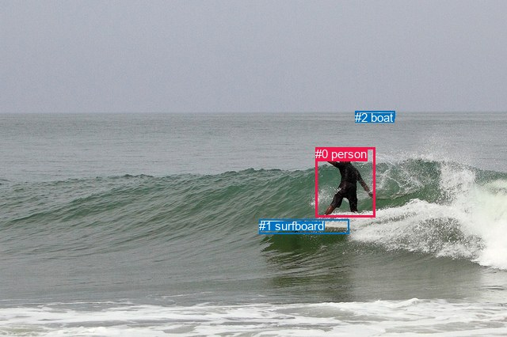
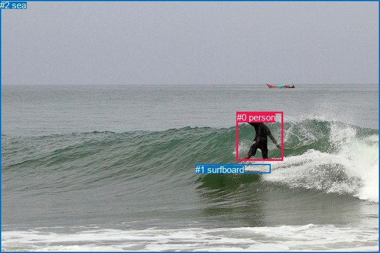

# 图片 0388：2331571.jpg

随机样本序号：258。图片 SHA256：`f52ff0a96efaf136300ad289e5e7a4c944596fe16f4276bb5c41ffbe0a6b657d`。

红色框表示人，蓝色框表示其他物体。两个模式分别保留自身框编号，可依据位置比较对应对象。

## 自动检测框与输出

人的框编号：`[0]`。状态：`ok`。

### 自动检测全部物体框

| 编号 | 类别 | 是否为人 | 检测分数 | 像素坐标 xyxy |
|---|---|---|---|---|
| 0 | person | True | 0.9997 | 398.3, 186.4, 473.8, 274.8 |
| 1 | surfboard | False | 0.9977 | 327.2, 277.3, 440.5, 295.9 |
| 2 | boat | False | 0.9810 | 448.1, 140.3, 498.6, 149.2 |

### 自动检测 Top50 人相关候选

评分物体对：6；人相关物体对：4；输出关系：8。

| 排名 | 主语编号与类别 | 关系 | 宾语编号与类别 | 类型 | 人与人 | 排序分数 | 原始融合 logit |
|---|---|---|---|---|---|---|---|
| 1 | #0 person | riding | #1 surfboard | semantic | False | 0.99139 | 4.7465 |
| 2 | #0 person | on | #1 surfboard | spatial | False | 0.93605 | 2.6836 |
| 3 | #0 person | riding | #2 boat | semantic | False | 0.91154 | 2.3326 |
| 4 | #0 person | on | #2 boat | spatial | False | 0.57818 | 0.3153 |
| 5 | #2 boat | beside | #0 person | spatial | False | 0.21824 | -1.2760 |
| 6 | #2 boat | flying over | #0 person | semantic | False | 0.13505 | -1.8571 |
| 7 | #1 surfboard | beside | #0 person | spatial | False | 0.12023 | -1.9902 |
| 8 | #1 surfboard | holding | #0 person | semantic | False | 0.04895 | -2.9668 |

### 自动检测逐条人相关 GT 核验

R@50：25.00%；命中 1/4。

| GT 主语编号 | GT 关系 | GT 宾语编号 | 结果阶段 | 匹配预测主语编号 | 匹配预测宾语编号 |
|---|---|---|---|---|---|
| 0 | on | 1 | hit50 | [0] | [1] |
| 0 | standing on | 1 | wrong_predicate | [0] | [1] |
| 0 | playing | 1 | wrong_predicate | [0] | [1] |
| 0 | on | 2 | endpoint_missing_or_wrong_class | [0] | [] |

## 真实框与输出

人的框编号：`[0]`。

### 真实框全部物体框

| 编号 | 类别 | 是否为人 | 检测分数 | 像素坐标 xyxy |
|---|---|---|---|---|
| 0 | person | True | GT | 399.0, 189.0, 477.0, 271.0 |
| 1 | surfboard | False | GT | 329.0, 277.0, 455.0, 292.0 |
| 2 | sea | False | GT | 0.0, 0.0, 640.0, 426.0 |

### 真实框 Top50 人相关候选

评分物体对：6；人相关物体对：4；输出关系：8。

| 排名 | 主语编号与类别 | 关系 | 宾语编号与类别 | 类型 | 人与人 | 排序分数 | 原始融合 logit |
|---|---|---|---|---|---|---|---|
| 1 | #0 person | riding | #1 surfboard | semantic | False | 0.98727 | 4.3511 |
| 2 | #0 person | in | #2 sea | spatial | False | 0.98630 | 4.2764 |
| 3 | #0 person | on | #1 surfboard | spatial | False | 0.97947 | 3.8649 |
| 4 | #0 person | riding | #2 sea | semantic | False | 0.88343 | 2.0253 |
| 5 | #1 surfboard | beside | #0 person | spatial | False | 0.32278 | -0.7410 |
| 6 | #2 sea | in | #0 person | spatial | False | 0.18167 | -1.5051 |
| 7 | #1 surfboard | holding | #0 person | semantic | False | 0.09253 | -2.2831 |
| 8 | #2 sea | catching | #0 person | semantic | False | 0.08348 | -2.3960 |

### 真实框逐条人相关 GT 核验

R@50：25.00%；命中 1/4。

| GT 主语编号 | GT 关系 | GT 宾语编号 | 结果阶段 | 匹配预测主语编号 | 匹配预测宾语编号 |
|---|---|---|---|---|---|
| 0 | on | 1 | hit50 | [0] | [1] |
| 0 | standing on | 1 | wrong_predicate | [0] | [1] |
| 0 | playing | 1 | wrong_predicate | [0] | [1] |
| 0 | on | 2 | wrong_predicate | [0] | [2] |

## 全部人相关 GT

| 主语编号与类别 | 关系 | 宾语编号与类别 |
|---|---|---|
| #0 person | on | #1 surfboard |
| #0 person | standing on | #1 surfboard |
| #0 person | playing | #1 surfboard |
| #0 person | on | #2 sea |

原始记录、全部人相关物体对的两项预测与分项分数见 [逐图证据 JSON](../evidence/cases/0388.json)。全部56类 logits 保留于本机 HOR/output/random500/logits/。

<!-- HOR_COMPLETE_RESULTS -->

## 六组条件的完整输出对照

以下保留同一图片三种框与候选模式、两种谓词输出规则的全部 Top50。框编号各自在所属模式内解释。

### 自动检测框完整枚举：空间与语义各保留一个谓词

| 排名 | 主语编号与类别 | 谓词 | 宾语编号与类别 | 分组 | 排序分数 | predicate logit | pair logit |
|---|---|---|---|---|---|---|---|
| 1 | #0 person | riding | #1 surfboard | semantic | 0.9913924 | 4.3533254 | 0.3931293 |
| 2 | #0 person | on | #1 surfboard | spatial | 0.9360508 | 2.2904501 | 0.3931293 |
| 3 | #0 person | riding | #2 boat | semantic | 0.9115372 | 3.3407302 | -1.0081794 |
| 4 | #0 person | on | #2 boat | spatial | 0.5781776 | 1.3234763 | -1.0081794 |
| 5 | #2 boat | beside | #0 person | spatial | 0.2182378 | -0.4050283 | -0.8709372 |
| 6 | #2 boat | flying over | #0 person | semantic | 0.1350465 | -0.9861190 | -0.8709372 |
| 7 | #1 surfboard | beside | #0 person | spatial | 0.1202311 | -1.1892402 | -0.8010036 |
| 8 | #1 surfboard | holding | #0 person | semantic | 0.0489480 | -2.1658061 | -0.8010036 |

GT 命中：1/4，R@50=25.00%。

| GT主语 | GT谓词 | GT宾语 | 结果阶段 | 匹配主语框 | 匹配宾语框 |
|---|---|---|---|---|---|
| 0 | on | 1 | hit50 | [0] | [1] |
| 0 | standing on | 1 | wrong_predicate | [0] | [1] |
| 0 | playing | 1 | wrong_predicate | [0] | [1] |
| 0 | on | 2 | endpoint_missing_or_wrong_class | [0] | [] |

### 自动检测框完整枚举：每对只保留一个谓词

| 排名 | 主语编号与类别 | 谓词 | 宾语编号与类别 | 分组 | 排序分数 | predicate logit | pair logit |
|---|---|---|---|---|---|---|---|
| 1 | #0 person | riding | #1 surfboard | single | 0.9913924 | 4.3533254 | 0.3931293 |
| 2 | #0 person | riding | #2 boat | single | 0.9115372 | 3.3407302 | -1.0081794 |
| 3 | #2 boat | beside | #0 person | single | 0.2182378 | -0.4050283 | -0.8709372 |
| 4 | #1 surfboard | beside | #0 person | single | 0.1202311 | -1.1892402 | -0.8010036 |

GT 命中：0/4，R@50=0.00%。

| GT主语 | GT谓词 | GT宾语 | 结果阶段 | 匹配主语框 | 匹配宾语框 |
|---|---|---|---|---|---|
| 0 | on | 1 | wrong_predicate | [0] | [1] |
| 0 | standing on | 1 | wrong_predicate | [0] | [1] |
| 0 | playing | 1 | wrong_predicate | [0] | [1] |
| 0 | on | 2 | endpoint_missing_or_wrong_class | [0] | [] |

### 真实框完整枚举：空间与语义各保留一个谓词

| 排名 | 主语编号与类别 | 谓词 | 宾语编号与类别 | 分组 | 排序分数 | predicate logit | pair logit |
|---|---|---|---|---|---|---|---|
| 1 | #0 person | riding | #1 surfboard | semantic | 0.9872710 | 3.9430442 | 0.4080215 |
| 2 | #0 person | in | #2 sea | spatial | 0.9862972 | 4.2104058 | 0.0659597 |
| 3 | #0 person | on | #1 surfboard | spatial | 0.9794651 | 3.4568553 | 0.4080215 |
| 4 | #0 person | riding | #2 sea | semantic | 0.8834283 | 1.9593434 | 0.0659597 |
| 5 | #1 surfboard | beside | #0 person | spatial | 0.3227810 | 0.1054530 | -0.8464735 |
| 6 | #2 sea | in | #0 person | spatial | 0.1816719 | -0.2150111 | -1.2900496 |
| 7 | #1 surfboard | holding | #0 person | semantic | 0.0925304 | -1.4366498 | -0.8464735 |
| 8 | #2 sea | catching | #0 person | semantic | 0.0834816 | -1.1059065 | -1.2900496 |

GT 命中：1/4，R@50=25.00%。

| GT主语 | GT谓词 | GT宾语 | 结果阶段 | 匹配主语框 | 匹配宾语框 |
|---|---|---|---|---|---|
| 0 | on | 1 | hit50 | [0] | [1] |
| 0 | standing on | 1 | wrong_predicate | [0] | [1] |
| 0 | playing | 1 | wrong_predicate | [0] | [1] |
| 0 | on | 2 | wrong_predicate | [0] | [2] |

### 真实框完整枚举：每对只保留一个谓词

| 排名 | 主语编号与类别 | 谓词 | 宾语编号与类别 | 分组 | 排序分数 | predicate logit | pair logit |
|---|---|---|---|---|---|---|---|
| 1 | #0 person | riding | #1 surfboard | single | 0.9872710 | 3.9430442 | 0.4080215 |
| 2 | #0 person | in | #2 sea | single | 0.9862972 | 4.2104058 | 0.0659597 |
| 3 | #1 surfboard | beside | #0 person | single | 0.3227810 | 0.1054530 | -0.8464735 |
| 4 | #2 sea | in | #0 person | single | 0.1816719 | -0.2150111 | -1.2900496 |

GT 命中：0/4，R@50=0.00%。

| GT主语 | GT谓词 | GT宾语 | 结果阶段 | 匹配主语框 | 匹配宾语框 |
|---|---|---|---|---|---|
| 0 | on | 1 | wrong_predicate | [0] | [1] |
| 0 | standing on | 1 | wrong_predicate | [0] | [1] |
| 0 | playing | 1 | wrong_predicate | [0] | [1] |
| 0 | on | 2 | wrong_predicate | [0] | [2] |

### 真实框400候选：空间与语义各保留一个谓词

| 排名 | 主语编号与类别 | 谓词 | 宾语编号与类别 | 分组 | 排序分数 | predicate logit | pair logit |
|---|---|---|---|---|---|---|---|
| 1 | #0 person | riding | #1 surfboard | semantic | 0.9872710 | 3.9430442 | 0.4080215 |
| 2 | #0 person | in | #2 sea | spatial | 0.9862972 | 4.2104058 | 0.0659597 |
| 3 | #0 person | on | #1 surfboard | spatial | 0.9794651 | 3.4568553 | 0.4080215 |
| 4 | #0 person | riding | #2 sea | semantic | 0.8834283 | 1.9593434 | 0.0659597 |
| 5 | #1 surfboard | beside | #0 person | spatial | 0.3227684 | 0.1053953 | -0.8464735 |
| 6 | #2 sea | in | #0 person | spatial | 0.1816719 | -0.2150111 | -1.2900496 |
| 7 | #1 surfboard | holding | #0 person | semantic | 0.0924374 | -1.4377580 | -0.8464735 |
| 8 | #2 sea | catching | #0 person | semantic | 0.0824372 | -1.1196344 | -1.2900496 |

GT 命中：1/4，R@50=25.00%。

| GT主语 | GT谓词 | GT宾语 | 结果阶段 | 匹配主语框 | 匹配宾语框 |
|---|---|---|---|---|---|
| 0 | on | 1 | hit50 | [0] | [1] |
| 0 | standing on | 1 | wrong_predicate | [0] | [1] |
| 0 | playing | 1 | wrong_predicate | [0] | [1] |
| 0 | on | 2 | wrong_predicate | [0] | [2] |

### 真实框400候选：每对只保留一个谓词

| 排名 | 主语编号与类别 | 谓词 | 宾语编号与类别 | 分组 | 排序分数 | predicate logit | pair logit |
|---|---|---|---|---|---|---|---|
| 1 | #0 person | riding | #1 surfboard | single | 0.9872710 | 3.9430442 | 0.4080215 |
| 2 | #0 person | in | #2 sea | single | 0.9862972 | 4.2104058 | 0.0659597 |
| 3 | #1 surfboard | beside | #0 person | single | 0.3227684 | 0.1053953 | -0.8464735 |
| 4 | #2 sea | in | #0 person | single | 0.1816719 | -0.2150111 | -1.2900496 |

GT 命中：0/4，R@50=0.00%。

| GT主语 | GT谓词 | GT宾语 | 结果阶段 | 匹配主语框 | 匹配宾语框 |
|---|---|---|---|---|---|
| 0 | on | 1 | wrong_predicate | [0] | [1] |
| 0 | standing on | 1 | wrong_predicate | [0] | [1] |
| 0 | playing | 1 | wrong_predicate | [0] | [1] |
| 0 | on | 2 | wrong_predicate | [0] | [2] |
