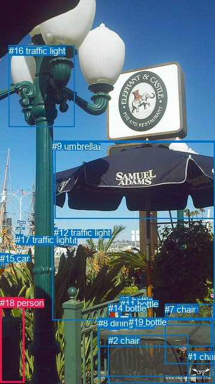
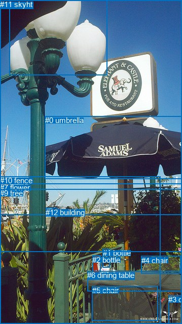

# 图片 0392：2331848.jpg

随机样本序号：137。图片 SHA256：`0597160ab761e875e9468097f80a17d2148bf9ccdb2687526cf518ec494997ac`。

红色框表示人，蓝色框表示其他物体。两个模式分别保留自身框编号，可依据位置比较对应对象。

## 自动检测框与输出

人的框编号：`[18]`。状态：`ok`。

### 自动检测全部物体框

| 编号 | 类别 | 是否为人 | 检测分数 | 像素坐标 xyxy |
|---|---|---|---|---|
| 0 | umbrella | False | 0.9872 | 91.5, 236.1, 359.0, 364.7 |
| 1 | chair | False | 0.9832 | 313.1, 585.9, 358.9, 639.9 |
| 2 | chair | False | 0.9594 | 180.8, 558.7, 314.3, 638.1 |
| 3 | bottle | False | 0.9366 | 199.7, 492.2, 217.7, 545.9 |
| 4 | car | False | 0.9148 | 0.8, 422.6, 18.5, 438.7 |
| 5 | chair | False | 0.9108 | 278.3, 506.9, 356.7, 542.5 |
| 6 | dining table | False | 0.8735 | 163.1, 529.9, 353.2, 627.5 |
| 7 | chair | False | 0.8700 | 275.0, 506.6, 357.1, 606.8 |
| 8 | dining table | False | 0.8687 | 164.3, 530.0, 356.7, 577.1 |
| 9 | umbrella | False | 0.8634 | 87.1, 234.8, 359.0, 533.8 |
| 10 | traffic light | False | 0.8406 | 26.2, 391.0, 31.2, 402.0 |
| 11 | bottle | False | 0.7955 | 201.3, 497.8, 217.5, 526.9 |
| 12 | traffic light | False | 0.7630 | 90.0, 379.1, 95.9, 397.6 |
| 13 | traffic light | False | 0.7279 | 33.6, 391.9, 37.6, 401.6 |
| 14 | bottle | False | 0.6318 | 180.7, 505.3, 199.1, 549.8 |
| 15 | car | False | 0.6198 | 0.1, 421.7, 8.0, 445.7 |
| 16 | traffic light | False | 0.5829 | 14.9, 75.7, 124.0, 211.8 |
| 17 | traffic light | False | 0.5618 | 26.3, 390.8, 38.1, 403.3 |
| 18 | person | True | 0.4060 | 0.0, 495.6, 40.5, 638.0 |
| 19 | bottle | False | 0.3517 | 214.6, 528.0, 223.6, 548.9 |

### 自动检测 Top50 人相关候选

评分物体对：380；人相关物体对：38；输出关系：50。

| 排名 | 主语编号与类别 | 关系 | 宾语编号与类别 | 类型 | 人与人 | 排序分数 | 原始融合 logit |
|---|---|---|---|---|---|---|---|
| 1 | #4 car | parked on | #18 person | semantic | False | 0.50567 | 0.0227 |
| 2 | #15 car | parked on | #18 person | semantic | False | 0.40961 | -0.3656 |
| 3 | #18 person | beside | #6 dining table | spatial | False | 0.31670 | -0.7690 |
| 4 | #18 person | beside | #8 dining table | spatial | False | 0.29874 | -0.8533 |
| 5 | #15 car | on | #18 person | spatial | False | 0.23657 | -1.1716 |
| 6 | #17 traffic light | on | #18 person | spatial | False | 0.23634 | -1.1728 |
| 7 | #10 traffic light | on | #18 person | spatial | False | 0.21633 | -1.2872 |
| 8 | #4 car | beside | #18 person | spatial | False | 0.19271 | -1.4325 |
| 9 | #18 person | on | #16 traffic light | spatial | False | 0.15048 | -1.7309 |
| 10 | #13 traffic light | on | #18 person | spatial | False | 0.14990 | -1.7354 |
| 11 | #16 traffic light | on | #18 person | spatial | False | 0.13029 | -1.8984 |
| 12 | #18 person | on | #4 car | spatial | False | 0.10969 | -2.0939 |
| 13 | #12 traffic light | on | #18 person | spatial | False | 0.10144 | -2.1814 |
| 14 | #18 person | in | #15 car | spatial | False | 0.08774 | -2.3416 |
| 15 | #18 person | holding | #9 umbrella | semantic | False | 0.08123 | -2.4257 |
| 16 | #6 dining table | beside | #18 person | spatial | False | 0.07988 | -2.4439 |
| 17 | #18 person | beside | #2 chair | spatial | False | 0.07511 | -2.5108 |
| 18 | #18 person | holding | #8 dining table | semantic | False | 0.06903 | -2.6017 |
| 19 | #18 person | holding | #16 traffic light | semantic | False | 0.06767 | -2.6230 |
| 20 | #8 dining table | beside | #18 person | spatial | False | 0.06708 | -2.6325 |
| 21 | #18 person | holding | #6 dining table | semantic | False | 0.06337 | -2.6933 |
| 22 | #18 person | beside | #9 umbrella | spatial | False | 0.06159 | -2.7237 |
| 23 | #1 chair | in | #18 person | spatial | False | 0.05531 | -2.8379 |
| 24 | #2 chair | in | #18 person | spatial | False | 0.04735 | -3.0016 |
| 25 | #18 person | holding | #4 car | semantic | False | 0.04638 | -3.0235 |
| 26 | #9 umbrella | on | #18 person | spatial | False | 0.04446 | -3.0677 |
| 27 | #18 person | holding | #15 car | semantic | False | 0.04191 | -3.1293 |
| 28 | #0 umbrella | over | #18 person | spatial | False | 0.04162 | -3.1367 |
| 29 | #18 person | holding | #0 umbrella | semantic | False | 0.03814 | -3.2277 |
| 30 | #19 bottle | on | #18 person | spatial | False | 0.03127 | -3.4332 |
| 31 | #7 chair | in | #18 person | spatial | False | 0.02853 | -3.5278 |
| 32 | #11 bottle | on | #18 person | spatial | False | 0.02766 | -3.5598 |
| 33 | #16 traffic light | holding | #18 person | semantic | False | 0.02554 | -3.6414 |
| 34 | #8 dining table | holding | #18 person | semantic | False | 0.02511 | -3.6592 |
| 35 | #3 bottle | on | #18 person | spatial | False | 0.02508 | -3.6602 |
| 36 | #14 bottle | on | #18 person | spatial | False | 0.01825 | -3.9850 |
| 37 | #18 person | in | #17 traffic light | spatial | False | 0.01799 | -3.9995 |
| 38 | #17 traffic light | standing on | #18 person | semantic | False | 0.01686 | -4.0660 |
| 39 | #6 dining table | holding | #18 person | semantic | False | 0.01662 | -4.0805 |
| 40 | #18 person | beside | #0 umbrella | spatial | False | 0.01626 | -4.1024 |
| 41 | #10 traffic light | standing on | #18 person | semantic | False | 0.01568 | -4.1399 |
| 42 | #18 person | in | #10 traffic light | spatial | False | 0.01461 | -4.2114 |
| 43 | #5 chair | in | #18 person | spatial | False | 0.01442 | -4.2248 |
| 44 | #18 person | holding | #2 chair | semantic | False | 0.01432 | -4.2317 |
| 45 | #18 person | holding | #17 traffic light | semantic | False | 0.01319 | -4.3152 |
| 46 | #18 person | on | #19 bottle | spatial | False | 0.01317 | -4.3166 |
| 47 | #18 person | in | #3 bottle | spatial | False | 0.01246 | -4.3731 |
| 48 | #18 person | beside | #11 bottle | spatial | False | 0.01240 | -4.3779 |
| 49 | #18 person | in | #13 traffic light | spatial | False | 0.01189 | -4.4200 |
| 50 | #18 person | holding | #10 traffic light | semantic | False | 0.01125 | -4.4762 |

### 自动检测逐条人相关 GT 核验

本图没有人相关 GT，R@50 无分母；预测候选继续展示。

## 真实框与输出

人的框编号：`[]`。

### 真实框全部物体框

| 编号 | 类别 | 是否为人 | 检测分数 | 像素坐标 xyxy |
|---|---|---|---|---|
| 0 | umbrella | False | GT | 89.0, 229.0, 359.0, 353.0 |
| 1 | bottle | False | GT | 203.0, 491.0, 217.0, 528.0 |
| 2 | bottle | False | GT | 182.0, 505.0, 198.0, 552.0 |
| 3 | chair | False | GT | 332.0, 583.0, 359.0, 640.0 |
| 4 | chair | False | GT | 279.0, 506.0, 357.0, 541.0 |
| 5 | chair | False | GT | 182.0, 565.0, 312.0, 633.0 |
| 6 | dining table | False | GT | 172.0, 535.0, 359.0, 575.0 |
| 7 | flower | False | GT | 0.0, 362.0, 359.0, 497.0 |
| 8 | light | False | GT | 18.0, 0.0, 212.0, 148.0 |
| 9 | tree | False | GT | 0.0, 373.0, 359.0, 640.0 |
| 10 | fence | False | GT | 0.0, 348.0, 316.0, 640.0 |
| 11 | sky | False | GT | 0.0, 0.0, 359.0, 424.0 |
| 12 | building | False | GT | 90.0, 411.0, 112.0, 426.0 |

### 真实框 Top50 人相关候选

评分物体对：0；人相关物体对：0；输出关系：0。

| 排名 | 主语编号与类别 | 关系 | 宾语编号与类别 | 类型 | 人与人 | 排序分数 | 原始融合 logit |
|---|---|---|---|---|---|---|---|

### 真实框逐条人相关 GT 核验

本图没有人相关 GT，R@50 无分母；预测候选继续展示。

## 全部人相关 GT

| 主语编号与类别 | 关系 | 宾语编号与类别 |
|---|---|---|

原始记录、全部人相关物体对的两项预测与分项分数见 [逐图证据 JSON](../evidence/cases/0392.json)。全部56类 logits 保留于本机 HOR/output/random500/logits/。

<!-- HOR_COMPLETE_RESULTS -->

## 六组条件的完整输出对照

以下保留同一图片三种框与候选模式、两种谓词输出规则的全部 Top50。框编号各自在所属模式内解释。

### 自动检测框完整枚举：空间与语义各保留一个谓词

| 排名 | 主语编号与类别 | 谓词 | 宾语编号与类别 | 分组 | 排序分数 | predicate logit | pair logit |
|---|---|---|---|---|---|---|---|
| 1 | #4 car | parked on | #18 person | semantic | 0.5056740 | 0.5349832 | -0.5122862 |
| 2 | #15 car | parked on | #18 person | semantic | 0.4096099 | 0.1446047 | -0.5101832 |
| 3 | #18 person | beside | #6 dining table | spatial | 0.3166961 | 0.0163360 | -0.7853332 |
| 4 | #18 person | beside | #8 dining table | spatial | 0.2987379 | -0.1640091 | -0.6893061 |
| 5 | #15 car | on | #18 person | spatial | 0.2365672 | -0.6614094 | -0.5101832 |
| 6 | #17 traffic light | on | #18 person | spatial | 0.2363441 | -0.7763669 | -0.3964615 |
| 7 | #10 traffic light | on | #18 person | spatial | 0.2163304 | -0.8850172 | -0.4021635 |
| 8 | #4 car | beside | #18 person | spatial | 0.1927068 | -0.9202311 | -0.5122862 |
| 9 | #18 person | on | #16 traffic light | spatial | 0.1504768 | -0.7645209 | -0.9663454 |
| 10 | #13 traffic light | on | #18 person | spatial | 0.1499002 | -1.3208768 | -0.4145069 |
| 11 | #16 traffic light | on | #18 person | spatial | 0.1302859 | -0.4855328 | -1.4129002 |
| 12 | #18 person | on | #4 car | spatial | 0.1096916 | -1.4110627 | -0.6828325 |
| 13 | #12 traffic light | on | #18 person | spatial | 0.1014376 | -1.0960574 | -1.0852951 |
| 14 | #18 person | in | #15 car | spatial | 0.0877385 | -1.6687758 | -0.6727903 |
| 15 | #18 person | holding | #9 umbrella | semantic | 0.0812334 | -1.3258960 | -1.0998089 |
| 16 | #6 dining table | beside | #18 person | spatial | 0.0798831 | -1.4305232 | -1.0134137 |
| 17 | #18 person | beside | #2 chair | spatial | 0.0751069 | -1.4901273 | -1.0206389 |
| 18 | #18 person | holding | #8 dining table | semantic | 0.0690273 | -1.9124212 | -0.6893061 |
| 19 | #18 person | holding | #16 traffic light | semantic | 0.0676721 | -1.6566656 | -0.9663454 |
| 20 | #8 dining table | beside | #18 person | spatial | 0.0670763 | -1.4739759 | -1.1585163 |
| 21 | #18 person | holding | #6 dining table | semantic | 0.0633685 | -1.9079900 | -0.7853332 |
| 22 | #18 person | beside | #9 umbrella | spatial | 0.0615889 | -1.6238968 | -1.0998089 |
| 23 | #1 chair | in | #18 person | spatial | 0.0553109 | -1.7871423 | -1.0507427 |
| 24 | #2 chair | in | #18 person | spatial | 0.0473514 | -1.8834565 | -1.1181922 |
| 25 | #18 person | holding | #4 car | semantic | 0.0463767 | -2.3406398 | -0.6828325 |
| 26 | #9 umbrella | on | #18 person | spatial | 0.0444588 | -1.9480424 | -1.1196727 |
| 27 | #18 person | holding | #15 car | semantic | 0.0419146 | -2.4565120 | -0.6727903 |
| 28 | #0 umbrella | over | #18 person | spatial | 0.0416188 | -1.8640301 | -1.2726636 |
| 29 | #18 person | holding | #0 umbrella | semantic | 0.0381365 | -2.0969305 | -1.1307701 |
| 30 | #19 bottle | on | #18 person | spatial | 0.0312731 | -2.3656421 | -1.0675812 |
| 31 | #7 chair | in | #18 person | spatial | 0.0285325 | -2.3513582 | -1.1764057 |
| 32 | #11 bottle | on | #18 person | spatial | 0.0276590 | -2.5464795 | -1.0132760 |
| 33 | #16 traffic light | holding | #18 person | semantic | 0.0255447 | -2.2285492 | -1.4129002 |
| 34 | #8 dining table | holding | #18 person | semantic | 0.0251063 | -2.5006926 | -1.1585163 |
| 35 | #3 bottle | on | #18 person | spatial | 0.0250824 | -2.6219969 | -1.0381901 |
| 36 | #14 bottle | on | #18 person | spatial | 0.0182523 | -2.8615830 | -1.1234614 |
| 37 | #18 person | in | #17 traffic light | spatial | 0.0179948 | -2.7477047 | -1.2518086 |
| 38 | #17 traffic light | standing on | #18 person | semantic | 0.0168567 | -3.6695461 | -0.3964615 |
| 39 | #6 dining table | holding | #18 person | semantic | 0.0166185 | -3.0670669 | -1.0134137 |
| 40 | #18 person | beside | #0 umbrella | spatial | 0.0162639 | -2.9716368 | -1.1307701 |
| 41 | #10 traffic light | standing on | #18 person | semantic | 0.0156752 | -3.7377105 | -0.4021635 |
| 42 | #18 person | in | #10 traffic light | spatial | 0.0146094 | -2.9643741 | -1.2470001 |
| 43 | #5 chair | in | #18 person | spatial | 0.0144177 | -3.0205598 | -1.2042196 |
| 44 | #18 person | holding | #2 chair | semantic | 0.0143196 | -3.2110608 | -1.0206389 |
| 45 | #18 person | holding | #17 traffic light | semantic | 0.0131875 | -3.0633988 | -1.2518086 |
| 46 | #18 person | on | #19 bottle | spatial | 0.0131694 | -3.3913507 | -0.9252524 |
| 47 | #18 person | in | #3 bottle | spatial | 0.0124556 | -3.3606496 | -1.0124036 |
| 48 | #18 person | beside | #11 bottle | spatial | 0.0123958 | -3.4207792 | -0.9571480 |
| 49 | #18 person | in | #13 traffic light | spatial | 0.0118915 | -3.1448102 | -1.2751616 |
| 50 | #18 person | holding | #10 traffic light | semantic | 0.0112489 | -3.2291751 | -1.2470001 |

没有人相关 GT，本条件的召回率无分母。

### 自动检测框完整枚举：每对只保留一个谓词

| 排名 | 主语编号与类别 | 谓词 | 宾语编号与类别 | 分组 | 排序分数 | predicate logit | pair logit |
|---|---|---|---|---|---|---|---|
| 1 | #4 car | parked on | #18 person | single | 0.5056740 | 0.5349832 | -0.5122862 |
| 2 | #15 car | parked on | #18 person | single | 0.4096099 | 0.1446047 | -0.5101832 |
| 3 | #18 person | beside | #6 dining table | single | 0.3166961 | 0.0163360 | -0.7853332 |
| 4 | #18 person | beside | #8 dining table | single | 0.2987379 | -0.1640091 | -0.6893061 |
| 5 | #17 traffic light | on | #18 person | single | 0.2363441 | -0.7763669 | -0.3964615 |
| 6 | #10 traffic light | on | #18 person | single | 0.2163304 | -0.8850172 | -0.4021635 |
| 7 | #18 person | on | #16 traffic light | single | 0.1504768 | -0.7645209 | -0.9663454 |
| 8 | #13 traffic light | on | #18 person | single | 0.1499002 | -1.3208768 | -0.4145069 |
| 9 | #16 traffic light | on | #18 person | single | 0.1302859 | -0.4855328 | -1.4129002 |
| 10 | #18 person | on | #4 car | single | 0.1096916 | -1.4110627 | -0.6828325 |
| 11 | #12 traffic light | on | #18 person | single | 0.1014376 | -1.0960574 | -1.0852951 |
| 12 | #18 person | in | #15 car | single | 0.0877385 | -1.6687758 | -0.6727903 |
| 13 | #18 person | holding | #9 umbrella | single | 0.0812334 | -1.3258960 | -1.0998089 |
| 14 | #6 dining table | beside | #18 person | single | 0.0798831 | -1.4305232 | -1.0134137 |
| 15 | #18 person | beside | #2 chair | single | 0.0751069 | -1.4901273 | -1.0206389 |
| 16 | #8 dining table | beside | #18 person | single | 0.0670763 | -1.4739759 | -1.1585163 |
| 17 | #1 chair | in | #18 person | single | 0.0553109 | -1.7871423 | -1.0507427 |
| 18 | #2 chair | in | #18 person | single | 0.0473514 | -1.8834565 | -1.1181922 |
| 19 | #9 umbrella | on | #18 person | single | 0.0444588 | -1.9480424 | -1.1196727 |
| 20 | #0 umbrella | over | #18 person | single | 0.0416188 | -1.8640301 | -1.2726636 |
| 21 | #18 person | holding | #0 umbrella | single | 0.0381365 | -2.0969305 | -1.1307701 |
| 22 | #19 bottle | on | #18 person | single | 0.0312731 | -2.3656421 | -1.0675812 |
| 23 | #7 chair | in | #18 person | single | 0.0285325 | -2.3513582 | -1.1764057 |
| 24 | #11 bottle | on | #18 person | single | 0.0276590 | -2.5464795 | -1.0132760 |
| 25 | #3 bottle | on | #18 person | single | 0.0250824 | -2.6219969 | -1.0381901 |
| 26 | #14 bottle | on | #18 person | single | 0.0182523 | -2.8615830 | -1.1234614 |
| 27 | #18 person | in | #17 traffic light | single | 0.0179948 | -2.7477047 | -1.2518086 |
| 28 | #18 person | in | #10 traffic light | single | 0.0146094 | -2.9643741 | -1.2470001 |
| 29 | #5 chair | in | #18 person | single | 0.0144177 | -3.0205598 | -1.2042196 |
| 30 | #18 person | on | #19 bottle | single | 0.0131694 | -3.3913507 | -0.9252524 |
| 31 | #18 person | in | #3 bottle | single | 0.0124556 | -3.3606496 | -1.0124036 |
| 32 | #18 person | beside | #11 bottle | single | 0.0123958 | -3.4207792 | -0.9571480 |
| 33 | #18 person | in | #13 traffic light | single | 0.0118915 | -3.1448102 | -1.2751616 |
| 34 | #18 person | in front of | #5 chair | single | 0.0095939 | -3.2966604 | -1.3403232 |
| 35 | #18 person | beside | #14 bottle | single | 0.0085470 | -3.4661188 | -1.2874671 |
| 36 | #18 person | in | #7 chair | single | 0.0074200 | -3.6285872 | -1.2675457 |
| 37 | #18 person | in | #12 traffic light | single | 0.0070872 | -3.5542493 | -1.3881027 |
| 38 | #18 person | holding | #1 chair | single | 0.0044776 | -4.0513124 | -1.3528777 |

没有人相关 GT，本条件的召回率无分母。

### 真实框完整枚举：空间与语义各保留一个谓词

| 排名 | 主语编号与类别 | 谓词 | 宾语编号与类别 | 分组 | 排序分数 | predicate logit | pair logit |
|---|---|---|---|---|---|---|---|

没有人相关 GT，本条件的召回率无分母。

### 真实框完整枚举：每对只保留一个谓词

| 排名 | 主语编号与类别 | 谓词 | 宾语编号与类别 | 分组 | 排序分数 | predicate logit | pair logit |
|---|---|---|---|---|---|---|---|

没有人相关 GT，本条件的召回率无分母。

### 真实框400候选：空间与语义各保留一个谓词

| 排名 | 主语编号与类别 | 谓词 | 宾语编号与类别 | 分组 | 排序分数 | predicate logit | pair logit |
|---|---|---|---|---|---|---|---|

没有人相关 GT，本条件的召回率无分母。

### 真实框400候选：每对只保留一个谓词

| 排名 | 主语编号与类别 | 谓词 | 宾语编号与类别 | 分组 | 排序分数 | predicate logit | pair logit |
|---|---|---|---|---|---|---|---|

没有人相关 GT，本条件的召回率无分母。
