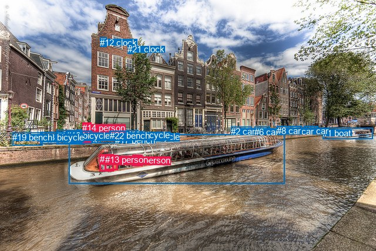
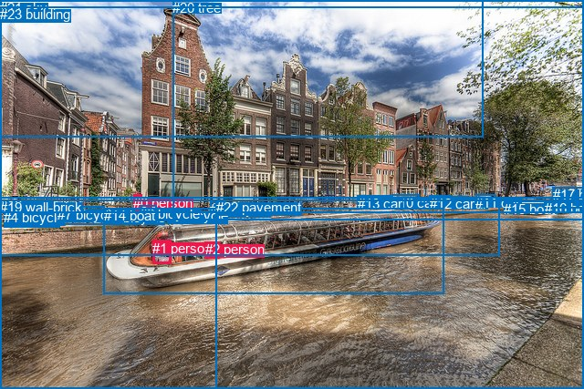

# 图片 0404：2332502.jpg

随机样本序号：472。图片 SHA256：`b96db615cd9c52b7eefc387d5e0575bde7af39b9117d3dcea0a7831a25ce74cc`。

红色框表示人，蓝色框表示其他物体。两个模式分别保留自身框编号，可依据位置比较对应对象。

## 自动检测框与输出

人的框编号：`[5, 7, 13, 14]`。状态：`ok`。

### 自动检测全部物体框

| 编号 | 类别 | 是否为人 | 检测分数 | 像素坐标 xyxy |
|---|---|---|---|---|
| 0 | boat | False | 0.9893 | 117.2, 228.4, 484.6, 312.3 |
| 1 | boat | False | 0.9838 | 549.4, 217.7, 634.7, 236.1 |
| 2 | car | False | 0.9801 | 393.0, 215.3, 428.4, 229.7 |
| 3 | car | False | 0.9743 | 517.5, 214.3, 541.6, 224.9 |
| 4 | car | False | 0.9726 | 493.0, 214.5, 513.9, 226.0 |
| 5 | person | True | 0.9696 | 225.2, 263.9, 242.6, 282.8 |
| 6 | car | False | 0.9667 | 433.2, 215.6, 459.1, 227.7 |
| 7 | person | True | 0.9496 | 169.5, 262.4, 193.6, 291.2 |
| 8 | car | False | 0.9488 | 471.1, 214.5, 494.8, 227.2 |
| 9 | bicycle | False | 0.9190 | 157.8, 221.8, 196.6, 243.1 |
| 10 | bicycle | False | 0.9150 | 130.6, 220.3, 171.1, 243.7 |
| 11 | bicycle | False | 0.8496 | 96.5, 221.8, 143.6, 245.2 |
| 12 | clock | False | 0.7668 | 170.1, 63.7, 181.7, 79.9 |
| 13 | person | True | 0.6889 | 178.6, 263.0, 200.5, 289.0 |
| 14 | person | True | 0.6625 | 140.3, 208.8, 155.9, 243.0 |
| 15 | bicycle | False | 0.6615 | 231.8, 223.6, 246.2, 239.4 |
| 16 | bicycle | False | 0.6092 | 113.4, 222.2, 156.3, 244.1 |
| 17 | bench | False | 0.6044 | 196.2, 229.9, 214.4, 238.6 |
| 18 | bicycle | False | 0.5645 | 68.9, 224.9, 111.5, 244.9 |
| 19 | bench | False | 0.4424 | 21.1, 225.1, 72.6, 247.7 |
| 20 | bicycle | False | 0.4183 | 215.4, 221.1, 235.8, 237.4 |
| 21 | clock | False | 0.3970 | 217.4, 75.4, 227.8, 91.0 |
| 22 | bench | False | 0.3851 | 186.9, 222.2, 218.4, 239.6 |

### 自动检测 Top50 人相关候选

评分物体对：506；人相关物体对：164；输出关系：50。

| 排名 | 主语编号与类别 | 关系 | 宾语编号与类别 | 类型 | 人与人 | 排序分数 | 原始融合 logit |
|---|---|---|---|---|---|---|---|
| 1 | #5 person | in | #0 boat | spatial | False | 0.98518 | 4.1966 |
| 2 | #13 person | in | #0 boat | spatial | False | 0.97730 | 3.7626 |
| 3 | #7 person | in | #0 boat | spatial | False | 0.97672 | 3.7368 |
| 4 | #13 person | driving on | #0 boat | semantic | False | 0.97534 | 3.6776 |
| 5 | #7 person | driving on | #0 boat | semantic | False | 0.97455 | 3.6452 |
| 6 | #14 person | riding | #10 bicycle | semantic | False | 0.97429 | 3.6348 |
| 7 | #5 person | riding | #0 boat | semantic | False | 0.97382 | 3.6163 |
| 8 | #14 person | on | #10 bicycle | spatial | False | 0.95425 | 3.0377 |
| 9 | #14 person | leaning on | #11 bicycle | spatial | False | 0.94418 | 2.8283 |
| 10 | #14 person | on | #16 bicycle | spatial | False | 0.93885 | 2.7313 |
| 11 | #14 person | riding | #16 bicycle | semantic | False | 0.93084 | 2.5996 |
| 12 | #13 person | in | #7 person | spatial | True | 0.90535 | 2.2581 |
| 13 | #7 person | in | #13 person | spatial | True | 0.89809 | 2.1762 |
| 14 | #14 person | parked on | #11 bicycle | semantic | False | 0.88387 | 2.0296 |
| 15 | #7 person | wearing | #13 person | semantic | True | 0.86340 | 1.8438 |
| 16 | #10 bicycle | leaning on | #14 person | spatial | False | 0.86219 | 1.8336 |
| 17 | #11 bicycle | leaning on | #14 person | spatial | False | 0.82911 | 1.5793 |
| 18 | #14 person | leaning on | #9 bicycle | spatial | False | 0.82056 | 1.5202 |
| 19 | #10 bicycle | parked on | #14 person | semantic | False | 0.81775 | 1.5012 |
| 20 | #16 bicycle | leaning on | #14 person | spatial | False | 0.79942 | 1.3827 |
| 21 | #11 bicycle | parked on | #14 person | semantic | False | 0.77588 | 1.2418 |
| 22 | #16 bicycle | parked on | #14 person | semantic | False | 0.76220 | 1.1648 |
| 23 | #0 boat | carrying | #5 person | semantic | False | 0.75048 | 1.1012 |
| 24 | #14 person | walking on | #9 bicycle | semantic | False | 0.72668 | 0.9779 |
| 25 | #13 person | sitting on | #7 person | semantic | True | 0.69568 | 0.8268 |
| 26 | #5 person | riding | #1 boat | semantic | False | 0.59418 | 0.3813 |
| 27 | #0 boat | carrying | #13 person | semantic | False | 0.56186 | 0.2487 |
| 28 | #0 boat | carrying | #7 person | semantic | False | 0.52331 | 0.0933 |
| 29 | #13 person | driving on | #1 boat | semantic | False | 0.49273 | -0.0291 |
| 30 | #7 person | driving on | #1 boat | semantic | False | 0.46946 | -0.1223 |
| 31 | #7 person | in | #1 boat | spatial | False | 0.39866 | -0.4110 |
| 32 | #9 bicycle | parked on | #14 person | semantic | False | 0.39235 | -0.4375 |
| 33 | #13 person | in | #1 boat | spatial | False | 0.38504 | -0.4682 |
| 34 | #5 person | in | #1 boat | spatial | False | 0.37804 | -0.4979 |
| 35 | #7 person | in | #5 person | spatial | True | 0.36280 | -0.5632 |
| 36 | #13 person | in | #5 person | spatial | True | 0.33964 | -0.6649 |
| 37 | #14 person | on | #18 bicycle | spatial | False | 0.32023 | -0.7527 |
| 38 | #18 bicycle | parked on | #14 person | semantic | False | 0.29961 | -0.8491 |
| 39 | #9 bicycle | on | #14 person | spatial | False | 0.29746 | -0.8594 |
| 40 | #14 person | walking on | #18 bicycle | semantic | False | 0.24543 | -1.1231 |
| 41 | #7 person | sitting on | #5 person | semantic | True | 0.21760 | -1.2797 |
| 42 | #13 person | sitting on | #5 person | semantic | True | 0.20927 | -1.3293 |
| 43 | #18 bicycle | leaning on | #14 person | spatial | False | 0.19940 | -1.3901 |
| 44 | #14 person | on | #22 bench | spatial | False | 0.17219 | -1.5702 |
| 45 | #14 person | on | #17 bench | spatial | False | 0.16841 | -1.5969 |
| 46 | #5 person | in | #7 person | spatial | True | 0.15615 | -1.6871 |
| 47 | #5 person | in | #13 person | spatial | True | 0.15361 | -1.7066 |
| 48 | #0 boat | in | #5 person | spatial | False | 0.14844 | -1.7469 |
| 49 | #5 person | riding | #18 bicycle | semantic | False | 0.14138 | -1.8039 |
| 50 | #14 person | on | #19 bench | spatial | False | 0.13504 | -1.8571 |

### 自动检测逐条人相关 GT 核验

R@50：33.33%；命中 1/3。

| GT 主语编号 | GT 关系 | GT 宾语编号 | 结果阶段 | 匹配预测主语编号 | 匹配预测宾语编号 |
|---|---|---|---|---|---|
| 1 | driving | 14 | wrong_predicate | [7] | [0] |
| 2 | in | 14 | hit50 | [5] | [0] |
| 2 | over | 18 | endpoint_missing_or_wrong_class | [5] | [] |

## 真实框与输出

人的框编号：`[0, 1, 2]`。

### 真实框全部物体框

| 编号 | 类别 | 是否为人 | 检测分数 | 像素坐标 xyxy |
|---|---|---|---|---|
| 0 | person | True | GT | 146.0, 214.0, 155.0, 234.0 |
| 1 | person | True | GT | 167.0, 264.0, 187.0, 290.0 |
| 2 | person | True | GT | 225.0, 265.0, 241.0, 283.0 |
| 3 | bicycle | False | GT | 230.0, 221.0, 247.0, 239.0 |
| 4 | bicycle | False | GT | 4.0, 230.0, 66.0, 249.0 |
| 5 | bicycle | False | GT | 184.0, 228.0, 202.0, 243.0 |
| 6 | bicycle | False | GT | 115.0, 230.0, 148.0, 244.0 |
| 7 | bicycle | False | GT | 63.0, 227.0, 114.0, 247.0 |
| 8 | bicycle | False | GT | 153.0, 226.0, 172.0, 244.0 |
| 9 | car | False | GT | 493.0, 215.0, 513.0, 225.0 |
| 10 | car | False | GT | 429.0, 214.0, 459.0, 229.0 |
| 11 | car | False | GT | 521.0, 214.0, 542.0, 225.0 |
| 12 | car | False | GT | 471.0, 215.0, 495.0, 228.0 |
| 13 | car | False | GT | 392.0, 215.0, 429.0, 230.0 |
| 14 | boat | False | GT | 114.0, 228.0, 487.0, 322.0 |
| 15 | boat | False | GT | 552.0, 221.0, 611.0, 235.0 |
| 16 | boat | False | GT | 597.0, 220.0, 634.0, 232.0 |
| 17 | bridge | False | GT | 606.0, 205.0, 640.0, 228.0 |
| 18 | river | False | GT | 0.0, 216.0, 640.0, 427.0 |
| 19 | wall-brick | False | GT | 0.0, 219.0, 547.0, 280.0 |
| 20 | tree | False | GT | 189.0, 0.0, 640.0, 241.0 |
| 21 | sky | False | GT | 0.0, 0.0, 529.0, 151.0 |
| 22 | pavement | False | GT | 237.0, 219.0, 640.0, 427.0 |
| 23 | building | False | GT | 0.0, 7.0, 640.0, 234.0 |

### 真实框 Top50 人相关候选

评分物体对：552；人相关物体对：132；输出关系：50。

| 排名 | 主语编号与类别 | 关系 | 宾语编号与类别 | 类型 | 人与人 | 排序分数 | 原始融合 logit |
|---|---|---|---|---|---|---|---|
| 1 | #1 person | driving on | #14 boat | semantic | False | 0.98564 | 4.2289 |
| 2 | #2 person | in | #14 boat | spatial | False | 0.98374 | 4.1030 |
| 3 | #1 person | in | #14 boat | spatial | False | 0.97505 | 3.6657 |
| 4 | #2 person | riding | #14 boat | semantic | False | 0.97475 | 3.6534 |
| 5 | #0 person | leaning on | #19 wall-brick | spatial | False | 0.96445 | 3.3007 |
| 6 | #0 person | standing on | #19 wall-brick | semantic | False | 0.93987 | 2.7492 |
| 7 | #0 person | leaning on | #8 bicycle | spatial | False | 0.92866 | 2.5662 |
| 8 | #0 person | beside | #18 river | spatial | False | 0.87639 | 1.9587 |
| 9 | #0 person | sitting on | #8 bicycle | semantic | False | 0.83375 | 1.6125 |
| 10 | #8 bicycle | leaning on | #0 person | spatial | False | 0.81835 | 1.5052 |
| 11 | #0 person | parked on | #18 river | semantic | False | 0.81471 | 1.4809 |
| 12 | #1 person | in | #18 river | spatial | False | 0.80437 | 1.4139 |
| 13 | #14 boat | carrying | #2 person | semantic | False | 0.76431 | 1.1765 |
| 14 | #2 person | in | #18 river | spatial | False | 0.74757 | 1.0857 |
| 15 | #6 bicycle | leaning on | #0 person | spatial | False | 0.65701 | 0.6500 |
| 16 | #8 bicycle | parked on | #0 person | semantic | False | 0.65600 | 0.6455 |
| 17 | #14 boat | carrying | #1 person | semantic | False | 0.62780 | 0.5228 |
| 18 | #0 person | leaning on | #23 building | spatial | False | 0.58638 | 0.3490 |
| 19 | #1 person | riding | #18 river | semantic | False | 0.58003 | 0.3229 |
| 20 | #6 bicycle | parked on | #0 person | semantic | False | 0.55732 | 0.2303 |
| 21 | #0 person | beside | #6 bicycle | spatial | False | 0.51987 | 0.0795 |
| 22 | #2 person | riding | #18 river | semantic | False | 0.49354 | -0.0258 |
| 23 | #0 person | parked on | #23 building | semantic | False | 0.45041 | -0.1990 |
| 24 | #0 person | sitting on | #6 bicycle | semantic | False | 0.42659 | -0.2958 |
| 25 | #1 person | driving on | #15 boat | semantic | False | 0.26753 | -1.0072 |
| 26 | #1 person | driving on | #16 boat | semantic | False | 0.24850 | -1.1066 |
| 27 | #2 person | in | #22 pavement | spatial | False | 0.23541 | -1.1780 |
| 28 | #1 person | sitting on | #19 wall-brick | semantic | False | 0.22620 | -1.2299 |
| 29 | #0 person | beside | #22 pavement | spatial | False | 0.20128 | -1.3783 |
| 30 | #1 person | in | #22 pavement | spatial | False | 0.19783 | -1.3999 |
| 31 | #0 person | leaning on | #14 boat | spatial | False | 0.16823 | -1.5982 |
| 32 | #2 person | riding | #16 boat | semantic | False | 0.16063 | -1.6535 |
| 33 | #2 person | driving on | #15 boat | semantic | False | 0.15320 | -1.7097 |
| 34 | #1 person | sitting on | #2 person | semantic | True | 0.14681 | -1.7599 |
| 35 | #1 person | in | #15 boat | spatial | False | 0.12796 | -1.9191 |
| 36 | #14 boat | in | #2 person | spatial | False | 0.12571 | -1.9394 |
| 37 | #1 person | in | #16 boat | spatial | False | 0.11385 | -2.0520 |
| 38 | #1 person | in | #19 wall-brick | spatial | False | 0.10775 | -2.1139 |
| 39 | #2 person | sitting on | #19 wall-brick | semantic | False | 0.10168 | -2.1787 |
| 40 | #2 person | in | #15 boat | spatial | False | 0.09867 | -2.2121 |
| 41 | #2 person | riding | #22 pavement | semantic | False | 0.09708 | -2.2301 |
| 42 | #2 person | in | #16 boat | spatial | False | 0.09561 | -2.2470 |
| 43 | #14 boat | in | #1 person | spatial | False | 0.09264 | -2.2818 |
| 44 | #7 bicycle | parked on | #0 person | semantic | False | 0.08711 | -2.3495 |
| 45 | #7 bicycle | leaning on | #0 person | spatial | False | 0.08084 | -2.4309 |
| 46 | #1 person | in | #2 person | spatial | True | 0.07407 | -2.5257 |
| 47 | #1 person | sitting on | #22 pavement | semantic | False | 0.06261 | -2.7061 |
| 48 | #0 person | looking at | #14 boat | semantic | False | 0.06231 | -2.7113 |
| 49 | #0 person | looking at | #22 pavement | semantic | False | 0.05982 | -2.7547 |
| 50 | #1 person | in | #17 bridge | spatial | False | 0.05944 | -2.7614 |

### 真实框逐条人相关 GT 核验

R@50：33.33%；命中 1/3。

| GT 主语编号 | GT 关系 | GT 宾语编号 | 结果阶段 | 匹配预测主语编号 | 匹配预测宾语编号 |
|---|---|---|---|---|---|
| 1 | driving | 14 | wrong_predicate | [1] | [14] |
| 2 | in | 14 | hit50 | [2] | [14] |
| 2 | over | 18 | wrong_predicate | [2] | [18] |

## 全部人相关 GT

| 主语编号与类别 | 关系 | 宾语编号与类别 |
|---|---|---|
| #1 person | driving | #14 boat |
| #2 person | in | #14 boat |
| #2 person | over | #18 river |

原始记录、全部人相关物体对的两项预测与分项分数见 [逐图证据 JSON](../evidence/cases/0404.json)。全部56类 logits 保留于本机 HOR/output/random500/logits/。

<!-- HOR_COMPLETE_RESULTS -->

## 六组条件的完整输出对照

以下保留同一图片三种框与候选模式、两种谓词输出规则的全部 Top50。框编号各自在所属模式内解释。

### 自动检测框完整枚举：空间与语义各保留一个谓词

| 排名 | 主语编号与类别 | 谓词 | 宾语编号与类别 | 分组 | 排序分数 | predicate logit | pair logit |
|---|---|---|---|---|---|---|---|
| 1 | #5 person | in | #0 boat | spatial | 0.9851768 | 3.9833961 | 0.2132292 |
| 2 | #13 person | in | #0 boat | spatial | 0.9773028 | 3.7493024 | 0.0132518 |
| 3 | #7 person | in | #0 boat | spatial | 0.9767240 | 3.7559400 | -0.0191574 |
| 4 | #13 person | driving on | #0 boat | semantic | 0.9753399 | 3.6643472 | 0.0132518 |
| 5 | #7 person | driving on | #0 boat | semantic | 0.9745486 | 3.6643605 | -0.0191574 |
| 6 | #14 person | riding | #10 bicycle | semantic | 0.9742885 | 3.8344083 | -0.1996398 |
| 7 | #5 person | riding | #0 boat | semantic | 0.9738228 | 3.4031119 | 0.2132292 |
| 8 | #14 person | on | #10 bicycle | spatial | 0.9542479 | 3.2373257 | -0.1996398 |
| 9 | #14 person | leaning on | #11 bicycle | spatial | 0.9441838 | 3.1095552 | -0.2812972 |
| 10 | #14 person | on | #16 bicycle | spatial | 0.9388476 | 2.9793930 | -0.2481091 |
| 11 | #14 person | riding | #16 bicycle | semantic | 0.9308384 | 2.8477502 | -0.2481091 |
| 12 | #13 person | in | #7 person | spatial | 0.9053492 | 2.3854432 | -0.1273169 |
| 13 | #7 person | in | #13 person | spatial | 0.8980944 | 2.3283567 | -0.1521294 |
| 14 | #14 person | parked on | #11 bicycle | semantic | 0.8838665 | 2.3108625 | -0.2812972 |
| 15 | #7 person | wearing | #13 person | semantic | 0.8633996 | 1.9959469 | -0.1521294 |
| 16 | #10 bicycle | leaning on | #14 person | spatial | 0.8621923 | 2.0703173 | -0.2366979 |
| 17 | #11 bicycle | leaning on | #14 person | spatial | 0.8291079 | 1.8947134 | -0.3153951 |
| 18 | #14 person | leaning on | #9 bicycle | spatial | 0.8205606 | 1.6316910 | -0.1115409 |
| 19 | #10 bicycle | parked on | #14 person | semantic | 0.8177482 | 1.7378631 | -0.2366979 |
| 20 | #16 bicycle | leaning on | #14 person | spatial | 0.7994179 | 1.6547251 | -0.2720648 |
| 21 | #11 bicycle | parked on | #14 person | semantic | 0.7758768 | 1.5571933 | -0.3153951 |
| 22 | #16 bicycle | parked on | #14 person | semantic | 0.7622028 | 1.4368591 | -0.2720648 |
| 23 | #0 boat | carrying | #5 person | semantic | 0.7504810 | 2.0704765 | -0.9692974 |
| 24 | #14 person | walking on | #9 bicycle | semantic | 0.7266843 | 1.0894055 | -0.1115409 |
| 25 | #13 person | sitting on | #7 person | semantic | 0.6956785 | 0.9541197 | -0.1273169 |
| 26 | #5 person | riding | #1 boat | semantic | 0.5941752 | 1.2502260 | -0.8689734 |
| 27 | #0 boat | carrying | #13 person | semantic | 0.5618598 | 1.4700165 | -1.2213032 |
| 28 | #0 boat | carrying | #7 person | semantic | 0.5233104 | 1.3081098 | -1.2148007 |
| 29 | #13 person | driving on | #1 boat | semantic | 0.4927306 | 0.8367929 | -0.8658728 |
| 30 | #7 person | driving on | #1 boat | semantic | 0.4694622 | 0.7465892 | -0.8688926 |
| 31 | #7 person | in | #1 boat | spatial | 0.3986604 | 0.4578428 | -0.8688926 |
| 32 | #9 bicycle | parked on | #14 person | semantic | 0.3923471 | -0.1268873 | -0.3105697 |
| 33 | #13 person | in | #1 boat | spatial | 0.3850394 | 0.3976603 | -0.8658728 |
| 34 | #5 person | in | #1 boat | spatial | 0.3780430 | 0.3711104 | -0.8689734 |
| 35 | #7 person | in | #5 person | spatial | 0.3627991 | -0.1318202 | -0.4314154 |
| 36 | #13 person | in | #5 person | spatial | 0.3396420 | -0.2455478 | -0.4193422 |
| 37 | #14 person | on | #18 bicycle | spatial | 0.3202344 | -0.4494171 | -0.3032779 |
| 38 | #18 bicycle | parked on | #14 person | semantic | 0.2996143 | -0.4580202 | -0.3911149 |
| 39 | #9 bicycle | on | #14 person | spatial | 0.2974560 | -0.5488720 | -0.3105697 |
| 40 | #14 person | walking on | #18 bicycle | semantic | 0.2454318 | -0.8198485 | -0.3032779 |
| 41 | #7 person | sitting on | #5 person | semantic | 0.2175982 | -0.8483026 | -0.4314154 |
| 42 | #13 person | sitting on | #5 person | semantic | 0.2092704 | -0.9099870 | -0.4193422 |
| 43 | #18 bicycle | leaning on | #14 person | spatial | 0.1993981 | -0.9989452 | -0.3911149 |
| 44 | #14 person | on | #22 bench | spatial | 0.1721939 | -1.3826804 | -0.1874775 |
| 45 | #14 person | on | #17 bench | spatial | 0.1684099 | -1.3840415 | -0.2128968 |
| 46 | #5 person | in | #7 person | spatial | 0.1561549 | -1.1705246 | -0.5165955 |
| 47 | #5 person | in | #13 person | spatial | 0.1536100 | -1.1790440 | -0.5275194 |
| 48 | #0 boat | in | #5 person | spatial | 0.1484443 | -0.7775576 | -0.9692974 |
| 49 | #5 person | riding | #18 bicycle | semantic | 0.1413769 | 0.6794696 | -2.4833701 |
| 50 | #14 person | on | #19 bench | spatial | 0.1350389 | -1.5286186 | -0.3285035 |

GT 命中：1/3，R@50=33.33%。

| GT主语 | GT谓词 | GT宾语 | 结果阶段 | 匹配主语框 | 匹配宾语框 |
|---|---|---|---|---|---|
| 1 | driving | 14 | wrong_predicate | [7] | [0] |
| 2 | in | 14 | hit50 | [5] | [0] |
| 2 | over | 18 | endpoint_missing_or_wrong_class | [5] | [] |

### 自动检测框完整枚举：每对只保留一个谓词

| 排名 | 主语编号与类别 | 谓词 | 宾语编号与类别 | 分组 | 排序分数 | predicate logit | pair logit |
|---|---|---|---|---|---|---|---|
| 1 | #5 person | in | #0 boat | single | 0.9851768 | 3.9833961 | 0.2132292 |
| 2 | #13 person | in | #0 boat | single | 0.9773028 | 3.7493024 | 0.0132518 |
| 3 | #7 person | in | #0 boat | single | 0.9767240 | 3.7559400 | -0.0191574 |
| 4 | #14 person | riding | #10 bicycle | single | 0.9742885 | 3.8344083 | -0.1996398 |
| 5 | #14 person | leaning on | #11 bicycle | single | 0.9441838 | 3.1095552 | -0.2812972 |
| 6 | #14 person | on | #16 bicycle | single | 0.9388476 | 2.9793930 | -0.2481091 |
| 7 | #13 person | in | #7 person | single | 0.9053492 | 2.3854432 | -0.1273169 |
| 8 | #7 person | in | #13 person | single | 0.8980944 | 2.3283567 | -0.1521294 |
| 9 | #10 bicycle | leaning on | #14 person | single | 0.8621923 | 2.0703173 | -0.2366979 |
| 10 | #11 bicycle | leaning on | #14 person | single | 0.8291079 | 1.8947134 | -0.3153951 |
| 11 | #14 person | leaning on | #9 bicycle | single | 0.8205606 | 1.6316910 | -0.1115409 |
| 12 | #16 bicycle | leaning on | #14 person | single | 0.7994179 | 1.6547251 | -0.2720648 |
| 13 | #0 boat | carrying | #5 person | single | 0.7504810 | 2.0704765 | -0.9692974 |
| 14 | #5 person | riding | #1 boat | single | 0.5941752 | 1.2502260 | -0.8689734 |
| 15 | #0 boat | carrying | #13 person | single | 0.5618598 | 1.4700165 | -1.2213032 |
| 16 | #0 boat | carrying | #7 person | single | 0.5233104 | 1.3081098 | -1.2148007 |
| 17 | #13 person | driving on | #1 boat | single | 0.4927306 | 0.8367929 | -0.8658728 |
| 18 | #7 person | driving on | #1 boat | single | 0.4694622 | 0.7465892 | -0.8688926 |
| 19 | #9 bicycle | parked on | #14 person | single | 0.3923471 | -0.1268873 | -0.3105697 |
| 20 | #7 person | in | #5 person | single | 0.3627991 | -0.1318202 | -0.4314154 |
| 21 | #13 person | in | #5 person | single | 0.3396420 | -0.2455478 | -0.4193422 |
| 22 | #14 person | on | #18 bicycle | single | 0.3202344 | -0.4494171 | -0.3032779 |
| 23 | #18 bicycle | parked on | #14 person | single | 0.2996143 | -0.4580202 | -0.3911149 |
| 24 | #14 person | on | #22 bench | single | 0.1721939 | -1.3826804 | -0.1874775 |
| 25 | #14 person | on | #17 bench | single | 0.1684099 | -1.3840415 | -0.2128968 |
| 26 | #5 person | in | #7 person | single | 0.1561549 | -1.1705246 | -0.5165955 |
| 27 | #5 person | in | #13 person | single | 0.1536100 | -1.1790440 | -0.5275194 |
| 28 | #5 person | riding | #18 bicycle | single | 0.1413769 | 0.6794696 | -2.4833701 |
| 29 | #14 person | on | #19 bench | single | 0.1350389 | -1.5286186 | -0.3285035 |
| 30 | #19 bench | on | #14 person | single | 0.1151098 | -1.4732003 | -0.5663772 |
| 31 | #7 person | in | #2 car | single | 0.0981528 | -0.0373373 | -2.1805825 |
| 32 | #7 person | in | #6 car | single | 0.0945288 | -0.0439749 | -2.2155755 |
| 33 | #14 person | on | #0 boat | single | 0.0931290 | -1.0248871 | -1.2511274 |
| 34 | #13 person | in | #2 car | single | 0.0851973 | -0.2195444 | -2.1541948 |
| 35 | #13 person | in | #6 car | single | 0.0841273 | -0.1944313 | -2.1931148 |
| 36 | #5 person | riding | #19 bench | single | 0.0704605 | -0.0048094 | -2.5748279 |
| 37 | #5 person | in | #2 car | single | 0.0699975 | -0.6173677 | -1.9693598 |
| 38 | #14 person | on | #20 bicycle | single | 0.0661103 | -2.3828888 | -0.2651458 |
| 39 | #5 person | in | #6 car | single | 0.0649394 | -0.6005516 | -2.0666056 |
| 40 | #7 person | in | #3 car | single | 0.0569656 | -0.5704603 | -2.2361941 |
| 41 | #7 person | in | #8 car | single | 0.0549217 | -0.5353909 | -2.3099687 |
| 42 | #22 bench | on | #14 person | single | 0.0548732 | -2.3465853 | -0.4997083 |
| 43 | #5 person | riding | #11 bicycle | single | 0.0543843 | -0.4564228 | -2.3993387 |
| 44 | #7 person | in | #4 car | single | 0.0531882 | -0.5486660 | -2.3305979 |
| 45 | #13 person | in | #3 car | single | 0.0518809 | -0.6858473 | -2.2196822 |
| 46 | #14 person | on | #15 bicycle | single | 0.0515143 | -2.5874743 | -0.3255318 |
| 47 | #13 person | in | #8 car | single | 0.0486781 | -0.6775503 | -2.2950728 |
| 48 | #17 bench | on | #14 person | single | 0.0483071 | -2.4443026 | -0.5363611 |
| 49 | #13 person | in | #4 car | single | 0.0471718 | -0.6908255 | -2.3148122 |
| 50 | #5 person | in | #3 car | single | 0.0440116 | -0.9249177 | -2.1533751 |

GT 命中：1/3，R@50=33.33%。

| GT主语 | GT谓词 | GT宾语 | 结果阶段 | 匹配主语框 | 匹配宾语框 |
|---|---|---|---|---|---|
| 1 | driving | 14 | wrong_predicate | [7] | [0] |
| 2 | in | 14 | hit50 | [5] | [0] |
| 2 | over | 18 | endpoint_missing_or_wrong_class | [5] | [] |

### 真实框完整枚举：空间与语义各保留一个谓词

| 排名 | 主语编号与类别 | 谓词 | 宾语编号与类别 | 分组 | 排序分数 | predicate logit | pair logit |
|---|---|---|---|---|---|---|---|
| 1 | #1 person | driving on | #14 boat | semantic | 0.9856410 | 4.2054343 | 0.0234817 |
| 2 | #2 person | in | #14 boat | spatial | 0.9837449 | 3.8497558 | 0.2532017 |
| 3 | #1 person | in | #14 boat | spatial | 0.9750519 | 3.6422143 | 0.0234817 |
| 4 | #2 person | riding | #14 boat | semantic | 0.9747507 | 3.4001803 | 0.2532017 |
| 5 | #0 person | leaning on | #19 wall-brick | spatial | 0.9644514 | 3.0079780 | 0.2926800 |
| 6 | #0 person | standing on | #19 wall-brick | semantic | 0.9398709 | 2.4565687 | 0.2926800 |
| 7 | #0 person | leaning on | #8 bicycle | spatial | 0.9286550 | 2.7563705 | -0.1901600 |
| 8 | #0 person | beside | #18 river | spatial | 0.8763922 | 2.4581509 | -0.4994507 |
| 9 | #0 person | sitting on | #8 bicycle | semantic | 0.8337548 | 1.8026357 | -0.1901600 |
| 10 | #8 bicycle | leaning on | #0 person | spatial | 0.8183542 | 1.8160582 | -0.3108214 |
| 11 | #0 person | parked on | #18 river | semantic | 0.8147147 | 1.9803920 | -0.4994507 |
| 12 | #1 person | in | #18 river | spatial | 0.8043732 | 2.5244055 | -1.1105506 |
| 13 | #14 boat | carrying | #2 person | semantic | 0.7643100 | 2.1351194 | -0.9586636 |
| 14 | #2 person | in | #18 river | spatial | 0.7475729 | 2.4243979 | -1.3386886 |
| 15 | #6 bicycle | leaning on | #0 person | spatial | 0.6570147 | 1.0144715 | -0.3644525 |
| 16 | #8 bicycle | parked on | #0 person | semantic | 0.6559975 | 0.9563293 | -0.3108214 |
| 17 | #14 boat | carrying | #1 person | semantic | 0.6278040 | 1.6827855 | -1.1599780 |
| 18 | #0 person | leaning on | #23 building | spatial | 0.5863793 | 0.9326029 | -0.5835851 |
| 19 | #1 person | riding | #18 river | semantic | 0.5800334 | 1.4334612 | -1.1105506 |
| 20 | #6 bicycle | parked on | #0 person | semantic | 0.5573184 | 0.5947385 | -0.3644525 |
| 21 | #0 person | beside | #6 bicycle | spatial | 0.5198702 | 0.3754649 | -0.2959423 |
| 22 | #2 person | riding | #18 river | semantic | 0.4935412 | 1.3128519 | -1.3386886 |
| 23 | #0 person | parked on | #23 building | semantic | 0.4504123 | 0.3845801 | -0.5835851 |
| 24 | #0 person | sitting on | #6 bicycle | semantic | 0.4265862 | 0.0001493 | -0.2959423 |
| 25 | #1 person | driving on | #15 boat | semantic | 0.2675311 | -0.1257329 | -0.8814522 |
| 26 | #1 person | driving on | #16 boat | semantic | 0.2484981 | -0.1558208 | -0.9508177 |
| 27 | #2 person | in | #22 pavement | spatial | 0.2354091 | 0.2396765 | -1.4176924 |
| 28 | #1 person | sitting on | #19 wall-brick | semantic | 0.2261990 | 0.4305992 | -1.6604991 |
| 29 | #0 person | beside | #22 pavement | spatial | 0.2012825 | -0.6746063 | -0.7036916 |
| 30 | #1 person | in | #22 pavement | spatial | 0.1978310 | -0.1017289 | -1.2981771 |
| 31 | #0 person | leaning on | #14 boat | spatial | 0.1682344 | -0.3589053 | -1.2392871 |
| 32 | #2 person | riding | #16 boat | semantic | 0.1606304 | -0.7248006 | -0.9287448 |
| 33 | #2 person | driving on | #15 boat | semantic | 0.1532023 | -0.8174982 | -0.8922042 |
| 34 | #1 person | sitting on | #2 person | semantic | 0.1468052 | -1.3072138 | -0.4526672 |
| 35 | #1 person | in | #15 boat | spatial | 0.1279613 | -1.0376537 | -0.8814522 |
| 36 | #14 boat | in | #2 person | spatial | 0.1257146 | -0.9807293 | -0.9586636 |
| 37 | #1 person | in | #16 boat | spatial | 0.1138532 | -1.1011550 | -0.9508177 |
| 38 | #1 person | in | #19 wall-brick | spatial | 0.1077519 | -0.4534140 | -1.6604991 |
| 39 | #2 person | sitting on | #19 wall-brick | semantic | 0.1016757 | -0.3262038 | -1.8525392 |
| 40 | #2 person | in | #15 boat | spatial | 0.0986717 | -1.3198678 | -0.8922042 |
| 41 | #2 person | riding | #22 pavement | semantic | 0.0970817 | -0.8123865 | -1.4176924 |
| 42 | #2 person | in | #16 boat | spatial | 0.0956126 | -1.3182085 | -0.9287448 |
| 43 | #14 boat | in | #1 person | spatial | 0.0926403 | -1.1218364 | -1.1599780 |
| 44 | #7 bicycle | parked on | #0 person | semantic | 0.0871070 | -1.8869660 | -0.4625158 |
| 45 | #7 bicycle | leaning on | #0 person | spatial | 0.0808442 | -1.9684162 | -0.4625158 |
| 46 | #1 person | in | #2 person | spatial | 0.0740749 | -2.0730498 | -0.4526672 |
| 47 | #1 person | sitting on | #22 pavement | semantic | 0.0626115 | -1.4079711 | -1.2981771 |
| 48 | #0 person | looking at | #14 boat | semantic | 0.0623113 | -1.4719880 | -1.2392871 |
| 49 | #0 person | looking at | #22 pavement | semantic | 0.0598198 | -2.0510430 | -0.7036916 |
| 50 | #1 person | in | #17 bridge | spatial | 0.0594446 | -1.2734058 | -1.4880209 |

GT 命中：1/3，R@50=33.33%。

| GT主语 | GT谓词 | GT宾语 | 结果阶段 | 匹配主语框 | 匹配宾语框 |
|---|---|---|---|---|---|
| 1 | driving | 14 | wrong_predicate | [1] | [14] |
| 2 | in | 14 | hit50 | [2] | [14] |
| 2 | over | 18 | wrong_predicate | [2] | [18] |

### 真实框完整枚举：每对只保留一个谓词

| 排名 | 主语编号与类别 | 谓词 | 宾语编号与类别 | 分组 | 排序分数 | predicate logit | pair logit |
|---|---|---|---|---|---|---|---|
| 1 | #1 person | driving on | #14 boat | single | 0.9856410 | 4.2054343 | 0.0234817 |
| 2 | #2 person | in | #14 boat | single | 0.9837449 | 3.8497558 | 0.2532017 |
| 3 | #0 person | leaning on | #19 wall-brick | single | 0.9644514 | 3.0079780 | 0.2926800 |
| 4 | #0 person | leaning on | #8 bicycle | single | 0.9286550 | 2.7563705 | -0.1901600 |
| 5 | #0 person | beside | #18 river | single | 0.8763922 | 2.4581509 | -0.4994507 |
| 6 | #8 bicycle | leaning on | #0 person | single | 0.8183542 | 1.8160582 | -0.3108214 |
| 7 | #1 person | in | #18 river | single | 0.8043732 | 2.5244055 | -1.1105506 |
| 8 | #14 boat | carrying | #2 person | single | 0.7643100 | 2.1351194 | -0.9586636 |
| 9 | #2 person | in | #18 river | single | 0.7475729 | 2.4243979 | -1.3386886 |
| 10 | #6 bicycle | leaning on | #0 person | single | 0.6570147 | 1.0144715 | -0.3644525 |
| 11 | #14 boat | carrying | #1 person | single | 0.6278040 | 1.6827855 | -1.1599780 |
| 12 | #0 person | leaning on | #23 building | single | 0.5863793 | 0.9326029 | -0.5835851 |
| 13 | #0 person | beside | #6 bicycle | single | 0.5198702 | 0.3754649 | -0.2959423 |
| 14 | #1 person | driving on | #15 boat | single | 0.2675311 | -0.1257329 | -0.8814522 |
| 15 | #1 person | driving on | #16 boat | single | 0.2484981 | -0.1558208 | -0.9508177 |
| 16 | #2 person | in | #22 pavement | single | 0.2354091 | 0.2396765 | -1.4176924 |
| 17 | #1 person | sitting on | #19 wall-brick | single | 0.2261990 | 0.4305992 | -1.6604991 |
| 18 | #0 person | beside | #22 pavement | single | 0.2012825 | -0.6746063 | -0.7036916 |
| 19 | #1 person | in | #22 pavement | single | 0.1978310 | -0.1017289 | -1.2981771 |
| 20 | #0 person | leaning on | #14 boat | single | 0.1682344 | -0.3589053 | -1.2392871 |
| 21 | #2 person | riding | #16 boat | single | 0.1606304 | -0.7248006 | -0.9287448 |
| 22 | #2 person | driving on | #15 boat | single | 0.1532023 | -0.8174982 | -0.8922042 |
| 23 | #1 person | sitting on | #2 person | single | 0.1468052 | -1.3072138 | -0.4526672 |
| 24 | #2 person | sitting on | #19 wall-brick | single | 0.1016757 | -0.3262038 | -1.8525392 |
| 25 | #7 bicycle | parked on | #0 person | single | 0.0871070 | -1.8869660 | -0.4625158 |
| 26 | #1 person | in | #17 bridge | single | 0.0594446 | -1.2734058 | -1.4880209 |
| 27 | #2 person | sitting on | #1 person | single | 0.0545205 | -2.3619816 | -0.4911339 |
| 28 | #1 person | in | #23 building | single | 0.0528253 | -0.9663007 | -1.9201927 |
| 29 | #0 person | leaning on | #4 bicycle | single | 0.0526144 | -2.5170488 | -0.3736681 |
| 30 | #2 person | in | #17 bridge | single | 0.0514218 | -1.4954374 | -1.4194652 |
| 31 | #0 person | beside | #7 bicycle | single | 0.0466256 | -2.6782763 | -0.3395811 |
| 32 | #0 person | beside | #5 bicycle | single | 0.0351823 | -3.1508834 | -0.1605113 |
| 33 | #5 bicycle | beside | #0 person | single | 0.0303521 | -2.9352660 | -0.5288023 |
| 34 | #2 person | in | #23 building | single | 0.0297066 | -1.7079580 | -1.7782718 |
| 35 | #4 bicycle | beside | #0 person | single | 0.0235910 | -3.0507593 | -0.6722585 |
| 36 | #1 person | in | #10 car | single | 0.0199047 | -1.6812971 | -2.2153988 |
| 37 | #2 person | in | #11 car | single | 0.0191183 | -1.8049505 | -2.1328535 |
| 38 | #2 person | in | #10 car | single | 0.0182335 | -1.9488652 | -2.0372272 |
| 39 | #1 person | in | #13 car | single | 0.0180397 | -1.8011661 | -2.1958125 |
| 40 | #1 person | sitting on | #11 car | single | 0.0173252 | -1.8051977 | -2.2329192 |
| 41 | #2 person | looking at | #21 sky | single | 0.0167380 | -2.1680417 | -1.9051505 |
| 42 | #1 person | in | #20 tree | single | 0.0159120 | -2.2944415 | -1.8301986 |
| 43 | #1 person | in | #12 car | single | 0.0155376 | -1.8443098 | -2.3045249 |
| 44 | #2 person | in | #13 car | single | 0.0154607 | -2.1924334 | -1.9614387 |
| 45 | #2 person | in | #9 car | single | 0.0150083 | -1.9321601 | -2.2518697 |
| 46 | #1 person | in | #9 car | single | 0.0147692 | -1.8509474 | -2.3493834 |
| 47 | #2 person | in | #12 car | single | 0.0138951 | -2.0557480 | -2.2064795 |
| 48 | #1 person | sitting on | #3 bicycle | single | 0.0131504 | -2.5236642 | -1.7943981 |
| 49 | #2 person | in | #20 tree | single | 0.0115846 | -2.8755977 | -1.5708252 |
| 50 | #1 person | looking at | #21 sky | single | 0.0108592 | -2.4291558 | -2.0826697 |

GT 命中：1/3，R@50=33.33%。

| GT主语 | GT谓词 | GT宾语 | 结果阶段 | 匹配主语框 | 匹配宾语框 |
|---|---|---|---|---|---|
| 1 | driving | 14 | wrong_predicate | [1] | [14] |
| 2 | in | 14 | hit50 | [2] | [14] |
| 2 | over | 18 | wrong_predicate | [2] | [18] |

### 真实框400候选：空间与语义各保留一个谓词

| 排名 | 主语编号与类别 | 谓词 | 宾语编号与类别 | 分组 | 排序分数 | predicate logit | pair logit |
|---|---|---|---|---|---|---|---|
| 1 | #1 person | driving on | #14 boat | semantic | 0.9856403 | 4.2053800 | 0.0234817 |
| 2 | #2 person | in | #14 boat | spatial | 0.9818226 | 3.7360282 | 0.2532017 |
| 3 | #2 person | driving on | #14 boat | semantic | 0.9767229 | 3.4835286 | 0.2532017 |
| 4 | #1 person | in | #14 boat | spatial | 0.9735454 | 3.5820308 | 0.0234817 |
| 5 | #0 person | leaning on | #8 bicycle | spatial | 0.9183180 | 2.6098695 | -0.1901600 |
| 6 | #0 person | leaning on | #19 wall-brick | spatial | 0.9167817 | 2.1067233 | 0.2926800 |
| 7 | #0 person | beside | #18 river | spatial | 0.8974729 | 2.6689057 | -0.4994507 |
| 8 | #0 person | parked on | #18 river | semantic | 0.8666726 | 2.3713040 | -0.4994507 |
| 9 | #0 person | parked on | #19 wall-brick | semantic | 0.8496693 | 1.4393291 | 0.2926800 |
| 10 | #1 person | in | #18 river | spatial | 0.8340095 | 2.7248650 | -1.1105506 |
| 11 | #0 person | sitting on | #8 bicycle | semantic | 0.8312390 | 1.7845936 | -0.1901600 |
| 12 | #14 boat | carrying | #2 person | semantic | 0.7997551 | 2.3434281 | -0.9586636 |
| 13 | #2 person | in | #18 river | spatial | 0.7956990 | 2.6983151 | -1.3386886 |
| 14 | #8 bicycle | leaning on | #0 person | spatial | 0.7602011 | 1.4646039 | -0.3108214 |
| 15 | #1 person | riding | #18 river | semantic | 0.6837595 | 1.8816538 | -1.1105506 |
| 16 | #14 boat | carrying | #1 person | semantic | 0.6673813 | 1.8563428 | -1.1599780 |
| 17 | #2 person | riding | #18 river | semantic | 0.6597338 | 2.0007968 | -1.3386886 |
| 18 | #8 bicycle | parked on | #0 person | semantic | 0.6141794 | 0.7757359 | -0.3108214 |
| 19 | #6 bicycle | leaning on | #0 person | spatial | 0.6097009 | 0.8105073 | -0.3644525 |
| 20 | #6 bicycle | parked on | #0 person | semantic | 0.5498670 | 0.5645862 | -0.3644525 |
| 21 | #0 person | leaning on | #23 building | spatial | 0.5072223 | 0.6124763 | -0.5835851 |
| 22 | #0 person | leaning on | #6 bicycle | spatial | 0.4805152 | 0.2179637 | -0.2959423 |
| 23 | #2 person | in | #22 pavement | spatial | 0.4687794 | 1.2926474 | -1.4176924 |
| 24 | #0 person | parked on | #23 building | semantic | 0.4355653 | 0.3244052 | -0.5835851 |
| 25 | #0 person | sitting on | #6 bicycle | semantic | 0.4265902 | 0.0001655 | -0.2959423 |
| 26 | #1 person | in | #22 pavement | spatial | 0.4230645 | 0.9879713 | -1.2981771 |
| 27 | #0 person | beside | #22 pavement | spatial | 0.4195943 | 0.3792524 | -0.7036916 |
| 28 | #2 person | riding | #22 pavement | semantic | 0.3180087 | 0.6547542 | -1.4176924 |
| 29 | #1 person | sitting on | #19 wall-brick | semantic | 0.3088285 | 0.8548970 | -1.6604991 |
| 30 | #0 person | leaning on | #14 boat | spatial | 0.2187869 | -0.0334630 | -1.2392871 |
| 31 | #1 person | riding | #22 pavement | semantic | 0.1944043 | -0.1234646 | -1.2981771 |
| 32 | #14 boat | in | #2 person | spatial | 0.1453819 | -0.8126271 | -0.9586636 |
| 33 | #1 person | sitting on | #2 person | semantic | 0.1441867 | -1.3282762 | -0.4526672 |
| 34 | #2 person | sitting on | #19 wall-brick | semantic | 0.1366712 | 0.0093217 | -1.8525392 |
| 35 | #0 person | parked on | #22 pavement | semantic | 0.1205913 | -1.2831511 | -0.7036916 |
| 36 | #1 person | in | #19 wall-brick | spatial | 0.1164014 | -0.3664589 | -1.6604991 |
| 37 | #7 bicycle | parked on | #0 person | semantic | 0.1039549 | -1.6915178 | -0.4625158 |
| 38 | #14 boat | in | #1 person | spatial | 0.1007380 | -1.0290735 | -1.1599780 |
| 39 | #7 bicycle | leaning on | #0 person | spatial | 0.0832123 | -1.9369655 | -0.4625158 |
| 40 | #0 person | looking at | #14 boat | semantic | 0.0709144 | -1.3334396 | -1.2392871 |
| 41 | #1 person | in | #2 person | spatial | 0.0628909 | -2.2487307 | -0.4526672 |
| 42 | #0 person | leaning on | #4 bicycle | spatial | 0.0542768 | -2.4841845 | -0.3736681 |
| 43 | #2 person | in | #19 wall-brick | spatial | 0.0513242 | -1.0643656 | -1.8525392 |
| 44 | #2 person | sitting on | #1 person | semantic | 0.0467928 | -2.5229690 | -0.4911339 |
| 45 | #0 person | beside | #7 bicycle | spatial | 0.0421660 | -2.7834799 | -0.3395811 |
| 46 | #0 person | standing on | #4 bicycle | semantic | 0.0369790 | -2.8860569 | -0.3736681 |
| 47 | #0 person | beside | #5 bicycle | spatial | 0.0327052 | -3.2264585 | -0.1605113 |
| 48 | #1 person | in | #20 tree | spatial | 0.0314157 | -1.5983284 | -1.8301986 |
| 49 | #1 person | in | #23 building | spatial | 0.0302247 | -1.5482132 | -1.9201927 |
| 50 | #0 person | standing on | #7 bicycle | semantic | 0.0282817 | -3.1972711 | -0.3395811 |

GT 命中：1/3，R@50=33.33%。

| GT主语 | GT谓词 | GT宾语 | 结果阶段 | 匹配主语框 | 匹配宾语框 |
|---|---|---|---|---|---|
| 1 | driving | 14 | wrong_predicate | [1] | [14] |
| 2 | in | 14 | hit50 | [2] | [14] |
| 2 | over | 18 | wrong_predicate | [2] | [18] |

### 真实框400候选：每对只保留一个谓词

| 排名 | 主语编号与类别 | 谓词 | 宾语编号与类别 | 分组 | 排序分数 | predicate logit | pair logit |
|---|---|---|---|---|---|---|---|
| 1 | #1 person | driving on | #14 boat | single | 0.9856403 | 4.2053800 | 0.0234817 |
| 2 | #2 person | in | #14 boat | single | 0.9818226 | 3.7360282 | 0.2532017 |
| 3 | #0 person | leaning on | #8 bicycle | single | 0.9183180 | 2.6098695 | -0.1901600 |
| 4 | #0 person | leaning on | #19 wall-brick | single | 0.9167817 | 2.1067233 | 0.2926800 |
| 5 | #0 person | beside | #18 river | single | 0.8974729 | 2.6689057 | -0.4994507 |
| 6 | #1 person | in | #18 river | single | 0.8340095 | 2.7248650 | -1.1105506 |
| 7 | #14 boat | carrying | #2 person | single | 0.7997551 | 2.3434281 | -0.9586636 |
| 8 | #2 person | in | #18 river | single | 0.7956990 | 2.6983151 | -1.3386886 |
| 9 | #8 bicycle | leaning on | #0 person | single | 0.7602011 | 1.4646039 | -0.3108214 |
| 10 | #14 boat | carrying | #1 person | single | 0.6673813 | 1.8563428 | -1.1599780 |
| 11 | #6 bicycle | leaning on | #0 person | single | 0.6097009 | 0.8105073 | -0.3644525 |
| 12 | #0 person | leaning on | #23 building | single | 0.5072223 | 0.6124763 | -0.5835851 |
| 13 | #0 person | leaning on | #6 bicycle | single | 0.4805152 | 0.2179637 | -0.2959423 |
| 14 | #2 person | in | #22 pavement | single | 0.4687794 | 1.2926474 | -1.4176924 |
| 15 | #1 person | in | #22 pavement | single | 0.4230645 | 0.9879713 | -1.2981771 |
| 16 | #0 person | beside | #22 pavement | single | 0.4195943 | 0.3792524 | -0.7036916 |
| 17 | #1 person | sitting on | #19 wall-brick | single | 0.3088285 | 0.8548970 | -1.6604991 |
| 18 | #0 person | leaning on | #14 boat | single | 0.2187869 | -0.0334630 | -1.2392871 |
| 19 | #1 person | sitting on | #2 person | single | 0.1441867 | -1.3282762 | -0.4526672 |
| 20 | #2 person | sitting on | #19 wall-brick | single | 0.1366712 | 0.0093217 | -1.8525392 |
| 21 | #7 bicycle | parked on | #0 person | single | 0.1039549 | -1.6915178 | -0.4625158 |
| 22 | #0 person | leaning on | #4 bicycle | single | 0.0542768 | -2.4841845 | -0.3736681 |
| 23 | #2 person | sitting on | #1 person | single | 0.0467928 | -2.5229690 | -0.4911339 |
| 24 | #0 person | beside | #7 bicycle | single | 0.0421660 | -2.7834799 | -0.3395811 |
| 25 | #0 person | beside | #5 bicycle | single | 0.0327052 | -3.2264585 | -0.1605113 |
| 26 | #1 person | in | #20 tree | single | 0.0314157 | -1.5983284 | -1.8301986 |
| 27 | #1 person | in | #23 building | single | 0.0302247 | -1.5482132 | -1.9201927 |
| 28 | #5 bicycle | beside | #0 person | single | 0.0266165 | -3.0704455 | -0.5288023 |
| 29 | #4 bicycle | beside | #0 person | single | 0.0234133 | -3.0584989 | -0.6722585 |
| 30 | #2 person | in | #20 tree | single | 0.0231948 | -2.1695361 | -1.5708252 |
| 31 | #1 person | sitting on | #3 bicycle | single | 0.0143537 | -2.4348927 | -1.7943981 |
| 32 | #2 person | in | #23 building | single | 0.0129893 | -2.5522835 | -1.7782718 |
| 33 | #14 boat | beside | #0 person | single | 0.0102569 | -2.8372092 | -1.7322820 |
| 34 | #2 person | sitting on | #3 bicycle | single | 0.0099453 | -3.0412402 | -1.5594169 |
| 35 | #0 person | looking at | #20 tree | single | 0.0098880 | -3.4274020 | -1.1790907 |
| 36 | #0 person | leaning on | #3 bicycle | single | 0.0081279 | -4.4889879 | -0.3153000 |
| 37 | #1 person | sitting on | #8 bicycle | single | 0.0060044 | -3.0803764 | -2.0288651 |
| 38 | #1 person | sitting on | #5 bicycle | single | 0.0058128 | -3.2684345 | -1.8734369 |
| 39 | #1 person | sitting on | #4 bicycle | single | 0.0052967 | -2.8712077 | -2.3641596 |
| 40 | #1 person | sitting on | #7 bicycle | single | 0.0052188 | -2.9833188 | -2.2669363 |
| 41 | #0 person | parked on | #10 car | single | 0.0047863 | -3.9696872 | -1.3675067 |
| 42 | #22 pavement | beside | #1 person | single | 0.0045694 | -3.3890924 | -1.9946928 |
| 43 | #1 person | sitting on | #6 bicycle | single | 0.0045541 | -3.2022274 | -2.1849346 |
| 44 | #22 pavement | beside | #2 person | single | 0.0041346 | -3.7204432 | -1.7637830 |
| 45 | #0 person | looking at | #1 person | single | 0.0039845 | -3.5999365 | -1.9214190 |
| 46 | #3 bicycle | beside | #0 person | single | 0.0038179 | -4.7740068 | -0.7902123 |
| 47 | #18 river | in | #1 person | single | 0.0037704 | -3.8698685 | -1.7069285 |
| 48 | #0 person | parked on | #13 car | single | 0.0036630 | -4.1688013 | -1.4370105 |
| 49 | #0 person | walking on | #15 boat | single | 0.0034807 | -4.5542307 | -1.1028138 |
| 50 | #0 person | walking on | #17 bridge | single | 0.0033553 | -4.8241129 | -0.8697432 |

GT 命中：1/3，R@50=33.33%。

| GT主语 | GT谓词 | GT宾语 | 结果阶段 | 匹配主语框 | 匹配宾语框 |
|---|---|---|---|---|---|
| 1 | driving | 14 | wrong_predicate | [1] | [14] |
| 2 | in | 14 | hit50 | [2] | [14] |
| 2 | over | 18 | wrong_predicate | [2] | [18] |
