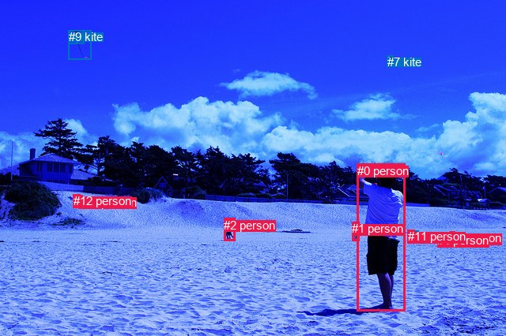
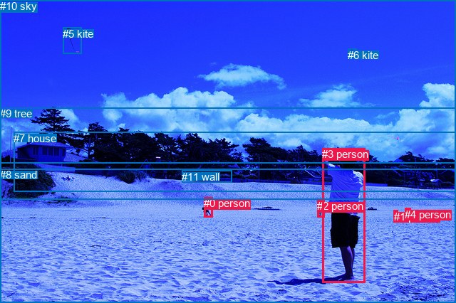

# 图片 0411：2332726.jpg

随机样本序号：21。图片 SHA256：`7d403827fdf85b5639fbf53832be1e92129ee259c99d89a30ac70aad7dc1a8f7`。

红色框表示人，蓝色框表示其他物体。两个模式分别保留自身框编号，可依据位置比较对应对象。

## 自动检测框与输出

人的框编号：`[0, 1, 2, 3, 4, 6, 10, 11, 12]`。状态：`ok`。

### 自动检测全部物体框

| 编号 | 类别 | 是否为人 | 检测分数 | 像素坐标 xyxy |
|---|---|---|---|---|
| 0 | person | True | 0.9997 | 451.9, 207.8, 512.6, 394.3 |
| 1 | person | True | 0.9943 | 445.2, 281.5, 454.8, 305.1 |
| 2 | person | True | 0.9943 | 283.2, 276.8, 297.0, 305.6 |
| 3 | person | True | 0.9890 | 569.3, 293.1, 575.6, 306.6 |
| 4 | person | True | 0.9762 | 553.5, 296.0, 559.6, 304.9 |
| 5 | kite | False | 0.9754 | 86.9, 38.3, 115.2, 75.3 |
| 6 | person | True | 0.9116 | 92.8, 246.3, 101.4, 254.7 |
| 7 | kite | False | 0.8458 | 489.7, 70.1, 497.3, 76.0 |
| 8 | boat | False | 0.8143 | 515.2, 292.2, 529.0, 295.4 |
| 9 | kite | False | 0.5421 | 87.0, 38.1, 106.3, 55.6 |
| 10 | person | True | 0.5247 | 99.9, 247.9, 104.2, 254.3 |
| 11 | person | True | 0.4824 | 515.9, 291.2, 524.3, 295.2 |
| 12 | person | True | 0.3532 | 93.3, 246.1, 98.1, 253.5 |

### 自动检测 Top50 人相关候选

评分物体对：156；人相关物体对：144；输出关系：50。

| 排名 | 主语编号与类别 | 关系 | 宾语编号与类别 | 类型 | 人与人 | 排序分数 | 原始融合 logit |
|---|---|---|---|---|---|---|---|
| 1 | #0 person | flying over | #5 kite | semantic | False | 0.98536 | 4.2094 |
| 2 | #0 person | flying over | #9 kite | semantic | False | 0.98169 | 3.9821 |
| 3 | #0 person | flying over | #7 kite | semantic | False | 0.97432 | 3.6359 |
| 4 | #2 person | flying over | #5 kite | semantic | False | 0.93992 | 2.7501 |
| 5 | #2 person | flying over | #7 kite | semantic | False | 0.93873 | 2.7293 |
| 6 | #0 person | wearing | #11 person | semantic | True | 0.93576 | 2.6788 |
| 7 | #0 person | holding | #1 person | semantic | True | 0.93573 | 2.6782 |
| 8 | #3 person | in | #4 person | spatial | True | 0.93207 | 2.6190 |
| 9 | #0 person | wearing | #8 boat | semantic | False | 0.93130 | 2.6068 |
| 10 | #12 person | on | #6 person | spatial | True | 0.92955 | 2.5798 |
| 11 | #11 person | in | #8 boat | spatial | False | 0.91727 | 2.4058 |
| 12 | #6 person | on | #10 person | spatial | True | 0.91039 | 2.3184 |
| 13 | #10 person | on | #6 person | spatial | True | 0.90554 | 2.2604 |
| 14 | #4 person | in | #8 boat | spatial | False | 0.90267 | 2.2273 |
| 15 | #2 person | flying over | #9 kite | semantic | False | 0.90109 | 2.2094 |
| 16 | #8 boat | in | #11 person | spatial | False | 0.89680 | 2.1622 |
| 17 | #3 person | in | #8 boat | spatial | False | 0.89047 | 2.0956 |
| 18 | #0 person | in | #11 person | spatial | True | 0.88289 | 2.0201 |
| 19 | #12 person | on | #10 person | spatial | True | 0.87981 | 1.9907 |
| 20 | #0 person | in | #8 boat | spatial | False | 0.87091 | 1.9090 |
| 21 | #4 person | in | #3 person | spatial | True | 0.86794 | 1.8829 |
| 22 | #4 person | in | #11 person | spatial | True | 0.86621 | 1.8679 |
| 23 | #6 person | on | #12 person | spatial | True | 0.85585 | 1.7813 |
| 24 | #0 person | in | #1 person | spatial | True | 0.85262 | 1.7553 |
| 25 | #4 person | wearing | #11 person | semantic | True | 0.85133 | 1.7451 |
| 26 | #4 person | wearing | #8 boat | semantic | False | 0.84809 | 1.7197 |
| 27 | #3 person | in | #11 person | spatial | True | 0.84468 | 1.6934 |
| 28 | #10 person | on | #12 person | spatial | True | 0.84406 | 1.6887 |
| 29 | #3 person | wearing | #8 boat | semantic | False | 0.80046 | 1.3892 |
| 30 | #2 person | in | #1 person | spatial | True | 0.78553 | 1.2982 |
| 31 | #3 person | wearing | #11 person | semantic | True | 0.77883 | 1.2589 |
| 32 | #1 person | in | #8 boat | spatial | False | 0.77402 | 1.2311 |
| 33 | #2 person | wearing | #1 person | semantic | True | 0.76592 | 1.1854 |
| 34 | #11 person | wearing | #8 boat | semantic | False | 0.74515 | 1.0729 |
| 35 | #3 person | playing with | #4 person | semantic | True | 0.73420 | 1.0161 |
| 36 | #2 person | in | #8 boat | spatial | False | 0.72972 | 0.9932 |
| 37 | #1 person | in | #11 person | spatial | True | 0.72793 | 0.9841 |
| 38 | #8 boat | wearing | #11 person | semantic | False | 0.68649 | 0.7838 |
| 39 | #2 person | in | #11 person | spatial | True | 0.68288 | 0.7671 |
| 40 | #4 person | walking on | #3 person | semantic | True | 0.63624 | 0.5591 |
| 41 | #6 person | wearing | #10 person | semantic | True | 0.61014 | 0.4479 |
| 42 | #1 person | wearing | #8 boat | semantic | False | 0.56836 | 0.2751 |
| 43 | #6 person | wearing | #12 person | semantic | True | 0.56176 | 0.2483 |
| 44 | #1 person | wearing | #11 person | semantic | True | 0.55891 | 0.2368 |
| 45 | #12 person | wearing | #6 person | semantic | True | 0.51829 | 0.0732 |
| 46 | #2 person | wearing | #11 person | semantic | True | 0.51646 | 0.0659 |
| 47 | #2 person | wearing | #8 boat | semantic | False | 0.51396 | 0.0559 |
| 48 | #10 person | wearing | #6 person | semantic | True | 0.50418 | 0.0167 |
| 49 | #12 person | playing | #10 person | semantic | True | 0.48147 | -0.0741 |
| 50 | #10 person | playing | #12 person | semantic | True | 0.42717 | -0.2934 |

### 自动检测逐条人相关 GT 核验

R@50：20.00%；命中 1/5。

| GT 主语编号 | GT 关系 | GT 宾语编号 | 结果阶段 | 匹配预测主语编号 | 匹配预测宾语编号 |
|---|---|---|---|---|---|
| 0 | walking on | 8 | endpoint_missing_or_wrong_class | [2] | [] |
| 3 | flying over | 5 | hit50 | [0] | [5] |
| 3 | looking at | 5 | wrong_predicate | [0] | [5] |
| 3 | playing | 5 | wrong_predicate | [0] | [5] |
| 3 | wearing | 8 | endpoint_missing_or_wrong_class | [0] | [] |

## 真实框与输出

人的框编号：`[0, 1, 2, 3, 4]`。

### 真实框全部物体框

| 编号 | 类别 | 是否为人 | 检测分数 | 像素坐标 xyxy |
|---|---|---|---|---|
| 0 | person | True | GT | 286.0, 277.0, 298.0, 305.0 |
| 1 | person | True | GT | 553.0, 296.0, 559.0, 305.0 |
| 2 | person | True | GT | 445.0, 281.0, 455.0, 305.0 |
| 3 | person | True | GT | 452.0, 208.0, 513.0, 397.0 |
| 4 | person | True | GT | 568.0, 293.0, 576.0, 306.0 |
| 5 | kite | False | GT | 88.0, 39.0, 114.0, 76.0 |
| 6 | kite | False | GT | 488.0, 69.0, 500.0, 76.0 |
| 7 | house | False | GT | 19.0, 186.0, 640.0, 270.0 |
| 8 | sand | False | GT | 0.0, 237.0, 640.0, 426.0 |
| 9 | tree | False | GT | 0.0, 151.0, 640.0, 280.0 |
| 10 | sky | False | GT | 0.0, 0.0, 640.0, 230.0 |
| 11 | wall | False | GT | 255.0, 240.0, 325.0, 257.0 |

### 真实框 Top50 人相关候选

评分物体对：132；人相关物体对：90；输出关系：50。

| 排名 | 主语编号与类别 | 关系 | 宾语编号与类别 | 类型 | 人与人 | 排序分数 | 原始融合 logit |
|---|---|---|---|---|---|---|---|
| 1 | #3 person | flying over | #5 kite | semantic | False | 0.99460 | 5.2161 |
| 2 | #0 person | flying over | #5 kite | semantic | False | 0.98444 | 4.1473 |
| 3 | #3 person | standing on | #8 sand | semantic | False | 0.98112 | 3.9504 |
| 4 | #4 person | on | #8 sand | spatial | False | 0.97381 | 3.6158 |
| 5 | #1 person | on | #8 sand | spatial | False | 0.97306 | 3.5868 |
| 6 | #0 person | on | #8 sand | spatial | False | 0.97299 | 3.5842 |
| 7 | #3 person | flying over | #6 kite | semantic | False | 0.96886 | 3.4378 |
| 8 | #0 person | standing on | #8 sand | semantic | False | 0.96313 | 3.2627 |
| 9 | #3 person | on | #8 sand | spatial | False | 0.96183 | 3.2267 |
| 10 | #4 person | standing on | #8 sand | semantic | False | 0.95742 | 3.1129 |
| 11 | #1 person | standing on | #8 sand | semantic | False | 0.95426 | 3.0379 |
| 12 | #3 person | holding | #2 person | semantic | True | 0.94597 | 2.8628 |
| 13 | #0 person | flying over | #6 kite | semantic | False | 0.86779 | 1.8815 |
| 14 | #2 person | standing on | #8 sand | semantic | False | 0.66790 | 0.6987 |
| 15 | #2 person | in | #8 sand | spatial | False | 0.65411 | 0.6371 |
| 16 | #3 person | in | #2 person | spatial | True | 0.65037 | 0.6207 |
| 17 | #3 person | looking at | #10 sky | semantic | False | 0.62142 | 0.4956 |
| 18 | #0 person | wearing | #2 person | semantic | True | 0.55957 | 0.2394 |
| 19 | #10 sky | over | #3 person | spatial | False | 0.51439 | 0.0576 |
| 20 | #2 person | beside | #3 person | spatial | True | 0.50993 | 0.0397 |
| 21 | #0 person | in | #9 tree | spatial | False | 0.44505 | -0.2207 |
| 22 | #0 person | in | #11 wall | spatial | False | 0.40450 | -0.3868 |
| 23 | #0 person | in | #7 house | spatial | False | 0.38234 | -0.4796 |
| 24 | #3 person | looking at | #0 person | semantic | True | 0.37019 | -0.5314 |
| 25 | #1 person | beside | #4 person | spatial | True | 0.36498 | -0.5538 |
| 26 | #0 person | in | #2 person | spatial | True | 0.36405 | -0.5578 |
| 27 | #3 person | on | #5 kite | spatial | False | 0.34945 | -0.6215 |
| 28 | #0 person | walking on | #11 wall | semantic | False | 0.30956 | -0.8022 |
| 29 | #4 person | beside | #1 person | spatial | True | 0.29086 | -0.8912 |
| 30 | #0 person | walking on | #7 house | semantic | False | 0.26969 | -0.9962 |
| 31 | #0 person | looking at | #3 person | semantic | True | 0.25354 | -1.0798 |
| 32 | #3 person | looking at | #9 tree | semantic | False | 0.25282 | -1.0836 |
| 33 | #2 person | looking at | #3 person | semantic | True | 0.22000 | -1.2657 |
| 34 | #3 person | in | #6 kite | spatial | False | 0.19700 | -1.4051 |
| 35 | #0 person | on | #5 kite | spatial | False | 0.19288 | -1.4314 |
| 36 | #1 person | looking at | #4 person | semantic | True | 0.18875 | -1.4582 |
| 37 | #3 person | looking at | #7 house | semantic | False | 0.18477 | -1.4843 |
| 38 | #3 person | beside | #7 house | spatial | False | 0.17250 | -1.5680 |
| 39 | #4 person | standing on | #1 person | semantic | True | 0.16119 | -1.6494 |
| 40 | #3 person | in | #9 tree | spatial | False | 0.16016 | -1.6570 |
| 41 | #0 person | walking on | #9 tree | semantic | False | 0.15946 | -1.6623 |
| 42 | #3 person | in | #10 sky | spatial | False | 0.15766 | -1.6757 |
| 43 | #7 house | beside | #3 person | spatial | False | 0.15550 | -1.6921 |
| 44 | #6 kite | over | #3 person | spatial | False | 0.15239 | -1.7160 |
| 45 | #4 person | flying over | #5 kite | semantic | False | 0.14216 | -1.7975 |
| 46 | #9 tree | beside | #3 person | spatial | False | 0.14206 | -1.7983 |
| 47 | #4 person | looking at | #6 kite | semantic | False | 0.13792 | -1.8327 |
| 48 | #8 sand | beside | #3 person | spatial | False | 0.13612 | -1.8479 |
| 49 | #1 person | looking at | #3 person | semantic | True | 0.13164 | -1.8866 |
| 50 | #4 person | looking at | #3 person | semantic | True | 0.12852 | -1.9141 |

### 真实框逐条人相关 GT 核验

R@50：20.00%；命中 1/5。

| GT 主语编号 | GT 关系 | GT 宾语编号 | 结果阶段 | 匹配预测主语编号 | 匹配预测宾语编号 |
|---|---|---|---|---|---|
| 0 | walking on | 8 | wrong_predicate | [0] | [8] |
| 3 | flying over | 5 | hit50 | [3] | [5] |
| 3 | looking at | 5 | wrong_predicate | [3] | [5] |
| 3 | playing | 5 | wrong_predicate | [3] | [5] |
| 3 | wearing | 8 | wrong_predicate | [3] | [8] |

## 全部人相关 GT

| 主语编号与类别 | 关系 | 宾语编号与类别 |
|---|---|---|
| #0 person | walking on | #8 sand |
| #3 person | flying over | #5 kite |
| #3 person | looking at | #5 kite |
| #3 person | playing | #5 kite |
| #3 person | wearing | #8 sand |

原始记录、全部人相关物体对的两项预测与分项分数见 [逐图证据 JSON](../evidence/cases/0411.json)。全部56类 logits 保留于本机 HOR/output/random500/logits/。

<!-- HOR_COMPLETE_RESULTS -->

## 六组条件的完整输出对照

以下保留同一图片三种框与候选模式、两种谓词输出规则的全部 Top50。框编号各自在所属模式内解释。

### 自动检测框完整枚举：空间与语义各保留一个谓词

| 排名 | 主语编号与类别 | 谓词 | 宾语编号与类别 | 分组 | 排序分数 | predicate logit | pair logit |
|---|---|---|---|---|---|---|---|
| 1 | #0 person | flying over | #5 kite | semantic | 0.9853625 | 3.9568725 | 0.2525549 |
| 2 | #0 person | flying over | #9 kite | semantic | 0.9816946 | 3.7767558 | 0.2053265 |
| 3 | #0 person | flying over | #7 kite | semantic | 0.9743164 | 3.7762952 | -0.1404109 |
| 4 | #2 person | flying over | #5 kite | semantic | 0.9399188 | 2.9041553 | -0.1540591 |
| 5 | #2 person | flying over | #7 kite | semantic | 0.9387341 | 2.9046316 | -0.1753226 |
| 6 | #0 person | wearing | #11 person | semantic | 0.9357638 | 2.7644739 | -0.0856771 |
| 7 | #0 person | holding | #1 person | semantic | 0.9357271 | 2.9662685 | -0.2880838 |
| 8 | #3 person | in | #4 person | spatial | 0.9320744 | 2.6031647 | 0.0158341 |
| 9 | #0 person | wearing | #8 boat | semantic | 0.9312955 | 2.7703419 | -0.1635797 |
| 10 | #12 person | on | #6 person | spatial | 0.9295478 | 2.5936799 | -0.0139176 |
| 11 | #11 person | in | #8 boat | spatial | 0.9172695 | 2.9248800 | -0.5190660 |
| 12 | #6 person | on | #10 person | spatial | 0.9103866 | 2.3122301 | 0.0061342 |
| 13 | #10 person | on | #6 person | spatial | 0.9055405 | 2.3088121 | -0.0484512 |
| 14 | #4 person | in | #8 boat | spatial | 0.9026700 | 2.7045074 | -0.4772573 |
| 15 | #2 person | flying over | #9 kite | semantic | 0.9010923 | 2.3933725 | -0.1839521 |
| 16 | #8 boat | in | #11 person | spatial | 0.8968024 | 2.6496267 | -0.4874369 |
| 17 | #3 person | in | #8 boat | spatial | 0.8904716 | 2.5708680 | -0.4752998 |
| 18 | #0 person | in | #11 person | spatial | 0.8828915 | 2.1057787 | -0.0856771 |
| 19 | #12 person | on | #10 person | spatial | 0.8798130 | 1.9843831 | 0.0062776 |
| 20 | #0 person | in | #8 boat | spatial | 0.8709080 | 2.0725913 | -0.1635797 |
| 21 | #4 person | in | #3 person | spatial | 0.8679390 | 2.0942645 | -0.2114069 |
| 22 | #4 person | in | #11 person | spatial | 0.8662099 | 2.4438648 | -0.5760097 |
| 23 | #6 person | on | #12 person | spatial | 0.8558524 | 1.8109889 | -0.0297290 |
| 24 | #0 person | in | #1 person | spatial | 0.8526183 | 2.0433702 | -0.2880838 |
| 25 | #4 person | wearing | #11 person | semantic | 0.8513302 | 2.3210826 | -0.5760097 |
| 26 | #4 person | wearing | #8 boat | semantic | 0.8480904 | 2.1969590 | -0.4772573 |
| 27 | #3 person | in | #11 person | spatial | 0.8446764 | 2.2770381 | -0.5835954 |
| 28 | #10 person | on | #12 person | spatial | 0.8440569 | 1.7551212 | -0.0663924 |
| 29 | #3 person | wearing | #8 boat | semantic | 0.8004568 | 1.8644514 | -0.4752998 |
| 30 | #2 person | in | #1 person | spatial | 0.7855301 | 1.9730291 | -0.6748396 |
| 31 | #3 person | wearing | #11 person | semantic | 0.7788346 | 1.8424835 | -0.5835954 |
| 32 | #1 person | in | #8 boat | spatial | 0.7740173 | 1.8993497 | -0.6682136 |
| 33 | #2 person | wearing | #1 person | semantic | 0.7659162 | 1.8602328 | -0.6748396 |
| 34 | #11 person | wearing | #8 boat | semantic | 0.7451509 | 1.5919814 | -0.5190660 |
| 35 | #3 person | playing with | #4 person | semantic | 0.7342033 | 1.0002203 | 0.0158341 |
| 36 | #2 person | in | #8 boat | spatial | 0.7297162 | 1.7794294 | -0.7862462 |
| 37 | #1 person | in | #11 person | spatial | 0.7279299 | 1.6621604 | -0.6780150 |
| 38 | #8 boat | wearing | #11 person | semantic | 0.6864927 | 1.2712097 | -0.4874369 |
| 39 | #2 person | in | #11 person | spatial | 0.6828830 | 1.6592870 | -0.8922342 |
| 40 | #4 person | walking on | #3 person | semantic | 0.6362394 | 0.7704859 | -0.2114069 |
| 41 | #6 person | wearing | #10 person | semantic | 0.6101356 | 0.4417481 | 0.0061342 |
| 42 | #1 person | wearing | #8 boat | semantic | 0.5683555 | 0.9433584 | -0.6682136 |
| 43 | #6 person | wearing | #12 person | semantic | 0.5617640 | 0.2780533 | -0.0297290 |
| 44 | #1 person | wearing | #11 person | semantic | 0.5589140 | 0.9147706 | -0.6780150 |
| 45 | #12 person | wearing | #6 person | semantic | 0.5182941 | 0.0871267 | -0.0139176 |
| 46 | #2 person | wearing | #11 person | semantic | 0.5164610 | 0.9581017 | -0.8922342 |
| 47 | #2 person | wearing | #8 boat | semantic | 0.5139601 | 0.8421011 | -0.7862462 |
| 48 | #10 person | wearing | #6 person | semantic | 0.5041769 | 0.0651588 | -0.0484512 |
| 49 | #12 person | playing | #10 person | semantic | 0.4814738 | -0.0804162 | 0.0062776 |
| 50 | #10 person | playing | #12 person | semantic | 0.4271661 | -0.2270303 | -0.0663924 |

GT 命中：1/5，R@50=20.00%。

| GT主语 | GT谓词 | GT宾语 | 结果阶段 | 匹配主语框 | 匹配宾语框 |
|---|---|---|---|---|---|
| 0 | walking on | 8 | endpoint_missing_or_wrong_class | [2] | [] |
| 3 | flying over | 5 | hit50 | [0] | [5] |
| 3 | looking at | 5 | wrong_predicate | [0] | [5] |
| 3 | playing | 5 | wrong_predicate | [0] | [5] |
| 3 | wearing | 8 | endpoint_missing_or_wrong_class | [0] | [] |

### 自动检测框完整枚举：每对只保留一个谓词

| 排名 | 主语编号与类别 | 谓词 | 宾语编号与类别 | 分组 | 排序分数 | predicate logit | pair logit |
|---|---|---|---|---|---|---|---|
| 1 | #0 person | flying over | #5 kite | single | 0.9853625 | 3.9568725 | 0.2525549 |
| 2 | #0 person | flying over | #9 kite | single | 0.9816946 | 3.7767558 | 0.2053265 |
| 3 | #0 person | flying over | #7 kite | single | 0.9743164 | 3.7762952 | -0.1404109 |
| 4 | #2 person | flying over | #5 kite | single | 0.9399188 | 2.9041553 | -0.1540591 |
| 5 | #2 person | flying over | #7 kite | single | 0.9387341 | 2.9046316 | -0.1753226 |
| 6 | #0 person | wearing | #11 person | single | 0.9357638 | 2.7644739 | -0.0856771 |
| 7 | #0 person | holding | #1 person | single | 0.9357271 | 2.9662685 | -0.2880838 |
| 8 | #3 person | in | #4 person | single | 0.9320744 | 2.6031647 | 0.0158341 |
| 9 | #0 person | wearing | #8 boat | single | 0.9312955 | 2.7703419 | -0.1635797 |
| 10 | #12 person | on | #6 person | single | 0.9295478 | 2.5936799 | -0.0139176 |
| 11 | #11 person | in | #8 boat | single | 0.9172695 | 2.9248800 | -0.5190660 |
| 12 | #6 person | on | #10 person | single | 0.9103866 | 2.3122301 | 0.0061342 |
| 13 | #10 person | on | #6 person | single | 0.9055405 | 2.3088121 | -0.0484512 |
| 14 | #4 person | in | #8 boat | single | 0.9026700 | 2.7045074 | -0.4772573 |
| 15 | #2 person | flying over | #9 kite | single | 0.9010923 | 2.3933725 | -0.1839521 |
| 16 | #8 boat | in | #11 person | single | 0.8968024 | 2.6496267 | -0.4874369 |
| 17 | #3 person | in | #8 boat | single | 0.8904716 | 2.5708680 | -0.4752998 |
| 18 | #12 person | on | #10 person | single | 0.8798130 | 1.9843831 | 0.0062776 |
| 19 | #4 person | in | #3 person | single | 0.8679390 | 2.0942645 | -0.2114069 |
| 20 | #4 person | in | #11 person | single | 0.8662099 | 2.4438648 | -0.5760097 |
| 21 | #6 person | on | #12 person | single | 0.8558524 | 1.8109889 | -0.0297290 |
| 22 | #3 person | in | #11 person | single | 0.8446764 | 2.2770381 | -0.5835954 |
| 23 | #10 person | on | #12 person | single | 0.8440569 | 1.7551212 | -0.0663924 |
| 24 | #2 person | in | #1 person | single | 0.7855301 | 1.9730291 | -0.6748396 |
| 25 | #1 person | in | #8 boat | single | 0.7740173 | 1.8993497 | -0.6682136 |
| 26 | #2 person | in | #8 boat | single | 0.7297162 | 1.7794294 | -0.7862462 |
| 27 | #1 person | in | #11 person | single | 0.7279299 | 1.6621604 | -0.6780150 |
| 28 | #2 person | in | #11 person | single | 0.6828830 | 1.6592870 | -0.8922342 |
| 29 | #3 person | in | #1 person | single | 0.3985918 | 0.2454438 | -0.6567798 |
| 30 | #11 person | in | #1 person | single | 0.3752299 | 0.2772951 | -0.7871401 |
| 31 | #8 boat | in | #1 person | single | 0.3500753 | 0.1332536 | -0.7519618 |
| 32 | #4 person | in | #1 person | single | 0.3400174 | -0.0353336 | -0.6278831 |
| 33 | #1 person | flying over | #5 kite | single | 0.2978779 | 0.5887995 | -1.4462229 |
| 34 | #7 kite | flying over | #0 person | single | 0.2594606 | 0.1451745 | -1.1939486 |
| 35 | #4 person | flying over | #5 kite | single | 0.2581297 | -0.1920104 | -0.8637019 |
| 36 | #3 person | flying over | #5 kite | single | 0.2579714 | -0.1920218 | -0.8645173 |
| 37 | #3 person | flying over | #9 kite | single | 0.2448475 | -0.2520547 | -0.8742292 |
| 38 | #1 person | flying over | #9 kite | single | 0.2446454 | 0.3485913 | -1.4759686 |
| 39 | #4 person | flying over | #9 kite | single | 0.2321736 | -0.3121562 | -0.8839223 |
| 40 | #8 boat | on | #4 person | single | 0.2275467 | -0.1601181 | -1.0620980 |
| 41 | #4 person | flying over | #7 kite | single | 0.2122028 | -0.6431689 | -0.6685293 |
| 42 | #1 person | on | #0 person | single | 0.2072005 | -0.6682520 | -0.6736315 |
| 43 | #2 person | looking at | #0 person | single | 0.2044903 | -0.2284846 | -1.1299779 |
| 44 | #3 person | flying over | #7 kite | single | 0.1949412 | -0.7331820 | -0.6850355 |
| 45 | #2 person | in | #4 person | single | 0.1783139 | -1.0102136 | -0.5175995 |
| 46 | #11 person | flying over | #5 kite | single | 0.1695491 | 0.0181370 | -1.6069632 |
| 47 | #8 boat | on | #0 person | single | 0.1653333 | -1.1425297 | -0.4765396 |
| 48 | #0 person | in | #2 person | single | 0.1484012 | -0.6301975 | -1.1169982 |
| 49 | #1 person | flying over | #7 kite | single | 0.1439950 | -0.3127866 | -1.4697108 |
| 50 | #3 person | on | #10 person | single | 0.1434206 | -1.0678661 | -0.7192993 |

GT 命中：1/5，R@50=20.00%。

| GT主语 | GT谓词 | GT宾语 | 结果阶段 | 匹配主语框 | 匹配宾语框 |
|---|---|---|---|---|---|
| 0 | walking on | 8 | endpoint_missing_or_wrong_class | [2] | [] |
| 3 | flying over | 5 | hit50 | [0] | [5] |
| 3 | looking at | 5 | wrong_predicate | [0] | [5] |
| 3 | playing | 5 | wrong_predicate | [0] | [5] |
| 3 | wearing | 8 | endpoint_missing_or_wrong_class | [0] | [] |

### 真实框完整枚举：空间与语义各保留一个谓词

| 排名 | 主语编号与类别 | 谓词 | 宾语编号与类别 | 分组 | 排序分数 | predicate logit | pair logit |
|---|---|---|---|---|---|---|---|
| 1 | #3 person | flying over | #5 kite | semantic | 0.9946008 | 4.9775491 | 0.2385390 |
| 2 | #0 person | flying over | #5 kite | semantic | 0.9844395 | 4.3157716 | -0.1684310 |
| 3 | #3 person | standing on | #8 sand | semantic | 0.9811158 | 3.7586694 | 0.1916943 |
| 4 | #4 person | on | #8 sand | spatial | 0.9738103 | 3.1783009 | 0.4375455 |
| 5 | #1 person | on | #8 sand | spatial | 0.9730584 | 3.1949253 | 0.3918459 |
| 6 | #0 person | on | #8 sand | spatial | 0.9729921 | 3.2992454 | 0.2849971 |
| 7 | #3 person | flying over | #6 kite | semantic | 0.9688647 | 3.5955014 | -0.1577190 |
| 8 | #0 person | standing on | #8 sand | semantic | 0.9631277 | 2.9777265 | 0.2849971 |
| 9 | #3 person | on | #8 sand | spatial | 0.9618264 | 3.0349984 | 0.1916943 |
| 10 | #4 person | standing on | #8 sand | semantic | 0.9574230 | 2.6753845 | 0.4375455 |
| 11 | #1 person | standing on | #8 sand | semantic | 0.9542553 | 2.6460080 | 0.3918459 |
| 12 | #3 person | holding | #2 person | semantic | 0.9459749 | 3.1844630 | -0.3216974 |
| 13 | #0 person | flying over | #6 kite | semantic | 0.8677856 | 2.0621686 | -0.1806493 |
| 14 | #2 person | standing on | #8 sand | semantic | 0.6678987 | 1.5860858 | -0.8873894 |
| 15 | #2 person | in | #8 sand | spatial | 0.6541078 | 1.5245342 | -0.8873894 |
| 16 | #3 person | in | #2 person | spatial | 0.6503736 | 0.9423790 | -0.3216974 |
| 17 | #3 person | looking at | #10 sky | semantic | 0.6214228 | 1.7775183 | -1.2819269 |
| 18 | #0 person | wearing | #2 person | semantic | 0.5595695 | 0.9031811 | -0.6637661 |
| 19 | #10 sky | over | #3 person | spatial | 0.5143867 | 1.1547027 | -1.0971402 |
| 20 | #2 person | beside | #3 person | spatial | 0.5099252 | 0.7375145 | -0.6978085 |
| 21 | #0 person | in | #9 tree | spatial | 0.4450458 | 0.1989613 | -0.4196698 |
| 22 | #0 person | in | #11 wall | spatial | 0.4044972 | 0.2334838 | -0.6202450 |
| 23 | #0 person | in | #7 house | spatial | 0.3823416 | 0.0427575 | -0.5223786 |
| 24 | #3 person | looking at | #0 person | semantic | 0.3701901 | 0.5893168 | -1.1207184 |
| 25 | #1 person | beside | #4 person | spatial | 0.3649778 | -0.3444691 | -0.2093544 |
| 26 | #0 person | in | #2 person | spatial | 0.3640495 | 0.1059351 | -0.6637661 |
| 27 | #3 person | on | #5 kite | spatial | 0.3494477 | -0.8600068 | 0.2385390 |
| 28 | #0 person | walking on | #11 wall | semantic | 0.3095586 | -0.1819386 | -0.6202450 |
| 29 | #4 person | beside | #1 person | spatial | 0.2908575 | -0.9048657 | 0.0136427 |
| 30 | #0 person | walking on | #7 house | semantic | 0.2696922 | -0.4738064 | -0.5223786 |
| 31 | #0 person | looking at | #3 person | semantic | 0.2535391 | 0.0633631 | -1.1431880 |
| 32 | #3 person | looking at | #9 tree | semantic | 0.2528176 | 0.1830306 | -1.2666718 |
| 33 | #2 person | looking at | #3 person | semantic | 0.2200003 | -0.5678558 | -0.6978085 |
| 34 | #3 person | in | #6 kite | spatial | 0.1970015 | -1.2474225 | -0.1577190 |
| 35 | #0 person | on | #5 kite | spatial | 0.1928834 | -1.2629511 | -0.1684310 |
| 36 | #1 person | looking at | #4 person | semantic | 0.1887483 | -1.2488096 | -0.2093544 |
| 37 | #3 person | looking at | #7 house | semantic | 0.1847717 | 0.1861682 | -1.6705157 |
| 38 | #3 person | beside | #7 house | spatial | 0.1724980 | 0.1024895 | -1.6705157 |
| 39 | #4 person | standing on | #1 person | semantic | 0.1611938 | -1.6630149 | 0.0136427 |
| 40 | #3 person | in | #9 tree | spatial | 0.1601611 | -0.3903584 | -1.2666718 |
| 41 | #0 person | walking on | #9 tree | semantic | 0.1594571 | -1.2426033 | -0.4196698 |
| 42 | #3 person | in | #10 sky | spatial | 0.1576623 | -0.3937984 | -1.2819269 |
| 43 | #7 house | beside | #3 person | spatial | 0.1554996 | -0.8301897 | -0.8619122 |
| 44 | #6 kite | over | #3 person | spatial | 0.1523905 | -0.5085039 | -1.2074695 |
| 45 | #4 person | flying over | #5 kite | semantic | 0.1421556 | -0.9144535 | -0.8830471 |
| 46 | #9 tree | beside | #3 person | spatial | 0.1420610 | -0.9976189 | -0.8006572 |
| 47 | #4 person | looking at | #6 kite | semantic | 0.1379215 | -1.1474018 | -0.6852595 |
| 48 | #8 sand | beside | #3 person | spatial | 0.1361235 | -0.6119084 | -1.2359586 |
| 49 | #1 person | looking at | #3 person | semantic | 0.1316358 | -0.8609900 | -1.0255818 |
| 50 | #4 person | looking at | #3 person | semantic | 0.1285211 | -0.8902094 | -1.0238891 |

GT 命中：1/5，R@50=20.00%。

| GT主语 | GT谓词 | GT宾语 | 结果阶段 | 匹配主语框 | 匹配宾语框 |
|---|---|---|---|---|---|
| 0 | walking on | 8 | wrong_predicate | [0] | [8] |
| 3 | flying over | 5 | hit50 | [3] | [5] |
| 3 | looking at | 5 | wrong_predicate | [3] | [5] |
| 3 | playing | 5 | wrong_predicate | [3] | [5] |
| 3 | wearing | 8 | wrong_predicate | [3] | [8] |

### 真实框完整枚举：每对只保留一个谓词

| 排名 | 主语编号与类别 | 谓词 | 宾语编号与类别 | 分组 | 排序分数 | predicate logit | pair logit |
|---|---|---|---|---|---|---|---|
| 1 | #3 person | flying over | #5 kite | single | 0.9946008 | 4.9775491 | 0.2385390 |
| 2 | #0 person | flying over | #5 kite | single | 0.9844395 | 4.3157716 | -0.1684310 |
| 3 | #3 person | standing on | #8 sand | single | 0.9811158 | 3.7586694 | 0.1916943 |
| 4 | #4 person | on | #8 sand | single | 0.9738103 | 3.1783009 | 0.4375455 |
| 5 | #1 person | on | #8 sand | single | 0.9730584 | 3.1949253 | 0.3918459 |
| 6 | #0 person | on | #8 sand | single | 0.9729921 | 3.2992454 | 0.2849971 |
| 7 | #3 person | flying over | #6 kite | single | 0.9688647 | 3.5955014 | -0.1577190 |
| 8 | #3 person | holding | #2 person | single | 0.9459749 | 3.1844630 | -0.3216974 |
| 9 | #0 person | flying over | #6 kite | single | 0.8677856 | 2.0621686 | -0.1806493 |
| 10 | #2 person | standing on | #8 sand | single | 0.6678987 | 1.5860858 | -0.8873894 |
| 11 | #3 person | looking at | #10 sky | single | 0.6214228 | 1.7775183 | -1.2819269 |
| 12 | #0 person | wearing | #2 person | single | 0.5595695 | 0.9031811 | -0.6637661 |
| 13 | #10 sky | over | #3 person | single | 0.5143867 | 1.1547027 | -1.0971402 |
| 14 | #2 person | beside | #3 person | single | 0.5099252 | 0.7375145 | -0.6978085 |
| 15 | #0 person | in | #9 tree | single | 0.4450458 | 0.1989613 | -0.4196698 |
| 16 | #0 person | in | #11 wall | single | 0.4044972 | 0.2334838 | -0.6202450 |
| 17 | #0 person | in | #7 house | single | 0.3823416 | 0.0427575 | -0.5223786 |
| 18 | #3 person | looking at | #0 person | single | 0.3701901 | 0.5893168 | -1.1207184 |
| 19 | #1 person | beside | #4 person | single | 0.3649778 | -0.3444691 | -0.2093544 |
| 20 | #4 person | beside | #1 person | single | 0.2908575 | -0.9048657 | 0.0136427 |
| 21 | #0 person | looking at | #3 person | single | 0.2535391 | 0.0633631 | -1.1431880 |
| 22 | #3 person | looking at | #9 tree | single | 0.2528176 | 0.1830306 | -1.2666718 |
| 23 | #3 person | looking at | #7 house | single | 0.1847717 | 0.1861682 | -1.6705157 |
| 24 | #7 house | beside | #3 person | single | 0.1554996 | -0.8301897 | -0.8619122 |
| 25 | #6 kite | over | #3 person | single | 0.1523905 | -0.5085039 | -1.2074695 |
| 26 | #4 person | flying over | #5 kite | single | 0.1421556 | -0.9144535 | -0.8830471 |
| 27 | #9 tree | beside | #3 person | single | 0.1420610 | -0.9976189 | -0.8006572 |
| 28 | #4 person | looking at | #6 kite | single | 0.1379215 | -1.1474018 | -0.6852595 |
| 29 | #8 sand | beside | #3 person | single | 0.1361235 | -0.6119084 | -1.2359586 |
| 30 | #1 person | looking at | #3 person | single | 0.1316358 | -0.8609900 | -1.0255818 |
| 31 | #4 person | looking at | #3 person | single | 0.1285211 | -0.8902094 | -1.0238891 |
| 32 | #1 person | flying over | #5 kite | single | 0.1283761 | -1.0497797 | -0.8656144 |
| 33 | #2 person | flying over | #5 kite | single | 0.1179416 | -0.5843177 | -1.4277505 |
| 34 | #10 sky | over | #0 person | single | 0.1129641 | -1.0094488 | -1.0513672 |
| 35 | #5 kite | pulling | #0 person | single | 0.0995651 | -0.9517448 | -1.2503209 |
| 36 | #1 person | looking at | #0 person | single | 0.0974389 | -1.3283086 | -0.8977022 |
| 37 | #4 person | in | #9 tree | single | 0.0967917 | -1.8364074 | -0.3969848 |
| 38 | #1 person | looking at | #6 kite | single | 0.0946726 | -1.5974960 | -0.6603756 |
| 39 | #4 person | looking at | #0 person | single | 0.0944223 | -1.4437931 | -0.8170027 |
| 40 | #5 kite | flying over | #3 person | single | 0.0836254 | -1.3292966 | -1.0647819 |
| 41 | #1 person | in | #9 tree | single | 0.0718946 | -2.1165781 | -0.4413668 |
| 42 | #4 person | looking at | #7 house | single | 0.0695838 | -2.1383426 | -0.4547580 |
| 43 | #11 wall | beside | #0 person | single | 0.0620580 | -1.6996746 | -1.0159446 |
| 44 | #9 tree | beside | #0 person | single | 0.0590239 | -1.8974650 | -0.8715100 |
| 45 | #1 person | in | #7 house | single | 0.0452182 | -2.5545070 | -0.4954757 |
| 46 | #7 house | beside | #0 person | single | 0.0415891 | -2.1818140 | -0.9556246 |
| 47 | #3 person | looking at | #1 person | single | 0.0409362 | -1.7694800 | -1.3844635 |
| 48 | #3 person | looking at | #4 person | single | 0.0379852 | -1.7512965 | -1.4805356 |
| 49 | #6 kite | flying over | #0 person | single | 0.0374827 | -1.8852475 | -1.3604249 |
| 50 | #8 sand | in | #0 person | single | 0.0374120 | -1.8729136 | -1.3747212 |

GT 命中：1/5，R@50=20.00%。

| GT主语 | GT谓词 | GT宾语 | 结果阶段 | 匹配主语框 | 匹配宾语框 |
|---|---|---|---|---|---|
| 0 | walking on | 8 | wrong_predicate | [0] | [8] |
| 3 | flying over | 5 | hit50 | [3] | [5] |
| 3 | looking at | 5 | wrong_predicate | [3] | [5] |
| 3 | playing | 5 | wrong_predicate | [3] | [5] |
| 3 | wearing | 8 | wrong_predicate | [3] | [8] |

### 真实框400候选：空间与语义各保留一个谓词

| 排名 | 主语编号与类别 | 谓词 | 宾语编号与类别 | 分组 | 排序分数 | predicate logit | pair logit |
|---|---|---|---|---|---|---|---|
| 1 | #3 person | flying over | #5 kite | semantic | 0.9946008 | 4.9775491 | 0.2385390 |
| 2 | #0 person | flying over | #5 kite | semantic | 0.9844395 | 4.3157716 | -0.1684310 |
| 3 | #3 person | standing on | #8 sand | semantic | 0.9811158 | 3.7586694 | 0.1916943 |
| 4 | #4 person | on | #8 sand | spatial | 0.9738103 | 3.1783009 | 0.4375455 |
| 5 | #1 person | on | #8 sand | spatial | 0.9730584 | 3.1949253 | 0.3918459 |
| 6 | #0 person | on | #8 sand | spatial | 0.9729921 | 3.2992454 | 0.2849971 |
| 7 | #3 person | flying over | #6 kite | semantic | 0.9706264 | 3.6555610 | -0.1577190 |
| 8 | #0 person | standing on | #8 sand | semantic | 0.9631277 | 2.9777265 | 0.2849971 |
| 9 | #3 person | on | #8 sand | spatial | 0.9603912 | 2.9965954 | 0.1916943 |
| 10 | #4 person | standing on | #8 sand | semantic | 0.9574230 | 2.6753845 | 0.4375455 |
| 11 | #1 person | standing on | #8 sand | semantic | 0.9542553 | 2.6460080 | 0.3918459 |
| 12 | #3 person | holding | #2 person | semantic | 0.9456721 | 3.1785545 | -0.3216974 |
| 13 | #0 person | flying over | #6 kite | semantic | 0.8643001 | 2.0321236 | -0.1806493 |
| 14 | #2 person | standing on | #8 sand | semantic | 0.6662676 | 1.5787416 | -0.8873894 |
| 15 | #2 person | in | #8 sand | spatial | 0.6533565 | 1.5212154 | -0.8873894 |
| 16 | #3 person | in | #2 person | spatial | 0.6488628 | 0.9357414 | -0.3216974 |
| 17 | #3 person | looking at | #10 sky | semantic | 0.6214228 | 1.7775183 | -1.2819269 |
| 18 | #0 person | wearing | #2 person | semantic | 0.5662512 | 0.9303384 | -0.6637661 |
| 19 | #10 sky | over | #3 person | spatial | 0.5055457 | 1.1193237 | -1.0971402 |
| 20 | #2 person | beside | #3 person | spatial | 0.5023893 | 0.7073655 | -0.6978085 |
| 21 | #0 person | in | #9 tree | spatial | 0.4434070 | 0.1923237 | -0.4196698 |
| 22 | #0 person | in | #11 wall | spatial | 0.4133746 | 0.2702127 | -0.6202450 |
| 23 | #0 person | in | #7 house | spatial | 0.3768184 | 0.0193038 | -0.5223786 |
| 24 | #3 person | looking at | #0 person | semantic | 0.3701901 | 0.5893168 | -1.1207184 |
| 25 | #1 person | beside | #4 person | spatial | 0.3649778 | -0.3444691 | -0.2093544 |
| 26 | #0 person | in | #2 person | spatial | 0.3648180 | 0.1092534 | -0.6637661 |
| 27 | #3 person | on | #5 kite | spatial | 0.3538253 | -0.8408055 | 0.2385390 |
| 28 | #0 person | walking on | #11 wall | semantic | 0.3219091 | -0.1247673 | -0.6202450 |
| 29 | #4 person | beside | #1 person | spatial | 0.2908556 | -0.9048750 | 0.0136427 |
| 30 | #0 person | walking on | #7 house | semantic | 0.2640992 | -0.5023918 | -0.5223786 |
| 31 | #3 person | looking at | #9 tree | semantic | 0.2527516 | 0.1826816 | -1.2666718 |
| 32 | #0 person | looking at | #3 person | semantic | 0.2480165 | 0.0339689 | -1.1431880 |
| 33 | #2 person | looking at | #3 person | semantic | 0.2100206 | -0.6269927 | -0.6978085 |
| 34 | #3 person | in | #6 kite | spatial | 0.1951530 | -1.2591493 | -0.1577190 |
| 35 | #0 person | on | #5 kite | spatial | 0.1928834 | -1.2629511 | -0.1684310 |
| 36 | #3 person | looking at | #7 house | semantic | 0.1846667 | 0.1854711 | -1.6705157 |
| 37 | #1 person | looking at | #4 person | semantic | 0.1842623 | -1.2783782 | -0.2093544 |
| 38 | #3 person | beside | #7 house | spatial | 0.1682571 | 0.0724854 | -1.6705157 |
| 39 | #4 person | standing on | #1 person | semantic | 0.1611938 | -1.6630149 | 0.0136427 |
| 40 | #3 person | in | #9 tree | spatial | 0.1601611 | -0.3903584 | -1.2666718 |
| 41 | #0 person | walking on | #9 tree | semantic | 0.1574508 | -1.2576489 | -0.4196698 |
| 42 | #3 person | in | #10 sky | spatial | 0.1572221 | -0.3971171 | -1.2819269 |
| 43 | #7 house | beside | #3 person | spatial | 0.1554866 | -0.8302884 | -0.8619122 |
| 44 | #6 kite | over | #3 person | spatial | 0.1523905 | -0.5085039 | -1.2074695 |
| 45 | #4 person | flying over | #5 kite | semantic | 0.1458562 | -0.8844314 | -0.8830471 |
| 46 | #9 tree | beside | #3 person | spatial | 0.1457574 | -0.9676144 | -0.8006572 |
| 47 | #8 sand | beside | #3 person | spatial | 0.1396871 | -0.5819325 | -1.2359586 |
| 48 | #4 person | looking at | #6 kite | semantic | 0.1361526 | -1.1623602 | -0.6852595 |
| 49 | #1 person | looking at | #3 person | semantic | 0.1350527 | -0.8314216 | -1.0255818 |
| 50 | #4 person | looking at | #3 person | semantic | 0.1319093 | -0.8602924 | -1.0238891 |

GT 命中：1/5，R@50=20.00%。

| GT主语 | GT谓词 | GT宾语 | 结果阶段 | 匹配主语框 | 匹配宾语框 |
|---|---|---|---|---|---|
| 0 | walking on | 8 | wrong_predicate | [0] | [8] |
| 3 | flying over | 5 | hit50 | [3] | [5] |
| 3 | looking at | 5 | wrong_predicate | [3] | [5] |
| 3 | playing | 5 | wrong_predicate | [3] | [5] |
| 3 | wearing | 8 | wrong_predicate | [3] | [8] |

### 真实框400候选：每对只保留一个谓词

| 排名 | 主语编号与类别 | 谓词 | 宾语编号与类别 | 分组 | 排序分数 | predicate logit | pair logit |
|---|---|---|---|---|---|---|---|
| 1 | #3 person | flying over | #5 kite | single | 0.9946008 | 4.9775491 | 0.2385390 |
| 2 | #0 person | flying over | #5 kite | single | 0.9844395 | 4.3157716 | -0.1684310 |
| 3 | #3 person | standing on | #8 sand | single | 0.9811158 | 3.7586694 | 0.1916943 |
| 4 | #4 person | on | #8 sand | single | 0.9738103 | 3.1783009 | 0.4375455 |
| 5 | #1 person | on | #8 sand | single | 0.9730584 | 3.1949253 | 0.3918459 |
| 6 | #0 person | on | #8 sand | single | 0.9729921 | 3.2992454 | 0.2849971 |
| 7 | #3 person | flying over | #6 kite | single | 0.9706264 | 3.6555610 | -0.1577190 |
| 8 | #3 person | holding | #2 person | single | 0.9456721 | 3.1785545 | -0.3216974 |
| 9 | #0 person | flying over | #6 kite | single | 0.8643001 | 2.0321236 | -0.1806493 |
| 10 | #2 person | standing on | #8 sand | single | 0.6662676 | 1.5787416 | -0.8873894 |
| 11 | #3 person | looking at | #10 sky | single | 0.6214228 | 1.7775183 | -1.2819269 |
| 12 | #0 person | wearing | #2 person | single | 0.5662512 | 0.9303384 | -0.6637661 |
| 13 | #10 sky | over | #3 person | single | 0.5055457 | 1.1193237 | -1.0971402 |
| 14 | #2 person | beside | #3 person | single | 0.5023893 | 0.7073655 | -0.6978085 |
| 15 | #0 person | in | #9 tree | single | 0.4434070 | 0.1923237 | -0.4196698 |
| 16 | #0 person | in | #11 wall | single | 0.4133746 | 0.2702127 | -0.6202450 |
| 17 | #0 person | in | #7 house | single | 0.3768184 | 0.0193038 | -0.5223786 |
| 18 | #3 person | looking at | #0 person | single | 0.3701901 | 0.5893168 | -1.1207184 |
| 19 | #1 person | beside | #4 person | single | 0.3649778 | -0.3444691 | -0.2093544 |
| 20 | #4 person | beside | #1 person | single | 0.2908556 | -0.9048750 | 0.0136427 |
| 21 | #3 person | looking at | #9 tree | single | 0.2527516 | 0.1826816 | -1.2666718 |
| 22 | #0 person | looking at | #3 person | single | 0.2480165 | 0.0339689 | -1.1431880 |
| 23 | #3 person | looking at | #7 house | single | 0.1846667 | 0.1854711 | -1.6705157 |
| 24 | #7 house | beside | #3 person | single | 0.1554866 | -0.8302884 | -0.8619122 |
| 25 | #6 kite | over | #3 person | single | 0.1523905 | -0.5085039 | -1.2074695 |
| 26 | #4 person | flying over | #5 kite | single | 0.1458562 | -0.8844314 | -0.8830471 |
| 27 | #9 tree | beside | #3 person | single | 0.1457574 | -0.9676144 | -0.8006572 |
| 28 | #8 sand | beside | #3 person | single | 0.1396871 | -0.5819325 | -1.2359586 |
| 29 | #4 person | looking at | #6 kite | single | 0.1361526 | -1.1623602 | -0.6852595 |
| 30 | #1 person | looking at | #3 person | single | 0.1350527 | -0.8314216 | -1.0255818 |
| 31 | #4 person | looking at | #3 person | single | 0.1319093 | -0.8602924 | -1.0238891 |
| 32 | #1 person | flying over | #5 kite | single | 0.1317748 | -1.0197423 | -0.8656144 |
| 33 | #2 person | flying over | #5 kite | single | 0.1179424 | -0.5843101 | -1.4277505 |
| 34 | #10 sky | over | #0 person | single | 0.1129641 | -1.0094488 | -1.0513672 |
| 35 | #5 kite | pulling | #0 person | single | 0.0995654 | -0.9517417 | -1.2503209 |
| 36 | #1 person | looking at | #6 kite | single | 0.0985677 | -1.5528655 | -0.6603756 |
| 37 | #4 person | in | #9 tree | single | 0.0981150 | -1.8213620 | -0.3969848 |
| 38 | #1 person | looking at | #0 person | single | 0.0974542 | -1.3281343 | -0.8977022 |
| 39 | #4 person | looking at | #0 person | single | 0.0931731 | -1.4584897 | -0.8170027 |
| 40 | #5 kite | flying over | #3 person | single | 0.0836277 | -1.3292658 | -1.0647819 |
| 41 | #1 person | in | #9 tree | single | 0.0726251 | -2.1056807 | -0.4413668 |
| 42 | #4 person | looking at | #7 house | single | 0.0676479 | -2.1686358 | -0.4547580 |
| 43 | #11 wall | beside | #0 person | single | 0.0620595 | -1.6996477 | -1.0159446 |
| 44 | #9 tree | beside | #0 person | single | 0.0590231 | -1.8974793 | -0.8715100 |
| 45 | #1 person | in | #7 house | single | 0.0459995 | -2.5365577 | -0.4954757 |
| 46 | #7 house | beside | #0 person | single | 0.0421924 | -2.1667829 | -0.9556246 |
| 47 | #3 person | looking at | #1 person | single | 0.0403495 | -1.7845256 | -1.3844635 |
| 48 | #3 person | looking at | #4 person | single | 0.0379821 | -1.7513838 | -1.4805356 |
| 49 | #6 kite | flying over | #0 person | single | 0.0374838 | -1.8852167 | -1.3604249 |
| 50 | #0 person | looking at | #10 sky | single | 0.0373664 | -2.2774248 | -0.9714764 |

GT 命中：1/5，R@50=20.00%。

| GT主语 | GT谓词 | GT宾语 | 结果阶段 | 匹配主语框 | 匹配宾语框 |
|---|---|---|---|---|---|
| 0 | walking on | 8 | wrong_predicate | [0] | [8] |
| 3 | flying over | 5 | hit50 | [3] | [5] |
| 3 | looking at | 5 | wrong_predicate | [3] | [5] |
| 3 | playing | 5 | wrong_predicate | [3] | [5] |
| 3 | wearing | 8 | wrong_predicate | [3] | [8] |
