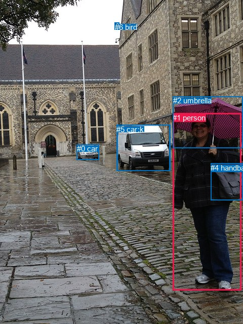
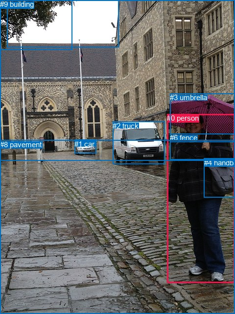

# 图片 0417：2332914.jpg

随机样本序号：173。图片 SHA256：`4635596b77228a330bebea2dba69c6c96f33febfeb4047f5e74f34a85692387b`。

红色框表示人，蓝色框表示其他物体。两个模式分别保留自身框编号，可依据位置比较对应对象。

## 自动检测框与输出

人的框编号：`[1]`。状态：`ok`。

### 自动检测全部物体框

| 编号 | 类别 | 是否为人 | 检测分数 | 像素坐标 xyxy |
|---|---|---|---|---|
| 0 | car | False | 0.9991 | 151.9, 285.4, 195.6, 315.5 |
| 1 | person | True | 0.9990 | 341.2, 223.8, 476.5, 573.9 |
| 2 | umbrella | False | 0.9967 | 341.6, 190.4, 480.0, 292.3 |
| 3 | truck | False | 0.9235 | 231.1, 246.6, 335.7, 337.5 |
| 4 | handbag | False | 0.9111 | 416.5, 322.6, 480.0, 396.0 |
| 5 | car | False | 0.4079 | 230.2, 246.7, 336.1, 337.1 |
| 6 | bird | False | 0.3517 | 226.6, 44.9, 236.0, 56.8 |

### 自动检测 Top50 人相关候选

评分物体对：42；人相关物体对：12；输出关系：24。

| 排名 | 主语编号与类别 | 关系 | 宾语编号与类别 | 类型 | 人与人 | 排序分数 | 原始融合 logit |
|---|---|---|---|---|---|---|---|
| 1 | #1 person | holding | #2 umbrella | semantic | False | 0.99701 | 5.8086 |
| 2 | #1 person | carrying | #4 handbag | semantic | False | 0.99315 | 4.9769 |
| 3 | #1 person | beside | #3 truck | spatial | False | 0.96626 | 3.3548 |
| 4 | #1 person | beside | #5 car | spatial | False | 0.96610 | 3.3499 |
| 5 | #1 person | walking on | #5 car | semantic | False | 0.92261 | 2.4784 |
| 6 | #1 person | walking on | #3 truck | semantic | False | 0.91903 | 2.4292 |
| 7 | #4 handbag | on | #1 person | spatial | False | 0.89608 | 2.1544 |
| 8 | #1 person | beside | #2 umbrella | spatial | False | 0.87348 | 1.9321 |
| 9 | #1 person | beside | #0 car | spatial | False | 0.84948 | 1.7305 |
| 10 | #4 handbag | carrying | #1 person | semantic | False | 0.79890 | 1.3795 |
| 11 | #1 person | walking on | #0 car | semantic | False | 0.75068 | 1.1022 |
| 12 | #1 person | in | #4 handbag | spatial | False | 0.73267 | 1.0082 |
| 13 | #2 umbrella | over | #1 person | spatial | False | 0.69576 | 0.8272 |
| 14 | #3 truck | beside | #1 person | spatial | False | 0.44283 | -0.2297 |
| 15 | #5 car | beside | #1 person | spatial | False | 0.44171 | -0.2342 |
| 16 | #3 truck | driving on | #1 person | semantic | False | 0.41079 | -0.3607 |
| 17 | #5 car | driving on | #1 person | semantic | False | 0.40969 | -0.3652 |
| 18 | #2 umbrella | holding | #1 person | semantic | False | 0.34241 | -0.6526 |
| 19 | #0 car | driving on | #1 person | semantic | False | 0.23480 | -1.1814 |
| 20 | #0 car | beside | #1 person | spatial | False | 0.17355 | -1.5607 |
| 21 | #6 bird | flying over | #1 person | semantic | False | 0.08669 | -2.3548 |
| 22 | #6 bird | over | #1 person | spatial | False | 0.05831 | -2.7819 |
| 23 | #1 person | beside | #6 bird | spatial | False | 0.04942 | -2.9567 |
| 24 | #1 person | walking on | #6 bird | semantic | False | 0.03148 | -3.4263 |

### 自动检测逐条人相关 GT 核验

R@50：50.00%；命中 2/4。

| GT 主语编号 | GT 关系 | GT 宾语编号 | 结果阶段 | 匹配预测主语编号 | 匹配预测宾语编号 |
|---|---|---|---|---|---|
| 0 | holding | 3 | hit50 | [1] | [2] |
| 0 | carrying | 4 | hit50 | [1] | [4] |
| 0 | standing on | 8 | endpoint_missing_or_wrong_class | [1] | [] |
| 0 | in front of | 9 | endpoint_missing_or_wrong_class | [1] | [] |

## 真实框与输出

人的框编号：`[0]`。

### 真实框全部物体框

| 编号 | 类别 | 是否为人 | 检测分数 | 像素坐标 xyxy |
|---|---|---|---|---|
| 0 | person | True | GT | 341.0, 232.0, 480.0, 576.0 |
| 1 | car | False | GT | 152.0, 285.0, 196.0, 313.0 |
| 2 | truck | False | GT | 230.0, 248.0, 336.0, 335.0 |
| 3 | umbrella | False | GT | 347.0, 190.0, 480.0, 289.0 |
| 4 | handbag | False | GT | 417.0, 323.0, 480.0, 402.0 |
| 5 | tree | False | GT | 0.0, 0.0, 147.0, 101.0 |
| 6 | fence | False | GT | 347.0, 272.0, 480.0, 325.0 |
| 7 | sky | False | GT | 14.0, 0.0, 243.0, 97.0 |
| 8 | pavement | False | GT | 0.0, 286.0, 480.0, 640.0 |
| 9 | building | False | GT | 0.0, 0.0, 480.0, 327.0 |

### 真实框 Top50 人相关候选

评分物体对：90；人相关物体对：18；输出关系：36。

| 排名 | 主语编号与类别 | 关系 | 宾语编号与类别 | 类型 | 人与人 | 排序分数 | 原始融合 logit |
|---|---|---|---|---|---|---|---|
| 1 | #0 person | holding | #3 umbrella | semantic | False | 0.99539 | 5.3759 |
| 2 | #0 person | carrying | #4 handbag | semantic | False | 0.99298 | 4.9516 |
| 3 | #0 person | wearing | #6 fence | semantic | False | 0.98615 | 4.2655 |
| 4 | #0 person | walking on | #8 pavement | semantic | False | 0.98499 | 4.1836 |
| 5 | #0 person | on | #8 pavement | spatial | False | 0.93822 | 2.7205 |
| 6 | #4 handbag | on | #0 person | spatial | False | 0.93402 | 2.6502 |
| 7 | #0 person | in | #3 umbrella | spatial | False | 0.85489 | 1.7735 |
| 8 | #0 person | in | #6 fence | spatial | False | 0.84843 | 1.7224 |
| 9 | #0 person | in | #4 handbag | spatial | False | 0.81228 | 1.4649 |
| 10 | #6 fence | on | #0 person | spatial | False | 0.81171 | 1.4612 |
| 11 | #4 handbag | carrying | #0 person | semantic | False | 0.80019 | 1.3875 |
| 12 | #3 umbrella | holding | #0 person | semantic | False | 0.54439 | 0.1780 |
| 13 | #3 umbrella | over | #0 person | spatial | False | 0.53196 | 0.1280 |
| 14 | #0 person | beside | #9 building | spatial | False | 0.50402 | 0.0161 |
| 15 | #2 truck | beside | #0 person | spatial | False | 0.47069 | -0.1174 |
| 16 | #0 person | walking on | #9 building | semantic | False | 0.46242 | -0.1506 |
| 17 | #9 building | beside | #0 person | spatial | False | 0.36797 | -0.5409 |
| 18 | #0 person | beside | #2 truck | spatial | False | 0.35106 | -0.6144 |
| 19 | #8 pavement | beside | #0 person | spatial | False | 0.27899 | -0.9495 |
| 20 | #1 car | beside | #0 person | spatial | False | 0.24194 | -1.1420 |
| 21 | #6 fence | carrying | #0 person | semantic | False | 0.21187 | -1.3137 |
| 22 | #0 person | looking at | #2 truck | semantic | False | 0.14533 | -1.7717 |
| 23 | #9 building | looking at | #0 person | semantic | False | 0.11784 | -2.0131 |
| 24 | #2 truck | parked on | #0 person | semantic | False | 0.11748 | -2.0165 |
| 25 | #8 pavement | holding | #0 person | semantic | False | 0.10946 | -2.0962 |
| 26 | #7 sky | over | #0 person | spatial | False | 0.06006 | -2.7505 |
| 27 | #1 car | parked on | #0 person | semantic | False | 0.05817 | -2.7844 |
| 28 | #5 tree | beside | #0 person | spatial | False | 0.05001 | -2.9442 |
| 29 | #0 person | beside | #1 car | spatial | False | 0.03738 | -3.2485 |
| 30 | #0 person | looking at | #7 sky | semantic | False | 0.01764 | -4.0196 |
| 31 | #0 person | looking at | #1 car | semantic | False | 0.01562 | -4.1438 |
| 32 | #0 person | holding | #5 tree | semantic | False | 0.01313 | -4.3195 |
| 33 | #5 tree | holding | #0 person | semantic | False | 0.00956 | -4.6406 |
| 34 | #0 person | beside | #5 tree | spatial | False | 0.00907 | -4.6941 |
| 35 | #7 sky | holding | #0 person | semantic | False | 0.00525 | -5.2444 |
| 36 | #0 person | in | #7 sky | spatial | False | 0.00503 | -5.2882 |

### 真实框逐条人相关 GT 核验

R@50：50.00%；命中 2/4。

| GT 主语编号 | GT 关系 | GT 宾语编号 | 结果阶段 | 匹配预测主语编号 | 匹配预测宾语编号 |
|---|---|---|---|---|---|
| 0 | holding | 3 | hit50 | [0] | [3] |
| 0 | carrying | 4 | hit50 | [0] | [4] |
| 0 | standing on | 8 | wrong_predicate | [0] | [8] |
| 0 | in front of | 9 | wrong_predicate | [0] | [9] |

## 全部人相关 GT

| 主语编号与类别 | 关系 | 宾语编号与类别 |
|---|---|---|
| #0 person | holding | #3 umbrella |
| #0 person | carrying | #4 handbag |
| #0 person | standing on | #8 pavement |
| #0 person | in front of | #9 building |

原始记录、全部人相关物体对的两项预测与分项分数见 [逐图证据 JSON](../evidence/cases/0417.json)。全部56类 logits 保留于本机 HOR/output/random500/logits/。

<!-- HOR_COMPLETE_RESULTS -->

## 六组条件的完整输出对照

以下保留同一图片三种框与候选模式、两种谓词输出规则的全部 Top50。框编号各自在所属模式内解释。

### 自动检测框完整枚举：空间与语义各保留一个谓词

| 排名 | 主语编号与类别 | 谓词 | 宾语编号与类别 | 分组 | 排序分数 | predicate logit | pair logit |
|---|---|---|---|---|---|---|---|
| 1 | #1 person | holding | #2 umbrella | semantic | 0.9970073 | 4.8201089 | 0.9884695 |
| 2 | #1 person | carrying | #4 handbag | semantic | 0.9931519 | 4.4664903 | 0.5104296 |
| 3 | #1 person | beside | #3 truck | spatial | 0.9662633 | 4.0039878 | -0.6491388 |
| 4 | #1 person | beside | #5 car | spatial | 0.9661028 | 4.0041032 | -0.6541651 |
| 5 | #1 person | walking on | #5 car | semantic | 0.9226102 | 3.1325169 | -0.6541651 |
| 6 | #1 person | walking on | #3 truck | semantic | 0.9190282 | 3.0783548 | -0.6491388 |
| 7 | #4 handbag | on | #1 person | spatial | 0.8960774 | 2.4200249 | -0.2656442 |
| 8 | #1 person | beside | #2 umbrella | spatial | 0.8734831 | 0.9436426 | 0.9884695 |
| 9 | #1 person | beside | #0 car | spatial | 0.8494827 | 2.9784846 | -1.2479353 |
| 10 | #4 handbag | carrying | #1 person | semantic | 0.7989043 | 1.6451044 | -0.2656442 |
| 11 | #1 person | walking on | #0 car | semantic | 0.7506764 | 2.3501582 | -1.2479353 |
| 12 | #1 person | in | #4 handbag | spatial | 0.7326714 | 0.4977889 | 0.5104296 |
| 13 | #2 umbrella | over | #1 person | spatial | 0.6957617 | 1.4857063 | -0.6585103 |
| 14 | #3 truck | beside | #1 person | spatial | 0.4428254 | 0.8491039 | -1.0788069 |
| 15 | #5 car | beside | #1 person | spatial | 0.4417140 | 0.8491435 | -1.0833523 |
| 16 | #3 truck | driving on | #1 person | semantic | 0.4107900 | 0.7181063 | -1.0788069 |
| 17 | #5 car | driving on | #1 person | semantic | 0.4096923 | 0.7181149 | -1.0833523 |
| 18 | #2 umbrella | holding | #1 person | semantic | 0.3424080 | 0.0059285 | -0.6585103 |
| 19 | #0 car | driving on | #1 person | semantic | 0.2347980 | -0.0036225 | -1.1777918 |
| 20 | #0 car | beside | #1 person | spatial | 0.1735512 | -0.3828735 | -1.1777918 |
| 21 | #6 bird | flying over | #1 person | semantic | 0.0866864 | -0.6670432 | -1.6877393 |
| 22 | #6 bird | over | #1 person | spatial | 0.0583075 | -1.0942092 | -1.6877393 |
| 23 | #1 person | beside | #6 bird | spatial | 0.0494202 | -1.2447965 | -1.7119155 |
| 24 | #1 person | walking on | #6 bird | semantic | 0.0314836 | -1.7143836 | -1.7119155 |

GT 命中：2/4，R@50=50.00%。

| GT主语 | GT谓词 | GT宾语 | 结果阶段 | 匹配主语框 | 匹配宾语框 |
|---|---|---|---|---|---|
| 0 | holding | 3 | hit50 | [1] | [2] |
| 0 | carrying | 4 | hit50 | [1] | [4] |
| 0 | standing on | 8 | endpoint_missing_or_wrong_class | [1] | [] |
| 0 | in front of | 9 | endpoint_missing_or_wrong_class | [1] | [] |

### 自动检测框完整枚举：每对只保留一个谓词

| 排名 | 主语编号与类别 | 谓词 | 宾语编号与类别 | 分组 | 排序分数 | predicate logit | pair logit |
|---|---|---|---|---|---|---|---|
| 1 | #1 person | holding | #2 umbrella | single | 0.9970073 | 4.8201089 | 0.9884695 |
| 2 | #1 person | carrying | #4 handbag | single | 0.9931519 | 4.4664903 | 0.5104296 |
| 3 | #1 person | beside | #3 truck | single | 0.9662633 | 4.0039878 | -0.6491388 |
| 4 | #1 person | beside | #5 car | single | 0.9661028 | 4.0041032 | -0.6541651 |
| 5 | #4 handbag | on | #1 person | single | 0.8960774 | 2.4200249 | -0.2656442 |
| 6 | #1 person | beside | #0 car | single | 0.8494827 | 2.9784846 | -1.2479353 |
| 7 | #2 umbrella | over | #1 person | single | 0.6957617 | 1.4857063 | -0.6585103 |
| 8 | #3 truck | beside | #1 person | single | 0.4428254 | 0.8491039 | -1.0788069 |
| 9 | #5 car | beside | #1 person | single | 0.4417140 | 0.8491435 | -1.0833523 |
| 10 | #0 car | driving on | #1 person | single | 0.2347980 | -0.0036225 | -1.1777918 |
| 11 | #6 bird | flying over | #1 person | single | 0.0866864 | -0.6670432 | -1.6877393 |
| 12 | #1 person | beside | #6 bird | single | 0.0494202 | -1.2447965 | -1.7119155 |

GT 命中：2/4，R@50=50.00%。

| GT主语 | GT谓词 | GT宾语 | 结果阶段 | 匹配主语框 | 匹配宾语框 |
|---|---|---|---|---|---|
| 0 | holding | 3 | hit50 | [1] | [2] |
| 0 | carrying | 4 | hit50 | [1] | [4] |
| 0 | standing on | 8 | endpoint_missing_or_wrong_class | [1] | [] |
| 0 | in front of | 9 | endpoint_missing_or_wrong_class | [1] | [] |

### 真实框完整枚举：空间与语义各保留一个谓词

| 排名 | 主语编号与类别 | 谓词 | 宾语编号与类别 | 分组 | 排序分数 | predicate logit | pair logit |
|---|---|---|---|---|---|---|---|
| 1 | #0 person | holding | #3 umbrella | semantic | 0.9953945 | 4.3859172 | 0.9899637 |
| 2 | #0 person | carrying | #4 handbag | semantic | 0.9929778 | 4.3740878 | 0.5775461 |
| 3 | #0 person | wearing | #6 fence | semantic | 0.9861502 | 3.8816085 | 0.3839316 |
| 4 | #0 person | walking on | #8 pavement | semantic | 0.9849852 | 4.0894713 | 0.0941185 |
| 5 | #0 person | on | #8 pavement | spatial | 0.9382235 | 2.6263480 | 0.0941185 |
| 6 | #4 handbag | on | #0 person | spatial | 0.9340242 | 2.8791261 | -0.2289122 |
| 7 | #0 person | in | #3 umbrella | spatial | 0.8548909 | 0.7835245 | 0.9899637 |
| 8 | #0 person | in | #6 fence | spatial | 0.8484343 | 1.3384418 | 0.3839316 |
| 9 | #0 person | in | #4 handbag | spatial | 0.8122752 | 0.8873158 | 0.5775461 |
| 10 | #6 fence | on | #0 person | spatial | 0.8117113 | 1.8491311 | -0.3879628 |
| 11 | #4 handbag | carrying | #0 person | semantic | 0.8001873 | 1.6163774 | -0.2289122 |
| 12 | #3 umbrella | holding | #0 person | semantic | 0.5443909 | 0.7861047 | -0.6080725 |
| 13 | #3 umbrella | over | #0 person | spatial | 0.5319557 | 0.7360697 | -0.6080725 |
| 14 | #0 person | beside | #9 building | spatial | 0.5040209 | 0.9220519 | -0.9059682 |
| 15 | #2 truck | beside | #0 person | spatial | 0.4706933 | 0.9770880 | -1.0944490 |
| 16 | #0 person | walking on | #9 building | semantic | 0.4624234 | 0.7553778 | -0.9059682 |
| 17 | #9 building | beside | #0 person | spatial | 0.3679720 | 0.3784428 | -0.9193695 |
| 18 | #0 person | beside | #2 truck | spatial | 0.3510629 | 0.0773568 | -0.6917274 |
| 19 | #8 pavement | beside | #0 person | spatial | 0.2789942 | 0.1096458 | -1.0591018 |
| 20 | #1 car | beside | #0 person | spatial | 0.2419446 | 0.0431023 | -1.1851497 |
| 21 | #6 fence | carrying | #0 person | semantic | 0.2118749 | -0.9256980 | -0.3879628 |
| 22 | #0 person | looking at | #2 truck | semantic | 0.1453281 | -1.0799959 | -0.6917274 |
| 23 | #9 building | looking at | #0 person | semantic | 0.1178374 | -1.0937011 | -0.9193695 |
| 24 | #2 truck | parked on | #0 person | semantic | 0.1174824 | -0.9220409 | -1.0944490 |
| 25 | #8 pavement | holding | #0 person | semantic | 0.1094631 | -1.0371349 | -1.0591018 |
| 26 | #7 sky | over | #0 person | spatial | 0.0600608 | -1.5926459 | -1.1578121 |
| 27 | #1 car | parked on | #0 person | semantic | 0.0581720 | -1.5992694 | -1.1851497 |
| 28 | #5 tree | beside | #0 person | spatial | 0.0500115 | -1.8896189 | -1.0545778 |
| 29 | #0 person | beside | #1 car | spatial | 0.0373808 | -1.9856355 | -1.2628655 |
| 30 | #0 person | looking at | #7 sky | semantic | 0.0176434 | -2.6873829 | -1.3322074 |
| 31 | #0 person | looking at | #1 car | semantic | 0.0156152 | -2.8809056 | -1.2628655 |
| 32 | #0 person | holding | #5 tree | semantic | 0.0131314 | -3.1364961 | -1.1830318 |
| 33 | #5 tree | holding | #0 person | semantic | 0.0095596 | -3.5860286 | -1.0545778 |
| 34 | #0 person | beside | #5 tree | spatial | 0.0090658 | -3.5111110 | -1.1830318 |
| 35 | #7 sky | holding | #0 person | semantic | 0.0052495 | -4.0865536 | -1.1578121 |
| 36 | #0 person | in | #7 sky | spatial | 0.0050257 | -3.9559484 | -1.3322074 |

GT 命中：2/4，R@50=50.00%。

| GT主语 | GT谓词 | GT宾语 | 结果阶段 | 匹配主语框 | 匹配宾语框 |
|---|---|---|---|---|---|
| 0 | holding | 3 | hit50 | [0] | [3] |
| 0 | carrying | 4 | hit50 | [0] | [4] |
| 0 | standing on | 8 | wrong_predicate | [0] | [8] |
| 0 | in front of | 9 | wrong_predicate | [0] | [9] |

### 真实框完整枚举：每对只保留一个谓词

| 排名 | 主语编号与类别 | 谓词 | 宾语编号与类别 | 分组 | 排序分数 | predicate logit | pair logit |
|---|---|---|---|---|---|---|---|
| 1 | #0 person | holding | #3 umbrella | single | 0.9953945 | 4.3859172 | 0.9899637 |
| 2 | #0 person | carrying | #4 handbag | single | 0.9929778 | 4.3740878 | 0.5775461 |
| 3 | #0 person | wearing | #6 fence | single | 0.9861502 | 3.8816085 | 0.3839316 |
| 4 | #0 person | walking on | #8 pavement | single | 0.9849852 | 4.0894713 | 0.0941185 |
| 5 | #4 handbag | on | #0 person | single | 0.9340242 | 2.8791261 | -0.2289122 |
| 6 | #6 fence | on | #0 person | single | 0.8117113 | 1.8491311 | -0.3879628 |
| 7 | #3 umbrella | holding | #0 person | single | 0.5443909 | 0.7861047 | -0.6080725 |
| 8 | #0 person | beside | #9 building | single | 0.5040209 | 0.9220519 | -0.9059682 |
| 9 | #2 truck | beside | #0 person | single | 0.4706933 | 0.9770880 | -1.0944490 |
| 10 | #9 building | beside | #0 person | single | 0.3679720 | 0.3784428 | -0.9193695 |
| 11 | #0 person | beside | #2 truck | single | 0.3510629 | 0.0773568 | -0.6917274 |
| 12 | #8 pavement | beside | #0 person | single | 0.2789942 | 0.1096458 | -1.0591018 |
| 13 | #1 car | beside | #0 person | single | 0.2419446 | 0.0431023 | -1.1851497 |
| 14 | #7 sky | over | #0 person | single | 0.0600608 | -1.5926459 | -1.1578121 |
| 15 | #5 tree | beside | #0 person | single | 0.0500115 | -1.8896189 | -1.0545778 |
| 16 | #0 person | beside | #1 car | single | 0.0373808 | -1.9856355 | -1.2628655 |
| 17 | #0 person | looking at | #7 sky | single | 0.0176434 | -2.6873829 | -1.3322074 |
| 18 | #0 person | holding | #5 tree | single | 0.0131314 | -3.1364961 | -1.1830318 |

GT 命中：2/4，R@50=50.00%。

| GT主语 | GT谓词 | GT宾语 | 结果阶段 | 匹配主语框 | 匹配宾语框 |
|---|---|---|---|---|---|
| 0 | holding | 3 | hit50 | [0] | [3] |
| 0 | carrying | 4 | hit50 | [0] | [4] |
| 0 | standing on | 8 | wrong_predicate | [0] | [8] |
| 0 | in front of | 9 | wrong_predicate | [0] | [9] |

### 真实框400候选：空间与语义各保留一个谓词

| 排名 | 主语编号与类别 | 谓词 | 宾语编号与类别 | 分组 | 排序分数 | predicate logit | pair logit |
|---|---|---|---|---|---|---|---|
| 1 | #0 person | holding | #3 umbrella | semantic | 0.9953945 | 4.3859172 | 0.9899637 |
| 2 | #0 person | carrying | #4 handbag | semantic | 0.9929940 | 4.3764176 | 0.5775461 |
| 3 | #0 person | wearing | #6 fence | semantic | 0.9862301 | 3.8874764 | 0.3839316 |
| 4 | #0 person | walking on | #8 pavement | semantic | 0.9857655 | 4.1436324 | 0.0941185 |
| 5 | #0 person | on | #8 pavement | spatial | 0.9382235 | 2.6263480 | 0.0941185 |
| 6 | #4 handbag | on | #0 person | spatial | 0.9333500 | 2.8682365 | -0.2289122 |
| 7 | #0 person | in | #3 umbrella | spatial | 0.8519571 | 0.7600708 | 0.9899637 |
| 8 | #0 person | in | #6 fence | spatial | 0.8484343 | 1.3384418 | 0.3839316 |
| 9 | #0 person | in | #4 handbag | spatial | 0.8122752 | 0.8873158 | 0.5775461 |
| 10 | #6 fence | on | #0 person | spatial | 0.8108777 | 1.8436861 | -0.3879628 |
| 11 | #4 handbag | carrying | #0 person | semantic | 0.8001873 | 1.6163774 | -0.2289122 |
| 12 | #3 umbrella | holding | #0 person | semantic | 0.5443909 | 0.7861047 | -0.6080725 |
| 13 | #3 umbrella | over | #0 person | spatial | 0.5381259 | 0.7608728 | -0.6080725 |
| 14 | #0 person | beside | #9 building | spatial | 0.4965127 | 0.8920188 | -0.9059682 |
| 15 | #2 truck | beside | #0 person | spatial | 0.4706933 | 0.9770880 | -1.0944490 |
| 16 | #0 person | walking on | #9 building | semantic | 0.4556986 | 0.7282968 | -0.9059682 |
| 17 | #9 building | beside | #0 person | spatial | 0.3679720 | 0.3784428 | -0.9193695 |
| 18 | #0 person | beside | #2 truck | spatial | 0.3579485 | 0.1074481 | -0.6917274 |
| 19 | #8 pavement | beside | #0 person | spatial | 0.2789942 | 0.1096458 | -1.0591018 |
| 20 | #1 car | beside | #0 person | spatial | 0.2419446 | 0.0431023 | -1.1851497 |
| 21 | #6 fence | carrying | #0 person | semantic | 0.2142020 | -0.9118176 | -0.3879628 |
| 22 | #0 person | looking at | #2 truck | semantic | 0.1491500 | -1.0495560 | -0.6917274 |
| 23 | #9 building | looking at | #0 person | semantic | 0.1163182 | -1.1083982 | -0.9193695 |
| 24 | #2 truck | parked on | #0 person | semantic | 0.1159330 | -0.9370711 | -1.0944490 |
| 25 | #8 pavement | holding | #0 person | semantic | 0.1094631 | -1.0371349 | -1.0591018 |
| 26 | #7 sky | over | #0 person | spatial | 0.0601728 | -1.5906627 | -1.1578121 |
| 27 | #1 car | parked on | #0 person | semantic | 0.0573548 | -1.6142843 | -1.1851497 |
| 28 | #5 tree | beside | #0 person | spatial | 0.0479154 | -1.9346399 | -1.0545778 |
| 29 | #0 person | beside | #1 car | spatial | 0.0373837 | -1.9855559 | -1.2628655 |
| 30 | #0 person | looking at | #7 sky | semantic | 0.0173875 | -2.7022543 | -1.3322074 |
| 31 | #0 person | looking at | #1 car | semantic | 0.0157339 | -2.8732142 | -1.2628655 |
| 32 | #0 person | holding | #5 tree | semantic | 0.0132794 | -3.1251435 | -1.1830318 |
| 33 | #5 tree | holding | #0 person | semantic | 0.0091952 | -3.6252570 | -1.0545778 |
| 34 | #0 person | beside | #5 tree | spatial | 0.0089318 | -3.5261278 | -1.1830318 |
| 35 | #7 sky | holding | #0 person | semantic | 0.0052027 | -4.0955534 | -1.1578121 |
| 36 | #0 person | in | #7 sky | spatial | 0.0050634 | -3.9484255 | -1.3322074 |

GT 命中：2/4，R@50=50.00%。

| GT主语 | GT谓词 | GT宾语 | 结果阶段 | 匹配主语框 | 匹配宾语框 |
|---|---|---|---|---|---|
| 0 | holding | 3 | hit50 | [0] | [3] |
| 0 | carrying | 4 | hit50 | [0] | [4] |
| 0 | standing on | 8 | wrong_predicate | [0] | [8] |
| 0 | in front of | 9 | wrong_predicate | [0] | [9] |

### 真实框400候选：每对只保留一个谓词

| 排名 | 主语编号与类别 | 谓词 | 宾语编号与类别 | 分组 | 排序分数 | predicate logit | pair logit |
|---|---|---|---|---|---|---|---|
| 1 | #0 person | holding | #3 umbrella | single | 0.9953945 | 4.3859172 | 0.9899637 |
| 2 | #0 person | carrying | #4 handbag | single | 0.9929940 | 4.3764176 | 0.5775461 |
| 3 | #0 person | wearing | #6 fence | single | 0.9862301 | 3.8874764 | 0.3839316 |
| 4 | #0 person | walking on | #8 pavement | single | 0.9857655 | 4.1436324 | 0.0941185 |
| 5 | #4 handbag | on | #0 person | single | 0.9333500 | 2.8682365 | -0.2289122 |
| 6 | #6 fence | on | #0 person | single | 0.8108777 | 1.8436861 | -0.3879628 |
| 7 | #3 umbrella | holding | #0 person | single | 0.5443909 | 0.7861047 | -0.6080725 |
| 8 | #0 person | beside | #9 building | single | 0.4965127 | 0.8920188 | -0.9059682 |
| 9 | #2 truck | beside | #0 person | single | 0.4706933 | 0.9770880 | -1.0944490 |
| 10 | #9 building | beside | #0 person | single | 0.3679720 | 0.3784428 | -0.9193695 |
| 11 | #0 person | beside | #2 truck | single | 0.3579485 | 0.1074481 | -0.6917274 |
| 12 | #8 pavement | beside | #0 person | single | 0.2789942 | 0.1096458 | -1.0591018 |
| 13 | #1 car | beside | #0 person | single | 0.2419446 | 0.0431023 | -1.1851497 |
| 14 | #7 sky | over | #0 person | single | 0.0601728 | -1.5906627 | -1.1578121 |
| 15 | #5 tree | beside | #0 person | single | 0.0479154 | -1.9346399 | -1.0545778 |
| 16 | #0 person | beside | #1 car | single | 0.0373837 | -1.9855559 | -1.2628655 |
| 17 | #0 person | looking at | #7 sky | single | 0.0173875 | -2.7022543 | -1.3322074 |
| 18 | #0 person | holding | #5 tree | single | 0.0132794 | -3.1251435 | -1.1830318 |

GT 命中：2/4，R@50=50.00%。

| GT主语 | GT谓词 | GT宾语 | 结果阶段 | 匹配主语框 | 匹配宾语框 |
|---|---|---|---|---|---|
| 0 | holding | 3 | hit50 | [0] | [3] |
| 0 | carrying | 4 | hit50 | [0] | [4] |
| 0 | standing on | 8 | wrong_predicate | [0] | [8] |
| 0 | in front of | 9 | wrong_predicate | [0] | [9] |
