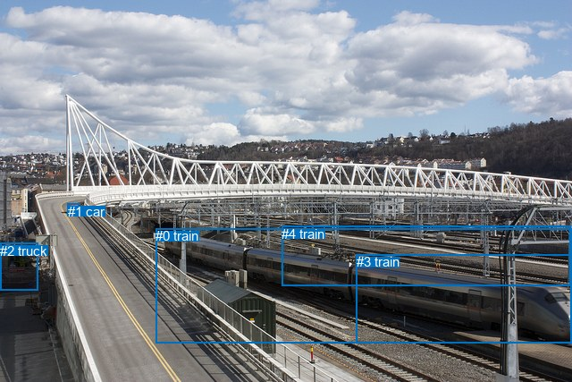
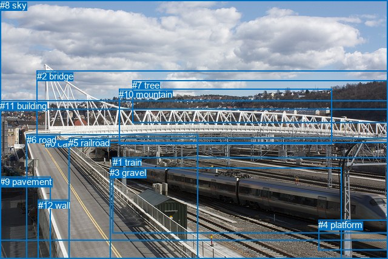

# 图片 0419：2333088.jpg

随机样本序号：390。图片 SHA256：`f9e17866f4db47a88724f051f0cd2a2650168c09ab6908bc4f75e5dba398ba1b`。

红色框表示人，蓝色框表示其他物体。两个模式分别保留自身框编号，可依据位置比较对应对象。

## 自动检测框与输出

人的框编号：`[]`。状态：`no_person`。

### 自动检测全部物体框

| 编号 | 类别 | 是否为人 | 检测分数 | 像素坐标 xyxy |
|---|---|---|---|---|
| 0 | train | False | 0.9978 | 174.2, 255.3, 640.0, 383.4 |
| 1 | car | False | 0.9568 | 75.5, 227.9, 88.6, 238.3 |
| 2 | truck | False | 0.5243 | 0.2, 271.9, 42.8, 324.9 |
| 3 | train | False | 0.4843 | 398.8, 284.5, 639.4, 383.2 |
| 4 | train | False | 0.4150 | 315.0, 252.6, 638.0, 319.6 |

### 自动检测 Top50 人相关候选

评分物体对：0；人相关物体对：0；输出关系：0。

| 排名 | 主语编号与类别 | 关系 | 宾语编号与类别 | 类型 | 人与人 | 排序分数 | 原始融合 logit |
|---|---|---|---|---|---|---|---|

### 自动检测逐条人相关 GT 核验

本图没有人相关 GT，R@50 无分母；预测候选继续展示。

## 真实框与输出

人的框编号：`[]`。

### 真实框全部物体框

| 编号 | 类别 | 是否为人 | 检测分数 | 像素坐标 xyxy |
|---|---|---|---|---|
| 0 | car | False | GT | 75.0, 228.0, 88.0, 238.0 |
| 1 | train | False | GT | 186.0, 259.0, 640.0, 384.0 |
| 2 | bridge | False | GT | 61.0, 117.0, 640.0, 236.0 |
| 3 | gravel | False | GT | 181.0, 276.0, 563.0, 427.0 |
| 4 | platform | False | GT | 525.0, 362.0, 640.0, 412.0 |
| 5 | railroad | False | GT | 113.0, 227.0, 640.0, 427.0 |
| 6 | road | False | GT | 44.0, 222.0, 327.0, 427.0 |
| 7 | tree | False | GT | 218.0, 132.0, 640.0, 202.0 |
| 8 | sky | False | GT | 0.0, 0.0, 640.0, 181.0 |
| 9 | pavement | False | GT | 0.0, 291.0, 84.0, 427.0 |
| 10 | mountain | False | GT | 196.0, 147.0, 547.0, 238.0 |
| 11 | building | False | GT | 0.0, 166.0, 640.0, 397.0 |
| 12 | wall | False | GT | 63.0, 330.0, 115.0, 427.0 |

### 真实框 Top50 人相关候选

评分物体对：0；人相关物体对：0；输出关系：0。

| 排名 | 主语编号与类别 | 关系 | 宾语编号与类别 | 类型 | 人与人 | 排序分数 | 原始融合 logit |
|---|---|---|---|---|---|---|---|

### 真实框逐条人相关 GT 核验

本图没有人相关 GT，R@50 无分母；预测候选继续展示。

## 全部人相关 GT

| 主语编号与类别 | 关系 | 宾语编号与类别 |
|---|---|---|

原始记录、全部人相关物体对的两项预测与分项分数见 [逐图证据 JSON](../evidence/cases/0419.json)。全部56类 logits 保留于本机 HOR/output/random500/logits/。

<!-- HOR_COMPLETE_RESULTS -->

## 六组条件的完整输出对照

以下保留同一图片三种框与候选模式、两种谓词输出规则的全部 Top50。框编号各自在所属模式内解释。

### 自动检测框完整枚举：空间与语义各保留一个谓词

| 排名 | 主语编号与类别 | 谓词 | 宾语编号与类别 | 分组 | 排序分数 | predicate logit | pair logit |
|---|---|---|---|---|---|---|---|

没有人相关 GT，本条件的召回率无分母。

### 自动检测框完整枚举：每对只保留一个谓词

| 排名 | 主语编号与类别 | 谓词 | 宾语编号与类别 | 分组 | 排序分数 | predicate logit | pair logit |
|---|---|---|---|---|---|---|---|

没有人相关 GT，本条件的召回率无分母。

### 真实框完整枚举：空间与语义各保留一个谓词

| 排名 | 主语编号与类别 | 谓词 | 宾语编号与类别 | 分组 | 排序分数 | predicate logit | pair logit |
|---|---|---|---|---|---|---|---|

没有人相关 GT，本条件的召回率无分母。

### 真实框完整枚举：每对只保留一个谓词

| 排名 | 主语编号与类别 | 谓词 | 宾语编号与类别 | 分组 | 排序分数 | predicate logit | pair logit |
|---|---|---|---|---|---|---|---|

没有人相关 GT，本条件的召回率无分母。

### 真实框400候选：空间与语义各保留一个谓词

| 排名 | 主语编号与类别 | 谓词 | 宾语编号与类别 | 分组 | 排序分数 | predicate logit | pair logit |
|---|---|---|---|---|---|---|---|

没有人相关 GT，本条件的召回率无分母。

### 真实框400候选：每对只保留一个谓词

| 排名 | 主语编号与类别 | 谓词 | 宾语编号与类别 | 分组 | 排序分数 | predicate logit | pair logit |
|---|---|---|---|---|---|---|---|

没有人相关 GT，本条件的召回率无分母。
