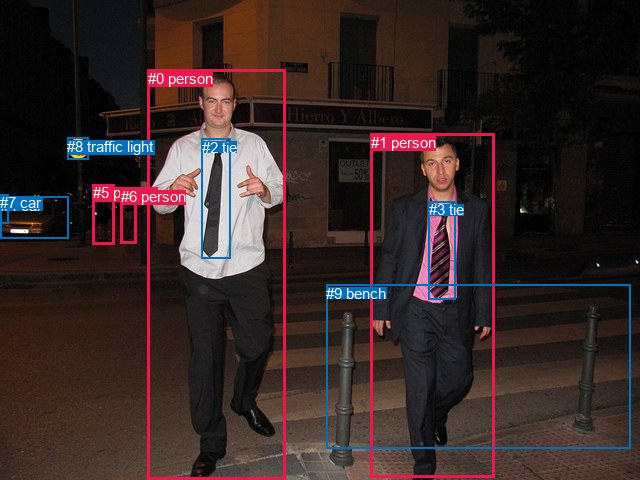
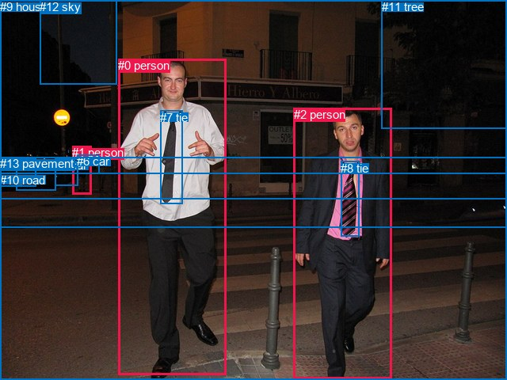

# 图片 0461：2334659.jpg

随机样本序号：480。图片 SHA256：`677e993476aed8ceca9bd9b8edbeb3c8874ed19488c9050cb8b55057a5f1547a`。

红色框表示人，蓝色框表示其他物体。两个模式分别保留自身框编号，可依据位置比较对应对象。

## 自动检测框与输出

人的框编号：`[0, 1, 5, 6]`。状态：`ok`。

### 自动检测全部物体框

| 编号 | 类别 | 是否为人 | 检测分数 | 像素坐标 xyxy |
|---|---|---|---|---|
| 0 | person | True | 0.9996 | 147.8, 69.8, 286.0, 479.1 |
| 1 | person | True | 0.9995 | 370.6, 133.6, 495.0, 477.3 |
| 2 | tie | False | 0.9977 | 202.0, 138.7, 230.1, 258.8 |
| 3 | tie | False | 0.9960 | 428.8, 201.2, 455.6, 299.2 |
| 4 | car | False | 0.9736 | 0.8, 196.8, 68.7, 238.4 |
| 5 | person | True | 0.8871 | 92.9, 184.5, 114.7, 244.2 |
| 6 | person | True | 0.8622 | 120.7, 188.0, 136.1, 243.1 |
| 7 | car | False | 0.5763 | 0.1, 194.1, 8.1, 223.1 |
| 8 | traffic light | False | 0.5406 | 67.3, 137.5, 88.6, 159.3 |
| 9 | bench | False | 0.4475 | 326.5, 284.8, 630.1, 448.9 |

### 自动检测 Top50 人相关候选

评分物体对：90；人相关物体对：60；输出关系：50。

| 排名 | 主语编号与类别 | 关系 | 宾语编号与类别 | 类型 | 人与人 | 排序分数 | 原始融合 logit |
|---|---|---|---|---|---|---|---|
| 1 | #0 person | wearing | #2 tie | semantic | False | 0.99694 | 5.7851 |
| 2 | #1 person | wearing | #3 tie | semantic | False | 0.99544 | 5.3851 |
| 3 | #1 person | walking on | #9 bench | semantic | False | 0.99346 | 5.0234 |
| 4 | #0 person | beside | #1 person | spatial | True | 0.97897 | 3.8403 |
| 5 | #0 person | walking on | #9 bench | semantic | False | 0.97688 | 3.7435 |
| 6 | #1 person | beside | #0 person | spatial | True | 0.96571 | 3.3381 |
| 7 | #1 person | on | #9 bench | spatial | False | 0.93467 | 2.6608 |
| 8 | #6 person | beside | #5 person | spatial | True | 0.92637 | 2.5323 |
| 9 | #5 person | beside | #4 car | spatial | False | 0.90766 | 2.2854 |
| 10 | #5 person | parked on | #9 bench | semantic | False | 0.89555 | 2.1487 |
| 11 | #5 person | parked on | #4 car | semantic | False | 0.89305 | 2.1223 |
| 12 | #5 person | beside | #6 person | spatial | True | 0.87450 | 1.9413 |
| 13 | #0 person | in | #2 tie | spatial | False | 0.87446 | 1.9410 |
| 14 | #1 person | in | #3 tie | spatial | False | 0.87015 | 1.9023 |
| 15 | #4 car | parked on | #5 person | semantic | False | 0.86816 | 1.8847 |
| 16 | #0 person | beside | #9 bench | spatial | False | 0.85636 | 1.7854 |
| 17 | #0 person | walking on | #1 person | semantic | True | 0.84840 | 1.7221 |
| 18 | #5 person | parked on | #6 person | semantic | True | 0.84395 | 1.6879 |
| 19 | #1 person | walking on | #0 person | semantic | True | 0.82915 | 1.5796 |
| 20 | #2 tie | hanging from | #0 person | spatial | False | 0.81205 | 1.4634 |
| 21 | #6 person | parked on | #5 person | semantic | True | 0.78829 | 1.3146 |
| 22 | #6 person | parked on | #4 car | semantic | False | 0.75859 | 1.1449 |
| 23 | #4 car | beside | #5 person | spatial | False | 0.72400 | 0.9644 |
| 24 | #3 tie | hanging from | #1 person | spatial | False | 0.71588 | 0.9241 |
| 25 | #0 person | in front of | #4 car | spatial | False | 0.71294 | 0.9097 |
| 26 | #7 car | parked on | #5 person | semantic | False | 0.70619 | 0.8769 |
| 27 | #4 car | parked on | #6 person | semantic | False | 0.69100 | 0.8048 |
| 28 | #6 person | parked on | #9 bench | semantic | False | 0.67571 | 0.7341 |
| 29 | #5 person | parked on | #7 car | semantic | False | 0.65573 | 0.6443 |
| 30 | #6 person | looking at | #0 person | semantic | True | 0.65463 | 0.6395 |
| 31 | #3 tie | wearing | #1 person | semantic | False | 0.64329 | 0.5897 |
| 32 | #7 car | parked on | #6 person | semantic | False | 0.63662 | 0.5607 |
| 33 | #6 person | parked on | #7 car | semantic | False | 0.61472 | 0.4672 |
| 34 | #6 person | beside | #4 car | spatial | False | 0.60154 | 0.4119 |
| 35 | #6 person | beside | #9 bench | spatial | False | 0.55194 | 0.2085 |
| 36 | #0 person | in front of | #5 person | spatial | True | 0.52870 | 0.1149 |
| 37 | #5 person | beside | #9 bench | spatial | False | 0.50746 | 0.0299 |
| 38 | #0 person | in front of | #6 person | spatial | True | 0.50444 | 0.0178 |
| 39 | #9 bench | beside | #0 person | spatial | False | 0.46916 | -0.1235 |
| 40 | #9 bench | beside | #1 person | spatial | False | 0.46661 | -0.1338 |
| 41 | #2 tie | wearing | #0 person | semantic | False | 0.41641 | -0.3375 |
| 42 | #0 person | walking on | #6 person | semantic | True | 0.40912 | -0.3676 |
| 43 | #0 person | walking on | #4 car | semantic | False | 0.36492 | -0.5541 |
| 44 | #6 person | beside | #0 person | spatial | True | 0.35495 | -0.5973 |
| 45 | #1 person | in front of | #4 car | spatial | False | 0.35246 | -0.6082 |
| 46 | #0 person | in front of | #7 car | spatial | False | 0.34385 | -0.6462 |
| 47 | #0 person | throwing | #8 traffic light | semantic | False | 0.33938 | -0.6660 |
| 48 | #8 traffic light | over | #5 person | spatial | False | 0.33734 | -0.6752 |
| 49 | #0 person | walking on | #5 person | semantic | True | 0.32977 | -0.7092 |
| 50 | #0 person | in front of | #8 traffic light | spatial | False | 0.32943 | -0.7108 |

### 自动检测逐条人相关 GT 核验

R@50：33.33%；命中 2/6。

| GT 主语编号 | GT 关系 | GT 宾语编号 | 结果阶段 | 匹配预测主语编号 | 匹配预测宾语编号 |
|---|---|---|---|---|---|
| 0 | wearing | 7 | hit50 | [0] | [2] |
| 0 | in front of | 9 | endpoint_missing_or_wrong_class | [0] | [] |
| 0 | walking on | 13 | endpoint_missing_or_wrong_class | [0] | [] |
| 2 | wearing | 8 | hit50 | [1] | [3] |
| 2 | in front of | 9 | endpoint_missing_or_wrong_class | [1] | [] |
| 2 | walking on | 13 | endpoint_missing_or_wrong_class | [1] | [] |

## 真实框与输出

人的框编号：`[0, 1, 2]`。

### 真实框全部物体框

| 编号 | 类别 | 是否为人 | 检测分数 | 像素坐标 xyxy |
|---|---|---|---|---|
| 0 | person | True | GT | 149.0, 74.0, 286.0, 474.0 |
| 1 | person | True | GT | 91.0, 184.0, 115.0, 245.0 |
| 2 | person | True | GT | 371.0, 136.0, 495.0, 478.0 |
| 3 | car | False | GT | 69.0, 200.0, 98.0, 235.0 |
| 4 | car | False | GT | 0.0, 201.0, 45.0, 236.0 |
| 5 | car | False | GT | 20.0, 198.0, 70.0, 240.0 |
| 6 | car | False | GT | 97.0, 195.0, 125.0, 219.0 |
| 7 | tie | False | GT | 202.0, 140.0, 230.0, 258.0 |
| 8 | tie | False | GT | 430.0, 204.0, 453.0, 299.0 |
| 9 | house | False | GT | 0.0, 0.0, 640.0, 252.0 |
| 10 | road | False | GT | 0.0, 219.0, 640.0, 288.0 |
| 11 | tree | False | GT | 482.0, 0.0, 640.0, 162.0 |
| 12 | sky | False | GT | 50.0, 0.0, 147.0, 107.0 |
| 13 | pavement | False | GT | 0.0, 198.0, 640.0, 480.0 |

### 真实框 Top50 人相关候选

评分物体对：182；人相关物体对：72；输出关系：50。

| 排名 | 主语编号与类别 | 关系 | 宾语编号与类别 | 类型 | 人与人 | 排序分数 | 原始融合 logit |
|---|---|---|---|---|---|---|---|
| 1 | #0 person | wearing | #7 tie | semantic | False | 0.99520 | 5.3341 |
| 2 | #2 person | wearing | #8 tie | semantic | False | 0.99375 | 5.0681 |
| 3 | #1 person | parked on | #10 road | semantic | False | 0.99259 | 4.8978 |
| 4 | #2 person | walking on | #13 pavement | semantic | False | 0.99019 | 4.6145 |
| 5 | #0 person | walking on | #13 pavement | semantic | False | 0.98267 | 4.0380 |
| 6 | #0 person | walking on | #10 road | semantic | False | 0.97771 | 3.7809 |
| 7 | #1 person | parked on | #13 pavement | semantic | False | 0.97495 | 3.6613 |
| 8 | #2 person | walking on | #10 road | semantic | False | 0.97275 | 3.5749 |
| 9 | #0 person | beside | #2 person | spatial | True | 0.94425 | 2.8295 |
| 10 | #1 person | parked on | #9 house | semantic | False | 0.94409 | 2.8265 |
| 11 | #0 person | walking on | #9 house | semantic | False | 0.93602 | 2.6830 |
| 12 | #2 person | walking on | #9 house | semantic | False | 0.93585 | 2.6803 |
| 13 | #0 person | on | #13 pavement | spatial | False | 0.92611 | 2.5284 |
| 14 | #2 person | beside | #0 person | spatial | True | 0.92378 | 2.4949 |
| 15 | #0 person | in front of | #9 house | spatial | False | 0.91588 | 2.3877 |
| 16 | #2 person | on | #13 pavement | spatial | False | 0.90672 | 2.2742 |
| 17 | #2 person | in | #8 tie | spatial | False | 0.90352 | 2.2369 |
| 18 | #1 person | on | #10 road | spatial | False | 0.89994 | 2.1965 |
| 19 | #0 person | in | #7 tie | spatial | False | 0.89567 | 2.1501 |
| 20 | #2 person | walking on | #0 person | semantic | True | 0.87457 | 1.9420 |
| 21 | #2 person | in front of | #9 house | spatial | False | 0.85188 | 1.7494 |
| 22 | #0 person | walking on | #2 person | semantic | True | 0.84791 | 1.7183 |
| 23 | #1 person | on | #13 pavement | spatial | False | 0.82620 | 1.5589 |
| 24 | #0 person | on | #10 road | spatial | False | 0.80111 | 1.3933 |
| 25 | #1 person | parked on | #6 car | semantic | False | 0.73502 | 1.0203 |
| 26 | #2 person | on | #10 road | spatial | False | 0.72080 | 0.9484 |
| 27 | #6 car | parked on | #1 person | semantic | False | 0.71870 | 0.9380 |
| 28 | #7 tie | hanging from | #0 person | spatial | False | 0.68612 | 0.7820 |
| 29 | #8 tie | on | #2 person | spatial | False | 0.66212 | 0.6728 |
| 30 | #1 person | in | #6 car | spatial | False | 0.64987 | 0.6185 |
| 31 | #1 person | in front of | #9 house | spatial | False | 0.63960 | 0.5736 |
| 32 | #8 tie | wearing | #2 person | semantic | False | 0.63086 | 0.5359 |
| 33 | #12 sky | over | #0 person | spatial | False | 0.51548 | 0.0620 |
| 34 | #6 car | on | #1 person | spatial | False | 0.45366 | -0.1859 |
| 35 | #3 car | parked on | #1 person | semantic | False | 0.42504 | -0.3021 |
| 36 | #7 tie | wearing | #0 person | semantic | False | 0.39777 | -0.4148 |
| 37 | #9 house | beside | #0 person | spatial | False | 0.32546 | -0.7288 |
| 38 | #11 tree | beside | #2 person | spatial | False | 0.32018 | -0.7530 |
| 39 | #1 person | parked on | #3 car | semantic | False | 0.29633 | -0.8648 |
| 40 | #10 road | beside | #0 person | spatial | False | 0.29142 | -0.8885 |
| 41 | #5 car | parked on | #1 person | semantic | False | 0.27338 | -0.9775 |
| 42 | #1 person | beside | #3 car | spatial | False | 0.23568 | -1.1765 |
| 43 | #9 house | looking at | #0 person | semantic | False | 0.22230 | -1.2523 |
| 44 | #0 person | wearing | #8 tie | semantic | False | 0.21935 | -1.2694 |
| 45 | #9 house | beside | #2 person | spatial | False | 0.21069 | -1.3208 |
| 46 | #11 tree | beside | #0 person | spatial | False | 0.20911 | -1.3303 |
| 47 | #10 road | beside | #2 person | spatial | False | 0.19456 | -1.4206 |
| 48 | #5 car | beside | #0 person | spatial | False | 0.18127 | -1.5078 |
| 49 | #5 car | beside | #1 person | spatial | False | 0.17570 | -1.5458 |
| 50 | #3 car | beside | #1 person | spatial | False | 0.16929 | -1.5907 |

### 真实框逐条人相关 GT 核验

R@50：100.00%；命中 6/6。

| GT 主语编号 | GT 关系 | GT 宾语编号 | 结果阶段 | 匹配预测主语编号 | 匹配预测宾语编号 |
|---|---|---|---|---|---|
| 0 | wearing | 7 | hit50 | [0] | [7] |
| 0 | in front of | 9 | hit50 | [0] | [9] |
| 0 | walking on | 13 | hit50 | [0] | [13] |
| 2 | wearing | 8 | hit50 | [2] | [8] |
| 2 | in front of | 9 | hit50 | [2] | [9] |
| 2 | walking on | 13 | hit50 | [2] | [13] |

## 全部人相关 GT

| 主语编号与类别 | 关系 | 宾语编号与类别 |
|---|---|---|
| #0 person | wearing | #7 tie |
| #0 person | in front of | #9 house |
| #0 person | walking on | #13 pavement |
| #2 person | wearing | #8 tie |
| #2 person | in front of | #9 house |
| #2 person | walking on | #13 pavement |

原始记录、全部人相关物体对的两项预测与分项分数见 [逐图证据 JSON](../evidence/cases/0461.json)。全部56类 logits 保留于本机 HOR/output/random500/logits/。

<!-- HOR_COMPLETE_RESULTS -->

## 六组条件的完整输出对照

以下保留同一图片三种框与候选模式、两种谓词输出规则的全部 Top50。框编号各自在所属模式内解释。

### 自动检测框完整枚举：空间与语义各保留一个谓词

| 排名 | 主语编号与类别 | 谓词 | 宾语编号与类别 | 分组 | 排序分数 | predicate logit | pair logit |
|---|---|---|---|---|---|---|---|
| 1 | #0 person | wearing | #2 tie | semantic | 0.9969364 | 4.7623773 | 1.0227252 |
| 2 | #1 person | wearing | #3 tie | semantic | 0.9954364 | 4.5114160 | 0.8736435 |
| 3 | #1 person | walking on | #9 bench | semantic | 0.9934613 | 4.8477044 | 0.1757379 |
| 4 | #0 person | beside | #1 person | spatial | 0.9789653 | 3.6438746 | 0.1964514 |
| 5 | #0 person | walking on | #9 bench | semantic | 0.9768769 | 3.9570365 | -0.2135088 |
| 6 | #1 person | beside | #0 person | spatial | 0.9657118 | 3.4029136 | -0.0648507 |
| 7 | #1 person | on | #9 bench | spatial | 0.9346741 | 2.4850726 | 0.1757379 |
| 8 | #6 person | beside | #5 person | spatial | 0.9263740 | 2.8654928 | -0.3332140 |
| 9 | #5 person | beside | #4 car | spatial | 0.9076625 | 2.6217270 | -0.3363048 |
| 10 | #5 person | parked on | #9 bench | semantic | 0.8955453 | 2.7301421 | -0.5814626 |
| 11 | #5 person | parked on | #4 car | semantic | 0.8930517 | 2.4586043 | -0.3363048 |
| 12 | #5 person | beside | #6 person | spatial | 0.8744974 | 2.1718612 | -0.2305388 |
| 13 | #0 person | in | #2 tie | spatial | 0.8744622 | 0.9182777 | 1.0227252 |
| 14 | #1 person | in | #3 tie | spatial | 0.8701550 | 1.0286860 | 0.8736435 |
| 15 | #4 car | parked on | #5 person | semantic | 0.8681553 | 2.2479582 | -0.3632122 |
| 16 | #0 person | beside | #9 bench | spatial | 0.8563635 | 1.9989181 | -0.2135088 |
| 17 | #0 person | walking on | #1 person | semantic | 0.8484014 | 1.5256662 | 0.1964514 |
| 18 | #5 person | parked on | #6 person | semantic | 0.8439461 | 1.9184256 | -0.2305388 |
| 19 | #1 person | walking on | #0 person | semantic | 0.8291486 | 1.6444559 | -0.0648507 |
| 20 | #2 tie | hanging from | #0 person | spatial | 0.8120465 | 2.6148672 | -1.1515042 |
| 21 | #6 person | parked on | #5 person | semantic | 0.7882901 | 1.6478639 | -0.3332140 |
| 22 | #6 person | parked on | #4 car | semantic | 0.7585868 | 1.5856032 | -0.4406556 |
| 23 | #4 car | beside | #5 person | spatial | 0.7239952 | 1.3275785 | -0.3632122 |
| 24 | #3 tie | hanging from | #1 person | spatial | 0.7158824 | 1.5316277 | -0.6075002 |
| 25 | #0 person | in front of | #4 car | spatial | 0.7129376 | 1.1960831 | -0.2863888 |
| 26 | #7 car | parked on | #5 person | semantic | 0.7061860 | 1.4044380 | -0.5275064 |
| 27 | #4 car | parked on | #6 person | semantic | 0.6910017 | 1.1948633 | -0.3900569 |
| 28 | #6 person | parked on | #9 bench | semantic | 0.6757143 | 1.2873483 | -0.5532027 |
| 29 | #5 person | parked on | #7 car | semantic | 0.6557341 | 1.1035528 | -0.4592116 |
| 30 | #6 person | looking at | #0 person | semantic | 0.6546329 | 1.2444596 | -0.6049927 |
| 31 | #3 tie | wearing | #1 person | semantic | 0.6432921 | 1.1971822 | -0.6075002 |
| 32 | #7 car | parked on | #6 person | semantic | 0.6366205 | 1.1034613 | -0.5427352 |
| 33 | #6 person | parked on | #7 car | semantic | 0.6147237 | 1.0431261 | -0.5759141 |
| 34 | #6 person | beside | #4 car | spatial | 0.6015373 | 0.8525300 | -0.4406556 |
| 35 | #6 person | beside | #9 bench | spatial | 0.5519416 | 0.7617216 | -0.5532027 |
| 36 | #0 person | in front of | #5 person | spatial | 0.5286993 | 0.6271257 | -0.5122024 |
| 37 | #5 person | beside | #9 bench | spatial | 0.5074646 | 0.6113234 | -0.5814626 |
| 38 | #0 person | in front of | #6 person | spatial | 0.5044423 | 0.5072970 | -0.4895273 |
| 39 | #9 bench | beside | #0 person | spatial | 0.4691573 | 0.6371355 | -0.7606633 |
| 40 | #9 bench | beside | #1 person | spatial | 0.4666103 | 0.4878392 | -0.6215969 |
| 41 | #2 tie | wearing | #0 person | semantic | 0.4164093 | 0.8139729 | -1.1515042 |
| 42 | #0 person | walking on | #6 person | semantic | 0.4091214 | 0.1219287 | -0.4895273 |
| 43 | #0 person | walking on | #4 car | semantic | 0.3649170 | -0.2676969 | -0.2863888 |
| 44 | #6 person | beside | #0 person | spatial | 0.3549531 | 0.0076551 | -0.6049927 |
| 45 | #1 person | in front of | #4 car | spatial | 0.3524597 | -0.0117593 | -0.5964856 |
| 46 | #0 person | in front of | #7 car | spatial | 0.3438533 | -0.1907749 | -0.4553942 |
| 47 | #0 person | throwing | #8 traffic light | semantic | 0.3393820 | -0.1798010 | -0.4862483 |
| 48 | #8 traffic light | over | #5 person | spatial | 0.3373399 | -0.1615925 | -0.5135784 |
| 49 | #0 person | walking on | #5 person | semantic | 0.3297708 | -0.1970196 | -0.5122024 |
| 50 | #0 person | in front of | #8 traffic light | spatial | 0.3294252 | -0.2245374 | -0.4862483 |

GT 命中：2/6，R@50=33.33%。

| GT主语 | GT谓词 | GT宾语 | 结果阶段 | 匹配主语框 | 匹配宾语框 |
|---|---|---|---|---|---|
| 0 | wearing | 7 | hit50 | [0] | [2] |
| 0 | in front of | 9 | endpoint_missing_or_wrong_class | [0] | [] |
| 0 | walking on | 13 | endpoint_missing_or_wrong_class | [0] | [] |
| 2 | wearing | 8 | hit50 | [1] | [3] |
| 2 | in front of | 9 | endpoint_missing_or_wrong_class | [1] | [] |
| 2 | walking on | 13 | endpoint_missing_or_wrong_class | [1] | [] |

### 自动检测框完整枚举：每对只保留一个谓词

| 排名 | 主语编号与类别 | 谓词 | 宾语编号与类别 | 分组 | 排序分数 | predicate logit | pair logit |
|---|---|---|---|---|---|---|---|
| 1 | #0 person | wearing | #2 tie | single | 0.9969364 | 4.7623773 | 1.0227252 |
| 2 | #1 person | wearing | #3 tie | single | 0.9954364 | 4.5114160 | 0.8736435 |
| 3 | #1 person | walking on | #9 bench | single | 0.9934613 | 4.8477044 | 0.1757379 |
| 4 | #0 person | beside | #1 person | single | 0.9789653 | 3.6438746 | 0.1964514 |
| 5 | #0 person | walking on | #9 bench | single | 0.9768769 | 3.9570365 | -0.2135088 |
| 6 | #1 person | beside | #0 person | single | 0.9657118 | 3.4029136 | -0.0648507 |
| 7 | #6 person | beside | #5 person | single | 0.9263740 | 2.8654928 | -0.3332140 |
| 8 | #5 person | beside | #4 car | single | 0.9076625 | 2.6217270 | -0.3363048 |
| 9 | #5 person | parked on | #9 bench | single | 0.8955453 | 2.7301421 | -0.5814626 |
| 10 | #5 person | beside | #6 person | single | 0.8744974 | 2.1718612 | -0.2305388 |
| 11 | #4 car | parked on | #5 person | single | 0.8681553 | 2.2479582 | -0.3632122 |
| 12 | #2 tie | hanging from | #0 person | single | 0.8120465 | 2.6148672 | -1.1515042 |
| 13 | #6 person | parked on | #4 car | single | 0.7585868 | 1.5856032 | -0.4406556 |
| 14 | #3 tie | hanging from | #1 person | single | 0.7158824 | 1.5316277 | -0.6075002 |
| 15 | #0 person | in front of | #4 car | single | 0.7129376 | 1.1960831 | -0.2863888 |
| 16 | #7 car | parked on | #5 person | single | 0.7061860 | 1.4044380 | -0.5275064 |
| 17 | #4 car | parked on | #6 person | single | 0.6910017 | 1.1948633 | -0.3900569 |
| 18 | #6 person | parked on | #9 bench | single | 0.6757143 | 1.2873483 | -0.5532027 |
| 19 | #5 person | parked on | #7 car | single | 0.6557341 | 1.1035528 | -0.4592116 |
| 20 | #6 person | looking at | #0 person | single | 0.6546329 | 1.2444596 | -0.6049927 |
| 21 | #7 car | parked on | #6 person | single | 0.6366205 | 1.1034613 | -0.5427352 |
| 22 | #6 person | parked on | #7 car | single | 0.6147237 | 1.0431261 | -0.5759141 |
| 23 | #0 person | in front of | #5 person | single | 0.5286993 | 0.6271257 | -0.5122024 |
| 24 | #0 person | in front of | #6 person | single | 0.5044423 | 0.5072970 | -0.4895273 |
| 25 | #9 bench | beside | #0 person | single | 0.4691573 | 0.6371355 | -0.7606633 |
| 26 | #9 bench | beside | #1 person | single | 0.4666103 | 0.4878392 | -0.6215969 |
| 27 | #1 person | in front of | #4 car | single | 0.3524597 | -0.0117593 | -0.5964856 |
| 28 | #0 person | in front of | #7 car | single | 0.3438533 | -0.1907749 | -0.4553942 |
| 29 | #0 person | throwing | #8 traffic light | single | 0.3393820 | -0.1798010 | -0.4862483 |
| 30 | #8 traffic light | over | #5 person | single | 0.3373399 | -0.1615925 | -0.5135784 |
| 31 | #8 traffic light | beside | #0 person | single | 0.3041127 | -0.3609209 | -0.4668686 |
| 32 | #5 person | looking at | #0 person | single | 0.2971216 | -0.3574576 | -0.5035846 |
| 33 | #1 person | in front of | #6 person | single | 0.2482555 | -0.1686487 | -0.9392893 |
| 34 | #1 person | in front of | #5 person | single | 0.2431164 | -0.1652789 | -0.9703900 |
| 35 | #4 car | beside | #0 person | single | 0.2255826 | -1.0746396 | -0.1587850 |
| 36 | #6 person | looking at | #1 person | single | 0.2249392 | -0.1849284 | -1.0521828 |
| 37 | #6 person | looking at | #8 traffic light | single | 0.2019888 | -0.4174228 | -0.9564874 |
| 38 | #1 person | in front of | #7 car | single | 0.1846995 | -0.8229980 | -0.6618283 |
| 39 | #5 person | parked on | #8 traffic light | single | 0.1464007 | -0.8635359 | -0.8995789 |
| 40 | #8 traffic light | over | #6 person | single | 0.1355661 | -1.3232532 | -0.5293623 |
| 41 | #7 car | beside | #0 person | single | 0.1177039 | -1.6020749 | -0.4122810 |
| 42 | #5 person | looking at | #1 person | single | 0.0730857 | -1.5935190 | -0.9467087 |
| 43 | #1 person | walking on | #8 traffic light | single | 0.0615151 | -1.7456176 | -0.9793662 |
| 44 | #7 car | beside | #1 person | single | 0.0399533 | -2.3515804 | -0.8276895 |
| 45 | #1 person | in front of | #2 tie | single | 0.0333236 | -3.2979035 | -0.0696933 |
| 46 | #4 car | parked on | #1 person | single | 0.0297197 | -2.9167490 | -0.5690247 |
| 47 | #2 tie | wearing | #1 person | single | 0.0267773 | -2.3079913 | -1.2850673 |
| 48 | #3 tie | wearing | #0 person | single | 0.0254007 | -2.1933293 | -1.4539183 |
| 49 | #0 person | wearing | #3 tie | single | 0.0253062 | -3.6179028 | -0.0331707 |
| 50 | #8 traffic light | over | #1 person | single | 0.0241551 | -2.7850668 | -0.9137417 |

GT 命中：2/6，R@50=33.33%。

| GT主语 | GT谓词 | GT宾语 | 结果阶段 | 匹配主语框 | 匹配宾语框 |
|---|---|---|---|---|---|
| 0 | wearing | 7 | hit50 | [0] | [2] |
| 0 | in front of | 9 | endpoint_missing_or_wrong_class | [0] | [] |
| 0 | walking on | 13 | endpoint_missing_or_wrong_class | [0] | [] |
| 2 | wearing | 8 | hit50 | [1] | [3] |
| 2 | in front of | 9 | endpoint_missing_or_wrong_class | [1] | [] |
| 2 | walking on | 13 | endpoint_missing_or_wrong_class | [1] | [] |

### 真实框完整枚举：空间与语义各保留一个谓词

| 排名 | 主语编号与类别 | 谓词 | 宾语编号与类别 | 分组 | 排序分数 | predicate logit | pair logit |
|---|---|---|---|---|---|---|---|
| 1 | #0 person | wearing | #7 tie | semantic | 0.9951990 | 4.3058934 | 1.0282294 |
| 2 | #2 person | wearing | #8 tie | semantic | 0.9937452 | 4.2046351 | 0.8635098 |
| 3 | #1 person | parked on | #10 road | semantic | 0.9925925 | 4.6258607 | 0.2719679 |
| 4 | #2 person | walking on | #13 pavement | semantic | 0.9901903 | 4.4745946 | 0.1399298 |
| 5 | #0 person | walking on | #13 pavement | semantic | 0.9826722 | 3.8246846 | 0.2132837 |
| 6 | #0 person | walking on | #10 road | semantic | 0.9777064 | 3.8607554 | -0.0798477 |
| 7 | #1 person | parked on | #13 pavement | semantic | 0.9749453 | 3.6029563 | 0.0583655 |
| 8 | #2 person | walking on | #10 road | semantic | 0.9727456 | 3.7253098 | -0.1504017 |
| 9 | #0 person | beside | #2 person | spatial | 0.9442481 | 2.6338410 | 0.1956380 |
| 10 | #1 person | parked on | #9 house | semantic | 0.9440908 | 2.5495486 | 0.2769452 |
| 11 | #0 person | walking on | #9 house | semantic | 0.9360157 | 2.3683047 | 0.3146901 |
| 12 | #2 person | walking on | #9 house | semantic | 0.9358522 | 2.3381720 | 0.3420966 |
| 13 | #0 person | on | #13 pavement | spatial | 0.9261096 | 2.3151255 | 0.2132837 |
| 14 | #2 person | beside | #0 person | spatial | 0.9237849 | 2.5720391 | -0.0771199 |
| 15 | #0 person | in front of | #9 house | spatial | 0.9158815 | 2.0729709 | 0.3146901 |
| 16 | #2 person | on | #13 pavement | spatial | 0.9067191 | 2.1342883 | 0.1399298 |
| 17 | #2 person | in | #8 tie | spatial | 0.9035162 | 1.3734102 | 0.8635098 |
| 18 | #1 person | on | #10 road | spatial | 0.8999361 | 1.9245472 | 0.2719679 |
| 19 | #0 person | in | #7 tie | spatial | 0.8956746 | 1.1218328 | 1.0282294 |
| 20 | #2 person | walking on | #0 person | semantic | 0.8745739 | 2.0191407 | -0.0771199 |
| 21 | #2 person | in front of | #9 house | spatial | 0.8518751 | 1.4072876 | 0.3420966 |
| 22 | #0 person | walking on | #2 person | semantic | 0.8479124 | 1.5226831 | 0.1956380 |
| 23 | #1 person | on | #13 pavement | spatial | 0.8261973 | 1.5005469 | 0.0583655 |
| 24 | #0 person | on | #10 road | spatial | 0.8011143 | 1.4731212 | -0.0798477 |
| 25 | #1 person | parked on | #6 car | semantic | 0.7350242 | 1.3780642 | -0.3577990 |
| 26 | #2 person | on | #10 road | spatial | 0.7208027 | 1.0988483 | -0.1504017 |
| 27 | #6 car | parked on | #1 person | semantic | 0.7186980 | 1.2569818 | -0.3189695 |
| 28 | #7 tie | hanging from | #0 person | spatial | 0.6861193 | 1.9528670 | -1.1708283 |
| 29 | #8 tie | on | #2 person | spatial | 0.6621190 | 1.2768464 | -0.6040948 |
| 30 | #1 person | in | #6 car | spatial | 0.6498671 | 0.9762540 | -0.3577990 |
| 31 | #1 person | in front of | #9 house | spatial | 0.6395965 | 0.2966681 | 0.2769452 |
| 32 | #8 tie | wearing | #2 person | semantic | 0.6308609 | 1.1400065 | -0.6040948 |
| 33 | #12 sky | over | #0 person | spatial | 0.5154840 | 0.6188431 | -0.5568871 |
| 34 | #6 car | on | #1 person | spatial | 0.4536633 | 0.1330895 | -0.3189695 |
| 35 | #3 car | parked on | #1 person | semantic | 0.4250441 | 0.1131945 | -0.4152948 |
| 36 | #7 tie | wearing | #0 person | semantic | 0.3977659 | 0.7560458 | -1.1708283 |
| 37 | #9 house | beside | #0 person | spatial | 0.3254632 | -0.8011150 | 0.0723380 |
| 38 | #11 tree | beside | #2 person | spatial | 0.3201758 | -0.6282153 | -0.1247488 |
| 39 | #1 person | parked on | #3 car | semantic | 0.2963285 | -0.4576011 | -0.4072419 |
| 40 | #10 road | beside | #0 person | spatial | 0.2914231 | -0.2290273 | -0.6594554 |
| 41 | #5 car | parked on | #1 person | semantic | 0.2733783 | -0.6086559 | -0.3688933 |
| 42 | #1 person | beside | #3 car | spatial | 0.2356805 | -0.7692671 | -0.4072419 |
| 43 | #9 house | looking at | #0 person | semantic | 0.2222968 | -1.3246694 | 0.0723380 |
| 44 | #0 person | wearing | #8 tie | semantic | 0.2193528 | -1.2531929 | -0.0162488 |
| 45 | #9 house | beside | #2 person | spatial | 0.2106852 | -1.3725884 | 0.0517880 |
| 46 | #11 tree | beside | #0 person | spatial | 0.2091135 | -0.9590452 | -0.3712322 |
| 47 | #10 road | beside | #2 person | spatial | 0.1945610 | -0.7107692 | -0.7098724 |
| 48 | #5 car | beside | #0 person | spatial | 0.1812716 | -1.2685122 | -0.2392437 |
| 49 | #5 car | beside | #1 person | spatial | 0.1756976 | -1.1768799 | -0.3688933 |
| 50 | #3 car | beside | #1 person | spatial | 0.1692869 | -1.1753945 | -0.4152948 |

GT 命中：6/6，R@50=100.00%。

| GT主语 | GT谓词 | GT宾语 | 结果阶段 | 匹配主语框 | 匹配宾语框 |
|---|---|---|---|---|---|
| 0 | wearing | 7 | hit50 | [0] | [7] |
| 0 | in front of | 9 | hit50 | [0] | [9] |
| 0 | walking on | 13 | hit50 | [0] | [13] |
| 2 | wearing | 8 | hit50 | [2] | [8] |
| 2 | in front of | 9 | hit50 | [2] | [9] |
| 2 | walking on | 13 | hit50 | [2] | [13] |

### 真实框完整枚举：每对只保留一个谓词

| 排名 | 主语编号与类别 | 谓词 | 宾语编号与类别 | 分组 | 排序分数 | predicate logit | pair logit |
|---|---|---|---|---|---|---|---|
| 1 | #0 person | wearing | #7 tie | single | 0.9951990 | 4.3058934 | 1.0282294 |
| 2 | #2 person | wearing | #8 tie | single | 0.9937452 | 4.2046351 | 0.8635098 |
| 3 | #1 person | parked on | #10 road | single | 0.9925925 | 4.6258607 | 0.2719679 |
| 4 | #2 person | walking on | #13 pavement | single | 0.9901903 | 4.4745946 | 0.1399298 |
| 5 | #0 person | walking on | #13 pavement | single | 0.9826722 | 3.8246846 | 0.2132837 |
| 6 | #0 person | walking on | #10 road | single | 0.9777064 | 3.8607554 | -0.0798477 |
| 7 | #1 person | parked on | #13 pavement | single | 0.9749453 | 3.6029563 | 0.0583655 |
| 8 | #2 person | walking on | #10 road | single | 0.9727456 | 3.7253098 | -0.1504017 |
| 9 | #0 person | beside | #2 person | single | 0.9442481 | 2.6338410 | 0.1956380 |
| 10 | #1 person | parked on | #9 house | single | 0.9440908 | 2.5495486 | 0.2769452 |
| 11 | #0 person | walking on | #9 house | single | 0.9360157 | 2.3683047 | 0.3146901 |
| 12 | #2 person | walking on | #9 house | single | 0.9358522 | 2.3381720 | 0.3420966 |
| 13 | #2 person | beside | #0 person | single | 0.9237849 | 2.5720391 | -0.0771199 |
| 14 | #1 person | parked on | #6 car | single | 0.7350242 | 1.3780642 | -0.3577990 |
| 15 | #6 car | parked on | #1 person | single | 0.7186980 | 1.2569818 | -0.3189695 |
| 16 | #7 tie | hanging from | #0 person | single | 0.6861193 | 1.9528670 | -1.1708283 |
| 17 | #8 tie | on | #2 person | single | 0.6621190 | 1.2768464 | -0.6040948 |
| 18 | #12 sky | over | #0 person | single | 0.5154840 | 0.6188431 | -0.5568871 |
| 19 | #3 car | parked on | #1 person | single | 0.4250441 | 0.1131945 | -0.4152948 |
| 20 | #9 house | beside | #0 person | single | 0.3254632 | -0.8011150 | 0.0723380 |
| 21 | #11 tree | beside | #2 person | single | 0.3201758 | -0.6282153 | -0.1247488 |
| 22 | #1 person | parked on | #3 car | single | 0.2963285 | -0.4576011 | -0.4072419 |
| 23 | #10 road | beside | #0 person | single | 0.2914231 | -0.2290273 | -0.6594554 |
| 24 | #5 car | parked on | #1 person | single | 0.2733783 | -0.6086559 | -0.3688933 |
| 25 | #0 person | wearing | #8 tie | single | 0.2193528 | -1.2531929 | -0.0162488 |
| 26 | #9 house | beside | #2 person | single | 0.2106852 | -1.3725884 | 0.0517880 |
| 27 | #11 tree | beside | #0 person | single | 0.2091135 | -0.9590452 | -0.3712322 |
| 28 | #10 road | beside | #2 person | single | 0.1945610 | -0.7107692 | -0.7098724 |
| 29 | #5 car | beside | #0 person | single | 0.1812716 | -1.2685122 | -0.2392437 |
| 30 | #4 car | beside | #0 person | single | 0.1689391 | -1.4030411 | -0.1901236 |
| 31 | #4 car | parked on | #1 person | single | 0.1647866 | -1.2402039 | -0.3828318 |
| 32 | #0 person | throwing | #12 sky | single | 0.1607152 | -1.0127363 | -0.6401800 |
| 33 | #1 person | beside | #5 car | single | 0.1574382 | -1.3262229 | -0.3511909 |
| 34 | #1 person | beside | #0 person | single | 0.1456779 | -1.2689605 | -0.4999494 |
| 35 | #3 car | beside | #0 person | single | 0.0932745 | -1.7351437 | -0.5391496 |
| 36 | #6 car | beside | #0 person | single | 0.0900057 | -1.7789505 | -0.5346154 |
| 37 | #1 person | parked on | #4 car | single | 0.0882167 | -1.9767814 | -0.3588243 |
| 38 | #13 pavement | beside | #0 person | single | 0.0793701 | -1.5667217 | -0.8842149 |
| 39 | #0 person | in front of | #5 car | single | 0.0785744 | -2.0932171 | -0.3686588 |
| 40 | #2 person | wearing | #7 tie | single | 0.0781198 | -2.3905258 | -0.0776453 |
| 41 | #0 person | in front of | #4 car | single | 0.0764195 | -2.1804276 | -0.3115920 |
| 42 | #12 sky | beside | #2 person | single | 0.0585578 | -1.8286269 | -0.9487711 |
| 43 | #12 sky | over | #1 person | single | 0.0577687 | -1.8203132 | -0.9714905 |
| 44 | #13 pavement | beside | #2 person | single | 0.0554059 | -1.8355985 | -1.0004711 |
| 45 | #4 car | beside | #2 person | single | 0.0504569 | -2.3349447 | -0.5999168 |
| 46 | #5 car | beside | #2 person | single | 0.0502666 | -2.2903574 | -0.6484835 |
| 47 | #2 person | looking at | #12 sky | single | 0.0494872 | -2.0588005 | -0.8964861 |
| 48 | #1 person | beside | #2 person | single | 0.0475205 | -2.0521138 | -0.9457935 |
| 49 | #0 person | in front of | #1 person | single | 0.0466266 | -2.4913313 | -0.5265038 |
| 50 | #1 person | parked on | #12 sky | single | 0.0444228 | -2.3532660 | -0.7152971 |

GT 命中：4/6，R@50=66.67%。

| GT主语 | GT谓词 | GT宾语 | 结果阶段 | 匹配主语框 | 匹配宾语框 |
|---|---|---|---|---|---|
| 0 | wearing | 7 | hit50 | [0] | [7] |
| 0 | in front of | 9 | wrong_predicate | [0] | [9] |
| 0 | walking on | 13 | hit50 | [0] | [13] |
| 2 | wearing | 8 | hit50 | [2] | [8] |
| 2 | in front of | 9 | wrong_predicate | [2] | [9] |
| 2 | walking on | 13 | hit50 | [2] | [13] |

### 真实框400候选：空间与语义各保留一个谓词

| 排名 | 主语编号与类别 | 谓词 | 宾语编号与类别 | 分组 | 排序分数 | predicate logit | pair logit |
|---|---|---|---|---|---|---|---|
| 1 | #0 person | wearing | #7 tie | semantic | 0.9954250 | 4.3543401 | 1.0282294 |
| 2 | #2 person | wearing | #8 tie | semantic | 0.9937452 | 4.2046351 | 0.8635098 |
| 3 | #1 person | parked on | #10 road | semantic | 0.9925925 | 4.6258607 | 0.2719679 |
| 4 | #2 person | walking on | #13 pavement | semantic | 0.9901903 | 4.4745946 | 0.1399298 |
| 5 | #0 person | walking on | #13 pavement | semantic | 0.9826722 | 3.8246846 | 0.2132837 |
| 6 | #0 person | walking on | #10 road | semantic | 0.9777719 | 3.8637662 | -0.0798477 |
| 7 | #1 person | parked on | #13 pavement | semantic | 0.9749450 | 3.6029410 | 0.0583655 |
| 8 | #2 person | walking on | #10 road | semantic | 0.9727456 | 3.7253098 | -0.1504017 |
| 9 | #1 person | parked on | #9 house | semantic | 0.9456573 | 2.5796251 | 0.2769452 |
| 10 | #0 person | beside | #2 person | spatial | 0.9442481 | 2.6338410 | 0.1956380 |
| 11 | #2 person | walking on | #9 house | semantic | 0.9374589 | 2.3652525 | 0.3420966 |
| 12 | #0 person | walking on | #9 house | semantic | 0.9360157 | 2.3683047 | 0.3146901 |
| 13 | #0 person | on | #13 pavement | spatial | 0.9257361 | 2.3096805 | 0.2132837 |
| 14 | #2 person | beside | #0 person | spatial | 0.9216474 | 2.5420637 | -0.0771199 |
| 15 | #0 person | in front of | #9 house | spatial | 0.9135824 | 2.0434923 | 0.3146901 |
| 16 | #2 person | on | #13 pavement | spatial | 0.9067191 | 2.1342883 | 0.1399298 |
| 17 | #2 person | in | #8 tie | spatial | 0.9032266 | 1.3700914 | 0.8635098 |
| 18 | #1 person | on | #10 road | spatial | 0.8999361 | 1.9245472 | 0.2719679 |
| 19 | #0 person | in | #7 tie | spatial | 0.8956746 | 1.1218328 | 1.0282294 |
| 20 | #2 person | walking on | #0 person | semantic | 0.8715731 | 1.9920597 | -0.0771199 |
| 21 | #2 person | in front of | #9 house | spatial | 0.8555564 | 1.4367661 | 0.3420966 |
| 22 | #0 person | walking on | #2 person | semantic | 0.8479124 | 1.5226831 | 0.1956380 |
| 23 | #1 person | on | #13 pavement | spatial | 0.8265878 | 1.5032692 | 0.0583655 |
| 24 | #0 person | on | #10 road | spatial | 0.8019804 | 1.4785662 | -0.0798477 |
| 25 | #1 person | parked on | #6 car | semantic | 0.7408403 | 1.4081397 | -0.3577990 |
| 26 | #2 person | on | #10 road | spatial | 0.7218971 | 1.1042933 | -0.1504017 |
| 27 | #6 car | parked on | #1 person | semantic | 0.7186980 | 1.2569818 | -0.3189695 |
| 28 | #7 tie | hanging from | #0 person | spatial | 0.6861194 | 1.9528675 | -1.1708283 |
| 29 | #8 tie | on | #2 person | spatial | 0.6621190 | 1.2768464 | -0.6040948 |
| 30 | #1 person | in | #6 car | spatial | 0.6506218 | 0.9795728 | -0.3577990 |
| 31 | #1 person | in front of | #9 house | spatial | 0.6464334 | 0.3264532 | 0.2769452 |
| 32 | #8 tie | wearing | #2 person | semantic | 0.6308609 | 1.1400065 | -0.6040948 |
| 33 | #12 sky | over | #0 person | spatial | 0.5151539 | 0.6175213 | -0.5568871 |
| 34 | #6 car | on | #1 person | spatial | 0.4536633 | 0.1330895 | -0.3189695 |
| 35 | #3 car | parked on | #1 person | semantic | 0.4250441 | 0.1131945 | -0.4152948 |
| 36 | #7 tie | wearing | #0 person | semantic | 0.3977659 | 0.7560458 | -1.1708283 |
| 37 | #9 house | beside | #0 person | spatial | 0.3321069 | -0.7710092 | 0.0723380 |
| 38 | #11 tree | beside | #2 person | spatial | 0.3201632 | -0.6282730 | -0.1247488 |
| 39 | #1 person | parked on | #3 car | semantic | 0.3026372 | -0.4275293 | -0.4072419 |
| 40 | #10 road | beside | #0 person | spatial | 0.2852589 | -0.2590675 | -0.6594554 |
| 41 | #5 car | parked on | #1 person | semantic | 0.2793885 | -0.5786037 | -0.3688933 |
| 42 | #1 person | beside | #3 car | spatial | 0.2303326 | -0.7991922 | -0.4072419 |
| 43 | #9 house | looking at | #0 person | semantic | 0.2274812 | -1.2949269 | 0.0723380 |
| 44 | #0 person | wearing | #8 tie | semantic | 0.2147380 | -1.2803502 | -0.0162488 |
| 45 | #9 house | beside | #2 person | spatial | 0.2132005 | -1.3575284 | 0.0517880 |
| 46 | #11 tree | beside | #0 person | spatial | 0.2066360 | -0.9740908 | -0.3712322 |
| 47 | #10 road | beside | #2 person | spatial | 0.1993017 | -0.6807919 | -0.7098724 |
| 48 | #5 car | beside | #0 person | spatial | 0.1790600 | -1.2834857 | -0.2392437 |
| 49 | #5 car | beside | #1 person | spatial | 0.1757018 | -1.1768510 | -0.3688933 |
| 50 | #4 car | beside | #0 person | spatial | 0.1731833 | -1.3731089 | -0.1901236 |

GT 命中：6/6，R@50=100.00%。

| GT主语 | GT谓词 | GT宾语 | 结果阶段 | 匹配主语框 | 匹配宾语框 |
|---|---|---|---|---|---|
| 0 | wearing | 7 | hit50 | [0] | [7] |
| 0 | in front of | 9 | hit50 | [0] | [9] |
| 0 | walking on | 13 | hit50 | [0] | [13] |
| 2 | wearing | 8 | hit50 | [2] | [8] |
| 2 | in front of | 9 | hit50 | [2] | [9] |
| 2 | walking on | 13 | hit50 | [2] | [13] |

### 真实框400候选：每对只保留一个谓词

| 排名 | 主语编号与类别 | 谓词 | 宾语编号与类别 | 分组 | 排序分数 | predicate logit | pair logit |
|---|---|---|---|---|---|---|---|
| 1 | #0 person | wearing | #7 tie | single | 0.9954250 | 4.3543401 | 1.0282294 |
| 2 | #2 person | wearing | #8 tie | single | 0.9937452 | 4.2046351 | 0.8635098 |
| 3 | #1 person | parked on | #10 road | single | 0.9925925 | 4.6258607 | 0.2719679 |
| 4 | #2 person | walking on | #13 pavement | single | 0.9901903 | 4.4745946 | 0.1399298 |
| 5 | #0 person | walking on | #13 pavement | single | 0.9826722 | 3.8246846 | 0.2132837 |
| 6 | #0 person | walking on | #10 road | single | 0.9777719 | 3.8637662 | -0.0798477 |
| 7 | #1 person | parked on | #13 pavement | single | 0.9749450 | 3.6029410 | 0.0583655 |
| 8 | #2 person | walking on | #10 road | single | 0.9727456 | 3.7253098 | -0.1504017 |
| 9 | #1 person | parked on | #9 house | single | 0.9456573 | 2.5796251 | 0.2769452 |
| 10 | #0 person | beside | #2 person | single | 0.9442481 | 2.6338410 | 0.1956380 |
| 11 | #2 person | walking on | #9 house | single | 0.9374589 | 2.3652525 | 0.3420966 |
| 12 | #0 person | walking on | #9 house | single | 0.9360157 | 2.3683047 | 0.3146901 |
| 13 | #2 person | beside | #0 person | single | 0.9216474 | 2.5420637 | -0.0771199 |
| 14 | #1 person | parked on | #6 car | single | 0.7408403 | 1.4081397 | -0.3577990 |
| 15 | #6 car | parked on | #1 person | single | 0.7186980 | 1.2569818 | -0.3189695 |
| 16 | #7 tie | hanging from | #0 person | single | 0.6861194 | 1.9528675 | -1.1708283 |
| 17 | #8 tie | on | #2 person | single | 0.6621190 | 1.2768464 | -0.6040948 |
| 18 | #12 sky | over | #0 person | single | 0.5151539 | 0.6175213 | -0.5568871 |
| 19 | #3 car | parked on | #1 person | single | 0.4250441 | 0.1131945 | -0.4152948 |
| 20 | #9 house | beside | #0 person | single | 0.3321069 | -0.7710092 | 0.0723380 |
| 21 | #11 tree | beside | #2 person | single | 0.3201632 | -0.6282730 | -0.1247488 |
| 22 | #1 person | parked on | #3 car | single | 0.3026372 | -0.4275293 | -0.4072419 |
| 23 | #10 road | beside | #0 person | single | 0.2852589 | -0.2590675 | -0.6594554 |
| 24 | #5 car | parked on | #1 person | single | 0.2793885 | -0.5786037 | -0.3688933 |
| 25 | #0 person | wearing | #8 tie | single | 0.2147380 | -1.2803502 | -0.0162488 |
| 26 | #9 house | beside | #2 person | single | 0.2132005 | -1.3575284 | 0.0517880 |
| 27 | #11 tree | beside | #0 person | single | 0.2066360 | -0.9740908 | -0.3712322 |
| 28 | #10 road | beside | #2 person | single | 0.1993017 | -0.6807919 | -0.7098724 |
| 29 | #5 car | beside | #0 person | single | 0.1790600 | -1.2834857 | -0.2392437 |
| 30 | #4 car | beside | #0 person | single | 0.1731833 | -1.3731089 | -0.1901236 |
| 31 | #4 car | parked on | #1 person | single | 0.1647884 | -1.2401915 | -0.3828318 |
| 32 | #1 person | beside | #5 car | single | 0.1574363 | -1.3262374 | -0.3511909 |
| 33 | #0 person | throwing | #12 sky | single | 0.1547447 | -1.0576818 | -0.6401800 |
| 34 | #1 person | beside | #0 person | single | 0.1456743 | -1.2689893 | -0.4999494 |
| 35 | #3 car | beside | #0 person | single | 0.0945498 | -1.7201557 | -0.5391496 |
| 36 | #6 car | beside | #0 person | single | 0.0900057 | -1.7789505 | -0.5346154 |
| 37 | #1 person | parked on | #4 car | single | 0.0882175 | -1.9767718 | -0.3588243 |
| 38 | #0 person | in front of | #5 car | single | 0.0818936 | -2.0482333 | -0.3686588 |
| 39 | #0 person | in front of | #4 car | single | 0.0796107 | -2.1360564 | -0.3115920 |
| 40 | #13 pavement | beside | #0 person | single | 0.0782766 | -1.5817816 | -0.8842149 |
| 41 | #2 person | wearing | #7 tie | single | 0.0761863 | -2.4176834 | -0.0776453 |
| 42 | #12 sky | beside | #2 person | single | 0.0585578 | -1.8286269 | -0.9487711 |
| 43 | #12 sky | over | #1 person | single | 0.0576250 | -1.8229570 | -0.9714905 |
| 44 | #13 pavement | beside | #2 person | single | 0.0546203 | -1.8507090 | -1.0004711 |
| 45 | #4 car | beside | #2 person | single | 0.0504569 | -2.3349447 | -0.5999168 |
| 46 | #5 car | beside | #2 person | single | 0.0502680 | -2.2903285 | -0.6484835 |
| 47 | #2 person | looking at | #12 sky | single | 0.0487884 | -2.0737588 | -0.8964861 |
| 48 | #0 person | in front of | #1 person | single | 0.0479617 | -2.4616995 | -0.5265038 |
| 49 | #1 person | beside | #2 person | single | 0.0475205 | -2.0521138 | -0.9457935 |
| 50 | #1 person | parked on | #12 sky | single | 0.0444228 | -2.3532660 | -0.7152971 |

GT 命中：4/6，R@50=66.67%。

| GT主语 | GT谓词 | GT宾语 | 结果阶段 | 匹配主语框 | 匹配宾语框 |
|---|---|---|---|---|---|
| 0 | wearing | 7 | hit50 | [0] | [7] |
| 0 | in front of | 9 | wrong_predicate | [0] | [9] |
| 0 | walking on | 13 | hit50 | [0] | [13] |
| 2 | wearing | 8 | hit50 | [2] | [8] |
| 2 | in front of | 9 | wrong_predicate | [2] | [9] |
| 2 | walking on | 13 | hit50 | [2] | [13] |
