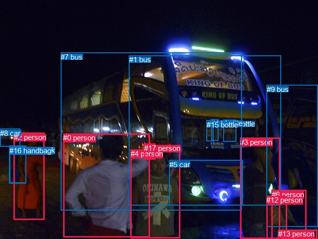
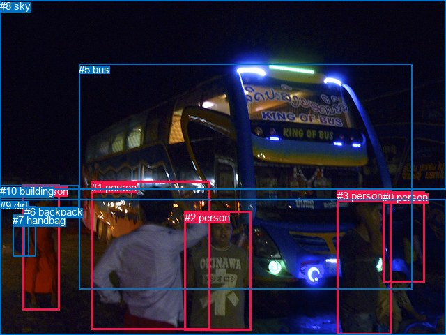

# 图片 0483：2335916.jpg

随机样本序号：364。图片 SHA256：`4a419d23d2d2137bf145b3affe935b85e8fbe93855a121ac6bd8ec81195703f0`。

红色框表示人，蓝色框表示其他物体。两个模式分别保留自身框编号，可依据位置比较对应对象。

## 自动检测框与输出

人的框编号：`[0, 2, 3, 4, 6, 12, 13, 17]`。状态：`ok`。

### 自动检测全部物体框

| 编号 | 类别 | 是否为人 | 检测分数 | 像素坐标 xyxy |
|---|---|---|---|---|
| 0 | person | True | 0.9998 | 127.5, 268.4, 301.3, 476.7 |
| 1 | bus | False | 0.9990 | 259.7, 111.3, 565.7, 413.0 |
| 2 | person | True | 0.9989 | 27.7, 266.5, 89.3, 441.0 |
| 3 | person | True | 0.9958 | 483.5, 276.7, 563.5, 480.0 |
| 4 | person | True | 0.9953 | 262.7, 300.1, 362.5, 478.2 |
| 5 | car | False | 0.8450 | 340.8, 321.9, 488.2, 412.9 |
| 6 | person | True | 0.8357 | 546.5, 381.5, 616.0, 479.6 |
| 7 | bus | False | 0.7914 | 122.0, 105.6, 486.9, 422.8 |
| 8 | car | False | 0.7273 | 0.4, 259.0, 40.7, 294.8 |
| 9 | bus | False | 0.6818 | 536.9, 170.6, 640.0, 455.2 |
| 10 | backpack | False | 0.6364 | 18.5, 292.7, 52.9, 368.4 |
| 11 | bottle | False | 0.6100 | 450.0, 240.5, 475.4, 285.0 |
| 12 | person | True | 0.5156 | 536.3, 393.1, 577.2, 480.0 |
| 13 | person | True | 0.4984 | 559.8, 461.0, 638.6, 479.9 |
| 14 | bottle | False | 0.4960 | 425.5, 239.2, 439.8, 282.3 |
| 15 | bottle | False | 0.4812 | 415.8, 241.6, 429.9, 283.7 |
| 16 | handbag | False | 0.4278 | 19.5, 293.6, 52.9, 367.8 |
| 17 | person | True | 0.3659 | 290.4, 289.0, 312.7, 320.5 |

### 自动检测 Top50 人相关候选

评分物体对：306；人相关物体对：216；输出关系：50。

| 排名 | 主语编号与类别 | 关系 | 宾语编号与类别 | 类型 | 人与人 | 排序分数 | 原始融合 logit |
|---|---|---|---|---|---|---|---|
| 1 | #2 person | carrying | #16 handbag | semantic | False | 0.99279 | 4.9249 |
| 2 | #2 person | carrying | #10 backpack | semantic | False | 0.99240 | 4.8715 |
| 3 | #3 person | holding | #12 person | semantic | True | 0.98384 | 4.1092 |
| 4 | #6 person | sitting on | #13 person | semantic | True | 0.98245 | 4.0247 |
| 5 | #12 person | touching | #13 person | semantic | True | 0.97853 | 3.8195 |
| 6 | #6 person | on | #13 person | spatial | True | 0.97694 | 3.7464 |
| 7 | #3 person | pushing | #13 person | semantic | True | 0.96675 | 3.3699 |
| 8 | #12 person | on | #13 person | spatial | True | 0.95444 | 3.0420 |
| 9 | #3 person | pushing | #6 person | semantic | True | 0.95284 | 3.0058 |
| 10 | #6 person | holding | #12 person | semantic | True | 0.95220 | 2.9916 |
| 11 | #12 person | holding | #6 person | semantic | True | 0.93743 | 2.7069 |
| 12 | #4 person | wearing | #17 person | semantic | True | 0.92922 | 2.5747 |
| 13 | #6 person | leaning on | #9 bus | spatial | False | 0.92766 | 2.5513 |
| 14 | #4 person | standing on | #7 bus | semantic | False | 0.92468 | 2.5077 |
| 15 | #17 person | standing on | #7 bus | semantic | False | 0.92146 | 2.4624 |
| 16 | #17 person | on | #7 bus | spatial | False | 0.91818 | 2.4179 |
| 17 | #4 person | standing on | #1 bus | semantic | False | 0.91445 | 2.3692 |
| 18 | #0 person | standing on | #7 bus | semantic | False | 0.90146 | 2.2135 |
| 19 | #0 person | holding | #17 person | semantic | True | 0.88766 | 2.0671 |
| 20 | #3 person | looking at | #1 bus | semantic | False | 0.88763 | 2.0668 |
| 21 | #2 person | in | #16 handbag | spatial | False | 0.88600 | 2.0506 |
| 22 | #2 person | in | #10 backpack | spatial | False | 0.88588 | 2.0494 |
| 23 | #2 person | looking at | #7 bus | semantic | False | 0.87689 | 1.9633 |
| 24 | #3 person | leaning on | #13 person | spatial | True | 0.87536 | 1.9492 |
| 25 | #17 person | standing on | #1 bus | semantic | False | 0.86528 | 1.8599 |
| 26 | #4 person | in front of | #7 bus | spatial | False | 0.85194 | 1.7499 |
| 27 | #0 person | leaning on | #7 bus | spatial | False | 0.84443 | 1.6915 |
| 28 | #4 person | leaning on | #1 bus | spatial | False | 0.84416 | 1.6895 |
| 29 | #16 handbag | on | #2 person | spatial | False | 0.83996 | 1.6579 |
| 30 | #0 person | touching | #1 bus | semantic | False | 0.83852 | 1.6473 |
| 31 | #10 backpack | on | #2 person | spatial | False | 0.83473 | 1.6195 |
| 32 | #3 person | standing on | #9 bus | semantic | False | 0.83071 | 1.5907 |
| 33 | #17 person | on | #1 bus | spatial | False | 0.82979 | 1.5841 |
| 34 | #6 person | sitting on | #9 bus | semantic | False | 0.81162 | 1.4606 |
| 35 | #0 person | talking to | #4 person | semantic | True | 0.81023 | 1.4515 |
| 36 | #6 person | in | #12 person | spatial | True | 0.78305 | 1.2836 |
| 37 | #12 person | beside | #6 person | spatial | True | 0.78089 | 1.2709 |
| 38 | #0 person | leaning on | #1 bus | spatial | False | 0.77262 | 1.2232 |
| 39 | #3 person | beside | #1 bus | spatial | False | 0.76706 | 1.1918 |
| 40 | #2 person | beside | #7 bus | spatial | False | 0.75769 | 1.1401 |
| 41 | #2 person | looking at | #1 bus | semantic | False | 0.75265 | 1.1128 |
| 42 | #3 person | looking at | #7 bus | semantic | False | 0.74220 | 1.0575 |
| 43 | #3 person | beside | #6 person | spatial | True | 0.73925 | 1.0421 |
| 44 | #4 person | in | #17 person | spatial | True | 0.73913 | 1.0415 |
| 45 | #2 person | standing on | #8 car | semantic | False | 0.72966 | 0.9929 |
| 46 | #3 person | in | #12 person | spatial | True | 0.70112 | 0.8526 |
| 47 | #3 person | leaning on | #9 bus | spatial | False | 0.65911 | 0.6593 |
| 48 | #0 person | beside | #4 person | spatial | True | 0.65835 | 0.6560 |
| 49 | #2 person | in front of | #8 car | spatial | False | 0.65531 | 0.6425 |
| 50 | #6 person | looking at | #1 bus | semantic | False | 0.57846 | 0.3165 |

### 自动检测逐条人相关 GT 核验

R@50：33.33%；命中 1/3。

| GT 主语编号 | GT 关系 | GT 宾语编号 | 结果阶段 | 匹配预测主语编号 | 匹配预测宾语编号 |
|---|---|---|---|---|---|
| 1 | looking at | 5 | wrong_predicate | [0] | [1, 7] |
| 2 | standing on | 9 | endpoint_missing_or_wrong_class | [4] | [] |
| 4 | carrying | 7 | hit50 | [2] | [16] |

## 真实框与输出

人的框编号：`[0, 1, 2, 3, 4]`。

### 真实框全部物体框

| 编号 | 类别 | 是否为人 | 检测分数 | 像素坐标 xyxy |
|---|---|---|---|---|
| 0 | person | True | GT | 549.0, 274.0, 609.0, 404.0 |
| 1 | person | True | GT | 131.0, 260.0, 301.0, 473.0 |
| 2 | person | True | GT | 265.0, 303.0, 361.0, 474.0 |
| 3 | person | True | GT | 484.0, 272.0, 562.0, 480.0 |
| 4 | person | True | GT | 33.0, 265.0, 86.0, 445.0 |
| 5 | bus | False | GT | 113.0, 91.0, 591.0, 414.0 |
| 6 | backpack | False | GT | 35.0, 295.0, 52.0, 367.0 |
| 7 | handbag | False | GT | 18.0, 307.0, 41.0, 367.0 |
| 8 | sky | False | GT | 0.0, 0.0, 640.0, 272.0 |
| 9 | dirt | False | GT | 0.0, 286.0, 640.0, 480.0 |
| 10 | building | False | GT | 0.0, 265.0, 114.0, 297.0 |

### 真实框 Top50 人相关候选

评分物体对：110；人相关物体对：80；输出关系：50。

| 排名 | 主语编号与类别 | 关系 | 宾语编号与类别 | 类型 | 人与人 | 排序分数 | 原始融合 logit |
|---|---|---|---|---|---|---|---|
| 1 | #4 person | carrying | #6 backpack | semantic | False | 0.99453 | 5.2027 |
| 2 | #4 person | carrying | #7 handbag | semantic | False | 0.98980 | 4.5749 |
| 3 | #1 person | standing on | #9 dirt | semantic | False | 0.98776 | 4.3908 |
| 4 | #2 person | standing on | #9 dirt | semantic | False | 0.98707 | 4.3351 |
| 5 | #4 person | standing on | #9 dirt | semantic | False | 0.98573 | 4.2351 |
| 6 | #3 person | standing on | #9 dirt | semantic | False | 0.98393 | 4.1143 |
| 7 | #0 person | standing on | #9 dirt | semantic | False | 0.97711 | 3.7538 |
| 8 | #0 person | exiting | #5 bus | semantic | False | 0.95389 | 3.0295 |
| 9 | #3 person | looking at | #5 bus | semantic | False | 0.95083 | 2.9620 |
| 10 | #2 person | standing on | #5 bus | semantic | False | 0.94631 | 2.8694 |
| 11 | #0 person | beside | #5 bus | spatial | False | 0.93872 | 2.7290 |
| 12 | #4 person | looking at | #5 bus | semantic | False | 0.93772 | 2.7118 |
| 13 | #1 person | looking at | #5 bus | semantic | False | 0.93450 | 2.6579 |
| 14 | #3 person | beside | #5 bus | spatial | False | 0.93032 | 2.5916 |
| 15 | #2 person | in front of | #5 bus | spatial | False | 0.92541 | 2.5182 |
| 16 | #1 person | beside | #2 person | spatial | True | 0.91898 | 2.4285 |
| 17 | #4 person | beside | #5 bus | spatial | False | 0.90547 | 2.2596 |
| 18 | #1 person | leaning on | #5 bus | spatial | False | 0.90345 | 2.2361 |
| 19 | #2 person | beside | #1 person | spatial | True | 0.88852 | 2.0757 |
| 20 | #4 person | standing on | #10 building | semantic | False | 0.87712 | 1.9654 |
| 21 | #6 backpack | on | #4 person | spatial | False | 0.87294 | 1.9272 |
| 22 | #1 person | talking to | #2 person | semantic | True | 0.86389 | 1.8480 |
| 23 | #1 person | on | #9 dirt | spatial | False | 0.85290 | 1.7575 |
| 24 | #4 person | in | #6 backpack | spatial | False | 0.85057 | 1.7391 |
| 25 | #3 person | beside | #0 person | spatial | True | 0.84584 | 1.7023 |
| 26 | #4 person | on | #9 dirt | spatial | False | 0.82795 | 1.5712 |
| 27 | #7 handbag | on | #4 person | spatial | False | 0.81982 | 1.5151 |
| 28 | #3 person | on | #9 dirt | spatial | False | 0.81103 | 1.4567 |
| 29 | #2 person | on | #9 dirt | spatial | False | 0.79232 | 1.3389 |
| 30 | #0 person | on | #9 dirt | spatial | False | 0.78908 | 1.3194 |
| 31 | #4 person | in front of | #10 building | spatial | False | 0.76522 | 1.1815 |
| 32 | #4 person | in | #7 handbag | spatial | False | 0.76169 | 1.1620 |
| 33 | #3 person | standing on | #0 person | semantic | True | 0.75245 | 1.1117 |
| 34 | #2 person | standing on | #1 person | semantic | True | 0.60055 | 0.4078 |
| 35 | #0 person | beside | #3 person | spatial | True | 0.59140 | 0.3698 |
| 36 | #6 backpack | carrying | #4 person | semantic | False | 0.55117 | 0.2054 |
| 37 | #7 handbag | carrying | #4 person | semantic | False | 0.47725 | -0.0911 |
| 38 | #3 person | beside | #2 person | spatial | True | 0.43983 | -0.2419 |
| 39 | #4 person | beside | #1 person | spatial | True | 0.42973 | -0.2829 |
| 40 | #1 person | beside | #4 person | spatial | True | 0.42210 | -0.3142 |
| 41 | #0 person | looking at | #3 person | semantic | True | 0.37483 | -0.5116 |
| 42 | #3 person | looking at | #2 person | semantic | True | 0.35746 | -0.5864 |
| 43 | #4 person | looking at | #1 person | semantic | True | 0.30050 | -0.8449 |
| 44 | #10 building | beside | #4 person | spatial | False | 0.27310 | -0.9790 |
| 45 | #10 building | parked on | #4 person | semantic | False | 0.26284 | -1.0313 |
| 46 | #5 bus | beside | #1 person | spatial | False | 0.23660 | -1.1714 |
| 47 | #3 person | beside | #1 person | spatial | True | 0.16547 | -1.6181 |
| 48 | #2 person | beside | #3 person | spatial | True | 0.16398 | -1.6289 |
| 49 | #5 bus | beside | #3 person | spatial | False | 0.16270 | -1.6383 |
| 50 | #3 person | looking at | #1 person | semantic | True | 0.15852 | -1.6693 |

### 真实框逐条人相关 GT 核验

R@50：100.00%；命中 3/3。

| GT 主语编号 | GT 关系 | GT 宾语编号 | 结果阶段 | 匹配预测主语编号 | 匹配预测宾语编号 |
|---|---|---|---|---|---|
| 1 | looking at | 5 | hit50 | [1] | [5] |
| 2 | standing on | 9 | hit50 | [2] | [9] |
| 4 | carrying | 7 | hit50 | [4] | [7] |

## 全部人相关 GT

| 主语编号与类别 | 关系 | 宾语编号与类别 |
|---|---|---|
| #1 person | looking at | #5 bus |
| #2 person | standing on | #9 dirt |
| #4 person | carrying | #7 handbag |

原始记录、全部人相关物体对的两项预测与分项分数见 [逐图证据 JSON](../evidence/cases/0483.json)。全部56类 logits 保留于本机 HOR/output/random500/logits/。

<!-- HOR_COMPLETE_RESULTS -->

## 六组条件的完整输出对照

以下保留同一图片三种框与候选模式、两种谓词输出规则的全部 Top50。框编号各自在所属模式内解释。

### 自动检测框完整枚举：空间与语义各保留一个谓词

| 排名 | 主语编号与类别 | 谓词 | 宾语编号与类别 | 分组 | 排序分数 | predicate logit | pair logit |
|---|---|---|---|---|---|---|---|
| 1 | #2 person | carrying | #16 handbag | semantic | 0.9927887 | 4.3139052 | 0.6109706 |
| 2 | #2 person | carrying | #10 backpack | semantic | 0.9923963 | 4.2583823 | 0.6131092 |
| 3 | #3 person | holding | #12 person | semantic | 0.9838449 | 4.1607165 | -0.0514865 |
| 4 | #6 person | sitting on | #13 person | semantic | 0.9824454 | 3.5540805 | 0.4706472 |
| 5 | #12 person | touching | #13 person | semantic | 0.9785326 | 3.7792363 | 0.0402819 |
| 6 | #6 person | on | #13 person | spatial | 0.9769412 | 3.2757282 | 0.4706472 |
| 7 | #3 person | pushing | #13 person | semantic | 0.9667521 | 3.3059363 | 0.0640123 |
| 8 | #12 person | on | #13 person | spatial | 0.9544373 | 3.0017509 | 0.0402819 |
| 9 | #3 person | pushing | #6 person | semantic | 0.9528360 | 3.3056092 | -0.2997986 |
| 10 | #6 person | holding | #12 person | semantic | 0.9521954 | 2.9888043 | 0.0028437 |
| 11 | #12 person | holding | #6 person | semantic | 0.9374309 | 3.1671562 | -0.4602847 |
| 12 | #4 person | wearing | #17 person | semantic | 0.9292152 | 2.6161270 | -0.0414313 |
| 13 | #6 person | leaning on | #9 bus | spatial | 0.9276620 | 2.8091369 | -0.2578189 |
| 14 | #4 person | standing on | #7 bus | semantic | 0.9246787 | 2.8283820 | -0.3206996 |
| 15 | #17 person | standing on | #7 bus | semantic | 0.9214603 | 2.5756230 | -0.1132669 |
| 16 | #17 person | on | #7 bus | spatial | 0.9181831 | 2.5311804 | -0.1132669 |
| 17 | #4 person | standing on | #1 bus | semantic | 0.9144491 | 2.7080169 | -0.3388071 |
| 18 | #0 person | standing on | #7 bus | semantic | 0.9014560 | 2.6094861 | -0.3959779 |
| 19 | #0 person | holding | #17 person | semantic | 0.8876604 | 2.3208885 | -0.2538252 |
| 20 | #3 person | looking at | #1 bus | semantic | 0.8876335 | 2.6348248 | -0.5680313 |
| 21 | #2 person | in | #16 handbag | spatial | 0.8860034 | 1.4395823 | 0.6109706 |
| 22 | #2 person | in | #10 backpack | spatial | 0.8858842 | 1.4362636 | 0.6131092 |
| 23 | #2 person | looking at | #7 bus | semantic | 0.8768936 | 2.4339476 | -0.4706113 |
| 24 | #3 person | leaning on | #13 person | spatial | 0.8753616 | 1.8852077 | 0.0640123 |
| 25 | #17 person | standing on | #1 bus | semantic | 0.8652798 | 2.1557746 | -0.2959218 |
| 26 | #4 person | in front of | #7 bus | spatial | 0.8519393 | 2.0705919 | -0.3206996 |
| 27 | #0 person | leaning on | #7 bus | spatial | 0.8444254 | 2.0875092 | -0.3959779 |
| 28 | #4 person | leaning on | #1 bus | spatial | 0.8441595 | 2.0283155 | -0.3388071 |
| 29 | #16 handbag | on | #2 person | spatial | 0.8399590 | 2.3426390 | -0.6847155 |
| 30 | #0 person | touching | #1 bus | semantic | 0.8385219 | 2.2788072 | -0.6315364 |
| 31 | #10 backpack | on | #2 person | spatial | 0.8347254 | 2.3096805 | -0.6901861 |
| 32 | #3 person | standing on | #9 bus | semantic | 0.8307130 | 2.2917414 | -0.7010526 |
| 33 | #17 person | on | #1 bus | spatial | 0.8297901 | 1.8800621 | -0.2959218 |
| 34 | #6 person | sitting on | #9 bus | semantic | 0.8116244 | 1.7184186 | -0.2578189 |
| 35 | #0 person | talking to | #4 person | semantic | 0.8102267 | 2.1986370 | -0.7471529 |
| 36 | #6 person | in | #12 person | spatial | 0.7830538 | 1.2807078 | 0.0028437 |
| 37 | #12 person | beside | #6 person | spatial | 0.7808928 | 1.7311616 | -0.4602847 |
| 38 | #0 person | leaning on | #1 bus | spatial | 0.7726180 | 1.8546896 | -0.6315364 |
| 39 | #3 person | beside | #1 bus | spatial | 0.7670586 | 1.7598071 | -0.5680313 |
| 40 | #2 person | beside | #7 bus | spatial | 0.7576923 | 1.6106806 | -0.4706113 |
| 41 | #2 person | looking at | #1 bus | semantic | 0.7526451 | 1.9714227 | -0.8586529 |
| 42 | #3 person | looking at | #7 bus | semantic | 0.7422048 | 1.5036678 | -0.4462083 |
| 43 | #3 person | beside | #6 person | spatial | 0.7392520 | 1.3418832 | -0.2997986 |
| 44 | #4 person | in | #17 person | spatial | 0.7391331 | 1.0828991 | -0.0414313 |
| 45 | #2 person | standing on | #8 car | semantic | 0.7296607 | 1.6467648 | -0.6538631 |
| 46 | #3 person | in | #12 person | spatial | 0.7011177 | 0.9041123 | -0.0514865 |
| 47 | #3 person | leaning on | #9 bus | spatial | 0.6591082 | 1.3603749 | -0.7010526 |
| 48 | #0 person | beside | #4 person | spatial | 0.6583509 | 1.4031072 | -0.7471529 |
| 49 | #2 person | in front of | #8 car | spatial | 0.6553125 | 1.2963371 | -0.6538631 |
| 50 | #6 person | looking at | #1 bus | semantic | 0.5784609 | 1.1167741 | -0.8003155 |

GT 命中：1/3，R@50=33.33%。

| GT主语 | GT谓词 | GT宾语 | 结果阶段 | 匹配主语框 | 匹配宾语框 |
|---|---|---|---|---|---|
| 1 | looking at | 5 | wrong_predicate | [0] | [1, 7] |
| 2 | standing on | 9 | endpoint_missing_or_wrong_class | [4] | [] |
| 4 | carrying | 7 | hit50 | [2] | [16] |

### 自动检测框完整枚举：每对只保留一个谓词

| 排名 | 主语编号与类别 | 谓词 | 宾语编号与类别 | 分组 | 排序分数 | predicate logit | pair logit |
|---|---|---|---|---|---|---|---|
| 1 | #2 person | carrying | #16 handbag | single | 0.9927887 | 4.3139052 | 0.6109706 |
| 2 | #2 person | carrying | #10 backpack | single | 0.9923963 | 4.2583823 | 0.6131092 |
| 3 | #3 person | holding | #12 person | single | 0.9838449 | 4.1607165 | -0.0514865 |
| 4 | #6 person | sitting on | #13 person | single | 0.9824454 | 3.5540805 | 0.4706472 |
| 5 | #12 person | touching | #13 person | single | 0.9785326 | 3.7792363 | 0.0402819 |
| 6 | #3 person | pushing | #13 person | single | 0.9667521 | 3.3059363 | 0.0640123 |
| 7 | #3 person | pushing | #6 person | single | 0.9528360 | 3.3056092 | -0.2997986 |
| 8 | #6 person | holding | #12 person | single | 0.9521954 | 2.9888043 | 0.0028437 |
| 9 | #12 person | holding | #6 person | single | 0.9374309 | 3.1671562 | -0.4602847 |
| 10 | #4 person | wearing | #17 person | single | 0.9292152 | 2.6161270 | -0.0414313 |
| 11 | #6 person | leaning on | #9 bus | single | 0.9276620 | 2.8091369 | -0.2578189 |
| 12 | #4 person | standing on | #7 bus | single | 0.9246787 | 2.8283820 | -0.3206996 |
| 13 | #17 person | standing on | #7 bus | single | 0.9214603 | 2.5756230 | -0.1132669 |
| 14 | #4 person | standing on | #1 bus | single | 0.9144491 | 2.7080169 | -0.3388071 |
| 15 | #0 person | standing on | #7 bus | single | 0.9014560 | 2.6094861 | -0.3959779 |
| 16 | #0 person | holding | #17 person | single | 0.8876604 | 2.3208885 | -0.2538252 |
| 17 | #3 person | looking at | #1 bus | single | 0.8876335 | 2.6348248 | -0.5680313 |
| 18 | #2 person | looking at | #7 bus | single | 0.8768936 | 2.4339476 | -0.4706113 |
| 19 | #17 person | standing on | #1 bus | single | 0.8652798 | 2.1557746 | -0.2959218 |
| 20 | #16 handbag | on | #2 person | single | 0.8399590 | 2.3426390 | -0.6847155 |
| 21 | #0 person | touching | #1 bus | single | 0.8385219 | 2.2788072 | -0.6315364 |
| 22 | #10 backpack | on | #2 person | single | 0.8347254 | 2.3096805 | -0.6901861 |
| 23 | #3 person | standing on | #9 bus | single | 0.8307130 | 2.2917414 | -0.7010526 |
| 24 | #0 person | talking to | #4 person | single | 0.8102267 | 2.1986370 | -0.7471529 |
| 25 | #2 person | looking at | #1 bus | single | 0.7526451 | 1.9714227 | -0.8586529 |
| 26 | #3 person | looking at | #7 bus | single | 0.7422048 | 1.5036678 | -0.4462083 |
| 27 | #2 person | standing on | #8 car | single | 0.7296607 | 1.6467648 | -0.6538631 |
| 28 | #6 person | looking at | #1 bus | single | 0.5784609 | 1.1167741 | -0.8003155 |
| 29 | #12 person | leaning on | #9 bus | single | 0.5029215 | 0.7863483 | -0.7746621 |
| 30 | #17 person | on | #4 person | single | 0.5026022 | 0.5213799 | -0.5109710 |
| 31 | #12 person | beside | #3 person | single | 0.4755610 | 0.7702656 | -0.8680998 |
| 32 | #4 person | talking to | #0 person | single | 0.4612906 | 0.7266669 | -0.8818148 |
| 33 | #13 person | on | #6 person | single | 0.4510744 | 0.3474073 | -0.5437380 |
| 34 | #6 person | looking at | #3 person | single | 0.3991122 | 0.5415540 | -0.9507195 |
| 35 | #6 person | looking at | #7 bus | single | 0.2959403 | -0.0872250 | -0.7794802 |
| 36 | #13 person | on | #12 person | single | 0.2325761 | -0.7629569 | -0.4308651 |
| 37 | #13 person | on | #9 bus | single | 0.2169212 | -0.7229893 | -0.5607100 |
| 38 | #2 person | looking at | #9 bus | single | 0.1987141 | -0.5590315 | -0.8353194 |
| 39 | #2 person | looking at | #0 person | single | 0.1887920 | -0.2922854 | -1.1655935 |
| 40 | #3 person | looking at | #4 person | single | 0.1840617 | -0.5505557 | -0.9385122 |
| 41 | #8 car | parked on | #2 person | single | 0.1758585 | -0.5174713 | -1.0271914 |
| 42 | #2 person | pushing | #13 person | single | 0.1577126 | -0.9662993 | -0.7090474 |
| 43 | #0 person | pushing | #13 person | single | 0.1508629 | -1.0568674 | -0.6709818 |
| 44 | #17 person | on | #0 person | single | 0.1246302 | -1.1620207 | -0.7872748 |
| 45 | #12 person | looking at | #1 bus | single | 0.1140530 | -0.9021289 | -1.1478651 |
| 46 | #13 person | beside | #3 person | single | 0.1019786 | -1.2154968 | -0.9599343 |
| 47 | #4 person | playing | #13 person | single | 0.0867705 | -1.6561832 | -0.6975375 |
| 48 | #0 person | looking at | #9 bus | single | 0.0866278 | -1.2616434 | -1.0938795 |
| 49 | #2 person | holding | #12 person | single | 0.0845621 | -1.5550117 | -0.8269045 |
| 50 | #9 bus | on | #13 person | single | 0.0828361 | -1.4368672 | -0.9675553 |

GT 命中：1/3，R@50=33.33%。

| GT主语 | GT谓词 | GT宾语 | 结果阶段 | 匹配主语框 | 匹配宾语框 |
|---|---|---|---|---|---|
| 1 | looking at | 5 | wrong_predicate | [0] | [1, 7] |
| 2 | standing on | 9 | endpoint_missing_or_wrong_class | [4] | [] |
| 4 | carrying | 7 | hit50 | [2] | [16] |

### 真实框完整枚举：空间与语义各保留一个谓词

| 排名 | 主语编号与类别 | 谓词 | 宾语编号与类别 | 分组 | 排序分数 | predicate logit | pair logit |
|---|---|---|---|---|---|---|---|
| 1 | #4 person | carrying | #6 backpack | semantic | 0.9945286 | 4.5821958 | 0.6205359 |
| 2 | #4 person | carrying | #7 handbag | semantic | 0.9897976 | 3.9644608 | 0.6104159 |
| 3 | #1 person | standing on | #9 dirt | semantic | 0.9877614 | 4.5632739 | -0.1724288 |
| 4 | #2 person | standing on | #9 dirt | semantic | 0.9870691 | 4.4251628 | -0.0900402 |
| 5 | #4 person | standing on | #9 dirt | semantic | 0.9857282 | 4.3092837 | -0.0741925 |
| 6 | #3 person | standing on | #9 dirt | semantic | 0.9839253 | 4.3519206 | -0.2376118 |
| 7 | #0 person | standing on | #9 dirt | semantic | 0.9771085 | 4.1391377 | -0.3853090 |
| 8 | #0 person | exiting | #5 bus | semantic | 0.9538890 | 2.9881349 | 0.0413616 |
| 9 | #3 person | looking at | #5 bus | semantic | 0.9508258 | 3.2100453 | -0.2480834 |
| 10 | #2 person | standing on | #5 bus | semantic | 0.9463118 | 3.1117482 | -0.2423704 |
| 11 | #0 person | beside | #5 bus | spatial | 0.9387177 | 2.6876631 | 0.0413616 |
| 12 | #4 person | looking at | #5 bus | semantic | 0.9377221 | 2.9923244 | -0.2804770 |
| 13 | #1 person | looking at | #5 bus | semantic | 0.9344965 | 2.9300499 | -0.2721452 |
| 14 | #3 person | beside | #5 bus | spatial | 0.9303188 | 2.8396797 | -0.2480834 |
| 15 | #2 person | in front of | #5 bus | spatial | 0.9254063 | 2.7605467 | -0.2423704 |
| 16 | #1 person | beside | #2 person | spatial | 0.9189752 | 3.1111956 | -0.6826909 |
| 17 | #4 person | beside | #5 bus | spatial | 0.9054722 | 2.5400395 | -0.2804770 |
| 18 | #1 person | leaning on | #5 bus | spatial | 0.9034489 | 2.5082922 | -0.2721452 |
| 19 | #2 person | beside | #1 person | spatial | 0.8885151 | 3.0528064 | -0.9771440 |
| 20 | #4 person | standing on | #10 building | semantic | 0.8771164 | 2.2132974 | -0.2478955 |
| 21 | #6 backpack | on | #4 person | spatial | 0.8729446 | 2.6395545 | -0.7123058 |
| 22 | #1 person | talking to | #2 person | semantic | 0.8638863 | 2.5306411 | -0.6826909 |
| 23 | #1 person | on | #9 dirt | spatial | 0.8528970 | 1.9299350 | -0.1724288 |
| 24 | #4 person | in | #6 backpack | spatial | 0.8505691 | 1.1185350 | 0.6205359 |
| 25 | #3 person | beside | #0 person | spatial | 0.8458359 | 2.4178824 | -0.7155750 |
| 26 | #4 person | on | #9 dirt | spatial | 0.8279495 | 1.6453567 | -0.0741925 |
| 27 | #7 handbag | on | #4 person | spatial | 0.8198152 | 2.2176981 | -0.7026023 |
| 28 | #3 person | on | #9 dirt | spatial | 0.8110349 | 1.6943603 | -0.2376118 |
| 29 | #2 person | on | #9 dirt | spatial | 0.7923160 | 1.4289832 | -0.0900402 |
| 30 | #0 person | on | #9 dirt | spatial | 0.7890754 | 1.7046700 | -0.3853090 |
| 31 | #4 person | in front of | #10 building | spatial | 0.7652208 | 1.4294143 | -0.2478955 |
| 32 | #4 person | in | #7 handbag | spatial | 0.7616910 | 0.5515571 | 0.6104159 |
| 33 | #3 person | standing on | #0 person | semantic | 0.7524529 | 1.8273125 | -0.7155750 |
| 34 | #2 person | standing on | #1 person | semantic | 0.6005533 | 1.3849154 | -0.9771440 |
| 35 | #0 person | beside | #3 person | spatial | 0.5913986 | 1.3321400 | -0.9623898 |
| 36 | #6 backpack | carrying | #4 person | semantic | 0.5511660 | 0.9176888 | -0.7123058 |
| 37 | #7 handbag | carrying | #4 person | semantic | 0.4772487 | 0.6115341 | -0.7026023 |
| 38 | #3 person | beside | #2 person | spatial | 0.4398279 | 0.6718674 | -0.9137277 |
| 39 | #4 person | beside | #1 person | spatial | 0.4297338 | 0.8242316 | -1.1071690 |
| 40 | #1 person | beside | #4 person | spatial | 0.4220997 | 1.0907884 | -1.4049482 |
| 41 | #0 person | looking at | #3 person | semantic | 0.3748262 | 0.4508224 | -0.9623898 |
| 42 | #3 person | looking at | #2 person | semantic | 0.3574595 | 0.3273201 | -0.9137277 |
| 43 | #4 person | looking at | #1 person | semantic | 0.3005012 | 0.2622566 | -1.1071690 |
| 44 | #10 building | beside | #4 person | spatial | 0.2730953 | -0.1349297 | -0.8440452 |
| 45 | #10 building | parked on | #4 person | semantic | 0.2628392 | -0.1872187 | -0.8440452 |
| 46 | #5 bus | beside | #1 person | spatial | 0.2366004 | 0.2235055 | -1.3949146 |
| 47 | #3 person | beside | #1 person | spatial | 0.1654729 | -0.4720340 | -1.1460241 |
| 48 | #2 person | beside | #3 person | spatial | 0.1639752 | -0.1044335 | -1.5245094 |
| 49 | #5 bus | beside | #3 person | spatial | 0.1626998 | -0.2603183 | -1.3779578 |
| 50 | #3 person | looking at | #1 person | semantic | 0.1585205 | -0.5232534 | -1.1460241 |

GT 命中：3/3，R@50=100.00%。

| GT主语 | GT谓词 | GT宾语 | 结果阶段 | 匹配主语框 | 匹配宾语框 |
|---|---|---|---|---|---|
| 1 | looking at | 5 | hit50 | [1] | [5] |
| 2 | standing on | 9 | hit50 | [2] | [9] |
| 4 | carrying | 7 | hit50 | [4] | [7] |

### 真实框完整枚举：每对只保留一个谓词

| 排名 | 主语编号与类别 | 谓词 | 宾语编号与类别 | 分组 | 排序分数 | predicate logit | pair logit |
|---|---|---|---|---|---|---|---|
| 1 | #4 person | carrying | #6 backpack | single | 0.9945286 | 4.5821958 | 0.6205359 |
| 2 | #4 person | carrying | #7 handbag | single | 0.9897976 | 3.9644608 | 0.6104159 |
| 3 | #1 person | standing on | #9 dirt | single | 0.9877614 | 4.5632739 | -0.1724288 |
| 4 | #2 person | standing on | #9 dirt | single | 0.9870691 | 4.4251628 | -0.0900402 |
| 5 | #4 person | standing on | #9 dirt | single | 0.9857282 | 4.3092837 | -0.0741925 |
| 6 | #3 person | standing on | #9 dirt | single | 0.9839253 | 4.3519206 | -0.2376118 |
| 7 | #0 person | standing on | #9 dirt | single | 0.9771085 | 4.1391377 | -0.3853090 |
| 8 | #0 person | exiting | #5 bus | single | 0.9538890 | 2.9881349 | 0.0413616 |
| 9 | #3 person | looking at | #5 bus | single | 0.9508258 | 3.2100453 | -0.2480834 |
| 10 | #2 person | standing on | #5 bus | single | 0.9463118 | 3.1117482 | -0.2423704 |
| 11 | #4 person | looking at | #5 bus | single | 0.9377221 | 2.9923244 | -0.2804770 |
| 12 | #1 person | looking at | #5 bus | single | 0.9344965 | 2.9300499 | -0.2721452 |
| 13 | #1 person | beside | #2 person | single | 0.9189752 | 3.1111956 | -0.6826909 |
| 14 | #2 person | beside | #1 person | single | 0.8885151 | 3.0528064 | -0.9771440 |
| 15 | #4 person | standing on | #10 building | single | 0.8771164 | 2.2132974 | -0.2478955 |
| 16 | #6 backpack | on | #4 person | single | 0.8729446 | 2.6395545 | -0.7123058 |
| 17 | #3 person | beside | #0 person | single | 0.8458359 | 2.4178824 | -0.7155750 |
| 18 | #7 handbag | on | #4 person | single | 0.8198152 | 2.2176981 | -0.7026023 |
| 19 | #0 person | beside | #3 person | single | 0.5913986 | 1.3321400 | -0.9623898 |
| 20 | #3 person | beside | #2 person | single | 0.4398279 | 0.6718674 | -0.9137277 |
| 21 | #4 person | beside | #1 person | single | 0.4297338 | 0.8242316 | -1.1071690 |
| 22 | #1 person | beside | #4 person | single | 0.4220997 | 1.0907884 | -1.4049482 |
| 23 | #10 building | beside | #4 person | single | 0.2730953 | -0.1349297 | -0.8440452 |
| 24 | #5 bus | beside | #1 person | single | 0.2366004 | 0.2235055 | -1.3949146 |
| 25 | #3 person | beside | #1 person | single | 0.1654729 | -0.4720340 | -1.1460241 |
| 26 | #2 person | beside | #3 person | single | 0.1639752 | -0.1044335 | -1.5245094 |
| 27 | #5 bus | beside | #3 person | single | 0.1626998 | -0.2603183 | -1.3779578 |
| 28 | #5 bus | beside | #2 person | single | 0.1505891 | -0.4075146 | -1.3224739 |
| 29 | #4 person | looking at | #8 sky | single | 0.1063440 | -0.9635744 | -1.1650672 |
| 30 | #5 bus | beside | #0 person | single | 0.1051738 | -0.9549108 | -1.1861043 |
| 31 | #5 bus | beside | #4 person | single | 0.1017628 | -0.7749414 | -1.4028480 |
| 32 | #3 person | looking at | #8 sky | single | 0.0998966 | -0.9166400 | -1.2817336 |
| 33 | #9 dirt | beside | #1 person | single | 0.0931931 | -1.0242116 | -1.2510448 |
| 34 | #4 person | looking at | #2 person | single | 0.0834400 | -0.9085128 | -1.4879874 |
| 35 | #8 sky | over | #4 person | single | 0.0700011 | -1.1799386 | -1.4067347 |
| 36 | #0 person | looking at | #8 sky | single | 0.0694508 | -1.2058191 | -1.3893369 |
| 37 | #1 person | looking at | #3 person | single | 0.0617055 | -1.2941210 | -1.4275700 |
| 38 | #0 person | looking at | #2 person | single | 0.0554581 | -1.4060643 | -1.4290085 |
| 39 | #2 person | looking at | #8 sky | single | 0.0530055 | -1.5569777 | -1.3259206 |
| 40 | #9 dirt | beside | #2 person | single | 0.0522699 | -1.7141871 | -1.1834621 |
| 41 | #0 person | standing on | #10 building | single | 0.0466730 | -2.4336069 | -0.5831846 |
| 42 | #8 sky | over | #1 person | single | 0.0459529 | -1.6720278 | -1.3610691 |
| 43 | #1 person | looking at | #8 sky | single | 0.0456992 | -1.7123694 | -1.3265285 |
| 44 | #9 dirt | beside | #3 person | single | 0.0453012 | -1.8492327 | -1.1988299 |
| 45 | #9 dirt | beside | #4 person | single | 0.0432148 | -1.8057096 | -1.2916862 |
| 46 | #1 person | in front of | #10 building | single | 0.0418833 | -1.5344667 | -1.5956159 |
| 47 | #1 person | looking at | #0 person | single | 0.0335001 | -1.9475327 | -1.4145999 |
| 48 | #0 person | looking at | #1 person | single | 0.0295211 | -1.9698668 | -1.5228186 |
| 49 | #2 person | looking at | #0 person | single | 0.0272901 | -1.8548949 | -1.7186669 |
| 50 | #4 person | looking at | #0 person | single | 0.0256840 | -2.5535412 | -1.0823262 |

GT 命中：3/3，R@50=100.00%。

| GT主语 | GT谓词 | GT宾语 | 结果阶段 | 匹配主语框 | 匹配宾语框 |
|---|---|---|---|---|---|
| 1 | looking at | 5 | hit50 | [1] | [5] |
| 2 | standing on | 9 | hit50 | [2] | [9] |
| 4 | carrying | 7 | hit50 | [4] | [7] |

### 真实框400候选：空间与语义各保留一个谓词

| 排名 | 主语编号与类别 | 谓词 | 宾语编号与类别 | 分组 | 排序分数 | predicate logit | pair logit |
|---|---|---|---|---|---|---|---|
| 1 | #4 person | carrying | #6 backpack | semantic | 0.9945286 | 4.5821958 | 0.6205359 |
| 2 | #4 person | carrying | #7 handbag | semantic | 0.9897976 | 3.9644608 | 0.6104159 |
| 3 | #1 person | standing on | #9 dirt | semantic | 0.9877614 | 4.5632739 | -0.1724288 |
| 4 | #2 person | standing on | #9 dirt | semantic | 0.9870691 | 4.4251628 | -0.0900402 |
| 5 | #4 person | standing on | #9 dirt | semantic | 0.9856244 | 4.3019404 | -0.0741925 |
| 6 | #3 person | standing on | #9 dirt | semantic | 0.9839253 | 4.3519206 | -0.2376118 |
| 7 | #0 person | standing on | #9 dirt | semantic | 0.9771085 | 4.1391377 | -0.3853090 |
| 8 | #0 person | exiting | #5 bus | semantic | 0.9564515 | 3.0479951 | 0.0413616 |
| 9 | #3 person | looking at | #5 bus | semantic | 0.9508258 | 3.2100453 | -0.2480834 |
| 10 | #2 person | standing on | #5 bus | semantic | 0.9463118 | 3.1117482 | -0.2423704 |
| 11 | #4 person | looking at | #5 bus | semantic | 0.9377221 | 2.9923244 | -0.2804770 |
| 12 | #0 person | beside | #5 bus | spatial | 0.9369705 | 2.6576872 | 0.0413616 |
| 13 | #1 person | looking at | #5 bus | semantic | 0.9344965 | 2.9300499 | -0.2721452 |
| 14 | #3 person | beside | #5 bus | spatial | 0.9303226 | 2.8397379 | -0.2480834 |
| 15 | #2 person | in front of | #5 bus | spatial | 0.9254063 | 2.7605467 | -0.2423704 |
| 16 | #1 person | beside | #2 person | spatial | 0.9189709 | 3.1111374 | -0.6826909 |
| 17 | #4 person | beside | #5 bus | spatial | 0.9054772 | 2.5400977 | -0.2804770 |
| 18 | #1 person | leaning on | #5 bus | spatial | 0.9009686 | 2.4801788 | -0.2721452 |
| 19 | #2 person | beside | #1 person | spatial | 0.8885265 | 3.0529213 | -0.9771440 |
| 20 | #4 person | standing on | #10 building | semantic | 0.8771164 | 2.2132974 | -0.2478955 |
| 21 | #6 backpack | on | #4 person | spatial | 0.8667485 | 2.5848165 | -0.7123058 |
| 22 | #1 person | talking to | #2 person | semantic | 0.8639156 | 2.5308909 | -0.6826909 |
| 23 | #4 person | in | #6 backpack | spatial | 0.8505691 | 1.1185350 | 0.6205359 |
| 24 | #1 person | on | #9 dirt | spatial | 0.8466043 | 1.8806415 | -0.1724288 |
| 25 | #3 person | beside | #0 person | spatial | 0.8458283 | 2.4178247 | -0.7155750 |
| 26 | #4 person | on | #9 dirt | spatial | 0.8279495 | 1.6453567 | -0.0741925 |
| 27 | #7 handbag | on | #4 person | spatial | 0.8198152 | 2.2176981 | -0.7026023 |
| 28 | #3 person | on | #9 dirt | spatial | 0.8093603 | 1.6834702 | -0.2376118 |
| 29 | #2 person | on | #9 dirt | spatial | 0.7923160 | 1.4289832 | -0.0900402 |
| 30 | #0 person | on | #9 dirt | spatial | 0.7890754 | 1.7046700 | -0.3853090 |
| 31 | #4 person | in front of | #10 building | spatial | 0.7652208 | 1.4294143 | -0.2478955 |
| 32 | #4 person | in | #7 handbag | spatial | 0.7610881 | 0.5482383 | 0.6104159 |
| 33 | #3 person | standing on | #0 person | semantic | 0.7481915 | 1.8045650 | -0.7155750 |
| 34 | #2 person | standing on | #1 person | semantic | 0.6059974 | 1.4076624 | -0.9771440 |
| 35 | #0 person | beside | #3 person | spatial | 0.5913846 | 1.3320818 | -0.9623898 |
| 36 | #6 backpack | carrying | #4 person | semantic | 0.5511660 | 0.9176888 | -0.7123058 |
| 37 | #7 handbag | carrying | #4 person | semantic | 0.4771033 | 0.6109514 | -0.7026023 |
| 38 | #3 person | beside | #2 person | spatial | 0.4398350 | 0.6718960 | -0.9137277 |
| 39 | #4 person | beside | #1 person | spatial | 0.4297479 | 0.8242893 | -1.1071690 |
| 40 | #1 person | beside | #4 person | spatial | 0.4294387 | 1.1208067 | -1.4049482 |
| 41 | #0 person | looking at | #3 person | semantic | 0.3747445 | 0.4504738 | -0.9623898 |
| 42 | #3 person | looking at | #2 person | semantic | 0.3573795 | 0.3269715 | -0.9137277 |
| 43 | #4 person | looking at | #1 person | semantic | 0.3068641 | 0.2923479 | -1.1071690 |
| 44 | #10 building | beside | #4 person | spatial | 0.2613294 | -0.1950254 | -0.8440452 |
| 45 | #10 building | parked on | #4 person | semantic | 0.2513576 | -0.2473397 | -0.8440452 |
| 46 | #5 bus | beside | #1 person | spatial | 0.2365899 | 0.2234473 | -1.3949146 |
| 47 | #2 person | beside | #3 person | spatial | 0.1681260 | -0.0744581 | -1.5245094 |
| 48 | #3 person | beside | #1 person | spatial | 0.1654719 | -0.4720411 | -1.1460241 |
| 49 | #5 bus | beside | #3 person | spatial | 0.1626946 | -0.2603559 | -1.3779578 |
| 50 | #2 person | looking at | #3 person | semantic | 0.1612096 | -0.1247458 | -1.5245094 |

GT 命中：3/3，R@50=100.00%。

| GT主语 | GT谓词 | GT宾语 | 结果阶段 | 匹配主语框 | 匹配宾语框 |
|---|---|---|---|---|---|
| 1 | looking at | 5 | hit50 | [1] | [5] |
| 2 | standing on | 9 | hit50 | [2] | [9] |
| 4 | carrying | 7 | hit50 | [4] | [7] |

### 真实框400候选：每对只保留一个谓词

| 排名 | 主语编号与类别 | 谓词 | 宾语编号与类别 | 分组 | 排序分数 | predicate logit | pair logit |
|---|---|---|---|---|---|---|---|
| 1 | #4 person | carrying | #6 backpack | single | 0.9945286 | 4.5821958 | 0.6205359 |
| 2 | #4 person | carrying | #7 handbag | single | 0.9897976 | 3.9644608 | 0.6104159 |
| 3 | #1 person | standing on | #9 dirt | single | 0.9877614 | 4.5632739 | -0.1724288 |
| 4 | #2 person | standing on | #9 dirt | single | 0.9870691 | 4.4251628 | -0.0900402 |
| 5 | #4 person | standing on | #9 dirt | single | 0.9856244 | 4.3019404 | -0.0741925 |
| 6 | #3 person | standing on | #9 dirt | single | 0.9839253 | 4.3519206 | -0.2376118 |
| 7 | #0 person | standing on | #9 dirt | single | 0.9771085 | 4.1391377 | -0.3853090 |
| 8 | #0 person | exiting | #5 bus | single | 0.9564515 | 3.0479951 | 0.0413616 |
| 9 | #3 person | looking at | #5 bus | single | 0.9508258 | 3.2100453 | -0.2480834 |
| 10 | #2 person | standing on | #5 bus | single | 0.9463118 | 3.1117482 | -0.2423704 |
| 11 | #4 person | looking at | #5 bus | single | 0.9377221 | 2.9923244 | -0.2804770 |
| 12 | #1 person | looking at | #5 bus | single | 0.9344965 | 2.9300499 | -0.2721452 |
| 13 | #1 person | beside | #2 person | single | 0.9189709 | 3.1111374 | -0.6826909 |
| 14 | #2 person | beside | #1 person | single | 0.8885265 | 3.0529213 | -0.9771440 |
| 15 | #4 person | standing on | #10 building | single | 0.8771164 | 2.2132974 | -0.2478955 |
| 16 | #6 backpack | on | #4 person | single | 0.8667485 | 2.5848165 | -0.7123058 |
| 17 | #3 person | beside | #0 person | single | 0.8458283 | 2.4178247 | -0.7155750 |
| 18 | #7 handbag | on | #4 person | single | 0.8198152 | 2.2176981 | -0.7026023 |
| 19 | #0 person | beside | #3 person | single | 0.5913846 | 1.3320818 | -0.9623898 |
| 20 | #3 person | beside | #2 person | single | 0.4398350 | 0.6718960 | -0.9137277 |
| 21 | #4 person | beside | #1 person | single | 0.4297479 | 0.8242893 | -1.1071690 |
| 22 | #1 person | beside | #4 person | single | 0.4294387 | 1.1208067 | -1.4049482 |
| 23 | #10 building | beside | #4 person | single | 0.2613294 | -0.1950254 | -0.8440452 |
| 24 | #5 bus | beside | #1 person | single | 0.2365899 | 0.2234473 | -1.3949146 |
| 25 | #2 person | beside | #3 person | single | 0.1681260 | -0.0744581 | -1.5245094 |
| 26 | #3 person | beside | #1 person | single | 0.1654719 | -0.4720411 | -1.1460241 |
| 27 | #5 bus | beside | #3 person | single | 0.1626946 | -0.2603559 | -1.3779578 |
| 28 | #5 bus | beside | #2 person | single | 0.1467767 | -0.4376349 | -1.3224739 |
| 29 | #5 bus | beside | #0 person | single | 0.1080257 | -0.9249640 | -1.1861043 |
| 30 | #4 person | looking at | #8 sky | single | 0.1063440 | -0.9635744 | -1.1650672 |
| 31 | #5 bus | beside | #4 person | single | 0.1045384 | -0.7449369 | -1.4028480 |
| 32 | #3 person | looking at | #8 sky | single | 0.0998653 | -0.9169888 | -1.2817336 |
| 33 | #9 dirt | beside | #1 person | single | 0.0931949 | -1.0241899 | -1.2510448 |
| 34 | #4 person | looking at | #2 person | single | 0.0834400 | -0.9085128 | -1.4879874 |
| 35 | #8 sky | over | #4 person | single | 0.0701788 | -1.1772118 | -1.4067347 |
| 36 | #0 person | looking at | #8 sky | single | 0.0694283 | -1.2061679 | -1.3893369 |
| 37 | #1 person | looking at | #3 person | single | 0.0617156 | -1.2939467 | -1.4275700 |
| 38 | #0 person | looking at | #2 person | single | 0.0554855 | -1.4055414 | -1.4290085 |
| 39 | #9 dirt | beside | #2 person | single | 0.0537789 | -1.6841321 | -1.1834621 |
| 40 | #2 person | looking at | #8 sky | single | 0.0522553 | -1.5720236 | -1.3259206 |
| 41 | #0 person | looking at | #10 building | single | 0.0467002 | -2.4329963 | -0.5831846 |
| 42 | #9 dirt | beside | #3 person | single | 0.0459549 | -1.8342195 | -1.1988299 |
| 43 | #1 person | looking at | #8 sky | single | 0.0450625 | -1.7270663 | -1.3265285 |
| 44 | #8 sky | over | #1 person | single | 0.0440141 | -1.7171645 | -1.3610691 |
| 45 | #9 dirt | beside | #4 person | single | 0.0438403 | -1.7906857 | -1.2916862 |
| 46 | #1 person | in front of | #10 building | single | 0.0418956 | -1.5341601 | -1.5956159 |
| 47 | #1 person | looking at | #0 person | single | 0.0330117 | -1.9627252 | -1.4145999 |
| 48 | #0 person | looking at | #1 person | single | 0.0299425 | -1.9552567 | -1.5228186 |
| 49 | #2 person | looking at | #0 person | single | 0.0276935 | -1.8398056 | -1.7186669 |
| 50 | #4 person | looking at | #0 person | single | 0.0256993 | -2.5529311 | -1.0823262 |

GT 命中：3/3，R@50=100.00%。

| GT主语 | GT谓词 | GT宾语 | 结果阶段 | 匹配主语框 | 匹配宾语框 |
|---|---|---|---|---|---|
| 1 | looking at | 5 | hit50 | [1] | [5] |
| 2 | standing on | 9 | hit50 | [2] | [9] |
| 4 | carrying | 7 | hit50 | [4] | [7] |
