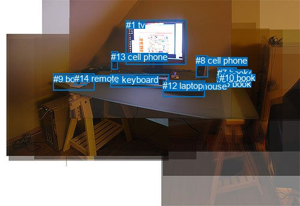
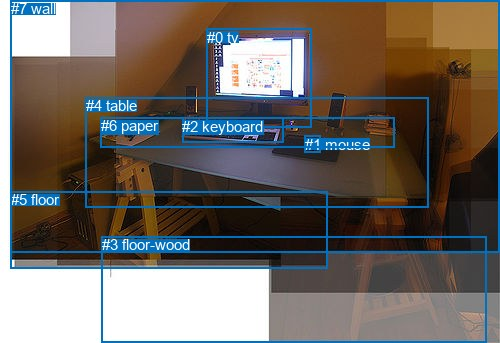

# 图片 0484：2335920.jpg

随机样本序号：482。图片 SHA256：`72c6b3a388f0996cd233fe9c8e1dd1469bf36449e38cf30f4c5a9fc05a6d8247`。

红色框表示人，蓝色框表示其他物体。两个模式分别保留自身框编号，可依据位置比较对应对象。

## 自动检测框与输出

人的框编号：`[]`。状态：`no_person`。

### 自动检测全部物体框

| 编号 | 类别 | 是否为人 | 检测分数 | 像素坐标 xyxy |
|---|---|---|---|---|
| 0 | keyboard | False | 0.9982 | 183.2, 123.9, 281.7, 145.2 |
| 1 | tv | False | 0.9968 | 209.8, 33.1, 310.5, 107.4 |
| 2 | book | False | 0.8180 | 364.6, 127.5, 395.7, 133.4 |
| 3 | book | False | 0.8146 | 367.6, 113.2, 389.8, 125.9 |
| 4 | book | False | 0.6807 | 364.4, 123.6, 393.8, 129.1 |
| 5 | book | False | 0.6483 | 366.9, 131.5, 395.2, 135.5 |
| 6 | book | False | 0.6399 | 361.4, 123.4, 395.7, 135.4 |
| 7 | book | False | 0.5866 | 362.5, 112.9, 394.4, 134.6 |
| 8 | cell phone | False | 0.5647 | 326.2, 92.1, 346.8, 128.1 |
| 9 | book | False | 0.5456 | 89.0, 122.9, 157.1, 150.9 |
| 10 | book | False | 0.5383 | 365.7, 120.6, 393.3, 127.8 |
| 11 | mouse | False | 0.5268 | 305.4, 135.5, 319.7, 150.2 |
| 12 | laptop | False | 0.4449 | 271.4, 134.1, 341.7, 161.5 |
| 13 | cell phone | False | 0.3553 | 185.4, 85.7, 196.9, 115.8 |
| 14 | remote | False | 0.3552 | 124.3, 122.0, 144.2, 141.1 |

### 自动检测 Top50 人相关候选

评分物体对：0；人相关物体对：0；输出关系：0。

| 排名 | 主语编号与类别 | 关系 | 宾语编号与类别 | 类型 | 人与人 | 排序分数 | 原始融合 logit |
|---|---|---|---|---|---|---|---|

### 自动检测逐条人相关 GT 核验

本图没有人相关 GT，R@50 无分母；预测候选继续展示。

## 真实框与输出

人的框编号：`[]`。

### 真实框全部物体框

| 编号 | 类别 | 是否为人 | 检测分数 | 像素坐标 xyxy |
|---|---|---|---|---|
| 0 | tv | False | GT | 207.0, 29.0, 312.0, 128.0 |
| 1 | mouse | False | GT | 305.0, 136.0, 321.0, 153.0 |
| 2 | keyboard | False | GT | 182.0, 118.0, 283.0, 143.0 |
| 3 | floor-wood | False | GT | 102.0, 236.0, 487.0, 343.0 |
| 4 | table | False | GT | 86.0, 97.0, 429.0, 207.0 |
| 5 | floor | False | GT | 11.0, 191.0, 327.0, 268.0 |
| 6 | paper | False | GT | 101.0, 117.0, 395.0, 147.0 |
| 7 | wall | False | GT | 11.0, 0.0, 500.0, 253.0 |

### 真实框 Top50 人相关候选

评分物体对：0；人相关物体对：0；输出关系：0。

| 排名 | 主语编号与类别 | 关系 | 宾语编号与类别 | 类型 | 人与人 | 排序分数 | 原始融合 logit |
|---|---|---|---|---|---|---|---|

### 真实框逐条人相关 GT 核验

本图没有人相关 GT，R@50 无分母；预测候选继续展示。

## 全部人相关 GT

| 主语编号与类别 | 关系 | 宾语编号与类别 |
|---|---|---|

原始记录、全部人相关物体对的两项预测与分项分数见 [逐图证据 JSON](../evidence/cases/0484.json)。全部56类 logits 保留于本机 HOR/output/random500/logits/。

<!-- HOR_COMPLETE_RESULTS -->

## 六组条件的完整输出对照

以下保留同一图片三种框与候选模式、两种谓词输出规则的全部 Top50。框编号各自在所属模式内解释。

### 自动检测框完整枚举：空间与语义各保留一个谓词

| 排名 | 主语编号与类别 | 谓词 | 宾语编号与类别 | 分组 | 排序分数 | predicate logit | pair logit |
|---|---|---|---|---|---|---|---|

没有人相关 GT，本条件的召回率无分母。

### 自动检测框完整枚举：每对只保留一个谓词

| 排名 | 主语编号与类别 | 谓词 | 宾语编号与类别 | 分组 | 排序分数 | predicate logit | pair logit |
|---|---|---|---|---|---|---|---|

没有人相关 GT，本条件的召回率无分母。

### 真实框完整枚举：空间与语义各保留一个谓词

| 排名 | 主语编号与类别 | 谓词 | 宾语编号与类别 | 分组 | 排序分数 | predicate logit | pair logit |
|---|---|---|---|---|---|---|---|

没有人相关 GT，本条件的召回率无分母。

### 真实框完整枚举：每对只保留一个谓词

| 排名 | 主语编号与类别 | 谓词 | 宾语编号与类别 | 分组 | 排序分数 | predicate logit | pair logit |
|---|---|---|---|---|---|---|---|

没有人相关 GT，本条件的召回率无分母。

### 真实框400候选：空间与语义各保留一个谓词

| 排名 | 主语编号与类别 | 谓词 | 宾语编号与类别 | 分组 | 排序分数 | predicate logit | pair logit |
|---|---|---|---|---|---|---|---|

没有人相关 GT，本条件的召回率无分母。

### 真实框400候选：每对只保留一个谓词

| 排名 | 主语编号与类别 | 谓词 | 宾语编号与类别 | 分组 | 排序分数 | predicate logit | pair logit |
|---|---|---|---|---|---|---|---|

没有人相关 GT，本条件的召回率无分母。
