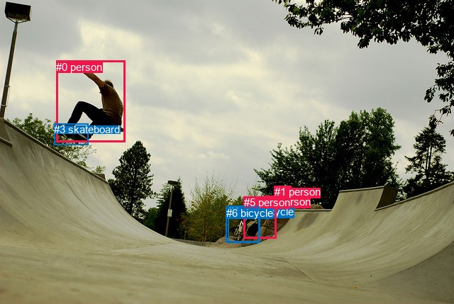
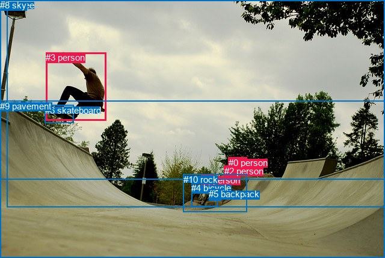

# 图片 0489：2336251.jpg

随机样本序号：44。图片 SHA256：`13df9ceee5e13c98236ec81acd8808d35a56c49f999ec3a535dfbd40060b9e79`。

红色框表示人，蓝色框表示其他物体。两个模式分别保留自身框编号，可依据位置比较对应对象。

## 自动检测框与输出

人的框编号：`[0, 1, 2, 5]`。状态：`ok`。

### 自动检测全部物体框

| 编号 | 类别 | 是否为人 | 检测分数 | 像素坐标 xyxy |
|---|---|---|---|---|
| 0 | person | True | 0.9994 | 79.0, 86.0, 177.0, 200.6 |
| 1 | person | True | 0.9736 | 387.0, 262.0, 410.6, 289.9 |
| 2 | person | True | 0.9652 | 372.9, 276.3, 389.5, 290.2 |
| 3 | skateboard | False | 0.9050 | 76.1, 174.2, 124.6, 204.5 |
| 4 | motorcycle | False | 0.7246 | 321.4, 290.1, 366.5, 342.4 |
| 5 | person | True | 0.5888 | 343.8, 277.3, 389.2, 336.2 |
| 6 | bicycle | False | 0.5863 | 318.6, 291.7, 365.5, 341.3 |

### 自动检测 Top50 人相关候选

评分物体对：42；人相关物体对：36；输出关系：50。

| 排名 | 主语编号与类别 | 关系 | 宾语编号与类别 | 类型 | 人与人 | 排序分数 | 原始融合 logit |
|---|---|---|---|---|---|---|---|
| 1 | #0 person | riding | #3 skateboard | semantic | False | 0.99272 | 4.9151 |
| 2 | #0 person | on | #3 skateboard | spatial | False | 0.98066 | 3.9260 |
| 3 | #1 person | on | #5 person | spatial | True | 0.94817 | 2.9065 |
| 4 | #4 motorcycle | on | #5 person | spatial | False | 0.92161 | 2.4645 |
| 5 | #6 bicycle | on | #5 person | spatial | False | 0.91834 | 2.4200 |
| 6 | #2 person | on | #5 person | spatial | True | 0.90495 | 2.2534 |
| 7 | #5 person | wearing | #2 person | semantic | True | 0.88250 | 2.0163 |
| 8 | #1 person | riding | #5 person | semantic | True | 0.87405 | 1.9373 |
| 9 | #4 motorcycle | riding | #5 person | semantic | False | 0.83025 | 1.5874 |
| 10 | #1 person | on | #2 person | spatial | True | 0.81807 | 1.5033 |
| 11 | #6 bicycle | riding | #5 person | semantic | False | 0.81784 | 1.5018 |
| 12 | #1 person | riding | #2 person | semantic | True | 0.80006 | 1.3867 |
| 13 | #2 person | riding | #5 person | semantic | True | 0.77380 | 1.2299 |
| 14 | #1 person | looking at | #0 person | semantic | True | 0.77141 | 1.2163 |
| 15 | #5 person | looking at | #0 person | semantic | True | 0.75278 | 1.1135 |
| 16 | #5 person | on | #4 motorcycle | spatial | False | 0.65756 | 0.6524 |
| 17 | #5 person | on | #6 bicycle | spatial | False | 0.65163 | 0.6262 |
| 18 | #2 person | looking at | #0 person | semantic | True | 0.64812 | 0.6108 |
| 19 | #5 person | riding | #4 motorcycle | semantic | False | 0.63905 | 0.5713 |
| 20 | #1 person | on | #4 motorcycle | spatial | False | 0.62709 | 0.5197 |
| 21 | #5 person | riding | #6 bicycle | semantic | False | 0.62330 | 0.5036 |
| 22 | #4 motorcycle | looking at | #0 person | semantic | False | 0.62056 | 0.4919 |
| 23 | #1 person | on | #6 bicycle | spatial | False | 0.60365 | 0.4207 |
| 24 | #6 bicycle | looking at | #0 person | semantic | False | 0.58040 | 0.3244 |
| 25 | #5 person | in | #2 person | spatial | True | 0.52851 | 0.1142 |
| 26 | #2 person | on | #4 motorcycle | spatial | False | 0.51816 | 0.0727 |
| 27 | #2 person | on | #1 person | spatial | True | 0.50271 | 0.0108 |
| 28 | #2 person | on | #6 bicycle | spatial | False | 0.47825 | -0.0871 |
| 29 | #1 person | riding | #6 bicycle | semantic | False | 0.39609 | -0.4218 |
| 30 | #1 person | riding | #4 motorcycle | semantic | False | 0.39254 | -0.4367 |
| 31 | #2 person | sitting on | #1 person | semantic | True | 0.29754 | -0.8590 |
| 32 | #2 person | riding | #4 motorcycle | semantic | False | 0.28581 | -0.9158 |
| 33 | #2 person | riding | #6 bicycle | semantic | False | 0.28319 | -0.9287 |
| 34 | #3 skateboard | on | #0 person | spatial | False | 0.25543 | -1.0699 |
| 35 | #0 person | jumping over | #5 person | semantic | True | 0.23485 | -1.1811 |
| 36 | #0 person | over | #5 person | spatial | True | 0.21617 | -1.2881 |
| 37 | #5 person | holding | #1 person | semantic | True | 0.16619 | -1.6128 |
| 38 | #5 person | in | #1 person | spatial | True | 0.15126 | -1.7247 |
| 39 | #0 person | jumping over | #4 motorcycle | semantic | False | 0.14514 | -1.7733 |
| 40 | #0 person | over | #4 motorcycle | spatial | False | 0.14308 | -1.7900 |
| 41 | #4 motorcycle | wearing | #2 person | semantic | False | 0.14043 | -1.8118 |
| 42 | #0 person | jumping over | #6 bicycle | semantic | False | 0.13770 | -1.8345 |
| 43 | #0 person | over | #6 bicycle | spatial | False | 0.13135 | -1.8890 |
| 44 | #0 person | looking at | #1 person | semantic | True | 0.10339 | -2.1601 |
| 45 | #6 bicycle | wearing | #2 person | semantic | False | 0.10267 | -2.1679 |
| 46 | #3 skateboard | wearing | #0 person | semantic | False | 0.07381 | -2.5295 |
| 47 | #4 motorcycle | in | #2 person | spatial | False | 0.07111 | -2.5698 |
| 48 | #0 person | looking at | #2 person | semantic | True | 0.06738 | -2.6276 |
| 49 | #6 bicycle | in | #2 person | spatial | False | 0.06109 | -2.7324 |
| 50 | #0 person | in | #1 person | spatial | True | 0.05849 | -2.7786 |

### 自动检测逐条人相关 GT 核验

R@50：0.00%；命中 0/6。

| GT 主语编号 | GT 关系 | GT 宾语编号 | 结果阶段 | 匹配预测主语编号 | 匹配预测宾语编号 |
|---|---|---|---|---|---|
| 0 | sitting on | 9 | endpoint_missing_or_wrong_class | [1] | [] |
| 1 | talking to | 0 | endpoint_missing_or_wrong_class | [] | [1] |
| 1 | sitting on | 9 | endpoint_missing_or_wrong_class | [] | [] |
| 2 | sitting on | 9 | endpoint_missing_or_wrong_class | [2] | [] |
| 3 | playing | 6 | wrong_predicate | [0] | [3] |
| 3 | jumping from | 9 | endpoint_missing_or_wrong_class | [0] | [] |

## 真实框与输出

人的框编号：`[0, 1, 2, 3]`。

### 真实框全部物体框

| 编号 | 类别 | 是否为人 | 检测分数 | 像素坐标 xyxy |
|---|---|---|---|---|
| 0 | person | True | GT | 380.0, 262.0, 411.0, 290.0 |
| 1 | person | True | GT | 334.0, 291.0, 355.0, 315.0 |
| 2 | person | True | GT | 373.0, 276.0, 389.0, 290.0 |
| 3 | person | True | GT | 76.0, 87.0, 176.0, 201.0 |
| 4 | bicycle | False | GT | 318.0, 304.0, 361.0, 343.0 |
| 5 | backpack | False | GT | 347.0, 314.0, 368.0, 333.0 |
| 6 | skateboard | False | GT | 75.0, 175.0, 123.0, 205.0 |
| 7 | tree | False | GT | 12.0, 0.0, 640.0, 344.0 |
| 8 | sky | False | GT | 0.0, 0.0, 640.0, 299.0 |
| 9 | pavement | False | GT | 0.0, 168.0, 640.0, 429.0 |
| 10 | rock | False | GT | 305.0, 290.0, 411.0, 353.0 |

### 真实框 Top50 人相关候选

评分物体对：110；人相关物体对：68；输出关系：50。

| 排名 | 主语编号与类别 | 关系 | 宾语编号与类别 | 类型 | 人与人 | 排序分数 | 原始融合 logit |
|---|---|---|---|---|---|---|---|
| 1 | #3 person | riding | #6 skateboard | semantic | False | 0.99290 | 4.9402 |
| 2 | #3 person | on | #6 skateboard | spatial | False | 0.98612 | 4.2632 |
| 3 | #1 person | riding | #4 bicycle | semantic | False | 0.96302 | 3.2597 |
| 4 | #3 person | in | #8 sky | spatial | False | 0.95783 | 3.1230 |
| 5 | #3 person | in | #7 tree | spatial | False | 0.95464 | 3.0466 |
| 6 | #0 person | on | #9 pavement | spatial | False | 0.94850 | 2.9132 |
| 7 | #0 person | on | #10 rock | spatial | False | 0.94790 | 2.9011 |
| 8 | #1 person | on | #4 bicycle | spatial | False | 0.94335 | 2.8126 |
| 9 | #3 person | jumping over | #9 pavement | semantic | False | 0.94081 | 2.7660 |
| 10 | #1 person | on | #10 rock | spatial | False | 0.94060 | 2.7623 |
| 11 | #2 person | on | #9 pavement | spatial | False | 0.93936 | 2.7402 |
| 12 | #3 person | on | #9 pavement | spatial | False | 0.92830 | 2.5609 |
| 13 | #1 person | on | #9 pavement | spatial | False | 0.91732 | 2.4065 |
| 14 | #0 person | wearing | #2 person | semantic | True | 0.91100 | 2.3259 |
| 15 | #1 person | sitting on | #10 rock | semantic | False | 0.90786 | 2.2878 |
| 16 | #0 person | sitting on | #10 rock | semantic | False | 0.90781 | 2.2872 |
| 17 | #2 person | sitting on | #9 pavement | semantic | False | 0.88880 | 2.0786 |
| 18 | #0 person | on | #2 person | spatial | True | 0.88183 | 2.0098 |
| 19 | #0 person | looking at | #3 person | semantic | True | 0.88092 | 2.0011 |
| 20 | #0 person | sitting on | #9 pavement | semantic | False | 0.88017 | 1.9941 |
| 21 | #2 person | on | #10 rock | spatial | False | 0.84949 | 1.7306 |
| 22 | #1 person | riding | #9 pavement | semantic | False | 0.82919 | 1.5799 |
| 23 | #2 person | sitting on | #10 rock | semantic | False | 0.77116 | 1.2149 |
| 24 | #0 person | in | #7 tree | spatial | False | 0.76237 | 1.1657 |
| 25 | #2 person | looking at | #3 person | semantic | True | 0.68535 | 0.7784 |
| 26 | #2 person | on | #0 person | spatial | True | 0.65587 | 0.6450 |
| 27 | #2 person | in | #7 tree | spatial | False | 0.64809 | 0.6107 |
| 28 | #1 person | in | #7 tree | spatial | False | 0.60033 | 0.4069 |
| 29 | #2 person | sitting on | #0 person | semantic | True | 0.56391 | 0.2570 |
| 30 | #0 person | in | #8 sky | spatial | False | 0.53454 | 0.1384 |
| 31 | #3 person | jumping over | #8 sky | semantic | False | 0.52838 | 0.1136 |
| 32 | #3 person | jumping over | #7 tree | semantic | False | 0.52189 | 0.0876 |
| 33 | #1 person | on | #5 backpack | spatial | False | 0.49765 | -0.0094 |
| 34 | #10 rock | wearing | #1 person | semantic | False | 0.49351 | -0.0260 |
| 35 | #4 bicycle | wearing | #1 person | semantic | False | 0.48270 | -0.0692 |
| 36 | #4 bicycle | on | #1 person | spatial | False | 0.46200 | -0.1523 |
| 37 | #3 person | jumping over | #10 rock | semantic | False | 0.43941 | -0.2435 |
| 38 | #2 person | in | #8 sky | spatial | False | 0.38638 | -0.4626 |
| 39 | #0 person | looking at | #7 tree | semantic | False | 0.38555 | -0.4661 |
| 40 | #0 person | looking at | #8 sky | semantic | False | 0.34849 | -0.6257 |
| 41 | #6 skateboard | on | #3 person | spatial | False | 0.34192 | -0.6547 |
| 42 | #1 person | in | #8 sky | spatial | False | 0.30978 | -0.8011 |
| 43 | #1 person | sitting on | #5 backpack | semantic | False | 0.28899 | -0.9003 |
| 44 | #1 person | looking at | #3 person | semantic | True | 0.25274 | -1.0841 |
| 45 | #10 rock | in | #1 person | spatial | False | 0.23989 | -1.1533 |
| 46 | #3 person | on | #10 rock | spatial | False | 0.21739 | -1.2809 |
| 47 | #8 sky | over | #3 person | spatial | False | 0.20962 | -1.3272 |
| 48 | #10 rock | looking at | #3 person | semantic | False | 0.20937 | -1.3288 |
| 49 | #3 person | looking at | #0 person | semantic | True | 0.20301 | -1.3676 |
| 50 | #6 skateboard | wearing | #3 person | semantic | False | 0.19686 | -1.4060 |

### 真实框逐条人相关 GT 核验

R@50：33.33%；命中 2/6。

| GT 主语编号 | GT 关系 | GT 宾语编号 | 结果阶段 | 匹配预测主语编号 | 匹配预测宾语编号 |
|---|---|---|---|---|---|
| 0 | sitting on | 9 | hit50 | [0] | [9] |
| 1 | talking to | 0 | wrong_predicate | [1] | [0] |
| 1 | sitting on | 9 | wrong_predicate | [1] | [9] |
| 2 | sitting on | 9 | hit50 | [2] | [9] |
| 3 | playing | 6 | wrong_predicate | [3] | [6] |
| 3 | jumping from | 9 | wrong_predicate | [3] | [9] |

## 全部人相关 GT

| 主语编号与类别 | 关系 | 宾语编号与类别 |
|---|---|---|
| #0 person | sitting on | #9 pavement |
| #1 person | talking to | #0 person |
| #1 person | sitting on | #9 pavement |
| #2 person | sitting on | #9 pavement |
| #3 person | playing | #6 skateboard |
| #3 person | jumping from | #9 pavement |

原始记录、全部人相关物体对的两项预测与分项分数见 [逐图证据 JSON](../evidence/cases/0489.json)。全部56类 logits 保留于本机 HOR/output/random500/logits/。

<!-- HOR_COMPLETE_RESULTS -->

## 六组条件的完整输出对照

以下保留同一图片三种框与候选模式、两种谓词输出规则的全部 Top50。框编号各自在所属模式内解释。

### 自动检测框完整枚举：空间与语义各保留一个谓词

| 排名 | 主语编号与类别 | 谓词 | 宾语编号与类别 | 分组 | 排序分数 | predicate logit | pair logit |
|---|---|---|---|---|---|---|---|
| 1 | #0 person | riding | #3 skateboard | semantic | 0.9927182 | 4.2442012 | 0.6708677 |
| 2 | #0 person | on | #3 skateboard | spatial | 0.9806585 | 3.2551079 | 0.6708677 |
| 3 | #1 person | on | #5 person | spatial | 0.9481655 | 3.1422148 | -0.2357410 |
| 4 | #4 motorcycle | on | #5 person | spatial | 0.9216130 | 2.8051586 | -0.3406913 |
| 5 | #6 bicycle | on | #5 person | spatial | 0.9183421 | 2.7558656 | -0.3358334 |
| 6 | #2 person | on | #5 person | spatial | 0.9049457 | 2.3864870 | -0.1330601 |
| 7 | #5 person | wearing | #2 person | semantic | 0.8825018 | 2.7527375 | -0.7363989 |
| 8 | #1 person | riding | #5 person | semantic | 0.8740508 | 2.1730003 | -0.2357410 |
| 9 | #4 motorcycle | riding | #5 person | semantic | 0.8302534 | 1.9281158 | -0.3406913 |
| 10 | #1 person | on | #2 person | spatial | 0.8180664 | 1.7952056 | -0.2919040 |
| 11 | #6 bicycle | riding | #5 person | semantic | 0.8178375 | 1.8375983 | -0.3358334 |
| 12 | #1 person | riding | #2 person | semantic | 0.8000627 | 1.6785898 | -0.2919040 |
| 13 | #2 person | riding | #5 person | semantic | 0.7738047 | 1.3629804 | -0.1330601 |
| 14 | #1 person | looking at | #0 person | semantic | 0.7714096 | 2.1238384 | -0.9075507 |
| 15 | #5 person | looking at | #0 person | semantic | 0.7527788 | 2.2465782 | -1.1330905 |
| 16 | #5 person | on | #4 motorcycle | spatial | 0.6575576 | 1.1349349 | -0.4825062 |
| 17 | #5 person | on | #6 bicycle | spatial | 0.6516315 | 1.1157331 | -0.4895145 |
| 18 | #2 person | looking at | #0 person | semantic | 0.6481199 | 1.5521054 | -0.9413203 |
| 19 | #5 person | riding | #4 motorcycle | semantic | 0.6390523 | 1.0537596 | -0.4825062 |
| 20 | #1 person | on | #4 motorcycle | spatial | 0.6270891 | 0.9082794 | -0.3885306 |
| 21 | #5 person | riding | #6 bicycle | semantic | 0.6232988 | 0.9930882 | -0.4895145 |
| 22 | #4 motorcycle | looking at | #0 person | semantic | 0.6205558 | 1.7077255 | -1.2158175 |
| 23 | #1 person | on | #6 bicycle | spatial | 0.6036510 | 0.8234510 | -0.4027498 |
| 24 | #6 bicycle | looking at | #0 person | semantic | 0.5803968 | 1.5581408 | -1.2337383 |
| 25 | #5 person | in | #2 person | spatial | 0.5285110 | 0.8505669 | -0.7363989 |
| 26 | #2 person | on | #4 motorcycle | spatial | 0.5181640 | 0.3419909 | -0.2693029 |
| 27 | #2 person | on | #1 person | spatial | 0.5027092 | 0.2350364 | -0.2241993 |
| 28 | #2 person | on | #6 bicycle | spatial | 0.4782497 | 0.1941123 | -0.2811686 |
| 29 | #1 person | riding | #6 bicycle | semantic | 0.3960938 | -0.0190182 | -0.4027498 |
| 30 | #1 person | riding | #4 motorcycle | semantic | 0.3925365 | -0.0481319 | -0.3885306 |
| 31 | #2 person | sitting on | #1 person | semantic | 0.2975444 | -0.6348195 | -0.2241993 |
| 32 | #2 person | riding | #4 motorcycle | semantic | 0.2858065 | -0.6465359 | -0.2693029 |
| 33 | #2 person | riding | #6 bicycle | semantic | 0.2831921 | -0.6475139 | -0.2811686 |
| 34 | #3 skateboard | on | #0 person | spatial | 0.2554315 | -0.4216137 | -0.6482370 |
| 35 | #0 person | jumping over | #5 person | semantic | 0.2348500 | -0.2454104 | -0.9357144 |
| 36 | #0 person | over | #5 person | spatial | 0.2161748 | -0.3523841 | -0.9357144 |
| 37 | #5 person | holding | #1 person | semantic | 0.1661942 | -0.8475552 | -0.7652885 |
| 38 | #5 person | in | #1 person | spatial | 0.1512630 | -0.9594407 | -0.7652885 |
| 39 | #0 person | jumping over | #4 motorcycle | semantic | 0.1451371 | -0.8621168 | -0.9111458 |
| 40 | #0 person | over | #4 motorcycle | spatial | 0.1430765 | -0.8788230 | -0.9111458 |
| 41 | #4 motorcycle | wearing | #2 person | semantic | 0.1404265 | -1.0265634 | -0.7851883 |
| 42 | #0 person | jumping over | #6 bicycle | semantic | 0.1377024 | -0.9072962 | -0.9272094 |
| 43 | #0 person | over | #6 bicycle | spatial | 0.1313545 | -0.9618256 | -0.9272094 |
| 44 | #0 person | looking at | #1 person | semantic | 0.1033928 | -1.4757142 | -0.6843684 |
| 45 | #6 bicycle | wearing | #2 person | semantic | 0.1026746 | -1.3829181 | -0.7849360 |
| 46 | #3 skateboard | wearing | #0 person | semantic | 0.0738139 | -1.8812916 | -0.6482370 |
| 47 | #4 motorcycle | in | #2 person | spatial | 0.0711101 | -1.7845724 | -0.7851883 |
| 48 | #0 person | looking at | #2 person | semantic | 0.0673816 | -1.8320155 | -0.7956089 |
| 49 | #6 bicycle | in | #2 person | spatial | 0.0610878 | -1.9474740 | -0.7849360 |
| 50 | #0 person | in | #1 person | spatial | 0.0584891 | -2.0942774 | -0.6843684 |

GT 命中：0/6，R@50=0.00%。

| GT主语 | GT谓词 | GT宾语 | 结果阶段 | 匹配主语框 | 匹配宾语框 |
|---|---|---|---|---|---|
| 0 | sitting on | 9 | endpoint_missing_or_wrong_class | [1] | [] |
| 1 | talking to | 0 | endpoint_missing_or_wrong_class | [] | [1] |
| 1 | sitting on | 9 | endpoint_missing_or_wrong_class | [] | [] |
| 2 | sitting on | 9 | endpoint_missing_or_wrong_class | [2] | [] |
| 3 | playing | 6 | wrong_predicate | [0] | [3] |
| 3 | jumping from | 9 | endpoint_missing_or_wrong_class | [0] | [] |

### 自动检测框完整枚举：每对只保留一个谓词

| 排名 | 主语编号与类别 | 谓词 | 宾语编号与类别 | 分组 | 排序分数 | predicate logit | pair logit |
|---|---|---|---|---|---|---|---|
| 1 | #0 person | riding | #3 skateboard | single | 0.9927182 | 4.2442012 | 0.6708677 |
| 2 | #1 person | on | #5 person | single | 0.9481655 | 3.1422148 | -0.2357410 |
| 3 | #4 motorcycle | on | #5 person | single | 0.9216130 | 2.8051586 | -0.3406913 |
| 4 | #6 bicycle | on | #5 person | single | 0.9183421 | 2.7558656 | -0.3358334 |
| 5 | #2 person | on | #5 person | single | 0.9049457 | 2.3864870 | -0.1330601 |
| 6 | #5 person | wearing | #2 person | single | 0.8825018 | 2.7527375 | -0.7363989 |
| 7 | #1 person | on | #2 person | single | 0.8180664 | 1.7952056 | -0.2919040 |
| 8 | #1 person | looking at | #0 person | single | 0.7714096 | 2.1238384 | -0.9075507 |
| 9 | #5 person | looking at | #0 person | single | 0.7527788 | 2.2465782 | -1.1330905 |
| 10 | #5 person | on | #4 motorcycle | single | 0.6575576 | 1.1349349 | -0.4825062 |
| 11 | #5 person | on | #6 bicycle | single | 0.6516315 | 1.1157331 | -0.4895145 |
| 12 | #2 person | looking at | #0 person | single | 0.6481199 | 1.5521054 | -0.9413203 |
| 13 | #1 person | on | #4 motorcycle | single | 0.6270891 | 0.9082794 | -0.3885306 |
| 14 | #4 motorcycle | looking at | #0 person | single | 0.6205558 | 1.7077255 | -1.2158175 |
| 15 | #1 person | on | #6 bicycle | single | 0.6036510 | 0.8234510 | -0.4027498 |
| 16 | #6 bicycle | looking at | #0 person | single | 0.5803968 | 1.5581408 | -1.2337383 |
| 17 | #2 person | on | #4 motorcycle | single | 0.5181640 | 0.3419909 | -0.2693029 |
| 18 | #2 person | on | #1 person | single | 0.5027092 | 0.2350364 | -0.2241993 |
| 19 | #2 person | on | #6 bicycle | single | 0.4782497 | 0.1941123 | -0.2811686 |
| 20 | #3 skateboard | on | #0 person | single | 0.2554315 | -0.4216137 | -0.6482370 |
| 21 | #0 person | jumping over | #5 person | single | 0.2348500 | -0.2454104 | -0.9357144 |
| 22 | #5 person | holding | #1 person | single | 0.1661942 | -0.8475552 | -0.7652885 |
| 23 | #0 person | jumping over | #4 motorcycle | single | 0.1451371 | -0.8621168 | -0.9111458 |
| 24 | #4 motorcycle | wearing | #2 person | single | 0.1404265 | -1.0265634 | -0.7851883 |
| 25 | #0 person | jumping over | #6 bicycle | single | 0.1377024 | -0.9072962 | -0.9272094 |
| 26 | #0 person | looking at | #1 person | single | 0.1033928 | -1.4757142 | -0.6843684 |
| 27 | #6 bicycle | wearing | #2 person | single | 0.1026746 | -1.3829181 | -0.7849360 |
| 28 | #0 person | looking at | #2 person | single | 0.0673816 | -1.8320155 | -0.7956089 |
| 29 | #4 motorcycle | looking at | #1 person | single | 0.0506900 | -2.1024671 | -0.8275398 |
| 30 | #1 person | on | #3 skateboard | single | 0.0468372 | -1.8486459 | -1.1644617 |
| 31 | #6 bicycle | looking at | #1 person | single | 0.0439703 | -2.2498727 | -0.8294009 |
| 32 | #2 person | on | #3 skateboard | single | 0.0288237 | -2.3973842 | -1.1199259 |
| 33 | #5 person | on | #3 skateboard | single | 0.0164835 | -2.7877884 | -1.3009875 |
| 34 | #3 skateboard | on | #5 person | single | 0.0023336 | -4.4789224 | -1.5790765 |
| 35 | #3 skateboard | in | #1 person | single | 0.0012384 | -5.0458074 | -1.6468487 |
| 36 | #3 skateboard | on | #2 person | single | 0.0007171 | -5.5610957 | -1.6784191 |

GT 命中：0/6，R@50=0.00%。

| GT主语 | GT谓词 | GT宾语 | 结果阶段 | 匹配主语框 | 匹配宾语框 |
|---|---|---|---|---|---|
| 0 | sitting on | 9 | endpoint_missing_or_wrong_class | [1] | [] |
| 1 | talking to | 0 | endpoint_missing_or_wrong_class | [] | [1] |
| 1 | sitting on | 9 | endpoint_missing_or_wrong_class | [] | [] |
| 2 | sitting on | 9 | endpoint_missing_or_wrong_class | [2] | [] |
| 3 | playing | 6 | wrong_predicate | [0] | [3] |
| 3 | jumping from | 9 | endpoint_missing_or_wrong_class | [0] | [] |

### 真实框完整枚举：空间与语义各保留一个谓词

| 排名 | 主语编号与类别 | 谓词 | 宾语编号与类别 | 分组 | 排序分数 | predicate logit | pair logit |
|---|---|---|---|---|---|---|---|
| 1 | #3 person | riding | #6 skateboard | semantic | 0.9928979 | 4.2473779 | 0.6928543 |
| 2 | #3 person | on | #6 skateboard | spatial | 0.9861180 | 3.5703273 | 0.6928543 |
| 3 | #1 person | riding | #4 bicycle | semantic | 0.9630215 | 3.6638799 | -0.4041388 |
| 4 | #3 person | in | #8 sky | spatial | 0.9578327 | 3.6957583 | -0.5727291 |
| 5 | #3 person | in | #7 tree | spatial | 0.9546361 | 3.5550361 | -0.5084217 |
| 6 | #0 person | on | #9 pavement | spatial | 0.9484958 | 3.1221161 | -0.2089012 |
| 7 | #0 person | on | #10 rock | spatial | 0.9479023 | 3.0516224 | -0.1504929 |
| 8 | #1 person | on | #4 bicycle | spatial | 0.9433511 | 3.2167048 | -0.4041388 |
| 9 | #3 person | jumping over | #9 pavement | semantic | 0.9408112 | 2.7317123 | 0.0342985 |
| 10 | #1 person | on | #10 rock | spatial | 0.9406031 | 2.9753952 | -0.2131160 |
| 11 | #2 person | on | #9 pavement | spatial | 0.9393603 | 2.8916965 | -0.1514475 |
| 12 | #3 person | on | #9 pavement | spatial | 0.9283026 | 2.5266042 | 0.0342985 |
| 13 | #1 person | on | #9 pavement | spatial | 0.9173212 | 2.7214589 | -0.3149644 |
| 14 | #0 person | wearing | #2 person | semantic | 0.9109994 | 2.5815253 | -0.2556269 |
| 15 | #1 person | sitting on | #10 rock | semantic | 0.9078578 | 2.5008707 | -0.2131160 |
| 16 | #0 person | sitting on | #10 rock | semantic | 0.9078133 | 2.4377160 | -0.1504929 |
| 17 | #2 person | sitting on | #9 pavement | semantic | 0.8888044 | 2.2300339 | -0.1514475 |
| 18 | #0 person | on | #2 person | spatial | 0.8818254 | 2.2654576 | -0.2556269 |
| 19 | #0 person | looking at | #3 person | semantic | 0.8809159 | 2.8943582 | -0.8932260 |
| 20 | #0 person | sitting on | #9 pavement | semantic | 0.8801722 | 2.2029629 | -0.2089012 |
| 21 | #2 person | on | #10 rock | spatial | 0.8494947 | 1.7829251 | -0.0522822 |
| 22 | #1 person | riding | #9 pavement | semantic | 0.8291882 | 1.8948488 | -0.3149644 |
| 23 | #2 person | sitting on | #10 rock | semantic | 0.7711641 | 1.2671781 | -0.0522822 |
| 24 | #0 person | in | #7 tree | spatial | 0.7623653 | 2.1026826 | -0.9369915 |
| 25 | #2 person | looking at | #3 person | semantic | 0.6853458 | 1.7263770 | -0.9479280 |
| 26 | #2 person | on | #0 person | spatial | 0.6558729 | 0.8996215 | -0.2546652 |
| 27 | #2 person | in | #7 tree | spatial | 0.6480911 | 1.5639138 | -0.9532551 |
| 28 | #1 person | in | #7 tree | spatial | 0.6003326 | 1.7406974 | -1.3338462 |
| 29 | #2 person | sitting on | #0 person | semantic | 0.5639074 | 0.5117006 | -0.2546652 |
| 30 | #0 person | in | #8 sky | spatial | 0.5345435 | 1.1636615 | -1.0252672 |
| 31 | #3 person | jumping over | #8 sky | semantic | 0.5283817 | 0.6863780 | -0.5727291 |
| 32 | #3 person | jumping over | #7 tree | semantic | 0.5218885 | 0.5960317 | -0.5084217 |
| 33 | #1 person | on | #5 backpack | spatial | 0.4976504 | 0.3479867 | -0.3573850 |
| 34 | #10 rock | wearing | #1 person | semantic | 0.4935071 | 1.0483756 | -1.0743486 |
| 35 | #4 bicycle | wearing | #1 person | semantic | 0.4827036 | 0.5961089 | -0.6653221 |
| 36 | #4 bicycle | on | #1 person | spatial | 0.4619958 | 0.5130115 | -0.6653221 |
| 37 | #3 person | jumping over | #10 rock | semantic | 0.4394142 | 0.6860981 | -0.9296381 |
| 38 | #2 person | in | #8 sky | spatial | 0.3863793 | 0.5848451 | -1.0474026 |
| 39 | #0 person | looking at | #7 tree | semantic | 0.3855501 | 0.4709353 | -0.9369915 |
| 40 | #0 person | looking at | #8 sky | semantic | 0.3484927 | 0.3995962 | -1.0252672 |
| 41 | #6 skateboard | on | #3 person | spatial | 0.3419214 | 0.0198498 | -0.6745932 |
| 42 | #1 person | in | #8 sky | spatial | 0.3097806 | 0.6209064 | -1.4220517 |
| 43 | #1 person | sitting on | #5 backpack | semantic | 0.2889888 | -0.5429153 | -0.3573850 |
| 44 | #1 person | looking at | #3 person | semantic | 0.2527401 | 0.0841713 | -1.1682224 |
| 45 | #10 rock | in | #1 person | spatial | 0.2398883 | -0.0789433 | -1.0743486 |
| 46 | #3 person | on | #10 rock | spatial | 0.2173916 | -0.3512940 | -0.9296381 |
| 47 | #8 sky | over | #3 person | spatial | 0.2096182 | -0.0998154 | -1.2274131 |
| 48 | #10 rock | looking at | #3 person | semantic | 0.2093662 | -0.1214995 | -1.2072507 |
| 49 | #3 person | looking at | #0 person | semantic | 0.2030111 | -0.6744075 | -0.6931725 |
| 50 | #6 skateboard | wearing | #3 person | semantic | 0.1968613 | -0.7314346 | -0.6745932 |

GT 命中：2/6，R@50=33.33%。

| GT主语 | GT谓词 | GT宾语 | 结果阶段 | 匹配主语框 | 匹配宾语框 |
|---|---|---|---|---|---|
| 0 | sitting on | 9 | hit50 | [0] | [9] |
| 1 | talking to | 0 | wrong_predicate | [1] | [0] |
| 1 | sitting on | 9 | wrong_predicate | [1] | [9] |
| 2 | sitting on | 9 | hit50 | [2] | [9] |
| 3 | playing | 6 | wrong_predicate | [3] | [6] |
| 3 | jumping from | 9 | wrong_predicate | [3] | [9] |

### 真实框完整枚举：每对只保留一个谓词

| 排名 | 主语编号与类别 | 谓词 | 宾语编号与类别 | 分组 | 排序分数 | predicate logit | pair logit |
|---|---|---|---|---|---|---|---|
| 1 | #3 person | riding | #6 skateboard | single | 0.9928979 | 4.2473779 | 0.6928543 |
| 2 | #1 person | riding | #4 bicycle | single | 0.9630215 | 3.6638799 | -0.4041388 |
| 3 | #3 person | in | #8 sky | single | 0.9578327 | 3.6957583 | -0.5727291 |
| 4 | #3 person | in | #7 tree | single | 0.9546361 | 3.5550361 | -0.5084217 |
| 5 | #0 person | on | #9 pavement | single | 0.9484958 | 3.1221161 | -0.2089012 |
| 6 | #0 person | on | #10 rock | single | 0.9479023 | 3.0516224 | -0.1504929 |
| 7 | #3 person | jumping over | #9 pavement | single | 0.9408112 | 2.7317123 | 0.0342985 |
| 8 | #1 person | on | #10 rock | single | 0.9406031 | 2.9753952 | -0.2131160 |
| 9 | #2 person | on | #9 pavement | single | 0.9393603 | 2.8916965 | -0.1514475 |
| 10 | #1 person | on | #9 pavement | single | 0.9173212 | 2.7214589 | -0.3149644 |
| 11 | #0 person | wearing | #2 person | single | 0.9109994 | 2.5815253 | -0.2556269 |
| 12 | #0 person | looking at | #3 person | single | 0.8809159 | 2.8943582 | -0.8932260 |
| 13 | #2 person | on | #10 rock | single | 0.8494947 | 1.7829251 | -0.0522822 |
| 14 | #0 person | in | #7 tree | single | 0.7623653 | 2.1026826 | -0.9369915 |
| 15 | #2 person | looking at | #3 person | single | 0.6853458 | 1.7263770 | -0.9479280 |
| 16 | #2 person | on | #0 person | single | 0.6558729 | 0.8996215 | -0.2546652 |
| 17 | #2 person | in | #7 tree | single | 0.6480911 | 1.5639138 | -0.9532551 |
| 18 | #1 person | in | #7 tree | single | 0.6003326 | 1.7406974 | -1.3338462 |
| 19 | #0 person | in | #8 sky | single | 0.5345435 | 1.1636615 | -1.0252672 |
| 20 | #1 person | on | #5 backpack | single | 0.4976504 | 0.3479867 | -0.3573850 |
| 21 | #10 rock | wearing | #1 person | single | 0.4935071 | 1.0483756 | -1.0743486 |
| 22 | #4 bicycle | wearing | #1 person | single | 0.4827036 | 0.5961089 | -0.6653221 |
| 23 | #3 person | jumping over | #10 rock | single | 0.4394142 | 0.6860981 | -0.9296381 |
| 24 | #2 person | in | #8 sky | single | 0.3863793 | 0.5848451 | -1.0474026 |
| 25 | #6 skateboard | on | #3 person | single | 0.3419214 | 0.0198498 | -0.6745932 |
| 26 | #1 person | in | #8 sky | single | 0.3097806 | 0.6209064 | -1.4220517 |
| 27 | #1 person | looking at | #3 person | single | 0.2527401 | 0.0841713 | -1.1682224 |
| 28 | #8 sky | over | #3 person | single | 0.2096182 | -0.0998154 | -1.2274131 |
| 29 | #10 rock | looking at | #3 person | single | 0.2093662 | -0.1214995 | -1.2072507 |
| 30 | #3 person | looking at | #0 person | single | 0.2030111 | -0.6744075 | -0.6931725 |
| 31 | #9 pavement | holding | #3 person | single | 0.1178894 | -0.7248046 | -1.2877662 |
| 32 | #3 person | looking at | #2 person | single | 0.1149179 | -1.2600532 | -0.7814095 |
| 33 | #3 person | wearing | #1 person | single | 0.0950123 | -1.5028343 | -0.7510803 |
| 34 | #4 bicycle | looking at | #3 person | single | 0.0934601 | -0.9034798 | -1.3686208 |
| 35 | #5 backpack | attached to | #1 person | single | 0.0913751 | -1.4853241 | -0.8116357 |
| 36 | #7 tree | over | #3 person | single | 0.0813744 | -1.0716741 | -1.3521435 |
| 37 | #3 person | riding | #4 bicycle | single | 0.0666627 | -1.5554867 | -1.0836346 |
| 38 | #0 person | wearing | #1 person | single | 0.0531669 | -2.5594835 | -0.3202024 |
| 39 | #10 rock | beside | #0 person | single | 0.0519568 | -1.6830316 | -1.2209558 |
| 40 | #0 person | on | #4 bicycle | single | 0.0435734 | -2.6534197 | -0.4353380 |
| 41 | #8 sky | over | #0 person | single | 0.0333363 | -1.4948900 | -1.8723148 |
| 42 | #3 person | jumping over | #5 backpack | single | 0.0292559 | -2.3524911 | -1.1494923 |
| 43 | #1 person | beside | #0 person | single | 0.0286424 | -2.7536201 | -0.7701862 |
| 44 | #2 person | on | #1 person | single | 0.0283575 | -3.2609282 | -0.2731698 |
| 45 | #4 bicycle | beside | #0 person | single | 0.0277852 | -2.4822350 | -1.0728393 |
| 46 | #2 person | on | #4 bicycle | single | 0.0241400 | -3.3731625 | -0.3262861 |
| 47 | #7 tree | over | #0 person | single | 0.0228260 | -1.7379334 | -2.0188327 |
| 48 | #10 rock | in | #2 person | single | 0.0221347 | -2.6074576 | -1.1807685 |
| 49 | #9 pavement | in | #0 person | single | 0.0216469 | -2.0870733 | -1.7239373 |
| 50 | #1 person | beside | #2 person | single | 0.0207892 | -3.1221509 | -0.7301632 |

GT 命中：0/6，R@50=0.00%。

| GT主语 | GT谓词 | GT宾语 | 结果阶段 | 匹配主语框 | 匹配宾语框 |
|---|---|---|---|---|---|
| 0 | sitting on | 9 | wrong_predicate | [0] | [9] |
| 1 | talking to | 0 | wrong_predicate | [1] | [0] |
| 1 | sitting on | 9 | wrong_predicate | [1] | [9] |
| 2 | sitting on | 9 | wrong_predicate | [2] | [9] |
| 3 | playing | 6 | wrong_predicate | [3] | [6] |
| 3 | jumping from | 9 | wrong_predicate | [3] | [9] |

### 真实框400候选：空间与语义各保留一个谓词

| 排名 | 主语编号与类别 | 谓词 | 宾语编号与类别 | 分组 | 排序分数 | predicate logit | pair logit |
|---|---|---|---|---|---|---|---|
| 1 | #3 person | riding | #6 skateboard | semantic | 0.9933067 | 4.3070722 | 0.6928543 |
| 2 | #3 person | on | #6 skateboard | spatial | 0.9861180 | 3.5703273 | 0.6928543 |
| 3 | #1 person | riding | #4 bicycle | semantic | 0.9630215 | 3.6638799 | -0.4041388 |
| 4 | #3 person | in | #8 sky | spatial | 0.9581000 | 3.7023959 | -0.5727291 |
| 5 | #3 person | in | #7 tree | spatial | 0.9543478 | 3.5483985 | -0.5084217 |
| 6 | #0 person | on | #10 rock | spatial | 0.9502834 | 3.1009159 | -0.1504929 |
| 7 | #0 person | on | #9 pavement | spatial | 0.9484958 | 3.1221161 | -0.2089012 |
| 8 | #2 person | on | #9 pavement | spatial | 0.9415112 | 2.9300995 | -0.1514475 |
| 9 | #3 person | jumping over | #9 pavement | semantic | 0.9408112 | 2.7317123 | 0.0342985 |
| 10 | #1 person | on | #4 bicycle | spatial | 0.9406586 | 3.1674118 | -0.4041388 |
| 11 | #1 person | on | #10 rock | spatial | 0.9406031 | 2.9753952 | -0.2131160 |
| 12 | #3 person | on | #9 pavement | spatial | 0.9283026 | 2.5266042 | 0.0342985 |
| 13 | #1 person | on | #9 pavement | spatial | 0.9164916 | 2.7105699 | -0.3149644 |
| 14 | #0 person | wearing | #2 person | semantic | 0.9109994 | 2.5815253 | -0.2556269 |
| 15 | #1 person | sitting on | #10 rock | semantic | 0.9078578 | 2.5008707 | -0.2131160 |
| 16 | #0 person | sitting on | #10 rock | semantic | 0.9078133 | 2.4377160 | -0.1504929 |
| 17 | #2 person | sitting on | #9 pavement | semantic | 0.8867056 | 2.2089715 | -0.1514475 |
| 18 | #0 person | on | #2 person | spatial | 0.8818254 | 2.2654576 | -0.2556269 |
| 19 | #0 person | looking at | #3 person | semantic | 0.8809159 | 2.8943582 | -0.8932260 |
| 20 | #0 person | sitting on | #9 pavement | semantic | 0.8801722 | 2.2029629 | -0.2089012 |
| 21 | #2 person | on | #10 rock | spatial | 0.8556889 | 1.8322172 | -0.0522822 |
| 22 | #1 person | riding | #9 pavement | semantic | 0.8291882 | 1.8948488 | -0.3149644 |
| 23 | #2 person | sitting on | #10 rock | semantic | 0.7785128 | 1.3093023 | -0.0522822 |
| 24 | #0 person | in | #7 tree | spatial | 0.7635657 | 2.1093202 | -0.9369915 |
| 25 | #2 person | looking at | #3 person | semantic | 0.6853458 | 1.7263770 | -0.9479280 |
| 26 | #2 person | on | #0 person | spatial | 0.6490499 | 0.8695307 | -0.2546652 |
| 27 | #2 person | in | #7 tree | spatial | 0.6480911 | 1.5639138 | -0.9532551 |
| 28 | #1 person | in | #7 tree | spatial | 0.5930914 | 1.7106061 | -1.3338462 |
| 29 | #2 person | sitting on | #0 person | semantic | 0.5587210 | 0.4906383 | -0.2546652 |
| 30 | #0 person | in | #8 sky | spatial | 0.5270494 | 1.1335707 | -1.0252672 |
| 31 | #3 person | jumping over | #7 tree | semantic | 0.5218885 | 0.5960317 | -0.5084217 |
| 32 | #3 person | jumping over | #8 sky | semantic | 0.5208834 | 0.6563115 | -0.5727291 |
| 33 | #10 rock | wearing | #1 person | semantic | 0.4935071 | 1.0483756 | -1.0743486 |
| 34 | #1 person | on | #5 backpack | spatial | 0.4887683 | 0.3124509 | -0.3573850 |
| 35 | #4 bicycle | wearing | #1 person | semantic | 0.4691574 | 0.5417948 | -0.6653221 |
| 36 | #4 bicycle | on | #1 person | spatial | 0.4572267 | 0.4938097 | -0.6653221 |
| 37 | #3 person | jumping over | #10 rock | semantic | 0.4394096 | 0.6860800 | -0.9296381 |
| 38 | #0 person | looking at | #7 tree | semantic | 0.3855501 | 0.4709353 | -0.9369915 |
| 39 | #2 person | in | #8 sky | spatial | 0.3784889 | 0.5514355 | -1.0474026 |
| 40 | #0 person | looking at | #8 sky | semantic | 0.3484927 | 0.3995962 | -1.0252672 |
| 41 | #6 skateboard | on | #3 person | spatial | 0.3406974 | 0.0144053 | -0.6745932 |
| 42 | #1 person | in | #8 sky | spatial | 0.3090714 | 0.6175876 | -1.4220517 |
| 43 | #1 person | sitting on | #5 backpack | semantic | 0.2785925 | -0.5940690 | -0.3573850 |
| 44 | #1 person | looking at | #3 person | semantic | 0.2527566 | 0.0842586 | -1.1682224 |
| 45 | #10 rock | in | #1 person | spatial | 0.2398883 | -0.0789433 | -1.0743486 |
| 46 | #3 person | on | #10 rock | spatial | 0.2164666 | -0.3567395 | -0.9296381 |
| 47 | #10 rock | looking at | #3 person | semantic | 0.2093805 | -0.1214128 | -1.2072507 |
| 48 | #8 sky | over | #3 person | spatial | 0.2091804 | -0.1024594 | -1.2274131 |
| 49 | #3 person | looking at | #0 person | semantic | 0.2029266 | -0.6749301 | -0.6931725 |
| 50 | #6 skateboard | wearing | #3 person | semantic | 0.1959352 | -0.7373025 | -0.6745932 |

GT 命中：2/6，R@50=33.33%。

| GT主语 | GT谓词 | GT宾语 | 结果阶段 | 匹配主语框 | 匹配宾语框 |
|---|---|---|---|---|---|
| 0 | sitting on | 9 | hit50 | [0] | [9] |
| 1 | talking to | 0 | wrong_predicate | [1] | [0] |
| 1 | sitting on | 9 | wrong_predicate | [1] | [9] |
| 2 | sitting on | 9 | hit50 | [2] | [9] |
| 3 | playing | 6 | wrong_predicate | [3] | [6] |
| 3 | jumping from | 9 | wrong_predicate | [3] | [9] |

### 真实框400候选：每对只保留一个谓词

| 排名 | 主语编号与类别 | 谓词 | 宾语编号与类别 | 分组 | 排序分数 | predicate logit | pair logit |
|---|---|---|---|---|---|---|---|
| 1 | #3 person | riding | #6 skateboard | single | 0.9933067 | 4.3070722 | 0.6928543 |
| 2 | #1 person | riding | #4 bicycle | single | 0.9630215 | 3.6638799 | -0.4041388 |
| 3 | #3 person | in | #8 sky | single | 0.9581000 | 3.7023959 | -0.5727291 |
| 4 | #3 person | in | #7 tree | single | 0.9543478 | 3.5483985 | -0.5084217 |
| 5 | #0 person | on | #10 rock | single | 0.9502834 | 3.1009159 | -0.1504929 |
| 6 | #0 person | on | #9 pavement | single | 0.9484958 | 3.1221161 | -0.2089012 |
| 7 | #2 person | on | #9 pavement | single | 0.9415112 | 2.9300995 | -0.1514475 |
| 8 | #3 person | jumping over | #9 pavement | single | 0.9408112 | 2.7317123 | 0.0342985 |
| 9 | #1 person | on | #10 rock | single | 0.9406031 | 2.9753952 | -0.2131160 |
| 10 | #1 person | on | #9 pavement | single | 0.9164916 | 2.7105699 | -0.3149644 |
| 11 | #0 person | wearing | #2 person | single | 0.9109994 | 2.5815253 | -0.2556269 |
| 12 | #0 person | looking at | #3 person | single | 0.8809159 | 2.8943582 | -0.8932260 |
| 13 | #2 person | on | #10 rock | single | 0.8556889 | 1.8322172 | -0.0522822 |
| 14 | #0 person | in | #7 tree | single | 0.7635657 | 2.1093202 | -0.9369915 |
| 15 | #2 person | looking at | #3 person | single | 0.6853458 | 1.7263770 | -0.9479280 |
| 16 | #2 person | on | #0 person | single | 0.6490499 | 0.8695307 | -0.2546652 |
| 17 | #2 person | in | #7 tree | single | 0.6480911 | 1.5639138 | -0.9532551 |
| 18 | #1 person | in | #7 tree | single | 0.5930914 | 1.7106061 | -1.3338462 |
| 19 | #0 person | in | #8 sky | single | 0.5270494 | 1.1335707 | -1.0252672 |
| 20 | #10 rock | wearing | #1 person | single | 0.4935071 | 1.0483756 | -1.0743486 |
| 21 | #1 person | on | #5 backpack | single | 0.4887683 | 0.3124509 | -0.3573850 |
| 22 | #4 bicycle | wearing | #1 person | single | 0.4691574 | 0.5417948 | -0.6653221 |
| 23 | #3 person | jumping over | #10 rock | single | 0.4394096 | 0.6860800 | -0.9296381 |
| 24 | #2 person | in | #8 sky | single | 0.3784889 | 0.5514355 | -1.0474026 |
| 25 | #6 skateboard | on | #3 person | single | 0.3406974 | 0.0144053 | -0.6745932 |
| 26 | #1 person | in | #8 sky | single | 0.3090714 | 0.6175876 | -1.4220517 |
| 27 | #1 person | looking at | #3 person | single | 0.2527566 | 0.0842586 | -1.1682224 |
| 28 | #10 rock | looking at | #3 person | single | 0.2093805 | -0.1214128 | -1.2072507 |
| 29 | #8 sky | over | #3 person | single | 0.2091804 | -0.1024594 | -1.2274131 |
| 30 | #3 person | looking at | #0 person | single | 0.2029266 | -0.6749301 | -0.6931725 |
| 31 | #3 person | looking at | #2 person | single | 0.1164212 | -1.2453563 | -0.7814095 |
| 32 | #9 pavement | holding | #3 person | single | 0.1151717 | -0.7512031 | -1.2877662 |
| 33 | #3 person | wearing | #1 person | single | 0.0939760 | -1.5149460 | -0.7510803 |
| 34 | #4 bicycle | looking at | #3 person | single | 0.0897873 | -0.9476144 | -1.3686208 |
| 35 | #5 backpack | attached to | #1 person | single | 0.0888474 | -1.5161541 | -0.8116357 |
| 36 | #7 tree | over | #3 person | single | 0.0809800 | -1.0769622 | -1.3521435 |
| 37 | #3 person | riding | #4 bicycle | single | 0.0657327 | -1.5705323 | -1.0836346 |
| 38 | #0 person | wearing | #1 person | single | 0.0527989 | -2.5668185 | -0.3202024 |
| 39 | #10 rock | beside | #0 person | single | 0.0527022 | -1.6680005 | -1.2209558 |
| 40 | #0 person | on | #4 bicycle | single | 0.0400147 | -2.7423320 | -0.4353380 |
| 41 | #8 sky | over | #0 person | single | 0.0327395 | -1.5135713 | -1.8723148 |
| 42 | #1 person | beside | #0 person | single | 0.0290624 | -2.7386322 | -0.7701862 |
| 43 | #2 person | on | #1 person | single | 0.0288368 | -3.2436707 | -0.2731698 |
| 44 | #3 person | jumping over | #5 backpack | single | 0.0284132 | -2.3825858 | -1.1494923 |
| 45 | #4 bicycle | beside | #0 person | single | 0.0273816 | -2.4972806 | -1.0728393 |
| 46 | #2 person | on | #4 bicycle | single | 0.0237250 | -3.3909307 | -0.3262861 |
| 47 | #7 tree | over | #0 person | single | 0.0227928 | -1.7394207 | -2.0188327 |
| 48 | #10 rock | in | #2 person | single | 0.0219267 | -2.6171107 | -1.1807685 |
| 49 | #9 pavement | in | #0 person | single | 0.0215942 | -2.0895624 | -1.7239373 |
| 50 | #1 person | beside | #2 person | single | 0.0210971 | -3.1071343 | -0.7301632 |

GT 命中：0/6，R@50=0.00%。

| GT主语 | GT谓词 | GT宾语 | 结果阶段 | 匹配主语框 | 匹配宾语框 |
|---|---|---|---|---|---|
| 0 | sitting on | 9 | wrong_predicate | [0] | [9] |
| 1 | talking to | 0 | wrong_predicate | [1] | [0] |
| 1 | sitting on | 9 | wrong_predicate | [1] | [9] |
| 2 | sitting on | 9 | wrong_predicate | [2] | [9] |
| 3 | playing | 6 | wrong_predicate | [3] | [6] |
| 3 | jumping from | 9 | wrong_predicate | [3] | [9] |
