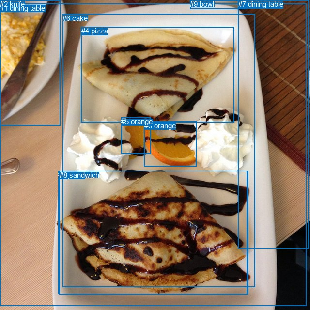
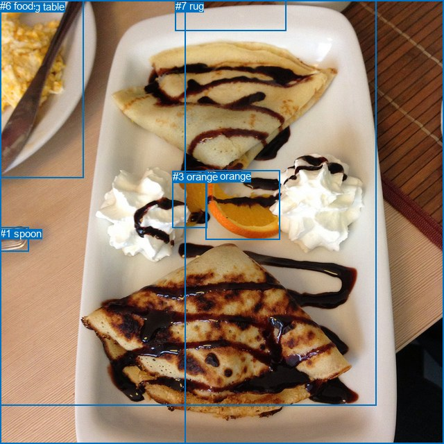

# 图片 0494：2336489.jpg

随机样本序号：56。图片 SHA256：`2ac6b4e9e1b53277db20fab701366dbfa6271d5f0749fade0c3b8cf115d085bf`。

红色框表示人，蓝色框表示其他物体。两个模式分别保留自身框编号，可依据位置比较对应对象。

## 自动检测框与输出

人的框编号：`[]`。状态：`no_person`。

### 自动检测全部物体框

| 编号 | 类别 | 是否为人 | 检测分数 | 像素坐标 xyxy |
|---|---|---|---|---|
| 0 | orange | False | 0.9860 | 297.6, 250.9, 405.6, 343.8 |
| 1 | dining table | False | 0.9648 | 0.2, 8.0, 632.8, 631.3 |
| 2 | knife | False | 0.9645 | 0.0, 0.0, 124.9, 259.9 |
| 3 | pizza | False | 0.8917 | 120.3, 352.2, 510.0, 607.9 |
| 4 | pizza | False | 0.8504 | 167.9, 55.4, 483.7, 253.0 |
| 5 | orange | False | 0.5631 | 250.2, 242.3, 311.6, 317.6 |
| 6 | cake | False | 0.5542 | 129.0, 28.6, 526.6, 592.8 |
| 7 | dining table | False | 0.4870 | 491.5, 0.0, 637.5, 513.3 |
| 8 | sandwich | False | 0.4794 | 122.8, 352.8, 512.7, 608.9 |
| 9 | bowl | False | 0.4644 | 392.4, 0.0, 508.6, 18.2 |

### 自动检测 Top50 人相关候选

评分物体对：0；人相关物体对：0；输出关系：0。

| 排名 | 主语编号与类别 | 关系 | 宾语编号与类别 | 类型 | 人与人 | 排序分数 | 原始融合 logit |
|---|---|---|---|---|---|---|---|

### 自动检测逐条人相关 GT 核验

本图没有人相关 GT，R@50 无分母；预测候选继续展示。

## 真实框与输出

人的框编号：`[]`。

### 真实框全部物体框

| 编号 | 类别 | 是否为人 | 检测分数 | 像素坐标 xyxy |
|---|---|---|---|---|
| 0 | knife | False | GT | 1.0, 0.0, 121.0, 256.0 |
| 1 | spoon | False | GT | 0.0, 328.0, 42.0, 363.0 |
| 2 | orange | False | GT | 297.0, 245.0, 404.0, 345.0 |
| 3 | orange | False | GT | 249.0, 246.0, 299.0, 328.0 |
| 4 | dining table | False | GT | 0.0, 1.0, 640.0, 640.0 |
| 5 | table | False | GT | 0.0, 0.0, 267.0, 640.0 |
| 6 | food | False | GT | 0.0, 0.0, 542.0, 584.0 |
| 7 | rug | False | GT | 253.0, 0.0, 413.0, 44.0 |

### 真实框 Top50 人相关候选

评分物体对：0；人相关物体对：0；输出关系：0。

| 排名 | 主语编号与类别 | 关系 | 宾语编号与类别 | 类型 | 人与人 | 排序分数 | 原始融合 logit |
|---|---|---|---|---|---|---|---|

### 真实框逐条人相关 GT 核验

本图没有人相关 GT，R@50 无分母；预测候选继续展示。

## 全部人相关 GT

| 主语编号与类别 | 关系 | 宾语编号与类别 |
|---|---|---|

原始记录、全部人相关物体对的两项预测与分项分数见 [逐图证据 JSON](../evidence/cases/0494.json)。全部56类 logits 保留于本机 HOR/output/random500/logits/。

<!-- HOR_COMPLETE_RESULTS -->

## 六组条件的完整输出对照

以下保留同一图片三种框与候选模式、两种谓词输出规则的全部 Top50。框编号各自在所属模式内解释。

### 自动检测框完整枚举：空间与语义各保留一个谓词

| 排名 | 主语编号与类别 | 谓词 | 宾语编号与类别 | 分组 | 排序分数 | predicate logit | pair logit |
|---|---|---|---|---|---|---|---|

没有人相关 GT，本条件的召回率无分母。

### 自动检测框完整枚举：每对只保留一个谓词

| 排名 | 主语编号与类别 | 谓词 | 宾语编号与类别 | 分组 | 排序分数 | predicate logit | pair logit |
|---|---|---|---|---|---|---|---|

没有人相关 GT，本条件的召回率无分母。

### 真实框完整枚举：空间与语义各保留一个谓词

| 排名 | 主语编号与类别 | 谓词 | 宾语编号与类别 | 分组 | 排序分数 | predicate logit | pair logit |
|---|---|---|---|---|---|---|---|

没有人相关 GT，本条件的召回率无分母。

### 真实框完整枚举：每对只保留一个谓词

| 排名 | 主语编号与类别 | 谓词 | 宾语编号与类别 | 分组 | 排序分数 | predicate logit | pair logit |
|---|---|---|---|---|---|---|---|

没有人相关 GT，本条件的召回率无分母。

### 真实框400候选：空间与语义各保留一个谓词

| 排名 | 主语编号与类别 | 谓词 | 宾语编号与类别 | 分组 | 排序分数 | predicate logit | pair logit |
|---|---|---|---|---|---|---|---|

没有人相关 GT，本条件的召回率无分母。

### 真实框400候选：每对只保留一个谓词

| 排名 | 主语编号与类别 | 谓词 | 宾语编号与类别 | 分组 | 排序分数 | predicate logit | pair logit |
|---|---|---|---|---|---|---|---|

没有人相关 GT，本条件的召回率无分母。
