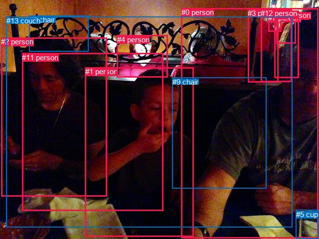
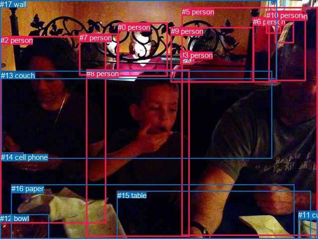

# 图片 0495：2336518.jpg

随机样本序号：293。图片 SHA256：`9fbfdb443c249bdac83b8d0c9d4120a817cdf3987a7826a90e9fcbc95b535986`。

红色框表示人，蓝色框表示其他物体。两个模式分别保留自身框编号，可依据位置比较对应对象。

## 自动检测框与输出

人的框编号：`[0, 1, 2, 3, 4, 6, 7, 10, 11, 12]`。状态：`ok`。

### 自动检测全部物体框

| 编号 | 类别 | 是否为人 | 检测分数 | 像素坐标 xyxy |
|---|---|---|---|---|
| 0 | person | True | 0.9966 | 363.7, 16.1, 638.7, 478.5 |
| 1 | person | True | 0.9906 | 170.8, 135.1, 388.5, 475.4 |
| 2 | person | True | 0.9889 | 2.4, 75.4, 214.2, 394.8 |
| 3 | person | True | 0.9351 | 497.4, 17.7, 558.0, 165.3 |
| 4 | person | True | 0.8929 | 234.5, 70.8, 336.5, 155.3 |
| 5 | cup | False | 0.8839 | 593.5, 421.7, 639.8, 479.8 |
| 6 | person | True | 0.8240 | 554.9, 22.8, 593.4, 87.5 |
| 7 | person | True | 0.8232 | 538.5, 27.5, 564.2, 63.3 |
| 8 | chair | False | 0.6836 | 58.2, 31.3, 177.9, 103.9 |
| 9 | chair | False | 0.5996 | 345.6, 155.6, 534.8, 378.3 |
| 10 | person | True | 0.5933 | 550.3, 21.6, 599.0, 156.6 |
| 11 | person | True | 0.4075 | 44.4, 106.6, 327.4, 423.8 |
| 12 | person | True | 0.3735 | 523.5, 18.4, 585.3, 164.4 |
| 13 | couch | False | 0.3500 | 12.5, 33.4, 587.0, 456.7 |

### 自动检测 Top50 人相关候选

评分物体对：182；人相关物体对：170；输出关系：50。

| 排名 | 主语编号与类别 | 关系 | 宾语编号与类别 | 类型 | 人与人 | 排序分数 | 原始融合 logit |
|---|---|---|---|---|---|---|---|
| 1 | #0 person | holding | #5 cup | semantic | False | 0.99171 | 4.7845 |
| 2 | #12 person | wearing | #7 person | semantic | True | 0.98067 | 3.9266 |
| 3 | #10 person | wearing | #6 person | semantic | True | 0.97919 | 3.8514 |
| 4 | #11 person | sitting on | #13 couch | semantic | False | 0.97046 | 3.4921 |
| 5 | #2 person | sitting on | #13 couch | semantic | False | 0.96884 | 3.4371 |
| 6 | #11 person | eating | #1 person | semantic | True | 0.96766 | 3.3985 |
| 7 | #4 person | sitting on | #13 couch | semantic | False | 0.96697 | 3.3768 |
| 8 | #3 person | wearing | #7 person | semantic | True | 0.96138 | 3.2147 |
| 9 | #1 person | sitting on | #13 couch | semantic | False | 0.95741 | 3.1125 |
| 10 | #0 person | sitting on | #13 couch | semantic | False | 0.95449 | 3.0432 |
| 11 | #1 person | eating | #0 person | semantic | True | 0.95237 | 2.9955 |
| 12 | #12 person | wearing | #6 person | semantic | True | 0.94849 | 2.9131 |
| 13 | #10 person | wearing | #7 person | semantic | True | 0.94154 | 2.7792 |
| 14 | #2 person | eating | #1 person | semantic | True | 0.94091 | 2.7678 |
| 15 | #11 person | on | #13 couch | spatial | False | 0.93964 | 2.7452 |
| 16 | #0 person | sitting on | #9 chair | semantic | False | 0.93873 | 2.7292 |
| 17 | #2 person | on | #13 couch | spatial | False | 0.93613 | 2.6850 |
| 18 | #4 person | on | #13 couch | spatial | False | 0.93362 | 2.6437 |
| 19 | #10 person | in | #6 person | spatial | True | 0.92597 | 2.5264 |
| 20 | #3 person | leaning on | #13 couch | spatial | False | 0.91978 | 2.4394 |
| 21 | #1 person | sitting on | #9 chair | semantic | False | 0.91340 | 2.3559 |
| 22 | #1 person | eating | #5 cup | semantic | False | 0.90792 | 2.2885 |
| 23 | #1 person | in | #13 couch | spatial | False | 0.90354 | 2.2371 |
| 24 | #1 person | eating | #11 person | semantic | True | 0.90330 | 2.2344 |
| 25 | #6 person | wearing | #7 person | semantic | True | 0.88743 | 2.0647 |
| 26 | #0 person | in | #13 couch | spatial | False | 0.87851 | 1.9784 |
| 27 | #12 person | leaning on | #13 couch | spatial | False | 0.87049 | 1.9053 |
| 28 | #4 person | sitting on | #9 chair | semantic | False | 0.86628 | 1.8684 |
| 29 | #6 person | on | #10 person | spatial | True | 0.86075 | 1.8215 |
| 30 | #1 person | on | #9 chair | spatial | False | 0.84709 | 1.7119 |
| 31 | #12 person | in | #7 person | spatial | True | 0.84644 | 1.7069 |
| 32 | #3 person | sitting on | #13 couch | semantic | False | 0.84345 | 1.6841 |
| 33 | #0 person | wearing | #7 person | semantic | True | 0.84228 | 1.6753 |
| 34 | #2 person | sitting on | #11 person | semantic | True | 0.84202 | 1.6733 |
| 35 | #0 person | on | #9 chair | spatial | False | 0.84185 | 1.6720 |
| 36 | #0 person | looking at | #1 person | semantic | True | 0.83573 | 1.6268 |
| 37 | #1 person | beside | #0 person | spatial | True | 0.82342 | 1.5397 |
| 38 | #0 person | wearing | #6 person | semantic | True | 0.81982 | 1.5151 |
| 39 | #12 person | sitting on | #13 couch | semantic | False | 0.81414 | 1.4771 |
| 40 | #7 person | on | #12 person | spatial | True | 0.81315 | 1.4706 |
| 41 | #4 person | looking at | #1 person | semantic | True | 0.80845 | 1.4400 |
| 42 | #2 person | beside | #1 person | spatial | True | 0.78173 | 1.2758 |
| 43 | #0 person | beside | #5 cup | spatial | False | 0.77387 | 1.2303 |
| 44 | #12 person | in | #6 person | spatial | True | 0.77343 | 1.2278 |
| 45 | #0 person | beside | #1 person | spatial | True | 0.76325 | 1.1706 |
| 46 | #3 person | in | #7 person | spatial | True | 0.75212 | 1.1100 |
| 47 | #4 person | on | #9 chair | spatial | False | 0.74430 | 1.0685 |
| 48 | #2 person | eating | #5 cup | semantic | False | 0.74201 | 1.0565 |
| 49 | #3 person | sitting on | #9 chair | semantic | False | 0.74108 | 1.0516 |
| 50 | #0 person | wearing | #10 person | semantic | True | 0.70915 | 0.8913 |

### 自动检测逐条人相关 GT 核验

R@50：0.00%；命中 0/5。

| GT 主语编号 | GT 关系 | GT 宾语编号 | 结果阶段 | 匹配预测主语编号 | 匹配预测宾语编号 |
|---|---|---|---|---|---|
| 2 | holding | 14 | endpoint_missing_or_wrong_class | [2] | [] |
| 2 | looking at | 14 | endpoint_missing_or_wrong_class | [2] | [] |
| 7 | talking to | 3 | endpoint_missing_or_wrong_class | [] | [] |
| 8 | sitting on | 13 | endpoint_missing_or_wrong_class | [1] | [] |
| 8 | looking at | 15 | endpoint_missing_or_wrong_class | [1] | [] |

## 真实框与输出

人的框编号：`[0, 1, 2, 3, 4, 5, 6, 7, 8, 9, 10]`。

### 真实框全部物体框

| 编号 | 类别 | 是否为人 | 检测分数 | 像素坐标 xyxy |
|---|---|---|---|---|
| 0 | person | True | GT | 237.0, 46.0, 337.0, 154.0 |
| 1 | person | True | GT | 541.0, 21.0, 616.0, 163.0 |
| 2 | person | True | GT | 1.0, 72.0, 213.0, 448.0 |
| 3 | person | True | GT | 363.0, 102.0, 387.0, 130.0 |
| 4 | person | True | GT | 554.0, 24.0, 591.0, 87.0 |
| 5 | person | True | GT | 366.0, 15.0, 640.0, 474.0 |
| 6 | person | True | GT | 509.0, 35.0, 558.0, 165.0 |
| 7 | person | True | GT | 160.0, 67.0, 238.0, 151.0 |
| 8 | person | True | GT | 174.0, 139.0, 382.0, 475.0 |
| 9 | person | True | GT | 344.0, 54.0, 511.0, 165.0 |
| 10 | person | True | GT | 536.0, 22.0, 566.0, 67.0 |
| 11 | cup | False | GT | 600.0, 423.0, 640.0, 480.0 |
| 12 | bowl | False | GT | 0.0, 430.0, 99.0, 480.0 |
| 13 | couch | False | GT | 2.0, 143.0, 547.0, 318.0 |
| 14 | cell phone | False | GT | 2.0, 307.0, 47.0, 323.0 |
| 15 | table | False | GT | 236.0, 384.0, 626.0, 480.0 |
| 16 | paper | False | GT | 23.0, 370.0, 593.0, 480.0 |
| 17 | wall | False | GT | 0.0, 0.0, 557.0, 158.0 |

### 真实框 Top50 人相关候选

评分物体对：306；人相关物体对：264；输出关系：50。

| 排名 | 主语编号与类别 | 关系 | 宾语编号与类别 | 类型 | 人与人 | 排序分数 | 原始融合 logit |
|---|---|---|---|---|---|---|---|
| 1 | #2 person | eating | #14 cell phone | semantic | False | 0.99339 | 5.0128 |
| 2 | #9 person | sitting on | #13 couch | semantic | False | 0.98850 | 4.4537 |
| 3 | #7 person | sitting on | #13 couch | semantic | False | 0.98564 | 4.2290 |
| 4 | #1 person | wearing | #4 person | semantic | True | 0.98501 | 4.1854 |
| 5 | #9 person | wearing | #3 person | semantic | True | 0.98481 | 4.1717 |
| 6 | #5 person | sitting on | #15 table | semantic | False | 0.97893 | 3.8385 |
| 7 | #5 person | holding | #11 cup | semantic | False | 0.97845 | 3.8157 |
| 8 | #0 person | sitting on | #13 couch | semantic | False | 0.97559 | 3.6880 |
| 9 | #7 person | leaning on | #17 wall | spatial | False | 0.97409 | 3.6270 |
| 10 | #8 person | sitting on | #16 paper | semantic | False | 0.97030 | 3.4865 |
| 11 | #8 person | sitting on | #13 couch | semantic | False | 0.96999 | 3.4759 |
| 12 | #1 person | wearing | #10 person | semantic | True | 0.96872 | 3.4331 |
| 13 | #2 person | sitting on | #13 couch | semantic | False | 0.96771 | 3.4003 |
| 14 | #7 person | leaning on | #13 couch | spatial | False | 0.95793 | 3.1255 |
| 15 | #0 person | leaning on | #13 couch | spatial | False | 0.95561 | 3.0693 |
| 16 | #9 person | leaning on | #13 couch | spatial | False | 0.95492 | 3.0531 |
| 17 | #2 person | eating | #12 bowl | semantic | False | 0.95155 | 2.9775 |
| 18 | #5 person | sitting on | #16 paper | semantic | False | 0.94791 | 2.9012 |
| 19 | #8 person | sitting on | #15 table | semantic | False | 0.94576 | 2.8586 |
| 20 | #9 person | leaning on | #17 wall | spatial | False | 0.94072 | 2.7643 |
| 21 | #0 person | leaning on | #17 wall | spatial | False | 0.93328 | 2.6382 |
| 22 | #2 person | beside | #8 person | spatial | True | 0.92759 | 2.5502 |
| 23 | #5 person | on | #15 table | spatial | False | 0.92583 | 2.5244 |
| 24 | #2 person | leaning on | #13 couch | spatial | False | 0.92303 | 2.4843 |
| 25 | #2 person | sitting on | #16 paper | semantic | False | 0.92187 | 2.4681 |
| 26 | #8 person | on | #16 paper | spatial | False | 0.91820 | 2.4182 |
| 27 | #7 person | sitting on | #17 wall | semantic | False | 0.91038 | 2.3183 |
| 28 | #8 person | beside | #2 person | spatial | True | 0.89520 | 2.1449 |
| 29 | #1 person | in | #4 person | spatial | True | 0.89437 | 2.1362 |
| 30 | #5 person | beside | #8 person | spatial | True | 0.89419 | 2.1343 |
| 31 | #3 person | on | #9 person | spatial | True | 0.88047 | 1.9969 |
| 32 | #6 person | leaning on | #17 wall | spatial | False | 0.88045 | 1.9967 |
| 33 | #5 person | looking at | #8 person | semantic | True | 0.87981 | 1.9907 |
| 34 | #8 person | beside | #5 person | spatial | True | 0.87803 | 1.9739 |
| 35 | #2 person | looking at | #8 person | semantic | True | 0.87396 | 1.9365 |
| 36 | #6 person | wearing | #10 person | semantic | True | 0.86984 | 1.8996 |
| 37 | #4 person | wearing | #10 person | semantic | True | 0.86435 | 1.8519 |
| 38 | #8 person | on | #15 table | spatial | False | 0.85480 | 1.7727 |
| 39 | #5 person | sitting on | #13 couch | semantic | False | 0.84863 | 1.7239 |
| 40 | #9 person | sitting on | #15 table | semantic | False | 0.83641 | 1.6318 |
| 41 | #2 person | on | #16 paper | spatial | False | 0.83534 | 1.6240 |
| 42 | #5 person | on | #16 paper | spatial | False | 0.83071 | 1.5907 |
| 43 | #7 person | looking at | #8 person | semantic | True | 0.82879 | 1.5770 |
| 44 | #9 person | sitting on | #17 wall | semantic | False | 0.82333 | 1.5391 |
| 45 | #5 person | wearing | #4 person | semantic | True | 0.81303 | 1.4698 |
| 46 | #8 person | leaning on | #13 couch | spatial | False | 0.81291 | 1.4690 |
| 47 | #9 person | in | #3 person | spatial | True | 0.80301 | 1.4052 |
| 48 | #8 person | eating | #12 bowl | semantic | False | 0.80163 | 1.3965 |
| 49 | #7 person | sitting on | #16 paper | semantic | False | 0.79800 | 1.3739 |
| 50 | #5 person | wearing | #10 person | semantic | True | 0.79658 | 1.3650 |

### 真实框逐条人相关 GT 核验

R@50：20.00%；命中 1/5。

| GT 主语编号 | GT 关系 | GT 宾语编号 | 结果阶段 | 匹配预测主语编号 | 匹配预测宾语编号 |
|---|---|---|---|---|---|
| 2 | holding | 14 | wrong_predicate | [2] | [14] |
| 2 | looking at | 14 | wrong_predicate | [2] | [14] |
| 7 | talking to | 3 | wrong_predicate | [7] | [3] |
| 8 | sitting on | 13 | hit50 | [8] | [13] |
| 8 | looking at | 15 | wrong_predicate | [8] | [15] |

## 全部人相关 GT

| 主语编号与类别 | 关系 | 宾语编号与类别 |
|---|---|---|
| #2 person | holding | #14 cell phone |
| #2 person | looking at | #14 cell phone |
| #7 person | talking to | #3 person |
| #8 person | sitting on | #13 couch |
| #8 person | looking at | #15 table |

原始记录、全部人相关物体对的两项预测与分项分数见 [逐图证据 JSON](../evidence/cases/0495.json)。全部56类 logits 保留于本机 HOR/output/random500/logits/。

<!-- HOR_COMPLETE_RESULTS -->

## 六组条件的完整输出对照

以下保留同一图片三种框与候选模式、两种谓词输出规则的全部 Top50。框编号各自在所属模式内解释。

### 自动检测框完整枚举：空间与语义各保留一个谓词

| 排名 | 主语编号与类别 | 谓词 | 宾语编号与类别 | 分组 | 排序分数 | predicate logit | pair logit |
|---|---|---|---|---|---|---|---|
| 1 | #0 person | holding | #5 cup | semantic | 0.9917108 | 4.8905921 | -0.1061184 |
| 2 | #12 person | wearing | #7 person | semantic | 0.9806703 | 3.9873767 | -0.0607826 |
| 3 | #10 person | wearing | #6 person | semantic | 0.9791920 | 4.0299554 | -0.1785637 |
| 4 | #11 person | sitting on | #13 couch | semantic | 0.9704635 | 3.1870084 | 0.3051387 |
| 5 | #2 person | sitting on | #13 couch | semantic | 0.9688435 | 3.1870084 | 0.2500718 |
| 6 | #11 person | eating | #1 person | semantic | 0.9676589 | 3.5961890 | -0.1976489 |
| 7 | #4 person | sitting on | #13 couch | semantic | 0.9669729 | 3.5119557 | -0.1351129 |
| 8 | #3 person | wearing | #7 person | semantic | 0.9613838 | 3.2372050 | -0.0225033 |
| 9 | #1 person | sitting on | #13 couch | semantic | 0.9574068 | 2.9252172 | 0.1873181 |
| 10 | #0 person | sitting on | #13 couch | semantic | 0.9544902 | 2.7988114 | 0.2444383 |
| 11 | #1 person | eating | #0 person | semantic | 0.9523695 | 3.4829040 | -0.4874247 |
| 12 | #12 person | wearing | #6 person | semantic | 0.9484881 | 3.0918651 | -0.1788093 |
| 13 | #10 person | wearing | #7 person | semantic | 0.9415414 | 2.8746071 | -0.0954072 |
| 14 | #2 person | eating | #1 person | semantic | 0.9409105 | 2.8340917 | -0.0662967 |
| 15 | #11 person | on | #13 couch | spatial | 0.9396420 | 2.4400663 | 0.3051387 |
| 16 | #0 person | sitting on | #9 chair | semantic | 0.9387305 | 2.8650346 | -0.1357886 |
| 17 | #2 person | on | #13 couch | spatial | 0.9361346 | 2.4349113 | 0.2500718 |
| 18 | #4 person | on | #13 couch | spatial | 0.9336211 | 2.7788033 | -0.1351129 |
| 19 | #10 person | in | #6 person | spatial | 0.9259712 | 2.7049522 | -0.1785637 |
| 20 | #3 person | leaning on | #13 couch | spatial | 0.9197831 | 2.7385716 | -0.2991686 |
| 21 | #1 person | sitting on | #9 chair | semantic | 0.9134018 | 2.5521040 | -0.1962068 |
| 22 | #1 person | eating | #5 cup | semantic | 0.9079230 | 3.2637362 | -0.9752021 |
| 23 | #1 person | in | #13 couch | spatial | 0.9035358 | 2.0498261 | 0.1873181 |
| 24 | #1 person | eating | #11 person | semantic | 0.9032991 | 2.8347349 | -0.6003043 |
| 25 | #6 person | wearing | #7 person | semantic | 0.8874295 | 2.3299575 | -0.2652085 |
| 26 | #0 person | in | #13 couch | spatial | 0.8785123 | 1.7339787 | 0.2444383 |
| 27 | #12 person | leaning on | #13 couch | spatial | 0.8704947 | 2.2941251 | -0.3887855 |
| 28 | #4 person | sitting on | #9 chair | semantic | 0.8662751 | 2.2662134 | -0.3977953 |
| 29 | #6 person | on | #10 person | spatial | 0.8607454 | 2.1827126 | -0.3612176 |
| 30 | #1 person | on | #9 chair | spatial | 0.8470888 | 1.9081554 | -0.1962068 |
| 31 | #12 person | in | #7 person | spatial | 0.8464350 | 1.7676926 | -0.0607826 |
| 32 | #3 person | sitting on | #13 couch | semantic | 0.8434502 | 1.9832950 | -0.2991686 |
| 33 | #0 person | wearing | #7 person | semantic | 0.8422824 | 1.9204884 | -0.2451790 |
| 34 | #2 person | sitting on | #11 person | semantic | 0.8420175 | 2.1066327 | -0.4333158 |
| 35 | #0 person | on | #9 chair | spatial | 0.8418480 | 1.8078318 | -0.1357886 |
| 36 | #0 person | looking at | #1 person | semantic | 0.8357283 | 1.7050018 | -0.0782198 |
| 37 | #1 person | beside | #0 person | spatial | 0.8234177 | 2.0271010 | -0.4874247 |
| 38 | #0 person | wearing | #6 person | semantic | 0.8198153 | 1.7677770 | -0.2526799 |
| 39 | #12 person | sitting on | #13 couch | semantic | 0.8141415 | 1.8659344 | -0.3887855 |
| 40 | #7 person | on | #12 person | spatial | 0.8131522 | 1.7505455 | -0.2799218 |
| 41 | #4 person | looking at | #1 person | semantic | 0.8084535 | 2.0946856 | -0.6546931 |
| 42 | #2 person | beside | #1 person | spatial | 0.7817272 | 1.3420568 | -0.0662967 |
| 43 | #0 person | beside | #5 cup | spatial | 0.7738661 | 1.3363895 | -0.1061184 |
| 44 | #12 person | in | #6 person | spatial | 0.7734312 | 1.4065976 | -0.1788093 |
| 45 | #0 person | beside | #1 person | spatial | 0.7632456 | 1.2487764 | -0.0782198 |
| 46 | #3 person | in | #7 person | spatial | 0.7521206 | 1.1324573 | -0.0225033 |
| 47 | #4 person | on | #9 chair | spatial | 0.7443043 | 1.4662571 | -0.3977953 |
| 48 | #2 person | eating | #5 cup | semantic | 0.7420119 | 1.9513073 | -0.8948553 |
| 49 | #3 person | sitting on | #9 chair | semantic | 0.7410799 | 1.4777684 | -0.4261795 |
| 50 | #0 person | wearing | #10 person | semantic | 0.7091507 | 1.1151776 | -0.2239149 |

GT 命中：0/5，R@50=0.00%。

| GT主语 | GT谓词 | GT宾语 | 结果阶段 | 匹配主语框 | 匹配宾语框 |
|---|---|---|---|---|---|
| 2 | holding | 14 | endpoint_missing_or_wrong_class | [2] | [] |
| 2 | looking at | 14 | endpoint_missing_or_wrong_class | [2] | [] |
| 7 | talking to | 3 | endpoint_missing_or_wrong_class | [] | [] |
| 8 | sitting on | 13 | endpoint_missing_or_wrong_class | [1] | [] |
| 8 | looking at | 15 | endpoint_missing_or_wrong_class | [1] | [] |

### 自动检测框完整枚举：每对只保留一个谓词

| 排名 | 主语编号与类别 | 谓词 | 宾语编号与类别 | 分组 | 排序分数 | predicate logit | pair logit |
|---|---|---|---|---|---|---|---|
| 1 | #0 person | holding | #5 cup | single | 0.9917108 | 4.8905921 | -0.1061184 |
| 2 | #12 person | wearing | #7 person | single | 0.9806703 | 3.9873767 | -0.0607826 |
| 3 | #10 person | wearing | #6 person | single | 0.9791920 | 4.0299554 | -0.1785637 |
| 4 | #11 person | sitting on | #13 couch | single | 0.9704635 | 3.1870084 | 0.3051387 |
| 5 | #2 person | sitting on | #13 couch | single | 0.9688435 | 3.1870084 | 0.2500718 |
| 6 | #11 person | eating | #1 person | single | 0.9676589 | 3.5961890 | -0.1976489 |
| 7 | #4 person | sitting on | #13 couch | single | 0.9669729 | 3.5119557 | -0.1351129 |
| 8 | #3 person | wearing | #7 person | single | 0.9613838 | 3.2372050 | -0.0225033 |
| 9 | #1 person | sitting on | #13 couch | single | 0.9574068 | 2.9252172 | 0.1873181 |
| 10 | #0 person | sitting on | #13 couch | single | 0.9544902 | 2.7988114 | 0.2444383 |
| 11 | #1 person | eating | #0 person | single | 0.9523695 | 3.4829040 | -0.4874247 |
| 12 | #12 person | wearing | #6 person | single | 0.9484881 | 3.0918651 | -0.1788093 |
| 13 | #10 person | wearing | #7 person | single | 0.9415414 | 2.8746071 | -0.0954072 |
| 14 | #2 person | eating | #1 person | single | 0.9409105 | 2.8340917 | -0.0662967 |
| 15 | #0 person | sitting on | #9 chair | single | 0.9387305 | 2.8650346 | -0.1357886 |
| 16 | #3 person | leaning on | #13 couch | single | 0.9197831 | 2.7385716 | -0.2991686 |
| 17 | #1 person | sitting on | #9 chair | single | 0.9134018 | 2.5521040 | -0.1962068 |
| 18 | #1 person | eating | #5 cup | single | 0.9079230 | 3.2637362 | -0.9752021 |
| 19 | #1 person | eating | #11 person | single | 0.9032991 | 2.8347349 | -0.6003043 |
| 20 | #6 person | wearing | #7 person | single | 0.8874295 | 2.3299575 | -0.2652085 |
| 21 | #12 person | leaning on | #13 couch | single | 0.8704947 | 2.2941251 | -0.3887855 |
| 22 | #4 person | sitting on | #9 chair | single | 0.8662751 | 2.2662134 | -0.3977953 |
| 23 | #6 person | on | #10 person | single | 0.8607454 | 2.1827126 | -0.3612176 |
| 24 | #0 person | wearing | #7 person | single | 0.8422824 | 1.9204884 | -0.2451790 |
| 25 | #2 person | sitting on | #11 person | single | 0.8420175 | 2.1066327 | -0.4333158 |
| 26 | #0 person | looking at | #1 person | single | 0.8357283 | 1.7050018 | -0.0782198 |
| 27 | #0 person | wearing | #6 person | single | 0.8198153 | 1.7677770 | -0.2526799 |
| 28 | #7 person | on | #12 person | single | 0.8131522 | 1.7505455 | -0.2799218 |
| 29 | #4 person | looking at | #1 person | single | 0.8084535 | 2.0946856 | -0.6546931 |
| 30 | #2 person | eating | #5 cup | single | 0.7420119 | 1.9513073 | -0.8948553 |
| 31 | #3 person | sitting on | #9 chair | single | 0.7410799 | 1.4777684 | -0.4261795 |
| 32 | #0 person | wearing | #10 person | single | 0.7091507 | 1.1151776 | -0.2239149 |
| 33 | #1 person | eating | #2 person | single | 0.6996396 | 1.6544175 | -0.8088353 |
| 34 | #0 person | wearing | #12 person | single | 0.6952475 | 1.0124893 | -0.1877211 |
| 35 | #12 person | sitting on | #9 chair | single | 0.6872282 | 1.3182836 | -0.5310910 |
| 36 | #10 person | wearing | #12 person | single | 0.6871913 | 0.9162745 | -0.1292536 |
| 37 | #11 person | eating | #5 cup | single | 0.6819131 | 1.6687388 | -0.9061608 |
| 38 | #1 person | eating | #4 person | single | 0.6799328 | 1.3485165 | -0.5950533 |
| 39 | #10 person | leaning on | #13 couch | single | 0.6625859 | 0.9819756 | -0.3071362 |
| 40 | #11 person | sitting on | #9 chair | single | 0.6490954 | 1.0204072 | -0.4053420 |
| 41 | #0 person | wearing | #3 person | single | 0.6443041 | 0.8018503 | -0.2077557 |
| 42 | #3 person | wearing | #12 person | single | 0.6379583 | 0.6770477 | -0.1105343 |
| 43 | #2 person | sitting on | #9 chair | single | 0.6262794 | 1.0053377 | -0.4890498 |
| 44 | #7 person | on | #3 person | single | 0.6222556 | 0.7704225 | -0.2712894 |
| 45 | #12 person | wearing | #10 person | single | 0.6202103 | 0.7261734 | -0.2357321 |
| 46 | #3 person | wearing | #6 person | single | 0.6148022 | 0.6337905 | -0.1662467 |
| 47 | #6 person | wearing | #12 person | single | 0.6001851 | 0.6833758 | -0.2771394 |
| 48 | #3 person | looking at | #1 person | single | 0.5941046 | 1.2699103 | -0.8889502 |
| 49 | #11 person | holding | #2 person | single | 0.5858502 | 1.2053170 | -0.8584805 |
| 50 | #12 person | wearing | #3 person | single | 0.5532578 | 0.3224998 | -0.1086576 |

GT 命中：0/5，R@50=0.00%。

| GT主语 | GT谓词 | GT宾语 | 结果阶段 | 匹配主语框 | 匹配宾语框 |
|---|---|---|---|---|---|
| 2 | holding | 14 | endpoint_missing_or_wrong_class | [2] | [] |
| 2 | looking at | 14 | endpoint_missing_or_wrong_class | [2] | [] |
| 7 | talking to | 3 | endpoint_missing_or_wrong_class | [] | [] |
| 8 | sitting on | 13 | endpoint_missing_or_wrong_class | [1] | [] |
| 8 | looking at | 15 | endpoint_missing_or_wrong_class | [1] | [] |

### 真实框完整枚举：空间与语义各保留一个谓词

| 排名 | 主语编号与类别 | 谓词 | 宾语编号与类别 | 分组 | 排序分数 | predicate logit | pair logit |
|---|---|---|---|---|---|---|---|
| 1 | #2 person | eating | #14 cell phone | semantic | 0.9933918 | 4.7396560 | 0.2731540 |
| 2 | #9 person | sitting on | #13 couch | semantic | 0.9884983 | 4.0446172 | 0.4090729 |
| 3 | #7 person | sitting on | #13 couch | semantic | 0.9856421 | 4.0386090 | 0.1903869 |
| 4 | #1 person | wearing | #4 person | semantic | 0.9850119 | 4.3058934 | -0.1204923 |
| 5 | #9 person | wearing | #3 person | semantic | 0.9848080 | 4.0004706 | 0.1712025 |
| 6 | #5 person | sitting on | #15 table | semantic | 0.9789276 | 3.6865268 | 0.1519669 |
| 7 | #5 person | holding | #11 cup | semantic | 0.9784524 | 3.8825994 | -0.0668939 |
| 8 | #0 person | sitting on | #13 couch | semantic | 0.9755896 | 3.5932012 | 0.0948311 |
| 9 | #7 person | leaning on | #17 wall | spatial | 0.9740922 | 4.2037177 | -0.5767578 |
| 10 | #8 person | sitting on | #16 paper | semantic | 0.9703003 | 3.2893801 | 0.1970871 |
| 11 | #8 person | sitting on | #13 couch | semantic | 0.9699947 | 3.4458604 | 0.0300567 |
| 12 | #1 person | wearing | #10 person | semantic | 0.9687246 | 3.5381179 | -0.1049689 |
| 13 | #2 person | sitting on | #13 couch | semantic | 0.9677135 | 3.3676200 | 0.0326652 |
| 14 | #7 person | leaning on | #13 couch | spatial | 0.9579309 | 2.9350753 | 0.1903869 |
| 15 | #0 person | leaning on | #13 couch | spatial | 0.9556095 | 2.9744930 | 0.0948311 |
| 16 | #9 person | leaning on | #13 couch | spatial | 0.9549173 | 2.6440511 | 0.4090729 |
| 17 | #2 person | eating | #12 bowl | semantic | 0.9515457 | 3.2814364 | -0.3039709 |
| 18 | #5 person | sitting on | #16 paper | semantic | 0.9479051 | 2.9011502 | 0.0000358 |
| 19 | #8 person | sitting on | #15 table | semantic | 0.9457616 | 2.8409996 | 0.0176005 |
| 20 | #9 person | leaning on | #17 wall | spatial | 0.9407161 | 3.4943814 | -0.7300772 |
| 21 | #0 person | leaning on | #17 wall | spatial | 0.9332790 | 3.3730273 | -0.7348427 |
| 22 | #2 person | beside | #8 person | spatial | 0.9275870 | 2.6640482 | -0.1138469 |
| 23 | #5 person | on | #15 table | spatial | 0.9258333 | 2.3724122 | 0.1519669 |
| 24 | #2 person | leaning on | #13 couch | spatial | 0.9230340 | 2.4516377 | 0.0326652 |
| 25 | #2 person | sitting on | #16 paper | semantic | 0.9218743 | 2.4407520 | 0.0273381 |
| 26 | #8 person | on | #16 paper | spatial | 0.9182049 | 2.2211161 | 0.1970871 |
| 27 | #7 person | sitting on | #17 wall | semantic | 0.9103830 | 2.8950782 | -0.5767578 |
| 28 | #8 person | beside | #2 person | spatial | 0.8951957 | 2.8732991 | -0.7283515 |
| 29 | #1 person | in | #4 person | spatial | 0.8943710 | 2.2566805 | -0.1204923 |
| 30 | #5 person | beside | #8 person | spatial | 0.8941882 | 2.2093253 | -0.0750702 |
| 31 | #3 person | on | #9 person | spatial | 0.8804694 | 2.3248568 | -0.3279737 |
| 32 | #6 person | leaning on | #17 wall | spatial | 0.8804529 | 3.0172362 | -1.0205098 |
| 33 | #5 person | looking at | #8 person | semantic | 0.8798149 | 2.0657487 | -0.0750702 |
| 34 | #8 person | beside | #5 person | spatial | 0.8780298 | 2.5112209 | -0.5373174 |
| 35 | #2 person | looking at | #8 person | semantic | 0.8739619 | 2.0502996 | -0.1138469 |
| 36 | #6 person | wearing | #10 person | semantic | 0.8698444 | 2.0899792 | -0.1903953 |
| 37 | #4 person | wearing | #10 person | semantic | 0.8643525 | 2.1567812 | -0.3048601 |
| 38 | #8 person | on | #15 table | spatial | 0.8547958 | 1.7551212 | 0.0176005 |
| 39 | #5 person | sitting on | #13 couch | semantic | 0.8486344 | 1.9803867 | -0.2564566 |
| 40 | #9 person | sitting on | #15 table | semantic | 0.8364101 | 2.0796571 | -0.4479008 |
| 41 | #2 person | on | #16 paper | spatial | 0.8353434 | 1.5966430 | 0.0273381 |
| 42 | #5 person | on | #16 paper | spatial | 0.8307082 | 1.5906191 | 0.0000358 |
| 43 | #7 person | looking at | #8 person | semantic | 0.8287850 | 2.0484481 | -0.4714075 |
| 44 | #9 person | sitting on | #17 wall | semantic | 0.8233304 | 2.2691536 | -0.7300772 |
| 45 | #5 person | wearing | #4 person | semantic | 0.8130299 | 1.7032304 | -0.2334109 |
| 46 | #8 person | leaning on | #13 couch | spatial | 0.8129119 | 1.4389858 | 0.0300567 |
| 47 | #9 person | in | #3 person | spatial | 0.8030086 | 1.2340031 | 0.1712025 |
| 48 | #8 person | eating | #12 bowl | semantic | 0.8016286 | 1.7483921 | -0.3518876 |
| 49 | #7 person | sitting on | #16 paper | semantic | 0.7980043 | 1.9713416 | -0.5974742 |
| 50 | #5 person | wearing | #10 person | semantic | 0.7965785 | 1.6313114 | -0.2662660 |

GT 命中：1/5，R@50=20.00%。

| GT主语 | GT谓词 | GT宾语 | 结果阶段 | 匹配主语框 | 匹配宾语框 |
|---|---|---|---|---|---|
| 2 | holding | 14 | wrong_predicate | [2] | [14] |
| 2 | looking at | 14 | wrong_predicate | [2] | [14] |
| 7 | talking to | 3 | wrong_predicate | [7] | [3] |
| 8 | sitting on | 13 | hit50 | [8] | [13] |
| 8 | looking at | 15 | wrong_predicate | [8] | [15] |

### 真实框完整枚举：每对只保留一个谓词

| 排名 | 主语编号与类别 | 谓词 | 宾语编号与类别 | 分组 | 排序分数 | predicate logit | pair logit |
|---|---|---|---|---|---|---|---|
| 1 | #2 person | eating | #14 cell phone | single | 0.9933918 | 4.7396560 | 0.2731540 |
| 2 | #9 person | sitting on | #13 couch | single | 0.9884983 | 4.0446172 | 0.4090729 |
| 3 | #7 person | sitting on | #13 couch | single | 0.9856421 | 4.0386090 | 0.1903869 |
| 4 | #1 person | wearing | #4 person | single | 0.9850119 | 4.3058934 | -0.1204923 |
| 5 | #9 person | wearing | #3 person | single | 0.9848080 | 4.0004706 | 0.1712025 |
| 6 | #5 person | sitting on | #15 table | single | 0.9789276 | 3.6865268 | 0.1519669 |
| 7 | #5 person | holding | #11 cup | single | 0.9784524 | 3.8825994 | -0.0668939 |
| 8 | #0 person | sitting on | #13 couch | single | 0.9755896 | 3.5932012 | 0.0948311 |
| 9 | #7 person | leaning on | #17 wall | single | 0.9740922 | 4.2037177 | -0.5767578 |
| 10 | #8 person | sitting on | #16 paper | single | 0.9703003 | 3.2893801 | 0.1970871 |
| 11 | #8 person | sitting on | #13 couch | single | 0.9699947 | 3.4458604 | 0.0300567 |
| 12 | #1 person | wearing | #10 person | single | 0.9687246 | 3.5381179 | -0.1049689 |
| 13 | #2 person | sitting on | #13 couch | single | 0.9677135 | 3.3676200 | 0.0326652 |
| 14 | #2 person | eating | #12 bowl | single | 0.9515457 | 3.2814364 | -0.3039709 |
| 15 | #5 person | sitting on | #16 paper | single | 0.9479051 | 2.9011502 | 0.0000358 |
| 16 | #8 person | sitting on | #15 table | single | 0.9457616 | 2.8409996 | 0.0176005 |
| 17 | #9 person | leaning on | #17 wall | single | 0.9407161 | 3.4943814 | -0.7300772 |
| 18 | #0 person | leaning on | #17 wall | single | 0.9332790 | 3.3730273 | -0.7348427 |
| 19 | #2 person | beside | #8 person | single | 0.9275870 | 2.6640482 | -0.1138469 |
| 20 | #2 person | sitting on | #16 paper | single | 0.9218743 | 2.4407520 | 0.0273381 |
| 21 | #8 person | beside | #2 person | single | 0.8951957 | 2.8732991 | -0.7283515 |
| 22 | #5 person | beside | #8 person | single | 0.8941882 | 2.2093253 | -0.0750702 |
| 23 | #3 person | on | #9 person | single | 0.8804694 | 2.3248568 | -0.3279737 |
| 24 | #6 person | leaning on | #17 wall | single | 0.8804529 | 3.0172362 | -1.0205098 |
| 25 | #8 person | beside | #5 person | single | 0.8780298 | 2.5112209 | -0.5373174 |
| 26 | #6 person | wearing | #10 person | single | 0.8698444 | 2.0899792 | -0.1903953 |
| 27 | #4 person | wearing | #10 person | single | 0.8643525 | 2.1567812 | -0.3048601 |
| 28 | #5 person | sitting on | #13 couch | single | 0.8486344 | 1.9803867 | -0.2564566 |
| 29 | #9 person | sitting on | #15 table | single | 0.8364101 | 2.0796571 | -0.4479008 |
| 30 | #7 person | looking at | #8 person | single | 0.8287850 | 2.0484481 | -0.4714075 |
| 31 | #5 person | wearing | #4 person | single | 0.8130299 | 1.7032304 | -0.2334109 |
| 32 | #8 person | eating | #12 bowl | single | 0.8016286 | 1.7483921 | -0.3518876 |
| 33 | #7 person | sitting on | #16 paper | single | 0.7980043 | 1.9713416 | -0.5974742 |
| 34 | #5 person | wearing | #10 person | single | 0.7965785 | 1.6313114 | -0.2662660 |
| 35 | #6 person | leaning on | #13 couch | single | 0.7922397 | 1.7924619 | -0.4539830 |
| 36 | #3 person | on | #13 couch | single | 0.7822170 | 1.1831269 | 0.0955063 |
| 37 | #0 person | looking at | #8 person | single | 0.7789733 | 1.8308363 | -0.5711432 |
| 38 | #8 person | eating | #14 cell phone | single | 0.7731538 | 1.6833825 | -0.4571767 |
| 39 | #9 person | sitting on | #16 paper | single | 0.7640823 | 1.5771351 | -0.4019427 |
| 40 | #1 person | leaning on | #13 couch | single | 0.7602280 | 1.3835444 | -0.2296147 |
| 41 | #10 person | wearing | #4 person | single | 0.7548341 | 1.4484363 | -0.3238734 |
| 42 | #2 person | sitting on | #15 table | single | 0.7507259 | 1.3273606 | -0.2248733 |
| 43 | #3 person | hanging from | #17 wall | single | 0.7503474 | 1.8626227 | -0.7621567 |
| 44 | #5 person | wearing | #3 person | single | 0.7236245 | 1.6496673 | -0.6871554 |
| 45 | #10 person | leaning on | #17 wall | single | 0.7203335 | 1.9576826 | -1.0115659 |
| 46 | #5 person | wearing | #1 person | single | 0.7177578 | 1.2156835 | -0.2823167 |
| 47 | #9 person | looking at | #8 person | single | 0.7055168 | 1.3690085 | -0.4953004 |
| 48 | #0 person | sitting on | #16 paper | single | 0.7019094 | 1.3845706 | -0.5281639 |
| 49 | #1 person | sitting on | #15 table | single | 0.6992748 | 1.4085732 | -0.5647263 |
| 50 | #7 person | eating | #14 cell phone | single | 0.6874338 | 1.7113819 | -0.9232327 |

GT 命中：1/5，R@50=20.00%。

| GT主语 | GT谓词 | GT宾语 | 结果阶段 | 匹配主语框 | 匹配宾语框 |
|---|---|---|---|---|---|
| 2 | holding | 14 | wrong_predicate | [2] | [14] |
| 2 | looking at | 14 | wrong_predicate | [2] | [14] |
| 7 | talking to | 3 | wrong_predicate | [7] | [3] |
| 8 | sitting on | 13 | hit50 | [8] | [13] |
| 8 | looking at | 15 | wrong_predicate | [8] | [15] |

### 真实框400候选：空间与语义各保留一个谓词

| 排名 | 主语编号与类别 | 谓词 | 宾语编号与类别 | 分组 | 排序分数 | predicate logit | pair logit |
|---|---|---|---|---|---|---|---|
| 1 | #2 person | eating | #14 cell phone | semantic | 0.9937513 | 4.7959771 | 0.2731540 |
| 2 | #9 person | sitting on | #13 couch | semantic | 0.9882563 | 4.0235553 | 0.4090729 |
| 3 | #7 person | sitting on | #13 couch | semantic | 0.9853843 | 4.0205512 | 0.1903869 |
| 4 | #1 person | wearing | #4 person | semantic | 0.9850119 | 4.3058934 | -0.1204923 |
| 5 | #9 person | wearing | #3 person | semantic | 0.9848080 | 4.0004706 | 0.1712025 |
| 6 | #5 person | sitting on | #15 table | semantic | 0.9789276 | 3.6865268 | 0.1519669 |
| 7 | #5 person | holding | #11 cup | semantic | 0.9785146 | 3.8855538 | -0.0668939 |
| 8 | #0 person | sitting on | #13 couch | semantic | 0.9755896 | 3.5932012 | 0.0948311 |
| 9 | #7 person | leaning on | #17 wall | spatial | 0.9755211 | 4.2619224 | -0.5767578 |
| 10 | #8 person | sitting on | #16 paper | semantic | 0.9703003 | 3.2893801 | 0.1970871 |
| 11 | #8 person | sitting on | #13 couch | semantic | 0.9699947 | 3.4458604 | 0.0300567 |
| 12 | #1 person | wearing | #10 person | semantic | 0.9685463 | 3.5322499 | -0.1049689 |
| 13 | #2 person | sitting on | #13 couch | semantic | 0.9677135 | 3.3676200 | 0.0326652 |
| 14 | #7 person | leaning on | #13 couch | spatial | 0.9579707 | 2.9360647 | 0.1903869 |
| 15 | #0 person | leaning on | #13 couch | spatial | 0.9556095 | 2.9744930 | 0.0948311 |
| 16 | #9 person | leaning on | #13 couch | spatial | 0.9549173 | 2.6440511 | 0.4090729 |
| 17 | #2 person | eating | #12 bowl | semantic | 0.9514565 | 3.2795053 | -0.3039709 |
| 18 | #5 person | sitting on | #16 paper | semantic | 0.9479051 | 2.9011502 | 0.0000358 |
| 19 | #9 person | leaning on | #17 wall | spatial | 0.9438801 | 3.5525870 | -0.7300772 |
| 20 | #8 person | sitting on | #15 table | semantic | 0.9437194 | 2.8018794 | 0.0176005 |
| 21 | #0 person | leaning on | #17 wall | spatial | 0.9333405 | 3.3740163 | -0.7348427 |
| 22 | #2 person | beside | #8 person | spatial | 0.9295748 | 2.6940236 | -0.1138469 |
| 23 | #5 person | on | #15 table | spatial | 0.9258333 | 2.3724122 | 0.1519669 |
| 24 | #2 person | leaning on | #13 couch | spatial | 0.9230340 | 2.4516377 | 0.0326652 |
| 25 | #2 person | sitting on | #16 paper | semantic | 0.9218743 | 2.4407520 | 0.0273381 |
| 26 | #8 person | on | #16 paper | spatial | 0.9182049 | 2.2211161 | 0.1970871 |
| 27 | #7 person | sitting on | #17 wall | semantic | 0.9103830 | 2.8950782 | -0.5767578 |
| 28 | #8 person | beside | #2 person | spatial | 0.8979855 | 2.9033904 | -0.7283515 |
| 29 | #5 person | beside | #8 person | spatial | 0.8969858 | 2.2392430 | -0.0750702 |
| 30 | #1 person | in | #4 person | spatial | 0.8943710 | 2.2566805 | -0.1204923 |
| 31 | #5 person | looking at | #8 person | semantic | 0.8828885 | 2.0951424 | -0.0750702 |
| 32 | #3 person | on | #9 person | spatial | 0.8804694 | 2.3248568 | -0.3279737 |
| 33 | #6 person | leaning on | #17 wall | spatial | 0.8804529 | 3.0172362 | -1.0205098 |
| 34 | #8 person | beside | #5 person | spatial | 0.8780236 | 2.5111628 | -0.5373174 |
| 35 | #2 person | looking at | #8 person | semantic | 0.8772019 | 2.0800424 | -0.1138469 |
| 36 | #6 person | wearing | #10 person | semantic | 0.8691786 | 2.0841112 | -0.1903953 |
| 37 | #4 person | wearing | #10 person | semantic | 0.8643525 | 2.1567812 | -0.3048601 |
| 38 | #8 person | on | #15 table | spatial | 0.8541188 | 1.7496767 | 0.0176005 |
| 39 | #5 person | sitting on | #13 couch | semantic | 0.8486344 | 1.9803867 | -0.2564566 |
| 40 | #9 person | sitting on | #15 table | semantic | 0.8364101 | 2.0796571 | -0.4479008 |
| 41 | #5 person | on | #16 paper | spatial | 0.8307082 | 1.5906191 | 0.0000358 |
| 42 | #2 person | on | #16 paper | spatial | 0.8299931 | 1.5582399 | 0.0273381 |
| 43 | #7 person | looking at | #8 person | semantic | 0.8287850 | 2.0484481 | -0.4714075 |
| 44 | #9 person | sitting on | #17 wall | semantic | 0.8202460 | 2.2480922 | -0.7300772 |
| 45 | #5 person | wearing | #4 person | semantic | 0.8134755 | 1.7061644 | -0.2334109 |
| 46 | #8 person | leaning on | #13 couch | spatial | 0.8129119 | 1.4389858 | 0.0300567 |
| 47 | #9 person | in | #3 person | spatial | 0.8066923 | 1.2574568 | 0.1712025 |
| 48 | #8 person | eating | #12 bowl | semantic | 0.8014750 | 1.7474265 | -0.3518876 |
| 49 | #5 person | wearing | #10 person | semantic | 0.8004754 | 1.6555347 | -0.2662660 |
| 50 | #7 person | sitting on | #16 paper | semantic | 0.7980043 | 1.9713416 | -0.5974742 |

GT 命中：1/5，R@50=20.00%。

| GT主语 | GT谓词 | GT宾语 | 结果阶段 | 匹配主语框 | 匹配宾语框 |
|---|---|---|---|---|---|
| 2 | holding | 14 | wrong_predicate | [2] | [14] |
| 2 | looking at | 14 | wrong_predicate | [2] | [14] |
| 7 | talking to | 3 | wrong_predicate | [7] | [3] |
| 8 | sitting on | 13 | hit50 | [8] | [13] |
| 8 | looking at | 15 | wrong_predicate | [8] | [15] |

### 真实框400候选：每对只保留一个谓词

| 排名 | 主语编号与类别 | 谓词 | 宾语编号与类别 | 分组 | 排序分数 | predicate logit | pair logit |
|---|---|---|---|---|---|---|---|
| 1 | #2 person | eating | #14 cell phone | single | 0.9937513 | 4.7959771 | 0.2731540 |
| 2 | #9 person | sitting on | #13 couch | single | 0.9882563 | 4.0235553 | 0.4090729 |
| 3 | #7 person | sitting on | #13 couch | single | 0.9853843 | 4.0205512 | 0.1903869 |
| 4 | #1 person | wearing | #4 person | single | 0.9850119 | 4.3058934 | -0.1204923 |
| 5 | #9 person | wearing | #3 person | single | 0.9848080 | 4.0004706 | 0.1712025 |
| 6 | #5 person | sitting on | #15 table | single | 0.9789276 | 3.6865268 | 0.1519669 |
| 7 | #5 person | holding | #11 cup | single | 0.9785146 | 3.8855538 | -0.0668939 |
| 8 | #0 person | sitting on | #13 couch | single | 0.9755896 | 3.5932012 | 0.0948311 |
| 9 | #7 person | leaning on | #17 wall | single | 0.9755211 | 4.2619224 | -0.5767578 |
| 10 | #8 person | sitting on | #16 paper | single | 0.9703003 | 3.2893801 | 0.1970871 |
| 11 | #8 person | sitting on | #13 couch | single | 0.9699947 | 3.4458604 | 0.0300567 |
| 12 | #1 person | wearing | #10 person | single | 0.9685463 | 3.5322499 | -0.1049689 |
| 13 | #2 person | sitting on | #13 couch | single | 0.9677135 | 3.3676200 | 0.0326652 |
| 14 | #2 person | eating | #12 bowl | single | 0.9514565 | 3.2795053 | -0.3039709 |
| 15 | #5 person | sitting on | #16 paper | single | 0.9479051 | 2.9011502 | 0.0000358 |
| 16 | #9 person | leaning on | #17 wall | single | 0.9438801 | 3.5525870 | -0.7300772 |
| 17 | #8 person | sitting on | #15 table | single | 0.9437194 | 2.8018794 | 0.0176005 |
| 18 | #0 person | leaning on | #17 wall | single | 0.9333405 | 3.3740163 | -0.7348427 |
| 19 | #2 person | beside | #8 person | single | 0.9295748 | 2.6940236 | -0.1138469 |
| 20 | #2 person | sitting on | #16 paper | single | 0.9218743 | 2.4407520 | 0.0273381 |
| 21 | #8 person | beside | #2 person | single | 0.8979855 | 2.9033904 | -0.7283515 |
| 22 | #5 person | beside | #8 person | single | 0.8969858 | 2.2392430 | -0.0750702 |
| 23 | #3 person | on | #9 person | single | 0.8804694 | 2.3248568 | -0.3279737 |
| 24 | #6 person | leaning on | #17 wall | single | 0.8804529 | 3.0172362 | -1.0205098 |
| 25 | #8 person | beside | #5 person | single | 0.8780236 | 2.5111628 | -0.5373174 |
| 26 | #6 person | wearing | #10 person | single | 0.8691786 | 2.0841112 | -0.1903953 |
| 27 | #4 person | wearing | #10 person | single | 0.8643525 | 2.1567812 | -0.3048601 |
| 28 | #5 person | sitting on | #13 couch | single | 0.8486344 | 1.9803867 | -0.2564566 |
| 29 | #9 person | sitting on | #15 table | single | 0.8364101 | 2.0796571 | -0.4479008 |
| 30 | #7 person | looking at | #8 person | single | 0.8287850 | 2.0484481 | -0.4714075 |
| 31 | #5 person | wearing | #4 person | single | 0.8134755 | 1.7061644 | -0.2334109 |
| 32 | #8 person | eating | #12 bowl | single | 0.8014750 | 1.7474265 | -0.3518876 |
| 33 | #5 person | wearing | #10 person | single | 0.8004754 | 1.6555347 | -0.2662660 |
| 34 | #7 person | sitting on | #16 paper | single | 0.7980043 | 1.9713416 | -0.5974742 |
| 35 | #6 person | leaning on | #13 couch | single | 0.7923211 | 1.7929568 | -0.4539830 |
| 36 | #3 person | on | #13 couch | single | 0.7831432 | 1.1885715 | 0.0955063 |
| 37 | #0 person | looking at | #8 person | single | 0.7738709 | 1.8014426 | -0.5711432 |
| 38 | #8 person | eating | #14 cell phone | single | 0.7685206 | 1.6571531 | -0.4571767 |
| 39 | #10 person | wearing | #4 person | single | 0.7647459 | 1.5027509 | -0.3238734 |
| 40 | #9 person | sitting on | #16 paper | single | 0.7602645 | 1.5560727 | -0.4019427 |
| 41 | #1 person | leaning on | #13 couch | single | 0.7602280 | 1.3835444 | -0.2296147 |
| 42 | #3 person | hanging from | #17 wall | single | 0.7559416 | 1.8927135 | -0.7621567 |
| 43 | #2 person | sitting on | #15 table | single | 0.7467636 | 1.3062983 | -0.2248733 |
| 44 | #5 person | wearing | #3 person | single | 0.7236245 | 1.6496673 | -0.6871554 |
| 45 | #10 person | leaning on | #17 wall | single | 0.7203335 | 1.9576826 | -1.0115659 |
| 46 | #5 person | wearing | #1 person | single | 0.7177578 | 1.2156835 | -0.2823167 |
| 47 | #0 person | sitting on | #16 paper | single | 0.7100293 | 1.4236903 | -0.5281639 |
| 48 | #9 person | looking at | #8 person | single | 0.7055168 | 1.3690085 | -0.4953004 |
| 49 | #1 person | sitting on | #15 table | single | 0.7030584 | 1.4266310 | -0.5647263 |
| 50 | #7 person | eating | #14 cell phone | single | 0.6870187 | 1.7094507 | -0.9232327 |

GT 命中：1/5，R@50=20.00%。

| GT主语 | GT谓词 | GT宾语 | 结果阶段 | 匹配主语框 | 匹配宾语框 |
|---|---|---|---|---|---|
| 2 | holding | 14 | wrong_predicate | [2] | [14] |
| 2 | looking at | 14 | wrong_predicate | [2] | [14] |
| 7 | talking to | 3 | wrong_predicate | [7] | [3] |
| 8 | sitting on | 13 | hit50 | [8] | [13] |
| 8 | looking at | 15 | wrong_predicate | [8] | [15] |
