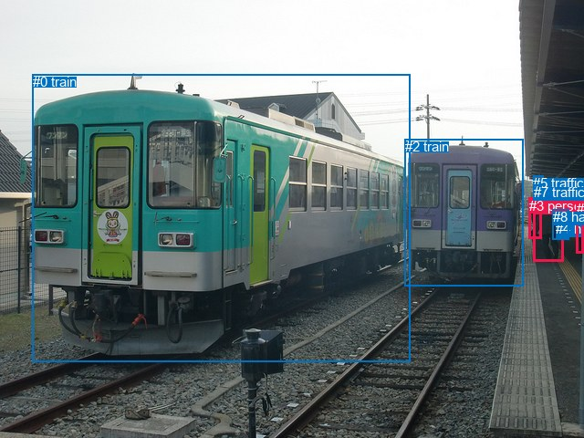
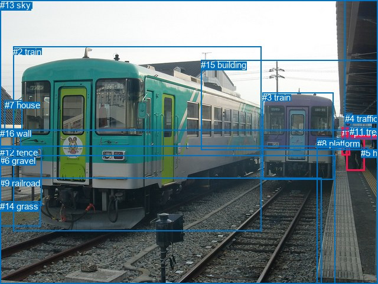

# 图片 0496：2336634.jpg

随机样本序号：359。图片 SHA256：`36f56bd366552bab4f5d65d93f594de7c2dd3098e637dcf71262880d91b36ede`。

红色框表示人，蓝色框表示其他物体。两个模式分别保留自身框编号，可依据位置比较对应对象。

## 自动检测框与输出

人的框编号：`[1, 3, 6]`。状态：`ok`。

### 自动检测全部物体框

| 编号 | 类别 | 是否为人 | 检测分数 | 像素坐标 xyxy |
|---|---|---|---|---|
| 0 | train | False | 0.9996 | 35.8, 81.5, 449.5, 396.1 |
| 1 | person | True | 0.9989 | 585.0, 217.1, 618.0, 286.3 |
| 2 | train | False | 0.9986 | 443.7, 152.2, 573.4, 313.6 |
| 3 | person | True | 0.9912 | 579.8, 216.8, 593.1, 261.3 |
| 4 | handbag | False | 0.9267 | 609.5, 242.5, 623.4, 261.6 |
| 5 | traffic light | False | 0.8691 | 584.3, 192.2, 595.7, 214.9 |
| 6 | person | True | 0.6753 | 631.5, 220.4, 640.0, 277.8 |
| 7 | traffic light | False | 0.5893 | 584.8, 202.4, 593.9, 213.8 |
| 8 | handbag | False | 0.4886 | 605.6, 229.0, 623.0, 262.0 |

### 自动检测 Top50 人相关候选

评分物体对：72；人相关物体对：42；输出关系：50。

| 排名 | 主语编号与类别 | 关系 | 宾语编号与类别 | 类型 | 人与人 | 排序分数 | 原始融合 logit |
|---|---|---|---|---|---|---|---|
| 1 | #1 person | carrying | #4 handbag | semantic | False | 0.97499 | 3.6630 |
| 2 | #1 person | carrying | #8 handbag | semantic | False | 0.96675 | 3.3700 |
| 3 | #1 person | beside | #2 train | spatial | False | 0.95421 | 3.0369 |
| 4 | #3 person | beside | #2 train | spatial | False | 0.93843 | 2.7241 |
| 5 | #1 person | entering | #2 train | semantic | False | 0.93232 | 2.6230 |
| 6 | #6 person | beside | #2 train | spatial | False | 0.88508 | 2.0415 |
| 7 | #3 person | entering | #2 train | semantic | False | 0.87974 | 1.9900 |
| 8 | #6 person | looking at | #0 train | semantic | False | 0.84005 | 1.6586 |
| 9 | #6 person | walking on | #2 train | semantic | False | 0.83431 | 1.6165 |
| 10 | #1 person | walking on | #0 train | semantic | False | 0.78742 | 1.3094 |
| 11 | #1 person | beside | #8 handbag | spatial | False | 0.77924 | 1.2612 |
| 12 | #1 person | beside | #0 train | spatial | False | 0.77805 | 1.2543 |
| 13 | #6 person | beside | #0 train | spatial | False | 0.77708 | 1.2487 |
| 14 | #3 person | beside | #0 train | spatial | False | 0.73706 | 1.0308 |
| 15 | #3 person | walking on | #0 train | semantic | False | 0.67605 | 0.7357 |
| 16 | #1 person | beside | #6 person | spatial | True | 0.67423 | 0.7274 |
| 17 | #1 person | carrying | #3 person | semantic | True | 0.61936 | 0.4868 |
| 18 | #3 person | beside | #1 person | spatial | True | 0.59899 | 0.4013 |
| 19 | #6 person | carrying | #4 handbag | semantic | False | 0.58372 | 0.3381 |
| 20 | #1 person | beside | #4 handbag | spatial | False | 0.57629 | 0.3076 |
| 21 | #3 person | walking on | #1 person | semantic | True | 0.57156 | 0.2882 |
| 22 | #1 person | beside | #3 person | spatial | True | 0.54678 | 0.1877 |
| 23 | #1 person | walking on | #6 person | semantic | True | 0.51718 | 0.0688 |
| 24 | #0 train | pulling | #1 person | semantic | False | 0.50141 | 0.0057 |
| 25 | #3 person | beside | #8 handbag | spatial | False | 0.48018 | -0.0793 |
| 26 | #0 train | pulling | #6 person | semantic | False | 0.43785 | -0.2499 |
| 27 | #4 handbag | carrying | #1 person | semantic | False | 0.42567 | -0.2995 |
| 28 | #0 train | beside | #6 person | spatial | False | 0.35485 | -0.5978 |
| 29 | #5 traffic light | pushing | #6 person | semantic | False | 0.34508 | -0.6407 |
| 30 | #8 handbag | carrying | #1 person | semantic | False | 0.34412 | -0.6450 |
| 31 | #8 handbag | beside | #6 person | spatial | False | 0.33564 | -0.6828 |
| 32 | #3 person | walking on | #8 handbag | semantic | False | 0.33014 | -0.7075 |
| 33 | #3 person | pushing | #4 handbag | semantic | False | 0.32415 | -0.7348 |
| 34 | #6 person | beside | #8 handbag | spatial | False | 0.30282 | -0.8339 |
| 35 | #6 person | walking on | #1 person | semantic | True | 0.30267 | -0.8346 |
| 36 | #3 person | beside | #4 handbag | spatial | False | 0.30077 | -0.8437 |
| 37 | #5 traffic light | pushing | #1 person | semantic | False | 0.27930 | -0.9479 |
| 38 | #7 traffic light | pushing | #6 person | semantic | False | 0.27305 | -0.9792 |
| 39 | #6 person | carrying | #8 handbag | semantic | False | 0.25889 | -1.0518 |
| 40 | #2 train | beside | #1 person | spatial | False | 0.25325 | -1.0814 |
| 41 | #5 traffic light | beside | #1 person | spatial | False | 0.25302 | -1.0825 |
| 42 | #7 traffic light | beside | #1 person | spatial | False | 0.24454 | -1.1280 |
| 43 | #6 person | beside | #1 person | spatial | True | 0.23548 | -1.1776 |
| 44 | #1 person | looking at | #7 traffic light | semantic | False | 0.22959 | -1.2106 |
| 45 | #6 person | beside | #4 handbag | spatial | False | 0.22676 | -1.2267 |
| 46 | #3 person | beside | #5 traffic light | spatial | False | 0.22641 | -1.2287 |
| 47 | #3 person | looking at | #7 traffic light | semantic | False | 0.21879 | -1.2727 |
| 48 | #1 person | beside | #5 traffic light | spatial | False | 0.21678 | -1.2845 |
| 49 | #8 handbag | pushing | #6 person | semantic | False | 0.20721 | -1.3418 |
| 50 | #7 traffic light | guiding | #1 person | semantic | False | 0.20336 | -1.3654 |

### 自动检测逐条人相关 GT 核验

本图没有人相关 GT，R@50 无分母；预测候选继续展示。

## 真实框与输出

人的框编号：`[0, 1]`。

### 真实框全部物体框

| 编号 | 类别 | 是否为人 | 检测分数 | 像素坐标 xyxy |
|---|---|---|---|---|
| 0 | person | True | GT | 586.0, 218.0, 617.0, 288.0 |
| 1 | person | True | GT | 579.0, 216.0, 593.0, 263.0 |
| 2 | train | False | GT | 22.0, 79.0, 443.0, 390.0 |
| 3 | train | False | GT | 444.0, 156.0, 564.0, 303.0 |
| 4 | traffic light | False | GT | 584.0, 192.0, 596.0, 215.0 |
| 5 | handbag | False | GT | 611.0, 250.0, 623.0, 260.0 |
| 6 | gravel | False | GT | 0.0, 263.0, 568.0, 480.0 |
| 7 | house | False | GT | 8.0, 169.0, 38.0, 222.0 |
| 8 | platform | False | GT | 537.0, 234.0, 640.0, 480.0 |
| 9 | railroad | False | GT | 0.0, 301.0, 544.0, 480.0 |
| 10 | roof | False | GT | 0.0, 0.0, 640.0, 220.0 |
| 11 | tree | False | GT | 592.0, 214.0, 630.0, 235.0 |
| 12 | fence | False | GT | 0.0, 249.0, 70.0, 348.0 |
| 13 | sky | False | GT | 0.0, 0.0, 584.0, 247.0 |
| 14 | grass | False | GT | 0.0, 340.0, 68.0, 382.0 |
| 15 | building | False | GT | 340.0, 101.0, 640.0, 253.0 |
| 16 | wall | False | GT | 0.0, 217.0, 36.0, 253.0 |

### 真实框 Top50 人相关候选

评分物体对：272；人相关物体对：62；输出关系：50。

| 排名 | 主语编号与类别 | 关系 | 宾语编号与类别 | 类型 | 人与人 | 排序分数 | 原始融合 logit |
|---|---|---|---|---|---|---|---|
| 1 | #0 person | carrying | #5 handbag | semantic | False | 0.97189 | 3.5432 |
| 2 | #0 person | walking on | #8 platform | semantic | False | 0.96990 | 3.4728 |
| 3 | #0 person | entering | #3 train | semantic | False | 0.93282 | 2.6309 |
| 4 | #0 person | on | #8 platform | spatial | False | 0.92974 | 2.5827 |
| 5 | #0 person | wearing | #11 tree | semantic | False | 0.91938 | 2.4339 |
| 6 | #1 person | entering | #3 train | semantic | False | 0.91882 | 2.4264 |
| 7 | #1 person | standing on | #8 platform | semantic | False | 0.88596 | 2.0501 |
| 8 | #0 person | beside | #3 train | spatial | False | 0.87376 | 1.9346 |
| 9 | #0 person | in | #11 tree | spatial | False | 0.83717 | 1.6373 |
| 10 | #0 person | carrying | #1 person | semantic | True | 0.83241 | 1.6028 |
| 11 | #0 person | entering | #15 building | semantic | False | 0.83024 | 1.5873 |
| 12 | #0 person | walking on | #6 gravel | semantic | False | 0.81728 | 1.4980 |
| 13 | #1 person | standing on | #11 tree | semantic | False | 0.81598 | 1.4893 |
| 14 | #0 person | entering | #2 train | semantic | False | 0.81444 | 1.4791 |
| 15 | #1 person | beside | #3 train | spatial | False | 0.80401 | 1.4115 |
| 16 | #0 person | in | #5 handbag | spatial | False | 0.76851 | 1.1999 |
| 17 | #1 person | on | #8 platform | spatial | False | 0.76156 | 1.1613 |
| 18 | #0 person | walking on | #9 railroad | semantic | False | 0.73895 | 1.0405 |
| 19 | #1 person | standing on | #0 person | semantic | True | 0.66650 | 0.6924 |
| 20 | #1 person | entering | #2 train | semantic | False | 0.65433 | 0.6381 |
| 21 | #0 person | beside | #2 train | spatial | False | 0.61844 | 0.4829 |
| 22 | #0 person | in | #15 building | spatial | False | 0.59805 | 0.3974 |
| 23 | #5 handbag | on | #0 person | spatial | False | 0.58061 | 0.3253 |
| 24 | #1 person | pushing | #5 handbag | semantic | False | 0.56297 | 0.2532 |
| 25 | #1 person | beside | #11 tree | spatial | False | 0.54475 | 0.1795 |
| 26 | #0 person | on | #6 gravel | spatial | False | 0.52327 | 0.0932 |
| 27 | #11 tree | parked on | #0 person | semantic | False | 0.51407 | 0.0563 |
| 28 | #0 person | beside | #1 person | spatial | True | 0.46829 | -0.1270 |
| 29 | #1 person | beside | #2 train | spatial | False | 0.43869 | -0.2465 |
| 30 | #1 person | beside | #0 person | spatial | True | 0.41422 | -0.3465 |
| 31 | #1 person | walking on | #15 building | semantic | False | 0.38183 | -0.4818 |
| 32 | #1 person | standing on | #4 traffic light | semantic | False | 0.37232 | -0.5223 |
| 33 | #5 handbag | carrying | #0 person | semantic | False | 0.37114 | -0.5273 |
| 34 | #0 person | on | #9 railroad | spatial | False | 0.36479 | -0.5546 |
| 35 | #1 person | walking on | #6 gravel | semantic | False | 0.28570 | -0.9163 |
| 36 | #4 traffic light | on | #1 person | spatial | False | 0.27985 | -0.9452 |
| 37 | #4 traffic light | wearing | #1 person | semantic | False | 0.27855 | -0.9516 |
| 38 | #4 traffic light | on | #0 person | spatial | False | 0.27114 | -0.9888 |
| 39 | #8 platform | holding | #0 person | semantic | False | 0.24882 | -1.1049 |
| 40 | #1 person | in | #15 building | spatial | False | 0.23533 | -1.1785 |
| 41 | #1 person | on | #4 traffic light | spatial | False | 0.23183 | -1.1980 |
| 42 | #1 person | walking on | #9 railroad | semantic | False | 0.22830 | -1.2180 |
| 43 | #0 person | looking at | #4 traffic light | semantic | False | 0.22610 | -1.2305 |
| 44 | #11 tree | beside | #0 person | spatial | False | 0.21896 | -1.2718 |
| 45 | #0 person | walking on | #14 grass | semantic | False | 0.20651 | -1.3461 |
| 46 | #0 person | on | #4 traffic light | spatial | False | 0.20568 | -1.3512 |
| 47 | #8 platform | beside | #0 person | spatial | False | 0.20028 | -1.3846 |
| 48 | #1 person | in | #5 handbag | spatial | False | 0.19977 | -1.3877 |
| 49 | #5 handbag | on | #1 person | spatial | False | 0.12439 | -1.9515 |
| 50 | #1 person | on | #6 gravel | spatial | False | 0.11342 | -2.0563 |

### 真实框逐条人相关 GT 核验

本图没有人相关 GT，R@50 无分母；预测候选继续展示。

## 全部人相关 GT

| 主语编号与类别 | 关系 | 宾语编号与类别 |
|---|---|---|

原始记录、全部人相关物体对的两项预测与分项分数见 [逐图证据 JSON](../evidence/cases/0496.json)。全部56类 logits 保留于本机 HOR/output/random500/logits/。

<!-- HOR_COMPLETE_RESULTS -->

## 六组条件的完整输出对照

以下保留同一图片三种框与候选模式、两种谓词输出规则的全部 Top50。框编号各自在所属模式内解释。

### 自动检测框完整枚举：空间与语义各保留一个谓词

| 排名 | 主语编号与类别 | 谓词 | 宾语编号与类别 | 分组 | 排序分数 | predicate logit | pair logit |
|---|---|---|---|---|---|---|---|
| 1 | #1 person | carrying | #4 handbag | semantic | 0.9749871 | 3.5179515 | 0.1450819 |
| 2 | #1 person | carrying | #8 handbag | semantic | 0.9667549 | 3.2329497 | 0.1370888 |
| 3 | #1 person | beside | #2 train | spatial | 0.9542131 | 3.1695852 | -0.1326950 |
| 4 | #3 person | beside | #2 train | spatial | 0.9384333 | 3.1069746 | -0.3828830 |
| 5 | #1 person | entering | #2 train | semantic | 0.9323248 | 2.7556553 | -0.1326950 |
| 6 | #6 person | beside | #2 train | spatial | 0.8850827 | 2.4201374 | -0.3786700 |
| 7 | #3 person | entering | #2 train | semantic | 0.8797413 | 2.3728652 | -0.3828830 |
| 8 | #6 person | looking at | #0 train | semantic | 0.8400539 | 2.0174198 | -0.3587901 |
| 9 | #6 person | walking on | #2 train | semantic | 0.8343077 | 1.9951396 | -0.3786700 |
| 10 | #1 person | walking on | #0 train | semantic | 0.7874169 | 1.5678554 | -0.2584307 |
| 11 | #1 person | beside | #8 handbag | spatial | 0.7792362 | 1.1241322 | 0.1370888 |
| 12 | #1 person | beside | #0 train | spatial | 0.7780508 | 1.5127740 | -0.2584307 |
| 13 | #6 person | beside | #0 train | spatial | 0.7770765 | 1.6075001 | -0.3587901 |
| 14 | #3 person | beside | #0 train | spatial | 0.7370641 | 1.6914134 | -0.6606485 |
| 15 | #3 person | walking on | #0 train | semantic | 0.6760529 | 1.3963394 | -0.6606485 |
| 16 | #1 person | beside | #6 person | spatial | 0.6742346 | 0.7294693 | -0.0020689 |
| 17 | #1 person | carrying | #3 person | semantic | 0.6193560 | 0.5780215 | -0.0912061 |
| 18 | #3 person | beside | #1 person | spatial | 0.5989901 | 1.1512456 | -0.7499866 |
| 19 | #6 person | carrying | #4 handbag | semantic | 0.5837236 | 0.5381918 | -0.2001136 |
| 20 | #1 person | beside | #4 handbag | spatial | 0.5762912 | 0.1624846 | 0.1450819 |
| 21 | #3 person | walking on | #1 person | semantic | 0.5715585 | 1.0381989 | -0.7499866 |
| 22 | #1 person | beside | #3 person | spatial | 0.5467780 | 0.2788668 | -0.0912061 |
| 23 | #1 person | walking on | #6 person | semantic | 0.5171809 | 0.0708194 | -0.0020689 |
| 24 | #0 train | pulling | #1 person | semantic | 0.5014146 | 1.6210871 | -1.6154286 |
| 25 | #3 person | beside | #8 handbag | spatial | 0.4801782 | 0.3966222 | -0.4759508 |
| 26 | #0 train | pulling | #6 person | semantic | 0.4378504 | 1.1999583 | -1.4498491 |
| 27 | #4 handbag | carrying | #1 person | semantic | 0.4256741 | 0.4975595 | -0.7970824 |
| 28 | #0 train | beside | #6 person | spatial | 0.3548481 | 0.8520532 | -1.4498491 |
| 29 | #5 traffic light | pushing | #6 person | semantic | 0.3450820 | -0.3050694 | -0.3356587 |
| 30 | #8 handbag | carrying | #1 person | semantic | 0.3441243 | 0.1471868 | -0.7921552 |
| 31 | #8 handbag | beside | #6 person | spatial | 0.3356437 | -0.3231244 | -0.3596439 |
| 32 | #3 person | walking on | #8 handbag | semantic | 0.3301405 | -0.2315989 | -0.4759508 |
| 33 | #3 person | pushing | #4 handbag | semantic | 0.3241529 | -0.2453270 | -0.4894248 |
| 34 | #6 person | beside | #8 handbag | spatial | 0.3028205 | -0.6509156 | -0.1829869 |
| 35 | #6 person | walking on | #1 person | semantic | 0.3026664 | -0.1850052 | -0.6496275 |
| 36 | #3 person | beside | #4 handbag | spatial | 0.3007661 | -0.3542275 | -0.4894248 |
| 37 | #5 traffic light | pushing | #1 person | semantic | 0.2792979 | -0.1539927 | -0.7939546 |
| 38 | #7 traffic light | pushing | #6 person | semantic | 0.2730545 | -0.6359653 | -0.3432148 |
| 39 | #6 person | carrying | #8 handbag | semantic | 0.2588858 | -0.8687806 | -0.1829869 |
| 40 | #2 train | beside | #1 person | spatial | 0.2532455 | 0.5240707 | -1.6054476 |
| 41 | #5 traffic light | beside | #1 person | spatial | 0.2530238 | -0.2885952 | -0.7939546 |
| 42 | #7 traffic light | beside | #1 person | spatial | 0.2445361 | -0.3507810 | -0.7771881 |
| 43 | #6 person | beside | #1 person | spatial | 0.2354799 | -0.5279951 | -0.6496275 |
| 44 | #1 person | looking at | #7 traffic light | semantic | 0.2295924 | -1.0268846 | -0.1837293 |
| 45 | #6 person | beside | #4 handbag | spatial | 0.2267576 | -1.0265970 | -0.2001136 |
| 46 | #3 person | beside | #5 traffic light | spatial | 0.2264057 | -0.5029926 | -0.7257263 |
| 47 | #3 person | looking at | #7 traffic light | semantic | 0.2187896 | -0.5821342 | -0.6905997 |
| 48 | #1 person | beside | #5 traffic light | spatial | 0.2167831 | -1.0731363 | -0.2113761 |
| 49 | #8 handbag | pushing | #6 person | semantic | 0.2072132 | -0.9821622 | -0.3596439 |
| 50 | #7 traffic light | guiding | #1 person | semantic | 0.2033596 | -0.5882392 | -0.7771881 |

没有人相关 GT，本条件的召回率无分母。

### 自动检测框完整枚举：每对只保留一个谓词

| 排名 | 主语编号与类别 | 谓词 | 宾语编号与类别 | 分组 | 排序分数 | predicate logit | pair logit |
|---|---|---|---|---|---|---|---|
| 1 | #1 person | carrying | #4 handbag | single | 0.9749871 | 3.5179515 | 0.1450819 |
| 2 | #1 person | carrying | #8 handbag | single | 0.9667549 | 3.2329497 | 0.1370888 |
| 3 | #1 person | beside | #2 train | single | 0.9542131 | 3.1695852 | -0.1326950 |
| 4 | #3 person | beside | #2 train | single | 0.9384333 | 3.1069746 | -0.3828830 |
| 5 | #6 person | beside | #2 train | single | 0.8850827 | 2.4201374 | -0.3786700 |
| 6 | #6 person | looking at | #0 train | single | 0.8400539 | 2.0174198 | -0.3587901 |
| 7 | #1 person | walking on | #0 train | single | 0.7874169 | 1.5678554 | -0.2584307 |
| 8 | #3 person | beside | #0 train | single | 0.7370641 | 1.6914134 | -0.6606485 |
| 9 | #1 person | beside | #6 person | single | 0.6742346 | 0.7294693 | -0.0020689 |
| 10 | #1 person | carrying | #3 person | single | 0.6193560 | 0.5780215 | -0.0912061 |
| 11 | #3 person | beside | #1 person | single | 0.5989901 | 1.1512456 | -0.7499866 |
| 12 | #6 person | carrying | #4 handbag | single | 0.5837236 | 0.5381918 | -0.2001136 |
| 13 | #0 train | pulling | #1 person | single | 0.5014146 | 1.6210871 | -1.6154286 |
| 14 | #3 person | beside | #8 handbag | single | 0.4801782 | 0.3966222 | -0.4759508 |
| 15 | #0 train | pulling | #6 person | single | 0.4378504 | 1.1999583 | -1.4498491 |
| 16 | #4 handbag | carrying | #1 person | single | 0.4256741 | 0.4975595 | -0.7970824 |
| 17 | #5 traffic light | pushing | #6 person | single | 0.3450820 | -0.3050694 | -0.3356587 |
| 18 | #8 handbag | carrying | #1 person | single | 0.3441243 | 0.1471868 | -0.7921552 |
| 19 | #8 handbag | beside | #6 person | single | 0.3356437 | -0.3231244 | -0.3596439 |
| 20 | #3 person | pushing | #4 handbag | single | 0.3241529 | -0.2453270 | -0.4894248 |
| 21 | #6 person | beside | #8 handbag | single | 0.3028205 | -0.6509156 | -0.1829869 |
| 22 | #6 person | walking on | #1 person | single | 0.3026664 | -0.1850052 | -0.6496275 |
| 23 | #5 traffic light | pushing | #1 person | single | 0.2792979 | -0.1539927 | -0.7939546 |
| 24 | #7 traffic light | pushing | #6 person | single | 0.2730545 | -0.6359653 | -0.3432148 |
| 25 | #2 train | beside | #1 person | single | 0.2532455 | 0.5240707 | -1.6054476 |
| 26 | #7 traffic light | beside | #1 person | single | 0.2445361 | -0.3507810 | -0.7771881 |
| 27 | #1 person | looking at | #7 traffic light | single | 0.2295924 | -1.0268846 | -0.1837293 |
| 28 | #3 person | beside | #5 traffic light | single | 0.2264057 | -0.5029926 | -0.7257263 |
| 29 | #3 person | looking at | #7 traffic light | single | 0.2187896 | -0.5821342 | -0.6905997 |
| 30 | #1 person | beside | #5 traffic light | single | 0.2167831 | -1.0731363 | -0.2113761 |
| 31 | #2 train | beside | #6 person | single | 0.2030690 | 0.0729046 | -1.4401268 |
| 32 | #3 person | walking on | #6 person | single | 0.1959914 | -0.7927814 | -0.6187575 |
| 33 | #4 handbag | beside | #6 person | single | 0.1884691 | -1.0151508 | -0.4448379 |
| 34 | #8 handbag | beside | #3 person | single | 0.1620376 | -0.8691185 | -0.7740267 |
| 35 | #0 train | beside | #3 person | single | 0.1366981 | -0.1422448 | -1.7007444 |
| 36 | #2 train | beside | #3 person | single | 0.1318961 | -0.2923245 | -1.5919726 |
| 37 | #5 traffic light | over | #3 person | single | 0.1150921 | -1.1428847 | -0.8968666 |
| 38 | #4 handbag | carrying | #3 person | single | 0.1022930 | -1.4004195 | -0.7715830 |
| 39 | #6 person | walking on | #5 traffic light | single | 0.0699479 | -2.2619843 | -0.3255057 |
| 40 | #6 person | carrying | #7 traffic light | single | 0.0695518 | -2.2388535 | -0.3547415 |
| 41 | #7 traffic light | over | #3 person | single | 0.0601039 | -1.8840864 | -0.8656089 |
| 42 | #6 person | carrying | #3 person | single | 0.0309319 | -2.7183089 | -0.7262373 |

没有人相关 GT，本条件的召回率无分母。

### 真实框完整枚举：空间与语义各保留一个谓词

| 排名 | 主语编号与类别 | 谓词 | 宾语编号与类别 | 分组 | 排序分数 | predicate logit | pair logit |
|---|---|---|---|---|---|---|---|
| 1 | #0 person | carrying | #5 handbag | semantic | 0.9718912 | 3.3611045 | 0.1820586 |
| 2 | #0 person | walking on | #8 platform | semantic | 0.9699032 | 3.5869374 | -0.1141627 |
| 3 | #0 person | entering | #3 train | semantic | 0.9328209 | 2.8783493 | -0.2474983 |
| 4 | #0 person | on | #8 platform | spatial | 0.9297385 | 2.6968412 | -0.1141627 |
| 5 | #0 person | wearing | #11 tree | semantic | 0.9193778 | 2.3253012 | 0.1086217 |
| 6 | #1 person | entering | #3 train | semantic | 0.9188218 | 2.8349595 | -0.4085133 |
| 7 | #1 person | standing on | #8 platform | semantic | 0.8859608 | 2.7210774 | -0.6709476 |
| 8 | #0 person | beside | #3 train | spatial | 0.8737606 | 2.1821251 | -0.2474983 |
| 9 | #0 person | in | #11 tree | spatial | 0.8371733 | 1.5287228 | 0.1086217 |
| 10 | #0 person | carrying | #1 person | semantic | 0.8324090 | 1.6548243 | -0.0520263 |
| 11 | #0 person | entering | #15 building | semantic | 0.8302422 | 2.0755277 | -0.4881828 |
| 12 | #0 person | walking on | #6 gravel | semantic | 0.8172770 | 2.0041709 | -0.5061645 |
| 13 | #1 person | standing on | #11 tree | semantic | 0.8159783 | 1.9576807 | -0.4683467 |
| 14 | #0 person | entering | #2 train | semantic | 0.8144432 | 1.7625632 | -0.2834193 |
| 15 | #1 person | beside | #3 train | spatial | 0.8040078 | 1.8200474 | -0.4085133 |
| 16 | #0 person | in | #5 handbag | spatial | 0.7685067 | 1.0178399 | 0.1820586 |
| 17 | #1 person | on | #8 platform | spatial | 0.7615634 | 1.8322172 | -0.6709476 |
| 18 | #0 person | walking on | #9 railroad | semantic | 0.7389475 | 1.6310487 | -0.5905436 |
| 19 | #1 person | standing on | #0 person | semantic | 0.6664960 | 1.4470425 | -0.7546635 |
| 20 | #1 person | entering | #2 train | semantic | 0.6543254 | 1.2895398 | -0.6514325 |
| 21 | #0 person | beside | #2 train | spatial | 0.6184357 | 0.7663331 | -0.2834193 |
| 22 | #0 person | in | #15 building | spatial | 0.5980514 | 0.8855352 | -0.4881828 |
| 23 | #5 handbag | on | #0 person | spatial | 0.5806065 | 1.1438260 | -0.8185625 |
| 24 | #1 person | pushing | #5 handbag | semantic | 0.5629663 | 0.7179894 | -0.4647799 |
| 25 | #1 person | beside | #11 tree | spatial | 0.5447479 | 0.6478186 | -0.4683467 |
| 26 | #0 person | on | #6 gravel | spatial | 0.5232711 | 0.5993161 | -0.5061645 |
| 27 | #11 tree | parked on | #0 person | semantic | 0.5140685 | 0.9262528 | -0.8699639 |
| 28 | #0 person | beside | #1 person | spatial | 0.4682915 | -0.0749784 | -0.0520263 |
| 29 | #1 person | beside | #2 train | spatial | 0.4386894 | 0.4049497 | -0.6514325 |
| 30 | #1 person | beside | #0 person | spatial | 0.4142232 | 0.4081297 | -0.7546635 |
| 31 | #1 person | walking on | #15 building | semantic | 0.3818277 | 0.3581982 | -0.8399961 |
| 32 | #1 person | standing on | #4 traffic light | semantic | 0.3723229 | 0.1728091 | -0.6950738 |
| 33 | #5 handbag | carrying | #0 person | semantic | 0.3711398 | 0.2912326 | -0.8185625 |
| 34 | #0 person | on | #9 railroad | spatial | 0.3647865 | 0.0358949 | -0.5905436 |
| 35 | #1 person | walking on | #6 gravel | semantic | 0.2857037 | 0.1746817 | -1.0910242 |
| 36 | #4 traffic light | on | #1 person | spatial | 0.2798529 | -0.0586939 | -0.8864977 |
| 37 | #4 traffic light | wearing | #1 person | semantic | 0.2785542 | -0.0651469 | -0.8864977 |
| 38 | #4 traffic light | on | #0 person | spatial | 0.2711394 | -0.1569901 | -0.8318592 |
| 39 | #8 platform | holding | #0 person | semantic | 0.2488176 | 0.3313632 | -1.4362918 |
| 40 | #1 person | in | #15 building | spatial | 0.2353276 | -0.3384728 | -0.8399961 |
| 41 | #1 person | on | #4 traffic light | spatial | 0.2318292 | -0.5029373 | -0.6950738 |
| 42 | #1 person | walking on | #9 railroad | semantic | 0.2282958 | -0.0931287 | -1.1248305 |
| 43 | #0 person | looking at | #4 traffic light | semantic | 0.2260967 | -1.0316565 | -0.1988274 |
| 44 | #11 tree | beside | #0 person | spatial | 0.2189572 | -0.4017897 | -0.8699639 |
| 45 | #0 person | walking on | #14 grass | semantic | 0.2065124 | -0.6799431 | -0.6661344 |
| 46 | #0 person | on | #4 traffic light | spatial | 0.2056785 | -1.1523464 | -0.1988274 |
| 47 | #8 platform | beside | #0 person | spatial | 0.2002755 | 0.0517187 | -1.4362918 |
| 48 | #1 person | in | #5 handbag | spatial | 0.1997729 | -0.9229348 | -0.4647799 |
| 49 | #5 handbag | on | #1 person | spatial | 0.1243935 | -1.1541431 | -0.7973236 |
| 50 | #1 person | on | #6 gravel | spatial | 0.1134166 | -0.9652836 | -1.0910242 |

没有人相关 GT，本条件的召回率无分母。

### 真实框完整枚举：每对只保留一个谓词

| 排名 | 主语编号与类别 | 谓词 | 宾语编号与类别 | 分组 | 排序分数 | predicate logit | pair logit |
|---|---|---|---|---|---|---|---|
| 1 | #0 person | carrying | #5 handbag | single | 0.9718912 | 3.3611045 | 0.1820586 |
| 2 | #0 person | walking on | #8 platform | single | 0.9699032 | 3.5869374 | -0.1141627 |
| 3 | #0 person | entering | #3 train | single | 0.9328209 | 2.8783493 | -0.2474983 |
| 4 | #0 person | wearing | #11 tree | single | 0.9193778 | 2.3253012 | 0.1086217 |
| 5 | #1 person | entering | #3 train | single | 0.9188218 | 2.8349595 | -0.4085133 |
| 6 | #1 person | standing on | #8 platform | single | 0.8859608 | 2.7210774 | -0.6709476 |
| 7 | #0 person | carrying | #1 person | single | 0.8324090 | 1.6548243 | -0.0520263 |
| 8 | #0 person | entering | #15 building | single | 0.8302422 | 2.0755277 | -0.4881828 |
| 9 | #0 person | walking on | #6 gravel | single | 0.8172770 | 2.0041709 | -0.5061645 |
| 10 | #1 person | standing on | #11 tree | single | 0.8159783 | 1.9576807 | -0.4683467 |
| 11 | #0 person | entering | #2 train | single | 0.8144432 | 1.7625632 | -0.2834193 |
| 12 | #0 person | walking on | #9 railroad | single | 0.7389475 | 1.6310487 | -0.5905436 |
| 13 | #1 person | standing on | #0 person | single | 0.6664960 | 1.4470425 | -0.7546635 |
| 14 | #1 person | entering | #2 train | single | 0.6543254 | 1.2895398 | -0.6514325 |
| 15 | #5 handbag | on | #0 person | single | 0.5806065 | 1.1438260 | -0.8185625 |
| 16 | #1 person | pushing | #5 handbag | single | 0.5629663 | 0.7179894 | -0.4647799 |
| 17 | #11 tree | parked on | #0 person | single | 0.5140685 | 0.9262528 | -0.8699639 |
| 18 | #1 person | walking on | #15 building | single | 0.3818277 | 0.3581982 | -0.8399961 |
| 19 | #1 person | standing on | #4 traffic light | single | 0.3723229 | 0.1728091 | -0.6950738 |
| 20 | #1 person | walking on | #6 gravel | single | 0.2857037 | 0.1746817 | -1.0910242 |
| 21 | #4 traffic light | on | #1 person | single | 0.2798529 | -0.0586939 | -0.8864977 |
| 22 | #4 traffic light | on | #0 person | single | 0.2711394 | -0.1569901 | -0.8318592 |
| 23 | #8 platform | holding | #0 person | single | 0.2488176 | 0.3313632 | -1.4362918 |
| 24 | #1 person | walking on | #9 railroad | single | 0.2282958 | -0.0931287 | -1.1248305 |
| 25 | #0 person | looking at | #4 traffic light | single | 0.2260967 | -1.0316565 | -0.1988274 |
| 26 | #0 person | walking on | #14 grass | single | 0.2065124 | -0.6799431 | -0.6661344 |
| 27 | #5 handbag | on | #1 person | single | 0.1243935 | -1.1541431 | -0.7973236 |
| 28 | #1 person | walking on | #14 grass | single | 0.0838891 | -1.1553819 | -1.2352604 |
| 29 | #3 train | beside | #0 person | single | 0.0825633 | -0.7342968 | -1.6737220 |
| 30 | #8 platform | holding | #1 person | single | 0.0809952 | -0.7493470 | -1.6795549 |
| 31 | #11 tree | beside | #1 person | single | 0.0466699 | -2.0617383 | -0.9551246 |
| 32 | #0 person | walking on | #12 fence | single | 0.0417897 | -1.9761386 | -1.1562793 |
| 33 | #15 building | wearing | #1 person | single | 0.0342403 | -1.7875731 | -1.5519392 |
| 34 | #2 train | pulling | #0 person | single | 0.0322636 | -1.7633917 | -1.6376292 |
| 35 | #0 person | walking on | #16 wall | single | 0.0287416 | -2.0498612 | -1.4703851 |
| 36 | #1 person | walking on | #16 wall | single | 0.0247930 | -1.9671068 | -1.7049803 |
| 37 | #1 person | walking on | #12 fence | single | 0.0188466 | -2.3951509 | -1.5572472 |
| 38 | #3 train | beside | #1 person | single | 0.0151818 | -2.5404949 | -1.6318629 |
| 39 | #0 person | in | #13 sky | single | 0.0147379 | -2.9360533 | -1.2664336 |
| 40 | #0 person | walking on | #7 house | single | 0.0127797 | -2.6118107 | -1.7352234 |
| 41 | #15 building | carrying | #0 person | single | 0.0107220 | -2.9445872 | -1.5800905 |
| 42 | #0 person | looking at | #10 roof | single | 0.0089903 | -3.0010858 | -1.7014937 |
| 43 | #1 person | walking on | #7 house | single | 0.0085065 | -2.8435020 | -1.9148780 |
| 44 | #10 roof | over | #0 person | single | 0.0082264 | -3.1706409 | -1.6215026 |
| 45 | #2 train | pulling | #1 person | single | 0.0080804 | -3.1096561 | -1.7005495 |
| 46 | #12 fence | beside | #0 person | single | 0.0068301 | -3.3623605 | -1.6172036 |
| 47 | #1 person | in | #13 sky | single | 0.0059955 | -3.3960528 | -1.7146819 |
| 48 | #16 wall | beside | #0 person | single | 0.0049012 | -3.4082203 | -1.9051495 |
| 49 | #9 railroad | beside | #0 person | single | 0.0045407 | -3.5412312 | -1.8488944 |
| 50 | #1 person | looking at | #10 roof | single | 0.0045317 | -3.2721248 | -2.1199818 |

没有人相关 GT，本条件的召回率无分母。

### 真实框400候选：空间与语义各保留一个谓词

| 排名 | 主语编号与类别 | 谓词 | 宾语编号与类别 | 分组 | 排序分数 | predicate logit | pair logit |
|---|---|---|---|---|---|---|---|
| 1 | #0 person | carrying | #5 handbag | semantic | 0.9718912 | 3.3611045 | 0.1820586 |
| 2 | #0 person | walking on | #8 platform | semantic | 0.9681886 | 3.5297656 | -0.1141627 |
| 3 | #0 person | entering | #3 train | semantic | 0.9328209 | 2.8783493 | -0.2474983 |
| 4 | #0 person | on | #8 platform | spatial | 0.9297385 | 2.6968412 | -0.1141627 |
| 5 | #1 person | entering | #3 train | semantic | 0.9188218 | 2.8349595 | -0.4085133 |
| 6 | #0 person | wearing | #11 tree | semantic | 0.9175639 | 2.3010778 | 0.1086217 |
| 7 | #1 person | standing on | #8 platform | semantic | 0.8859608 | 2.7210774 | -0.6709476 |
| 8 | #0 person | beside | #3 train | spatial | 0.8737735 | 2.1822410 | -0.2474983 |
| 9 | #0 person | carrying | #1 person | semantic | 0.8364058 | 1.6837511 | -0.0520263 |
| 10 | #0 person | in | #11 tree | spatial | 0.8362665 | 1.5220852 | 0.1086217 |
| 11 | #0 person | entering | #15 building | semantic | 0.8302422 | 2.0755277 | -0.4881828 |
| 12 | #0 person | walking on | #6 gravel | semantic | 0.8212864 | 2.0312519 | -0.5061645 |
| 13 | #1 person | standing on | #11 tree | semantic | 0.8182799 | 1.9730835 | -0.4683467 |
| 14 | #0 person | entering | #2 train | semantic | 0.8102235 | 1.7348824 | -0.2834193 |
| 15 | #1 person | beside | #3 train | spatial | 0.8086972 | 1.8500805 | -0.4085133 |
| 16 | #0 person | in | #5 handbag | spatial | 0.7685067 | 1.0178399 | 0.1820586 |
| 17 | #1 person | on | #8 platform | spatial | 0.7605733 | 1.8267727 | -0.6709476 |
| 18 | #0 person | walking on | #9 railroad | semantic | 0.7389475 | 1.6310487 | -0.5905436 |
| 19 | #1 person | standing on | #0 person | semantic | 0.6664960 | 1.4470425 | -0.7546635 |
| 20 | #1 person | entering | #2 train | semantic | 0.6543254 | 1.2895398 | -0.6514325 |
| 21 | #0 person | beside | #2 train | spatial | 0.6184357 | 0.7663331 | -0.2834193 |
| 22 | #0 person | in | #15 building | spatial | 0.5980514 | 0.8855352 | -0.4881828 |
| 23 | #5 handbag | on | #0 person | spatial | 0.5806065 | 1.1438260 | -0.8185625 |
| 24 | #1 person | pushing | #5 handbag | semantic | 0.5703537 | 0.7480745 | -0.4647799 |
| 25 | #1 person | beside | #11 tree | spatial | 0.5447479 | 0.6478186 | -0.4683467 |
| 26 | #0 person | on | #6 gravel | spatial | 0.5232711 | 0.5993161 | -0.5061645 |
| 27 | #11 tree | parked on | #0 person | semantic | 0.5215740 | 0.9563136 | -0.8699639 |
| 28 | #0 person | beside | #1 person | spatial | 0.4682843 | -0.0750070 | -0.0520263 |
| 29 | #1 person | beside | #2 train | spatial | 0.4386894 | 0.4049497 | -0.6514325 |
| 30 | #1 person | beside | #0 person | spatial | 0.4142232 | 0.4081297 | -0.7546635 |
| 31 | #1 person | walking on | #15 building | semantic | 0.3818277 | 0.3581982 | -0.8399961 |
| 32 | #5 handbag | carrying | #0 person | semantic | 0.3708680 | 0.2900677 | -0.8185625 |
| 33 | #1 person | standing on | #4 traffic light | semantic | 0.3678760 | 0.1537342 | -0.6950738 |
| 34 | #0 person | on | #9 railroad | spatial | 0.3647865 | 0.0358949 | -0.5905436 |
| 35 | #4 traffic light | on | #1 person | spatial | 0.2848469 | -0.0340471 | -0.8864977 |
| 36 | #4 traffic light | wearing | #1 person | semantic | 0.2846415 | -0.0350556 | -0.8864977 |
| 37 | #1 person | walking on | #6 gravel | semantic | 0.2802093 | 0.1476007 | -1.0910242 |
| 38 | #4 traffic light | on | #0 person | spatial | 0.2684293 | -0.1707473 | -0.8318592 |
| 39 | #8 platform | holding | #0 person | semantic | 0.2493702 | 0.3343177 | -1.4362918 |
| 40 | #1 person | on | #4 traffic light | spatial | 0.2372312 | -0.4728460 | -0.6950738 |
| 41 | #1 person | in | #15 building | spatial | 0.2356263 | -0.3368134 | -0.8399961 |
| 42 | #1 person | walking on | #9 railroad | semantic | 0.2282958 | -0.0931287 | -1.1248305 |
| 43 | #0 person | looking at | #4 traffic light | semantic | 0.2209724 | -1.0611811 | -0.1988274 |
| 44 | #11 tree | beside | #0 person | spatial | 0.2189671 | -0.4017320 | -0.8699639 |
| 45 | #8 platform | beside | #0 person | spatial | 0.2051291 | 0.0817518 | -1.4362918 |
| 46 | #0 person | on | #4 traffic light | spatial | 0.2041145 | -1.1619470 | -0.1988274 |
| 47 | #0 person | walking on | #14 grass | semantic | 0.2023530 | -0.7055182 | -0.6661344 |
| 48 | #1 person | in | #5 handbag | spatial | 0.1997729 | -0.9229348 | -0.4647799 |
| 49 | #5 handbag | on | #1 person | spatial | 0.1246903 | -1.1514208 | -0.7973236 |
| 50 | #1 person | on | #6 gravel | spatial | 0.1134166 | -0.9652836 | -1.0910242 |

没有人相关 GT，本条件的召回率无分母。

### 真实框400候选：每对只保留一个谓词

| 排名 | 主语编号与类别 | 谓词 | 宾语编号与类别 | 分组 | 排序分数 | predicate logit | pair logit |
|---|---|---|---|---|---|---|---|
| 1 | #0 person | carrying | #5 handbag | single | 0.9718912 | 3.3611045 | 0.1820586 |
| 2 | #0 person | walking on | #8 platform | single | 0.9681886 | 3.5297656 | -0.1141627 |
| 3 | #0 person | entering | #3 train | single | 0.9328209 | 2.8783493 | -0.2474983 |
| 4 | #1 person | entering | #3 train | single | 0.9188218 | 2.8349595 | -0.4085133 |
| 5 | #0 person | wearing | #11 tree | single | 0.9175639 | 2.3010778 | 0.1086217 |
| 6 | #1 person | standing on | #8 platform | single | 0.8859608 | 2.7210774 | -0.6709476 |
| 7 | #0 person | carrying | #1 person | single | 0.8364058 | 1.6837511 | -0.0520263 |
| 8 | #0 person | entering | #15 building | single | 0.8302422 | 2.0755277 | -0.4881828 |
| 9 | #0 person | walking on | #6 gravel | single | 0.8212864 | 2.0312519 | -0.5061645 |
| 10 | #1 person | standing on | #11 tree | single | 0.8182799 | 1.9730835 | -0.4683467 |
| 11 | #0 person | entering | #2 train | single | 0.8102235 | 1.7348824 | -0.2834193 |
| 12 | #0 person | walking on | #9 railroad | single | 0.7389475 | 1.6310487 | -0.5905436 |
| 13 | #1 person | standing on | #0 person | single | 0.6664960 | 1.4470425 | -0.7546635 |
| 14 | #1 person | entering | #2 train | single | 0.6543254 | 1.2895398 | -0.6514325 |
| 15 | #5 handbag | on | #0 person | single | 0.5806065 | 1.1438260 | -0.8185625 |
| 16 | #1 person | pushing | #5 handbag | single | 0.5703537 | 0.7480745 | -0.4647799 |
| 17 | #11 tree | parked on | #0 person | single | 0.5215740 | 0.9563136 | -0.8699639 |
| 18 | #1 person | walking on | #15 building | single | 0.3818277 | 0.3581982 | -0.8399961 |
| 19 | #1 person | standing on | #4 traffic light | single | 0.3678760 | 0.1537342 | -0.6950738 |
| 20 | #4 traffic light | on | #1 person | single | 0.2848469 | -0.0340471 | -0.8864977 |
| 21 | #1 person | walking on | #6 gravel | single | 0.2802093 | 0.1476007 | -1.0910242 |
| 22 | #4 traffic light | on | #0 person | single | 0.2684293 | -0.1707473 | -0.8318592 |
| 23 | #8 platform | holding | #0 person | single | 0.2493702 | 0.3343177 | -1.4362918 |
| 24 | #1 person | walking on | #9 railroad | single | 0.2282958 | -0.0931287 | -1.1248305 |
| 25 | #0 person | looking at | #4 traffic light | single | 0.2209724 | -1.0611811 | -0.1988274 |
| 26 | #0 person | walking on | #14 grass | single | 0.2023530 | -0.7055182 | -0.6661344 |
| 27 | #5 handbag | on | #1 person | single | 0.1246903 | -1.1514208 | -0.7973236 |
| 28 | #1 person | walking on | #14 grass | single | 0.0840048 | -1.1538765 | -1.2352604 |
| 29 | #8 platform | holding | #1 person | single | 0.0808853 | -0.7508242 | -1.6795549 |
| 30 | #3 train | beside | #0 person | single | 0.0803145 | -0.7643592 | -1.6737220 |
| 31 | #11 tree | beside | #1 person | single | 0.0460063 | -2.0767550 | -0.9551246 |
| 32 | #0 person | walking on | #12 fence | single | 0.0417596 | -1.9768910 | -1.1562793 |
| 33 | #15 building | wearing | #1 person | single | 0.0334482 | -1.8117969 | -1.5519392 |
| 34 | #2 train | pulling | #0 person | single | 0.0313373 | -1.7934797 | -1.6376292 |
| 35 | #0 person | walking on | #16 wall | single | 0.0287206 | -2.0506141 | -1.4703851 |
| 36 | #1 person | walking on | #16 wall | single | 0.0247748 | -1.9678595 | -1.7049803 |
| 37 | #1 person | walking on | #12 fence | single | 0.0188466 | -2.3951509 | -1.5572472 |
| 38 | #3 train | beside | #1 person | single | 0.0154083 | -2.5254562 | -1.6318629 |
| 39 | #0 person | in | #13 sky | single | 0.0145924 | -2.9461210 | -1.2664336 |
| 40 | #0 person | walking on | #7 house | single | 0.0124333 | -2.6396441 | -1.7352234 |
| 41 | #15 building | carrying | #0 person | single | 0.0104300 | -2.9724941 | -1.5800905 |
| 42 | #0 person | looking at | #10 roof | single | 0.0087945 | -3.0233054 | -1.7014937 |
| 43 | #1 person | walking on | #7 house | single | 0.0085065 | -2.8435020 | -1.9148780 |
| 44 | #10 roof | over | #0 person | single | 0.0082049 | -3.1732850 | -1.6215026 |
| 45 | #2 train | pulling | #1 person | single | 0.0076691 | -3.1623077 | -1.7005495 |
| 46 | #12 fence | beside | #0 person | single | 0.0067288 | -3.3774064 | -1.6172036 |
| 47 | #1 person | in | #13 sky | single | 0.0059955 | -3.3960528 | -1.7146819 |
| 48 | #16 wall | beside | #0 person | single | 0.0047925 | -3.4307599 | -1.9051495 |
| 49 | #1 person | looking at | #10 roof | single | 0.0045317 | -3.2721248 | -2.1199818 |
| 50 | #9 railroad | beside | #0 person | single | 0.0044733 | -3.5562477 | -1.8488944 |

没有人相关 GT，本条件的召回率无分母。
