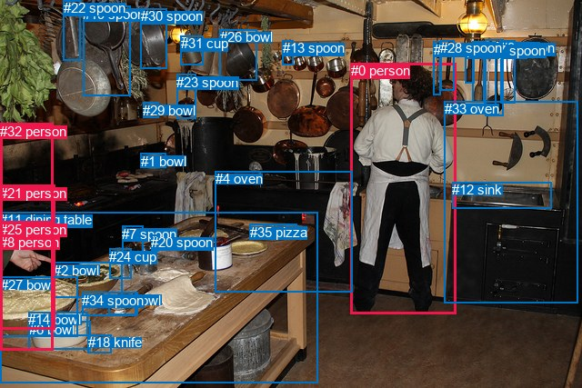
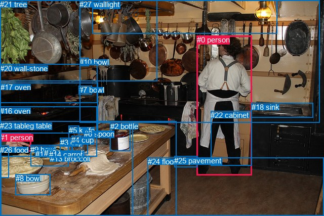

# 图片 0503：2336741.jpg

随机样本序号：383。图片 SHA256：`09e1d25c75f7879bdaa69c327fece5cabacd53939c8c2ef9e87f1c97a2e478c4`。

红色框表示人，蓝色框表示其他物体。两个模式分别保留自身框编号，可依据位置比较对应对象。

## 自动检测框与输出

人的框编号：`[0, 8, 21, 25, 32]`。状态：`ok`。

### 自动检测全部物体框

| 编号 | 类别 | 是否为人 | 检测分数 | 像素坐标 xyxy |
|---|---|---|---|---|
| 0 | person | True | 0.9994 | 385.5, 69.5, 501.3, 345.9 |
| 1 | bowl | False | 0.9793 | 154.8, 168.7, 182.7, 184.7 |
| 2 | bowl | False | 0.9775 | 59.1, 288.6, 134.2, 327.9 |
| 3 | spoon | False | 0.9652 | 519.3, 45.6, 532.5, 112.4 |
| 4 | oven | False | 0.9598 | 236.9, 188.0, 387.8, 321.8 |
| 5 | spoon | False | 0.9443 | 533.5, 43.4, 553.8, 127.2 |
| 6 | bowl | False | 0.9339 | 31.6, 353.8, 99.3, 384.7 |
| 7 | spoon | False | 0.9249 | 134.1, 248.9, 157.2, 277.0 |
| 8 | person | True | 0.9186 | 0.5, 257.7, 59.7, 309.8 |
| 9 | spoon | False | 0.9097 | 550.1, 44.2, 566.3, 113.5 |
| 10 | spoon | False | 0.8744 | 511.8, 47.9, 522.0, 91.1 |
| 11 | dining table | False | 0.7899 | 0.0, 233.0, 349.0, 421.8 |
| 12 | sink | False | 0.7469 | 497.3, 200.0, 606.8, 229.1 |
| 13 | spoon | False | 0.7135 | 310.7, 44.4, 322.1, 71.8 |
| 14 | bowl | False | 0.7098 | 31.3, 343.1, 96.6, 369.4 |
| 15 | bowl | False | 0.6811 | 119.4, 321.6, 151.4, 346.3 |
| 16 | spoon | False | 0.6486 | 476.9, 45.8, 484.9, 104.6 |
| 17 | spoon | False | 0.6318 | 532.0, 47.0, 545.1, 124.1 |
| 18 | knife | False | 0.6245 | 96.8, 368.1, 122.2, 388.2 |
| 19 | spoon | False | 0.6048 | 91.3, 6.7, 143.2, 105.4 |
| 20 | spoon | False | 0.5860 | 166.1, 258.3, 175.0, 276.4 |
| 21 | person | True | 0.5857 | 0.0, 203.9, 60.3, 311.5 |
| 22 | spoon | False | 0.5219 | 69.6, 0.0, 88.3, 66.9 |
| 23 | spoon | False | 0.4936 | 194.2, 81.6, 215.3, 130.2 |
| 24 | cup | False | 0.4933 | 120.3, 273.5, 144.5, 306.7 |
| 25 | person | True | 0.4858 | 0.3, 243.6, 60.1, 362.5 |
| 26 | bowl | False | 0.4581 | 241.8, 32.2, 283.0, 88.9 |
| 27 | bowl | False | 0.4458 | 0.5, 304.9, 85.7, 370.3 |
| 28 | spoon | False | 0.4412 | 484.4, 44.1, 499.5, 99.1 |
| 29 | bowl | False | 0.4267 | 157.4, 112.8, 174.5, 129.5 |
| 30 | spoon | False | 0.4101 | 154.6, 9.3, 183.4, 75.8 |
| 31 | cup | False | 0.3924 | 198.7, 39.1, 223.2, 72.0 |
| 32 | person | True | 0.3798 | 0.0, 135.6, 58.4, 385.6 |
| 33 | oven | False | 0.3754 | 488.8, 111.2, 635.4, 333.5 |
| 34 | spoon | False | 0.3696 | 90.5, 321.7, 149.2, 347.3 |
| 35 | pizza | False | 0.3647 | 274.9, 246.9, 326.2, 263.1 |

### 自动检测 Top50 人相关候选

评分物体对：1260；人相关物体对：330；输出关系：50。

| 排名 | 主语编号与类别 | 关系 | 宾语编号与类别 | 类型 | 人与人 | 排序分数 | 原始融合 logit |
|---|---|---|---|---|---|---|---|
| 1 | #21 person | in | #32 person | spatial | True | 0.97454 | 3.6447 |
| 2 | #25 person | wearing | #8 person | semantic | True | 0.95858 | 3.1417 |
| 3 | #25 person | holding | #27 bowl | semantic | False | 0.94564 | 2.8562 |
| 4 | #8 person | picking | #27 bowl | semantic | False | 0.94308 | 2.8075 |
| 5 | #21 person | wearing | #8 person | semantic | True | 0.92893 | 2.5704 |
| 6 | #25 person | in | #32 person | spatial | True | 0.92774 | 2.5525 |
| 7 | #8 person | on | #21 person | spatial | True | 0.91125 | 2.3290 |
| 8 | #25 person | in | #8 person | spatial | True | 0.90616 | 2.2676 |
| 9 | #25 person | on | #11 dining table | spatial | False | 0.89337 | 2.1256 |
| 10 | #25 person | standing on | #11 dining table | semantic | False | 0.88681 | 2.0585 |
| 11 | #8 person | touching | #25 person | semantic | True | 0.88178 | 2.0094 |
| 12 | #8 person | touching | #21 person | semantic | True | 0.87091 | 1.9091 |
| 13 | #8 person | on | #25 person | spatial | True | 0.86332 | 1.8432 |
| 14 | #21 person | standing on | #32 person | semantic | True | 0.86043 | 1.8189 |
| 15 | #21 person | in | #8 person | spatial | True | 0.85881 | 1.8054 |
| 16 | #25 person | standing on | #32 person | semantic | True | 0.85051 | 1.7386 |
| 17 | #8 person | touching | #11 dining table | semantic | False | 0.84992 | 1.7340 |
| 18 | #25 person | in | #21 person | spatial | True | 0.81743 | 1.4991 |
| 19 | #8 person | in | #32 person | spatial | True | 0.81534 | 1.4851 |
| 20 | #21 person | on | #11 dining table | spatial | False | 0.80038 | 1.3887 |
| 21 | #0 person | holding | #28 spoon | semantic | False | 0.79425 | 1.3507 |
| 22 | #0 person | standing on | #4 oven | semantic | False | 0.78574 | 1.2994 |
| 23 | #0 person | holding | #16 spoon | semantic | False | 0.78352 | 1.2863 |
| 24 | #0 person | standing on | #33 oven | semantic | False | 0.77657 | 1.2458 |
| 25 | #8 person | touching | #32 person | semantic | True | 0.77262 | 1.2232 |
| 26 | #0 person | standing on | #11 dining table | semantic | False | 0.75869 | 1.1455 |
| 27 | #0 person | beside | #33 oven | spatial | False | 0.74687 | 1.0820 |
| 28 | #21 person | holding | #25 person | semantic | True | 0.74669 | 1.0811 |
| 29 | #8 person | on | #11 dining table | spatial | False | 0.72746 | 0.9818 |
| 30 | #21 person | picking | #27 bowl | semantic | False | 0.69351 | 0.8166 |
| 31 | #25 person | on | #27 bowl | spatial | False | 0.68835 | 0.7924 |
| 32 | #0 person | beside | #4 oven | spatial | False | 0.66874 | 0.7025 |
| 33 | #32 person | on | #11 dining table | spatial | False | 0.66756 | 0.6972 |
| 34 | #0 person | standing on | #12 sink | semantic | False | 0.64998 | 0.6190 |
| 35 | #25 person | picking | #2 bowl | semantic | False | 0.64159 | 0.5823 |
| 36 | #28 spoon | hanging from | #0 person | spatial | False | 0.63757 | 0.5648 |
| 37 | #0 person | beside | #12 sink | spatial | False | 0.63638 | 0.5597 |
| 38 | #21 person | standing on | #11 dining table | semantic | False | 0.62596 | 0.5149 |
| 39 | #22 spoon | hanging from | #32 person | spatial | False | 0.61762 | 0.4795 |
| 40 | #25 person | holding | #21 person | semantic | True | 0.61751 | 0.4790 |
| 41 | #8 person | picking | #2 bowl | semantic | False | 0.61675 | 0.4758 |
| 42 | #16 spoon | hanging from | #0 person | spatial | False | 0.61341 | 0.4617 |
| 43 | #0 person | on | #11 dining table | spatial | False | 0.60388 | 0.4217 |
| 44 | #21 person | in | #25 person | spatial | True | 0.55006 | 0.2009 |
| 45 | #25 person | picking | #14 bowl | semantic | False | 0.50143 | 0.0057 |
| 46 | #25 person | picking | #6 bowl | semantic | False | 0.44963 | -0.2022 |
| 47 | #8 person | on | #27 bowl | spatial | False | 0.41229 | -0.3545 |
| 48 | #32 person | in | #21 person | spatial | True | 0.39713 | -0.4174 |
| 49 | #25 person | picking | #7 spoon | semantic | False | 0.31434 | -0.7799 |
| 50 | #25 person | picking | #34 spoon | semantic | False | 0.30329 | -0.8317 |

### 自动检测逐条人相关 GT 核验

R@50：0.00%；命中 0/1。

| GT 主语编号 | GT 关系 | GT 宾语编号 | 结果阶段 | 匹配预测主语编号 | 匹配预测宾语编号 |
|---|---|---|---|---|---|
| 0 | standing on | 24 | endpoint_missing_or_wrong_class | [0] | [] |

## 真实框与输出

人的框编号：`[0, 1]`。

### 真实框全部物体框

| 编号 | 类别 | 是否为人 | 检测分数 | 像素坐标 xyxy |
|---|---|---|---|---|
| 0 | person | True | GT | 389.0, 70.0, 498.0, 347.0 |
| 1 | person | True | GT | 0.0, 263.0, 62.0, 300.0 |
| 2 | bottle | False | GT | 218.0, 241.0, 257.0, 298.0 |
| 3 | cup | False | GT | 119.0, 273.0, 144.0, 307.0 |
| 4 | cup | False | GT | 141.0, 268.0, 174.0, 304.0 |
| 5 | knife | False | GT | 136.0, 249.0, 157.0, 278.0 |
| 6 | spoon | False | GT | 166.0, 256.0, 175.0, 275.0 |
| 7 | bowl | False | GT | 156.0, 169.0, 182.0, 186.0 |
| 8 | bowl | False | GT | 31.0, 344.0, 99.0, 385.0 |
| 9 | bowl | False | GT | 60.0, 287.0, 135.0, 329.0 |
| 10 | bowl | False | GT | 157.0, 114.0, 175.0, 130.0 |
| 11 | broccoli | False | GT | 70.0, 296.0, 79.0, 301.0 |
| 12 | broccoli | False | GT | 87.0, 294.0, 110.0, 305.0 |
| 13 | broccoli | False | GT | 99.0, 305.0, 109.0, 310.0 |
| 14 | carrot | False | GT | 97.0, 297.0, 104.0, 302.0 |
| 15 | dining table | False | GT | 1.0, 240.0, 348.0, 427.0 |
| 16 | oven | False | GT | 0.0, 211.0, 191.0, 310.0 |
| 17 | oven | False | GT | 1.0, 164.0, 193.0, 263.0 |
| 18 | sink | False | GT | 497.0, 203.0, 619.0, 232.0 |
| 19 | light | False | GT | 182.0, 0.0, 548.0, 67.0 |
| 20 | wall-stone | False | GT | 0.0, 127.0, 192.0, 204.0 |
| 21 | tree | False | GT | 0.0, 0.0, 310.0, 161.0 |
| 22 | cabinet | False | GT | 416.0, 219.0, 497.0, 327.0 |
| 23 | table | False | GT | 0.0, 240.0, 263.0, 427.0 |
| 24 | floor | False | GT | 292.0, 311.0, 640.0, 427.0 |
| 25 | pavement | False | GT | 344.0, 309.0, 390.0, 331.0 |
| 26 | food | False | GT | 0.0, 288.0, 17.0, 352.0 |
| 27 | wall | False | GT | 157.0, 0.0, 631.0, 242.0 |

### 真实框 Top50 人相关候选

评分物体对：756；人相关物体对：106；输出关系：50。

| 排名 | 主语编号与类别 | 关系 | 宾语编号与类别 | 类型 | 人与人 | 排序分数 | 原始融合 logit |
|---|---|---|---|---|---|---|---|
| 1 | #0 person | wearing | #22 cabinet | semantic | False | 0.99551 | 5.4010 |
| 2 | #0 person | standing on | #24 floor | semantic | False | 0.96642 | 3.3597 |
| 3 | #1 person | picking | #26 food | semantic | False | 0.95657 | 3.0922 |
| 4 | #0 person | in | #22 cabinet | spatial | False | 0.93751 | 2.7082 |
| 5 | #1 person | touching | #23 table | semantic | False | 0.85696 | 1.7903 |
| 6 | #22 cabinet | on | #0 person | spatial | False | 0.84433 | 1.6908 |
| 7 | #0 person | wearing | #25 pavement | semantic | False | 0.81571 | 1.4876 |
| 8 | #1 person | touching | #15 dining table | semantic | False | 0.81371 | 1.4743 |
| 9 | #1 person | picking | #9 bowl | semantic | False | 0.80395 | 1.4112 |
| 10 | #1 person | on | #23 table | spatial | False | 0.80061 | 1.3901 |
| 11 | #1 person | picking | #11 broccoli | semantic | False | 0.77770 | 1.2523 |
| 12 | #1 person | standing on | #16 oven | semantic | False | 0.77321 | 1.2265 |
| 13 | #1 person | on | #15 dining table | spatial | False | 0.74994 | 1.0983 |
| 14 | #0 person | on | #24 floor | spatial | False | 0.74512 | 1.0727 |
| 15 | #1 person | on | #16 oven | spatial | False | 0.73025 | 0.9959 |
| 16 | #0 person | standing on | #27 wall | semantic | False | 0.65150 | 0.6256 |
| 17 | #0 person | beside | #18 sink | spatial | False | 0.64206 | 0.5843 |
| 18 | #0 person | looking at | #18 sink | semantic | False | 0.64195 | 0.5838 |
| 19 | #0 person | standing on | #15 dining table | semantic | False | 0.58291 | 0.3347 |
| 20 | #1 person | on | #26 food | spatial | False | 0.54646 | 0.1864 |
| 21 | #0 person | leaning on | #27 wall | spatial | False | 0.53294 | 0.1320 |
| 22 | #1 person | picking | #8 bowl | semantic | False | 0.49203 | -0.0319 |
| 23 | #0 person | on | #25 pavement | spatial | False | 0.45295 | -0.1888 |
| 24 | #1 person | picking | #12 broccoli | semantic | False | 0.42230 | -0.3134 |
| 25 | #1 person | picking | #14 carrot | semantic | False | 0.40363 | -0.3904 |
| 26 | #1 person | picking | #5 knife | semantic | False | 0.39829 | -0.4126 |
| 27 | #18 sink | beside | #0 person | spatial | False | 0.39479 | -0.4272 |
| 28 | #22 cabinet | wearing | #0 person | semantic | False | 0.38870 | -0.4528 |
| 29 | #0 person | standing on | #23 table | semantic | False | 0.37971 | -0.4908 |
| 30 | #1 person | picking | #13 broccoli | semantic | False | 0.35976 | -0.5764 |
| 31 | #1 person | picking | #6 spoon | semantic | False | 0.32454 | -0.7330 |
| 32 | #0 person | beside | #15 dining table | spatial | False | 0.32169 | -0.7460 |
| 33 | #1 person | in | #9 bowl | spatial | False | 0.31530 | -0.7755 |
| 34 | #1 person | wearing | #22 cabinet | semantic | False | 0.28294 | -0.9299 |
| 35 | #0 person | beside | #23 table | spatial | False | 0.17988 | -1.5171 |
| 36 | #26 food | holding | #1 person | semantic | False | 0.16499 | -1.6215 |
| 37 | #1 person | in | #17 oven | spatial | False | 0.16318 | -1.6348 |
| 38 | #26 food | in | #1 person | spatial | False | 0.15938 | -1.6628 |
| 39 | #1 person | standing on | #17 oven | semantic | False | 0.14331 | -1.7881 |
| 40 | #0 person | in | #1 person | spatial | True | 0.13516 | -1.8561 |
| 41 | #1 person | in | #8 bowl | spatial | False | 0.12629 | -1.9342 |
| 42 | #0 person | holding | #1 person | semantic | True | 0.11481 | -2.0425 |
| 43 | #25 pavement | in | #0 person | spatial | False | 0.10629 | -2.1292 |
| 44 | #1 person | picking | #2 bottle | semantic | False | 0.09929 | -2.2052 |
| 45 | #0 person | standing on | #16 oven | semantic | False | 0.08772 | -2.3418 |
| 46 | #1 person | picking | #4 cup | semantic | False | 0.08160 | -2.4209 |
| 47 | #0 person | standing on | #17 oven | semantic | False | 0.07402 | -2.5265 |
| 48 | #1 person | picking | #3 cup | semantic | False | 0.07341 | -2.5354 |
| 49 | #1 person | leaning on | #11 broccoli | spatial | False | 0.06999 | -2.5868 |
| 50 | #1 person | standing on | #24 floor | semantic | False | 0.06958 | -2.5932 |

### 真实框逐条人相关 GT 核验

R@50：100.00%；命中 1/1。

| GT 主语编号 | GT 关系 | GT 宾语编号 | 结果阶段 | 匹配预测主语编号 | 匹配预测宾语编号 |
|---|---|---|---|---|---|
| 0 | standing on | 24 | hit50 | [0] | [24] |

## 全部人相关 GT

| 主语编号与类别 | 关系 | 宾语编号与类别 |
|---|---|---|
| #0 person | standing on | #24 floor |

原始记录、全部人相关物体对的两项预测与分项分数见 [逐图证据 JSON](../evidence/cases/0503.json)。全部56类 logits 保留于本机 HOR/output/random500/logits/。

<!-- HOR_COMPLETE_RESULTS -->

## 六组条件的完整输出对照

以下保留同一图片三种框与候选模式、两种谓词输出规则的全部 Top50。框编号各自在所属模式内解释。

### 自动检测框完整枚举：空间与语义各保留一个谓词

| 排名 | 主语编号与类别 | 谓词 | 宾语编号与类别 | 分组 | 排序分数 | predicate logit | pair logit |
|---|---|---|---|---|---|---|---|
| 1 | #21 person | in | #32 person | spatial | 0.9745355 | 3.5205131 | 0.1241620 |
| 2 | #25 person | wearing | #8 person | semantic | 0.9585810 | 2.8892035 | 0.2525086 |
| 3 | #25 person | holding | #27 bowl | semantic | 0.9456364 | 2.9293013 | -0.0731393 |
| 4 | #8 person | picking | #27 bowl | semantic | 0.9430805 | 3.1242409 | -0.3167257 |
| 5 | #21 person | wearing | #8 person | semantic | 0.9289329 | 2.3547864 | 0.2156259 |
| 6 | #25 person | in | #32 person | spatial | 0.9277415 | 2.5049386 | 0.0475646 |
| 7 | #8 person | on | #21 person | spatial | 0.9112509 | 1.9769111 | 0.3520943 |
| 8 | #25 person | in | #8 person | spatial | 0.9061552 | 2.0150595 | 0.2525086 |
| 9 | #25 person | on | #11 dining table | spatial | 0.8933656 | 2.4664216 | -0.3408318 |
| 10 | #25 person | standing on | #11 dining table | semantic | 0.8868068 | 2.3993630 | -0.3408318 |
| 11 | #8 person | touching | #25 person | semantic | 0.8817844 | 1.7379479 | 0.2714893 |
| 12 | #8 person | touching | #21 person | semantic | 0.8709143 | 1.5569735 | 0.3520943 |
| 13 | #8 person | on | #25 person | spatial | 0.8633229 | 1.5716782 | 0.2714893 |
| 14 | #21 person | standing on | #32 person | semantic | 0.8604319 | 1.6947198 | 0.1241620 |
| 15 | #21 person | in | #8 person | spatial | 0.8588076 | 1.5897956 | 0.2156259 |
| 16 | #25 person | standing on | #32 person | semantic | 0.8505107 | 1.6910472 | 0.0475646 |
| 17 | #8 person | touching | #11 dining table | semantic | 0.8499198 | 2.5176125 | -0.7836400 |
| 18 | #25 person | in | #21 person | spatial | 0.8174332 | 1.3714271 | 0.1276261 |
| 19 | #8 person | in | #32 person | spatial | 0.8153432 | 1.5165815 | -0.0314711 |
| 20 | #21 person | on | #11 dining table | spatial | 0.8003806 | 2.1798167 | -0.7911422 |
| 21 | #0 person | holding | #28 spoon | semantic | 0.7942504 | 2.1506414 | -0.7999021 |
| 22 | #0 person | standing on | #4 oven | semantic | 0.7857385 | 2.1455722 | -0.8461453 |
| 23 | #0 person | holding | #16 spoon | semantic | 0.7835212 | 2.0055447 | -0.7192396 |
| 24 | #0 person | standing on | #33 oven | semantic | 0.7765669 | 2.3445797 | -1.0988090 |
| 25 | #8 person | touching | #32 person | semantic | 0.7726200 | 1.2546358 | -0.0314711 |
| 26 | #0 person | standing on | #11 dining table | semantic | 0.7586936 | 1.8851523 | -0.7396220 |
| 27 | #0 person | beside | #33 oven | spatial | 0.7468697 | 2.1807957 | -1.0988090 |
| 28 | #21 person | holding | #25 person | semantic | 0.7466944 | 1.1956954 | -0.1146364 |
| 29 | #8 person | on | #11 dining table | spatial | 0.7274636 | 1.7654319 | -0.7836400 |
| 30 | #21 person | picking | #27 bowl | semantic | 0.6935094 | 1.3195086 | -0.5029309 |
| 31 | #25 person | on | #27 bowl | spatial | 0.6883451 | 0.8655329 | -0.0731393 |
| 32 | #0 person | beside | #4 oven | spatial | 0.6687424 | 1.5486479 | -0.8461453 |
| 33 | #32 person | on | #11 dining table | spatial | 0.6675600 | 1.8198800 | -1.1227100 |
| 34 | #0 person | standing on | #12 sink | semantic | 0.6499799 | 1.5149860 | -0.8960350 |
| 35 | #25 person | picking | #2 bowl | semantic | 0.6415928 | 0.8983984 | -0.3161145 |
| 36 | #28 spoon | hanging from | #0 person | spatial | 0.6375663 | 1.7422462 | -1.1774294 |
| 37 | #0 person | beside | #12 sink | spatial | 0.6363783 | 1.4557142 | -0.8960350 |
| 38 | #21 person | standing on | #11 dining table | semantic | 0.6259619 | 1.3060741 | -0.7911422 |
| 39 | #22 spoon | hanging from | #32 person | spatial | 0.6176238 | 1.2908669 | -0.8113922 |
| 40 | #25 person | holding | #21 person | semantic | 0.6175093 | 0.3513637 | 0.1276261 |
| 41 | #8 person | picking | #2 bowl | semantic | 0.6167465 | 1.0788984 | -0.6031371 |
| 42 | #16 spoon | hanging from | #0 person | spatial | 0.6134121 | 1.5917907 | -1.1301129 |
| 43 | #0 person | on | #11 dining table | spatial | 0.6038825 | 1.1612906 | -0.7396220 |
| 44 | #21 person | in | #25 person | spatial | 0.5500631 | 0.3155618 | -0.1146364 |
| 45 | #25 person | picking | #14 bowl | semantic | 0.5014269 | 0.4171896 | -0.4114821 |
| 46 | #25 person | picking | #6 bowl | semantic | 0.4496261 | 0.2366066 | -0.4387879 |
| 47 | #8 person | on | #27 bowl | spatial | 0.4122895 | -0.0377831 | -0.3167257 |
| 48 | #32 person | in | #21 person | spatial | 0.3971306 | 0.3865910 | -0.8040261 |
| 49 | #25 person | picking | #7 spoon | semantic | 0.3143361 | 0.0556636 | -0.8355883 |
| 50 | #25 person | picking | #34 spoon | semantic | 0.3032928 | -0.3652549 | -0.4664118 |

GT 命中：0/1，R@50=0.00%。

| GT主语 | GT谓词 | GT宾语 | 结果阶段 | 匹配主语框 | 匹配宾语框 |
|---|---|---|---|---|---|
| 0 | standing on | 24 | endpoint_missing_or_wrong_class | [0] | [] |

### 自动检测框完整枚举：每对只保留一个谓词

| 排名 | 主语编号与类别 | 谓词 | 宾语编号与类别 | 分组 | 排序分数 | predicate logit | pair logit |
|---|---|---|---|---|---|---|---|
| 1 | #21 person | in | #32 person | single | 0.9745355 | 3.5205131 | 0.1241620 |
| 2 | #25 person | wearing | #8 person | single | 0.9585810 | 2.8892035 | 0.2525086 |
| 3 | #25 person | holding | #27 bowl | single | 0.9456364 | 2.9293013 | -0.0731393 |
| 4 | #8 person | picking | #27 bowl | single | 0.9430805 | 3.1242409 | -0.3167257 |
| 5 | #21 person | wearing | #8 person | single | 0.9289329 | 2.3547864 | 0.2156259 |
| 6 | #25 person | in | #32 person | single | 0.9277415 | 2.5049386 | 0.0475646 |
| 7 | #8 person | on | #21 person | single | 0.9112509 | 1.9769111 | 0.3520943 |
| 8 | #25 person | on | #11 dining table | single | 0.8933656 | 2.4664216 | -0.3408318 |
| 9 | #8 person | touching | #25 person | single | 0.8817844 | 1.7379479 | 0.2714893 |
| 10 | #8 person | touching | #11 dining table | single | 0.8499198 | 2.5176125 | -0.7836400 |
| 11 | #25 person | in | #21 person | single | 0.8174332 | 1.3714271 | 0.1276261 |
| 12 | #8 person | in | #32 person | single | 0.8153432 | 1.5165815 | -0.0314711 |
| 13 | #21 person | on | #11 dining table | single | 0.8003806 | 2.1798167 | -0.7911422 |
| 14 | #0 person | holding | #28 spoon | single | 0.7942504 | 2.1506414 | -0.7999021 |
| 15 | #0 person | standing on | #4 oven | single | 0.7857385 | 2.1455722 | -0.8461453 |
| 16 | #0 person | holding | #16 spoon | single | 0.7835212 | 2.0055447 | -0.7192396 |
| 17 | #0 person | standing on | #33 oven | single | 0.7765669 | 2.3445797 | -1.0988090 |
| 18 | #0 person | standing on | #11 dining table | single | 0.7586936 | 1.8851523 | -0.7396220 |
| 19 | #21 person | holding | #25 person | single | 0.7466944 | 1.1956954 | -0.1146364 |
| 20 | #21 person | picking | #27 bowl | single | 0.6935094 | 1.3195086 | -0.5029309 |
| 21 | #32 person | on | #11 dining table | single | 0.6675600 | 1.8198800 | -1.1227100 |
| 22 | #0 person | standing on | #12 sink | single | 0.6499799 | 1.5149860 | -0.8960350 |
| 23 | #25 person | picking | #2 bowl | single | 0.6415928 | 0.8983984 | -0.3161145 |
| 24 | #28 spoon | hanging from | #0 person | single | 0.6375663 | 1.7422462 | -1.1774294 |
| 25 | #22 spoon | hanging from | #32 person | single | 0.6176238 | 1.2908669 | -0.8113922 |
| 26 | #8 person | picking | #2 bowl | single | 0.6167465 | 1.0788984 | -0.6031371 |
| 27 | #16 spoon | hanging from | #0 person | single | 0.6134121 | 1.5917907 | -1.1301129 |
| 28 | #25 person | picking | #14 bowl | single | 0.5014269 | 0.4171896 | -0.4114821 |
| 29 | #25 person | picking | #6 bowl | single | 0.4496261 | 0.2366066 | -0.4387879 |
| 30 | #32 person | in | #21 person | single | 0.3971306 | 0.3865910 | -0.8040261 |
| 31 | #25 person | picking | #7 spoon | single | 0.3143361 | 0.0556636 | -0.8355883 |
| 32 | #25 person | picking | #34 spoon | single | 0.3032928 | -0.3652549 | -0.4664118 |
| 33 | #25 person | picking | #15 bowl | single | 0.2447229 | -0.6061406 | -0.5208179 |
| 34 | #19 spoon | hanging from | #32 person | single | 0.2331207 | -0.1835728 | -1.0072004 |
| 35 | #8 person | picking | #7 spoon | single | 0.2185649 | -0.3956213 | -0.8784276 |
| 36 | #27 bowl | on | #32 person | single | 0.2122560 | -0.8616588 | -0.4497215 |
| 37 | #21 person | picking | #2 bowl | single | 0.1936769 | -0.7255955 | -0.7006980 |
| 38 | #25 person | picking | #20 spoon | single | 0.1893859 | -0.4557195 | -0.9982858 |
| 39 | #8 person | picking | #14 bowl | single | 0.1880798 | -0.6963778 | -0.7661582 |
| 40 | #22 spoon | hanging from | #21 person | single | 0.1826162 | -0.2437458 | -1.2549764 |
| 41 | #17 spoon | hanging from | #0 person | single | 0.1825527 | -0.0933037 | -1.4058436 |
| 42 | #21 person | picking | #7 spoon | single | 0.1812972 | -0.6061168 | -0.9014668 |
| 43 | #8 person | picking | #34 spoon | single | 0.1744132 | -0.8469720 | -0.7076951 |
| 44 | #3 spoon | hanging from | #0 person | single | 0.1696372 | -0.2738423 | -1.3143582 |
| 45 | #21 person | holding | #22 spoon | single | 0.1674994 | -0.5012507 | -1.1022032 |
| 46 | #5 spoon | hanging from | #0 person | single | 0.1664861 | -0.1835690 | -1.4271693 |
| 47 | #8 person | picking | #20 spoon | single | 0.1557681 | -0.6061168 | -1.0839421 |
| 48 | #2 bowl | on | #32 person | single | 0.1434311 | -1.1668863 | -0.6201935 |
| 49 | #12 sink | beside | #0 person | single | 0.1415985 | -0.6788054 | -1.1232709 |
| 50 | #32 person | in | #25 person | single | 0.1396506 | -0.7679458 | -1.0502493 |

GT 命中：0/1，R@50=0.00%。

| GT主语 | GT谓词 | GT宾语 | 结果阶段 | 匹配主语框 | 匹配宾语框 |
|---|---|---|---|---|---|
| 0 | standing on | 24 | endpoint_missing_or_wrong_class | [0] | [] |

### 真实框完整枚举：空间与语义各保留一个谓词

| 排名 | 主语编号与类别 | 谓词 | 宾语编号与类别 | 分组 | 排序分数 | predicate logit | pair logit |
|---|---|---|---|---|---|---|---|
| 1 | #0 person | wearing | #22 cabinet | semantic | 0.9955082 | 4.7419133 | 0.6590973 |
| 2 | #0 person | standing on | #24 floor | semantic | 0.9664221 | 3.9993997 | -0.6396651 |
| 3 | #1 person | picking | #26 food | semantic | 0.9565691 | 3.1843996 | -0.0922183 |
| 4 | #0 person | in | #22 cabinet | spatial | 0.9375108 | 2.0491376 | 0.6590973 |
| 5 | #1 person | touching | #23 table | semantic | 0.8569627 | 2.4883051 | -0.6980155 |
| 6 | #22 cabinet | on | #0 person | spatial | 0.8443251 | 1.9488750 | -0.2581072 |
| 7 | #0 person | wearing | #25 pavement | semantic | 0.8157140 | 1.5987463 | -0.1111714 |
| 8 | #1 person | touching | #15 dining table | semantic | 0.8137118 | 2.2778807 | -0.8035698 |
| 9 | #1 person | picking | #9 bowl | semantic | 0.8039543 | 2.0416980 | -0.6305034 |
| 10 | #1 person | on | #23 table | spatial | 0.8006095 | 2.0881233 | -0.6980155 |
| 11 | #1 person | picking | #11 broccoli | semantic | 0.7776998 | 1.6200495 | -0.3677375 |
| 12 | #1 person | standing on | #16 oven | semantic | 0.7732074 | 1.8745522 | -0.6480407 |
| 13 | #1 person | on | #15 dining table | spatial | 0.7499362 | 1.9018416 | -0.8035698 |
| 14 | #0 person | on | #24 floor | spatial | 0.7451173 | 1.7124033 | -0.6396651 |
| 15 | #1 person | on | #16 oven | spatial | 0.7302454 | 1.6439085 | -0.6480407 |
| 16 | #0 person | standing on | #27 wall | semantic | 0.6514953 | 1.5285435 | -0.9029247 |
| 17 | #0 person | beside | #18 sink | spatial | 0.6420573 | 1.4904318 | -0.9061272 |
| 18 | #0 person | looking at | #18 sink | semantic | 0.6419494 | 1.4899621 | -0.9061272 |
| 19 | #0 person | standing on | #15 dining table | semantic | 0.5829095 | 1.0645304 | -0.7298014 |
| 20 | #1 person | on | #26 food | spatial | 0.5464597 | 0.2785950 | -0.0922183 |
| 21 | #0 person | leaning on | #27 wall | spatial | 0.5329403 | 1.0348773 | -0.9029247 |
| 22 | #1 person | picking | #8 bowl | semantic | 0.4920305 | 0.7778296 | -0.8097101 |
| 23 | #0 person | on | #25 pavement | spatial | 0.4529453 | -0.0776062 | -0.1111714 |
| 24 | #1 person | picking | #12 broccoli | semantic | 0.4222952 | 0.3866677 | -0.7000260 |
| 25 | #1 person | picking | #14 carrot | semantic | 0.4036283 | 0.3563609 | -0.7467303 |
| 26 | #1 person | picking | #5 knife | semantic | 0.3982927 | 0.5370641 | -0.9496481 |
| 27 | #18 sink | beside | #0 person | spatial | 0.3947866 | 0.7063823 | -1.1336179 |
| 28 | #22 cabinet | wearing | #0 person | semantic | 0.3886987 | -0.1946783 | -0.2581072 |
| 29 | #0 person | standing on | #23 table | semantic | 0.3797082 | 0.3481560 | -0.8389429 |
| 30 | #1 person | picking | #13 broccoli | semantic | 0.3597621 | 0.1457939 | -0.7221910 |
| 31 | #1 person | picking | #6 spoon | semantic | 0.3245417 | 0.3565521 | -1.0895293 |
| 32 | #0 person | beside | #15 dining table | spatial | 0.3216905 | -0.0162125 | -0.7298014 |
| 33 | #1 person | in | #9 bowl | spatial | 0.3152956 | -0.1449733 | -0.6305034 |
| 34 | #1 person | wearing | #22 cabinet | semantic | 0.2829393 | 0.4913845 | -1.4213125 |
| 35 | #0 person | beside | #23 table | spatial | 0.1798839 | -0.6781912 | -0.8389429 |
| 36 | #26 food | holding | #1 person | semantic | 0.1649919 | -0.6172552 | -1.0042901 |
| 37 | #1 person | in | #17 oven | spatial | 0.1631799 | -0.7476890 | -0.8870667 |
| 38 | #26 food | in | #1 person | spatial | 0.1593840 | -0.6585283 | -1.0042901 |
| 39 | #1 person | standing on | #17 oven | semantic | 0.1433114 | -0.9009879 | -0.8870667 |
| 40 | #0 person | in | #1 person | spatial | 0.1351619 | -1.3057632 | -0.5503057 |
| 41 | #1 person | in | #8 bowl | spatial | 0.1262900 | -1.1244571 | -0.8097101 |
| 42 | #0 person | holding | #1 person | semantic | 0.1148142 | -1.4921765 | -0.5503057 |
| 43 | #25 pavement | in | #0 person | spatial | 0.1062886 | -1.6526525 | -0.4765727 |
| 44 | #1 person | picking | #2 bottle | semantic | 0.0992861 | -0.4255686 | -1.7796140 |
| 45 | #0 person | standing on | #16 oven | semantic | 0.0877234 | -0.9712639 | -1.3704907 |
| 46 | #1 person | picking | #4 cup | semantic | 0.0815950 | -0.9671392 | -1.4537306 |
| 47 | #0 person | standing on | #17 oven | semantic | 0.0740240 | -1.0160956 | -1.5103637 |
| 48 | #1 person | picking | #3 cup | semantic | 0.0734130 | -1.1927459 | -1.3426615 |
| 49 | #1 person | leaning on | #11 broccoli | spatial | 0.0699946 | -2.2190342 | -0.3677375 |
| 50 | #1 person | standing on | #24 floor | semantic | 0.0695778 | -0.9603567 | -1.6328359 |

GT 命中：1/1，R@50=100.00%。

| GT主语 | GT谓词 | GT宾语 | 结果阶段 | 匹配主语框 | 匹配宾语框 |
|---|---|---|---|---|---|
| 0 | standing on | 24 | hit50 | [0] | [24] |

### 真实框完整枚举：每对只保留一个谓词

| 排名 | 主语编号与类别 | 谓词 | 宾语编号与类别 | 分组 | 排序分数 | predicate logit | pair logit |
|---|---|---|---|---|---|---|---|
| 1 | #0 person | wearing | #22 cabinet | single | 0.9955082 | 4.7419133 | 0.6590973 |
| 2 | #0 person | standing on | #24 floor | single | 0.9664221 | 3.9993997 | -0.6396651 |
| 3 | #1 person | picking | #26 food | single | 0.9565691 | 3.1843996 | -0.0922183 |
| 4 | #1 person | touching | #23 table | single | 0.8569627 | 2.4883051 | -0.6980155 |
| 5 | #22 cabinet | on | #0 person | single | 0.8443251 | 1.9488750 | -0.2581072 |
| 6 | #0 person | wearing | #25 pavement | single | 0.8157140 | 1.5987463 | -0.1111714 |
| 7 | #1 person | touching | #15 dining table | single | 0.8137118 | 2.2778807 | -0.8035698 |
| 8 | #1 person | picking | #9 bowl | single | 0.8039543 | 2.0416980 | -0.6305034 |
| 9 | #1 person | picking | #11 broccoli | single | 0.7776998 | 1.6200495 | -0.3677375 |
| 10 | #1 person | standing on | #16 oven | single | 0.7732074 | 1.8745522 | -0.6480407 |
| 11 | #0 person | standing on | #27 wall | single | 0.6514953 | 1.5285435 | -0.9029247 |
| 12 | #0 person | beside | #18 sink | single | 0.6420573 | 1.4904318 | -0.9061272 |
| 13 | #0 person | standing on | #15 dining table | single | 0.5829095 | 1.0645304 | -0.7298014 |
| 14 | #1 person | picking | #8 bowl | single | 0.4920305 | 0.7778296 | -0.8097101 |
| 15 | #1 person | picking | #12 broccoli | single | 0.4222952 | 0.3866677 | -0.7000260 |
| 16 | #1 person | picking | #14 carrot | single | 0.4036283 | 0.3563609 | -0.7467303 |
| 17 | #1 person | picking | #5 knife | single | 0.3982927 | 0.5370641 | -0.9496481 |
| 18 | #18 sink | beside | #0 person | single | 0.3947866 | 0.7063823 | -1.1336179 |
| 19 | #0 person | standing on | #23 table | single | 0.3797082 | 0.3481560 | -0.8389429 |
| 20 | #1 person | picking | #13 broccoli | single | 0.3597621 | 0.1457939 | -0.7221910 |
| 21 | #1 person | picking | #6 spoon | single | 0.3245417 | 0.3565521 | -1.0895293 |
| 22 | #1 person | wearing | #22 cabinet | single | 0.2829393 | 0.4913845 | -1.4213125 |
| 23 | #26 food | holding | #1 person | single | 0.1649919 | -0.6172552 | -1.0042901 |
| 24 | #1 person | in | #17 oven | single | 0.1631799 | -0.7476890 | -0.8870667 |
| 25 | #0 person | in | #1 person | single | 0.1351619 | -1.3057632 | -0.5503057 |
| 26 | #25 pavement | in | #0 person | single | 0.1062886 | -1.6526525 | -0.4765727 |
| 27 | #1 person | picking | #2 bottle | single | 0.0992861 | -0.4255686 | -1.7796140 |
| 28 | #0 person | standing on | #16 oven | single | 0.0877234 | -0.9712639 | -1.3704907 |
| 29 | #1 person | picking | #4 cup | single | 0.0815950 | -0.9671392 | -1.4537306 |
| 30 | #0 person | standing on | #17 oven | single | 0.0740240 | -1.0160956 | -1.5103637 |
| 31 | #1 person | picking | #3 cup | single | 0.0734130 | -1.1927459 | -1.3426615 |
| 32 | #1 person | standing on | #24 floor | single | 0.0695778 | -0.9603567 | -1.6328359 |
| 33 | #24 floor | beside | #0 person | single | 0.0693725 | -1.6366730 | -0.9596951 |
| 34 | #1 person | wearing | #25 pavement | single | 0.0684734 | -0.6816416 | -1.9287381 |
| 35 | #1 person | talking to | #0 person | single | 0.0565427 | -2.0472696 | -0.7672845 |
| 36 | #0 person | looking at | #2 bottle | single | 0.0461120 | -1.3689134 | -1.6605603 |
| 37 | #0 person | standing on | #20 wall-stone | single | 0.0426829 | -1.6018102 | -1.5085268 |
| 38 | #19 light | over | #0 person | single | 0.0307209 | -2.0807757 | -1.3708351 |
| 39 | #23 table | in | #1 person | single | 0.0275609 | -2.1944468 | -1.3689636 |
| 40 | #0 person | picking | #26 food | single | 0.0274927 | -2.5003209 | -1.0656353 |
| 41 | #0 person | in | #19 light | single | 0.0273955 | -2.4561415 | -1.1134579 |
| 42 | #1 person | picking | #7 bowl | single | 0.0248608 | -1.9743702 | -1.6949170 |
| 43 | #17 oven | beside | #0 person | single | 0.0241557 | -1.7648301 | -1.9339536 |
| 44 | #27 wall | beside | #0 person | single | 0.0222257 | -2.4557145 | -1.3283160 |
| 45 | #16 oven | beside | #0 person | single | 0.0201739 | -2.0659740 | -1.8170104 |
| 46 | #1 person | in | #20 wall-stone | single | 0.0201123 | -2.6788409 | -1.2072673 |
| 47 | #0 person | looking at | #7 bowl | single | 0.0198241 | -2.2826216 | -1.6182134 |
| 48 | #1 person | in | #27 wall | single | 0.0194601 | -1.5308406 | -2.3888969 |
| 49 | #1 person | touching | #18 sink | single | 0.0193269 | -2.2628696 | -1.6638710 |
| 50 | #25 pavement | on | #1 person | single | 0.0186541 | -2.1554811 | -1.8073796 |

GT 命中：1/1，R@50=100.00%。

| GT主语 | GT谓词 | GT宾语 | 结果阶段 | 匹配主语框 | 匹配宾语框 |
|---|---|---|---|---|---|
| 0 | standing on | 24 | hit50 | [0] | [24] |

### 真实框400候选：空间与语义各保留一个谓词

| 排名 | 主语编号与类别 | 谓词 | 宾语编号与类别 | 分组 | 排序分数 | predicate logit | pair logit |
|---|---|---|---|---|---|---|---|
| 1 | #0 person | wearing | #22 cabinet | semantic | 0.9954820 | 4.7360454 | 0.6590973 |
| 2 | #0 person | standing on | #24 floor | semantic | 0.9689901 | 4.0816150 | -0.6396651 |
| 3 | #1 person | picking | #26 food | semantic | 0.9655321 | 3.4248672 | -0.0922183 |
| 4 | #0 person | in | #22 cabinet | spatial | 0.9241904 | 1.8415952 | 0.6590973 |
| 5 | #1 person | standing on | #15 dining table | semantic | 0.8436120 | 2.4889221 | -0.8035698 |
| 6 | #1 person | standing on | #16 oven | semantic | 0.8415388 | 2.3177633 | -0.6480407 |
| 7 | #1 person | picking | #9 bowl | semantic | 0.8350115 | 2.2520738 | -0.6305034 |
| 8 | #1 person | standing on | #23 table | semantic | 0.8344782 | 2.3157191 | -0.6980155 |
| 9 | #22 cabinet | on | #0 person | spatial | 0.8133335 | 1.7299247 | -0.2581072 |
| 10 | #1 person | on | #23 table | spatial | 0.7711322 | 1.9127312 | -0.6980155 |
| 11 | #1 person | on | #16 oven | spatial | 0.7702394 | 1.8577042 | -0.6480407 |
| 12 | #1 person | on | #15 dining table | spatial | 0.7238942 | 1.7674308 | -0.8035698 |
| 13 | #0 person | standing on | #15 dining table | semantic | 0.7203184 | 1.6758432 | -0.7298014 |
| 14 | #0 person | wearing | #25 pavement | semantic | 0.7040468 | 0.9778147 | -0.1111714 |
| 15 | #0 person | standing on | #27 wall | semantic | 0.7027512 | 1.7633581 | -0.9029247 |
| 16 | #0 person | looking at | #18 sink | semantic | 0.7012509 | 1.7593889 | -0.9061272 |
| 17 | #0 person | on | #24 floor | spatial | 0.7001585 | 1.4877181 | -0.6396651 |
| 18 | #0 person | beside | #18 sink | spatial | 0.6419775 | 1.4900846 | -0.9061272 |
| 19 | #1 person | picking | #8 bowl | semantic | 0.5960020 | 1.1985445 | -0.8097101 |
| 20 | #1 person | picking | #12 broccoli | semantic | 0.5641485 | 0.9580421 | -0.7000260 |
| 21 | #0 person | standing on | #23 table | semantic | 0.5488713 | 1.0350542 | -0.8389429 |
| 22 | #0 person | leaning on | #27 wall | spatial | 0.5484988 | 1.0975318 | -0.9029247 |
| 23 | #1 person | picking | #5 knife | semantic | 0.5246201 | 1.0482082 | -0.9496481 |
| 24 | #1 person | on | #26 food | spatial | 0.5096233 | 0.1307163 | -0.0922183 |
| 25 | #1 person | wearing | #22 cabinet | semantic | 0.4891789 | 1.3780212 | -1.4213125 |
| 26 | #18 sink | beside | #0 person | spatial | 0.4019708 | 0.7363577 | -1.1336179 |
| 27 | #0 person | beside | #15 dining table | spatial | 0.3976836 | 0.3146753 | -0.7298014 |
| 28 | #22 cabinet | wearing | #0 person | semantic | 0.3719286 | -0.2658448 | -0.2581072 |
| 29 | #0 person | on | #25 pavement | spatial | 0.3108718 | -0.6848755 | -0.1111714 |
| 30 | #1 person | in | #9 bowl | spatial | 0.2905435 | -0.2622423 | -0.6305034 |
| 31 | #0 person | beside | #23 table | spatial | 0.2504736 | -0.2571449 | -0.8389429 |
| 32 | #1 person | standing on | #17 oven | semantic | 0.2215932 | -0.3693395 | -0.8870667 |
| 33 | #1 person | beside | #17 oven | spatial | 0.2192724 | -0.3828444 | -0.8870667 |
| 34 | #1 person | standing on | #24 floor | semantic | 0.1847934 | 0.1486330 | -1.6328359 |
| 35 | #1 person | picking | #2 bottle | semantic | 0.1804185 | 0.2660990 | -1.7796140 |
| 36 | #0 person | standing on | #16 oven | semantic | 0.1687273 | -0.2241831 | -1.3704907 |
| 37 | #1 person | in | #27 wall | spatial | 0.1428139 | 0.5967846 | -2.3888969 |
| 38 | #1 person | picking | #4 cup | semantic | 0.1290117 | -0.4559951 | -1.4537306 |
| 39 | #0 person | standing on | #17 oven | semantic | 0.1259076 | -0.4272742 | -1.5103637 |
| 40 | #1 person | picking | #3 cup | semantic | 0.1246554 | -0.6064034 | -1.3426615 |
| 41 | #1 person | in | #8 bowl | spatial | 0.1080097 | -1.3015239 | -0.8097101 |
| 42 | #1 person | standing on | #27 wall | semantic | 0.1070410 | 0.2675686 | -2.3888969 |
| 43 | #26 food | holding | #1 person | semantic | 0.1008406 | -1.1836295 | -1.0042901 |
| 44 | #26 food | in | #1 person | spatial | 0.0994792 | -1.1987340 | -1.0042901 |
| 45 | #1 person | on | #24 floor | spatial | 0.0970365 | -0.5977588 | -1.6328359 |
| 46 | #1 person | in | #22 cabinet | spatial | 0.0952319 | -0.8300507 | -1.4213125 |
| 47 | #0 person | standing on | #20 wall-stone | semantic | 0.0759517 | -0.9901402 | -1.5085268 |
| 48 | #0 person | beside | #16 oven | spatial | 0.0757920 | -1.1304543 | -1.3704907 |
| 49 | #0 person | beside | #17 oven | spatial | 0.0620529 | -1.2053430 | -1.5103637 |
| 50 | #24 floor | beside | #0 person | spatial | 0.0602409 | -1.7875776 | -0.9596951 |

GT 命中：1/1，R@50=100.00%。

| GT主语 | GT谓词 | GT宾语 | 结果阶段 | 匹配主语框 | 匹配宾语框 |
|---|---|---|---|---|---|
| 0 | standing on | 24 | hit50 | [0] | [24] |

### 真实框400候选：每对只保留一个谓词

| 排名 | 主语编号与类别 | 谓词 | 宾语编号与类别 | 分组 | 排序分数 | predicate logit | pair logit |
|---|---|---|---|---|---|---|---|
| 1 | #0 person | wearing | #22 cabinet | single | 0.9954820 | 4.7360454 | 0.6590973 |
| 2 | #0 person | standing on | #24 floor | single | 0.9689901 | 4.0816150 | -0.6396651 |
| 3 | #1 person | picking | #26 food | single | 0.9655321 | 3.4248672 | -0.0922183 |
| 4 | #1 person | standing on | #15 dining table | single | 0.8436120 | 2.4889221 | -0.8035698 |
| 5 | #1 person | standing on | #16 oven | single | 0.8415388 | 2.3177633 | -0.6480407 |
| 6 | #1 person | picking | #9 bowl | single | 0.8350115 | 2.2520738 | -0.6305034 |
| 7 | #1 person | standing on | #23 table | single | 0.8344782 | 2.3157191 | -0.6980155 |
| 8 | #22 cabinet | on | #0 person | single | 0.8133335 | 1.7299247 | -0.2581072 |
| 9 | #0 person | standing on | #15 dining table | single | 0.7203184 | 1.6758432 | -0.7298014 |
| 10 | #0 person | wearing | #25 pavement | single | 0.7040468 | 0.9778147 | -0.1111714 |
| 11 | #0 person | standing on | #27 wall | single | 0.7027512 | 1.7633581 | -0.9029247 |
| 12 | #0 person | looking at | #18 sink | single | 0.7012509 | 1.7593889 | -0.9061272 |
| 13 | #1 person | picking | #8 bowl | single | 0.5960020 | 1.1985445 | -0.8097101 |
| 14 | #1 person | picking | #12 broccoli | single | 0.5641485 | 0.9580421 | -0.7000260 |
| 15 | #0 person | standing on | #23 table | single | 0.5488713 | 1.0350542 | -0.8389429 |
| 16 | #1 person | picking | #5 knife | single | 0.5246201 | 1.0482082 | -0.9496481 |
| 17 | #1 person | wearing | #22 cabinet | single | 0.4891789 | 1.3780212 | -1.4213125 |
| 18 | #18 sink | beside | #0 person | single | 0.4019708 | 0.7363577 | -1.1336179 |
| 19 | #1 person | standing on | #17 oven | single | 0.2215932 | -0.3693395 | -0.8870667 |
| 20 | #1 person | standing on | #24 floor | single | 0.1847934 | 0.1486330 | -1.6328359 |
| 21 | #1 person | picking | #2 bottle | single | 0.1804185 | 0.2660990 | -1.7796140 |
| 22 | #0 person | standing on | #16 oven | single | 0.1687273 | -0.2241831 | -1.3704907 |
| 23 | #1 person | in | #27 wall | single | 0.1428139 | 0.5967846 | -2.3888969 |
| 24 | #1 person | picking | #4 cup | single | 0.1290117 | -0.4559951 | -1.4537306 |
| 25 | #0 person | standing on | #17 oven | single | 0.1259076 | -0.4272742 | -1.5103637 |
| 26 | #1 person | picking | #3 cup | single | 0.1246554 | -0.6064034 | -1.3426615 |
| 27 | #26 food | holding | #1 person | single | 0.1008406 | -1.1836295 | -1.0042901 |
| 28 | #0 person | standing on | #20 wall-stone | single | 0.0759517 | -0.9901402 | -1.5085268 |
| 29 | #24 floor | beside | #0 person | single | 0.0602409 | -1.7875776 | -0.9596951 |
| 30 | #25 pavement | beside | #0 person | single | 0.0586435 | -2.2992716 | -0.4765727 |
| 31 | #0 person | looking at | #2 bottle | single | 0.0556991 | -1.1699209 | -1.6605603 |
| 32 | #1 person | in | #20 wall-stone | single | 0.0395321 | -1.9830391 | -1.2072673 |
| 33 | #0 person | in | #1 person | single | 0.0387929 | -2.6596467 | -0.5503057 |
| 34 | #1 person | in | #21 tree | single | 0.0337927 | -1.5130835 | -1.8400490 |
| 35 | #17 oven | beside | #0 person | single | 0.0318942 | -1.4789631 | -1.9339536 |
| 36 | #19 light | over | #0 person | single | 0.0302279 | -2.0974591 | -1.3708351 |
| 37 | #16 oven | beside | #0 person | single | 0.0295448 | -1.6748457 | -1.8170104 |
| 38 | #0 person | in | #19 light | single | 0.0240794 | -2.5885673 | -1.1134579 |
| 39 | #27 wall | beside | #0 person | single | 0.0238916 | -2.3817296 | -1.3283160 |
| 40 | #23 table | in | #1 person | single | 0.0219776 | -2.4265459 | -1.3689636 |
| 41 | #15 dining table | in front of | #0 person | single | 0.0184598 | -2.3776698 | -1.5958576 |
| 42 | #20 wall-stone | beside | #0 person | single | 0.0181658 | -2.1868305 | -1.8030519 |
| 43 | #23 table | in front of | #0 person | single | 0.0174027 | -2.2892339 | -1.7443385 |
| 44 | #15 dining table | in | #1 person | single | 0.0121456 | -2.9587278 | -1.4398366 |
| 45 | #22 cabinet | on | #1 person | single | 0.0116339 | -2.6655552 | -1.7765770 |
| 46 | #24 floor | in | #1 person | single | 0.0109104 | -2.6262875 | -1.8807847 |
| 47 | #16 oven | in | #1 person | single | 0.0108561 | -2.8401337 | -1.6719787 |
| 48 | #5 knife | in | #1 person | single | 0.0099860 | -3.2188139 | -1.3777239 |
| 49 | #21 tree | hanging from | #1 person | single | 0.0095222 | -3.0798073 | -1.5647520 |
| 50 | #8 bowl | holding | #1 person | single | 0.0080421 | -3.4066186 | -1.4083710 |

GT 命中：1/1，R@50=100.00%。

| GT主语 | GT谓词 | GT宾语 | 结果阶段 | 匹配主语框 | 匹配宾语框 |
|---|---|---|---|---|---|
| 0 | standing on | 24 | hit50 | [0] | [24] |
