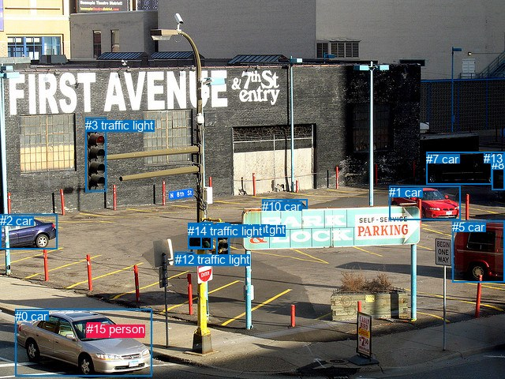
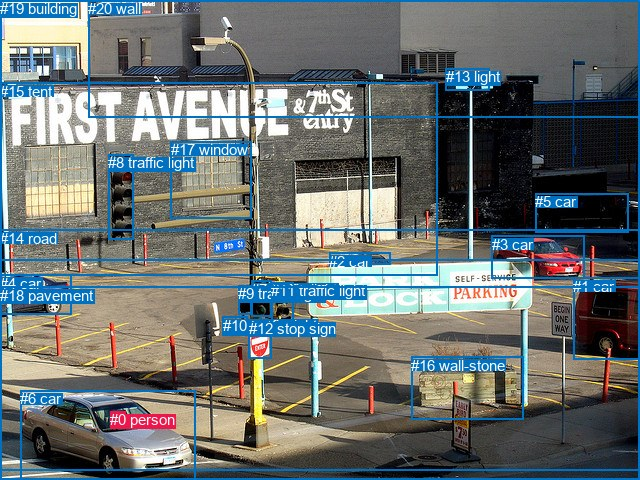

# 图片 0520：2337500.jpg

随机样本序号：249。图片 SHA256：`2b4d8a5404d27eca2b0e3a3d79e2a7129485ba5af33b0f209dcfac06458dfb26`。

红色框表示人，蓝色框表示其他物体。两个模式分别保留自身框编号，可依据位置比较对应对象。

## 自动检测框与输出

人的框编号：`[11, 15]`。状态：`ok`。

### 自动检测全部物体框

| 编号 | 类别 | 是否为人 | 检测分数 | 像素坐标 xyxy |
|---|---|---|---|---|
| 0 | car | False | 0.9995 | 19.3, 391.9, 192.3, 476.2 |
| 1 | car | False | 0.9994 | 493.4, 235.4, 583.8, 278.5 |
| 2 | car | False | 0.9978 | 0.2, 271.5, 72.7, 315.3 |
| 3 | traffic light | False | 0.9883 | 108.3, 149.7, 134.9, 242.5 |
| 4 | traffic light | False | 0.9742 | 274.6, 282.5, 290.6, 326.5 |
| 5 | car | False | 0.9546 | 573.2, 279.2, 639.3, 357.9 |
| 6 | traffic light | False | 0.9258 | 254.3, 281.0, 269.4, 315.8 |
| 7 | car | False | 0.9133 | 540.5, 193.0, 623.1, 233.8 |
| 8 | car | False | 0.9113 | 623.4, 200.1, 640.0, 240.9 |
| 9 | traffic light | False | 0.8920 | 238.7, 282.6, 268.2, 315.3 |
| 10 | car | False | 0.7864 | 332.1, 252.8, 389.3, 264.7 |
| 11 | person | True | 0.7609 | 109.1, 410.1, 133.8, 426.9 |
| 12 | traffic light | False | 0.6477 | 221.6, 319.8, 246.3, 335.3 |
| 13 | car | False | 0.6474 | 613.5, 192.5, 639.8, 206.8 |
| 14 | traffic light | False | 0.6333 | 238.4, 284.0, 255.1, 313.4 |
| 15 | person | True | 0.3903 | 110.2, 408.4, 127.2, 422.8 |

### 自动检测 Top50 人相关候选

评分物体对：240；人相关物体对：58；输出关系：50。

| 排名 | 主语编号与类别 | 关系 | 宾语编号与类别 | 类型 | 人与人 | 排序分数 | 原始融合 logit |
|---|---|---|---|---|---|---|---|
| 1 | #15 person | on | #0 car | spatial | False | 0.96756 | 3.3954 |
| 2 | #11 person | driving on | #0 car | semantic | False | 0.96755 | 3.3950 |
| 3 | #11 person | on | #0 car | spatial | False | 0.96721 | 3.3844 |
| 4 | #15 person | driving on | #0 car | semantic | False | 0.95644 | 3.0891 |
| 5 | #0 car | in | #11 person | spatial | False | 0.66697 | 0.6945 |
| 6 | #0 car | in | #15 person | spatial | False | 0.65256 | 0.6303 |
| 7 | #15 person | on | #11 person | spatial | True | 0.63047 | 0.5342 |
| 8 | #11 person | on | #15 person | spatial | True | 0.55663 | 0.2275 |
| 9 | #0 car | carrying | #15 person | semantic | False | 0.53949 | 0.1583 |
| 10 | #0 car | carrying | #11 person | semantic | False | 0.48611 | -0.0556 |
| 11 | #11 person | wearing | #15 person | semantic | True | 0.11266 | -2.0639 |
| 12 | #15 person | wearing | #11 person | semantic | True | 0.06778 | -2.6214 |
| 13 | #11 person | on | #5 car | spatial | False | 0.01435 | -4.2295 |
| 14 | #15 person | on | #5 car | spatial | False | 0.01426 | -4.2360 |
| 15 | #11 person | on | #1 car | spatial | False | 0.00537 | -5.2214 |
| 16 | #2 car | in | #11 person | spatial | False | 0.00501 | -5.2904 |
| 17 | #15 person | on | #1 car | spatial | False | 0.00491 | -5.3113 |
| 18 | #15 person | looking at | #4 traffic light | semantic | False | 0.00445 | -5.4110 |
| 19 | #2 car | in | #15 person | spatial | False | 0.00429 | -5.4461 |
| 20 | #11 person | on | #4 traffic light | spatial | False | 0.00401 | -5.5147 |
| 21 | #11 person | on | #12 traffic light | spatial | False | 0.00381 | -5.5673 |
| 22 | #11 person | on | #8 car | spatial | False | 0.00375 | -5.5822 |
| 23 | #11 person | looking at | #4 traffic light | semantic | False | 0.00365 | -5.6093 |
| 24 | #11 person | on | #13 car | spatial | False | 0.00354 | -5.6394 |
| 25 | #15 person | on | #8 car | spatial | False | 0.00348 | -5.6559 |
| 26 | #11 person | on | #7 car | spatial | False | 0.00339 | -5.6839 |
| 27 | #5 car | in | #11 person | spatial | False | 0.00339 | -5.6842 |
| 28 | #15 person | on | #13 car | spatial | False | 0.00336 | -5.6935 |
| 29 | #2 car | driving | #11 person | semantic | False | 0.00333 | -5.7005 |
| 30 | #2 car | driving | #15 person | semantic | False | 0.00330 | -5.7101 |
| 31 | #15 person | on | #4 traffic light | spatial | False | 0.00326 | -5.7214 |
| 32 | #15 person | looking at | #6 traffic light | semantic | False | 0.00324 | -5.7299 |
| 33 | #15 person | on | #7 car | spatial | False | 0.00318 | -5.7490 |
| 34 | #11 person | on | #6 traffic light | spatial | False | 0.00308 | -5.7792 |
| 35 | #5 car | in | #15 person | spatial | False | 0.00297 | -5.8174 |
| 36 | #15 person | looking at | #9 traffic light | semantic | False | 0.00296 | -5.8200 |
| 37 | #15 person | on | #12 traffic light | spatial | False | 0.00278 | -5.8813 |
| 38 | #11 person | looking at | #6 traffic light | semantic | False | 0.00261 | -5.9444 |
| 39 | #11 person | looking at | #9 traffic light | semantic | False | 0.00257 | -5.9626 |
| 40 | #15 person | looking at | #14 traffic light | semantic | False | 0.00256 | -5.9657 |
| 41 | #15 person | on | #6 traffic light | spatial | False | 0.00251 | -5.9859 |
| 42 | #11 person | on | #9 traffic light | spatial | False | 0.00221 | -6.1106 |
| 43 | #11 person | on | #14 traffic light | spatial | False | 0.00219 | -6.1212 |
| 44 | #11 person | looking at | #14 traffic light | semantic | False | 0.00211 | -6.1579 |
| 45 | #11 person | on | #2 car | spatial | False | 0.00204 | -6.1912 |
| 46 | #15 person | in | #2 car | spatial | False | 0.00198 | -6.2212 |
| 47 | #11 person | standing on | #5 car | semantic | False | 0.00194 | -6.2407 |
| 48 | #11 person | on | #10 car | spatial | False | 0.00193 | -6.2491 |
| 49 | #15 person | standing on | #5 car | semantic | False | 0.00189 | -6.2682 |
| 50 | #15 person | on | #10 car | spatial | False | 0.00187 | -6.2782 |

### 自动检测逐条人相关 GT 核验

R@50：0.00%；命中 0/1。

| GT 主语编号 | GT 关系 | GT 宾语编号 | 结果阶段 | 匹配预测主语编号 | 匹配预测宾语编号 |
|---|---|---|---|---|---|
| 0 | driving | 6 | wrong_predicate | [11, 15] | [0] |

## 真实框与输出

人的框编号：`[0]`。

### 真实框全部物体框

| 编号 | 类别 | 是否为人 | 检测分数 | 像素坐标 xyxy |
|---|---|---|---|---|
| 0 | person | True | GT | 110.0, 411.0, 125.0, 428.0 |
| 1 | car | False | GT | 573.0, 278.0, 640.0, 360.0 |
| 2 | car | False | GT | 329.0, 253.0, 391.0, 265.0 |
| 3 | car | False | GT | 492.0, 236.0, 585.0, 279.0 |
| 4 | car | False | GT | 0.0, 275.0, 72.0, 315.0 |
| 5 | car | False | GT | 535.0, 193.0, 628.0, 232.0 |
| 6 | car | False | GT | 20.0, 390.0, 195.0, 479.0 |
| 7 | traffic light | False | GT | 251.0, 281.0, 271.0, 317.0 |
| 8 | traffic light | False | GT | 108.0, 154.0, 133.0, 239.0 |
| 9 | traffic light | False | GT | 238.0, 285.0, 251.0, 314.0 |
| 10 | traffic light | False | GT | 223.0, 317.0, 248.0, 336.0 |
| 11 | traffic light | False | GT | 271.0, 282.0, 294.0, 329.0 |
| 12 | stop sign | False | GT | 249.0, 320.0, 271.0, 359.0 |
| 13 | light | False | GT | 446.0, 68.0, 490.0, 90.0 |
| 14 | road | False | GT | 0.0, 230.0, 640.0, 480.0 |
| 15 | tent | False | GT | 0.0, 83.0, 438.0, 276.0 |
| 16 | wall-stone | False | GT | 411.0, 357.0, 523.0, 420.0 |
| 17 | window | False | GT | 171.0, 141.0, 252.0, 219.0 |
| 18 | pavement | False | GT | 0.0, 287.0, 640.0, 471.0 |
| 19 | building | False | GT | 0.0, 0.0, 640.0, 261.0 |
| 20 | wall | False | GT | 88.0, 0.0, 640.0, 117.0 |

### 真实框 Top50 人相关候选

评分物体对：420；人相关物体对：40；输出关系：50。

| 排名 | 主语编号与类别 | 关系 | 宾语编号与类别 | 类型 | 人与人 | 排序分数 | 原始融合 logit |
|---|---|---|---|---|---|---|---|
| 1 | #0 person | on | #6 car | spatial | False | 0.97549 | 3.6837 |
| 2 | #0 person | driving on | #6 car | semantic | False | 0.80041 | 1.3889 |
| 3 | #6 car | in | #0 person | spatial | False | 0.66137 | 0.6694 |
| 4 | #6 car | wearing | #0 person | semantic | False | 0.31760 | -0.7648 |
| 5 | #0 person | on | #1 car | spatial | False | 0.01242 | -4.3759 |
| 6 | #0 person | on | #14 road | spatial | False | 0.00844 | -4.7659 |
| 7 | #0 person | on | #18 pavement | spatial | False | 0.00627 | -5.0656 |
| 8 | #0 person | on | #3 car | spatial | False | 0.00595 | -5.1184 |
| 9 | #4 car | in | #0 person | spatial | False | 0.00484 | -5.3267 |
| 10 | #0 person | on | #4 car | spatial | False | 0.00419 | -5.4705 |
| 11 | #0 person | on | #2 car | spatial | False | 0.00334 | -5.6971 |
| 12 | #0 person | on | #5 car | spatial | False | 0.00314 | -5.7599 |
| 13 | #18 pavement | in | #0 person | spatial | False | 0.00283 | -5.8657 |
| 14 | #0 person | walking on | #18 pavement | semantic | False | 0.00275 | -5.8922 |
| 15 | #0 person | walking on | #14 road | semantic | False | 0.00266 | -5.9262 |
| 16 | #14 road | in | #0 person | spatial | False | 0.00250 | -5.9900 |
| 17 | #2 car | in | #0 person | spatial | False | 0.00240 | -6.0297 |
| 18 | #0 person | on | #12 stop sign | spatial | False | 0.00229 | -6.0782 |
| 19 | #3 car | in | #0 person | spatial | False | 0.00209 | -6.1694 |
| 20 | #0 person | on | #11 traffic light | spatial | False | 0.00204 | -6.1903 |
| 21 | #0 person | on | #13 light | spatial | False | 0.00203 | -6.1997 |
| 22 | #1 car | in | #0 person | spatial | False | 0.00200 | -6.2107 |
| 23 | #0 person | on | #7 traffic light | spatial | False | 0.00178 | -6.3305 |
| 24 | #11 traffic light | on | #0 person | spatial | False | 0.00172 | -6.3617 |
| 25 | #9 traffic light | on | #0 person | spatial | False | 0.00169 | -6.3801 |
| 26 | #12 stop sign | in | #0 person | spatial | False | 0.00168 | -6.3852 |
| 27 | #7 traffic light | on | #0 person | spatial | False | 0.00167 | -6.3925 |
| 28 | #0 person | on | #10 traffic light | spatial | False | 0.00163 | -6.4175 |
| 29 | #0 person | on | #17 window | spatial | False | 0.00154 | -6.4772 |
| 30 | #0 person | looking at | #11 traffic light | semantic | False | 0.00153 | -6.4783 |
| 31 | #4 car | holding | #0 person | semantic | False | 0.00151 | -6.4948 |
| 32 | #0 person | standing on | #1 car | semantic | False | 0.00149 | -6.5093 |
| 33 | #0 person | on | #9 traffic light | spatial | False | 0.00143 | -6.5478 |
| 34 | #0 person | on | #16 wall-stone | spatial | False | 0.00125 | -6.6855 |
| 35 | #0 person | on | #20 wall | spatial | False | 0.00122 | -6.7080 |
| 36 | #10 traffic light | on | #0 person | spatial | False | 0.00120 | -6.7249 |
| 37 | #0 person | looking at | #7 traffic light | semantic | False | 0.00117 | -6.7536 |
| 38 | #0 person | looking at | #12 stop sign | semantic | False | 0.00114 | -6.7782 |
| 39 | #0 person | on | #8 traffic light | spatial | False | 0.00104 | -6.8719 |
| 40 | #0 person | looking at | #9 traffic light | semantic | False | 0.00083 | -7.0989 |
| 41 | #0 person | standing on | #3 car | semantic | False | 0.00081 | -7.1133 |
| 42 | #18 pavement | holding | #0 person | semantic | False | 0.00079 | -7.1370 |
| 43 | #8 traffic light | on | #0 person | spatial | False | 0.00078 | -7.1516 |
| 44 | #0 person | looking at | #8 traffic light | semantic | False | 0.00078 | -7.1520 |
| 45 | #0 person | on | #19 building | spatial | False | 0.00075 | -7.1902 |
| 46 | #5 car | in | #0 person | spatial | False | 0.00074 | -7.2097 |
| 47 | #14 road | wearing | #0 person | semantic | False | 0.00073 | -7.2186 |
| 48 | #0 person | looking at | #10 traffic light | semantic | False | 0.00070 | -7.2691 |
| 49 | #0 person | standing on | #4 car | semantic | False | 0.00067 | -7.3122 |
| 50 | #11 traffic light | holding | #0 person | semantic | False | 0.00064 | -7.3471 |

### 真实框逐条人相关 GT 核验

R@50：0.00%；命中 0/1。

| GT 主语编号 | GT 关系 | GT 宾语编号 | 结果阶段 | 匹配预测主语编号 | 匹配预测宾语编号 |
|---|---|---|---|---|---|
| 0 | driving | 6 | wrong_predicate | [0] | [6] |

## 全部人相关 GT

| 主语编号与类别 | 关系 | 宾语编号与类别 |
|---|---|---|
| #0 person | driving | #6 car |

原始记录、全部人相关物体对的两项预测与分项分数见 [逐图证据 JSON](../evidence/cases/0520.json)。全部56类 logits 保留于本机 HOR/output/random500/logits/。

<!-- HOR_COMPLETE_RESULTS -->

## 六组条件的完整输出对照

以下保留同一图片三种框与候选模式、两种谓词输出规则的全部 Top50。框编号各自在所属模式内解释。

### 自动检测框完整枚举：空间与语义各保留一个谓词

| 排名 | 主语编号与类别 | 谓词 | 宾语编号与类别 | 分组 | 排序分数 | predicate logit | pair logit |
|---|---|---|---|---|---|---|---|
| 1 | #15 person | on | #0 car | spatial | 0.9675599 | 2.8286748 | 0.5667092 |
| 2 | #11 person | driving on | #0 car | semantic | 0.9675480 | 2.8231835 | 0.5718174 |
| 3 | #11 person | on | #0 car | spatial | 0.9672149 | 2.8126302 | 0.5718174 |
| 4 | #15 person | driving on | #0 car | semantic | 0.9564423 | 2.5224247 | 0.5667092 |
| 5 | #0 car | in | #11 person | spatial | 0.6669679 | 0.7499123 | -0.0554095 |
| 6 | #0 car | in | #15 person | spatial | 0.6525578 | 0.6916118 | -0.0613103 |
| 7 | #15 person | on | #11 person | spatial | 0.6304721 | 1.6513805 | -1.1171377 |
| 8 | #11 person | on | #15 person | spatial | 0.5566310 | 1.3590407 | -1.1315403 |
| 9 | #0 car | carrying | #15 person | semantic | 0.5394899 | 0.2195997 | -0.0613103 |
| 10 | #0 car | carrying | #11 person | semantic | 0.4861113 | -0.0001597 | -0.0554095 |
| 11 | #11 person | wearing | #15 person | semantic | 0.1126551 | -0.9323626 | -1.1315403 |
| 12 | #15 person | wearing | #11 person | semantic | 0.0677751 | -1.5042422 | -1.1171377 |
| 13 | #11 person | on | #5 car | spatial | 0.0143502 | -3.1765418 | -1.0529928 |
| 14 | #15 person | on | #5 car | spatial | 0.0142591 | -3.1752529 | -1.0607471 |
| 15 | #11 person | on | #1 car | spatial | 0.0053710 | -3.7888362 | -1.4325277 |
| 16 | #2 car | in | #11 person | spatial | 0.0050144 | -4.0443301 | -1.2460909 |
| 17 | #15 person | on | #1 car | spatial | 0.0049113 | -3.8736653 | -1.4376274 |
| 18 | #15 person | looking at | #4 traffic light | semantic | 0.0044474 | -3.8480828 | -1.5629019 |
| 19 | #2 car | in | #15 person | spatial | 0.0042945 | -4.1932383 | -1.2528747 |
| 20 | #11 person | on | #4 traffic light | spatial | 0.0040109 | -3.9653215 | -1.5493977 |
| 21 | #11 person | on | #12 traffic light | spatial | 0.0038061 | -3.9117279 | -1.6556051 |
| 22 | #11 person | on | #8 car | spatial | 0.0037503 | -4.0348663 | -1.5472941 |
| 23 | #11 person | looking at | #4 traffic light | semantic | 0.0036503 | -4.0598817 | -1.5493977 |
| 24 | #11 person | on | #13 car | spatial | 0.0035426 | -4.0102196 | -1.6291341 |
| 25 | #15 person | on | #8 car | spatial | 0.0034848 | -4.1113834 | -1.5444801 |
| 26 | #11 person | on | #7 car | spatial | 0.0033886 | -4.2352595 | -1.4486847 |
| 27 | #5 car | in | #11 person | spatial | 0.0033877 | -3.8640051 | -1.8201931 |
| 28 | #15 person | on | #13 car | spatial | 0.0033566 | -4.0716910 | -1.6217771 |
| 29 | #2 car | driving | #11 person | semantic | 0.0033333 | -4.4543710 | -1.2460909 |
| 30 | #2 car | driving | #15 person | semantic | 0.0033015 | -4.4572039 | -1.2528747 |
| 31 | #15 person | on | #4 traffic light | spatial | 0.0032645 | -4.1584816 | -1.5629019 |
| 32 | #15 person | looking at | #6 traffic light | semantic | 0.0032367 | -4.0928359 | -1.6371105 |
| 33 | #15 person | on | #7 car | spatial | 0.0031758 | -4.3104877 | -1.4385326 |
| 34 | #11 person | on | #6 traffic light | spatial | 0.0030816 | -4.1562591 | -1.6229467 |
| 35 | #5 car | in | #15 person | spatial | 0.0029664 | -3.9828219 | -1.8346169 |
| 36 | #15 person | looking at | #9 traffic light | semantic | 0.0029587 | -4.1066475 | -1.7133937 |
| 37 | #15 person | on | #12 traffic light | spatial | 0.0027835 | -4.1977396 | -1.6835357 |
| 38 | #11 person | looking at | #6 traffic light | semantic | 0.0026137 | -4.3214302 | -1.6229467 |
| 39 | #11 person | looking at | #9 traffic light | semantic | 0.0025665 | -4.2635942 | -1.6990379 |
| 40 | #15 person | looking at | #14 traffic light | semantic | 0.0025588 | -4.1993752 | -1.7662938 |
| 41 | #15 person | on | #6 traffic light | spatial | 0.0025077 | -4.3487749 | -1.6371105 |
| 42 | #11 person | on | #9 traffic light | spatial | 0.0022144 | -4.4115348 | -1.6990379 |
| 43 | #11 person | on | #14 traffic light | spatial | 0.0021910 | -4.3692651 | -1.7519406 |
| 44 | #11 person | looking at | #14 traffic light | semantic | 0.0021123 | -4.4059243 | -1.7519406 |
| 45 | #11 person | on | #2 car | spatial | 0.0020431 | -5.5845237 | -0.6066979 |
| 46 | #15 person | in | #2 car | spatial | 0.0019829 | -5.6154590 | -0.6057398 |
| 47 | #11 person | standing on | #5 car | semantic | 0.0019446 | -5.1877460 | -1.0529928 |
| 48 | #11 person | on | #10 car | spatial | 0.0019286 | -4.2182808 | -2.0307703 |
| 49 | #15 person | standing on | #5 car | semantic | 0.0018920 | -5.2074752 | -1.0607471 |
| 50 | #15 person | on | #10 car | spatial | 0.0018733 | -4.2457948 | -2.0323949 |

GT 命中：0/1，R@50=0.00%。

| GT主语 | GT谓词 | GT宾语 | 结果阶段 | 匹配主语框 | 匹配宾语框 |
|---|---|---|---|---|---|
| 0 | driving | 6 | wrong_predicate | [11, 15] | [0] |

### 自动检测框完整枚举：每对只保留一个谓词

| 排名 | 主语编号与类别 | 谓词 | 宾语编号与类别 | 分组 | 排序分数 | predicate logit | pair logit |
|---|---|---|---|---|---|---|---|
| 1 | #15 person | on | #0 car | single | 0.9675599 | 2.8286748 | 0.5667092 |
| 2 | #11 person | driving on | #0 car | single | 0.9675480 | 2.8231835 | 0.5718174 |
| 3 | #0 car | in | #11 person | single | 0.6669679 | 0.7499123 | -0.0554095 |
| 4 | #0 car | in | #15 person | single | 0.6525578 | 0.6916118 | -0.0613103 |
| 5 | #15 person | on | #11 person | single | 0.6304721 | 1.6513805 | -1.1171377 |
| 6 | #11 person | on | #15 person | single | 0.5566310 | 1.3590407 | -1.1315403 |
| 7 | #11 person | on | #5 car | single | 0.0143502 | -3.1765418 | -1.0529928 |
| 8 | #15 person | on | #5 car | single | 0.0142591 | -3.1752529 | -1.0607471 |
| 9 | #11 person | on | #1 car | single | 0.0053710 | -3.7888362 | -1.4325277 |
| 10 | #2 car | in | #11 person | single | 0.0050144 | -4.0443301 | -1.2460909 |
| 11 | #15 person | on | #1 car | single | 0.0049113 | -3.8736653 | -1.4376274 |
| 12 | #15 person | looking at | #4 traffic light | single | 0.0044474 | -3.8480828 | -1.5629019 |
| 13 | #2 car | in | #15 person | single | 0.0042945 | -4.1932383 | -1.2528747 |
| 14 | #11 person | on | #4 traffic light | single | 0.0040109 | -3.9653215 | -1.5493977 |
| 15 | #11 person | on | #12 traffic light | single | 0.0038061 | -3.9117279 | -1.6556051 |
| 16 | #11 person | on | #8 car | single | 0.0037503 | -4.0348663 | -1.5472941 |
| 17 | #11 person | on | #13 car | single | 0.0035426 | -4.0102196 | -1.6291341 |
| 18 | #15 person | on | #8 car | single | 0.0034848 | -4.1113834 | -1.5444801 |
| 19 | #11 person | on | #7 car | single | 0.0033886 | -4.2352595 | -1.4486847 |
| 20 | #5 car | in | #11 person | single | 0.0033877 | -3.8640051 | -1.8201931 |
| 21 | #15 person | on | #13 car | single | 0.0033566 | -4.0716910 | -1.6217771 |
| 22 | #15 person | looking at | #6 traffic light | single | 0.0032367 | -4.0928359 | -1.6371105 |
| 23 | #15 person | on | #7 car | single | 0.0031758 | -4.3104877 | -1.4385326 |
| 24 | #11 person | on | #6 traffic light | single | 0.0030816 | -4.1562591 | -1.6229467 |
| 25 | #5 car | in | #15 person | single | 0.0029664 | -3.9828219 | -1.8346169 |
| 26 | #15 person | looking at | #9 traffic light | single | 0.0029587 | -4.1066475 | -1.7133937 |
| 27 | #15 person | on | #12 traffic light | single | 0.0027835 | -4.1977396 | -1.6835357 |
| 28 | #11 person | looking at | #9 traffic light | single | 0.0025665 | -4.2635942 | -1.6990379 |
| 29 | #15 person | looking at | #14 traffic light | single | 0.0025588 | -4.1993752 | -1.7662938 |
| 30 | #11 person | on | #14 traffic light | single | 0.0021910 | -4.3692651 | -1.7519406 |
| 31 | #11 person | on | #2 car | single | 0.0020431 | -5.5845237 | -0.6066979 |
| 32 | #15 person | in | #2 car | single | 0.0019829 | -5.6154590 | -0.6057398 |
| 33 | #11 person | on | #10 car | single | 0.0019286 | -4.2182808 | -2.0307703 |
| 34 | #15 person | on | #10 car | single | 0.0018733 | -4.2457948 | -2.0323949 |
| 35 | #1 car | in | #11 person | single | 0.0015818 | -4.3810911 | -2.0665412 |
| 36 | #10 car | in | #11 person | single | 0.0015002 | -3.9496346 | -2.5510440 |
| 37 | #10 car | in | #15 person | single | 0.0014069 | -4.0006351 | -2.5642951 |
| 38 | #1 car | in | #15 person | single | 0.0013681 | -4.5182724 | -2.0747190 |
| 39 | #7 car | driving | #11 person | single | 0.0013015 | -4.3867545 | -2.2561920 |
| 40 | #8 car | driving | #11 person | single | 0.0012806 | -4.5136514 | -2.1455045 |
| 41 | #7 car | driving | #15 person | single | 0.0012115 | -4.4525738 | -2.2621031 |
| 42 | #8 car | driving | #15 person | single | 0.0011163 | -4.6450586 | -2.1515229 |
| 43 | #11 person | looking at | #3 traffic light | single | 0.0009760 | -5.3701177 | -1.5609835 |
| 44 | #13 car | driving | #11 person | single | 0.0009486 | -4.7470698 | -2.2125471 |
| 45 | #15 person | looking at | #3 traffic light | single | 0.0009125 | -5.4323921 | -1.5660682 |
| 46 | #12 traffic light | on | #11 person | single | 0.0008719 | -5.2097139 | -1.8342617 |
| 47 | #13 car | driving | #15 person | single | 0.0008509 | -4.8493266 | -2.2190285 |
| 48 | #3 traffic light | on | #11 person | single | 0.0008020 | -5.3824162 | -1.7451773 |
| 49 | #12 traffic light | in | #15 person | single | 0.0007984 | -5.2750092 | -1.8570881 |
| 50 | #4 traffic light | in | #15 person | single | 0.0007910 | -5.2501135 | -1.8913164 |

GT 命中：0/1，R@50=0.00%。

| GT主语 | GT谓词 | GT宾语 | 结果阶段 | 匹配主语框 | 匹配宾语框 |
|---|---|---|---|---|---|
| 0 | driving | 6 | wrong_predicate | [11, 15] | [0] |

### 真实框完整枚举：空间与语义各保留一个谓词

| 排名 | 主语编号与类别 | 谓词 | 宾语编号与类别 | 分组 | 排序分数 | predicate logit | pair logit |
|---|---|---|---|---|---|---|---|
| 1 | #0 person | on | #6 car | spatial | 0.9754871 | 3.1032329 | 0.5805069 |
| 2 | #0 person | driving on | #6 car | semantic | 0.8004130 | 0.8083711 | 0.5805069 |
| 3 | #6 car | in | #0 person | spatial | 0.6613663 | 0.7211361 | -0.0517471 |
| 4 | #6 car | wearing | #0 person | semantic | 0.3175994 | -0.7130792 | -0.0517471 |
| 5 | #0 person | on | #1 car | spatial | 0.0124209 | -3.3632579 | -1.0126204 |
| 6 | #0 person | on | #14 road | spatial | 0.0084433 | -3.2616601 | -1.5042393 |
| 7 | #0 person | on | #18 pavement | spatial | 0.0062707 | -3.2893186 | -1.7762519 |
| 8 | #0 person | on | #3 car | spatial | 0.0059498 | -3.6696153 | -1.4488115 |
| 9 | #4 car | in | #0 person | spatial | 0.0048368 | -4.0490904 | -1.2775712 |
| 10 | #0 person | on | #4 car | spatial | 0.0041916 | -4.8325739 | -0.6378999 |
| 11 | #0 person | on | #2 car | spatial | 0.0033445 | -3.6389449 | -2.0581293 |
| 12 | #0 person | on | #5 car | spatial | 0.0031415 | -4.3059769 | -1.4539162 |
| 13 | #18 pavement | in | #0 person | spatial | 0.0028271 | -4.1565194 | -1.7091419 |
| 14 | #0 person | walking on | #18 pavement | semantic | 0.0027533 | -4.1159410 | -1.7762519 |
| 15 | #0 person | walking on | #14 road | semantic | 0.0026614 | -4.4220023 | -1.5042393 |
| 16 | #14 road | in | #0 person | spatial | 0.0024973 | -4.2452455 | -1.7448009 |
| 17 | #2 car | in | #0 person | spatial | 0.0024004 | -3.4431729 | -2.5865436 |
| 18 | #0 person | on | #12 stop sign | spatial | 0.0022871 | -4.5301766 | -1.5480027 |
| 19 | #3 car | in | #0 person | spatial | 0.0020881 | -4.0944500 | -2.0749474 |
| 20 | #0 person | on | #11 traffic light | spatial | 0.0020449 | -4.6397967 | -1.5505494 |
| 21 | #0 person | on | #13 light | spatial | 0.0020259 | -3.6595433 | -2.5401793 |
| 22 | #1 car | in | #0 person | spatial | 0.0020038 | -4.3973560 | -1.8133613 |
| 23 | #0 person | on | #7 traffic light | spatial | 0.0017780 | -4.7123027 | -1.6181862 |
| 24 | #11 traffic light | on | #0 person | spatial | 0.0017235 | -4.4621677 | -1.8995273 |
| 25 | #9 traffic light | on | #0 person | spatial | 0.0016921 | -4.3264675 | -2.0536337 |
| 26 | #12 stop sign | in | #0 person | spatial | 0.0016834 | -4.7081766 | -1.6770484 |
| 27 | #7 traffic light | on | #0 person | spatial | 0.0016713 | -4.4855251 | -1.9069593 |
| 28 | #0 person | on | #10 traffic light | spatial | 0.0016300 | -4.7542500 | -1.6632909 |
| 29 | #0 person | on | #17 window | spatial | 0.0015358 | -4.2054725 | -2.2717047 |
| 30 | #0 person | looking at | #11 traffic light | semantic | 0.0015341 | -4.9277072 | -1.5505494 |
| 31 | #4 car | holding | #0 person | semantic | 0.0015090 | -5.2172389 | -1.2775712 |
| 32 | #0 person | standing on | #1 car | semantic | 0.0014872 | -5.4967213 | -1.0126204 |
| 33 | #0 person | on | #9 traffic light | spatial | 0.0014312 | -4.7359824 | -1.8118353 |
| 34 | #0 person | on | #16 wall-stone | spatial | 0.0012473 | -4.2752557 | -2.4102452 |
| 35 | #0 person | on | #20 wall | spatial | 0.0012196 | -4.3609390 | -2.3470464 |
| 36 | #10 traffic light | on | #0 person | spatial | 0.0011992 | -4.8719110 | -1.8530056 |
| 37 | #0 person | looking at | #7 traffic light | semantic | 0.0011653 | -5.1354628 | -1.6181862 |
| 38 | #0 person | looking at | #12 stop sign | semantic | 0.0011370 | -5.2302022 | -1.5480027 |
| 39 | #0 person | on | #8 traffic light | spatial | 0.0010355 | -5.2733474 | -1.5985138 |
| 40 | #0 person | looking at | #9 traffic light | semantic | 0.0008253 | -5.2870588 | -1.8118353 |
| 41 | #0 person | standing on | #3 car | semantic | 0.0008135 | -5.6644807 | -1.4488115 |
| 42 | #18 pavement | holding | #0 person | semantic | 0.0007945 | -5.4278083 | -1.7091419 |
| 43 | #8 traffic light | on | #0 person | spatial | 0.0007830 | -5.3675947 | -1.7839816 |
| 44 | #0 person | looking at | #8 traffic light | semantic | 0.0007827 | -5.5534816 | -1.5985138 |
| 45 | #0 person | on | #19 building | spatial | 0.0007534 | -4.7399468 | -2.4502549 |
| 46 | #5 car | in | #0 person | spatial | 0.0007388 | -4.9234595 | -2.2862442 |
| 47 | #14 road | wearing | #0 person | semantic | 0.0007323 | -5.4737711 | -1.7448009 |
| 48 | #0 person | looking at | #10 traffic light | semantic | 0.0006962 | -5.6058331 | -1.6632909 |
| 49 | #0 person | standing on | #4 car | semantic | 0.0006669 | -6.6743388 | -0.6378999 |
| 50 | #11 traffic light | holding | #0 person | semantic | 0.0006441 | -5.4475236 | -1.8995273 |

GT 命中：0/1，R@50=0.00%。

| GT主语 | GT谓词 | GT宾语 | 结果阶段 | 匹配主语框 | 匹配宾语框 |
|---|---|---|---|---|---|
| 0 | driving | 6 | wrong_predicate | [0] | [6] |

### 真实框完整枚举：每对只保留一个谓词

| 排名 | 主语编号与类别 | 谓词 | 宾语编号与类别 | 分组 | 排序分数 | predicate logit | pair logit |
|---|---|---|---|---|---|---|---|
| 1 | #0 person | on | #6 car | single | 0.9754871 | 3.1032329 | 0.5805069 |
| 2 | #6 car | in | #0 person | single | 0.6613663 | 0.7211361 | -0.0517471 |
| 3 | #0 person | on | #1 car | single | 0.0124209 | -3.3632579 | -1.0126204 |
| 4 | #0 person | on | #14 road | single | 0.0084433 | -3.2616601 | -1.5042393 |
| 5 | #0 person | on | #18 pavement | single | 0.0062707 | -3.2893186 | -1.7762519 |
| 6 | #0 person | on | #3 car | single | 0.0059498 | -3.6696153 | -1.4488115 |
| 7 | #4 car | in | #0 person | single | 0.0048368 | -4.0490904 | -1.2775712 |
| 8 | #0 person | on | #4 car | single | 0.0041916 | -4.8325739 | -0.6378999 |
| 9 | #0 person | on | #2 car | single | 0.0033445 | -3.6389449 | -2.0581293 |
| 10 | #0 person | on | #5 car | single | 0.0031415 | -4.3059769 | -1.4539162 |
| 11 | #18 pavement | in | #0 person | single | 0.0028271 | -4.1565194 | -1.7091419 |
| 12 | #14 road | in | #0 person | single | 0.0024973 | -4.2452455 | -1.7448009 |
| 13 | #2 car | in | #0 person | single | 0.0024004 | -3.4431729 | -2.5865436 |
| 14 | #0 person | on | #12 stop sign | single | 0.0022871 | -4.5301766 | -1.5480027 |
| 15 | #3 car | in | #0 person | single | 0.0020881 | -4.0944500 | -2.0749474 |
| 16 | #0 person | on | #11 traffic light | single | 0.0020449 | -4.6397967 | -1.5505494 |
| 17 | #0 person | on | #13 light | single | 0.0020259 | -3.6595433 | -2.5401793 |
| 18 | #1 car | in | #0 person | single | 0.0020038 | -4.3973560 | -1.8133613 |
| 19 | #0 person | on | #7 traffic light | single | 0.0017780 | -4.7123027 | -1.6181862 |
| 20 | #11 traffic light | on | #0 person | single | 0.0017235 | -4.4621677 | -1.8995273 |
| 21 | #9 traffic light | on | #0 person | single | 0.0016921 | -4.3264675 | -2.0536337 |
| 22 | #12 stop sign | in | #0 person | single | 0.0016834 | -4.7081766 | -1.6770484 |
| 23 | #7 traffic light | on | #0 person | single | 0.0016713 | -4.4855251 | -1.9069593 |
| 24 | #0 person | on | #10 traffic light | single | 0.0016300 | -4.7542500 | -1.6632909 |
| 25 | #0 person | on | #17 window | single | 0.0015358 | -4.2054725 | -2.2717047 |
| 26 | #0 person | on | #9 traffic light | single | 0.0014312 | -4.7359824 | -1.8118353 |
| 27 | #0 person | on | #16 wall-stone | single | 0.0012473 | -4.2752557 | -2.4102452 |
| 28 | #0 person | on | #20 wall | single | 0.0012196 | -4.3609390 | -2.3470464 |
| 29 | #10 traffic light | on | #0 person | single | 0.0011992 | -4.8719110 | -1.8530056 |
| 30 | #0 person | on | #8 traffic light | single | 0.0010355 | -5.2733474 | -1.5985138 |
| 31 | #8 traffic light | on | #0 person | single | 0.0007830 | -5.3675947 | -1.7839816 |
| 32 | #0 person | on | #19 building | single | 0.0007534 | -4.7399468 | -2.4502549 |
| 33 | #5 car | in | #0 person | single | 0.0007388 | -4.9234595 | -2.2862442 |
| 34 | #0 person | on | #15 tent | single | 0.0006225 | -4.8514676 | -2.5297139 |
| 35 | #16 wall-stone | in | #0 person | single | 0.0005849 | -4.9768400 | -2.4666653 |
| 36 | #13 light | on | #0 person | single | 0.0005155 | -4.4977832 | -3.0720887 |
| 37 | #19 building | in | #0 person | single | 0.0004874 | -5.1766424 | -2.4492655 |
| 38 | #20 wall | in | #0 person | single | 0.0003382 | -5.3438344 | -2.6475754 |
| 39 | #15 tent | in | #0 person | single | 0.0003223 | -5.6262403 | -2.4135857 |
| 40 | #17 window | in | #0 person | single | 0.0001937 | -5.8675218 | -2.6814854 |

GT 命中：0/1，R@50=0.00%。

| GT主语 | GT谓词 | GT宾语 | 结果阶段 | 匹配主语框 | 匹配宾语框 |
|---|---|---|---|---|---|
| 0 | driving | 6 | wrong_predicate | [0] | [6] |

### 真实框400候选：空间与语义各保留一个谓词

| 排名 | 主语编号与类别 | 谓词 | 宾语编号与类别 | 分组 | 排序分数 | predicate logit | pair logit |
|---|---|---|---|---|---|---|---|
| 1 | #0 person | on | #6 car | spatial | 0.9748206 | 3.0757184 | 0.5805069 |
| 2 | #0 person | driving on | #6 car | semantic | 0.8004087 | 0.8083439 | 0.5805069 |
| 3 | #6 car | in | #0 person | spatial | 0.6545947 | 0.6910448 | -0.0517471 |
| 4 | #6 car | wearing | #0 person | semantic | 0.3149802 | -0.7251909 | -0.0517471 |
| 5 | #0 person | on | #1 car | spatial | 0.0121376 | -3.3866158 | -1.0126204 |
| 6 | #0 person | on | #14 road | spatial | 0.0093976 | -3.1536183 | -1.5042393 |
| 7 | #0 person | on | #18 pavement | spatial | 0.0069524 | -3.1854329 | -1.7762519 |
| 8 | #0 person | on | #3 car | spatial | 0.0048562 | -3.8738098 | -1.4488115 |
| 9 | #4 car | in | #0 person | spatial | 0.0048528 | -4.0457716 | -1.2775712 |
| 10 | #0 person | on | #4 car | spatial | 0.0040510 | -4.8668213 | -0.6378999 |
| 11 | #0 person | walking on | #18 pavement | semantic | 0.0033499 | -3.9192243 | -1.7762519 |
| 12 | #0 person | walking on | #14 road | semantic | 0.0032028 | -4.2362871 | -1.5042393 |
| 13 | #18 pavement | in | #0 person | spatial | 0.0029400 | -4.1172462 | -1.7091419 |
| 14 | #14 road | in | #0 person | spatial | 0.0026276 | -4.1942449 | -1.7448009 |
| 15 | #0 person | on | #5 car | spatial | 0.0025263 | -4.5245728 | -1.4539162 |
| 16 | #0 person | on | #12 stop sign | spatial | 0.0021241 | -4.6042609 | -1.5480027 |
| 17 | #1 car | in | #0 person | spatial | 0.0020104 | -4.3940372 | -1.8133613 |
| 18 | #0 person | looking at | #11 traffic light | semantic | 0.0018039 | -4.7654576 | -1.5505494 |
| 19 | #0 person | on | #11 traffic light | spatial | 0.0017968 | -4.7694077 | -1.5505494 |
| 20 | #12 stop sign | in | #0 person | spatial | 0.0017877 | -4.6479940 | -1.6770484 |
| 21 | #0 person | on | #17 window | spatial | 0.0017663 | -4.0654058 | -2.2717047 |
| 22 | #0 person | on | #7 traffic light | spatial | 0.0015929 | -4.8223896 | -1.6181862 |
| 23 | #4 car | holding | #0 person | semantic | 0.0015384 | -5.1979165 | -1.2775712 |
| 24 | #0 person | standing on | #1 car | semantic | 0.0014651 | -5.5117669 | -1.0126204 |
| 25 | #0 person | on | #10 traffic light | spatial | 0.0014347 | -4.8821054 | -1.6632909 |
| 26 | #0 person | looking at | #7 traffic light | semantic | 0.0013681 | -4.9748087 | -1.6181862 |
| 27 | #0 person | on | #16 wall-stone | spatial | 0.0013244 | -4.2152181 | -2.4102452 |
| 28 | #0 person | looking at | #12 stop sign | semantic | 0.0013182 | -5.0821862 | -1.5480027 |
| 29 | #0 person | on | #8 traffic light | spatial | 0.0010532 | -5.2563686 | -1.5985138 |
| 30 | #0 person | looking at | #8 traffic light | semantic | 0.0008821 | -5.4338136 | -1.5985138 |
| 31 | #0 person | on | #20 wall | spatial | 0.0008605 | -4.7101450 | -2.3470464 |
| 32 | #0 person | looking at | #10 traffic light | semantic | 0.0008343 | -5.4247494 | -1.6632909 |
| 33 | #18 pavement | holding | #0 person | semantic | 0.0008250 | -5.3901596 | -1.7091419 |
| 34 | #8 traffic light | on | #0 person | spatial | 0.0007849 | -5.3651948 | -1.7839816 |
| 35 | #14 road | wearing | #0 person | semantic | 0.0007754 | -5.4165225 | -1.7448009 |
| 36 | #0 person | standing on | #3 car | semantic | 0.0007055 | -5.8071213 | -1.4488115 |
| 37 | #0 person | on | #19 building | spatial | 0.0007002 | -4.8132420 | -2.4502549 |
| 38 | #0 person | standing on | #4 car | semantic | 0.0006569 | -6.6893845 | -0.6378999 |
| 39 | #16 wall-stone | in | #0 person | spatial | 0.0006322 | -4.8990674 | -2.4666653 |
| 40 | #1 car | holding | #0 person | semantic | 0.0006128 | -5.5835538 | -1.8133613 |
| 41 | #0 person | on | #15 tent | spatial | 0.0005923 | -4.9012275 | -2.5297139 |
| 42 | #12 stop sign | holding | #0 person | semantic | 0.0005659 | -5.7995481 | -1.6770484 |
| 43 | #19 building | in | #0 person | spatial | 0.0005080 | -5.1351700 | -2.4492655 |
| 44 | #0 person | standing on | #5 car | semantic | 0.0004568 | -6.2368150 | -1.4539162 |
| 45 | #0 person | looking at | #17 window | semantic | 0.0004325 | -5.4737210 | -2.2717047 |
| 46 | #0 person | looking at | #16 wall-stone | semantic | 0.0004054 | -5.3999147 | -2.4102452 |
| 47 | #0 person | looking at | #20 wall | semantic | 0.0003695 | -5.5558157 | -2.3470464 |
| 48 | #16 wall-stone | holding | #0 person | semantic | 0.0003579 | -5.4682031 | -2.4666653 |
| 49 | #8 traffic light | holding | #0 person | semantic | 0.0003516 | -6.1687508 | -1.7839816 |
| 50 | #15 tent | in | #0 person | spatial | 0.0003363 | -5.5836482 | -2.4135857 |

GT 命中：0/1，R@50=0.00%。

| GT主语 | GT谓词 | GT宾语 | 结果阶段 | 匹配主语框 | 匹配宾语框 |
|---|---|---|---|---|---|
| 0 | driving | 6 | wrong_predicate | [0] | [6] |

### 真实框400候选：每对只保留一个谓词

| 排名 | 主语编号与类别 | 谓词 | 宾语编号与类别 | 分组 | 排序分数 | predicate logit | pair logit |
|---|---|---|---|---|---|---|---|
| 1 | #0 person | on | #6 car | single | 0.9748206 | 3.0757184 | 0.5805069 |
| 2 | #6 car | in | #0 person | single | 0.6545947 | 0.6910448 | -0.0517471 |
| 3 | #0 person | on | #1 car | single | 0.0121376 | -3.3866158 | -1.0126204 |
| 4 | #0 person | on | #14 road | single | 0.0093976 | -3.1536183 | -1.5042393 |
| 5 | #0 person | on | #18 pavement | single | 0.0069524 | -3.1854329 | -1.7762519 |
| 6 | #0 person | on | #3 car | single | 0.0048562 | -3.8738098 | -1.4488115 |
| 7 | #4 car | in | #0 person | single | 0.0048528 | -4.0457716 | -1.2775712 |
| 8 | #0 person | on | #4 car | single | 0.0040510 | -4.8668213 | -0.6378999 |
| 9 | #18 pavement | in | #0 person | single | 0.0029400 | -4.1172462 | -1.7091419 |
| 10 | #14 road | in | #0 person | single | 0.0026276 | -4.1942449 | -1.7448009 |
| 11 | #0 person | on | #5 car | single | 0.0025263 | -4.5245728 | -1.4539162 |
| 12 | #0 person | on | #12 stop sign | single | 0.0021241 | -4.6042609 | -1.5480027 |
| 13 | #1 car | in | #0 person | single | 0.0020104 | -4.3940372 | -1.8133613 |
| 14 | #0 person | looking at | #11 traffic light | single | 0.0018039 | -4.7654576 | -1.5505494 |
| 15 | #12 stop sign | in | #0 person | single | 0.0017877 | -4.6479940 | -1.6770484 |
| 16 | #0 person | on | #17 window | single | 0.0017663 | -4.0654058 | -2.2717047 |
| 17 | #0 person | on | #7 traffic light | single | 0.0015929 | -4.8223896 | -1.6181862 |
| 18 | #0 person | on | #10 traffic light | single | 0.0014347 | -4.8821054 | -1.6632909 |
| 19 | #0 person | on | #16 wall-stone | single | 0.0013244 | -4.2152181 | -2.4102452 |
| 20 | #0 person | on | #8 traffic light | single | 0.0010532 | -5.2563686 | -1.5985138 |
| 21 | #0 person | on | #20 wall | single | 0.0008605 | -4.7101450 | -2.3470464 |
| 22 | #8 traffic light | on | #0 person | single | 0.0007849 | -5.3651948 | -1.7839816 |
| 23 | #0 person | on | #19 building | single | 0.0007002 | -4.8132420 | -2.4502549 |
| 24 | #16 wall-stone | in | #0 person | single | 0.0006322 | -4.8990674 | -2.4666653 |
| 25 | #0 person | on | #15 tent | single | 0.0005923 | -4.9012275 | -2.5297139 |
| 26 | #19 building | in | #0 person | single | 0.0005080 | -5.1351700 | -2.4492655 |
| 27 | #15 tent | in | #0 person | single | 0.0003363 | -5.5836482 | -2.4135857 |
| 28 | #17 window | in | #0 person | single | 0.0002156 | -5.7603493 | -2.6814854 |

GT 命中：0/1，R@50=0.00%。

| GT主语 | GT谓词 | GT宾语 | 结果阶段 | 匹配主语框 | 匹配宾语框 |
|---|---|---|---|---|---|
| 0 | driving | 6 | wrong_predicate | [0] | [6] |
