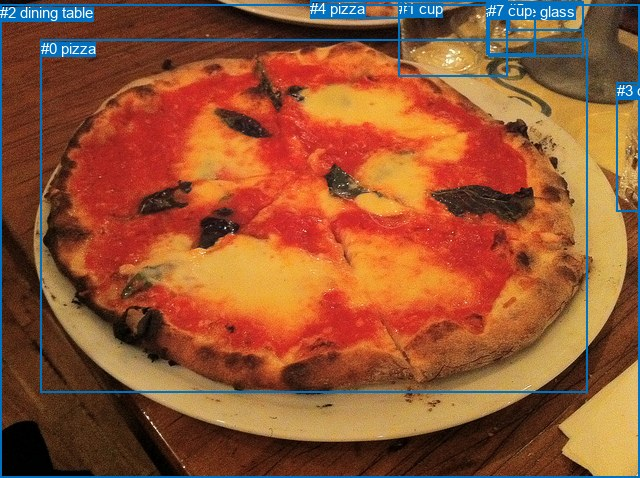
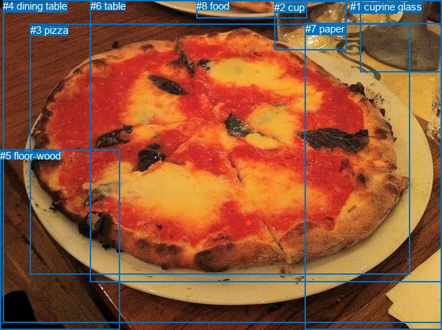

# 图片 0547：2339203.jpg

随机样本序号：37。图片 SHA256：`b5100ccec30bfc57efb6c8fce4c1510de8b824dfede37c1396e3f3f6a6d74d13`。

红色框表示人，蓝色框表示其他物体。两个模式分别保留自身框编号，可依据位置比较对应对象。

## 自动检测框与输出

人的框编号：`[]`。状态：`no_person`。

### 自动检测全部物体框

| 编号 | 类别 | 是否为人 | 检测分数 | 像素坐标 xyxy |
|---|---|---|---|---|
| 0 | pizza | False | 0.9981 | 40.8, 39.6, 588.0, 392.3 |
| 1 | cup | False | 0.9943 | 398.6, 0.4, 507.7, 76.4 |
| 2 | dining table | False | 0.8232 | 0.0, 4.2, 640.0, 478.0 |
| 3 | cup | False | 0.8094 | 616.5, 82.2, 639.8, 211.6 |
| 4 | pizza | False | 0.6708 | 310.1, 0.0, 403.6, 18.8 |
| 5 | cup | False | 0.5442 | 508.2, 1.2, 583.2, 30.1 |
| 6 | wine glass | False | 0.5255 | 486.2, 2.9, 535.3, 54.7 |
| 7 | cup | False | 0.4488 | 488.1, 2.3, 583.1, 56.2 |

### 自动检测 Top50 人相关候选

评分物体对：0；人相关物体对：0；输出关系：0。

| 排名 | 主语编号与类别 | 关系 | 宾语编号与类别 | 类型 | 人与人 | 排序分数 | 原始融合 logit |
|---|---|---|---|---|---|---|---|

### 自动检测逐条人相关 GT 核验

本图没有人相关 GT，R@50 无分母；预测候选继续展示。

## 真实框与输出

人的框编号：`[]`。

### 真实框全部物体框

| 编号 | 类别 | 是否为人 | 检测分数 | 像素坐标 xyxy |
|---|---|---|---|---|
| 0 | wine glass | False | GT | 522.0, 1.0, 640.0, 104.0 |
| 1 | cup | False | GT | 507.0, 1.0, 575.0, 20.0 |
| 2 | cup | False | GT | 397.0, 2.0, 501.0, 73.0 |
| 3 | pizza | False | GT | 44.0, 35.0, 593.0, 397.0 |
| 4 | dining table | False | GT | 4.0, 0.0, 640.0, 468.0 |
| 5 | floor-wood | False | GT | 0.0, 217.0, 174.0, 478.0 |
| 6 | table | False | GT | 131.0, 0.0, 640.0, 409.0 |
| 7 | paper | False | GT | 442.0, 33.0, 640.0, 478.0 |
| 8 | food | False | GT | 284.0, 0.0, 444.0, 27.0 |

### 真实框 Top50 人相关候选

评分物体对：0；人相关物体对：0；输出关系：0。

| 排名 | 主语编号与类别 | 关系 | 宾语编号与类别 | 类型 | 人与人 | 排序分数 | 原始融合 logit |
|---|---|---|---|---|---|---|---|

### 真实框逐条人相关 GT 核验

本图没有人相关 GT，R@50 无分母；预测候选继续展示。

## 全部人相关 GT

| 主语编号与类别 | 关系 | 宾语编号与类别 |
|---|---|---|

原始记录、全部人相关物体对的两项预测与分项分数见 [逐图证据 JSON](../evidence/cases/0547.json)。全部56类 logits 保留于本机 HOR/output/random500/logits/。

<!-- HOR_COMPLETE_RESULTS -->

## 六组条件的完整输出对照

以下保留同一图片三种框与候选模式、两种谓词输出规则的全部 Top50。框编号各自在所属模式内解释。

### 自动检测框完整枚举：空间与语义各保留一个谓词

| 排名 | 主语编号与类别 | 谓词 | 宾语编号与类别 | 分组 | 排序分数 | predicate logit | pair logit |
|---|---|---|---|---|---|---|---|

没有人相关 GT，本条件的召回率无分母。

### 自动检测框完整枚举：每对只保留一个谓词

| 排名 | 主语编号与类别 | 谓词 | 宾语编号与类别 | 分组 | 排序分数 | predicate logit | pair logit |
|---|---|---|---|---|---|---|---|

没有人相关 GT，本条件的召回率无分母。

### 真实框完整枚举：空间与语义各保留一个谓词

| 排名 | 主语编号与类别 | 谓词 | 宾语编号与类别 | 分组 | 排序分数 | predicate logit | pair logit |
|---|---|---|---|---|---|---|---|

没有人相关 GT，本条件的召回率无分母。

### 真实框完整枚举：每对只保留一个谓词

| 排名 | 主语编号与类别 | 谓词 | 宾语编号与类别 | 分组 | 排序分数 | predicate logit | pair logit |
|---|---|---|---|---|---|---|---|

没有人相关 GT，本条件的召回率无分母。

### 真实框400候选：空间与语义各保留一个谓词

| 排名 | 主语编号与类别 | 谓词 | 宾语编号与类别 | 分组 | 排序分数 | predicate logit | pair logit |
|---|---|---|---|---|---|---|---|

没有人相关 GT，本条件的召回率无分母。

### 真实框400候选：每对只保留一个谓词

| 排名 | 主语编号与类别 | 谓词 | 宾语编号与类别 | 分组 | 排序分数 | predicate logit | pair logit |
|---|---|---|---|---|---|---|---|

没有人相关 GT，本条件的召回率无分母。
