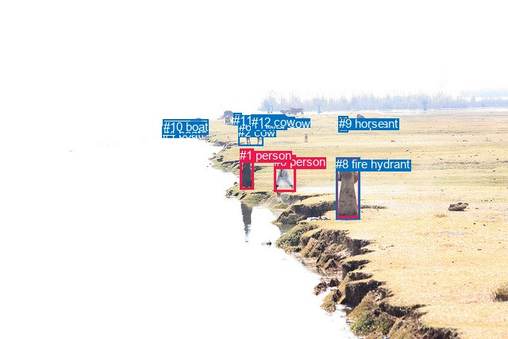
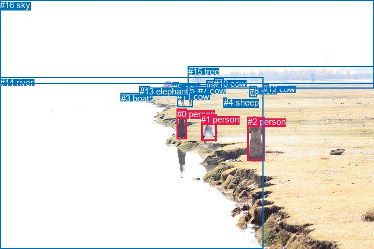

# 图片 0551：2339515.jpg

随机样本序号：292。图片 SHA256：`1e8f37827f316e5b51e1db3fdf2efc2c4751557c7ccb6f0b7c1d0a836b307ca1`。

红色框表示人，蓝色框表示其他物体。两个模式分别保留自身框编号，可依据位置比较对应对象。

## 自动检测框与输出

人的框编号：`[0, 1, 3]`。状态：`ok`。

### 自动检测全部物体框

| 编号 | 类别 | 是否为人 | 检测分数 | 像素坐标 xyxy |
|---|---|---|---|---|
| 0 | person | True | 0.9942 | 345.3, 195.2, 372.1, 241.9 |
| 1 | person | True | 0.9942 | 302.4, 187.0, 319.8, 238.9 |
| 2 | cow | False | 0.9863 | 300.3, 158.3, 331.4, 183.1 |
| 3 | person | True | 0.9697 | 423.8, 198.9, 453.1, 274.8 |
| 4 | boat | False | 0.9431 | 205.0, 159.9, 261.8, 168.9 |
| 5 | cow | False | 0.7568 | 343.7, 146.9, 361.3, 163.3 |
| 6 | cow | False | 0.5831 | 300.9, 151.1, 322.1, 161.7 |
| 7 | elephant | False | 0.5789 | 426.2, 146.8, 439.0, 166.2 |
| 8 | fire hydrant | False | 0.5676 | 423.4, 198.1, 453.3, 276.3 |
| 9 | horse | False | 0.4555 | 426.5, 146.9, 439.0, 166.5 |
| 10 | boat | False | 0.3907 | 206.0, 150.6, 262.5, 169.3 |
| 11 | cow | False | 0.3669 | 294.5, 142.7, 304.9, 157.5 |
| 12 | cow | False | 0.3548 | 316.9, 144.7, 359.7, 163.9 |

### 自动检测 Top50 人相关候选

评分物体对：156；人相关物体对：66；输出关系：50。

| 排名 | 主语编号与类别 | 关系 | 宾语编号与类别 | 类型 | 人与人 | 排序分数 | 原始融合 logit |
|---|---|---|---|---|---|---|---|
| 1 | #1 person | looking at | #2 cow | semantic | False | 0.95537 | 3.0638 |
| 2 | #8 fire hydrant | wearing | #3 person | semantic | False | 0.93648 | 2.6907 |
| 3 | #3 person | wearing | #8 fire hydrant | semantic | False | 0.90532 | 2.2578 |
| 4 | #1 person | looking at | #6 cow | semantic | False | 0.89787 | 2.1738 |
| 5 | #1 person | looking at | #12 cow | semantic | False | 0.88690 | 2.0595 |
| 6 | #8 fire hydrant | in | #3 person | spatial | False | 0.87532 | 1.9488 |
| 7 | #1 person | beside | #2 cow | spatial | False | 0.83377 | 1.6126 |
| 8 | #3 person | in | #8 fire hydrant | spatial | False | 0.82939 | 1.5813 |
| 9 | #1 person | looking at | #10 boat | semantic | False | 0.76285 | 1.1683 |
| 10 | #1 person | looking at | #4 boat | semantic | False | 0.75838 | 1.1438 |
| 11 | #1 person | beside | #0 person | spatial | True | 0.74932 | 1.0950 |
| 12 | #1 person | looking at | #11 cow | semantic | False | 0.74314 | 1.0624 |
| 13 | #0 person | walking on | #1 person | semantic | True | 0.74251 | 1.0591 |
| 14 | #1 person | walking on | #0 person | semantic | True | 0.67983 | 0.7530 |
| 15 | #1 person | looking at | #5 cow | semantic | False | 0.63031 | 0.5335 |
| 16 | #1 person | looking at | #7 elephant | semantic | False | 0.62258 | 0.5005 |
| 17 | #1 person | looking at | #9 horse | semantic | False | 0.60651 | 0.4327 |
| 18 | #0 person | walking on | #3 person | semantic | True | 0.58572 | 0.3463 |
| 19 | #0 person | beside | #1 person | spatial | True | 0.57356 | 0.2964 |
| 20 | #0 person | walking on | #8 fire hydrant | semantic | False | 0.56535 | 0.2629 |
| 21 | #3 person | looking at | #7 elephant | semantic | False | 0.55467 | 0.2196 |
| 22 | #3 person | looking at | #9 horse | semantic | False | 0.54442 | 0.1782 |
| 23 | #1 person | looking at | #3 person | semantic | True | 0.52142 | 0.0857 |
| 24 | #1 person | looking at | #8 fire hydrant | semantic | False | 0.50571 | 0.0228 |
| 25 | #1 person | beside | #6 cow | spatial | False | 0.49869 | -0.0052 |
| 26 | #3 person | looking at | #12 cow | semantic | False | 0.48466 | -0.0614 |
| 27 | #3 person | looking at | #2 cow | semantic | False | 0.47622 | -0.0952 |
| 28 | #0 person | looking at | #2 cow | semantic | False | 0.47199 | -0.1121 |
| 29 | #3 person | looking at | #6 cow | semantic | False | 0.46798 | -0.1282 |
| 30 | #0 person | looking at | #12 cow | semantic | False | 0.38491 | -0.4688 |
| 31 | #3 person | looking at | #10 boat | semantic | False | 0.35736 | -0.5868 |
| 32 | #3 person | looking at | #4 boat | semantic | False | 0.35358 | -0.6033 |
| 33 | #0 person | walking on | #4 boat | semantic | False | 0.34920 | -0.6226 |
| 34 | #0 person | beside | #3 person | spatial | True | 0.34313 | -0.6494 |
| 35 | #3 person | looking at | #11 cow | semantic | False | 0.33731 | -0.6753 |
| 36 | #1 person | beside | #12 cow | spatial | False | 0.33185 | -0.6998 |
| 37 | #3 person | beside | #0 person | spatial | True | 0.32485 | -0.7316 |
| 38 | #8 fire hydrant | beside | #0 person | spatial | False | 0.32028 | -0.7525 |
| 39 | #0 person | beside | #8 fire hydrant | spatial | False | 0.31742 | -0.7657 |
| 40 | #0 person | walking on | #6 cow | semantic | False | 0.31520 | -0.7759 |
| 41 | #0 person | walking on | #10 boat | semantic | False | 0.31443 | -0.7795 |
| 42 | #3 person | looking at | #5 cow | semantic | False | 0.30632 | -0.8174 |
| 43 | #1 person | beside | #3 person | spatial | True | 0.28418 | -0.9238 |
| 44 | #1 person | beside | #8 fire hydrant | spatial | False | 0.28354 | -0.9270 |
| 45 | #3 person | standing on | #0 person | semantic | True | 0.26909 | -0.9993 |
| 46 | #0 person | beside | #2 cow | spatial | False | 0.26862 | -1.0016 |
| 47 | #8 fire hydrant | standing on | #0 person | semantic | False | 0.25850 | -1.0538 |
| 48 | #0 person | walking on | #5 cow | semantic | False | 0.22750 | -1.2225 |
| 49 | #1 person | beside | #11 cow | spatial | False | 0.22679 | -1.2265 |
| 50 | #1 person | beside | #4 boat | spatial | False | 0.21200 | -1.3129 |

### 自动检测逐条人相关 GT 核验

R@50：0.00%；命中 0/3。

| GT 主语编号 | GT 关系 | GT 宾语编号 | 结果阶段 | 匹配预测主语编号 | 匹配预测宾语编号 |
|---|---|---|---|---|---|
| 0 | looking at | 14 | endpoint_missing_or_wrong_class | [1] | [] |
| 2 | looking at | 8 | endpoint_missing_or_wrong_class | [3] | [] |
| 6 | looking at | 0 | endpoint_missing_or_wrong_class | [] | [1] |

## 真实框与输出

人的框编号：`[0, 1, 2]`。

### 真实框全部物体框

| 编号 | 类别 | 是否为人 | 检测分数 | 像素坐标 xyxy |
|---|---|---|---|---|
| 0 | person | True | GT | 303.0, 187.0, 320.0, 239.0 |
| 1 | person | True | GT | 344.0, 196.0, 370.0, 241.0 |
| 2 | person | True | GT | 424.0, 200.0, 453.0, 275.0 |
| 3 | boat | False | GT | 207.0, 160.0, 261.0, 170.0 |
| 4 | sheep | False | GT | 383.0, 167.0, 388.0, 179.0 |
| 5 | cow | False | GT | 295.0, 142.0, 305.0, 157.0 |
| 6 | cow | False | GT | 317.0, 146.0, 339.0, 156.0 |
| 7 | cow | False | GT | 339.0, 147.0, 362.0, 163.0 |
| 8 | cow | False | GT | 427.0, 147.0, 440.0, 166.0 |
| 9 | cow | False | GT | 353.0, 137.0, 366.0, 146.0 |
| 10 | cow | False | GT | 366.0, 135.0, 382.0, 145.0 |
| 11 | cow | False | GT | 303.0, 157.0, 329.0, 184.0 |
| 12 | cow | False | GT | 450.0, 144.0, 459.0, 149.0 |
| 13 | elephant | False | GT | 239.0, 148.0, 257.0, 160.0 |
| 14 | river | False | GT | 0.0, 133.0, 450.0, 427.0 |
| 15 | tree | False | GT | 322.0, 114.0, 640.0, 152.0 |
| 16 | sky | False | GT | 0.0, 0.0, 640.0, 144.0 |

### 真实框 Top50 人相关候选

评分物体对：272；人相关物体对：90；输出关系：50。

| 排名 | 主语编号与类别 | 关系 | 宾语编号与类别 | 类型 | 人与人 | 排序分数 | 原始融合 logit |
|---|---|---|---|---|---|---|---|
| 1 | #2 person | beside | #14 river | spatial | False | 0.95572 | 3.0720 |
| 2 | #2 person | standing on | #14 river | semantic | False | 0.95511 | 3.0575 |
| 3 | #0 person | standing on | #14 river | semantic | False | 0.95492 | 3.0531 |
| 4 | #0 person | beside | #14 river | spatial | False | 0.94198 | 2.7872 |
| 5 | #0 person | looking at | #11 cow | semantic | False | 0.92532 | 2.5169 |
| 6 | #1 person | beside | #14 river | spatial | False | 0.90422 | 2.2450 |
| 7 | #1 person | standing on | #14 river | semantic | False | 0.90016 | 2.1990 |
| 8 | #0 person | beside | #11 cow | spatial | False | 0.77069 | 1.2122 |
| 9 | #0 person | beside | #1 person | spatial | True | 0.76095 | 1.1579 |
| 10 | #0 person | looking at | #6 cow | semantic | False | 0.75638 | 1.1329 |
| 11 | #0 person | looking at | #3 boat | semantic | False | 0.70998 | 0.8953 |
| 12 | #0 person | looking at | #5 cow | semantic | False | 0.63450 | 0.5516 |
| 13 | #2 person | looking at | #3 boat | semantic | False | 0.59823 | 0.3981 |
| 14 | #0 person | looking at | #7 cow | semantic | False | 0.59206 | 0.3725 |
| 15 | #2 person | looking at | #11 cow | semantic | False | 0.58837 | 0.3572 |
| 16 | #0 person | looking at | #8 cow | semantic | False | 0.56521 | 0.2623 |
| 17 | #2 person | looking at | #8 cow | semantic | False | 0.55828 | 0.2342 |
| 18 | #0 person | standing on | #1 person | semantic | True | 0.54147 | 0.1663 |
| 19 | #0 person | looking at | #2 person | semantic | True | 0.53872 | 0.1552 |
| 20 | #1 person | beside | #0 person | spatial | True | 0.51081 | 0.0433 |
| 21 | #2 person | looking at | #6 cow | semantic | False | 0.48929 | -0.0429 |
| 22 | #2 person | looking at | #5 cow | semantic | False | 0.48861 | -0.0456 |
| 23 | #1 person | beside | #2 person | spatial | True | 0.47266 | -0.1095 |
| 24 | #0 person | looking at | #13 elephant | semantic | False | 0.46969 | -0.1214 |
| 25 | #0 person | looking at | #12 cow | semantic | False | 0.45993 | -0.1606 |
| 26 | #1 person | looking at | #11 cow | semantic | False | 0.44147 | -0.2352 |
| 27 | #14 river | beside | #2 person | spatial | False | 0.44016 | -0.2405 |
| 28 | #14 river | beside | #0 person | spatial | False | 0.42383 | -0.3071 |
| 29 | #2 person | looking at | #7 cow | semantic | False | 0.39078 | -0.4440 |
| 30 | #0 person | beside | #2 person | spatial | True | 0.37884 | -0.4945 |
| 31 | #2 person | beside | #1 person | spatial | True | 0.36711 | -0.5446 |
| 32 | #1 person | walking on | #0 person | semantic | True | 0.36244 | -0.5648 |
| 33 | #1 person | looking at | #2 person | semantic | True | 0.35328 | -0.6047 |
| 34 | #2 person | looking at | #13 elephant | semantic | False | 0.33215 | -0.6985 |
| 35 | #2 person | looking at | #16 sky | semantic | False | 0.32478 | -0.7319 |
| 36 | #14 river | beside | #1 person | spatial | False | 0.29901 | -0.8520 |
| 37 | #2 person | wearing | #1 person | semantic | True | 0.25916 | -1.0503 |
| 38 | #1 person | walking on | #3 boat | semantic | False | 0.25420 | -1.0763 |
| 39 | #0 person | beside | #3 boat | spatial | False | 0.25061 | -1.0954 |
| 40 | #1 person | looking at | #6 cow | semantic | False | 0.24987 | -1.0993 |
| 41 | #0 person | looking at | #9 cow | semantic | False | 0.24517 | -1.1245 |
| 42 | #1 person | beside | #11 cow | spatial | False | 0.23282 | -1.1924 |
| 43 | #1 person | looking at | #7 cow | semantic | False | 0.23144 | -1.2002 |
| 44 | #0 person | looking at | #10 cow | semantic | False | 0.22470 | -1.2385 |
| 45 | #2 person | looking at | #12 cow | semantic | False | 0.22436 | -1.2404 |
| 46 | #2 person | beside | #0 person | spatial | True | 0.22297 | -1.2485 |
| 47 | #1 person | looking at | #8 cow | semantic | False | 0.18918 | -1.4553 |
| 48 | #2 person | looking at | #4 sheep | semantic | False | 0.18552 | -1.4794 |
| 49 | #2 person | looking at | #9 cow | semantic | False | 0.18159 | -1.5056 |
| 50 | #1 person | looking at | #5 cow | semantic | False | 0.17758 | -1.5328 |

### 真实框逐条人相关 GT 核验

R@50：33.33%；命中 1/3。

| GT 主语编号 | GT 关系 | GT 宾语编号 | 结果阶段 | 匹配预测主语编号 | 匹配预测宾语编号 |
|---|---|---|---|---|---|
| 0 | looking at | 14 | wrong_predicate | [0] | [14] |
| 2 | looking at | 8 | hit50 | [2] | [8] |
| 6 | looking at | 0 | wrong_predicate | [6] | [0] |

## 全部人相关 GT

| 主语编号与类别 | 关系 | 宾语编号与类别 |
|---|---|---|
| #0 person | looking at | #14 river |
| #2 person | looking at | #8 cow |
| #6 cow | looking at | #0 person |

原始记录、全部人相关物体对的两项预测与分项分数见 [逐图证据 JSON](../evidence/cases/0551.json)。全部56类 logits 保留于本机 HOR/output/random500/logits/。

<!-- HOR_COMPLETE_RESULTS -->

## 六组条件的完整输出对照

以下保留同一图片三种框与候选模式、两种谓词输出规则的全部 Top50。框编号各自在所属模式内解释。

### 自动检测框完整枚举：空间与语义各保留一个谓词

| 排名 | 主语编号与类别 | 谓词 | 宾语编号与类别 | 分组 | 排序分数 | predicate logit | pair logit |
|---|---|---|---|---|---|---|---|
| 1 | #1 person | looking at | #2 cow | semantic | 0.9553742 | 3.1445017 | -0.0807111 |
| 2 | #8 fire hydrant | wearing | #3 person | semantic | 0.9364771 | 2.8171391 | -0.1264137 |
| 3 | #3 person | wearing | #8 fire hydrant | semantic | 0.9053188 | 2.4479218 | -0.1901506 |
| 4 | #1 person | looking at | #6 cow | semantic | 0.8978738 | 2.3991928 | -0.2253722 |
| 5 | #1 person | looking at | #12 cow | semantic | 0.8869046 | 2.4992280 | -0.4397221 |
| 6 | #8 fire hydrant | in | #3 person | spatial | 0.8753189 | 2.0752425 | -0.1264137 |
| 7 | #1 person | beside | #2 cow | spatial | 0.8337655 | 1.6932635 | -0.0807111 |
| 8 | #3 person | in | #8 fire hydrant | spatial | 0.8293893 | 1.7714562 | -0.1901506 |
| 9 | #1 person | looking at | #10 boat | semantic | 0.7628466 | 1.6867642 | -0.5184147 |
| 10 | #1 person | looking at | #4 boat | semantic | 0.7583776 | 1.5975366 | -0.4537315 |
| 11 | #1 person | beside | #0 person | spatial | 0.7493213 | 1.4013143 | -0.3063183 |
| 12 | #1 person | looking at | #11 cow | semantic | 0.7431445 | 1.4261622 | -0.3637853 |
| 13 | #0 person | walking on | #1 person | semantic | 0.7425131 | 1.9228592 | -0.8637876 |
| 14 | #1 person | walking on | #0 person | semantic | 0.6798281 | 1.0593004 | -0.3063183 |
| 15 | #1 person | looking at | #5 cow | semantic | 0.6303051 | 1.0814528 | -0.5479270 |
| 16 | #1 person | looking at | #7 elephant | semantic | 0.6225807 | 1.2629375 | -0.7624208 |
| 17 | #1 person | looking at | #9 horse | semantic | 0.6065090 | 1.2027550 | -0.7700937 |
| 18 | #0 person | walking on | #3 person | semantic | 0.5857177 | 1.0743394 | -0.7280492 |
| 19 | #0 person | beside | #1 person | spatial | 0.5735603 | 1.1601796 | -0.8637876 |
| 20 | #0 person | walking on | #8 fire hydrant | semantic | 0.5653547 | 1.0171676 | -0.7542445 |
| 21 | #3 person | looking at | #7 elephant | semantic | 0.5546694 | 0.9596934 | -0.7401382 |
| 22 | #3 person | looking at | #9 horse | semantic | 0.5444246 | 0.9294276 | -0.7512594 |
| 23 | #1 person | looking at | #3 person | semantic | 0.5214216 | 1.0533447 | -0.9676059 |
| 24 | #1 person | looking at | #8 fire hydrant | semantic | 0.5057098 | 0.9935112 | -0.9706711 |
| 25 | #1 person | beside | #6 cow | spatial | 0.4986876 | 0.2201228 | -0.2253722 |
| 26 | #3 person | looking at | #12 cow | semantic | 0.4846625 | 0.9698043 | -1.0311735 |
| 27 | #3 person | looking at | #2 cow | semantic | 0.4762167 | 0.9407582 | -1.0359633 |
| 28 | #0 person | looking at | #2 cow | semantic | 0.4719932 | 0.1199274 | -0.2320721 |
| 29 | #3 person | looking at | #6 cow | semantic | 0.4679830 | 0.8889432 | -1.0171868 |
| 30 | #0 person | looking at | #12 cow | semantic | 0.3849061 | 0.0077558 | -0.4765314 |
| 31 | #3 person | looking at | #10 boat | semantic | 0.3573585 | 0.4249148 | -1.0117625 |
| 32 | #3 person | looking at | #4 boat | semantic | 0.3535796 | 0.3388252 | -0.9421664 |
| 33 | #0 person | walking on | #4 boat | semantic | 0.3491980 | 0.1009102 | -0.7234765 |
| 34 | #0 person | beside | #3 person | spatial | 0.3431333 | 0.0786872 | -0.7280492 |
| 35 | #3 person | looking at | #11 cow | semantic | 0.3373078 | 0.4421067 | -1.1174215 |
| 36 | #1 person | beside | #12 cow | spatial | 0.3318521 | -0.2600980 | -0.4397221 |
| 37 | #3 person | beside | #0 person | spatial | 0.3248543 | -0.1060238 | -0.6255282 |
| 38 | #8 fire hydrant | beside | #0 person | spatial | 0.3202787 | -0.1362886 | -0.6162028 |
| 39 | #0 person | beside | #8 fire hydrant | spatial | 0.3174192 | -0.0114131 | -0.7542445 |
| 40 | #0 person | walking on | #6 cow | semantic | 0.3151966 | -0.4076161 | -0.3683190 |
| 41 | #0 person | walking on | #10 boat | semantic | 0.3144262 | 0.0106363 | -0.7901428 |
| 42 | #3 person | looking at | #5 cow | semantic | 0.3063240 | 0.2169995 | -1.0343611 |
| 43 | #1 person | beside | #3 person | spatial | 0.2841764 | 0.0437675 | -0.9676059 |
| 44 | #1 person | beside | #8 fire hydrant | spatial | 0.2835357 | 0.0436807 | -0.9706711 |
| 45 | #3 person | standing on | #0 person | semantic | 0.2690861 | -0.3737359 | -0.6255282 |
| 46 | #0 person | beside | #2 cow | spatial | 0.2686235 | -0.7695453 | -0.2320721 |
| 47 | #8 fire hydrant | standing on | #0 person | semantic | 0.2584974 | -0.4375901 | -0.6162028 |
| 48 | #0 person | walking on | #5 cow | semantic | 0.2275022 | -0.7115393 | -0.5109298 |
| 49 | #1 person | beside | #11 cow | spatial | 0.2267896 | -0.8627431 | -0.3637853 |
| 50 | #1 person | beside | #4 boat | spatial | 0.2119989 | -0.8591869 | -0.4537315 |

GT 命中：0/3，R@50=0.00%。

| GT主语 | GT谓词 | GT宾语 | 结果阶段 | 匹配主语框 | 匹配宾语框 |
|---|---|---|---|---|---|
| 0 | looking at | 14 | endpoint_missing_or_wrong_class | [1] | [] |
| 2 | looking at | 8 | endpoint_missing_or_wrong_class | [3] | [] |
| 6 | looking at | 0 | endpoint_missing_or_wrong_class | [] | [1] |

### 自动检测框完整枚举：每对只保留一个谓词

| 排名 | 主语编号与类别 | 谓词 | 宾语编号与类别 | 分组 | 排序分数 | predicate logit | pair logit |
|---|---|---|---|---|---|---|---|
| 1 | #1 person | looking at | #2 cow | single | 0.9553742 | 3.1445017 | -0.0807111 |
| 2 | #8 fire hydrant | wearing | #3 person | single | 0.9364771 | 2.8171391 | -0.1264137 |
| 3 | #3 person | wearing | #8 fire hydrant | single | 0.9053188 | 2.4479218 | -0.1901506 |
| 4 | #1 person | looking at | #6 cow | single | 0.8978738 | 2.3991928 | -0.2253722 |
| 5 | #1 person | looking at | #12 cow | single | 0.8869046 | 2.4992280 | -0.4397221 |
| 6 | #1 person | looking at | #10 boat | single | 0.7628466 | 1.6867642 | -0.5184147 |
| 7 | #1 person | looking at | #4 boat | single | 0.7583776 | 1.5975366 | -0.4537315 |
| 8 | #1 person | beside | #0 person | single | 0.7493213 | 1.4013143 | -0.3063183 |
| 9 | #1 person | looking at | #11 cow | single | 0.7431445 | 1.4261622 | -0.3637853 |
| 10 | #0 person | walking on | #1 person | single | 0.7425131 | 1.9228592 | -0.8637876 |
| 11 | #1 person | looking at | #5 cow | single | 0.6303051 | 1.0814528 | -0.5479270 |
| 12 | #1 person | looking at | #7 elephant | single | 0.6225807 | 1.2629375 | -0.7624208 |
| 13 | #1 person | looking at | #9 horse | single | 0.6065090 | 1.2027550 | -0.7700937 |
| 14 | #0 person | walking on | #3 person | single | 0.5857177 | 1.0743394 | -0.7280492 |
| 15 | #0 person | walking on | #8 fire hydrant | single | 0.5653547 | 1.0171676 | -0.7542445 |
| 16 | #3 person | looking at | #7 elephant | single | 0.5546694 | 0.9596934 | -0.7401382 |
| 17 | #3 person | looking at | #9 horse | single | 0.5444246 | 0.9294276 | -0.7512594 |
| 18 | #1 person | looking at | #3 person | single | 0.5214216 | 1.0533447 | -0.9676059 |
| 19 | #1 person | looking at | #8 fire hydrant | single | 0.5057098 | 0.9935112 | -0.9706711 |
| 20 | #3 person | looking at | #12 cow | single | 0.4846625 | 0.9698043 | -1.0311735 |
| 21 | #3 person | looking at | #2 cow | single | 0.4762167 | 0.9407582 | -1.0359633 |
| 22 | #0 person | looking at | #2 cow | single | 0.4719932 | 0.1199274 | -0.2320721 |
| 23 | #3 person | looking at | #6 cow | single | 0.4679830 | 0.8889432 | -1.0171868 |
| 24 | #0 person | looking at | #12 cow | single | 0.3849061 | 0.0077558 | -0.4765314 |
| 25 | #3 person | looking at | #10 boat | single | 0.3573585 | 0.4249148 | -1.0117625 |
| 26 | #3 person | looking at | #4 boat | single | 0.3535796 | 0.3388252 | -0.9421664 |
| 27 | #0 person | walking on | #4 boat | single | 0.3491980 | 0.1009102 | -0.7234765 |
| 28 | #3 person | looking at | #11 cow | single | 0.3373078 | 0.4421067 | -1.1174215 |
| 29 | #3 person | beside | #0 person | single | 0.3248543 | -0.1060238 | -0.6255282 |
| 30 | #8 fire hydrant | beside | #0 person | single | 0.3202787 | -0.1362886 | -0.6162028 |
| 31 | #0 person | walking on | #6 cow | single | 0.3151966 | -0.4076161 | -0.3683190 |
| 32 | #0 person | walking on | #10 boat | single | 0.3144262 | 0.0106363 | -0.7901428 |
| 33 | #3 person | looking at | #5 cow | single | 0.3063240 | 0.2169995 | -1.0343611 |
| 34 | #0 person | walking on | #5 cow | single | 0.2275022 | -0.7115393 | -0.5109298 |
| 35 | #0 person | looking at | #7 elephant | single | 0.1944835 | -0.7869277 | -0.6342087 |
| 36 | #0 person | looking at | #9 horse | single | 0.1848810 | -0.8464129 | -0.6372089 |
| 37 | #3 person | standing on | #1 person | single | 0.1810083 | -0.1543236 | -1.3552076 |
| 38 | #0 person | walking on | #11 cow | single | 0.1772111 | -1.0034273 | -0.5319306 |
| 39 | #8 fire hydrant | standing on | #1 person | single | 0.1694136 | -0.2519417 | -1.3378470 |
| 40 | #2 cow | beside | #1 person | single | 0.1115577 | -0.9447515 | -1.1301761 |
| 41 | #7 elephant | looking at | #3 person | single | 0.0462039 | -1.7579749 | -1.2694107 |
| 42 | #9 horse | looking at | #3 person | single | 0.0451971 | -1.7728462 | -1.2776248 |
| 43 | #4 boat | beside | #1 person | single | 0.0298689 | -2.3526793 | -1.1279335 |
| 44 | #6 cow | walking on | #1 person | single | 0.0288281 | -2.3755758 | -1.1415777 |
| 45 | #12 cow | walking on | #1 person | single | 0.0285888 | -2.3078809 | -1.2178524 |
| 46 | #10 boat | beside | #1 person | single | 0.0281161 | -2.4130352 | -1.1298593 |
| 47 | #11 cow | beside | #1 person | single | 0.0239339 | -2.5370431 | -1.1711922 |
| 48 | #9 horse | walking on | #1 person | single | 0.0216078 | -2.2867723 | -1.5260838 |
| 49 | #7 elephant | walking on | #1 person | single | 0.0213635 | -2.3033235 | -1.5211520 |
| 50 | #2 cow | beside | #0 person | single | 0.0201524 | -2.7766166 | -1.1074570 |

GT 命中：0/3，R@50=0.00%。

| GT主语 | GT谓词 | GT宾语 | 结果阶段 | 匹配主语框 | 匹配宾语框 |
|---|---|---|---|---|---|
| 0 | looking at | 14 | endpoint_missing_or_wrong_class | [1] | [] |
| 2 | looking at | 8 | endpoint_missing_or_wrong_class | [3] | [] |
| 6 | looking at | 0 | endpoint_missing_or_wrong_class | [] | [1] |

### 真实框完整枚举：空间与语义各保留一个谓词

| 排名 | 主语编号与类别 | 谓词 | 宾语编号与类别 | 分组 | 排序分数 | predicate logit | pair logit |
|---|---|---|---|---|---|---|---|
| 1 | #2 person | beside | #14 river | spatial | 0.9557242 | 3.1715512 | -0.0995208 |
| 2 | #2 person | standing on | #14 river | semantic | 0.9551062 | 3.1570430 | -0.0995208 |
| 3 | #0 person | standing on | #14 river | semantic | 0.9549162 | 3.1070638 | -0.0539649 |
| 4 | #0 person | beside | #14 river | spatial | 0.9419781 | 2.8411260 | -0.0539649 |
| 5 | #0 person | looking at | #11 cow | semantic | 0.9253176 | 2.6105285 | -0.0936366 |
| 6 | #1 person | beside | #14 river | spatial | 0.9042196 | 2.5410805 | -0.2960660 |
| 7 | #1 person | standing on | #14 river | semantic | 0.9001570 | 2.4950356 | -0.2960660 |
| 8 | #0 person | beside | #11 cow | spatial | 0.7706879 | 1.3058362 | -0.0936366 |
| 9 | #0 person | beside | #1 person | spatial | 0.7609481 | 1.4333138 | -0.2754295 |
| 10 | #0 person | looking at | #6 cow | semantic | 0.7563770 | 1.5418859 | -0.4089681 |
| 11 | #0 person | looking at | #3 boat | semantic | 0.7099847 | 1.3434496 | -0.4481400 |
| 12 | #0 person | looking at | #5 cow | semantic | 0.6344953 | 0.9309969 | -0.3794460 |
| 13 | #2 person | looking at | #3 boat | semantic | 0.5982316 | 1.3353229 | -0.9372209 |
| 14 | #0 person | looking at | #7 cow | semantic | 0.5920576 | 0.8861542 | -0.5136761 |
| 15 | #2 person | looking at | #11 cow | semantic | 0.5883670 | 1.4053750 | -1.0481560 |
| 16 | #0 person | looking at | #8 cow | semantic | 0.5652131 | 1.0284834 | -0.7661368 |
| 17 | #2 person | looking at | #8 cow | semantic | 0.5582764 | 0.9823551 | -0.7481855 |
| 18 | #0 person | standing on | #1 person | semantic | 0.5414684 | 0.4416852 | -0.2754295 |
| 19 | #0 person | looking at | #2 person | semantic | 0.5387238 | 1.1159678 | -0.9607615 |
| 20 | #1 person | beside | #0 person | spatial | 0.5108147 | 0.8909779 | -0.8477120 |
| 21 | #2 person | looking at | #6 cow | semantic | 0.4892866 | 0.9900250 | -1.0328851 |
| 22 | #2 person | looking at | #5 cow | semantic | 0.4886137 | 1.0806470 | -1.1262000 |
| 23 | #1 person | beside | #2 person | spatial | 0.4726633 | 0.6216593 | -0.7311156 |
| 24 | #0 person | looking at | #13 elephant | semantic | 0.4696861 | 0.5219216 | -0.6433263 |
| 25 | #0 person | looking at | #12 cow | semantic | 0.4599281 | 0.8549085 | -1.0155406 |
| 26 | #1 person | looking at | #11 cow | semantic | 0.4414748 | 0.0094991 | -0.2446778 |
| 27 | #14 river | beside | #2 person | spatial | 0.4401595 | 0.7081170 | -0.9486316 |
| 28 | #14 river | beside | #0 person | spatial | 0.4238316 | 0.6172647 | -0.9243288 |
| 29 | #2 person | looking at | #7 cow | semantic | 0.3907849 | 0.5950036 | -1.0390178 |
| 30 | #0 person | beside | #2 person | spatial | 0.3788403 | 0.4662881 | -0.9607615 |
| 31 | #2 person | beside | #1 person | spatial | 0.3671079 | 0.0757670 | -0.6204111 |
| 32 | #1 person | walking on | #0 person | semantic | 0.3624429 | 0.2829351 | -0.8477120 |
| 33 | #1 person | looking at | #2 person | semantic | 0.3532755 | 0.1264434 | -0.7311156 |
| 34 | #2 person | looking at | #13 elephant | semantic | 0.3321481 | 0.4913731 | -1.1898587 |
| 35 | #2 person | looking at | #16 sky | semantic | 0.3247768 | 0.6550775 | -1.3869827 |
| 36 | #14 river | beside | #1 person | spatial | 0.2990124 | 0.1055689 | -0.9575740 |
| 37 | #2 person | wearing | #1 person | semantic | 0.2591601 | -0.4299273 | -0.6204111 |
| 38 | #1 person | walking on | #3 boat | semantic | 0.2541992 | -0.3519497 | -0.7243906 |
| 39 | #0 person | beside | #3 boat | spatial | 0.2506106 | -0.6472182 | -0.4481400 |
| 40 | #1 person | looking at | #6 cow | semantic | 0.2498694 | -0.6130042 | -0.4863046 |
| 41 | #0 person | looking at | #9 cow | semantic | 0.2451710 | -0.3654761 | -0.7590593 |
| 42 | #1 person | beside | #11 cow | spatial | 0.2328241 | -0.9477549 | -0.2446778 |
| 43 | #1 person | looking at | #7 cow | semantic | 0.2314372 | -0.7018833 | -0.4983305 |
| 44 | #0 person | looking at | #10 cow | semantic | 0.2247024 | -0.4232183 | -0.8152518 |
| 45 | #2 person | looking at | #12 cow | semantic | 0.2243644 | -0.3294578 | -0.9109536 |
| 46 | #2 person | beside | #0 person | spatial | 0.2229657 | 0.1047015 | -1.3531679 |
| 47 | #1 person | looking at | #8 cow | semantic | 0.1891843 | -0.8070827 | -0.6482365 |
| 48 | #2 person | looking at | #4 sheep | semantic | 0.1855209 | -0.8516424 | -0.6277391 |
| 49 | #2 person | looking at | #9 cow | semantic | 0.1815868 | -0.4487772 | -1.0568566 |
| 50 | #1 person | looking at | #5 cow | semantic | 0.1775846 | -0.9912367 | -0.5415615 |

GT 命中：1/3，R@50=33.33%。

| GT主语 | GT谓词 | GT宾语 | 结果阶段 | 匹配主语框 | 匹配宾语框 |
|---|---|---|---|---|---|
| 0 | looking at | 14 | wrong_predicate | [0] | [14] |
| 2 | looking at | 8 | hit50 | [2] | [8] |
| 6 | looking at | 0 | wrong_predicate | [6] | [0] |

### 真实框完整枚举：每对只保留一个谓词

| 排名 | 主语编号与类别 | 谓词 | 宾语编号与类别 | 分组 | 排序分数 | predicate logit | pair logit |
|---|---|---|---|---|---|---|---|
| 1 | #2 person | beside | #14 river | single | 0.9557242 | 3.1715512 | -0.0995208 |
| 2 | #0 person | standing on | #14 river | single | 0.9549162 | 3.1070638 | -0.0539649 |
| 3 | #0 person | looking at | #11 cow | single | 0.9253176 | 2.6105285 | -0.0936366 |
| 4 | #1 person | beside | #14 river | single | 0.9042196 | 2.5410805 | -0.2960660 |
| 5 | #0 person | beside | #1 person | single | 0.7609481 | 1.4333138 | -0.2754295 |
| 6 | #0 person | looking at | #6 cow | single | 0.7563770 | 1.5418859 | -0.4089681 |
| 7 | #0 person | looking at | #3 boat | single | 0.7099847 | 1.3434496 | -0.4481400 |
| 8 | #0 person | looking at | #5 cow | single | 0.6344953 | 0.9309969 | -0.3794460 |
| 9 | #2 person | looking at | #3 boat | single | 0.5982316 | 1.3353229 | -0.9372209 |
| 10 | #0 person | looking at | #7 cow | single | 0.5920576 | 0.8861542 | -0.5136761 |
| 11 | #2 person | looking at | #11 cow | single | 0.5883670 | 1.4053750 | -1.0481560 |
| 12 | #0 person | looking at | #8 cow | single | 0.5652131 | 1.0284834 | -0.7661368 |
| 13 | #2 person | looking at | #8 cow | single | 0.5582764 | 0.9823551 | -0.7481855 |
| 14 | #0 person | looking at | #2 person | single | 0.5387238 | 1.1159678 | -0.9607615 |
| 15 | #1 person | beside | #0 person | single | 0.5108147 | 0.8909779 | -0.8477120 |
| 16 | #2 person | looking at | #6 cow | single | 0.4892866 | 0.9900250 | -1.0328851 |
| 17 | #2 person | looking at | #5 cow | single | 0.4886137 | 1.0806470 | -1.1262000 |
| 18 | #1 person | beside | #2 person | single | 0.4726633 | 0.6216593 | -0.7311156 |
| 19 | #0 person | looking at | #13 elephant | single | 0.4696861 | 0.5219216 | -0.6433263 |
| 20 | #0 person | looking at | #12 cow | single | 0.4599281 | 0.8549085 | -1.0155406 |
| 21 | #1 person | looking at | #11 cow | single | 0.4414748 | 0.0094991 | -0.2446778 |
| 22 | #14 river | beside | #2 person | single | 0.4401595 | 0.7081170 | -0.9486316 |
| 23 | #14 river | beside | #0 person | single | 0.4238316 | 0.6172647 | -0.9243288 |
| 24 | #2 person | looking at | #7 cow | single | 0.3907849 | 0.5950036 | -1.0390178 |
| 25 | #2 person | beside | #1 person | single | 0.3671079 | 0.0757670 | -0.6204111 |
| 26 | #2 person | looking at | #13 elephant | single | 0.3321481 | 0.4913731 | -1.1898587 |
| 27 | #2 person | looking at | #16 sky | single | 0.3247768 | 0.6550775 | -1.3869827 |
| 28 | #14 river | beside | #1 person | single | 0.2990124 | 0.1055689 | -0.9575740 |
| 29 | #1 person | walking on | #3 boat | single | 0.2541992 | -0.3519497 | -0.7243906 |
| 30 | #1 person | looking at | #6 cow | single | 0.2498694 | -0.6130042 | -0.4863046 |
| 31 | #0 person | looking at | #9 cow | single | 0.2451710 | -0.3654761 | -0.7590593 |
| 32 | #1 person | looking at | #7 cow | single | 0.2314372 | -0.7018833 | -0.4983305 |
| 33 | #0 person | looking at | #10 cow | single | 0.2247024 | -0.4232183 | -0.8152518 |
| 34 | #2 person | looking at | #12 cow | single | 0.2243644 | -0.3294578 | -0.9109536 |
| 35 | #2 person | beside | #0 person | single | 0.2229657 | 0.1047015 | -1.3531679 |
| 36 | #1 person | looking at | #8 cow | single | 0.1891843 | -0.8070827 | -0.6482365 |
| 37 | #2 person | looking at | #4 sheep | single | 0.1855209 | -0.8516424 | -0.6277391 |
| 38 | #2 person | looking at | #9 cow | single | 0.1815868 | -0.4487772 | -1.0568566 |
| 39 | #1 person | looking at | #5 cow | single | 0.1775846 | -0.9912367 | -0.5415615 |
| 40 | #11 cow | beside | #0 person | single | 0.1723382 | -0.4432297 | -1.1259162 |
| 41 | #0 person | looking at | #4 sheep | single | 0.1651082 | -1.0525193 | -0.5681819 |
| 42 | #2 person | looking at | #10 cow | single | 0.1499315 | -0.6893325 | -1.0458056 |
| 43 | #1 person | looking at | #4 sheep | single | 0.1476671 | -1.4004860 | -0.3525313 |
| 44 | #0 person | looking at | #16 sky | single | 0.1459990 | -0.4572525 | -1.3090800 |
| 45 | #1 person | walking on | #13 elephant | single | 0.1345634 | -0.9658170 | -0.8953815 |
| 46 | #2 person | looking at | #15 tree | single | 0.1249644 | -0.3207421 | -1.6254936 |
| 47 | #1 person | looking at | #12 cow | single | 0.0673725 | -1.6857102 | -0.9420584 |
| 48 | #1 person | looking at | #9 cow | single | 0.0550890 | -2.1979587 | -0.6441823 |
| 49 | #1 person | looking at | #10 cow | single | 0.0485700 | -2.3001404 | -0.6748191 |
| 50 | #0 person | looking at | #15 tree | single | 0.0453675 | -1.3680089 | -1.6785226 |

GT 命中：1/3，R@50=33.33%。

| GT主语 | GT谓词 | GT宾语 | 结果阶段 | 匹配主语框 | 匹配宾语框 |
|---|---|---|---|---|---|
| 0 | looking at | 14 | wrong_predicate | [0] | [14] |
| 2 | looking at | 8 | hit50 | [2] | [8] |
| 6 | looking at | 0 | wrong_predicate | [6] | [0] |

### 真实框400候选：空间与语义各保留一个谓词

| 排名 | 主语编号与类别 | 谓词 | 宾语编号与类别 | 分组 | 排序分数 | predicate logit | pair logit |
|---|---|---|---|---|---|---|---|
| 1 | #2 person | beside | #14 river | spatial | 0.9557291 | 3.1716671 | -0.0995208 |
| 2 | #2 person | standing on | #14 river | semantic | 0.9551062 | 3.1570430 | -0.0995208 |
| 3 | #0 person | standing on | #14 river | semantic | 0.9549162 | 3.1070638 | -0.0539649 |
| 4 | #0 person | beside | #14 river | spatial | 0.9419781 | 2.8411260 | -0.0539649 |
| 5 | #0 person | looking at | #11 cow | semantic | 0.9253417 | 2.6108775 | -0.0936366 |
| 6 | #1 person | beside | #14 river | spatial | 0.9042196 | 2.5410805 | -0.2960660 |
| 7 | #1 person | standing on | #14 river | semantic | 0.8994949 | 2.4876919 | -0.2960660 |
| 8 | #0 person | beside | #11 cow | spatial | 0.7706981 | 1.3058939 | -0.0936366 |
| 9 | #0 person | beside | #1 person | spatial | 0.7609481 | 1.4333138 | -0.2754295 |
| 10 | #0 person | looking at | #6 cow | semantic | 0.7565055 | 1.5425835 | -0.4089681 |
| 11 | #0 person | looking at | #3 boat | semantic | 0.7099847 | 1.3434496 | -0.4481400 |
| 12 | #0 person | looking at | #5 cow | semantic | 0.6276926 | 0.9017768 | -0.3794460 |
| 13 | #2 person | looking at | #3 boat | semantic | 0.5982316 | 1.3353229 | -0.9372209 |
| 14 | #0 person | looking at | #7 cow | semantic | 0.5919734 | 0.8858051 | -0.5136761 |
| 15 | #2 person | looking at | #11 cow | semantic | 0.5812302 | 1.3759813 | -1.0481560 |
| 16 | #0 person | looking at | #8 cow | semantic | 0.5652987 | 1.0288320 | -0.7661368 |
| 17 | #2 person | looking at | #8 cow | semantic | 0.5581902 | 0.9820061 | -0.7481855 |
| 18 | #0 person | standing on | #1 person | semantic | 0.5432914 | 0.4490299 | -0.2754295 |
| 19 | #0 person | looking at | #2 person | semantic | 0.5385506 | 1.1152706 | -0.9607615 |
| 20 | #1 person | beside | #0 person | spatial | 0.5107858 | 0.8908620 | -0.8477120 |
| 21 | #2 person | looking at | #6 cow | semantic | 0.4966335 | 1.0194187 | -1.0328851 |
| 22 | #2 person | looking at | #5 cow | semantic | 0.4887008 | 1.0809956 | -1.1262000 |
| 23 | #1 person | beside | #2 person | spatial | 0.4726489 | 0.6216016 | -0.7311156 |
| 24 | #0 person | looking at | #13 elephant | semantic | 0.4696861 | 0.5219216 | -0.6433263 |
| 25 | #0 person | looking at | #12 cow | semantic | 0.4600146 | 0.8552570 | -1.0155406 |
| 26 | #1 person | looking at | #11 cow | semantic | 0.4414748 | 0.0094991 | -0.2446778 |
| 27 | #14 river | beside | #2 person | spatial | 0.4327725 | 0.6780834 | -0.9486316 |
| 28 | #14 river | beside | #0 person | spatial | 0.4238316 | 0.6172647 | -0.9243288 |
| 29 | #2 person | looking at | #7 cow | semantic | 0.3907019 | 0.5946550 | -1.0390178 |
| 30 | #0 person | beside | #2 person | spatial | 0.3788268 | 0.4662304 | -0.9607615 |
| 31 | #2 person | beside | #1 person | spatial | 0.3671012 | 0.0757380 | -0.6204111 |
| 32 | #1 person | walking on | #0 person | semantic | 0.3620951 | 0.2814298 | -0.8477120 |
| 33 | #1 person | looking at | #2 person | semantic | 0.3531958 | 0.1260943 | -0.7311156 |
| 34 | #2 person | looking at | #13 elephant | semantic | 0.3321481 | 0.4913731 | -1.1898587 |
| 35 | #2 person | looking at | #16 sky | semantic | 0.3312556 | 0.6844711 | -1.3869827 |
| 36 | #14 river | beside | #1 person | spatial | 0.2927496 | 0.0755067 | -0.9575740 |
| 37 | #1 person | walking on | #3 boat | semantic | 0.2596566 | -0.3233638 | -0.7243906 |
| 38 | #0 person | beside | #3 boat | spatial | 0.2562822 | -0.6172428 | -0.4481400 |
| 39 | #2 person | wearing | #1 person | semantic | 0.2545365 | -0.4541507 | -0.6204111 |
| 40 | #0 person | looking at | #9 cow | semantic | 0.2506514 | -0.3360820 | -0.7590593 |
| 41 | #1 person | looking at | #6 cow | semantic | 0.2499347 | -0.6126561 | -0.4863046 |
| 42 | #1 person | beside | #11 cow | spatial | 0.2301655 | -0.9626992 | -0.2446778 |
| 43 | #0 person | looking at | #10 cow | semantic | 0.2299881 | -0.3931265 | -0.8152518 |
| 44 | #2 person | looking at | #12 cow | semantic | 0.2243644 | -0.3294578 | -0.9109536 |
| 45 | #2 person | beside | #0 person | spatial | 0.2229557 | 0.1046438 | -1.3531679 |
| 46 | #1 person | looking at | #7 cow | semantic | 0.2209357 | -0.7618916 | -0.4983305 |
| 47 | #1 person | looking at | #8 cow | semantic | 0.1891575 | -0.8072572 | -0.6482365 |
| 48 | #2 person | looking at | #4 sheep | semantic | 0.1855472 | -0.8514681 | -0.6277391 |
| 49 | #2 person | looking at | #9 cow | semantic | 0.1816386 | -0.4484282 | -1.0568566 |
| 50 | #1 person | looking at | #5 cow | semantic | 0.1775974 | -0.9911497 | -0.5415615 |

GT 命中：1/3，R@50=33.33%。

| GT主语 | GT谓词 | GT宾语 | 结果阶段 | 匹配主语框 | 匹配宾语框 |
|---|---|---|---|---|---|
| 0 | looking at | 14 | wrong_predicate | [0] | [14] |
| 2 | looking at | 8 | hit50 | [2] | [8] |
| 6 | looking at | 0 | wrong_predicate | [6] | [0] |

### 真实框400候选：每对只保留一个谓词

| 排名 | 主语编号与类别 | 谓词 | 宾语编号与类别 | 分组 | 排序分数 | predicate logit | pair logit |
|---|---|---|---|---|---|---|---|
| 1 | #2 person | beside | #14 river | single | 0.9557291 | 3.1716671 | -0.0995208 |
| 2 | #0 person | standing on | #14 river | single | 0.9549162 | 3.1070638 | -0.0539649 |
| 3 | #0 person | looking at | #11 cow | single | 0.9253417 | 2.6108775 | -0.0936366 |
| 4 | #1 person | beside | #14 river | single | 0.9042196 | 2.5410805 | -0.2960660 |
| 5 | #0 person | beside | #1 person | single | 0.7609481 | 1.4333138 | -0.2754295 |
| 6 | #0 person | looking at | #6 cow | single | 0.7565055 | 1.5425835 | -0.4089681 |
| 7 | #0 person | looking at | #3 boat | single | 0.7099847 | 1.3434496 | -0.4481400 |
| 8 | #0 person | looking at | #5 cow | single | 0.6276926 | 0.9017768 | -0.3794460 |
| 9 | #2 person | looking at | #3 boat | single | 0.5982316 | 1.3353229 | -0.9372209 |
| 10 | #0 person | looking at | #7 cow | single | 0.5919734 | 0.8858051 | -0.5136761 |
| 11 | #2 person | looking at | #11 cow | single | 0.5812302 | 1.3759813 | -1.0481560 |
| 12 | #0 person | looking at | #8 cow | single | 0.5652987 | 1.0288320 | -0.7661368 |
| 13 | #2 person | looking at | #8 cow | single | 0.5581902 | 0.9820061 | -0.7481855 |
| 14 | #0 person | looking at | #2 person | single | 0.5385506 | 1.1152706 | -0.9607615 |
| 15 | #1 person | beside | #0 person | single | 0.5107858 | 0.8908620 | -0.8477120 |
| 16 | #2 person | looking at | #6 cow | single | 0.4966335 | 1.0194187 | -1.0328851 |
| 17 | #2 person | looking at | #5 cow | single | 0.4887008 | 1.0809956 | -1.1262000 |
| 18 | #1 person | beside | #2 person | single | 0.4726489 | 0.6216016 | -0.7311156 |
| 19 | #0 person | looking at | #13 elephant | single | 0.4696861 | 0.5219216 | -0.6433263 |
| 20 | #0 person | looking at | #12 cow | single | 0.4600146 | 0.8552570 | -1.0155406 |
| 21 | #1 person | looking at | #11 cow | single | 0.4414748 | 0.0094991 | -0.2446778 |
| 22 | #14 river | beside | #2 person | single | 0.4327725 | 0.6780834 | -0.9486316 |
| 23 | #14 river | beside | #0 person | single | 0.4238316 | 0.6172647 | -0.9243288 |
| 24 | #2 person | looking at | #7 cow | single | 0.3907019 | 0.5946550 | -1.0390178 |
| 25 | #2 person | beside | #1 person | single | 0.3671012 | 0.0757380 | -0.6204111 |
| 26 | #2 person | looking at | #13 elephant | single | 0.3321481 | 0.4913731 | -1.1898587 |
| 27 | #2 person | looking at | #16 sky | single | 0.3312556 | 0.6844711 | -1.3869827 |
| 28 | #14 river | beside | #1 person | single | 0.2927496 | 0.0755067 | -0.9575740 |
| 29 | #1 person | walking on | #3 boat | single | 0.2596566 | -0.3233638 | -0.7243906 |
| 30 | #0 person | looking at | #9 cow | single | 0.2506514 | -0.3360820 | -0.7590593 |
| 31 | #1 person | looking at | #6 cow | single | 0.2499347 | -0.6126561 | -0.4863046 |
| 32 | #0 person | looking at | #10 cow | single | 0.2299881 | -0.3931265 | -0.8152518 |
| 33 | #2 person | looking at | #12 cow | single | 0.2243644 | -0.3294578 | -0.9109536 |
| 34 | #2 person | beside | #0 person | single | 0.2229557 | 0.1046438 | -1.3531679 |
| 35 | #1 person | looking at | #7 cow | single | 0.2209357 | -0.7618916 | -0.4983305 |
| 36 | #1 person | looking at | #8 cow | single | 0.1891575 | -0.8072572 | -0.6482365 |
| 37 | #2 person | looking at | #4 sheep | single | 0.1855472 | -0.8514681 | -0.6277391 |
| 38 | #2 person | looking at | #9 cow | single | 0.1816386 | -0.4484282 | -1.0568566 |
| 39 | #1 person | looking at | #5 cow | single | 0.1775974 | -0.9911497 | -0.5415615 |
| 40 | #11 cow | beside | #0 person | single | 0.1766580 | -0.4132395 | -1.1259162 |
| 41 | #0 person | looking at | #4 sheep | single | 0.1651322 | -1.0523450 | -0.5681819 |
| 42 | #2 person | looking at | #10 cow | single | 0.1498871 | -0.6896811 | -1.0458056 |
| 43 | #0 person | looking at | #16 sky | single | 0.1459990 | -0.4572525 | -1.3090800 |
| 44 | #1 person | looking at | #4 sheep | single | 0.1457617 | -1.4157062 | -0.3525313 |
| 45 | #1 person | walking on | #13 elephant | single | 0.1329944 | -0.9793572 | -0.8953815 |
| 46 | #2 person | looking at | #15 tree | single | 0.1217109 | -0.3508334 | -1.6254936 |
| 47 | #1 person | looking at | #12 cow | single | 0.0683352 | -1.6704903 | -0.9420584 |
| 48 | #1 person | looking at | #9 cow | single | 0.0558636 | -2.1831744 | -0.6441823 |
| 49 | #1 person | looking at | #10 cow | single | 0.0458862 | -2.3597999 | -0.6748191 |
| 50 | #0 person | looking at | #15 tree | single | 0.0453599 | -1.3681831 | -1.6785226 |

GT 命中：1/3，R@50=33.33%。

| GT主语 | GT谓词 | GT宾语 | 结果阶段 | 匹配主语框 | 匹配宾语框 |
|---|---|---|---|---|---|
| 0 | looking at | 14 | wrong_predicate | [0] | [14] |
| 2 | looking at | 8 | hit50 | [2] | [8] |
| 6 | looking at | 0 | wrong_predicate | [6] | [0] |
