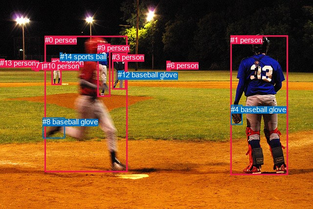
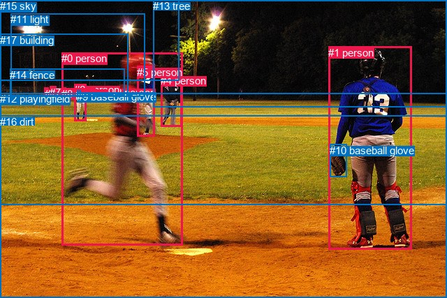

# 图片 0553：2339606.jpg

随机样本序号：10。图片 SHA256：`043f621733a834fb963006769920ea4f8fc772996045eba89f96e97b8832ba15`。

红色框表示人，蓝色框表示其他物体。两个模式分别保留自身框编号，可依据位置比较对应对象。

## 自动检测框与输出

人的框编号：`[0, 1, 2, 3, 5, 6, 7, 9, 10, 13]`。状态：`ok`。

### 自动检测全部物体框

| 编号 | 类别 | 是否为人 | 检测分数 | 像素坐标 xyxy |
|---|---|---|---|---|
| 0 | person | True | 0.9998 | 91.6, 73.4, 260.9, 351.7 |
| 1 | person | True | 0.9995 | 471.3, 72.6, 588.5, 357.5 |
| 2 | person | True | 0.9984 | 105.9, 119.2, 125.1, 173.3 |
| 3 | person | True | 0.9978 | 229.2, 108.0, 257.6, 182.3 |
| 4 | baseball glove | False | 0.9972 | 472.2, 214.7, 495.7, 254.8 |
| 5 | person | True | 0.9918 | 71.5, 124.5, 79.5, 145.9 |
| 6 | person | True | 0.9511 | 340.8, 124.9, 348.2, 144.6 |
| 7 | person | True | 0.9389 | 64.6, 125.2, 69.6, 139.4 |
| 8 | baseball glove | False | 0.9183 | 87.0, 240.1, 132.1, 282.5 |
| 9 | person | True | 0.8683 | 199.0, 89.0, 225.6, 197.3 |
| 10 | person | True | 0.7718 | 88.7, 126.3, 94.0, 140.4 |
| 11 | baseball glove | False | 0.6574 | 242.2, 145.8, 249.8, 152.1 |
| 12 | baseball glove | False | 0.5472 | 241.4, 144.3, 253.1, 155.1 |
| 13 | person | True | 0.5248 | 0.2, 120.2, 9.4, 138.0 |
| 14 | sports ball | False | 0.4206 | 122.5, 107.5, 127.3, 112.1 |

### 自动检测 Top50 人相关候选

评分物体对：210；人相关物体对：190；输出关系：50。

| 排名 | 主语编号与类别 | 关系 | 宾语编号与类别 | 类型 | 人与人 | 排序分数 | 原始融合 logit |
|---|---|---|---|---|---|---|---|
| 1 | #0 person | throwing | #14 sports ball | semantic | False | 0.98738 | 4.3596 |
| 2 | #3 person | wearing | #12 baseball glove | semantic | False | 0.98528 | 4.2037 |
| 3 | #0 person | wearing | #8 baseball glove | semantic | False | 0.98388 | 4.1114 |
| 4 | #3 person | wearing | #11 baseball glove | semantic | False | 0.98317 | 4.0677 |
| 5 | #2 person | throwing | #14 sports ball | semantic | False | 0.98301 | 4.0582 |
| 6 | #1 person | wearing | #4 baseball glove | semantic | False | 0.97777 | 3.7836 |
| 7 | #2 person | looking at | #0 person | semantic | True | 0.93226 | 2.6220 |
| 8 | #0 person | throwing | #9 person | semantic | True | 0.91100 | 2.3259 |
| 9 | #0 person | throwing | #11 baseball glove | semantic | False | 0.91009 | 2.3148 |
| 10 | #3 person | in | #12 baseball glove | spatial | False | 0.90924 | 2.3044 |
| 11 | #3 person | in | #11 baseball glove | spatial | False | 0.89860 | 2.1817 |
| 12 | #0 person | in | #8 baseball glove | spatial | False | 0.89779 | 2.1729 |
| 13 | #1 person | in | #4 baseball glove | spatial | False | 0.89717 | 2.1662 |
| 14 | #3 person | looking at | #0 person | semantic | True | 0.87382 | 1.9351 |
| 15 | #0 person | throwing | #12 baseball glove | semantic | False | 0.87100 | 1.9098 |
| 16 | #8 baseball glove | on | #0 person | spatial | False | 0.87088 | 1.9088 |
| 17 | #9 person | throwing | #14 sports ball | semantic | False | 0.86636 | 1.8691 |
| 18 | #4 baseball glove | on | #1 person | spatial | False | 0.85840 | 1.8021 |
| 19 | #9 person | looking at | #0 person | semantic | True | 0.83762 | 1.6407 |
| 20 | #10 person | looking at | #0 person | semantic | True | 0.80720 | 1.4319 |
| 21 | #5 person | holding | #7 person | semantic | True | 0.77881 | 1.2587 |
| 22 | #5 person | looking at | #0 person | semantic | True | 0.76689 | 1.1908 |
| 23 | #1 person | playing | #0 person | semantic | True | 0.75585 | 1.1301 |
| 24 | #0 person | throwing | #10 person | semantic | True | 0.75044 | 1.1010 |
| 25 | #7 person | looking at | #0 person | semantic | True | 0.74112 | 1.0518 |
| 26 | #0 person | throwing | #4 baseball glove | semantic | False | 0.72822 | 0.9856 |
| 27 | #0 person | in | #9 person | spatial | True | 0.69994 | 0.8470 |
| 28 | #7 person | in | #14 sports ball | spatial | False | 0.69323 | 0.8152 |
| 29 | #2 person | in | #14 sports ball | spatial | False | 0.66827 | 0.7004 |
| 30 | #0 person | playing | #1 person | semantic | True | 0.66181 | 0.6714 |
| 31 | #9 person | wearing | #8 baseball glove | semantic | False | 0.65789 | 0.6539 |
| 32 | #7 person | holding | #5 person | semantic | True | 0.59177 | 0.3713 |
| 33 | #5 person | holding | #10 person | semantic | True | 0.58224 | 0.3320 |
| 34 | #5 person | holding | #14 sports ball | semantic | False | 0.57468 | 0.3010 |
| 35 | #7 person | looking at | #1 person | semantic | True | 0.57071 | 0.2848 |
| 36 | #10 person | wearing | #14 sports ball | semantic | False | 0.55905 | 0.2373 |
| 37 | #5 person | in | #14 sports ball | spatial | False | 0.55326 | 0.2139 |
| 38 | #7 person | playing | #14 sports ball | semantic | False | 0.54479 | 0.1797 |
| 39 | #0 person | in | #12 baseball glove | spatial | False | 0.52977 | 0.1192 |
| 40 | #1 person | wearing | #8 baseball glove | semantic | False | 0.52822 | 0.1130 |
| 41 | #0 person | in | #11 baseball glove | spatial | False | 0.52344 | 0.0938 |
| 42 | #5 person | in | #7 person | spatial | True | 0.51583 | 0.0633 |
| 43 | #6 person | looking at | #0 person | semantic | True | 0.50068 | 0.0027 |
| 44 | #1 person | throwing | #14 sports ball | semantic | False | 0.49801 | -0.0080 |
| 45 | #10 person | looking at | #1 person | semantic | True | 0.49442 | -0.0223 |
| 46 | #10 person | in | #14 sports ball | spatial | False | 0.48281 | -0.0688 |
| 47 | #9 person | in | #8 baseball glove | spatial | False | 0.47545 | -0.0983 |
| 48 | #5 person | looking at | #1 person | semantic | True | 0.47040 | -0.1186 |
| 49 | #9 person | throwing | #11 baseball glove | semantic | False | 0.46773 | -0.1293 |
| 50 | #2 person | holding | #10 person | semantic | True | 0.45381 | -0.1853 |

### 自动检测逐条人相关 GT 核验

R@50：20.00%；命中 1/5。

| GT 主语编号 | GT 关系 | GT 宾语编号 | 结果阶段 | 匹配预测主语编号 | 匹配预测宾语编号 |
|---|---|---|---|---|---|
| 0 | running on | 16 | endpoint_missing_or_wrong_class | [0] | [] |
| 1 | wearing | 10 | hit50 | [1] | [4] |
| 1 | standing on | 16 | endpoint_missing_or_wrong_class | [1] | [] |
| 4 | standing on | 12 | endpoint_missing_or_wrong_class | [3] | [] |
| 6 | wearing | 9 | endpoint_missing_or_wrong_class | [2] | [] |

## 真实框与输出

人的框编号：`[0, 1, 2, 3, 4, 5, 6, 7, 8]`。

### 真实框全部物体框

| 编号 | 类别 | 是否为人 | 检测分数 | 像素坐标 xyxy |
|---|---|---|---|---|
| 0 | person | True | GT | 88.0, 75.0, 262.0, 352.0 |
| 1 | person | True | GT | 470.0, 67.0, 589.0, 358.0 |
| 2 | person | True | GT | 158.0, 124.0, 165.0, 140.0 |
| 3 | person | True | GT | 64.0, 126.0, 70.0, 140.0 |
| 4 | person | True | GT | 230.0, 107.0, 260.0, 182.0 |
| 5 | person | True | GT | 196.0, 95.0, 221.0, 196.0 |
| 6 | person | True | GT | 106.0, 120.0, 124.0, 173.0 |
| 7 | person | True | GT | 71.0, 124.0, 80.0, 146.0 |
| 8 | person | True | GT | 88.0, 126.0, 94.0, 140.0 |
| 9 | baseball glove | False | GT | 110.0, 130.0, 115.0, 138.0 |
| 10 | baseball glove | False | GT | 472.0, 207.0, 496.0, 254.0 |
| 11 | light | False | GT | 15.0, 19.0, 207.0, 138.0 |
| 12 | playingfield | False | GT | 0.0, 133.0, 640.0, 294.0 |
| 13 | tree | False | GT | 219.0, 0.0, 640.0, 154.0 |
| 14 | fence | False | GT | 14.0, 99.0, 178.0, 138.0 |
| 15 | sky | False | GT | 0.0, 0.0, 256.0, 115.0 |
| 16 | dirt | False | GT | 0.0, 166.0, 640.0, 427.0 |
| 17 | building | False | GT | 0.0, 49.0, 184.0, 138.0 |

### 真实框 Top50 人相关候选

评分物体对：306；人相关物体对：234；输出关系：50。

| 排名 | 主语编号与类别 | 关系 | 宾语编号与类别 | 类型 | 人与人 | 排序分数 | 原始融合 logit |
|---|---|---|---|---|---|---|---|
| 1 | #0 person | throwing | #2 person | semantic | True | 0.98881 | 4.4815 |
| 2 | #6 person | wearing | #9 baseball glove | semantic | False | 0.98359 | 4.0933 |
| 3 | #1 person | wearing | #10 baseball glove | semantic | False | 0.98074 | 3.9301 |
| 4 | #3 person | standing on | #12 playingfield | semantic | False | 0.97421 | 3.6315 |
| 5 | #7 person | standing on | #12 playingfield | semantic | False | 0.97256 | 3.5679 |
| 6 | #6 person | standing on | #12 playingfield | semantic | False | 0.97103 | 3.5122 |
| 7 | #8 person | standing on | #12 playingfield | semantic | False | 0.96301 | 3.2593 |
| 8 | #6 person | standing on | #16 dirt | semantic | False | 0.96291 | 3.2567 |
| 9 | #0 person | on | #16 dirt | spatial | False | 0.96213 | 3.2349 |
| 10 | #1 person | on | #16 dirt | spatial | False | 0.95825 | 3.1335 |
| 11 | #3 person | on | #12 playingfield | spatial | False | 0.95553 | 3.0674 |
| 12 | #7 person | on | #12 playingfield | spatial | False | 0.95538 | 3.0639 |
| 13 | #0 person | running on | #16 dirt | semantic | False | 0.95500 | 3.0550 |
| 14 | #4 person | standing on | #12 playingfield | semantic | False | 0.94301 | 2.8062 |
| 15 | #6 person | on | #12 playingfield | spatial | False | 0.94138 | 2.7764 |
| 16 | #1 person | standing on | #16 dirt | semantic | False | 0.93698 | 2.6992 |
| 17 | #4 person | on | #12 playingfield | spatial | False | 0.93686 | 2.6972 |
| 18 | #1 person | on | #12 playingfield | spatial | False | 0.93600 | 2.6828 |
| 19 | #0 person | on | #12 playingfield | spatial | False | 0.93564 | 2.6768 |
| 20 | #4 person | standing on | #16 dirt | semantic | False | 0.92456 | 2.5060 |
| 21 | #8 person | on | #12 playingfield | spatial | False | 0.92284 | 2.4816 |
| 22 | #0 person | throwing | #5 person | semantic | True | 0.91765 | 2.4109 |
| 23 | #6 person | on | #16 dirt | spatial | False | 0.91514 | 2.3781 |
| 24 | #7 person | standing on | #14 fence | semantic | False | 0.91228 | 2.3419 |
| 25 | #4 person | on | #16 dirt | spatial | False | 0.89867 | 2.1825 |
| 26 | #7 person | standing on | #16 dirt | semantic | False | 0.89303 | 2.1221 |
| 27 | #1 person | standing on | #12 playingfield | semantic | False | 0.88984 | 2.0891 |
| 28 | #6 person | in | #9 baseball glove | spatial | False | 0.88032 | 1.9955 |
| 29 | #8 person | standing on | #14 fence | semantic | False | 0.87330 | 1.9305 |
| 30 | #6 person | looking at | #0 person | semantic | True | 0.87284 | 1.9263 |
| 31 | #3 person | standing on | #16 dirt | semantic | False | 0.87140 | 1.9134 |
| 32 | #3 person | standing on | #14 fence | semantic | False | 0.85578 | 1.7807 |
| 33 | #1 person | looking at | #0 person | semantic | True | 0.84401 | 1.6884 |
| 34 | #4 person | looking at | #0 person | semantic | True | 0.84172 | 1.6711 |
| 35 | #7 person | on | #16 dirt | spatial | False | 0.83677 | 1.6344 |
| 36 | #7 person | leaning on | #14 fence | spatial | False | 0.82287 | 1.5359 |
| 37 | #0 person | throwing | #9 baseball glove | semantic | False | 0.82278 | 1.5353 |
| 38 | #10 baseball glove | on | #1 person | spatial | False | 0.82154 | 1.5268 |
| 39 | #3 person | on | #16 dirt | spatial | False | 0.81990 | 1.5157 |
| 40 | #1 person | in | #10 baseball glove | spatial | False | 0.80541 | 1.4204 |
| 41 | #5 person | looking at | #0 person | semantic | True | 0.74850 | 1.0906 |
| 42 | #12 playingfield | beside | #0 person | spatial | False | 0.74366 | 1.0651 |
| 43 | #3 person | leaning on | #14 fence | spatial | False | 0.73872 | 1.0393 |
| 44 | #8 person | standing on | #16 dirt | semantic | False | 0.73761 | 1.0336 |
| 45 | #6 person | standing on | #14 fence | semantic | False | 0.72211 | 0.9549 |
| 46 | #0 person | playing | #12 playingfield | semantic | False | 0.70182 | 0.8560 |
| 47 | #0 person | throwing | #8 person | semantic | True | 0.67005 | 0.7084 |
| 48 | #9 baseball glove | on | #6 person | spatial | False | 0.66508 | 0.6860 |
| 49 | #7 person | standing on | #17 building | semantic | False | 0.66444 | 0.6832 |
| 50 | #8 person | leaning on | #14 fence | spatial | False | 0.65753 | 0.6523 |

### 真实框逐条人相关 GT 核验

R@50：100.00%；命中 5/5。

| GT 主语编号 | GT 关系 | GT 宾语编号 | 结果阶段 | 匹配预测主语编号 | 匹配预测宾语编号 |
|---|---|---|---|---|---|
| 0 | running on | 16 | hit50 | [0] | [16] |
| 1 | wearing | 10 | hit50 | [1] | [10] |
| 1 | standing on | 16 | hit50 | [1] | [16] |
| 4 | standing on | 12 | hit50 | [4] | [12] |
| 6 | wearing | 9 | hit50 | [6] | [9] |

## 全部人相关 GT

| 主语编号与类别 | 关系 | 宾语编号与类别 |
|---|---|---|
| #0 person | running on | #16 dirt |
| #1 person | wearing | #10 baseball glove |
| #1 person | standing on | #16 dirt |
| #4 person | standing on | #12 playingfield |
| #6 person | wearing | #9 baseball glove |

原始记录、全部人相关物体对的两项预测与分项分数见 [逐图证据 JSON](../evidence/cases/0553.json)。全部56类 logits 保留于本机 HOR/output/random500/logits/。

<!-- HOR_COMPLETE_RESULTS -->

## 六组条件的完整输出对照

以下保留同一图片三种框与候选模式、两种谓词输出规则的全部 Top50。框编号各自在所属模式内解释。

### 自动检测框完整枚举：空间与语义各保留一个谓词

| 排名 | 主语编号与类别 | 谓词 | 宾语编号与类别 | 分组 | 排序分数 | predicate logit | pair logit |
|---|---|---|---|---|---|---|---|
| 1 | #0 person | throwing | #14 sports ball | semantic | 0.9873776 | 5.3758349 | -1.0162599 |
| 2 | #3 person | wearing | #12 baseball glove | semantic | 0.9852796 | 4.0386853 | 0.1650038 |
| 3 | #0 person | wearing | #8 baseball glove | semantic | 0.9838794 | 3.8433938 | 0.2680089 |
| 4 | #3 person | wearing | #11 baseball glove | semantic | 0.9831718 | 3.8816085 | 0.1861230 |
| 5 | #2 person | throwing | #14 sports ball | semantic | 0.9830136 | 4.1771998 | -0.1189949 |
| 6 | #1 person | wearing | #4 baseball glove | semantic | 0.9777659 | 3.6657081 | 0.1179388 |
| 7 | #2 person | looking at | #0 person | semantic | 0.9322623 | 3.0036983 | -0.3817273 |
| 8 | #0 person | throwing | #9 person | semantic | 0.9109967 | 2.5281296 | -0.2022637 |
| 9 | #0 person | throwing | #11 baseball glove | semantic | 0.9100949 | 3.0951891 | -0.7803953 |
| 10 | #3 person | in | #12 baseball glove | spatial | 0.9092420 | 2.1394110 | 0.1650038 |
| 11 | #3 person | in | #11 baseball glove | spatial | 0.8985955 | 1.9955926 | 0.1861230 |
| 12 | #0 person | in | #8 baseball glove | spatial | 0.8977878 | 1.9048738 | 0.2680089 |
| 13 | #1 person | in | #4 baseball glove | spatial | 0.8971717 | 2.0482473 | 0.1179388 |
| 14 | #3 person | looking at | #0 person | semantic | 0.8738174 | 2.4690285 | -0.5338867 |
| 15 | #0 person | throwing | #12 baseball glove | semantic | 0.8709996 | 2.7051077 | -0.7952820 |
| 16 | #8 baseball glove | on | #0 person | spatial | 0.8708807 | 1.9574480 | -0.0486806 |
| 17 | #9 person | throwing | #14 sports ball | semantic | 0.8663584 | 2.6724243 | -0.8032871 |
| 18 | #4 baseball glove | on | #1 person | spatial | 0.8584024 | 2.2423158 | -0.4402315 |
| 19 | #9 person | looking at | #0 person | semantic | 0.8376237 | 1.9910545 | -0.3504021 |
| 20 | #10 person | looking at | #0 person | semantic | 0.8071953 | 2.0953827 | -0.6634948 |
| 21 | #5 person | holding | #7 person | semantic | 0.7788091 | 1.4284515 | -0.1697117 |
| 22 | #5 person | looking at | #0 person | semantic | 0.7668917 | 1.9106512 | -0.7198089 |
| 23 | #1 person | playing | #0 person | semantic | 0.7558540 | 1.6232114 | -0.4931299 |
| 24 | #0 person | throwing | #10 person | semantic | 0.7504414 | 2.5216279 | -1.4206601 |
| 25 | #7 person | looking at | #0 person | semantic | 0.7411153 | 1.7308011 | -0.6790276 |
| 26 | #0 person | throwing | #4 baseball glove | semantic | 0.7282225 | 1.8685870 | -0.8829641 |
| 27 | #0 person | in | #9 person | spatial | 0.6999381 | 1.0492668 | -0.2022637 |
| 28 | #7 person | in | #14 sports ball | spatial | 0.6932260 | 0.9552288 | -0.1399840 |
| 29 | #2 person | in | #14 sports ball | spatial | 0.6682693 | 0.8193626 | -0.1189949 |
| 30 | #0 person | playing | #1 person | semantic | 0.6618063 | 1.4741731 | -0.8028187 |
| 31 | #9 person | wearing | #8 baseball glove | semantic | 0.6578931 | 1.1524940 | -0.4985749 |
| 32 | #7 person | holding | #5 person | semantic | 0.5917693 | 0.4304600 | -0.0591757 |
| 33 | #5 person | holding | #10 person | semantic | 0.5822417 | 0.4426560 | -0.1106732 |
| 34 | #5 person | holding | #14 sports ball | semantic | 0.5746776 | 0.4971395 | -0.1961778 |
| 35 | #7 person | looking at | #1 person | semantic | 0.5707113 | 1.4704390 | -1.1856852 |
| 36 | #10 person | wearing | #14 sports ball | semantic | 0.5590457 | 0.3415337 | -0.1042433 |
| 37 | #5 person | in | #14 sports ball | spatial | 0.5532638 | 0.4100447 | -0.1961778 |
| 38 | #7 person | playing | #14 sports ball | semantic | 0.5447940 | 0.3196416 | -0.1399840 |
| 39 | #0 person | in | #12 baseball glove | spatial | 0.5297725 | 0.9145131 | -0.7952820 |
| 40 | #1 person | wearing | #8 baseball glove | semantic | 0.5282245 | 0.8831768 | -0.7701589 |
| 41 | #0 person | in | #11 baseball glove | spatial | 0.5234448 | 0.8742433 | -0.7803953 |
| 42 | #5 person | in | #7 person | spatial | 0.5158265 | 0.2330389 | -0.1697117 |
| 43 | #6 person | looking at | #0 person | semantic | 0.5006828 | 1.3413577 | -1.3386264 |
| 44 | #1 person | throwing | #14 sports ball | semantic | 0.4980099 | 1.3278794 | -1.3358397 |
| 45 | #10 person | looking at | #1 person | semantic | 0.4944196 | 1.1422248 | -1.1645471 |
| 46 | #10 person | in | #14 sports ball | spatial | 0.4828090 | 0.0354524 | -0.1042433 |
| 47 | #9 person | in | #8 baseball glove | spatial | 0.4754539 | 0.4003115 | -0.4985749 |
| 48 | #5 person | looking at | #1 person | semantic | 0.4703963 | 1.0802989 | -1.1988522 |
| 49 | #9 person | throwing | #11 baseball glove | semantic | 0.4677292 | -0.0028501 | -0.1264129 |
| 50 | #2 person | holding | #10 person | semantic | 0.4538139 | -0.1648679 | -0.0204048 |

GT 命中：1/5，R@50=20.00%。

| GT主语 | GT谓词 | GT宾语 | 结果阶段 | 匹配主语框 | 匹配宾语框 |
|---|---|---|---|---|---|
| 0 | running on | 16 | endpoint_missing_or_wrong_class | [0] | [] |
| 1 | wearing | 10 | hit50 | [1] | [4] |
| 1 | standing on | 16 | endpoint_missing_or_wrong_class | [1] | [] |
| 4 | standing on | 12 | endpoint_missing_or_wrong_class | [3] | [] |
| 6 | wearing | 9 | endpoint_missing_or_wrong_class | [2] | [] |

### 自动检测框完整枚举：每对只保留一个谓词

| 排名 | 主语编号与类别 | 谓词 | 宾语编号与类别 | 分组 | 排序分数 | predicate logit | pair logit |
|---|---|---|---|---|---|---|---|
| 1 | #0 person | throwing | #14 sports ball | single | 0.9873776 | 5.3758349 | -1.0162599 |
| 2 | #3 person | wearing | #12 baseball glove | single | 0.9852796 | 4.0386853 | 0.1650038 |
| 3 | #0 person | wearing | #8 baseball glove | single | 0.9838794 | 3.8433938 | 0.2680089 |
| 4 | #3 person | wearing | #11 baseball glove | single | 0.9831718 | 3.8816085 | 0.1861230 |
| 5 | #2 person | throwing | #14 sports ball | single | 0.9830136 | 4.1771998 | -0.1189949 |
| 6 | #1 person | wearing | #4 baseball glove | single | 0.9777659 | 3.6657081 | 0.1179388 |
| 7 | #2 person | looking at | #0 person | single | 0.9322623 | 3.0036983 | -0.3817273 |
| 8 | #0 person | throwing | #9 person | single | 0.9109967 | 2.5281296 | -0.2022637 |
| 9 | #0 person | throwing | #11 baseball glove | single | 0.9100949 | 3.0951891 | -0.7803953 |
| 10 | #3 person | looking at | #0 person | single | 0.8738174 | 2.4690285 | -0.5338867 |
| 11 | #0 person | throwing | #12 baseball glove | single | 0.8709996 | 2.7051077 | -0.7952820 |
| 12 | #8 baseball glove | on | #0 person | single | 0.8708807 | 1.9574480 | -0.0486806 |
| 13 | #9 person | throwing | #14 sports ball | single | 0.8663584 | 2.6724243 | -0.8032871 |
| 14 | #4 baseball glove | on | #1 person | single | 0.8584024 | 2.2423158 | -0.4402315 |
| 15 | #9 person | looking at | #0 person | single | 0.8376237 | 1.9910545 | -0.3504021 |
| 16 | #10 person | looking at | #0 person | single | 0.8071953 | 2.0953827 | -0.6634948 |
| 17 | #5 person | holding | #7 person | single | 0.7788091 | 1.4284515 | -0.1697117 |
| 18 | #5 person | looking at | #0 person | single | 0.7668917 | 1.9106512 | -0.7198089 |
| 19 | #1 person | playing | #0 person | single | 0.7558540 | 1.6232114 | -0.4931299 |
| 20 | #0 person | throwing | #10 person | single | 0.7504414 | 2.5216279 | -1.4206601 |
| 21 | #7 person | looking at | #0 person | single | 0.7411153 | 1.7308011 | -0.6790276 |
| 22 | #0 person | throwing | #4 baseball glove | single | 0.7282225 | 1.8685870 | -0.8829641 |
| 23 | #7 person | in | #14 sports ball | single | 0.6932260 | 0.9552288 | -0.1399840 |
| 24 | #0 person | playing | #1 person | single | 0.6618063 | 1.4741731 | -0.8028187 |
| 25 | #9 person | wearing | #8 baseball glove | single | 0.6578931 | 1.1524940 | -0.4985749 |
| 26 | #7 person | holding | #5 person | single | 0.5917693 | 0.4304600 | -0.0591757 |
| 27 | #5 person | holding | #10 person | single | 0.5822417 | 0.4426560 | -0.1106732 |
| 28 | #5 person | holding | #14 sports ball | single | 0.5746776 | 0.4971395 | -0.1961778 |
| 29 | #7 person | looking at | #1 person | single | 0.5707113 | 1.4704390 | -1.1856852 |
| 30 | #10 person | wearing | #14 sports ball | single | 0.5590457 | 0.3415337 | -0.1042433 |
| 31 | #1 person | wearing | #8 baseball glove | single | 0.5282245 | 0.8831768 | -0.7701589 |
| 32 | #6 person | looking at | #0 person | single | 0.5006828 | 1.3413577 | -1.3386264 |
| 33 | #1 person | throwing | #14 sports ball | single | 0.4980099 | 1.3278794 | -1.3358397 |
| 34 | #10 person | looking at | #1 person | single | 0.4944196 | 1.1422248 | -1.1645471 |
| 35 | #5 person | looking at | #1 person | single | 0.4703963 | 1.0802989 | -1.1988522 |
| 36 | #9 person | throwing | #11 baseball glove | single | 0.4677292 | -0.0028501 | -0.1264129 |
| 37 | #2 person | holding | #10 person | single | 0.4538139 | -0.1648679 | -0.0204048 |
| 38 | #2 person | in | #11 baseball glove | single | 0.4363247 | 0.0938745 | -0.3499659 |
| 39 | #6 person | looking at | #1 person | single | 0.4211280 | 1.1187572 | -1.4369018 |
| 40 | #9 person | wearing | #12 baseball glove | single | 0.4105317 | -0.2153845 | -0.1463834 |
| 41 | #0 person | throwing | #2 person | single | 0.4062664 | 0.9365654 | -1.3159869 |
| 42 | #13 person | looking at | #0 person | single | 0.4044689 | 0.5603805 | -0.9472595 |
| 43 | #14 sports ball | on | #13 person | single | 0.3794427 | -0.1151123 | -0.3768020 |
| 44 | #3 person | looking at | #9 person | single | 0.3643003 | -0.0671787 | -0.4895689 |
| 45 | #2 person | looking at | #1 person | single | 0.3637009 | 0.3381281 | -0.8974651 |
| 46 | #3 person | looking at | #1 person | single | 0.3470355 | 0.4689517 | -1.1010473 |
| 47 | #2 person | in | #12 baseball glove | single | 0.3155119 | -0.4129210 | -0.3615541 |
| 48 | #12 baseball glove | on | #3 person | single | 0.3126088 | -0.0208411 | -0.7671100 |
| 49 | #11 baseball glove | on | #3 person | single | 0.3018961 | -0.0893354 | -0.7489498 |
| 50 | #9 person | looking at | #1 person | single | 0.3014898 | 0.2236896 | -1.0639031 |

GT 命中：1/5，R@50=20.00%。

| GT主语 | GT谓词 | GT宾语 | 结果阶段 | 匹配主语框 | 匹配宾语框 |
|---|---|---|---|---|---|
| 0 | running on | 16 | endpoint_missing_or_wrong_class | [0] | [] |
| 1 | wearing | 10 | hit50 | [1] | [4] |
| 1 | standing on | 16 | endpoint_missing_or_wrong_class | [1] | [] |
| 4 | standing on | 12 | endpoint_missing_or_wrong_class | [3] | [] |
| 6 | wearing | 9 | endpoint_missing_or_wrong_class | [2] | [] |

### 真实框完整枚举：空间与语义各保留一个谓词

| 排名 | 主语编号与类别 | 谓词 | 宾语编号与类别 | 分组 | 排序分数 | predicate logit | pair logit |
|---|---|---|---|---|---|---|---|
| 1 | #0 person | throwing | #2 person | semantic | 0.9888103 | 4.5948224 | -0.1133127 |
| 2 | #6 person | wearing | #9 baseball glove | semantic | 0.9835895 | 3.8655086 | 0.2277800 |
| 3 | #1 person | wearing | #10 baseball glove | semantic | 0.9807364 | 3.8155580 | 0.1145261 |
| 4 | #3 person | standing on | #12 playingfield | semantic | 0.9742064 | 3.2833238 | 0.3481720 |
| 5 | #7 person | standing on | #12 playingfield | semantic | 0.9725584 | 3.2231402 | 0.3447284 |
| 6 | #6 person | standing on | #12 playingfield | semantic | 0.9710339 | 3.4006314 | 0.1116010 |
| 7 | #8 person | standing on | #12 playingfield | semantic | 0.9630051 | 3.0807433 | 0.1785333 |
| 8 | #6 person | standing on | #16 dirt | semantic | 0.9629126 | 3.2521205 | 0.0045676 |
| 9 | #0 person | on | #16 dirt | spatial | 0.9621280 | 3.5181956 | -0.2832620 |
| 10 | #1 person | on | #16 dirt | spatial | 0.9582549 | 3.2871971 | -0.1536660 |
| 11 | #3 person | on | #12 playingfield | spatial | 0.9555266 | 2.7191997 | 0.3481720 |
| 12 | #7 person | on | #12 playingfield | spatial | 0.9553801 | 2.7191997 | 0.3447284 |
| 13 | #0 person | running on | #16 dirt | semantic | 0.9549977 | 3.3382564 | -0.2832620 |
| 14 | #4 person | standing on | #12 playingfield | semantic | 0.9430126 | 3.0425930 | -0.2363439 |
| 15 | #6 person | on | #12 playingfield | spatial | 0.9413846 | 2.6647515 | 0.1116010 |
| 16 | #1 person | standing on | #16 dirt | semantic | 0.9369799 | 2.8528752 | -0.1536660 |
| 17 | #4 person | on | #12 playingfield | spatial | 0.9368631 | 2.9335742 | -0.2363439 |
| 18 | #1 person | on | #12 playingfield | spatial | 0.9360045 | 3.1840358 | -0.5012285 |
| 19 | #0 person | on | #12 playingfield | spatial | 0.9356412 | 3.4694819 | -0.7927235 |
| 20 | #4 person | standing on | #16 dirt | semantic | 0.9245643 | 2.7796326 | -0.2735898 |
| 21 | #8 person | on | #12 playingfield | spatial | 0.9228425 | 2.3030772 | 0.1785333 |
| 22 | #0 person | throwing | #5 person | semantic | 0.9176517 | 2.3484321 | 0.0624279 |
| 23 | #6 person | on | #16 dirt | spatial | 0.9151450 | 2.3735704 | 0.0045676 |
| 24 | #7 person | standing on | #14 fence | semantic | 0.9122847 | 2.4622850 | -0.1204296 |
| 25 | #4 person | on | #16 dirt | spatial | 0.8986689 | 2.4561110 | -0.2735898 |
| 26 | #7 person | standing on | #16 dirt | semantic | 0.8930350 | 2.0574422 | 0.0646814 |
| 27 | #1 person | standing on | #12 playingfield | semantic | 0.8898376 | 2.5903115 | -0.5012285 |
| 28 | #6 person | in | #9 baseball glove | spatial | 0.8803209 | 1.7676926 | 0.2277800 |
| 29 | #8 person | standing on | #14 fence | semantic | 0.8733032 | 2.0431519 | -0.1126664 |
| 30 | #6 person | looking at | #0 person | semantic | 0.8728374 | 2.3192692 | -0.3929863 |
| 31 | #3 person | standing on | #16 dirt | semantic | 0.8713977 | 1.8306861 | 0.0826879 |
| 32 | #3 person | standing on | #14 fence | semantic | 0.8557823 | 1.8531156 | -0.0724231 |
| 33 | #1 person | looking at | #0 person | semantic | 0.8440091 | 2.1722994 | -0.4839341 |
| 34 | #4 person | looking at | #0 person | semantic | 0.8417200 | 2.1750884 | -0.5040061 |
| 35 | #7 person | on | #16 dirt | spatial | 0.8367701 | 1.5697079 | 0.0646814 |
| 36 | #7 person | leaning on | #14 fence | spatial | 0.8228700 | 1.6563435 | -0.1204296 |
| 37 | #0 person | throwing | #9 baseball glove | semantic | 0.8227821 | 2.4925566 | -0.9572455 |
| 38 | #10 baseball glove | on | #1 person | spatial | 0.8215432 | 1.9631824 | -0.4363444 |
| 39 | #3 person | on | #16 dirt | spatial | 0.8199040 | 1.4330091 | 0.0826879 |
| 40 | #1 person | in | #10 baseball glove | spatial | 0.8054087 | 1.3059225 | 0.1145261 |
| 41 | #5 person | looking at | #0 person | semantic | 0.7484994 | 1.5550261 | -0.4644009 |
| 42 | #12 playingfield | beside | #0 person | spatial | 0.7436616 | 2.0569606 | -0.9918729 |
| 43 | #3 person | leaning on | #14 fence | spatial | 0.7387171 | 1.1117344 | -0.0724231 |
| 44 | #8 person | standing on | #16 dirt | semantic | 0.7376052 | 1.1055384 | -0.0719796 |
| 45 | #6 person | standing on | #14 fence | semantic | 0.7221076 | 1.2908702 | -0.3359302 |
| 46 | #0 person | playing | #12 playingfield | semantic | 0.7018162 | 1.6486850 | -0.7927235 |
| 47 | #0 person | throwing | #8 person | semantic | 0.6700526 | 2.1298895 | -1.4214664 |
| 48 | #9 baseball glove | on | #6 person | spatial | 0.6650837 | 1.2819734 | -0.5959411 |
| 49 | #7 person | standing on | #17 building | semantic | 0.6644431 | 0.9240584 | -0.2409006 |
| 50 | #8 person | leaning on | #14 fence | spatial | 0.6575311 | 0.7649775 | -0.1126664 |

GT 命中：5/5，R@50=100.00%。

| GT主语 | GT谓词 | GT宾语 | 结果阶段 | 匹配主语框 | 匹配宾语框 |
|---|---|---|---|---|---|
| 0 | running on | 16 | hit50 | [0] | [16] |
| 1 | wearing | 10 | hit50 | [1] | [10] |
| 1 | standing on | 16 | hit50 | [1] | [16] |
| 4 | standing on | 12 | hit50 | [4] | [12] |
| 6 | wearing | 9 | hit50 | [6] | [9] |

### 真实框完整枚举：每对只保留一个谓词

| 排名 | 主语编号与类别 | 谓词 | 宾语编号与类别 | 分组 | 排序分数 | predicate logit | pair logit |
|---|---|---|---|---|---|---|---|
| 1 | #0 person | throwing | #2 person | single | 0.9888103 | 4.5948224 | -0.1133127 |
| 2 | #6 person | wearing | #9 baseball glove | single | 0.9835895 | 3.8655086 | 0.2277800 |
| 3 | #1 person | wearing | #10 baseball glove | single | 0.9807364 | 3.8155580 | 0.1145261 |
| 4 | #3 person | standing on | #12 playingfield | single | 0.9742064 | 3.2833238 | 0.3481720 |
| 5 | #7 person | standing on | #12 playingfield | single | 0.9725584 | 3.2231402 | 0.3447284 |
| 6 | #6 person | standing on | #12 playingfield | single | 0.9710339 | 3.4006314 | 0.1116010 |
| 7 | #8 person | standing on | #12 playingfield | single | 0.9630051 | 3.0807433 | 0.1785333 |
| 8 | #6 person | standing on | #16 dirt | single | 0.9629126 | 3.2521205 | 0.0045676 |
| 9 | #0 person | on | #16 dirt | single | 0.9621280 | 3.5181956 | -0.2832620 |
| 10 | #1 person | on | #16 dirt | single | 0.9582549 | 3.2871971 | -0.1536660 |
| 11 | #4 person | standing on | #12 playingfield | single | 0.9430126 | 3.0425930 | -0.2363439 |
| 12 | #1 person | on | #12 playingfield | single | 0.9360045 | 3.1840358 | -0.5012285 |
| 13 | #0 person | on | #12 playingfield | single | 0.9356412 | 3.4694819 | -0.7927235 |
| 14 | #4 person | standing on | #16 dirt | single | 0.9245643 | 2.7796326 | -0.2735898 |
| 15 | #0 person | throwing | #5 person | single | 0.9176517 | 2.3484321 | 0.0624279 |
| 16 | #7 person | standing on | #14 fence | single | 0.9122847 | 2.4622850 | -0.1204296 |
| 17 | #7 person | standing on | #16 dirt | single | 0.8930350 | 2.0574422 | 0.0646814 |
| 18 | #8 person | standing on | #14 fence | single | 0.8733032 | 2.0431519 | -0.1126664 |
| 19 | #6 person | looking at | #0 person | single | 0.8728374 | 2.3192692 | -0.3929863 |
| 20 | #3 person | standing on | #16 dirt | single | 0.8713977 | 1.8306861 | 0.0826879 |
| 21 | #3 person | standing on | #14 fence | single | 0.8557823 | 1.8531156 | -0.0724231 |
| 22 | #1 person | looking at | #0 person | single | 0.8440091 | 2.1722994 | -0.4839341 |
| 23 | #4 person | looking at | #0 person | single | 0.8417200 | 2.1750884 | -0.5040061 |
| 24 | #0 person | throwing | #9 baseball glove | single | 0.8227821 | 2.4925566 | -0.9572455 |
| 25 | #10 baseball glove | on | #1 person | single | 0.8215432 | 1.9631824 | -0.4363444 |
| 26 | #5 person | looking at | #0 person | single | 0.7484994 | 1.5550261 | -0.4644009 |
| 27 | #12 playingfield | beside | #0 person | single | 0.7436616 | 2.0569606 | -0.9918729 |
| 28 | #8 person | standing on | #16 dirt | single | 0.7376052 | 1.1055384 | -0.0719796 |
| 29 | #6 person | standing on | #14 fence | single | 0.7221076 | 1.2908702 | -0.3359302 |
| 30 | #0 person | throwing | #8 person | single | 0.6700526 | 2.1298895 | -1.4214664 |
| 31 | #9 baseball glove | on | #6 person | single | 0.6650837 | 1.2819734 | -0.5959411 |
| 32 | #7 person | standing on | #17 building | single | 0.6644431 | 0.9240584 | -0.2409006 |
| 33 | #7 person | looking at | #0 person | single | 0.6233180 | 1.2258739 | -0.7222188 |
| 34 | #8 person | looking at | #0 person | single | 0.6051692 | 1.1058578 | -0.6788069 |
| 35 | #5 person | on | #16 dirt | single | 0.5951733 | 1.3241129 | -0.9387194 |
| 36 | #3 person | looking at | #0 person | single | 0.5908870 | 1.0460238 | -0.6783908 |
| 37 | #5 person | in | #12 playingfield | single | 0.5672389 | 1.4685607 | -1.1979659 |
| 38 | #3 person | standing on | #17 building | single | 0.5514266 | 0.4044485 | -0.1980118 |
| 39 | #0 person | playing | #1 person | single | 0.5448081 | 0.9789944 | -0.7992797 |
| 40 | #3 person | looking at | #1 person | single | 0.5285513 | 1.2933779 | -1.1790481 |
| 41 | #2 person | on | #0 person | single | 0.4842597 | 0.4462829 | -0.5092649 |
| 42 | #7 person | looking at | #1 person | single | 0.4559580 | 1.0232534 | -1.1998792 |
| 43 | #12 playingfield | beside | #1 person | single | 0.4552791 | 0.8581104 | -1.0374732 |
| 44 | #8 person | looking at | #1 person | single | 0.4393758 | 0.9340258 | -1.1777216 |
| 45 | #4 person | looking at | #1 person | single | 0.4335914 | 0.8048368 | -1.0720499 |
| 46 | #7 person | looking at | #11 light | single | 0.4089405 | -0.1062679 | -0.2620790 |
| 47 | #3 person | standing on | #11 light | single | 0.4072677 | -0.1525965 | -0.2226756 |
| 48 | #6 person | looking at | #1 person | single | 0.3863654 | 0.4346771 | -0.8972932 |
| 49 | #6 person | standing on | #17 building | single | 0.3638718 | 0.0021472 | -0.5607455 |
| 50 | #8 person | standing on | #17 building | single | 0.3380188 | -0.3926125 | -0.2795233 |

GT 命中：3/5，R@50=60.00%。

| GT主语 | GT谓词 | GT宾语 | 结果阶段 | 匹配主语框 | 匹配宾语框 |
|---|---|---|---|---|---|
| 0 | running on | 16 | wrong_predicate | [0] | [16] |
| 1 | wearing | 10 | hit50 | [1] | [10] |
| 1 | standing on | 16 | wrong_predicate | [1] | [16] |
| 4 | standing on | 12 | hit50 | [4] | [12] |
| 6 | wearing | 9 | hit50 | [6] | [9] |

### 真实框400候选：空间与语义各保留一个谓词

| 排名 | 主语编号与类别 | 谓词 | 宾语编号与类别 | 分组 | 排序分数 | predicate logit | pair logit |
|---|---|---|---|---|---|---|---|
| 1 | #0 person | throwing | #2 person | semantic | 0.9888113 | 4.5949073 | -0.1133127 |
| 2 | #6 person | wearing | #9 baseball glove | semantic | 0.9836839 | 3.8713765 | 0.2277800 |
| 3 | #1 person | wearing | #10 baseball glove | semantic | 0.9807364 | 3.8155580 | 0.1145261 |
| 4 | #3 person | standing on | #12 playingfield | semantic | 0.9730382 | 3.2378287 | 0.3481720 |
| 5 | #7 person | standing on | #12 playingfield | semantic | 0.9725584 | 3.2231402 | 0.3447284 |
| 6 | #6 person | standing on | #12 playingfield | semantic | 0.9710339 | 3.4006314 | 0.1116010 |
| 7 | #8 person | standing on | #12 playingfield | semantic | 0.9630051 | 3.0807433 | 0.1785333 |
| 8 | #6 person | standing on | #16 dirt | semantic | 0.9626495 | 3.2447758 | 0.0045676 |
| 9 | #0 person | on | #16 dirt | spatial | 0.9621280 | 3.5181956 | -0.2832620 |
| 10 | #1 person | on | #16 dirt | spatial | 0.9582549 | 3.2871971 | -0.1536660 |
| 11 | #3 person | on | #12 playingfield | spatial | 0.9555266 | 2.7191997 | 0.3481720 |
| 12 | #7 person | on | #12 playingfield | spatial | 0.9553801 | 2.7191997 | 0.3447284 |
| 13 | #0 person | running on | #16 dirt | semantic | 0.9550828 | 3.3402410 | -0.2832620 |
| 14 | #4 person | standing on | #12 playingfield | semantic | 0.9430126 | 3.0425930 | -0.2363439 |
| 15 | #6 person | on | #12 playingfield | spatial | 0.9413846 | 2.6647515 | 0.1116010 |
| 16 | #1 person | on | #12 playingfield | spatial | 0.9382667 | 3.2224388 | -0.5012285 |
| 17 | #1 person | standing on | #16 dirt | semantic | 0.9369799 | 2.8528752 | -0.1536660 |
| 18 | #4 person | on | #12 playingfield | spatial | 0.9368631 | 2.9335742 | -0.2363439 |
| 19 | #0 person | on | #12 playingfield | spatial | 0.9356412 | 3.4694819 | -0.7927235 |
| 20 | #8 person | on | #12 playingfield | spatial | 0.9228425 | 2.3030772 | 0.1785333 |
| 21 | #4 person | standing on | #16 dirt | semantic | 0.9213294 | 2.7341385 | -0.2735898 |
| 22 | #0 person | throwing | #5 person | semantic | 0.9176389 | 2.3482623 | 0.0624279 |
| 23 | #6 person | on | #16 dirt | spatial | 0.9151450 | 2.3735704 | 0.0045676 |
| 24 | #7 person | standing on | #14 fence | semantic | 0.9098467 | 2.4321938 | -0.1204296 |
| 25 | #4 person | on | #16 dirt | spatial | 0.8976730 | 2.4452219 | -0.2735898 |
| 26 | #7 person | standing on | #16 dirt | semantic | 0.8901264 | 2.0273514 | 0.0646814 |
| 27 | #1 person | standing on | #12 playingfield | semantic | 0.8898376 | 2.5903115 | -0.5012285 |
| 28 | #6 person | in | #9 baseball glove | spatial | 0.8820813 | 1.7845087 | 0.2277800 |
| 29 | #6 person | looking at | #0 person | semantic | 0.8727600 | 2.3185716 | -0.3929863 |
| 30 | #8 person | standing on | #14 fence | semantic | 0.8724883 | 2.0358071 | -0.1126664 |
| 31 | #3 person | standing on | #16 dirt | semantic | 0.8713977 | 1.8306861 | 0.0826879 |
| 32 | #3 person | standing on | #14 fence | semantic | 0.8529522 | 1.8303685 | -0.0724231 |
| 33 | #1 person | looking at | #0 person | semantic | 0.8440091 | 2.1722994 | -0.4839341 |
| 34 | #4 person | looking at | #0 person | semantic | 0.8377645 | 2.1456943 | -0.5040061 |
| 35 | #7 person | on | #16 dirt | spatial | 0.8352772 | 1.5588183 | 0.0646814 |
| 36 | #0 person | throwing | #9 baseball glove | semantic | 0.8227821 | 2.4925566 | -0.9572455 |
| 37 | #10 baseball glove | on | #1 person | spatial | 0.8215432 | 1.9631824 | -0.4363444 |
| 38 | #3 person | on | #16 dirt | spatial | 0.8190986 | 1.4275641 | 0.0826879 |
| 39 | #7 person | leaning on | #14 fence | spatial | 0.8185147 | 1.6267467 | -0.1204296 |
| 40 | #1 person | in | #10 baseball glove | spatial | 0.8054087 | 1.3059225 | 0.1145261 |
| 41 | #12 playingfield | beside | #0 person | spatial | 0.7436727 | 2.0570188 | -0.9918729 |
| 42 | #5 person | looking at | #0 person | semantic | 0.7429257 | 1.5256319 | -0.4644009 |
| 43 | #3 person | leaning on | #14 fence | spatial | 0.7386217 | 1.1112399 | -0.0724231 |
| 44 | #8 person | standing on | #16 dirt | semantic | 0.7376052 | 1.1055384 | -0.0719796 |
| 45 | #6 person | standing on | #14 fence | semantic | 0.7206314 | 1.2835259 | -0.3359302 |
| 46 | #0 person | playing | #12 playingfield | semantic | 0.7018162 | 1.6486850 | -0.7927235 |
| 47 | #0 person | throwing | #8 person | semantic | 0.6700479 | 2.1298680 | -1.4214664 |
| 48 | #7 person | standing on | #17 building | semantic | 0.6644431 | 0.9240584 | -0.2409006 |
| 49 | #9 baseball glove | on | #6 person | spatial | 0.6626536 | 1.2710834 | -0.5959411 |
| 50 | #8 person | leaning on | #14 fence | spatial | 0.6508355 | 0.7353802 | -0.1126664 |

GT 命中：5/5，R@50=100.00%。

| GT主语 | GT谓词 | GT宾语 | 结果阶段 | 匹配主语框 | 匹配宾语框 |
|---|---|---|---|---|---|
| 0 | running on | 16 | hit50 | [0] | [16] |
| 1 | wearing | 10 | hit50 | [1] | [10] |
| 1 | standing on | 16 | hit50 | [1] | [16] |
| 4 | standing on | 12 | hit50 | [4] | [12] |
| 6 | wearing | 9 | hit50 | [6] | [9] |

### 真实框400候选：每对只保留一个谓词

| 排名 | 主语编号与类别 | 谓词 | 宾语编号与类别 | 分组 | 排序分数 | predicate logit | pair logit |
|---|---|---|---|---|---|---|---|
| 1 | #0 person | throwing | #2 person | single | 0.9888113 | 4.5949073 | -0.1133127 |
| 2 | #6 person | wearing | #9 baseball glove | single | 0.9836839 | 3.8713765 | 0.2277800 |
| 3 | #1 person | wearing | #10 baseball glove | single | 0.9807364 | 3.8155580 | 0.1145261 |
| 4 | #3 person | standing on | #12 playingfield | single | 0.9730382 | 3.2378287 | 0.3481720 |
| 5 | #7 person | standing on | #12 playingfield | single | 0.9725584 | 3.2231402 | 0.3447284 |
| 6 | #6 person | standing on | #12 playingfield | single | 0.9710339 | 3.4006314 | 0.1116010 |
| 7 | #8 person | standing on | #12 playingfield | single | 0.9630051 | 3.0807433 | 0.1785333 |
| 8 | #6 person | standing on | #16 dirt | single | 0.9626495 | 3.2447758 | 0.0045676 |
| 9 | #0 person | on | #16 dirt | single | 0.9621280 | 3.5181956 | -0.2832620 |
| 10 | #1 person | on | #16 dirt | single | 0.9582549 | 3.2871971 | -0.1536660 |
| 11 | #4 person | standing on | #12 playingfield | single | 0.9430126 | 3.0425930 | -0.2363439 |
| 12 | #1 person | on | #12 playingfield | single | 0.9382667 | 3.2224388 | -0.5012285 |
| 13 | #0 person | on | #12 playingfield | single | 0.9356412 | 3.4694819 | -0.7927235 |
| 14 | #4 person | standing on | #16 dirt | single | 0.9213294 | 2.7341385 | -0.2735898 |
| 15 | #0 person | throwing | #5 person | single | 0.9176389 | 2.3482623 | 0.0624279 |
| 16 | #7 person | standing on | #14 fence | single | 0.9098467 | 2.4321938 | -0.1204296 |
| 17 | #7 person | standing on | #16 dirt | single | 0.8901264 | 2.0273514 | 0.0646814 |
| 18 | #6 person | looking at | #0 person | single | 0.8727600 | 2.3185716 | -0.3929863 |
| 19 | #8 person | standing on | #14 fence | single | 0.8724883 | 2.0358071 | -0.1126664 |
| 20 | #3 person | standing on | #16 dirt | single | 0.8713977 | 1.8306861 | 0.0826879 |
| 21 | #3 person | standing on | #14 fence | single | 0.8529522 | 1.8303685 | -0.0724231 |
| 22 | #1 person | looking at | #0 person | single | 0.8440091 | 2.1722994 | -0.4839341 |
| 23 | #4 person | looking at | #0 person | single | 0.8377645 | 2.1456943 | -0.5040061 |
| 24 | #0 person | throwing | #9 baseball glove | single | 0.8227821 | 2.4925566 | -0.9572455 |
| 25 | #10 baseball glove | on | #1 person | single | 0.8215432 | 1.9631824 | -0.4363444 |
| 26 | #12 playingfield | beside | #0 person | single | 0.7436727 | 2.0570188 | -0.9918729 |
| 27 | #5 person | looking at | #0 person | single | 0.7429257 | 1.5256319 | -0.4644009 |
| 28 | #8 person | standing on | #16 dirt | single | 0.7376052 | 1.1055384 | -0.0719796 |
| 29 | #6 person | standing on | #14 fence | single | 0.7206314 | 1.2835259 | -0.3359302 |
| 30 | #0 person | throwing | #8 person | single | 0.6700479 | 2.1298680 | -1.4214664 |
| 31 | #7 person | standing on | #17 building | single | 0.6644431 | 0.9240584 | -0.2409006 |
| 32 | #9 baseball glove | on | #6 person | single | 0.6626536 | 1.2710834 | -0.5959411 |
| 33 | #7 person | looking at | #0 person | single | 0.6163092 | 1.1961308 | -0.7222188 |
| 34 | #8 person | looking at | #0 person | single | 0.6050025 | 1.1051602 | -0.6788069 |
| 35 | #5 person | on | #16 dirt | single | 0.5964844 | 1.3295574 | -0.9387194 |
| 36 | #3 person | looking at | #0 person | single | 0.5909711 | 1.0463719 | -0.6783908 |
| 37 | #5 person | in | #12 playingfield | single | 0.5811411 | 1.5254250 | -1.1979659 |
| 38 | #3 person | standing on | #17 building | single | 0.5532426 | 0.4117928 | -0.1980118 |
| 39 | #0 person | playing | #1 person | single | 0.5448081 | 0.9789944 | -0.7992797 |
| 40 | #3 person | looking at | #1 person | single | 0.5286382 | 1.2937264 | -1.1790481 |
| 41 | #2 person | on | #0 person | single | 0.4706039 | 0.3915448 | -0.5092649 |
| 42 | #7 person | looking at | #1 person | single | 0.4559580 | 1.0232534 | -1.1998792 |
| 43 | #12 playingfield | beside | #1 person | single | 0.4552791 | 0.8581104 | -1.0374732 |
| 44 | #8 person | looking at | #1 person | single | 0.4392899 | 0.9336772 | -1.1777216 |
| 45 | #4 person | looking at | #1 person | single | 0.4262165 | 0.7747450 | -1.0720499 |
| 46 | #7 person | looking at | #11 light | single | 0.4088562 | -0.1066170 | -0.2620790 |
| 47 | #3 person | standing on | #11 light | single | 0.4072677 | -0.1525965 | -0.2226756 |
| 48 | #6 person | looking at | #1 person | single | 0.3934403 | 0.4644194 | -0.8972932 |
| 49 | #6 person | standing on | #17 building | single | 0.3621736 | -0.0051970 | -0.5607455 |
| 50 | #8 person | standing on | #17 building | single | 0.3380188 | -0.3926125 | -0.2795233 |

GT 命中：3/5，R@50=60.00%。

| GT主语 | GT谓词 | GT宾语 | 结果阶段 | 匹配主语框 | 匹配宾语框 |
|---|---|---|---|---|---|
| 0 | running on | 16 | wrong_predicate | [0] | [16] |
| 1 | wearing | 10 | hit50 | [1] | [10] |
| 1 | standing on | 16 | wrong_predicate | [1] | [16] |
| 4 | standing on | 12 | hit50 | [4] | [12] |
| 6 | wearing | 9 | hit50 | [6] | [9] |
