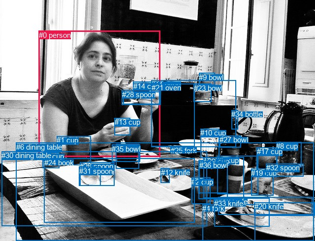
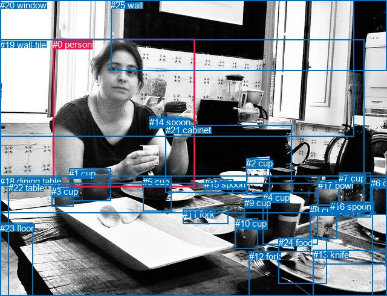

# 图片 0554：2339715.jpg

随机样本序号：140。图片 SHA256：`7110686f7909d235b993145e33ac6f5ae0baf8b89c308d5a32553aeb1601aed2`。

红色框表示人，蓝色框表示其他物体。两个模式分别保留自身框编号，可依据位置比较对应对象。

## 自动检测框与输出

人的框编号：`[0]`。状态：`ok`。

### 自动检测全部物体框

| 编号 | 类别 | 是否为人 | 检测分数 | 像素坐标 xyxy |
|---|---|---|---|---|
| 0 | person | True | 0.9994 | 78.7, 62.9, 325.7, 320.0 |
| 1 | cup | False | 0.9960 | 115.2, 277.0, 184.2, 336.7 |
| 2 | cup | False | 0.9919 | 389.2, 361.9, 427.9, 415.5 |
| 3 | cup | False | 0.9875 | 86.2, 310.1, 120.6, 342.5 |
| 4 | fork | False | 0.9857 | 411.4, 416.4, 518.2, 490.0 |
| 5 | cup | False | 0.9704 | 441.2, 318.0, 524.2, 395.6 |
| 6 | dining table | False | 0.9609 | 32.8, 290.9, 637.2, 491.0 |
| 7 | cup | False | 0.9274 | 235.7, 293.8, 282.4, 343.6 |
| 8 | cup | False | 0.8530 | 561.0, 289.1, 612.1, 340.8 |
| 9 | bowl | False | 0.8355 | 404.3, 149.0, 436.8, 173.3 |
| 10 | cup | False | 0.7839 | 407.1, 262.1, 445.9, 321.6 |
| 11 | oven | False | 0.7665 | 307.3, 164.0, 479.3, 299.8 |
| 12 | knife | False | 0.7385 | 326.8, 342.6, 345.0, 372.1 |
| 13 | cup | False | 0.7282 | 232.6, 240.1, 264.1, 275.9 |
| 14 | cup | False | 0.7088 | 270.6, 166.9, 309.0, 200.8 |
| 15 | pizza | False | 0.6731 | 435.7, 403.2, 547.1, 461.4 |
| 16 | knife | False | 0.6521 | 443.8, 401.7, 634.5, 437.6 |
| 17 | cup | False | 0.6285 | 521.7, 300.3, 563.4, 347.4 |
| 18 | fork | False | 0.6095 | 250.7, 186.4, 324.1, 212.2 |
| 19 | cup | False | 0.6092 | 510.1, 343.7, 555.6, 398.2 |
| 20 | knife | False | 0.6055 | 516.7, 412.1, 639.2, 439.2 |
| 21 | oven | False | 0.5904 | 307.9, 170.4, 395.3, 298.6 |
| 22 | cup | False | 0.5745 | 403.8, 326.3, 462.0, 405.5 |
| 23 | bowl | False | 0.5556 | 393.7, 170.9, 429.9, 207.2 |
| 24 | book | False | 0.4687 | 89.5, 323.0, 395.2, 453.5 |
| 25 | fork | False | 0.4578 | 346.8, 297.7, 385.9, 312.2 |
| 26 | spoon | False | 0.4527 | 162.0, 330.4, 232.8, 378.6 |
| 27 | bowl | False | 0.4425 | 446.1, 276.4, 489.4, 300.3 |
| 28 | spoon | False | 0.4209 | 247.6, 183.9, 327.0, 213.5 |
| 29 | cup | False | 0.4198 | 414.0, 320.0, 495.6, 403.1 |
| 30 | dining table | False | 0.4114 | 3.4, 308.0, 420.1, 460.3 |
| 31 | spoon | False | 0.3892 | 160.6, 339.7, 204.6, 378.2 |
| 32 | spoon | False | 0.3885 | 540.9, 333.2, 616.6, 359.9 |
| 33 | knife | False | 0.3721 | 435.0, 405.9, 490.5, 418.6 |
| 34 | bottle | False | 0.3672 | 470.1, 224.3, 483.9, 263.5 |
| 35 | bowl | False | 0.3620 | 227.2, 294.6, 284.8, 329.8 |
| 36 | bowl | False | 0.3562 | 404.7, 327.8, 462.2, 393.4 |

### 自动检测 Top50 人相关候选

评分物体对：1332；人相关物体对：72；输出关系：50。

| 排名 | 主语编号与类别 | 关系 | 宾语编号与类别 | 类型 | 人与人 | 排序分数 | 原始融合 logit |
|---|---|---|---|---|---|---|---|
| 1 | #0 person | holding | #28 spoon | semantic | False | 0.99509 | 5.3116 |
| 2 | #0 person | holding | #18 fork | semantic | False | 0.99482 | 5.2587 |
| 3 | #0 person | holding | #14 cup | semantic | False | 0.99323 | 4.9879 |
| 4 | #0 person | holding | #13 cup | semantic | False | 0.98844 | 4.4486 |
| 5 | #0 person | sitting on | #6 dining table | semantic | False | 0.96011 | 3.1809 |
| 6 | #0 person | in | #6 dining table | spatial | False | 0.92911 | 2.5730 |
| 7 | #0 person | eating | #11 oven | semantic | False | 0.85564 | 1.7795 |
| 8 | #0 person | on | #18 fork | spatial | False | 0.79037 | 1.3271 |
| 9 | #0 person | on | #28 spoon | spatial | False | 0.78636 | 1.3031 |
| 10 | #0 person | in | #11 oven | spatial | False | 0.78562 | 1.2987 |
| 11 | #0 person | in | #13 cup | spatial | False | 0.78411 | 1.2898 |
| 12 | #0 person | eating | #21 oven | semantic | False | 0.76784 | 1.1962 |
| 13 | #0 person | on | #14 cup | spatial | False | 0.75770 | 1.1401 |
| 14 | #0 person | in | #30 dining table | spatial | False | 0.62330 | 0.5036 |
| 15 | #0 person | in | #21 oven | spatial | False | 0.58084 | 0.3262 |
| 16 | #0 person | sitting on | #30 dining table | semantic | False | 0.57667 | 0.3091 |
| 17 | #0 person | holding | #35 bowl | semantic | False | 0.26921 | -0.9987 |
| 18 | #0 person | eating | #31 spoon | semantic | False | 0.26356 | -1.0276 |
| 19 | #0 person | eating | #26 spoon | semantic | False | 0.23907 | -1.1578 |
| 20 | #28 spoon | holding | #0 person | semantic | False | 0.23050 | -1.2055 |
| 21 | #18 fork | holding | #0 person | semantic | False | 0.22773 | -1.2212 |
| 22 | #13 cup | holding | #0 person | semantic | False | 0.21658 | -1.2857 |
| 23 | #13 cup | in front of | #0 person | spatial | False | 0.16858 | -1.5958 |
| 24 | #0 person | holding | #7 cup | semantic | False | 0.15638 | -1.6854 |
| 25 | #0 person | looking at | #24 book | semantic | False | 0.14366 | -1.7852 |
| 26 | #30 dining table | in front of | #0 person | spatial | False | 0.10677 | -2.1241 |
| 27 | #0 person | in | #24 book | spatial | False | 0.10623 | -2.1299 |
| 28 | #14 cup | holding | #0 person | semantic | False | 0.09910 | -2.2073 |
| 29 | #28 spoon | on | #0 person | spatial | False | 0.09219 | -2.2871 |
| 30 | #0 person | drinking | #1 cup | semantic | False | 0.09086 | -2.3032 |
| 31 | #18 fork | on | #0 person | spatial | False | 0.08943 | -2.3206 |
| 32 | #6 dining table | in front of | #0 person | spatial | False | 0.08739 | -2.3459 |
| 33 | #1 cup | beside | #0 person | spatial | False | 0.08712 | -2.3494 |
| 34 | #24 book | in front of | #0 person | spatial | False | 0.07828 | -2.4659 |
| 35 | #21 oven | beside | #0 person | spatial | False | 0.07021 | -2.5835 |
| 36 | #14 cup | on | #0 person | spatial | False | 0.06064 | -2.7403 |
| 37 | #0 person | in | #1 cup | spatial | False | 0.05740 | -2.7987 |
| 38 | #0 person | in | #35 bowl | spatial | False | 0.05484 | -2.8469 |
| 39 | #0 person | holding | #12 knife | semantic | False | 0.05427 | -2.8580 |
| 40 | #11 oven | beside | #0 person | spatial | False | 0.04728 | -3.0033 |
| 41 | #0 person | on | #7 cup | spatial | False | 0.02889 | -3.5148 |
| 42 | #3 cup | beside | #0 person | spatial | False | 0.02816 | -3.5411 |
| 43 | #0 person | holding | #3 cup | semantic | False | 0.02455 | -3.6824 |
| 44 | #9 bowl | beside | #0 person | spatial | False | 0.02451 | -3.6837 |
| 45 | #0 person | looking at | #9 bowl | semantic | False | 0.02436 | -3.6901 |
| 46 | #1 cup | holding | #0 person | semantic | False | 0.02145 | -3.8201 |
| 47 | #35 bowl | in front of | #0 person | spatial | False | 0.01659 | -4.0825 |
| 48 | #7 cup | in front of | #0 person | spatial | False | 0.01570 | -4.1381 |
| 49 | #23 bowl | beside | #0 person | spatial | False | 0.01545 | -4.1545 |
| 50 | #0 person | looking at | #23 bowl | semantic | False | 0.01492 | -4.1899 |

### 自动检测逐条人相关 GT 核验

R@50：0.00%；命中 0/2。

| GT 主语编号 | GT 关系 | GT 宾语编号 | 结果阶段 | 匹配预测主语编号 | 匹配预测宾语编号 |
|---|---|---|---|---|---|
| 0 | holding | 14 | endpoint_missing_or_wrong_class | [0] | [] |
| 0 | eating | 14 | endpoint_missing_or_wrong_class | [0] | [] |

## 真实框与输出

人的框编号：`[0]`。

### 真实框全部物体框

| 编号 | 类别 | 是否为人 | 检测分数 | 像素坐标 xyxy |
|---|---|---|---|---|
| 0 | person | True | GT | 87.0, 65.0, 322.0, 310.0 |
| 1 | cup | False | GT | 114.0, 279.0, 183.0, 333.0 |
| 2 | cup | False | GT | 407.0, 262.0, 446.0, 323.0 |
| 3 | cup | False | GT | 85.0, 309.0, 121.0, 342.0 |
| 4 | cup | False | GT | 435.0, 319.0, 526.0, 405.0 |
| 5 | cup | False | GT | 236.0, 293.0, 283.0, 351.0 |
| 6 | cup | False | GT | 613.0, 295.0, 640.0, 356.0 |
| 7 | cup | False | GT | 560.0, 287.0, 613.0, 361.0 |
| 8 | cup | False | GT | 512.0, 340.0, 558.0, 396.0 |
| 9 | cup | False | GT | 404.0, 328.0, 443.0, 380.0 |
| 10 | cup | False | GT | 389.0, 362.0, 427.0, 412.0 |
| 11 | fork | False | GT | 302.0, 347.0, 378.0, 372.0 |
| 12 | fork | False | GT | 412.0, 417.0, 519.0, 491.0 |
| 13 | knife | False | GT | 518.0, 414.0, 639.0, 438.0 |
| 14 | spoon | False | GT | 247.0, 194.0, 301.0, 213.0 |
| 15 | spoon | False | GT | 338.0, 297.0, 385.0, 319.0 |
| 16 | spoon | False | GT | 546.0, 334.0, 618.0, 356.0 |
| 17 | bowl | False | GT | 526.0, 299.0, 561.0, 341.0 |
| 18 | dining table | False | GT | 0.0, 292.0, 640.0, 491.0 |
| 19 | wall-tile | False | GT | 0.0, 66.0, 603.0, 353.0 |
| 20 | window | False | GT | 0.0, 0.0, 586.0, 227.0 |
| 21 | cabinet | False | GT | 274.0, 207.0, 483.0, 319.0 |
| 22 | table | False | GT | 14.0, 303.0, 617.0, 491.0 |
| 23 | floor | False | GT | 0.0, 370.0, 54.0, 491.0 |
| 24 | food | False | GT | 461.0, 394.0, 541.0, 470.0 |
| 25 | wall | False | GT | 183.0, 0.0, 640.0, 117.0 |

### 真实框 Top50 人相关候选

评分物体对：650；人相关物体对：50；输出关系：50。

| 排名 | 主语编号与类别 | 关系 | 宾语编号与类别 | 类型 | 人与人 | 排序分数 | 原始融合 logit |
|---|---|---|---|---|---|---|---|
| 1 | #0 person | holding | #14 spoon | semantic | False | 0.99600 | 5.5187 |
| 2 | #0 person | sitting on | #18 dining table | semantic | False | 0.97483 | 3.6566 |
| 3 | #0 person | sitting on | #22 table | semantic | False | 0.95567 | 3.0709 |
| 4 | #0 person | in | #18 dining table | spatial | False | 0.90972 | 2.3102 |
| 5 | #0 person | in | #22 table | spatial | False | 0.89925 | 2.1889 |
| 6 | #0 person | in | #19 wall-tile | spatial | False | 0.85262 | 1.7553 |
| 7 | #0 person | sitting on | #21 cabinet | semantic | False | 0.82889 | 1.5778 |
| 8 | #0 person | on | #14 spoon | spatial | False | 0.80879 | 1.4422 |
| 9 | #0 person | eating | #19 wall-tile | semantic | False | 0.75685 | 1.1355 |
| 10 | #0 person | in | #21 cabinet | spatial | False | 0.72285 | 0.9587 |
| 11 | #0 person | holding | #5 cup | semantic | False | 0.65483 | 0.6403 |
| 12 | #14 spoon | holding | #0 person | semantic | False | 0.64488 | 0.5966 |
| 13 | #0 person | in front of | #20 window | spatial | False | 0.51690 | 0.0676 |
| 14 | #0 person | looking at | #20 window | semantic | False | 0.43716 | -0.2527 |
| 15 | #0 person | holding | #1 cup | semantic | False | 0.32195 | -0.7448 |
| 16 | #19 wall-tile | beside | #0 person | spatial | False | 0.22972 | -1.2099 |
| 17 | #14 spoon | on | #0 person | spatial | False | 0.18319 | -1.4949 |
| 18 | #1 cup | in front of | #0 person | spatial | False | 0.18230 | -1.5009 |
| 19 | #0 person | in front of | #25 wall | spatial | False | 0.15341 | -1.7081 |
| 20 | #0 person | holding | #11 fork | semantic | False | 0.14908 | -1.7418 |
| 21 | #20 window | beside | #0 person | spatial | False | 0.11381 | -2.0524 |
| 22 | #0 person | on | #5 cup | spatial | False | 0.08254 | -2.4083 |
| 23 | #0 person | in | #1 cup | spatial | False | 0.07152 | -2.5635 |
| 24 | #25 wall | over | #0 person | spatial | False | 0.06115 | -2.7314 |
| 25 | #19 wall-tile | looking at | #0 person | semantic | False | 0.05957 | -2.7591 |
| 26 | #0 person | holding | #15 spoon | semantic | False | 0.05857 | -2.7773 |
| 27 | #0 person | holding | #3 cup | semantic | False | 0.05840 | -2.7803 |
| 28 | #22 table | in front of | #0 person | spatial | False | 0.05818 | -2.7843 |
| 29 | #21 cabinet | in front of | #0 person | spatial | False | 0.05690 | -2.8078 |
| 30 | #5 cup | in front of | #0 person | spatial | False | 0.05397 | -2.8638 |
| 31 | #18 dining table | in front of | #0 person | spatial | False | 0.05175 | -2.9083 |
| 32 | #0 person | in | #23 floor | spatial | False | 0.04927 | -2.9599 |
| 33 | #0 person | looking at | #25 wall | semantic | False | 0.04903 | -2.9650 |
| 34 | #0 person | eating | #24 food | semantic | False | 0.04831 | -2.9807 |
| 35 | #0 person | looking at | #23 floor | semantic | False | 0.03668 | -3.2682 |
| 36 | #3 cup | in front of | #0 person | spatial | False | 0.03573 | -3.2954 |
| 37 | #1 cup | holding | #0 person | semantic | False | 0.03548 | -3.3026 |
| 38 | #23 floor | in front of | #0 person | spatial | False | 0.03221 | -3.4028 |
| 39 | #20 window | looking at | #0 person | semantic | False | 0.02854 | -3.5274 |
| 40 | #0 person | holding | #12 fork | semantic | False | 0.02235 | -3.7782 |
| 41 | #0 person | on | #11 fork | spatial | False | 0.02143 | -3.8211 |
| 42 | #5 cup | holding | #0 person | semantic | False | 0.01827 | -3.9841 |
| 43 | #0 person | holding | #13 knife | semantic | False | 0.01814 | -3.9915 |
| 44 | #0 person | in | #24 food | spatial | False | 0.01517 | -4.1734 |
| 45 | #0 person | looking at | #8 cup | semantic | False | 0.01219 | -4.3950 |
| 46 | #23 floor | holding | #0 person | semantic | False | 0.01215 | -4.3979 |
| 47 | #25 wall | looking at | #0 person | semantic | False | 0.01214 | -4.3987 |
| 48 | #0 person | on | #12 fork | spatial | False | 0.01184 | -4.4244 |
| 49 | #0 person | on | #15 spoon | spatial | False | 0.01157 | -4.4474 |
| 50 | #0 person | looking at | #2 cup | semantic | False | 0.01006 | -4.5895 |

### 真实框逐条人相关 GT 核验

R@50：50.00%；命中 1/2。

| GT 主语编号 | GT 关系 | GT 宾语编号 | 结果阶段 | 匹配预测主语编号 | 匹配预测宾语编号 |
|---|---|---|---|---|---|
| 0 | holding | 14 | hit50 | [0] | [14] |
| 0 | eating | 14 | wrong_predicate | [0] | [14] |

## 全部人相关 GT

| 主语编号与类别 | 关系 | 宾语编号与类别 |
|---|---|---|
| #0 person | holding | #14 spoon |
| #0 person | eating | #14 spoon |

原始记录、全部人相关物体对的两项预测与分项分数见 [逐图证据 JSON](../evidence/cases/0554.json)。全部56类 logits 保留于本机 HOR/output/random500/logits/。

<!-- HOR_COMPLETE_RESULTS -->

## 六组条件的完整输出对照

以下保留同一图片三种框与候选模式、两种谓词输出规则的全部 Top50。框编号各自在所属模式内解释。

### 自动检测框完整枚举：空间与语义各保留一个谓词

| 排名 | 主语编号与类别 | 谓词 | 宾语编号与类别 | 分组 | 排序分数 | predicate logit | pair logit |
|---|---|---|---|---|---|---|---|
| 1 | #0 person | holding | #28 spoon | semantic | 0.9950902 | 4.6886067 | 0.6230199 |
| 2 | #0 person | holding | #18 fork | semantic | 0.9948248 | 4.6225152 | 0.6361612 |
| 3 | #0 person | holding | #14 cup | semantic | 0.9932260 | 4.4515882 | 0.5362700 |
| 4 | #0 person | holding | #13 cup | semantic | 0.9884398 | 3.9453969 | 0.5031605 |
| 5 | #0 person | sitting on | #6 dining table | semantic | 0.9601073 | 2.8890686 | 0.2917834 |
| 6 | #0 person | in | #6 dining table | spatial | 0.9291056 | 2.2812471 | 0.2917834 |
| 7 | #0 person | eating | #11 oven | semantic | 0.8556383 | 2.1825428 | -0.4030174 |
| 8 | #0 person | on | #18 fork | spatial | 0.7903677 | 0.6909814 | 0.6361612 |
| 9 | #0 person | on | #28 spoon | spatial | 0.7863582 | 0.6800914 | 0.6230199 |
| 10 | #0 person | in | #11 oven | spatial | 0.7856237 | 1.7017627 | -0.4030174 |
| 11 | #0 person | in | #13 cup | spatial | 0.7841101 | 0.7866206 | 0.5031605 |
| 12 | #0 person | eating | #21 oven | semantic | 0.7678426 | 1.7855635 | -0.5893942 |
| 13 | #0 person | on | #14 cup | spatial | 0.7577043 | 0.6038642 | 0.5362700 |
| 14 | #0 person | in | #30 dining table | spatial | 0.6232975 | 0.9169617 | -0.4133937 |
| 15 | #0 person | in | #21 oven | spatial | 0.5808424 | 0.9156265 | -0.5893942 |
| 16 | #0 person | sitting on | #30 dining table | semantic | 0.5766668 | 0.7224989 | -0.4133937 |
| 17 | #0 person | holding | #35 bowl | semantic | 0.2692061 | -0.5455794 | -0.4530747 |
| 18 | #0 person | eating | #31 spoon | semantic | 0.2635589 | -0.5897141 | -0.4378383 |
| 19 | #0 person | eating | #26 spoon | semantic | 0.2390668 | -0.7353432 | -0.4224592 |
| 20 | #28 spoon | holding | #0 person | semantic | 0.2305006 | 0.2130642 | -1.4185507 |
| 21 | #18 fork | holding | #0 person | semantic | 0.2277332 | 0.1953387 | -1.4164943 |
| 22 | #13 cup | holding | #0 person | semantic | 0.2165796 | -0.2501612 | -1.0355498 |
| 23 | #13 cup | in front of | #0 person | spatial | 0.1685755 | -0.5602069 | -1.0355498 |
| 24 | #0 person | holding | #7 cup | semantic | 0.1563810 | -1.1485076 | -0.5368981 |
| 25 | #0 person | looking at | #24 book | semantic | 0.1436625 | -1.1976802 | -0.5875177 |
| 26 | #30 dining table | in front of | #0 person | spatial | 0.1067729 | -0.8794992 | -1.2446375 |
| 27 | #0 person | in | #24 book | spatial | 0.1062280 | -1.5423448 | -0.5875177 |
| 28 | #14 cup | holding | #0 person | semantic | 0.0990960 | -1.0684938 | -1.1388156 |
| 29 | #28 spoon | on | #0 person | spatial | 0.0921944 | -0.8685801 | -1.4185507 |
| 30 | #0 person | drinking | #1 cup | semantic | 0.0908597 | -1.5182803 | -0.7849026 |
| 31 | #18 fork | on | #0 person | spatial | 0.0894303 | -0.9041162 | -1.4164943 |
| 32 | #6 dining table | in front of | #0 person | spatial | 0.0873932 | -1.0636106 | -1.2822773 |
| 33 | #1 cup | beside | #0 person | spatial | 0.0871165 | -1.7886908 | -0.5606710 |
| 34 | #24 book | in front of | #0 person | spatial | 0.0782813 | -1.2243998 | -1.2415313 |
| 35 | #21 oven | beside | #0 person | spatial | 0.0702081 | -1.4921296 | -1.0913680 |
| 36 | #14 cup | on | #0 person | spatial | 0.0606351 | -1.6015148 | -1.1388156 |
| 37 | #0 person | in | #1 cup | spatial | 0.0573972 | -2.0137475 | -0.7849026 |
| 38 | #0 person | in | #35 bowl | spatial | 0.0548424 | -2.3938138 | -0.4530747 |
| 39 | #0 person | holding | #12 knife | semantic | 0.0542714 | -1.9702129 | -0.8877465 |
| 40 | #11 oven | beside | #0 person | spatial | 0.0472780 | -1.8840673 | -1.1192098 |
| 41 | #0 person | on | #7 cup | spatial | 0.0288935 | -2.9779210 | -0.5368981 |
| 42 | #3 cup | beside | #0 person | spatial | 0.0281639 | -2.7354445 | -0.8057020 |
| 43 | #0 person | holding | #3 cup | semantic | 0.0245450 | -2.6772978 | -1.0050967 |
| 44 | #9 bowl | beside | #0 person | spatial | 0.0245147 | -2.5498915 | -1.1337688 |
| 45 | #0 person | looking at | #9 bowl | semantic | 0.0243602 | -2.2117627 | -1.4783814 |
| 46 | #1 cup | holding | #0 person | semantic | 0.0214542 | -3.2594786 | -0.5606710 |
| 47 | #35 bowl | in front of | #0 person | spatial | 0.0165862 | -3.0590827 | -1.0233791 |
| 48 | #7 cup | in front of | #0 person | spatial | 0.0157023 | -3.1042194 | -1.0339046 |
| 49 | #23 bowl | beside | #0 person | spatial | 0.0154511 | -2.9101191 | -1.2443814 |
| 50 | #0 person | looking at | #23 bowl | semantic | 0.0149221 | -2.7274103 | -1.4624681 |

GT 命中：0/2，R@50=0.00%。

| GT主语 | GT谓词 | GT宾语 | 结果阶段 | 匹配主语框 | 匹配宾语框 |
|---|---|---|---|---|---|
| 0 | holding | 14 | endpoint_missing_or_wrong_class | [0] | [] |
| 0 | eating | 14 | endpoint_missing_or_wrong_class | [0] | [] |

### 自动检测框完整枚举：每对只保留一个谓词

| 排名 | 主语编号与类别 | 谓词 | 宾语编号与类别 | 分组 | 排序分数 | predicate logit | pair logit |
|---|---|---|---|---|---|---|---|
| 1 | #0 person | holding | #28 spoon | single | 0.9950902 | 4.6886067 | 0.6230199 |
| 2 | #0 person | holding | #18 fork | single | 0.9948248 | 4.6225152 | 0.6361612 |
| 3 | #0 person | holding | #14 cup | single | 0.9932260 | 4.4515882 | 0.5362700 |
| 4 | #0 person | holding | #13 cup | single | 0.9884398 | 3.9453969 | 0.5031605 |
| 5 | #0 person | sitting on | #6 dining table | single | 0.9601073 | 2.8890686 | 0.2917834 |
| 6 | #0 person | eating | #11 oven | single | 0.8556383 | 2.1825428 | -0.4030174 |
| 7 | #0 person | eating | #21 oven | single | 0.7678426 | 1.7855635 | -0.5893942 |
| 8 | #0 person | in | #30 dining table | single | 0.6232975 | 0.9169617 | -0.4133937 |
| 9 | #0 person | holding | #35 bowl | single | 0.2692061 | -0.5455794 | -0.4530747 |
| 10 | #0 person | eating | #31 spoon | single | 0.2635589 | -0.5897141 | -0.4378383 |
| 11 | #0 person | eating | #26 spoon | single | 0.2390668 | -0.7353432 | -0.4224592 |
| 12 | #28 spoon | holding | #0 person | single | 0.2305006 | 0.2130642 | -1.4185507 |
| 13 | #18 fork | holding | #0 person | single | 0.2277332 | 0.1953387 | -1.4164943 |
| 14 | #13 cup | holding | #0 person | single | 0.2165796 | -0.2501612 | -1.0355498 |
| 15 | #0 person | holding | #7 cup | single | 0.1563810 | -1.1485076 | -0.5368981 |
| 16 | #0 person | looking at | #24 book | single | 0.1436625 | -1.1976802 | -0.5875177 |
| 17 | #30 dining table | in front of | #0 person | single | 0.1067729 | -0.8794992 | -1.2446375 |
| 18 | #14 cup | holding | #0 person | single | 0.0990960 | -1.0684938 | -1.1388156 |
| 19 | #0 person | drinking | #1 cup | single | 0.0908597 | -1.5182803 | -0.7849026 |
| 20 | #6 dining table | in front of | #0 person | single | 0.0873932 | -1.0636106 | -1.2822773 |
| 21 | #1 cup | beside | #0 person | single | 0.0871165 | -1.7886908 | -0.5606710 |
| 22 | #24 book | in front of | #0 person | single | 0.0782813 | -1.2243998 | -1.2415313 |
| 23 | #21 oven | beside | #0 person | single | 0.0702081 | -1.4921296 | -1.0913680 |
| 24 | #0 person | holding | #12 knife | single | 0.0542714 | -1.9702129 | -0.8877465 |
| 25 | #11 oven | beside | #0 person | single | 0.0472780 | -1.8840673 | -1.1192098 |
| 26 | #3 cup | beside | #0 person | single | 0.0281639 | -2.7354445 | -0.8057020 |
| 27 | #0 person | holding | #3 cup | single | 0.0245450 | -2.6772978 | -1.0050967 |
| 28 | #9 bowl | beside | #0 person | single | 0.0245147 | -2.5498915 | -1.1337688 |
| 29 | #0 person | looking at | #9 bowl | single | 0.0243602 | -2.2117627 | -1.4783814 |
| 30 | #35 bowl | in front of | #0 person | single | 0.0165862 | -3.0590827 | -1.0233791 |
| 31 | #7 cup | in front of | #0 person | single | 0.0157023 | -3.1042194 | -1.0339046 |
| 32 | #23 bowl | beside | #0 person | single | 0.0154511 | -2.9101191 | -1.2443814 |
| 33 | #0 person | looking at | #23 bowl | single | 0.0149221 | -2.7274103 | -1.4624681 |
| 34 | #34 bottle | beside | #0 person | single | 0.0147344 | -2.8550019 | -1.3477230 |
| 35 | #0 person | eating | #15 pizza | single | 0.0136909 | -3.1666200 | -1.1106166 |
| 36 | #0 person | holding | #33 knife | single | 0.0111369 | -3.3547497 | -1.1315410 |
| 37 | #16 knife | in front of | #0 person | single | 0.0109239 | -2.9754946 | -1.5303276 |
| 38 | #0 person | holding | #4 fork | single | 0.0099586 | -3.5140686 | -1.0852399 |
| 39 | #26 spoon | in front of | #0 person | single | 0.0097601 | -3.2816858 | -1.3379555 |
| 40 | #0 person | holding | #25 fork | single | 0.0097290 | -3.4112196 | -1.2116508 |
| 41 | #0 person | looking at | #16 knife | single | 0.0093552 | -3.4874916 | -1.1749341 |
| 42 | #0 person | looking at | #20 knife | single | 0.0091795 | -3.5010500 | -1.1805100 |
| 43 | #0 person | looking at | #19 cup | single | 0.0073671 | -3.4984193 | -1.4049146 |
| 44 | #0 person | in | #34 bottle | single | 0.0070290 | -3.4315724 | -1.5190859 |
| 45 | #31 spoon | in front of | #0 person | single | 0.0069962 | -3.6034822 | -1.3518900 |
| 46 | #0 person | looking at | #17 cup | single | 0.0068324 | -3.7625022 | -1.2167147 |
| 47 | #10 cup | in front of | #0 person | single | 0.0067165 | -3.4115114 | -1.5849367 |
| 48 | #0 person | looking at | #5 cup | single | 0.0062395 | -3.7911987 | -1.2793930 |
| 49 | #0 person | looking at | #10 cup | single | 0.0061705 | -3.3693442 | -1.7124398 |
| 50 | #0 person | looking at | #27 bowl | single | 0.0060268 | -3.5954041 | -1.5100867 |

GT 命中：0/2，R@50=0.00%。

| GT主语 | GT谓词 | GT宾语 | 结果阶段 | 匹配主语框 | 匹配宾语框 |
|---|---|---|---|---|---|
| 0 | holding | 14 | endpoint_missing_or_wrong_class | [0] | [] |
| 0 | eating | 14 | endpoint_missing_or_wrong_class | [0] | [] |

### 真实框完整枚举：空间与语义各保留一个谓词

| 排名 | 主语编号与类别 | 谓词 | 宾语编号与类别 | 分组 | 排序分数 | predicate logit | pair logit |
|---|---|---|---|---|---|---|---|
| 1 | #0 person | holding | #14 spoon | semantic | 0.9960049 | 4.8078732 | 0.7108154 |
| 2 | #0 person | sitting on | #18 dining table | semantic | 0.9748307 | 3.3404536 | 0.3161821 |
| 3 | #0 person | sitting on | #22 table | semantic | 0.9556748 | 2.8890686 | 0.1817961 |
| 4 | #0 person | in | #18 dining table | spatial | 0.9097213 | 1.9940543 | 0.3161821 |
| 5 | #0 person | in | #22 table | spatial | 0.8992486 | 2.0071068 | 0.1817961 |
| 6 | #0 person | in | #19 wall-tile | spatial | 0.8526157 | 2.3150816 | -0.5598159 |
| 7 | #0 person | sitting on | #21 cabinet | semantic | 0.8288906 | 1.8960733 | -0.3182886 |
| 8 | #0 person | on | #14 spoon | spatial | 0.8087948 | 0.7313828 | 0.7108154 |
| 9 | #0 person | eating | #19 wall-tile | semantic | 0.7568477 | 1.6952901 | -0.5598159 |
| 10 | #0 person | in | #21 cabinet | spatial | 0.7228525 | 1.2769437 | -0.3182886 |
| 11 | #0 person | holding | #5 cup | semantic | 0.6548254 | 1.2109365 | -0.5706181 |
| 12 | #14 spoon | holding | #0 person | semantic | 0.6448815 | 2.0316629 | -1.4350480 |
| 13 | #0 person | in front of | #20 window | spatial | 0.5168960 | 1.0824108 | -1.0148010 |
| 14 | #0 person | looking at | #20 window | semantic | 0.4371553 | 0.7620859 | -1.0148010 |
| 15 | #0 person | holding | #1 cup | semantic | 0.3219451 | 0.0416594 | -0.7865065 |
| 16 | #19 wall-tile | beside | #0 person | spatial | 0.2297216 | -0.2868314 | -0.9230524 |
| 17 | #14 spoon | on | #0 person | spatial | 0.1831875 | -0.0598516 | -1.4350480 |
| 18 | #1 cup | in front of | #0 person | spatial | 0.1822984 | -0.9425151 | -0.5583377 |
| 19 | #0 person | in front of | #25 wall | spatial | 0.1534053 | -0.3229232 | -1.3852154 |
| 20 | #0 person | holding | #11 fork | semantic | 0.1490822 | -0.8945229 | -0.8472946 |
| 21 | #20 window | beside | #0 person | spatial | 0.1138141 | -1.2368743 | -0.8154860 |
| 22 | #0 person | on | #5 cup | spatial | 0.0825419 | -1.8376827 | -0.5706181 |
| 23 | #0 person | in | #1 cup | spatial | 0.0715241 | -1.7770040 | -0.7865065 |
| 24 | #25 wall | over | #0 person | spatial | 0.0611463 | -1.7266061 | -1.0047847 |
| 25 | #19 wall-tile | looking at | #0 person | semantic | 0.0595748 | -1.8360462 | -0.9230524 |
| 26 | #0 person | holding | #15 spoon | semantic | 0.0585652 | -1.6412351 | -1.1360296 |
| 27 | #0 person | holding | #3 cup | semantic | 0.0583957 | -1.7465348 | -1.0338086 |
| 28 | #22 table | in front of | #0 person | spatial | 0.0581803 | -1.5180783 | -1.2661891 |
| 29 | #21 cabinet | in front of | #0 person | spatial | 0.0569045 | -1.7330873 | -1.0747049 |
| 30 | #5 cup | in front of | #0 person | spatial | 0.0539721 | -1.8345313 | -1.0292740 |
| 31 | #18 dining table | in front of | #0 person | spatial | 0.0517471 | -1.6720572 | -1.2361952 |
| 32 | #0 person | in | #23 floor | spatial | 0.0492688 | -2.0075853 | -0.9523544 |
| 33 | #0 person | looking at | #25 wall | semantic | 0.0490341 | -1.5797477 | -1.3852154 |
| 34 | #0 person | eating | #24 food | semantic | 0.0483064 | -1.9335222 | -1.0471560 |
| 35 | #0 person | looking at | #23 floor | semantic | 0.0366770 | -2.3158832 | -0.9523544 |
| 36 | #3 cup | in front of | #0 person | spatial | 0.0357290 | -2.4986830 | -0.7967262 |
| 37 | #1 cup | holding | #0 person | semantic | 0.0354830 | -2.7442360 | -0.5583377 |
| 38 | #23 floor | in front of | #0 person | spatial | 0.0322087 | -2.2975404 | -1.1052403 |
| 39 | #20 window | looking at | #0 person | semantic | 0.0285434 | -2.7118845 | -0.8154860 |
| 40 | #0 person | holding | #12 fork | semantic | 0.0223528 | -2.6687689 | -1.1094275 |
| 41 | #0 person | on | #11 fork | spatial | 0.0214332 | -2.9738519 | -0.8472946 |
| 42 | #5 cup | holding | #0 person | semantic | 0.0182684 | -2.9548707 | -1.0292740 |
| 43 | #0 person | holding | #13 knife | semantic | 0.0181374 | -2.8170943 | -1.1743789 |
| 44 | #0 person | in | #24 food | spatial | 0.0151660 | -3.1262636 | -1.0471560 |
| 45 | #0 person | looking at | #8 cup | semantic | 0.0121880 | -2.9961338 | -1.3989059 |
| 46 | #23 floor | holding | #0 person | semantic | 0.0121532 | -3.2926912 | -1.1052403 |
| 47 | #25 wall | looking at | #0 person | semantic | 0.0121445 | -3.3938727 | -1.0047847 |
| 48 | #0 person | on | #12 fork | spatial | 0.0118395 | -3.3149781 | -1.1094275 |
| 49 | #0 person | on | #15 spoon | spatial | 0.0115734 | -3.3113790 | -1.1360296 |
| 50 | #0 person | looking at | #2 cup | semantic | 0.0100563 | -2.9057188 | -1.6837344 |

GT 命中：1/2，R@50=50.00%。

| GT主语 | GT谓词 | GT宾语 | 结果阶段 | 匹配主语框 | 匹配宾语框 |
|---|---|---|---|---|---|
| 0 | holding | 14 | hit50 | [0] | [14] |
| 0 | eating | 14 | wrong_predicate | [0] | [14] |

### 真实框完整枚举：每对只保留一个谓词

| 排名 | 主语编号与类别 | 谓词 | 宾语编号与类别 | 分组 | 排序分数 | predicate logit | pair logit |
|---|---|---|---|---|---|---|---|
| 1 | #0 person | holding | #14 spoon | single | 0.9960049 | 4.8078732 | 0.7108154 |
| 2 | #0 person | sitting on | #18 dining table | single | 0.9748307 | 3.3404536 | 0.3161821 |
| 3 | #0 person | sitting on | #22 table | single | 0.9556748 | 2.8890686 | 0.1817961 |
| 4 | #0 person | in | #19 wall-tile | single | 0.8526157 | 2.3150816 | -0.5598159 |
| 5 | #0 person | sitting on | #21 cabinet | single | 0.8288906 | 1.8960733 | -0.3182886 |
| 6 | #0 person | holding | #5 cup | single | 0.6548254 | 1.2109365 | -0.5706181 |
| 7 | #14 spoon | holding | #0 person | single | 0.6448815 | 2.0316629 | -1.4350480 |
| 8 | #0 person | in front of | #20 window | single | 0.5168960 | 1.0824108 | -1.0148010 |
| 9 | #0 person | holding | #1 cup | single | 0.3219451 | 0.0416594 | -0.7865065 |
| 10 | #19 wall-tile | beside | #0 person | single | 0.2297216 | -0.2868314 | -0.9230524 |
| 11 | #1 cup | in front of | #0 person | single | 0.1822984 | -0.9425151 | -0.5583377 |
| 12 | #0 person | in front of | #25 wall | single | 0.1534053 | -0.3229232 | -1.3852154 |
| 13 | #0 person | holding | #11 fork | single | 0.1490822 | -0.8945229 | -0.8472946 |
| 14 | #20 window | beside | #0 person | single | 0.1138141 | -1.2368743 | -0.8154860 |
| 15 | #25 wall | over | #0 person | single | 0.0611463 | -1.7266061 | -1.0047847 |
| 16 | #0 person | holding | #15 spoon | single | 0.0585652 | -1.6412351 | -1.1360296 |
| 17 | #0 person | holding | #3 cup | single | 0.0583957 | -1.7465348 | -1.0338086 |
| 18 | #22 table | in front of | #0 person | single | 0.0581803 | -1.5180783 | -1.2661891 |
| 19 | #21 cabinet | in front of | #0 person | single | 0.0569045 | -1.7330873 | -1.0747049 |
| 20 | #5 cup | in front of | #0 person | single | 0.0539721 | -1.8345313 | -1.0292740 |
| 21 | #18 dining table | in front of | #0 person | single | 0.0517471 | -1.6720572 | -1.2361952 |
| 22 | #0 person | in | #23 floor | single | 0.0492688 | -2.0075853 | -0.9523544 |
| 23 | #0 person | eating | #24 food | single | 0.0483064 | -1.9335222 | -1.0471560 |
| 24 | #3 cup | in front of | #0 person | single | 0.0357290 | -2.4986830 | -0.7967262 |
| 25 | #23 floor | in front of | #0 person | single | 0.0322087 | -2.2975404 | -1.1052403 |
| 26 | #0 person | holding | #12 fork | single | 0.0223528 | -2.6687689 | -1.1094275 |
| 27 | #0 person | holding | #13 knife | single | 0.0181374 | -2.8170943 | -1.1743789 |
| 28 | #0 person | looking at | #8 cup | single | 0.0121880 | -2.9961338 | -1.3989059 |
| 29 | #0 person | looking at | #2 cup | single | 0.0100563 | -2.9057188 | -1.6837344 |
| 30 | #0 person | looking at | #17 bowl | single | 0.0096839 | -3.3968477 | -1.2307117 |
| 31 | #0 person | looking at | #4 cup | single | 0.0094918 | -3.3877559 | -1.2600324 |
| 32 | #0 person | looking at | #16 spoon | single | 0.0084441 | -3.2793696 | -1.4864392 |
| 33 | #0 person | looking at | #7 cup | single | 0.0080346 | -3.3706186 | -1.4453185 |
| 34 | #4 cup | in front of | #0 person | single | 0.0077024 | -3.2239184 | -1.6345694 |
| 35 | #15 spoon | in front of | #0 person | single | 0.0073234 | -3.3737621 | -1.5355651 |
| 36 | #0 person | looking at | #6 cup | single | 0.0069875 | -3.6066689 | -1.3499532 |
| 37 | #12 fork | in front of | #0 person | single | 0.0069499 | -3.1385460 | -1.8235016 |
| 38 | #2 cup | in front of | #0 person | single | 0.0068527 | -3.4023218 | -1.5739131 |
| 39 | #24 food | in front of | #0 person | single | 0.0060565 | -3.2755237 | -1.8250233 |
| 40 | #8 cup | in front of | #0 person | single | 0.0057916 | -3.5257499 | -1.6197962 |
| 41 | #11 fork | in front of | #0 person | single | 0.0046609 | -3.6756291 | -1.6882482 |
| 42 | #0 person | holding | #9 cup | single | 0.0043227 | -3.9911299 | -1.4484136 |
| 43 | #0 person | holding | #10 cup | single | 0.0041496 | -3.9156275 | -1.5649498 |
| 44 | #6 cup | in front of | #0 person | single | 0.0038109 | -4.0286975 | -1.5373690 |
| 45 | #7 cup | in front of | #0 person | single | 0.0036447 | -4.1116014 | -1.4992237 |
| 46 | #13 knife | in front of | #0 person | single | 0.0035387 | -3.8168600 | -1.8235826 |
| 47 | #9 cup | in front of | #0 person | single | 0.0034761 | -3.9326210 | -1.7257469 |
| 48 | #16 spoon | in front of | #0 person | single | 0.0033859 | -4.0274544 | -1.6572976 |
| 49 | #10 cup | in front of | #0 person | single | 0.0033130 | -4.0821671 | -1.6244256 |
| 50 | #17 bowl | in front of | #0 person | single | 0.0031414 | -4.0894923 | -1.6704494 |

GT 命中：1/2，R@50=50.00%。

| GT主语 | GT谓词 | GT宾语 | 结果阶段 | 匹配主语框 | 匹配宾语框 |
|---|---|---|---|---|---|
| 0 | holding | 14 | hit50 | [0] | [14] |
| 0 | eating | 14 | wrong_predicate | [0] | [14] |

### 真实框400候选：空间与语义各保留一个谓词

| 排名 | 主语编号与类别 | 谓词 | 宾语编号与类别 | 分组 | 排序分数 | predicate logit | pair logit |
|---|---|---|---|---|---|---|---|
| 1 | #0 person | holding | #14 spoon | semantic | 0.9958614 | 4.7724223 | 0.7108154 |
| 2 | #0 person | sitting on | #18 dining table | semantic | 0.9761961 | 3.3976312 | 0.3161821 |
| 3 | #0 person | sitting on | #22 table | semantic | 0.9556748 | 2.8890686 | 0.1817961 |
| 4 | #0 person | in | #18 dining table | spatial | 0.8872192 | 1.7464643 | 0.3161821 |
| 5 | #0 person | in | #22 table | spatial | 0.8744963 | 1.7595167 | 0.1817961 |
| 6 | #0 person | in | #19 wall-tile | spatial | 0.8457013 | 2.2610917 | -0.5598159 |
| 7 | #0 person | sitting on | #21 cabinet | semantic | 0.8433141 | 2.0013847 | -0.3182886 |
| 8 | #0 person | eating | #19 wall-tile | semantic | 0.7922248 | 1.8982043 | -0.5598159 |
| 9 | #0 person | on | #14 spoon | spatial | 0.7894865 | 0.6110177 | 0.7108154 |
| 10 | #0 person | holding | #5 cup | semantic | 0.6668657 | 1.2646613 | -0.5706181 |
| 11 | #0 person | in | #21 cabinet | spatial | 0.6435258 | 0.9089890 | -0.3182886 |
| 12 | #14 spoon | holding | #0 person | semantic | 0.6195216 | 1.9225664 | -1.4350480 |
| 13 | #0 person | in front of | #20 window | spatial | 0.4500533 | 0.8143458 | -1.0148010 |
| 14 | #0 person | looking at | #20 window | semantic | 0.3936803 | 0.5829329 | -1.0148010 |
| 15 | #0 person | holding | #1 cup | semantic | 0.2819506 | -0.1483002 | -0.7865065 |
| 16 | #1 cup | in front of | #0 person | spatial | 0.1866291 | -0.9137261 | -0.5583377 |
| 17 | #19 wall-tile | beside | #0 person | spatial | 0.1719760 | -0.6486349 | -0.9230524 |
| 18 | #14 spoon | on | #0 person | spatial | 0.1544530 | -0.2650456 | -1.4350480 |
| 19 | #0 person | eating | #24 food | semantic | 0.1345460 | -0.8141918 | -1.0471560 |
| 20 | #0 person | holding | #11 fork | semantic | 0.1299799 | -1.0538421 | -0.8472946 |
| 21 | #0 person | in front of | #25 wall | spatial | 0.1037128 | -0.7714200 | -1.3852154 |
| 22 | #0 person | on | #5 cup | spatial | 0.0842063 | -1.8159037 | -0.5706181 |
| 23 | #20 window | beside | #0 person | spatial | 0.0832940 | -1.5829237 | -0.8154860 |
| 24 | #5 cup | in front of | #0 person | spatial | 0.0629921 | -1.6704078 | -1.0292740 |
| 25 | #0 person | in | #1 cup | spatial | 0.0619546 | -1.9308903 | -0.7865065 |
| 26 | #0 person | holding | #3 cup | semantic | 0.0580313 | -1.7531817 | -1.0338086 |
| 27 | #21 cabinet | in front of | #0 person | spatial | 0.0576508 | -1.7192669 | -1.0747049 |
| 28 | #22 table | in front of | #0 person | spatial | 0.0549689 | -1.5782604 | -1.2661891 |
| 29 | #0 person | in | #23 floor | spatial | 0.0525058 | -1.9405429 | -0.9523544 |
| 30 | #18 dining table | in front of | #0 person | spatial | 0.0482340 | -1.7460597 | -1.2361952 |
| 31 | #0 person | holding | #12 fork | semantic | 0.0465255 | -1.9106841 | -1.1094275 |
| 32 | #25 wall | over | #0 person | spatial | 0.0451322 | -2.0471916 | -1.0047847 |
| 33 | #0 person | holding | #15 spoon | semantic | 0.0434604 | -1.9554415 | -1.1360296 |
| 34 | #0 person | looking at | #23 floor | semantic | 0.0424080 | -2.1647296 | -0.9523544 |
| 35 | #0 person | looking at | #25 wall | semantic | 0.0411652 | -1.7629101 | -1.3852154 |
| 36 | #3 cup | in front of | #0 person | spatial | 0.0388355 | -2.4120853 | -0.7967262 |
| 37 | #0 person | holding | #13 knife | semantic | 0.0373202 | -2.0758069 | -1.1743789 |
| 38 | #19 wall-tile | looking at | #0 person | semantic | 0.0368385 | -2.3406248 | -0.9230524 |
| 39 | #23 floor | in front of | #0 person | spatial | 0.0366752 | -2.1630490 | -1.1052403 |
| 40 | #0 person | in | #24 food | spatial | 0.0269581 | -2.5389884 | -1.0471560 |
| 41 | #0 person | looking at | #8 cup | semantic | 0.0234959 | -2.3282490 | -1.3989059 |
| 42 | #1 cup | holding | #0 person | semantic | 0.0230413 | -3.1888189 | -0.5583377 |
| 43 | #0 person | on | #12 fork | spatial | 0.0209010 | -2.7374084 | -1.1094275 |
| 44 | #20 window | looking at | #0 person | semantic | 0.0191280 | -3.1218042 | -0.8154860 |
| 45 | #0 person | on | #13 knife | spatial | 0.0174638 | -2.8556302 | -1.1743789 |
| 46 | #12 fork | in front of | #0 person | spatial | 0.0158056 | -2.3079555 | -1.8235016 |
| 47 | #0 person | on | #11 fork | spatial | 0.0157679 | -3.2865877 | -0.8472946 |
| 48 | #0 person | looking at | #4 cup | semantic | 0.0154968 | -2.8914685 | -1.2600324 |
| 49 | #4 cup | in front of | #0 person | spatial | 0.0150788 | -2.5447030 | -1.6345694 |
| 50 | #0 person | looking at | #17 bowl | semantic | 0.0141388 | -3.0138817 | -1.2307117 |

GT 命中：1/2，R@50=50.00%。

| GT主语 | GT谓词 | GT宾语 | 结果阶段 | 匹配主语框 | 匹配宾语框 |
|---|---|---|---|---|---|
| 0 | holding | 14 | hit50 | [0] | [14] |
| 0 | eating | 14 | wrong_predicate | [0] | [14] |

### 真实框400候选：每对只保留一个谓词

| 排名 | 主语编号与类别 | 谓词 | 宾语编号与类别 | 分组 | 排序分数 | predicate logit | pair logit |
|---|---|---|---|---|---|---|---|
| 1 | #0 person | holding | #14 spoon | single | 0.9958614 | 4.7724223 | 0.7108154 |
| 2 | #0 person | sitting on | #18 dining table | single | 0.9761961 | 3.3976312 | 0.3161821 |
| 3 | #0 person | sitting on | #22 table | single | 0.9556748 | 2.8890686 | 0.1817961 |
| 4 | #0 person | in | #19 wall-tile | single | 0.8457013 | 2.2610917 | -0.5598159 |
| 5 | #0 person | sitting on | #21 cabinet | single | 0.8433141 | 2.0013847 | -0.3182886 |
| 6 | #0 person | holding | #5 cup | single | 0.6668657 | 1.2646613 | -0.5706181 |
| 7 | #14 spoon | holding | #0 person | single | 0.6195216 | 1.9225664 | -1.4350480 |
| 8 | #0 person | in front of | #20 window | single | 0.4500533 | 0.8143458 | -1.0148010 |
| 9 | #0 person | holding | #1 cup | single | 0.2819506 | -0.1483002 | -0.7865065 |
| 10 | #1 cup | in front of | #0 person | single | 0.1866291 | -0.9137261 | -0.5583377 |
| 11 | #19 wall-tile | beside | #0 person | single | 0.1719760 | -0.6486349 | -0.9230524 |
| 12 | #0 person | eating | #24 food | single | 0.1345460 | -0.8141918 | -1.0471560 |
| 13 | #0 person | holding | #11 fork | single | 0.1299799 | -1.0538421 | -0.8472946 |
| 14 | #0 person | in front of | #25 wall | single | 0.1037128 | -0.7714200 | -1.3852154 |
| 15 | #20 window | beside | #0 person | single | 0.0832940 | -1.5829237 | -0.8154860 |
| 16 | #5 cup | in front of | #0 person | single | 0.0629921 | -1.6704078 | -1.0292740 |
| 17 | #0 person | holding | #3 cup | single | 0.0580313 | -1.7531817 | -1.0338086 |
| 18 | #21 cabinet | in front of | #0 person | single | 0.0576508 | -1.7192669 | -1.0747049 |
| 19 | #22 table | in front of | #0 person | single | 0.0549689 | -1.5782604 | -1.2661891 |
| 20 | #0 person | in | #23 floor | single | 0.0525058 | -1.9405429 | -0.9523544 |
| 21 | #18 dining table | in front of | #0 person | single | 0.0482340 | -1.7460597 | -1.2361952 |
| 22 | #0 person | holding | #12 fork | single | 0.0465255 | -1.9106841 | -1.1094275 |
| 23 | #25 wall | over | #0 person | single | 0.0451322 | -2.0471916 | -1.0047847 |
| 24 | #0 person | holding | #15 spoon | single | 0.0434604 | -1.9554415 | -1.1360296 |
| 25 | #3 cup | in front of | #0 person | single | 0.0388355 | -2.4120853 | -0.7967262 |
| 26 | #0 person | holding | #13 knife | single | 0.0373202 | -2.0758069 | -1.1743789 |
| 27 | #23 floor | in front of | #0 person | single | 0.0366752 | -2.1630490 | -1.1052403 |
| 28 | #0 person | looking at | #8 cup | single | 0.0234959 | -2.3282490 | -1.3989059 |
| 29 | #12 fork | in front of | #0 person | single | 0.0158056 | -2.3079555 | -1.8235016 |
| 30 | #0 person | looking at | #4 cup | single | 0.0154968 | -2.8914685 | -1.2600324 |
| 31 | #4 cup | in front of | #0 person | single | 0.0150788 | -2.5447030 | -1.6345694 |
| 32 | #0 person | looking at | #17 bowl | single | 0.0141388 | -3.0138817 | -1.2307117 |
| 33 | #24 food | in front of | #0 person | single | 0.0134268 | -2.4719613 | -1.8250233 |
| 34 | #0 person | looking at | #2 cup | single | 0.0132581 | -2.6260674 | -1.6837344 |
| 35 | #0 person | looking at | #7 cup | single | 0.0113498 | -3.0218239 | -1.4453185 |
| 36 | #2 cup | in front of | #0 person | single | 0.0108085 | -2.9426465 | -1.5739131 |
| 37 | #0 person | looking at | #16 spoon | single | 0.0093944 | -3.1717625 | -1.4864392 |
| 38 | #9 cup | in front of | #0 person | single | 0.0073584 | -3.1787815 | -1.7257469 |
| 39 | #10 cup | in front of | #0 person | single | 0.0073583 | -3.2801185 | -1.6244256 |
| 40 | #7 cup | in front of | #0 person | single | 0.0070721 | -3.4452786 | -1.4992237 |
| 41 | #0 person | holding | #9 cup | single | 0.0069802 | -3.5092583 | -1.4484136 |
| 42 | #0 person | holding | #10 cup | single | 0.0067230 | -3.4305270 | -1.5649498 |

GT 命中：1/2，R@50=50.00%。

| GT主语 | GT谓词 | GT宾语 | 结果阶段 | 匹配主语框 | 匹配宾语框 |
|---|---|---|---|---|---|
| 0 | holding | 14 | hit50 | [0] | [14] |
| 0 | eating | 14 | wrong_predicate | [0] | [14] |
