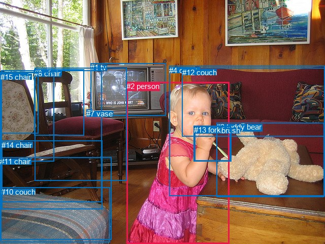
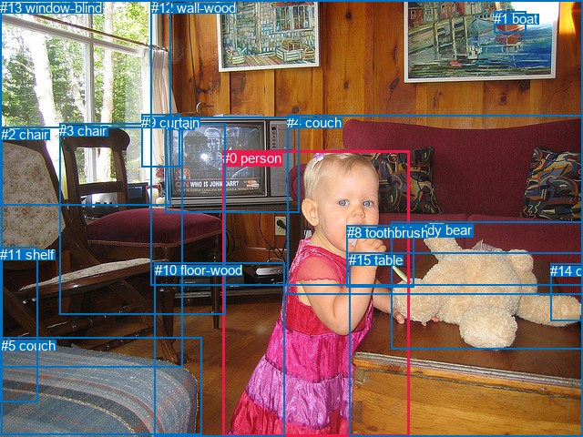

# 图片 0555：2339725.jpg

随机样本序号：463。图片 SHA256：`55455f6c5d2881d24a5bff35286940804143eda7a23fcc1ca9062eaedc144ef5`。

红色框表示人，蓝色框表示其他物体。两个模式分别保留自身框编号，可依据位置比较对应对象。

## 自动检测框与输出

人的框编号：`[2]`。状态：`ok`。

### 自动检测全部物体框

| 编号 | 类别 | 是否为人 | 检测分数 | 像素坐标 xyxy |
|---|---|---|---|---|
| 0 | chair | False | 0.9990 | 2.8, 138.8, 200.3, 397.2 |
| 1 | tv | False | 0.9983 | 178.0, 124.1, 326.2, 227.5 |
| 2 | person | True | 0.9977 | 249.2, 161.1, 451.7, 480.0 |
| 3 | teddy bear | False | 0.9958 | 426.2, 241.5, 638.7, 387.9 |
| 4 | couch | False | 0.9472 | 333.3, 129.9, 640.0, 385.7 |
| 5 | chair | False | 0.9363 | 68.5, 133.7, 249.7, 355.8 |
| 6 | toothbrush | False | 0.9281 | 383.9, 248.5, 453.8, 316.1 |
| 7 | vase | False | 0.7301 | 170.4, 215.1, 181.7, 227.7 |
| 8 | chair | False | 0.6874 | 67.1, 136.2, 165.3, 266.8 |
| 9 | chair | False | 0.6772 | 0.8, 141.8, 106.9, 317.4 |
| 10 | couch | False | 0.6237 | 1.9, 368.6, 216.1, 477.0 |
| 11 | chair | False | 0.5979 | 0.4, 309.5, 219.1, 471.9 |
| 12 | couch | False | 0.5621 | 358.7, 133.7, 640.0, 268.5 |
| 13 | fork | False | 0.4326 | 381.7, 247.2, 455.6, 317.8 |
| 14 | chair | False | 0.3922 | 3.4, 276.5, 201.2, 411.8 |
| 15 | chair | False | 0.3905 | 1.2, 142.7, 75.7, 262.1 |

### 自动检测 Top50 人相关候选

评分物体对：240；人相关物体对：30；输出关系：50。

| 排名 | 主语编号与类别 | 关系 | 宾语编号与类别 | 类型 | 人与人 | 排序分数 | 原始融合 logit |
|---|---|---|---|---|---|---|---|
| 1 | #2 person | playing with | #3 teddy bear | semantic | False | 0.98911 | 4.5094 |
| 2 | #2 person | holding | #13 fork | semantic | False | 0.98893 | 4.4921 |
| 3 | #2 person | holding | #6 toothbrush | semantic | False | 0.98872 | 4.4736 |
| 4 | #2 person | in | #6 toothbrush | spatial | False | 0.79150 | 1.3340 |
| 5 | #2 person | in | #13 fork | spatial | False | 0.78870 | 1.3171 |
| 6 | #2 person | leaning on | #4 couch | spatial | False | 0.77592 | 1.2420 |
| 7 | #13 fork | holding | #2 person | semantic | False | 0.70513 | 0.8718 |
| 8 | #6 toothbrush | holding | #2 person | semantic | False | 0.70235 | 0.8585 |
| 9 | #2 person | in | #3 teddy bear | spatial | False | 0.68028 | 0.7551 |
| 10 | #2 person | sitting on | #4 couch | semantic | False | 0.64045 | 0.5773 |
| 11 | #2 person | eating | #1 tv | semantic | False | 0.50950 | 0.0380 |
| 12 | #1 tv | beside | #2 person | spatial | False | 0.35726 | -0.5873 |
| 13 | #2 person | in front of | #1 tv | spatial | False | 0.29850 | -0.8544 |
| 14 | #3 teddy bear | beside | #2 person | spatial | False | 0.26990 | -0.9951 |
| 15 | #2 person | leaning on | #12 couch | spatial | False | 0.26781 | -1.0058 |
| 16 | #6 toothbrush | in | #2 person | spatial | False | 0.25227 | -1.0865 |
| 17 | #13 fork | in | #2 person | spatial | False | 0.24398 | -1.1310 |
| 18 | #5 chair | beside | #2 person | spatial | False | 0.12559 | -1.9405 |
| 19 | #2 person | sitting on | #12 couch | semantic | False | 0.10645 | -2.1275 |
| 20 | #0 chair | beside | #2 person | spatial | False | 0.09355 | -2.2710 |
| 21 | #1 tv | playing with | #2 person | semantic | False | 0.08899 | -2.3261 |
| 22 | #3 teddy bear | playing with | #2 person | semantic | False | 0.08809 | -2.3372 |
| 23 | #4 couch | beside | #2 person | spatial | False | 0.08235 | -2.4109 |
| 24 | #2 person | on | #11 chair | spatial | False | 0.07421 | -2.5237 |
| 25 | #11 chair | beside | #2 person | spatial | False | 0.06260 | -2.7064 |
| 26 | #2 person | on | #10 couch | spatial | False | 0.05502 | -2.8435 |
| 27 | #10 couch | beside | #2 person | spatial | False | 0.04784 | -2.9908 |
| 28 | #12 couch | beside | #2 person | spatial | False | 0.04565 | -3.0401 |
| 29 | #2 person | in | #5 chair | spatial | False | 0.04558 | -3.0416 |
| 30 | #2 person | wearing | #10 couch | semantic | False | 0.04496 | -3.0559 |
| 31 | #2 person | wearing | #11 chair | semantic | False | 0.03966 | -3.1868 |
| 32 | #9 chair | beside | #2 person | spatial | False | 0.03737 | -3.2489 |
| 33 | #14 chair | beside | #2 person | spatial | False | 0.03433 | -3.3369 |
| 34 | #8 chair | beside | #2 person | spatial | False | 0.03370 | -3.3559 |
| 35 | #2 person | sitting on | #5 chair | semantic | False | 0.03351 | -3.3619 |
| 36 | #2 person | in | #0 chair | spatial | False | 0.02760 | -3.5621 |
| 37 | #2 person | in | #14 chair | spatial | False | 0.02439 | -3.6888 |
| 38 | #5 chair | looking at | #2 person | semantic | False | 0.02034 | -3.8746 |
| 39 | #2 person | playing | #7 vase | semantic | False | 0.01945 | -3.9203 |
| 40 | #4 couch | holding | #2 person | semantic | False | 0.01584 | -4.1292 |
| 41 | #2 person | sitting on | #0 chair | semantic | False | 0.01539 | -4.1586 |
| 42 | #0 chair | looking at | #2 person | semantic | False | 0.01508 | -4.1793 |
| 43 | #7 vase | beside | #2 person | spatial | False | 0.01139 | -4.4639 |
| 44 | #2 person | wearing | #14 chair | semantic | False | 0.01123 | -4.4780 |
| 45 | #12 couch | looking at | #2 person | semantic | False | 0.01122 | -4.4791 |
| 46 | #11 chair | looking at | #2 person | semantic | False | 0.01021 | -4.5739 |
| 47 | #15 chair | beside | #2 person | spatial | False | 0.00879 | -4.7251 |
| 48 | #14 chair | holding | #2 person | semantic | False | 0.00811 | -4.8070 |
| 49 | #9 chair | looking at | #2 person | semantic | False | 0.00736 | -4.9049 |
| 50 | #10 couch | holding | #2 person | semantic | False | 0.00692 | -4.9670 |

### 自动检测逐条人相关 GT 核验

R@50：50.00%；命中 1/2。

| GT 主语编号 | GT 关系 | GT 宾语编号 | 结果阶段 | 匹配预测主语编号 | 匹配预测宾语编号 |
|---|---|---|---|---|---|
| 0 | in front of | 6 | hit50 | [2] | [1] |
| 0 | biting | 8 | wrong_predicate | [2] | [6] |

## 真实框与输出

人的框编号：`[0]`。

### 真实框全部物体框

| 编号 | 类别 | 是否为人 | 检测分数 | 像素坐标 xyxy |
|---|---|---|---|---|
| 0 | person | True | GT | 244.0, 165.0, 449.0, 479.0 |
| 1 | boat | False | GT | 542.0, 12.0, 578.0, 37.0 |
| 2 | chair | False | GT | 1.0, 139.0, 200.0, 403.0 |
| 3 | chair | False | GT | 65.0, 135.0, 248.0, 345.0 |
| 4 | couch | False | GT | 315.0, 126.0, 640.0, 324.0 |
| 5 | couch | False | GT | 1.0, 371.0, 221.0, 478.0 |
| 6 | tv | False | GT | 182.0, 128.0, 328.0, 233.0 |
| 7 | teddy bear | False | GT | 429.0, 244.0, 640.0, 384.0 |
| 8 | toothbrush | False | GT | 381.0, 247.0, 454.0, 315.0 |
| 9 | curtain | False | GT | 155.0, 126.0, 197.0, 184.0 |
| 10 | floor-wood | False | GT | 170.0, 288.0, 313.0, 480.0 |
| 11 | shelf | False | GT | 0.0, 271.0, 42.0, 441.0 |
| 12 | wall-wood | False | GT | 166.0, 0.0, 640.0, 314.0 |
| 13 | window-blind | False | GT | 0.0, 0.0, 187.0, 225.0 |
| 14 | cabinet | False | GT | 604.0, 289.0, 640.0, 352.0 |
| 15 | table | False | GT | 383.0, 277.0, 640.0, 480.0 |

### 真实框 Top50 人相关候选

评分物体对：240；人相关物体对：30；输出关系：50。

| 排名 | 主语编号与类别 | 关系 | 宾语编号与类别 | 类型 | 人与人 | 排序分数 | 原始融合 logit |
|---|---|---|---|---|---|---|---|
| 1 | #0 person | holding | #8 toothbrush | semantic | False | 0.98868 | 4.4702 |
| 2 | #0 person | playing with | #7 teddy bear | semantic | False | 0.97893 | 3.8385 |
| 3 | #0 person | standing on | #10 floor-wood | semantic | False | 0.93210 | 2.6194 |
| 4 | #0 person | on | #10 floor-wood | spatial | False | 0.91159 | 2.3332 |
| 5 | #0 person | leaning on | #15 table | spatial | False | 0.90580 | 2.2634 |
| 6 | #0 person | playing | #15 table | semantic | False | 0.89828 | 2.1783 |
| 7 | #8 toothbrush | holding | #0 person | semantic | False | 0.82414 | 1.5447 |
| 8 | #0 person | in | #8 toothbrush | spatial | False | 0.82259 | 1.5340 |
| 9 | #0 person | eating | #6 tv | semantic | False | 0.74890 | 1.0928 |
| 10 | #0 person | leaning on | #4 couch | spatial | False | 0.72838 | 0.9864 |
| 11 | #0 person | in | #7 teddy bear | spatial | False | 0.65810 | 0.6548 |
| 12 | #0 person | sitting on | #4 couch | semantic | False | 0.46623 | -0.1353 |
| 13 | #0 person | playing | #14 cabinet | semantic | False | 0.45843 | -0.1666 |
| 14 | #7 teddy bear | beside | #0 person | spatial | False | 0.43329 | -0.2684 |
| 15 | #0 person | in front of | #6 tv | spatial | False | 0.35604 | -0.5926 |
| 16 | #8 toothbrush | in | #0 person | spatial | False | 0.32929 | -0.7114 |
| 17 | #6 tv | beside | #0 person | spatial | False | 0.29543 | -0.8692 |
| 18 | #10 floor-wood | beside | #0 person | spatial | False | 0.28996 | -0.8956 |
| 19 | #5 couch | beside | #0 person | spatial | False | 0.26233 | -1.0339 |
| 20 | #0 person | in front of | #12 wall-wood | spatial | False | 0.23069 | -1.2044 |
| 21 | #3 chair | beside | #0 person | spatial | False | 0.23033 | -1.2064 |
| 22 | #2 chair | beside | #0 person | spatial | False | 0.22300 | -1.2483 |
| 23 | #4 couch | beside | #0 person | spatial | False | 0.20187 | -1.3746 |
| 24 | #0 person | on | #5 couch | spatial | False | 0.13688 | -1.8414 |
| 25 | #0 person | in | #14 cabinet | spatial | False | 0.12734 | -1.9247 |
| 26 | #15 table | holding | #0 person | semantic | False | 0.10484 | -2.1446 |
| 27 | #15 table | beside | #0 person | spatial | False | 0.09935 | -2.2045 |
| 28 | #0 person | beside | #3 chair | spatial | False | 0.09669 | -2.2346 |
| 29 | #0 person | wearing | #5 couch | semantic | False | 0.08324 | -2.3991 |
| 30 | #0 person | beside | #2 chair | spatial | False | 0.08277 | -2.4053 |
| 31 | #7 teddy bear | holding | #0 person | semantic | False | 0.07770 | -2.4740 |
| 32 | #6 tv | looking at | #0 person | semantic | False | 0.06318 | -2.6965 |
| 33 | #0 person | looking at | #12 wall-wood | semantic | False | 0.05342 | -2.8746 |
| 34 | #0 person | sitting on | #3 chair | semantic | False | 0.05217 | -2.8996 |
| 35 | #10 floor-wood | holding | #0 person | semantic | False | 0.04994 | -2.9458 |
| 36 | #11 shelf | beside | #0 person | spatial | False | 0.04908 | -2.9640 |
| 37 | #13 window-blind | beside | #0 person | spatial | False | 0.03848 | -3.2183 |
| 38 | #0 person | sitting on | #2 chair | semantic | False | 0.03341 | -3.3648 |
| 39 | #5 couch | holding | #0 person | semantic | False | 0.02887 | -3.5157 |
| 40 | #3 chair | looking at | #0 person | semantic | False | 0.02688 | -3.5891 |
| 41 | #4 couch | looking at | #0 person | semantic | False | 0.02642 | -3.6068 |
| 42 | #14 cabinet | on | #0 person | spatial | False | 0.02640 | -3.6075 |
| 43 | #2 chair | looking at | #0 person | semantic | False | 0.02575 | -3.6333 |
| 44 | #0 person | looking at | #9 curtain | semantic | False | 0.02445 | -3.6863 |
| 45 | #0 person | looking at | #13 window-blind | semantic | False | 0.02158 | -3.8140 |
| 46 | #0 person | in | #11 shelf | spatial | False | 0.02005 | -3.8893 |
| 47 | #12 wall-wood | beside | #0 person | spatial | False | 0.01695 | -4.0604 |
| 48 | #0 person | eating | #1 boat | semantic | False | 0.01569 | -4.1390 |
| 49 | #0 person | in front of | #13 window-blind | spatial | False | 0.00989 | -4.6067 |
| 50 | #9 curtain | beside | #0 person | spatial | False | 0.00872 | -4.7336 |

### 真实框逐条人相关 GT 核验

R@50：50.00%；命中 1/2。

| GT 主语编号 | GT 关系 | GT 宾语编号 | 结果阶段 | 匹配预测主语编号 | 匹配预测宾语编号 |
|---|---|---|---|---|---|
| 0 | in front of | 6 | hit50 | [0] | [6] |
| 0 | biting | 8 | wrong_predicate | [0] | [8] |

## 全部人相关 GT

| 主语编号与类别 | 关系 | 宾语编号与类别 |
|---|---|---|
| #0 person | in front of | #6 tv |
| #0 person | biting | #8 toothbrush |

原始记录、全部人相关物体对的两项预测与分项分数见 [逐图证据 JSON](../evidence/cases/0555.json)。全部56类 logits 保留于本机 HOR/output/random500/logits/。

<!-- HOR_COMPLETE_RESULTS -->

## 六组条件的完整输出对照

以下保留同一图片三种框与候选模式、两种谓词输出规则的全部 Top50。框编号各自在所属模式内解释。

### 自动检测框完整枚举：空间与语义各保留一个谓词

| 排名 | 主语编号与类别 | 谓词 | 宾语编号与类别 | 分组 | 排序分数 | predicate logit | pair logit |
|---|---|---|---|---|---|---|---|
| 1 | #2 person | playing with | #3 teddy bear | semantic | 0.9891145 | 4.8900504 | -0.3806742 |
| 2 | #2 person | holding | #13 fork | semantic | 0.9889263 | 4.0376573 | 0.4543956 |
| 3 | #2 person | holding | #6 toothbrush | semantic | 0.9887228 | 4.0258403 | 0.4477890 |
| 4 | #2 person | in | #6 toothbrush | spatial | 0.7914968 | 0.8861828 | 0.4477890 |
| 5 | #2 person | in | #13 fork | spatial | 0.7887029 | 0.8627291 | 0.4543956 |
| 6 | #2 person | leaning on | #4 couch | spatial | 0.7759163 | 1.7120762 | -0.4700511 |
| 7 | #13 fork | holding | #2 person | semantic | 0.7051281 | 1.4632230 | -0.5913845 |
| 8 | #6 toothbrush | holding | #2 person | semantic | 0.7023466 | 1.4272232 | -0.5687260 |
| 9 | #2 person | in | #3 teddy bear | spatial | 0.6802849 | 1.1357555 | -0.3806742 |
| 10 | #2 person | sitting on | #4 couch | semantic | 0.6404531 | 1.0473824 | -0.4700511 |
| 11 | #2 person | eating | #1 tv | semantic | 0.5095031 | 0.3820562 | -0.3440392 |
| 12 | #1 tv | beside | #2 person | spatial | 0.3572583 | 0.5282631 | -1.1155471 |
| 13 | #2 person | in front of | #1 tv | spatial | 0.2985031 | -0.5103970 | -0.3440392 |
| 14 | #3 teddy bear | beside | #2 person | spatial | 0.2699018 | 0.0799017 | -1.0750225 |
| 15 | #2 person | leaning on | #12 couch | spatial | 0.2678077 | -0.1163211 | -0.8894528 |
| 16 | #6 toothbrush | in | #2 person | spatial | 0.2522720 | -0.5178056 | -0.5687260 |
| 17 | #13 fork | in | #2 person | spatial | 0.2439795 | -0.5395999 | -0.5913845 |
| 18 | #5 chair | beside | #2 person | spatial | 0.1255923 | -0.8298182 | -1.1106877 |
| 19 | #2 person | sitting on | #12 couch | semantic | 0.1064523 | -1.2380502 | -0.8894528 |
| 20 | #0 chair | beside | #2 person | spatial | 0.0935530 | -1.3267434 | -0.9442610 |
| 21 | #1 tv | playing with | #2 person | semantic | 0.0889883 | -1.2105043 | -1.1155471 |
| 22 | #3 teddy bear | playing with | #2 person | semantic | 0.0880887 | -1.2621765 | -1.0750225 |
| 23 | #4 couch | beside | #2 person | spatial | 0.0823476 | -1.2187858 | -1.1920836 |
| 24 | #2 person | on | #11 chair | spatial | 0.0742132 | -1.5540757 | -0.9696264 |
| 25 | #11 chair | beside | #2 person | spatial | 0.0625977 | -1.4439099 | -1.2624735 |
| 26 | #2 person | on | #10 couch | spatial | 0.0550166 | -1.7809043 | -1.0626281 |
| 27 | #10 couch | beside | #2 person | spatial | 0.0478422 | -1.7457075 | -1.2451150 |
| 28 | #12 couch | beside | #2 person | spatial | 0.0456469 | -1.9870882 | -1.0530099 |
| 29 | #2 person | in | #5 chair | spatial | 0.0455814 | -2.1620235 | -0.8795797 |
| 30 | #2 person | wearing | #10 couch | semantic | 0.0449616 | -1.9933147 | -1.0626281 |
| 31 | #2 person | wearing | #11 chair | semantic | 0.0396648 | -2.2171926 | -0.9696264 |
| 32 | #9 chair | beside | #2 person | spatial | 0.0373672 | -1.8674028 | -1.3814759 |
| 33 | #14 chair | beside | #2 person | spatial | 0.0343260 | -1.9855342 | -1.3513894 |
| 34 | #8 chair | beside | #2 person | spatial | 0.0337016 | -1.9897628 | -1.3661654 |
| 35 | #2 person | sitting on | #5 chair | semantic | 0.0335068 | -2.4823468 | -0.8795797 |
| 36 | #2 person | in | #0 chair | spatial | 0.0275968 | -2.7133033 | -0.8487664 |
| 37 | #2 person | in | #14 chair | spatial | 0.0243910 | -2.4042463 | -1.2846001 |
| 38 | #5 chair | looking at | #2 person | semantic | 0.0203411 | -2.7638741 | -1.1106877 |
| 39 | #2 person | playing | #7 vase | semantic | 0.0194490 | -1.6942306 | -2.2260892 |
| 40 | #4 couch | holding | #2 person | semantic | 0.0158403 | -2.9371467 | -1.1920836 |
| 41 | #2 person | sitting on | #0 chair | semantic | 0.0153887 | -3.3098440 | -0.8487664 |
| 42 | #0 chair | looking at | #2 person | semantic | 0.0150790 | -3.2349949 | -0.9442610 |
| 43 | #7 vase | beside | #2 person | spatial | 0.0113860 | -2.8606162 | -1.6032997 |
| 44 | #2 person | wearing | #14 chair | semantic | 0.0112291 | -3.1933517 | -1.2846001 |
| 45 | #12 couch | looking at | #2 person | semantic | 0.0112168 | -3.4260559 | -1.0530099 |
| 46 | #11 chair | looking at | #2 person | semantic | 0.0102123 | -3.3114274 | -1.2624735 |
| 47 | #15 chair | beside | #2 person | spatial | 0.0087917 | -3.0264940 | -1.6986260 |
| 48 | #14 chair | holding | #2 person | semantic | 0.0081062 | -3.4555981 | -1.3513894 |
| 49 | #9 chair | looking at | #2 person | semantic | 0.0073559 | -3.5233896 | -1.3814759 |
| 50 | #10 couch | holding | #2 person | semantic | 0.0069161 | -3.7218509 | -1.2451150 |

GT 命中：1/2，R@50=50.00%。

| GT主语 | GT谓词 | GT宾语 | 结果阶段 | 匹配主语框 | 匹配宾语框 |
|---|---|---|---|---|---|
| 0 | in front of | 6 | hit50 | [2] | [1] |
| 0 | biting | 8 | wrong_predicate | [2] | [6] |

### 自动检测框完整枚举：每对只保留一个谓词

| 排名 | 主语编号与类别 | 谓词 | 宾语编号与类别 | 分组 | 排序分数 | predicate logit | pair logit |
|---|---|---|---|---|---|---|---|
| 1 | #2 person | playing with | #3 teddy bear | single | 0.9891145 | 4.8900504 | -0.3806742 |
| 2 | #2 person | holding | #13 fork | single | 0.9889263 | 4.0376573 | 0.4543956 |
| 3 | #2 person | holding | #6 toothbrush | single | 0.9887228 | 4.0258403 | 0.4477890 |
| 4 | #2 person | leaning on | #4 couch | single | 0.7759163 | 1.7120762 | -0.4700511 |
| 5 | #13 fork | holding | #2 person | single | 0.7051281 | 1.4632230 | -0.5913845 |
| 6 | #6 toothbrush | holding | #2 person | single | 0.7023466 | 1.4272232 | -0.5687260 |
| 7 | #2 person | eating | #1 tv | single | 0.5095031 | 0.3820562 | -0.3440392 |
| 8 | #1 tv | beside | #2 person | single | 0.3572583 | 0.5282631 | -1.1155471 |
| 9 | #3 teddy bear | beside | #2 person | single | 0.2699018 | 0.0799017 | -1.0750225 |
| 10 | #2 person | leaning on | #12 couch | single | 0.2678077 | -0.1163211 | -0.8894528 |
| 11 | #5 chair | beside | #2 person | single | 0.1255923 | -0.8298182 | -1.1106877 |
| 12 | #0 chair | beside | #2 person | single | 0.0935530 | -1.3267434 | -0.9442610 |
| 13 | #4 couch | beside | #2 person | single | 0.0823476 | -1.2187858 | -1.1920836 |
| 14 | #2 person | on | #11 chair | single | 0.0742132 | -1.5540757 | -0.9696264 |
| 15 | #11 chair | beside | #2 person | single | 0.0625977 | -1.4439099 | -1.2624735 |
| 16 | #2 person | on | #10 couch | single | 0.0550166 | -1.7809043 | -1.0626281 |
| 17 | #10 couch | beside | #2 person | single | 0.0478422 | -1.7457075 | -1.2451150 |
| 18 | #12 couch | beside | #2 person | single | 0.0456469 | -1.9870882 | -1.0530099 |
| 19 | #2 person | in | #5 chair | single | 0.0455814 | -2.1620235 | -0.8795797 |
| 20 | #9 chair | beside | #2 person | single | 0.0373672 | -1.8674028 | -1.3814759 |
| 21 | #14 chair | beside | #2 person | single | 0.0343260 | -1.9855342 | -1.3513894 |
| 22 | #8 chair | beside | #2 person | single | 0.0337016 | -1.9897628 | -1.3661654 |
| 23 | #2 person | in | #0 chair | single | 0.0275968 | -2.7133033 | -0.8487664 |
| 24 | #2 person | in | #14 chair | single | 0.0243910 | -2.4042463 | -1.2846001 |
| 25 | #2 person | playing | #7 vase | single | 0.0194490 | -1.6942306 | -2.2260892 |
| 26 | #7 vase | beside | #2 person | single | 0.0113860 | -2.8606162 | -1.6032997 |
| 27 | #15 chair | beside | #2 person | single | 0.0087917 | -3.0264940 | -1.6986260 |
| 28 | #2 person | in | #9 chair | single | 0.0051622 | -3.6944256 | -1.5667980 |
| 29 | #2 person | in | #8 chair | single | 0.0047603 | -3.7976403 | -1.5450286 |
| 30 | #2 person | playing | #15 chair | single | 0.0036257 | -3.6450605 | -1.9710073 |

GT 命中：0/2，R@50=0.00%。

| GT主语 | GT谓词 | GT宾语 | 结果阶段 | 匹配主语框 | 匹配宾语框 |
|---|---|---|---|---|---|
| 0 | in front of | 6 | wrong_predicate | [2] | [1] |
| 0 | biting | 8 | wrong_predicate | [2] | [6] |

### 真实框完整枚举：空间与语义各保留一个谓词

| 排名 | 主语编号与类别 | 谓词 | 宾语编号与类别 | 分组 | 排序分数 | predicate logit | pair logit |
|---|---|---|---|---|---|---|---|
| 1 | #0 person | holding | #8 toothbrush | semantic | 0.9886845 | 4.0029655 | 0.4672363 |
| 2 | #0 person | playing with | #7 teddy bear | semantic | 0.9789283 | 4.2490926 | -0.4105670 |
| 3 | #0 person | standing on | #10 floor-wood | semantic | 0.9321024 | 2.9269323 | -0.3074890 |
| 4 | #0 person | on | #10 floor-wood | spatial | 0.9115869 | 2.6406555 | -0.3074890 |
| 5 | #0 person | leaning on | #15 table | spatial | 0.9058032 | 2.3657465 | -0.1023112 |
| 6 | #0 person | playing | #15 table | semantic | 0.8982829 | 2.2806015 | -0.1023112 |
| 7 | #8 toothbrush | holding | #0 person | semantic | 0.8241432 | 2.1413093 | -0.5966350 |
| 8 | #0 person | in | #8 toothbrush | spatial | 0.8225859 | 1.0667300 | 0.4672363 |
| 9 | #0 person | eating | #6 tv | semantic | 0.7489001 | 1.4473186 | -0.3545634 |
| 10 | #0 person | leaning on | #4 couch | spatial | 0.7283757 | 1.6454663 | -0.6590692 |
| 11 | #0 person | in | #7 teddy bear | spatial | 0.6580975 | 1.0653944 | -0.4105670 |
| 12 | #0 person | sitting on | #4 couch | semantic | 0.4662257 | 0.5237660 | -0.6590692 |
| 13 | #0 person | playing | #14 cabinet | semantic | 0.4584348 | 0.6292429 | -0.7958882 |
| 14 | #7 teddy bear | beside | #0 person | spatial | 0.4332910 | 0.8027272 | -1.0711638 |
| 15 | #0 person | in front of | #6 tv | spatial | 0.3560357 | -0.2380486 | -0.3545634 |
| 16 | #8 toothbrush | in | #0 person | spatial | 0.3292859 | -0.1147814 | -0.5966350 |
| 17 | #6 tv | beside | #0 person | spatial | 0.2954263 | 0.2278714 | -1.0970447 |
| 18 | #10 floor-wood | beside | #0 person | spatial | 0.2899582 | 0.3458076 | -1.2413948 |
| 19 | #5 couch | beside | #0 person | spatial | 0.2623296 | 0.1943102 | -1.2282054 |
| 20 | #0 person | in front of | #12 wall-wood | spatial | 0.2306895 | -0.3697805 | -0.8346416 |
| 21 | #3 chair | beside | #0 person | spatial | 0.2303344 | -0.0778117 | -1.1286120 |
| 22 | #2 chair | beside | #0 person | spatial | 0.2229989 | -0.3185272 | -0.9297475 |
| 23 | #4 couch | beside | #0 person | spatial | 0.2018721 | -0.2573619 | -1.1172726 |
| 24 | #0 person | on | #5 couch | spatial | 0.1368828 | -0.7949302 | -1.0464952 |
| 25 | #0 person | in | #14 cabinet | spatial | 0.1273377 | -1.1288180 | -0.7958882 |
| 26 | #15 table | holding | #0 person | semantic | 0.1048370 | -0.8424051 | -1.3021941 |
| 27 | #15 table | beside | #0 person | spatial | 0.0993489 | -0.9022853 | -1.3021941 |
| 28 | #0 person | beside | #3 chair | spatial | 0.0966882 | -1.3358908 | -0.8986855 |
| 29 | #0 person | wearing | #5 couch | semantic | 0.0832420 | -1.3525968 | -1.0464952 |
| 30 | #0 person | beside | #2 chair | spatial | 0.0827698 | -1.5784709 | -0.8268241 |
| 31 | #7 teddy bear | holding | #0 person | semantic | 0.0777043 | -1.4027913 | -1.0711638 |
| 32 | #6 tv | looking at | #0 person | semantic | 0.0631814 | -1.5994344 | -1.0970447 |
| 33 | #0 person | looking at | #12 wall-wood | semantic | 0.0534244 | -2.0399411 | -0.8346416 |
| 34 | #0 person | sitting on | #3 chair | semantic | 0.0521739 | -2.0009027 | -0.8986855 |
| 35 | #10 floor-wood | holding | #0 person | semantic | 0.0499358 | -1.7043972 | -1.2413948 |
| 36 | #11 shelf | beside | #0 person | spatial | 0.0490799 | -1.7927096 | -1.1712706 |
| 37 | #13 window-blind | beside | #0 person | spatial | 0.0384838 | -1.7073944 | -1.5108795 |
| 38 | #0 person | sitting on | #2 chair | semantic | 0.0334123 | -2.5380225 | -0.8268241 |
| 39 | #5 couch | holding | #0 person | semantic | 0.0288690 | -2.2874863 | -1.2282054 |
| 40 | #3 chair | looking at | #0 person | semantic | 0.0268798 | -2.4605210 | -1.1286120 |
| 41 | #4 couch | looking at | #0 person | semantic | 0.0264205 | -2.4895666 | -1.1172726 |
| 42 | #14 cabinet | on | #0 person | spatial | 0.0264046 | -2.4374382 | -1.1700184 |
| 43 | #2 chair | looking at | #0 person | semantic | 0.0257492 | -2.7035174 | -0.9297475 |
| 44 | #0 person | looking at | #9 curtain | semantic | 0.0244520 | -2.0870068 | -1.5992818 |
| 45 | #0 person | looking at | #13 window-blind | semantic | 0.0215831 | -1.9976919 | -1.8163329 |
| 46 | #0 person | in | #11 shelf | spatial | 0.0200493 | -2.5632620 | -1.3260459 |
| 47 | #12 wall-wood | beside | #0 person | spatial | 0.0169496 | -2.9588952 | -1.1015241 |
| 48 | #0 person | eating | #1 boat | semantic | 0.0156889 | -2.3996947 | -1.7392921 |
| 49 | #0 person | in front of | #13 window-blind | spatial | 0.0098856 | -2.7904058 | -1.8163329 |
| 50 | #9 curtain | beside | #0 person | spatial | 0.0087180 | -2.9182544 | -1.8153559 |

GT 命中：1/2，R@50=50.00%。

| GT主语 | GT谓词 | GT宾语 | 结果阶段 | 匹配主语框 | 匹配宾语框 |
|---|---|---|---|---|---|
| 0 | in front of | 6 | hit50 | [0] | [6] |
| 0 | biting | 8 | wrong_predicate | [0] | [8] |

### 真实框完整枚举：每对只保留一个谓词

| 排名 | 主语编号与类别 | 谓词 | 宾语编号与类别 | 分组 | 排序分数 | predicate logit | pair logit |
|---|---|---|---|---|---|---|---|
| 1 | #0 person | holding | #8 toothbrush | single | 0.9886845 | 4.0029655 | 0.4672363 |
| 2 | #0 person | playing with | #7 teddy bear | single | 0.9789283 | 4.2490926 | -0.4105670 |
| 3 | #0 person | standing on | #10 floor-wood | single | 0.9321024 | 2.9269323 | -0.3074890 |
| 4 | #0 person | leaning on | #15 table | single | 0.9058032 | 2.3657465 | -0.1023112 |
| 5 | #8 toothbrush | holding | #0 person | single | 0.8241432 | 2.1413093 | -0.5966350 |
| 6 | #0 person | eating | #6 tv | single | 0.7489001 | 1.4473186 | -0.3545634 |
| 7 | #0 person | leaning on | #4 couch | single | 0.7283757 | 1.6454663 | -0.6590692 |
| 8 | #0 person | playing | #14 cabinet | single | 0.4584348 | 0.6292429 | -0.7958882 |
| 9 | #7 teddy bear | beside | #0 person | single | 0.4332910 | 0.8027272 | -1.0711638 |
| 10 | #6 tv | beside | #0 person | single | 0.2954263 | 0.2278714 | -1.0970447 |
| 11 | #10 floor-wood | beside | #0 person | single | 0.2899582 | 0.3458076 | -1.2413948 |
| 12 | #5 couch | beside | #0 person | single | 0.2623296 | 0.1943102 | -1.2282054 |
| 13 | #0 person | in front of | #12 wall-wood | single | 0.2306895 | -0.3697805 | -0.8346416 |
| 14 | #3 chair | beside | #0 person | single | 0.2303344 | -0.0778117 | -1.1286120 |
| 15 | #2 chair | beside | #0 person | single | 0.2229989 | -0.3185272 | -0.9297475 |
| 16 | #4 couch | beside | #0 person | single | 0.2018721 | -0.2573619 | -1.1172726 |
| 17 | #0 person | on | #5 couch | single | 0.1368828 | -0.7949302 | -1.0464952 |
| 18 | #15 table | holding | #0 person | single | 0.1048370 | -0.8424051 | -1.3021941 |
| 19 | #0 person | beside | #3 chair | single | 0.0966882 | -1.3358908 | -0.8986855 |
| 20 | #0 person | beside | #2 chair | single | 0.0827698 | -1.5784709 | -0.8268241 |
| 21 | #11 shelf | beside | #0 person | single | 0.0490799 | -1.7927096 | -1.1712706 |
| 22 | #13 window-blind | beside | #0 person | single | 0.0384838 | -1.7073944 | -1.5108795 |
| 23 | #14 cabinet | on | #0 person | single | 0.0264046 | -2.4374382 | -1.1700184 |
| 24 | #0 person | looking at | #9 curtain | single | 0.0244520 | -2.0870068 | -1.5992818 |
| 25 | #0 person | looking at | #13 window-blind | single | 0.0215831 | -1.9976919 | -1.8163329 |
| 26 | #0 person | in | #11 shelf | single | 0.0200493 | -2.5632620 | -1.3260459 |
| 27 | #12 wall-wood | beside | #0 person | single | 0.0169496 | -2.9588952 | -1.1015241 |
| 28 | #0 person | eating | #1 boat | single | 0.0156889 | -2.3996947 | -1.7392921 |
| 29 | #9 curtain | beside | #0 person | single | 0.0087180 | -2.9182544 | -1.8153559 |
| 30 | #1 boat | over | #0 person | single | 0.0063649 | -3.1805477 | -1.8700259 |

GT 命中：0/2，R@50=0.00%。

| GT主语 | GT谓词 | GT宾语 | 结果阶段 | 匹配主语框 | 匹配宾语框 |
|---|---|---|---|---|---|
| 0 | in front of | 6 | wrong_predicate | [0] | [6] |
| 0 | biting | 8 | wrong_predicate | [0] | [8] |

### 真实框400候选：空间与语义各保留一个谓词

| 排名 | 主语编号与类别 | 谓词 | 宾语编号与类别 | 分组 | 排序分数 | predicate logit | pair logit |
|---|---|---|---|---|---|---|---|
| 1 | #0 person | holding | #8 toothbrush | semantic | 0.9886181 | 3.9970574 | 0.4672363 |
| 2 | #0 person | playing with | #7 teddy bear | semantic | 0.9789283 | 4.2490926 | -0.4105670 |
| 3 | #0 person | standing on | #10 floor-wood | semantic | 0.9323345 | 2.9306045 | -0.3074890 |
| 4 | #0 person | on | #10 floor-wood | spatial | 0.9115869 | 2.6406555 | -0.3074890 |
| 5 | #0 person | leaning on | #15 table | spatial | 0.9032041 | 2.3356552 | -0.1023112 |
| 6 | #0 person | playing | #15 table | semantic | 0.8982829 | 2.2806015 | -0.1023112 |
| 7 | #8 toothbrush | holding | #0 person | semantic | 0.8241432 | 2.1413093 | -0.5966350 |
| 8 | #0 person | in | #8 toothbrush | spatial | 0.8225859 | 1.0667300 | 0.4672363 |
| 9 | #0 person | eating | #6 tv | semantic | 0.7433835 | 1.4181929 | -0.3545634 |
| 10 | #0 person | leaning on | #4 couch | spatial | 0.7284734 | 1.6459603 | -0.6590692 |
| 11 | #0 person | in | #7 teddy bear | spatial | 0.6580975 | 1.0653944 | -0.4105670 |
| 12 | #0 person | sitting on | #4 couch | semantic | 0.4662257 | 0.5237660 | -0.6590692 |
| 13 | #0 person | playing | #14 cabinet | semantic | 0.4447318 | 0.5739083 | -0.7958882 |
| 14 | #7 teddy bear | beside | #0 person | spatial | 0.4333053 | 0.8027854 | -1.0711638 |
| 15 | #0 person | in front of | #6 tv | spatial | 0.3560621 | -0.2379336 | -0.3545634 |
| 16 | #8 toothbrush | in | #0 person | spatial | 0.3285534 | -0.1181002 | -0.5966350 |
| 17 | #10 floor-wood | beside | #0 person | spatial | 0.2961622 | 0.3757539 | -1.2413948 |
| 18 | #6 tv | beside | #0 person | spatial | 0.2954263 | 0.2278714 | -1.0970447 |
| 19 | #5 couch | beside | #0 person | spatial | 0.2623520 | 0.1944261 | -1.2282054 |
| 20 | #3 chair | beside | #0 person | spatial | 0.2303524 | -0.0777106 | -1.1286120 |
| 21 | #0 person | in front of | #12 wall-wood | spatial | 0.2254459 | -0.3995657 | -0.8346416 |
| 22 | #2 chair | beside | #0 person | spatial | 0.2229965 | -0.3185415 | -0.9297475 |
| 23 | #4 couch | beside | #0 person | spatial | 0.2018861 | -0.2572751 | -1.1172726 |
| 24 | #0 person | on | #5 couch | spatial | 0.1368828 | -0.7949302 | -1.0464952 |
| 25 | #0 person | in | #14 cabinet | spatial | 0.1207987 | -1.1890004 | -0.7958882 |
| 26 | #15 table | holding | #0 person | semantic | 0.1048370 | -0.8424051 | -1.3021941 |
| 27 | #15 table | beside | #0 person | spatial | 0.0993489 | -0.9022853 | -1.3021941 |
| 28 | #0 person | beside | #3 chair | spatial | 0.0940942 | -1.3659530 | -0.8986855 |
| 29 | #0 person | wearing | #5 couch | semantic | 0.0841709 | -1.3404851 | -1.0464952 |
| 30 | #0 person | beside | #2 chair | spatial | 0.0827676 | -1.5785000 | -0.8268241 |
| 31 | #7 teddy bear | holding | #0 person | semantic | 0.0779163 | -1.3998370 | -1.0711638 |
| 32 | #6 tv | looking at | #0 person | semantic | 0.0623171 | -1.6141315 | -1.0970447 |
| 33 | #0 person | looking at | #12 wall-wood | semantic | 0.0526861 | -2.0546379 | -0.8346416 |
| 34 | #0 person | sitting on | #3 chair | semantic | 0.0509235 | -2.0264795 | -0.8986855 |
| 35 | #11 shelf | beside | #0 person | spatial | 0.0505042 | -1.7626035 | -1.1712706 |
| 36 | #10 floor-wood | holding | #0 person | semantic | 0.0499008 | -1.7051356 | -1.2413948 |
| 37 | #13 window-blind | beside | #0 person | spatial | 0.0379351 | -1.7223244 | -1.5108795 |
| 38 | #0 person | sitting on | #2 chair | semantic | 0.0334123 | -2.5380225 | -0.8268241 |
| 39 | #5 couch | holding | #0 person | semantic | 0.0289416 | -2.2849014 | -1.2282054 |
| 40 | #3 chair | looking at | #0 person | semantic | 0.0272761 | -2.4454756 | -1.1286120 |
| 41 | #4 couch | looking at | #0 person | semantic | 0.0268012 | -2.4748697 | -1.1172726 |
| 42 | #2 chair | looking at | #0 person | semantic | 0.0257492 | -2.7035174 | -0.9297475 |
| 43 | #14 cabinet | on | #0 person | spatial | 0.0251368 | -2.4879475 | -1.1700184 |
| 44 | #0 person | looking at | #9 curtain | semantic | 0.0248103 | -2.0720921 | -1.5992818 |
| 45 | #0 person | looking at | #13 window-blind | semantic | 0.0209621 | -2.0275214 | -1.8163329 |
| 46 | #0 person | in | #11 shelf | spatial | 0.0197799 | -2.5770628 | -1.3260459 |
| 47 | #12 wall-wood | beside | #0 person | spatial | 0.0167014 | -2.9738994 | -1.1015241 |
| 48 | #0 person | eating | #1 boat | semantic | 0.0156852 | -2.3999360 | -1.7392921 |
| 49 | #0 person | in front of | #13 window-blind | spatial | 0.0094563 | -2.8352365 | -1.8163329 |
| 50 | #9 curtain | beside | #0 person | spatial | 0.0086532 | -2.9257772 | -1.8153559 |

GT 命中：1/2，R@50=50.00%。

| GT主语 | GT谓词 | GT宾语 | 结果阶段 | 匹配主语框 | 匹配宾语框 |
|---|---|---|---|---|---|
| 0 | in front of | 6 | hit50 | [0] | [6] |
| 0 | biting | 8 | wrong_predicate | [0] | [8] |

### 真实框400候选：每对只保留一个谓词

| 排名 | 主语编号与类别 | 谓词 | 宾语编号与类别 | 分组 | 排序分数 | predicate logit | pair logit |
|---|---|---|---|---|---|---|---|
| 1 | #0 person | holding | #8 toothbrush | single | 0.9886181 | 3.9970574 | 0.4672363 |
| 2 | #0 person | playing with | #7 teddy bear | single | 0.9789283 | 4.2490926 | -0.4105670 |
| 3 | #0 person | standing on | #10 floor-wood | single | 0.9323345 | 2.9306045 | -0.3074890 |
| 4 | #0 person | leaning on | #15 table | single | 0.9032041 | 2.3356552 | -0.1023112 |
| 5 | #8 toothbrush | holding | #0 person | single | 0.8241432 | 2.1413093 | -0.5966350 |
| 6 | #0 person | eating | #6 tv | single | 0.7433835 | 1.4181929 | -0.3545634 |
| 7 | #0 person | leaning on | #4 couch | single | 0.7284734 | 1.6459603 | -0.6590692 |
| 8 | #0 person | playing | #14 cabinet | single | 0.4447318 | 0.5739083 | -0.7958882 |
| 9 | #7 teddy bear | beside | #0 person | single | 0.4333053 | 0.8027854 | -1.0711638 |
| 10 | #10 floor-wood | beside | #0 person | single | 0.2961622 | 0.3757539 | -1.2413948 |
| 11 | #6 tv | beside | #0 person | single | 0.2954263 | 0.2278714 | -1.0970447 |
| 12 | #5 couch | beside | #0 person | single | 0.2623520 | 0.1944261 | -1.2282054 |
| 13 | #3 chair | beside | #0 person | single | 0.2303524 | -0.0777106 | -1.1286120 |
| 14 | #0 person | in front of | #12 wall-wood | single | 0.2254459 | -0.3995657 | -0.8346416 |
| 15 | #2 chair | beside | #0 person | single | 0.2229965 | -0.3185415 | -0.9297475 |
| 16 | #4 couch | beside | #0 person | single | 0.2018861 | -0.2572751 | -1.1172726 |
| 17 | #0 person | on | #5 couch | single | 0.1368828 | -0.7949302 | -1.0464952 |
| 18 | #15 table | holding | #0 person | single | 0.1048370 | -0.8424051 | -1.3021941 |
| 19 | #0 person | beside | #3 chair | single | 0.0940942 | -1.3659530 | -0.8986855 |
| 20 | #0 person | beside | #2 chair | single | 0.0827676 | -1.5785000 | -0.8268241 |
| 21 | #11 shelf | beside | #0 person | single | 0.0505042 | -1.7626035 | -1.1712706 |
| 22 | #13 window-blind | beside | #0 person | single | 0.0379351 | -1.7223244 | -1.5108795 |
| 23 | #14 cabinet | on | #0 person | single | 0.0251368 | -2.4879475 | -1.1700184 |
| 24 | #0 person | looking at | #9 curtain | single | 0.0248103 | -2.0720921 | -1.5992818 |
| 25 | #0 person | looking at | #13 window-blind | single | 0.0209621 | -2.0275214 | -1.8163329 |
| 26 | #0 person | in | #11 shelf | single | 0.0197799 | -2.5770628 | -1.3260459 |
| 27 | #12 wall-wood | beside | #0 person | single | 0.0167014 | -2.9738994 | -1.1015241 |
| 28 | #0 person | eating | #1 boat | single | 0.0156852 | -2.3999360 | -1.7392921 |
| 29 | #9 curtain | beside | #0 person | single | 0.0086532 | -2.9257772 | -1.8153559 |
| 30 | #1 boat | over | #0 person | single | 0.0063524 | -3.1825309 | -1.8700259 |

GT 命中：0/2，R@50=0.00%。

| GT主语 | GT谓词 | GT宾语 | 结果阶段 | 匹配主语框 | 匹配宾语框 |
|---|---|---|---|---|---|
| 0 | in front of | 6 | wrong_predicate | [0] | [6] |
| 0 | biting | 8 | wrong_predicate | [0] | [8] |
