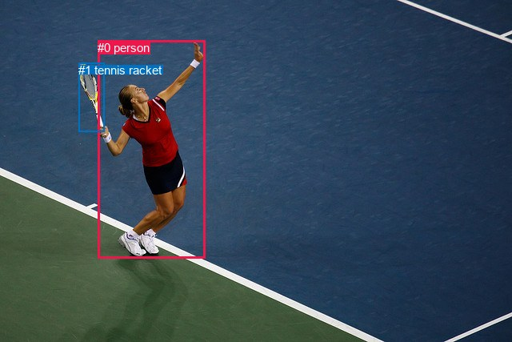
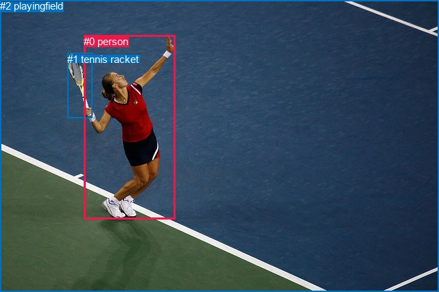

# 图片 0556：2339759.jpg

随机样本序号：344。图片 SHA256：`93eaf6ecb0627ae04cd7c6414baf845353594ada97d80494f39300accf60427a`。

红色框表示人，蓝色框表示其他物体。两个模式分别保留自身框编号，可依据位置比较对应对象。

## 自动检测框与输出

人的框编号：`[0]`。状态：`ok`。

### 自动检测全部物体框

| 编号 | 类别 | 是否为人 | 检测分数 | 像素坐标 xyxy |
|---|---|---|---|---|
| 0 | person | True | 0.9997 | 122.2, 50.7, 256.9, 322.2 |
| 1 | tennis racket | False | 0.9980 | 98.4, 78.8, 130.2, 164.8 |

### 自动检测 Top50 人相关候选

评分物体对：2；人相关物体对：2；输出关系：4。

| 排名 | 主语编号与类别 | 关系 | 宾语编号与类别 | 类型 | 人与人 | 排序分数 | 原始融合 logit |
|---|---|---|---|---|---|---|---|
| 1 | #0 person | swinging | #1 tennis racket | semantic | False | 0.99270 | 4.9132 |
| 2 | #0 person | in | #1 tennis racket | spatial | False | 0.51510 | 0.0604 |
| 3 | #1 tennis racket | in | #0 person | spatial | False | 0.10552 | -2.1373 |
| 4 | #1 tennis racket | holding | #0 person | semantic | False | 0.09640 | -2.2379 |

### 自动检测逐条人相关 GT 核验

R@50：33.33%；命中 1/3。

| GT 主语编号 | GT 关系 | GT 宾语编号 | 结果阶段 | 匹配预测主语编号 | 匹配预测宾语编号 |
|---|---|---|---|---|---|
| 0 | holding | 1 | wrong_predicate | [0] | [1] |
| 0 | swinging | 1 | hit50 | [0] | [1] |
| 0 | jumping from | 2 | endpoint_missing_or_wrong_class | [0] | [] |

## 真实框与输出

人的框编号：`[0]`。

### 真实框全部物体框

| 编号 | 类别 | 是否为人 | 检测分数 | 像素坐标 xyxy |
|---|---|---|---|---|
| 0 | person | True | GT | 122.0, 52.0, 255.0, 321.0 |
| 1 | tennis racket | False | GT | 98.0, 78.0, 134.0, 172.0 |
| 2 | playingfield | False | GT | 0.0, 0.0, 640.0, 427.0 |

### 真实框 Top50 人相关候选

评分物体对：6；人相关物体对：4；输出关系：8。

| 排名 | 主语编号与类别 | 关系 | 宾语编号与类别 | 类型 | 人与人 | 排序分数 | 原始融合 logit |
|---|---|---|---|---|---|---|---|
| 1 | #0 person | swinging | #1 tennis racket | semantic | False | 0.99583 | 5.4763 |
| 2 | #0 person | playing | #2 playingfield | semantic | False | 0.97206 | 3.5494 |
| 3 | #0 person | on | #2 playingfield | spatial | False | 0.96342 | 3.2711 |
| 4 | #0 person | in | #1 tennis racket | spatial | False | 0.82468 | 1.5484 |
| 5 | #1 tennis racket | holding | #0 person | semantic | False | 0.61637 | 0.4742 |
| 6 | #1 tennis racket | in | #0 person | spatial | False | 0.53666 | 0.1469 |
| 7 | #2 playingfield | in | #0 person | spatial | False | 0.13724 | -1.8384 |
| 8 | #2 playingfield | holding | #0 person | semantic | False | 0.06771 | -2.6224 |

### 真实框逐条人相关 GT 核验

R@50：33.33%；命中 1/3。

| GT 主语编号 | GT 关系 | GT 宾语编号 | 结果阶段 | 匹配预测主语编号 | 匹配预测宾语编号 |
|---|---|---|---|---|---|
| 0 | holding | 1 | wrong_predicate | [0] | [1] |
| 0 | swinging | 1 | hit50 | [0] | [1] |
| 0 | jumping from | 2 | wrong_predicate | [0] | [2] |

## 全部人相关 GT

| 主语编号与类别 | 关系 | 宾语编号与类别 |
|---|---|---|
| #0 person | holding | #1 tennis racket |
| #0 person | swinging | #1 tennis racket |
| #0 person | jumping from | #2 playingfield |

原始记录、全部人相关物体对的两项预测与分项分数见 [逐图证据 JSON](../evidence/cases/0556.json)。全部56类 logits 保留于本机 HOR/output/random500/logits/。

<!-- HOR_COMPLETE_RESULTS -->

## 六组条件的完整输出对照

以下保留同一图片三种框与候选模式、两种谓词输出规则的全部 Top50。框编号各自在所属模式内解释。

### 自动检测框完整枚举：空间与语义各保留一个谓词

| 排名 | 主语编号与类别 | 谓词 | 宾语编号与类别 | 分组 | 排序分数 | predicate logit | pair logit |
|---|---|---|---|---|---|---|---|
| 1 | #0 person | swinging | #1 tennis racket | semantic | 0.9927047 | 4.2698350 | 0.6433710 |
| 2 | #0 person | in | #1 tennis racket | spatial | 0.5150966 | -0.5829663 | 0.6433710 |
| 3 | #1 tennis racket | in | #0 person | spatial | 0.1055222 | -1.6696205 | -0.4676986 |
| 4 | #1 tennis racket | holding | #0 person | semantic | 0.0963957 | -1.7702310 | -0.4676986 |

GT 命中：1/3，R@50=33.33%。

| GT主语 | GT谓词 | GT宾语 | 结果阶段 | 匹配主语框 | 匹配宾语框 |
|---|---|---|---|---|---|
| 0 | holding | 1 | wrong_predicate | [0] | [1] |
| 0 | swinging | 1 | hit50 | [0] | [1] |
| 0 | jumping from | 2 | endpoint_missing_or_wrong_class | [0] | [] |

### 自动检测框完整枚举：每对只保留一个谓词

| 排名 | 主语编号与类别 | 谓词 | 宾语编号与类别 | 分组 | 排序分数 | predicate logit | pair logit |
|---|---|---|---|---|---|---|---|
| 1 | #0 person | swinging | #1 tennis racket | single | 0.9927047 | 4.2698350 | 0.6433710 |
| 2 | #1 tennis racket | in | #0 person | single | 0.1055222 | -1.6696205 | -0.4676986 |

GT 命中：1/3，R@50=33.33%。

| GT主语 | GT谓词 | GT宾语 | 结果阶段 | 匹配主语框 | 匹配宾语框 |
|---|---|---|---|---|---|
| 0 | holding | 1 | wrong_predicate | [0] | [1] |
| 0 | swinging | 1 | hit50 | [0] | [1] |
| 0 | jumping from | 2 | endpoint_missing_or_wrong_class | [0] | [] |

### 真实框完整枚举：空间与语义各保留一个谓词

| 排名 | 主语编号与类别 | 谓词 | 宾语编号与类别 | 分组 | 排序分数 | predicate logit | pair logit |
|---|---|---|---|---|---|---|---|
| 1 | #0 person | swinging | #1 tennis racket | semantic | 0.9958327 | 4.8114648 | 0.6648543 |
| 2 | #0 person | playing | #2 playingfield | semantic | 0.9720598 | 3.4536986 | 0.0956517 |
| 3 | #0 person | on | #2 playingfield | spatial | 0.9634244 | 3.1754627 | 0.0956517 |
| 4 | #0 person | in | #1 tennis racket | spatial | 0.8246805 | 0.8835316 | 0.6648543 |
| 5 | #1 tennis racket | holding | #0 person | semantic | 0.6163740 | 0.9371104 | -0.4629246 |
| 6 | #1 tennis racket | in | #0 person | spatial | 0.5366622 | 0.6098371 | -0.4629246 |
| 7 | #2 playingfield | in | #0 person | spatial | 0.1372366 | -0.9869823 | -0.8514517 |
| 8 | #2 playingfield | holding | #0 person | semantic | 0.0677085 | -1.7709820 | -0.8514517 |

GT 命中：1/3，R@50=33.33%。

| GT主语 | GT谓词 | GT宾语 | 结果阶段 | 匹配主语框 | 匹配宾语框 |
|---|---|---|---|---|---|
| 0 | holding | 1 | wrong_predicate | [0] | [1] |
| 0 | swinging | 1 | hit50 | [0] | [1] |
| 0 | jumping from | 2 | wrong_predicate | [0] | [2] |

### 真实框完整枚举：每对只保留一个谓词

| 排名 | 主语编号与类别 | 谓词 | 宾语编号与类别 | 分组 | 排序分数 | predicate logit | pair logit |
|---|---|---|---|---|---|---|---|
| 1 | #0 person | swinging | #1 tennis racket | single | 0.9958327 | 4.8114648 | 0.6648543 |
| 2 | #0 person | playing | #2 playingfield | single | 0.9720598 | 3.4536986 | 0.0956517 |
| 3 | #1 tennis racket | holding | #0 person | single | 0.6163740 | 0.9371104 | -0.4629246 |
| 4 | #2 playingfield | in | #0 person | single | 0.1372366 | -0.9869823 | -0.8514517 |

GT 命中：1/3，R@50=33.33%。

| GT主语 | GT谓词 | GT宾语 | 结果阶段 | 匹配主语框 | 匹配宾语框 |
|---|---|---|---|---|---|
| 0 | holding | 1 | wrong_predicate | [0] | [1] |
| 0 | swinging | 1 | hit50 | [0] | [1] |
| 0 | jumping from | 2 | wrong_predicate | [0] | [2] |

### 真实框400候选：空间与语义各保留一个谓词

| 排名 | 主语编号与类别 | 谓词 | 宾语编号与类别 | 分组 | 排序分数 | predicate logit | pair logit |
|---|---|---|---|---|---|---|---|
| 1 | #0 person | swinging | #1 tennis racket | semantic | 0.9958327 | 4.8114648 | 0.6648543 |
| 2 | #0 person | playing | #2 playingfield | semantic | 0.9720598 | 3.4536986 | 0.0956517 |
| 3 | #0 person | on | #2 playingfield | spatial | 0.9620469 | 3.1370597 | 0.0956517 |
| 4 | #0 person | in | #1 tennis racket | spatial | 0.8246805 | 0.8835316 | 0.6648543 |
| 5 | #1 tennis racket | holding | #0 person | semantic | 0.6163740 | 0.9371104 | -0.4629246 |
| 6 | #1 tennis racket | in | #0 person | spatial | 0.5374873 | 0.6131558 | -0.4629246 |
| 7 | #2 playingfield | in | #0 person | spatial | 0.1374332 | -0.9853230 | -0.8514517 |
| 8 | #2 playingfield | holding | #0 person | semantic | 0.0686054 | -1.7568595 | -0.8514517 |

GT 命中：1/3，R@50=33.33%。

| GT主语 | GT谓词 | GT宾语 | 结果阶段 | 匹配主语框 | 匹配宾语框 |
|---|---|---|---|---|---|
| 0 | holding | 1 | wrong_predicate | [0] | [1] |
| 0 | swinging | 1 | hit50 | [0] | [1] |
| 0 | jumping from | 2 | wrong_predicate | [0] | [2] |

### 真实框400候选：每对只保留一个谓词

| 排名 | 主语编号与类别 | 谓词 | 宾语编号与类别 | 分组 | 排序分数 | predicate logit | pair logit |
|---|---|---|---|---|---|---|---|
| 1 | #0 person | swinging | #1 tennis racket | single | 0.9958327 | 4.8114648 | 0.6648543 |
| 2 | #0 person | playing | #2 playingfield | single | 0.9720598 | 3.4536986 | 0.0956517 |
| 3 | #1 tennis racket | holding | #0 person | single | 0.6163740 | 0.9371104 | -0.4629246 |
| 4 | #2 playingfield | in | #0 person | single | 0.1374332 | -0.9853230 | -0.8514517 |

GT 命中：1/3，R@50=33.33%。

| GT主语 | GT谓词 | GT宾语 | 结果阶段 | 匹配主语框 | 匹配宾语框 |
|---|---|---|---|---|---|
| 0 | holding | 1 | wrong_predicate | [0] | [1] |
| 0 | swinging | 1 | hit50 | [0] | [1] |
| 0 | jumping from | 2 | wrong_predicate | [0] | [2] |
