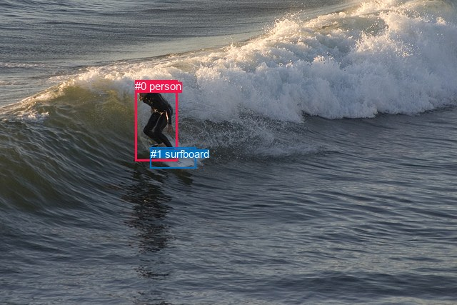
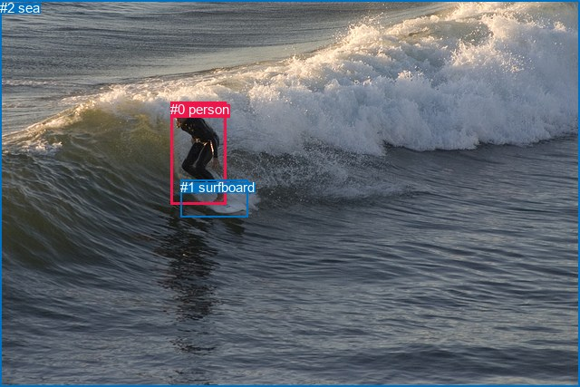

# 图片 0561：2340111.jpg

随机样本序号：236。图片 SHA256：`5b0a628c0b3b04de932b32d54211f8a9668a0a8b5afa331a6b5b40f2b9ecb700`。

红色框表示人，蓝色框表示其他物体。两个模式分别保留自身框编号，可依据位置比较对应对象。

## 自动检测框与输出

人的框编号：`[0]`。状态：`ok`。

### 自动检测全部物体框

| 编号 | 类别 | 是否为人 | 检测分数 | 像素坐标 xyxy |
|---|---|---|---|---|
| 0 | person | True | 0.9997 | 189.3, 112.2, 248.0, 225.4 |
| 1 | surfboard | False | 0.9872 | 210.6, 206.6, 274.4, 235.8 |

### 自动检测 Top50 人相关候选

评分物体对：2；人相关物体对：2；输出关系：4。

| 排名 | 主语编号与类别 | 关系 | 宾语编号与类别 | 类型 | 人与人 | 排序分数 | 原始融合 logit |
|---|---|---|---|---|---|---|---|
| 1 | #0 person | riding | #1 surfboard | semantic | False | 0.98512 | 4.1927 |
| 2 | #0 person | on | #1 surfboard | spatial | False | 0.46862 | -0.1257 |
| 3 | #1 surfboard | in | #0 person | spatial | False | 0.00324 | -5.7280 |
| 4 | #1 surfboard | holding | #0 person | semantic | False | 0.00111 | -6.8049 |

### 自动检测逐条人相关 GT 核验

R@50：25.00%；命中 1/4。

| GT 主语编号 | GT 关系 | GT 宾语编号 | 结果阶段 | 匹配预测主语编号 | 匹配预测宾语编号 |
|---|---|---|---|---|---|
| 0 | on | 1 | hit50 | [0] | [1] |
| 0 | standing on | 1 | wrong_predicate | [0] | [1] |
| 0 | playing | 1 | wrong_predicate | [0] | [1] |
| 0 | over | 2 | endpoint_missing_or_wrong_class | [0] | [] |

## 真实框与输出

人的框编号：`[0]`。

### 真实框全部物体框

| 编号 | 类别 | 是否为人 | 检测分数 | 像素坐标 xyxy |
|---|---|---|---|---|
| 0 | person | True | GT | 188.0, 112.0, 249.0, 225.0 |
| 1 | surfboard | False | GT | 199.0, 198.0, 273.0, 239.0 |
| 2 | sea | False | GT | 0.0, 0.0, 640.0, 427.0 |

### 真实框 Top50 人相关候选

评分物体对：6；人相关物体对：4；输出关系：8。

| 排名 | 主语编号与类别 | 关系 | 宾语编号与类别 | 类型 | 人与人 | 排序分数 | 原始融合 logit |
|---|---|---|---|---|---|---|---|
| 1 | #0 person | riding | #1 surfboard | semantic | False | 0.99406 | 5.1207 |
| 2 | #0 person | in | #2 sea | spatial | False | 0.99030 | 4.6254 |
| 3 | #0 person | on | #1 surfboard | spatial | False | 0.97865 | 3.8251 |
| 4 | #0 person | riding | #2 sea | semantic | False | 0.97673 | 3.7371 |
| 5 | #2 sea | beside | #0 person | spatial | False | 0.70919 | 0.8915 |
| 6 | #1 surfboard | beside | #0 person | spatial | False | 0.27504 | -0.9692 |
| 7 | #1 surfboard | holding | #0 person | semantic | False | 0.24690 | -1.1152 |
| 8 | #2 sea | running on | #0 person | semantic | False | 0.19714 | -1.4042 |

### 真实框逐条人相关 GT 核验

R@50：25.00%；命中 1/4。

| GT 主语编号 | GT 关系 | GT 宾语编号 | 结果阶段 | 匹配预测主语编号 | 匹配预测宾语编号 |
|---|---|---|---|---|---|
| 0 | on | 1 | hit50 | [0] | [1] |
| 0 | standing on | 1 | wrong_predicate | [0] | [1] |
| 0 | playing | 1 | wrong_predicate | [0] | [1] |
| 0 | over | 2 | wrong_predicate | [0] | [2] |

## 全部人相关 GT

| 主语编号与类别 | 关系 | 宾语编号与类别 |
|---|---|---|
| #0 person | on | #1 surfboard |
| #0 person | standing on | #1 surfboard |
| #0 person | playing | #1 surfboard |
| #0 person | over | #2 sea |

原始记录、全部人相关物体对的两项预测与分项分数见 [逐图证据 JSON](../evidence/cases/0561.json)。全部56类 logits 保留于本机 HOR/output/random500/logits/。

<!-- HOR_COMPLETE_RESULTS -->

## 六组条件的完整输出对照

以下保留同一图片三种框与候选模式、两种谓词输出规则的全部 Top50。框编号各自在所属模式内解释。

### 自动检测框完整枚举：空间与语义各保留一个谓词

| 排名 | 主语编号与类别 | 谓词 | 宾语编号与类别 | 分组 | 排序分数 | predicate logit | pair logit |
|---|---|---|---|---|---|---|---|
| 1 | #0 person | riding | #1 surfboard | semantic | 0.9851194 | 3.8607478 | 0.3319573 |
| 2 | #0 person | on | #1 surfboard | spatial | 0.4686202 | -0.4576416 | 0.3319573 |
| 3 | #1 surfboard | in | #0 person | spatial | 0.0032432 | -5.0627403 | -0.6652198 |
| 4 | #1 surfboard | holding | #0 person | semantic | 0.0011071 | -6.1396961 | -0.6652198 |

GT 命中：1/4，R@50=25.00%。

| GT主语 | GT谓词 | GT宾语 | 结果阶段 | 匹配主语框 | 匹配宾语框 |
|---|---|---|---|---|---|
| 0 | on | 1 | hit50 | [0] | [1] |
| 0 | standing on | 1 | wrong_predicate | [0] | [1] |
| 0 | playing | 1 | wrong_predicate | [0] | [1] |
| 0 | over | 2 | endpoint_missing_or_wrong_class | [0] | [] |

### 自动检测框完整枚举：每对只保留一个谓词

| 排名 | 主语编号与类别 | 谓词 | 宾语编号与类别 | 分组 | 排序分数 | predicate logit | pair logit |
|---|---|---|---|---|---|---|---|
| 1 | #0 person | riding | #1 surfboard | single | 0.9851194 | 3.8607478 | 0.3319573 |
| 2 | #1 surfboard | in | #0 person | single | 0.0032432 | -5.0627403 | -0.6652198 |

GT 命中：0/4，R@50=0.00%。

| GT主语 | GT谓词 | GT宾语 | 结果阶段 | 匹配主语框 | 匹配宾语框 |
|---|---|---|---|---|---|
| 0 | on | 1 | wrong_predicate | [0] | [1] |
| 0 | standing on | 1 | wrong_predicate | [0] | [1] |
| 0 | playing | 1 | wrong_predicate | [0] | [1] |
| 0 | over | 2 | endpoint_missing_or_wrong_class | [0] | [] |

### 真实框完整枚举：空间与语义各保留一个谓词

| 排名 | 主语编号与类别 | 谓词 | 宾语编号与类别 | 分组 | 排序分数 | predicate logit | pair logit |
|---|---|---|---|---|---|---|---|
| 1 | #0 person | riding | #1 surfboard | semantic | 0.9940639 | 4.7812009 | 0.3395407 |
| 2 | #0 person | in | #2 sea | spatial | 0.9902958 | 4.2254615 | 0.3999858 |
| 3 | #0 person | on | #1 surfboard | spatial | 0.9786488 | 3.4855275 | 0.3395407 |
| 4 | #0 person | riding | #2 sea | semantic | 0.9767302 | 3.3370652 | 0.3999858 |
| 5 | #2 sea | beside | #0 person | spatial | 0.7091894 | 1.5802426 | -0.6887923 |
| 6 | #1 surfboard | beside | #0 person | spatial | 0.2750406 | -0.3158817 | -0.6533153 |
| 7 | #1 surfboard | holding | #0 person | semantic | 0.2469003 | -0.4618979 | -0.6533153 |
| 8 | #2 sea | running on | #0 person | semantic | 0.1971436 | -0.7154512 | -0.6887923 |

GT 命中：1/4，R@50=25.00%。

| GT主语 | GT谓词 | GT宾语 | 结果阶段 | 匹配主语框 | 匹配宾语框 |
|---|---|---|---|---|---|
| 0 | on | 1 | hit50 | [0] | [1] |
| 0 | standing on | 1 | wrong_predicate | [0] | [1] |
| 0 | playing | 1 | wrong_predicate | [0] | [1] |
| 0 | over | 2 | wrong_predicate | [0] | [2] |

### 真实框完整枚举：每对只保留一个谓词

| 排名 | 主语编号与类别 | 谓词 | 宾语编号与类别 | 分组 | 排序分数 | predicate logit | pair logit |
|---|---|---|---|---|---|---|---|
| 1 | #0 person | riding | #1 surfboard | single | 0.9940639 | 4.7812009 | 0.3395407 |
| 2 | #0 person | in | #2 sea | single | 0.9902958 | 4.2254615 | 0.3999858 |
| 3 | #2 sea | beside | #0 person | single | 0.7091894 | 1.5802426 | -0.6887923 |
| 4 | #1 surfboard | beside | #0 person | single | 0.2750406 | -0.3158817 | -0.6533153 |

GT 命中：0/4，R@50=0.00%。

| GT主语 | GT谓词 | GT宾语 | 结果阶段 | 匹配主语框 | 匹配宾语框 |
|---|---|---|---|---|---|
| 0 | on | 1 | wrong_predicate | [0] | [1] |
| 0 | standing on | 1 | wrong_predicate | [0] | [1] |
| 0 | playing | 1 | wrong_predicate | [0] | [1] |
| 0 | over | 2 | wrong_predicate | [0] | [2] |

### 真实框400候选：空间与语义各保留一个谓词

| 排名 | 主语编号与类别 | 谓词 | 宾语编号与类别 | 分组 | 排序分数 | predicate logit | pair logit |
|---|---|---|---|---|---|---|---|
| 1 | #0 person | riding | #1 surfboard | semantic | 0.9940639 | 4.7812009 | 0.3395407 |
| 2 | #0 person | in | #2 sea | spatial | 0.9902318 | 4.2188239 | 0.3999858 |
| 3 | #0 person | on | #1 surfboard | spatial | 0.9788752 | 3.4964175 | 0.3395407 |
| 4 | #0 person | riding | #2 sea | semantic | 0.9767357 | 3.3373094 | 0.3999858 |
| 5 | #2 sea | beside | #0 person | spatial | 0.7092013 | 1.5803003 | -0.6887923 |
| 6 | #1 surfboard | beside | #0 person | spatial | 0.2750406 | -0.3158817 | -0.6533153 |
| 7 | #1 surfboard | holding | #0 person | semantic | 0.2466257 | -0.4633751 | -0.6533153 |
| 8 | #2 sea | running on | #0 person | semantic | 0.1968296 | -0.7174358 | -0.6887923 |

GT 命中：1/4，R@50=25.00%。

| GT主语 | GT谓词 | GT宾语 | 结果阶段 | 匹配主语框 | 匹配宾语框 |
|---|---|---|---|---|---|
| 0 | on | 1 | hit50 | [0] | [1] |
| 0 | standing on | 1 | wrong_predicate | [0] | [1] |
| 0 | playing | 1 | wrong_predicate | [0] | [1] |
| 0 | over | 2 | wrong_predicate | [0] | [2] |

### 真实框400候选：每对只保留一个谓词

| 排名 | 主语编号与类别 | 谓词 | 宾语编号与类别 | 分组 | 排序分数 | predicate logit | pair logit |
|---|---|---|---|---|---|---|---|
| 1 | #0 person | riding | #1 surfboard | single | 0.9940639 | 4.7812009 | 0.3395407 |
| 2 | #0 person | in | #2 sea | single | 0.9902318 | 4.2188239 | 0.3999858 |
| 3 | #2 sea | beside | #0 person | single | 0.7092013 | 1.5803003 | -0.6887923 |
| 4 | #1 surfboard | beside | #0 person | single | 0.2750406 | -0.3158817 | -0.6533153 |

GT 命中：0/4，R@50=0.00%。

| GT主语 | GT谓词 | GT宾语 | 结果阶段 | 匹配主语框 | 匹配宾语框 |
|---|---|---|---|---|---|
| 0 | on | 1 | wrong_predicate | [0] | [1] |
| 0 | standing on | 1 | wrong_predicate | [0] | [1] |
| 0 | playing | 1 | wrong_predicate | [0] | [1] |
| 0 | over | 2 | wrong_predicate | [0] | [2] |
