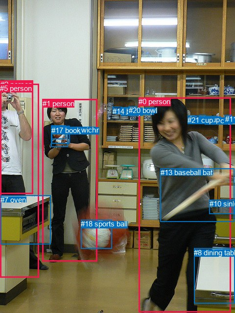
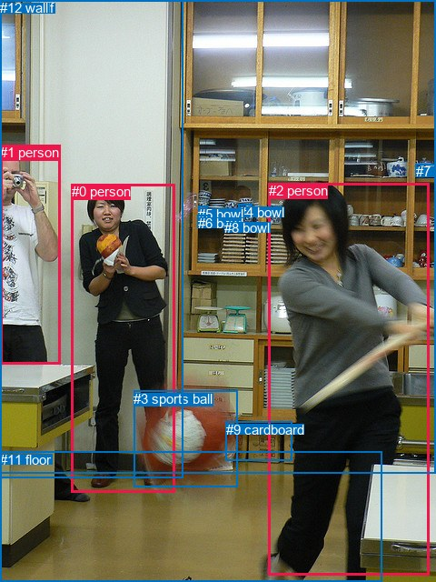

# 图片 0574：2340907.jpg

随机样本序号：327。图片 SHA256：`674f14c11aee89bfd18e61e35e64eb505f709897eb4a8d1d7b18b1e095abe70d`。

红色框表示人，蓝色框表示其他物体。两个模式分别保留自身框编号，可依据位置比较对应对象。

## 自动检测框与输出

人的框编号：`[0, 1, 2, 5]`。状态：`ok`。

### 自动检测全部物体框

| 编号 | 类别 | 是否为人 | 检测分数 | 像素坐标 xyxy |
|---|---|---|---|---|
| 0 | person | True | 0.9995 | 283.4, 199.4, 471.8, 638.8 |
| 1 | person | True | 0.9989 | 86.9, 202.7, 198.7, 534.6 |
| 2 | person | True | 0.9976 | 0.7, 164.3, 67.5, 396.7 |
| 3 | cup | False | 0.9527 | 418.9, 237.5, 432.2, 248.1 |
| 4 | cup | False | 0.8637 | 408.0, 235.6, 420.2, 247.9 |
| 5 | person | True | 0.7617 | 0.4, 171.8, 79.4, 567.7 |
| 6 | cup | False | 0.7273 | 430.4, 238.0, 443.0, 248.7 |
| 7 | oven | False | 0.6944 | 1.3, 399.7, 103.8, 499.7 |
| 8 | dining table | False | 0.6643 | 396.2, 507.7, 479.7, 620.0 |
| 9 | cup | False | 0.6461 | 247.0, 219.9, 262.1, 233.9 |
| 10 | sink | False | 0.6172 | 427.7, 408.3, 479.7, 437.7 |
| 11 | cup | False | 0.6015 | 459.6, 235.5, 473.0, 246.3 |
| 12 | cup | False | 0.5698 | 396.7, 236.3, 408.6, 248.2 |
| 13 | baseball bat | False | 0.5534 | 327.7, 344.3, 478.9, 453.8 |
| 14 | bowl | False | 0.4768 | 230.3, 218.6, 248.5, 222.5 |
| 15 | teddy bear | False | 0.4264 | 104.6, 257.2, 138.5, 300.1 |
| 16 | sandwich | False | 0.3885 | 105.8, 256.8, 134.7, 284.9 |
| 17 | book | False | 0.3832 | 105.5, 257.7, 142.2, 293.0 |
| 18 | sports ball | False | 0.3816 | 165.4, 449.4, 228.2, 508.9 |
| 19 | cup | False | 0.3811 | 262.8, 217.7, 278.4, 222.4 |
| 20 | bowl | False | 0.3789 | 262.5, 217.1, 277.8, 221.8 |
| 21 | cup | False | 0.3735 | 383.4, 236.8, 396.9, 249.5 |

### 自动检测 Top50 人相关候选

评分物体对：462；人相关物体对：156；输出关系：50。

| 排名 | 主语编号与类别 | 关系 | 宾语编号与类别 | 类型 | 人与人 | 排序分数 | 原始融合 logit |
|---|---|---|---|---|---|---|---|
| 1 | #0 person | holding | #13 baseball bat | semantic | False | 0.99604 | 5.5288 |
| 2 | #1 person | holding | #17 book | semantic | False | 0.99349 | 5.0277 |
| 3 | #1 person | holding | #15 teddy bear | semantic | False | 0.99299 | 4.9527 |
| 4 | #1 person | holding | #16 sandwich | semantic | False | 0.99267 | 4.9084 |
| 5 | #0 person | wearing | #21 cup | semantic | False | 0.97906 | 3.8451 |
| 6 | #5 person | standing on | #7 oven | semantic | False | 0.93593 | 2.6816 |
| 7 | #5 person | wearing | #2 person | semantic | True | 0.89634 | 2.1572 |
| 8 | #1 person | holding | #18 sports ball | semantic | False | 0.88067 | 1.9988 |
| 9 | #2 person | standing on | #7 oven | semantic | False | 0.87431 | 1.9396 |
| 10 | #1 person | on | #15 teddy bear | spatial | False | 0.82307 | 1.5373 |
| 11 | #0 person | on | #8 dining table | spatial | False | 0.81392 | 1.4757 |
| 12 | #1 person | on | #17 book | spatial | False | 0.81360 | 1.4736 |
| 13 | #0 person | running on | #8 dining table | semantic | False | 0.81271 | 1.4677 |
| 14 | #0 person | in | #13 baseball bat | spatial | False | 0.81010 | 1.4506 |
| 15 | #0 person | throwing | #18 sports ball | semantic | False | 0.80122 | 1.3939 |
| 16 | #2 person | standing on | #5 person | semantic | True | 0.78480 | 1.2938 |
| 17 | #5 person | beside | #7 oven | spatial | False | 0.78056 | 1.2689 |
| 18 | #0 person | in | #21 cup | spatial | False | 0.77356 | 1.2285 |
| 19 | #1 person | on | #16 sandwich | spatial | False | 0.76751 | 1.1943 |
| 20 | #1 person | looking at | #0 person | semantic | True | 0.75209 | 1.1098 |
| 21 | #5 person | in | #2 person | spatial | True | 0.74504 | 1.0723 |
| 22 | #1 person | standing on | #7 oven | semantic | False | 0.70224 | 0.8580 |
| 23 | #2 person | holding | #15 teddy bear | semantic | False | 0.69228 | 0.8108 |
| 24 | #0 person | playing | #10 sink | semantic | False | 0.66279 | 0.6758 |
| 25 | #2 person | holding | #17 book | semantic | False | 0.62496 | 0.5106 |
| 26 | #1 person | holding | #13 baseball bat | semantic | False | 0.59898 | 0.4012 |
| 27 | #2 person | holding | #16 sandwich | semantic | False | 0.58322 | 0.3360 |
| 28 | #1 person | beside | #0 person | spatial | True | 0.51125 | 0.0450 |
| 29 | #2 person | leaning on | #7 oven | spatial | False | 0.50447 | 0.0179 |
| 30 | #2 person | on | #5 person | spatial | True | 0.50327 | 0.0131 |
| 31 | #5 person | holding | #15 teddy bear | semantic | False | 0.45503 | -0.1804 |
| 32 | #2 person | holding | #13 baseball bat | semantic | False | 0.45462 | -0.1820 |
| 33 | #5 person | holding | #13 baseball bat | semantic | False | 0.43553 | -0.2593 |
| 34 | #2 person | looking at | #1 person | semantic | True | 0.41416 | -0.3468 |
| 35 | #0 person | in | #10 sink | spatial | False | 0.41110 | -0.3594 |
| 36 | #7 oven | beside | #5 person | spatial | False | 0.40721 | -0.3755 |
| 37 | #5 person | holding | #17 book | semantic | False | 0.38820 | -0.4549 |
| 38 | #2 person | looking at | #0 person | semantic | True | 0.38212 | -0.4806 |
| 39 | #13 baseball bat | holding | #0 person | semantic | False | 0.37976 | -0.4906 |
| 40 | #0 person | wearing | #12 cup | semantic | False | 0.36907 | -0.5362 |
| 41 | #5 person | holding | #16 sandwich | semantic | False | 0.36023 | -0.5744 |
| 42 | #21 cup | on | #0 person | spatial | False | 0.35013 | -0.6185 |
| 43 | #2 person | beside | #1 person | spatial | True | 0.34851 | -0.6256 |
| 44 | #0 person | holding | #15 teddy bear | semantic | False | 0.34642 | -0.6348 |
| 45 | #0 person | holding | #17 book | semantic | False | 0.34112 | -0.6583 |
| 46 | #1 person | standing on | #5 person | semantic | True | 0.33740 | -0.6749 |
| 47 | #1 person | on | #18 sports ball | spatial | False | 0.33304 | -0.6945 |
| 48 | #8 dining table | beside | #0 person | spatial | False | 0.32995 | -0.7084 |
| 49 | #1 person | beside | #5 person | spatial | True | 0.32143 | -0.7472 |
| 50 | #1 person | on | #7 oven | spatial | False | 0.31419 | -0.7806 |

### 自动检测逐条人相关 GT 核验

R@50：33.33%；命中 1/3。

| GT 主语编号 | GT 关系 | GT 宾语编号 | 结果阶段 | 匹配预测主语编号 | 匹配预测宾语编号 |
|---|---|---|---|---|---|
| 0 | standing on | 11 | endpoint_missing_or_wrong_class | [1] | [] |
| 1 | looking at | 2 | hit50 | [2] | [0] |
| 2 | playing | 3 | endpoint_missing_or_wrong_class | [0] | [] |

## 真实框与输出

人的框编号：`[0, 1, 2]`。

### 真实框全部物体框

| 编号 | 类别 | 是否为人 | 检测分数 | 像素坐标 xyxy |
|---|---|---|---|---|
| 0 | person | True | GT | 79.0, 202.0, 193.0, 541.0 |
| 1 | person | True | GT | 0.0, 159.0, 66.0, 400.0 |
| 2 | person | True | GT | 296.0, 201.0, 473.0, 632.0 |
| 3 | sports ball | False | GT | 147.0, 430.0, 261.0, 536.0 |
| 4 | bowl | False | GT | 263.0, 225.0, 278.0, 231.0 |
| 5 | bowl | False | GT | 218.0, 227.0, 228.0, 234.0 |
| 6 | bowl | False | GT | 218.0, 237.0, 227.0, 246.0 |
| 7 | bowl | False | GT | 458.0, 180.0, 480.0, 194.0 |
| 8 | bowl | False | GT | 247.0, 242.0, 262.0, 246.0 |
| 9 | cardboard | False | GT | 249.0, 464.0, 322.0, 507.0 |
| 10 | shelf | False | GT | 0.0, 0.0, 480.0, 520.0 |
| 11 | floor | False | GT | 0.0, 497.0, 420.0, 640.0 |
| 12 | wall | False | GT | 0.0, 0.0, 202.0, 525.0 |

### 真实框 Top50 人相关候选

评分物体对：156；人相关物体对：66；输出关系：50。

| 排名 | 主语编号与类别 | 关系 | 宾语编号与类别 | 类型 | 人与人 | 排序分数 | 原始融合 logit |
|---|---|---|---|---|---|---|---|
| 1 | #0 person | leaning on | #12 wall | spatial | False | 0.98958 | 4.5531 |
| 2 | #1 person | leaning on | #12 wall | spatial | False | 0.98848 | 4.4523 |
| 3 | #0 person | standing on | #11 floor | semantic | False | 0.97508 | 3.6669 |
| 4 | #2 person | standing on | #11 floor | semantic | False | 0.95960 | 3.1678 |
| 5 | #0 person | standing on | #12 wall | semantic | False | 0.95058 | 2.9568 |
| 6 | #1 person | standing on | #12 wall | semantic | False | 0.94919 | 2.9275 |
| 7 | #1 person | standing on | #11 floor | semantic | False | 0.94404 | 2.8256 |
| 8 | #0 person | holding | #3 sports ball | semantic | False | 0.93699 | 2.6994 |
| 9 | #0 person | standing on | #10 shelf | semantic | False | 0.92041 | 2.4479 |
| 10 | #2 person | playing with | #0 person | semantic | True | 0.91718 | 2.4047 |
| 11 | #0 person | in | #10 shelf | spatial | False | 0.91679 | 2.3995 |
| 12 | #2 person | holding | #3 sports ball | semantic | False | 0.90855 | 2.2960 |
| 13 | #2 person | on | #11 floor | spatial | False | 0.88608 | 2.0513 |
| 14 | #0 person | on | #11 floor | spatial | False | 0.81220 | 1.4644 |
| 15 | #1 person | standing on | #10 shelf | semantic | False | 0.76800 | 1.1970 |
| 16 | #0 person | looking at | #2 person | semantic | True | 0.76167 | 1.1619 |
| 17 | #1 person | in | #10 shelf | spatial | False | 0.69355 | 0.8168 |
| 18 | #0 person | playing | #5 bowl | semantic | False | 0.67816 | 0.7453 |
| 19 | #0 person | playing | #6 bowl | semantic | False | 0.66246 | 0.6743 |
| 20 | #2 person | playing | #10 shelf | semantic | False | 0.65171 | 0.6266 |
| 21 | #1 person | on | #11 floor | spatial | False | 0.62574 | 0.5140 |
| 22 | #1 person | beside | #0 person | spatial | True | 0.62180 | 0.4972 |
| 23 | #2 person | in | #10 shelf | spatial | False | 0.59219 | 0.3730 |
| 24 | #2 person | playing | #6 bowl | semantic | False | 0.57815 | 0.3152 |
| 25 | #2 person | playing | #5 bowl | semantic | False | 0.57292 | 0.2938 |
| 26 | #0 person | beside | #2 person | spatial | True | 0.57176 | 0.2890 |
| 27 | #1 person | playing with | #0 person | semantic | True | 0.54342 | 0.1741 |
| 28 | #0 person | beside | #1 person | spatial | True | 0.50345 | 0.0138 |
| 29 | #0 person | holding | #1 person | semantic | True | 0.49229 | -0.0308 |
| 30 | #0 person | in | #3 sports ball | spatial | False | 0.44828 | -0.2076 |
| 31 | #2 person | playing with | #1 person | semantic | True | 0.44776 | -0.2097 |
| 32 | #1 person | playing with | #2 person | semantic | True | 0.42802 | -0.2899 |
| 33 | #2 person | in | #3 sports ball | spatial | False | 0.41571 | -0.3404 |
| 34 | #2 person | beside | #0 person | spatial | True | 0.37085 | -0.5286 |
| 35 | #1 person | beside | #2 person | spatial | True | 0.22396 | -1.2427 |
| 36 | #2 person | playing | #8 bowl | semantic | False | 0.17816 | -1.5288 |
| 37 | #12 wall | beside | #0 person | spatial | False | 0.16839 | -1.5971 |
| 38 | #3 sports ball | beside | #0 person | spatial | False | 0.13443 | -1.8624 |
| 39 | #2 person | playing | #4 bowl | semantic | False | 0.13215 | -1.8820 |
| 40 | #2 person | playing | #12 wall | semantic | False | 0.13204 | -1.8831 |
| 41 | #2 person | in front of | #12 wall | spatial | False | 0.12447 | -1.9508 |
| 42 | #2 person | playing | #9 cardboard | semantic | False | 0.11480 | -2.0427 |
| 43 | #1 person | playing | #6 bowl | semantic | False | 0.08879 | -2.3285 |
| 44 | #9 cardboard | beside | #2 person | spatial | False | 0.08715 | -2.3490 |
| 45 | #2 person | beside | #1 person | spatial | True | 0.07829 | -2.4658 |
| 46 | #1 person | playing | #5 bowl | semantic | False | 0.07535 | -2.5073 |
| 47 | #2 person | playing | #7 bowl | semantic | False | 0.06811 | -2.6162 |
| 48 | #3 sports ball | beside | #2 person | spatial | False | 0.06605 | -2.6489 |
| 49 | #1 person | holding | #3 sports ball | semantic | False | 0.04734 | -3.0019 |
| 50 | #2 person | in | #9 cardboard | spatial | False | 0.04584 | -3.0357 |

### 真实框逐条人相关 GT 核验

R@50：33.33%；命中 1/3。

| GT 主语编号 | GT 关系 | GT 宾语编号 | 结果阶段 | 匹配预测主语编号 | 匹配预测宾语编号 |
|---|---|---|---|---|---|
| 0 | standing on | 11 | hit50 | [0] | [11] |
| 1 | looking at | 2 | wrong_predicate | [1] | [2] |
| 2 | playing | 3 | wrong_predicate | [2] | [3] |

## 全部人相关 GT

| 主语编号与类别 | 关系 | 宾语编号与类别 |
|---|---|---|
| #0 person | standing on | #11 floor |
| #1 person | looking at | #2 person |
| #2 person | playing | #3 sports ball |

原始记录、全部人相关物体对的两项预测与分项分数见 [逐图证据 JSON](../evidence/cases/0574.json)。全部56类 logits 保留于本机 HOR/output/random500/logits/。

<!-- HOR_COMPLETE_RESULTS -->

## 六组条件的完整输出对照

以下保留同一图片三种框与候选模式、两种谓词输出规则的全部 Top50。框编号各自在所属模式内解释。

### 自动检测框完整枚举：空间与语义各保留一个谓词

| 排名 | 主语编号与类别 | 谓词 | 宾语编号与类别 | 分组 | 排序分数 | predicate logit | pair logit |
|---|---|---|---|---|---|---|---|
| 1 | #0 person | holding | #13 baseball bat | semantic | 0.9960448 | 4.8669581 | 0.6618059 |
| 2 | #1 person | holding | #17 book | semantic | 0.9934886 | 4.5132890 | 0.5143740 |
| 3 | #1 person | holding | #15 teddy bear | semantic | 0.9929852 | 4.4649234 | 0.4877787 |
| 4 | #1 person | holding | #16 sandwich | semantic | 0.9926697 | 4.3999295 | 0.5084525 |
| 5 | #0 person | wearing | #21 cup | semantic | 0.9790626 | 3.6613431 | 0.1837110 |
| 6 | #5 person | standing on | #7 oven | semantic | 0.9359304 | 3.2347727 | -0.5532032 |
| 7 | #5 person | wearing | #2 person | semantic | 0.8963408 | 2.8729572 | -0.7157449 |
| 8 | #1 person | holding | #18 sports ball | semantic | 0.8806747 | 2.3703523 | -0.3715172 |
| 9 | #2 person | standing on | #7 oven | semantic | 0.8743127 | 2.5066676 | -0.5670266 |
| 10 | #1 person | on | #15 teddy bear | spatial | 0.8230686 | 1.0494986 | 0.4877787 |
| 11 | #0 person | on | #8 dining table | spatial | 0.8139216 | 1.9789095 | -0.5032135 |
| 12 | #1 person | on | #17 book | spatial | 0.8136038 | 0.9592247 | 0.5143740 |
| 13 | #0 person | running on | #8 dining table | semantic | 0.8127107 | 1.9709344 | -0.5032135 |
| 14 | #0 person | in | #13 baseball bat | spatial | 0.8100958 | 0.7888265 | 0.6618059 |
| 15 | #0 person | throwing | #18 sports ball | semantic | 0.8012207 | 1.9353137 | -0.5413721 |
| 16 | #2 person | standing on | #5 person | semantic | 0.7847959 | 2.1855679 | -0.8917313 |
| 17 | #5 person | beside | #7 oven | spatial | 0.7805588 | 1.8221292 | -0.5532032 |
| 18 | #0 person | in | #21 cup | spatial | 0.7735640 | 1.0448346 | 0.1837110 |
| 19 | #1 person | on | #16 sandwich | spatial | 0.7675053 | 0.6858258 | 0.5084525 |
| 20 | #1 person | looking at | #0 person | semantic | 0.7520924 | 1.8629112 | -0.7531084 |
| 21 | #5 person | in | #2 person | spatial | 0.7450351 | 1.7880502 | -0.7157449 |
| 22 | #1 person | standing on | #7 oven | semantic | 0.7022445 | 1.8828096 | -1.0248008 |
| 23 | #2 person | holding | #15 teddy bear | semantic | 0.6922836 | 0.9936705 | -0.1828534 |
| 24 | #0 person | playing | #10 sink | semantic | 0.6627935 | 1.6222053 | -0.9464375 |
| 25 | #2 person | holding | #17 book | semantic | 0.6249563 | 0.6816797 | -0.1710407 |
| 26 | #1 person | holding | #13 baseball bat | semantic | 0.5989791 | 1.0379839 | -0.6367706 |
| 27 | #2 person | holding | #16 sandwich | semantic | 0.5832239 | 0.4850731 | -0.1490512 |
| 28 | #1 person | beside | #0 person | spatial | 0.5112464 | 0.7981014 | -0.7531084 |
| 29 | #2 person | leaning on | #7 oven | spatial | 0.5044744 | 0.5849247 | -0.5670266 |
| 30 | #2 person | on | #5 person | spatial | 0.5032684 | 0.9048052 | -0.8917313 |
| 31 | #5 person | holding | #15 teddy bear | semantic | 0.4550338 | 0.1921153 | -0.3724675 |
| 32 | #2 person | holding | #13 baseball bat | semantic | 0.4546164 | 0.5151448 | -0.6971801 |
| 33 | #5 person | holding | #13 baseball bat | semantic | 0.4355328 | 0.5605760 | -0.8198879 |
| 34 | #2 person | looking at | #1 person | semantic | 0.4141628 | 0.6852775 | -1.0320604 |
| 35 | #0 person | in | #10 sink | spatial | 0.4111032 | 0.5870309 | -0.9464375 |
| 36 | #7 oven | beside | #5 person | spatial | 0.4072117 | 0.5018730 | -0.8773774 |
| 37 | #5 person | holding | #17 book | semantic | 0.3882025 | -0.0932875 | -0.3615866 |
| 38 | #2 person | looking at | #0 person | semantic | 0.3821186 | 0.4738326 | -0.9543983 |
| 39 | #13 baseball bat | holding | #0 person | semantic | 0.3797571 | 0.2184234 | -0.7090026 |
| 40 | #0 person | wearing | #12 cup | semantic | 0.3690727 | 0.4295521 | -0.9657489 |
| 41 | #5 person | holding | #16 sandwich | semantic | 0.3602336 | -0.2295213 | -0.3448293 |
| 42 | #21 cup | on | #0 person | spatial | 0.3501262 | -0.2260351 | -0.3924495 |
| 43 | #2 person | beside | #1 person | spatial | 0.3485071 | 0.4064527 | -1.0320604 |
| 44 | #0 person | holding | #15 teddy bear | semantic | 0.3464160 | 0.2183437 | -0.8531746 |
| 45 | #0 person | holding | #17 book | semantic | 0.3411219 | 0.1605668 | -0.8188654 |
| 46 | #1 person | standing on | #5 person | semantic | 0.3373964 | 0.4485326 | -1.1234508 |
| 47 | #1 person | on | #18 sports ball | spatial | 0.3330357 | -0.3229694 | -0.3715172 |
| 48 | #8 dining table | beside | #0 person | spatial | 0.3299533 | 0.0734534 | -0.7818495 |
| 49 | #1 person | beside | #5 person | spatial | 0.3214306 | 0.3762455 | -1.1234508 |
| 50 | #1 person | on | #7 oven | spatial | 0.3141941 | 0.2442169 | -1.0248008 |

GT 命中：1/3，R@50=33.33%。

| GT主语 | GT谓词 | GT宾语 | 结果阶段 | 匹配主语框 | 匹配宾语框 |
|---|---|---|---|---|---|
| 0 | standing on | 11 | endpoint_missing_or_wrong_class | [1] | [] |
| 1 | looking at | 2 | hit50 | [2] | [0] |
| 2 | playing | 3 | endpoint_missing_or_wrong_class | [0] | [] |

### 自动检测框完整枚举：每对只保留一个谓词

| 排名 | 主语编号与类别 | 谓词 | 宾语编号与类别 | 分组 | 排序分数 | predicate logit | pair logit |
|---|---|---|---|---|---|---|---|
| 1 | #0 person | holding | #13 baseball bat | single | 0.9960448 | 4.8669581 | 0.6618059 |
| 2 | #1 person | holding | #17 book | single | 0.9934886 | 4.5132890 | 0.5143740 |
| 3 | #1 person | holding | #15 teddy bear | single | 0.9929852 | 4.4649234 | 0.4877787 |
| 4 | #1 person | holding | #16 sandwich | single | 0.9926697 | 4.3999295 | 0.5084525 |
| 5 | #0 person | wearing | #21 cup | single | 0.9790626 | 3.6613431 | 0.1837110 |
| 6 | #5 person | standing on | #7 oven | single | 0.9359304 | 3.2347727 | -0.5532032 |
| 7 | #5 person | wearing | #2 person | single | 0.8963408 | 2.8729572 | -0.7157449 |
| 8 | #1 person | holding | #18 sports ball | single | 0.8806747 | 2.3703523 | -0.3715172 |
| 9 | #2 person | standing on | #7 oven | single | 0.8743127 | 2.5066676 | -0.5670266 |
| 10 | #0 person | on | #8 dining table | single | 0.8139216 | 1.9789095 | -0.5032135 |
| 11 | #0 person | throwing | #18 sports ball | single | 0.8012207 | 1.9353137 | -0.5413721 |
| 12 | #2 person | standing on | #5 person | single | 0.7847959 | 2.1855679 | -0.8917313 |
| 13 | #1 person | looking at | #0 person | single | 0.7520924 | 1.8629112 | -0.7531084 |
| 14 | #1 person | standing on | #7 oven | single | 0.7022445 | 1.8828096 | -1.0248008 |
| 15 | #2 person | holding | #15 teddy bear | single | 0.6922836 | 0.9936705 | -0.1828534 |
| 16 | #0 person | playing | #10 sink | single | 0.6627935 | 1.6222053 | -0.9464375 |
| 17 | #2 person | holding | #17 book | single | 0.6249563 | 0.6816797 | -0.1710407 |
| 18 | #1 person | holding | #13 baseball bat | single | 0.5989791 | 1.0379839 | -0.6367706 |
| 19 | #2 person | holding | #16 sandwich | single | 0.5832239 | 0.4850731 | -0.1490512 |
| 20 | #5 person | holding | #15 teddy bear | single | 0.4550338 | 0.1921153 | -0.3724675 |
| 21 | #2 person | holding | #13 baseball bat | single | 0.4546164 | 0.5151448 | -0.6971801 |
| 22 | #5 person | holding | #13 baseball bat | single | 0.4355328 | 0.5605760 | -0.8198879 |
| 23 | #2 person | looking at | #1 person | single | 0.4141628 | 0.6852775 | -1.0320604 |
| 24 | #7 oven | beside | #5 person | single | 0.4072117 | 0.5018730 | -0.8773774 |
| 25 | #5 person | holding | #17 book | single | 0.3882025 | -0.0932875 | -0.3615866 |
| 26 | #2 person | looking at | #0 person | single | 0.3821186 | 0.4738326 | -0.9543983 |
| 27 | #13 baseball bat | holding | #0 person | single | 0.3797571 | 0.2184234 | -0.7090026 |
| 28 | #0 person | wearing | #12 cup | single | 0.3690727 | 0.4295521 | -0.9657489 |
| 29 | #5 person | holding | #16 sandwich | single | 0.3602336 | -0.2295213 | -0.3448293 |
| 30 | #21 cup | on | #0 person | single | 0.3501262 | -0.2260351 | -0.3924495 |
| 31 | #0 person | holding | #15 teddy bear | single | 0.3464160 | 0.2183437 | -0.8531746 |
| 32 | #0 person | holding | #17 book | single | 0.3411219 | 0.1605668 | -0.8188654 |
| 33 | #1 person | standing on | #5 person | single | 0.3373964 | 0.4485326 | -1.1234508 |
| 34 | #8 dining table | beside | #0 person | single | 0.3299533 | 0.0734534 | -0.7818495 |
| 35 | #0 person | holding | #16 sandwich | single | 0.2933924 | -0.1157832 | -0.7631813 |
| 36 | #1 person | looking at | #2 person | single | 0.2687685 | 0.0119395 | -1.0128194 |
| 37 | #5 person | looking at | #0 person | single | 0.2668959 | -0.1817908 | -0.8286384 |
| 38 | #0 person | in front of | #1 person | single | 0.2607403 | 0.0061607 | -1.0482852 |
| 39 | #5 person | beside | #1 person | single | 0.2541008 | 0.0434489 | -1.1203084 |
| 40 | #1 person | standing on | #10 sink | single | 0.2229779 | -0.1914420 | -1.0569543 |
| 41 | #1 person | standing on | #8 dining table | single | 0.1560429 | -0.4801173 | -1.2078536 |
| 42 | #5 person | standing on | #10 sink | single | 0.1228746 | -0.6507702 | -1.3147156 |
| 43 | #5 person | standing on | #8 dining table | single | 0.1223970 | -0.5983391 | -1.3715851 |
| 44 | #18 sports ball | in | #1 person | single | 0.1121186 | -1.0286891 | -1.0405915 |
| 45 | #7 oven | beside | #1 person | single | 0.1017583 | -0.8675680 | -1.3102713 |
| 46 | #15 teddy bear | holding | #1 person | single | 0.0941547 | -1.3914585 | -0.8724708 |
| 47 | #0 person | holding | #4 cup | single | 0.0919532 | -1.0018539 | -1.2881625 |
| 48 | #7 oven | beside | #2 person | single | 0.0896916 | -0.9578128 | -1.3595939 |
| 49 | #0 person | wearing | #6 cup | single | 0.0886586 | -0.9932351 | -1.3368893 |
| 50 | #17 book | holding | #1 person | single | 0.0851453 | -1.4173927 | -0.9570137 |

GT 命中：1/3，R@50=33.33%。

| GT主语 | GT谓词 | GT宾语 | 结果阶段 | 匹配主语框 | 匹配宾语框 |
|---|---|---|---|---|---|
| 0 | standing on | 11 | endpoint_missing_or_wrong_class | [1] | [] |
| 1 | looking at | 2 | hit50 | [2] | [0] |
| 2 | playing | 3 | endpoint_missing_or_wrong_class | [0] | [] |

### 真实框完整枚举：空间与语义各保留一个谓词

| 排名 | 主语编号与类别 | 谓词 | 宾语编号与类别 | 分组 | 排序分数 | predicate logit | pair logit |
|---|---|---|---|---|---|---|---|
| 1 | #0 person | leaning on | #12 wall | spatial | 0.9895751 | 4.9691443 | -0.4160698 |
| 2 | #1 person | leaning on | #12 wall | spatial | 0.9884827 | 5.0855546 | -0.6332366 |
| 3 | #0 person | standing on | #11 floor | semantic | 0.9750821 | 4.3502917 | -0.6833543 |
| 4 | #2 person | standing on | #11 floor | semantic | 0.9596031 | 3.5061088 | -0.3383434 |
| 5 | #0 person | standing on | #12 wall | semantic | 0.9505845 | 3.3728833 | -0.4160698 |
| 6 | #1 person | standing on | #12 wall | semantic | 0.9491911 | 3.5607743 | -0.6332366 |
| 7 | #1 person | standing on | #11 floor | semantic | 0.9440426 | 3.5399728 | -0.7143917 |
| 8 | #0 person | holding | #3 sports ball | semantic | 0.9369927 | 3.2789974 | -0.5795721 |
| 9 | #0 person | standing on | #10 shelf | semantic | 0.9204097 | 2.6064291 | -0.1585015 |
| 10 | #2 person | playing with | #0 person | semantic | 0.9171820 | 3.4928222 | -1.0881618 |
| 11 | #0 person | in | #10 shelf | spatial | 0.9167904 | 2.5580177 | -0.1585015 |
| 12 | #2 person | holding | #3 sports ball | semantic | 0.9085454 | 3.0194449 | -0.7234426 |
| 13 | #2 person | on | #11 floor | spatial | 0.8860761 | 2.3896151 | -0.3383434 |
| 14 | #0 person | on | #11 floor | spatial | 0.8122005 | 2.1477270 | -0.6833543 |
| 15 | #1 person | standing on | #10 shelf | semantic | 0.7679973 | 1.7131791 | -0.5161418 |
| 16 | #0 person | looking at | #2 person | semantic | 0.7616720 | 1.9455147 | -0.7836462 |
| 17 | #1 person | in | #10 shelf | spatial | 0.6935514 | 1.3329172 | -0.5161418 |
| 18 | #0 person | playing | #5 bowl | semantic | 0.6781589 | 1.6022215 | -0.8568975 |
| 19 | #0 person | playing | #6 bowl | semantic | 0.6624647 | 1.5381975 | -0.8639001 |
| 20 | #2 person | playing | #10 shelf | semantic | 0.6517107 | 1.1264329 | -0.4998652 |
| 21 | #1 person | on | #11 floor | spatial | 0.6257375 | 1.2283654 | -0.7143917 |
| 22 | #1 person | beside | #0 person | spatial | 0.6218049 | 1.5209274 | -1.0237113 |
| 23 | #2 person | in | #10 shelf | spatial | 0.5921940 | 0.8729081 | -0.4998652 |
| 24 | #2 person | playing | #6 bowl | semantic | 0.5781463 | 1.2108531 | -0.8956847 |
| 25 | #2 person | playing | #5 bowl | semantic | 0.5729167 | 1.2205486 | -0.9267873 |
| 26 | #0 person | beside | #2 person | spatial | 0.5717599 | 1.0726814 | -0.7836462 |
| 27 | #1 person | playing with | #0 person | semantic | 0.5434196 | 1.1978283 | -1.0237113 |
| 28 | #0 person | beside | #1 person | spatial | 0.5034547 | 1.0107641 | -0.9969452 |
| 29 | #0 person | holding | #1 person | semantic | 0.4922902 | 0.9661036 | -0.9969452 |
| 30 | #0 person | in | #3 sports ball | spatial | 0.4482828 | 0.3719606 | -0.5795721 |
| 31 | #2 person | playing with | #1 person | semantic | 0.4477600 | 1.0398540 | -1.2495792 |
| 32 | #1 person | playing with | #2 person | semantic | 0.4280169 | 0.6702185 | -0.9601653 |
| 33 | #2 person | in | #3 sports ball | spatial | 0.4157090 | 0.3830290 | -0.7234426 |
| 34 | #2 person | beside | #0 person | spatial | 0.3708451 | 0.5595689 | -1.0881618 |
| 35 | #1 person | beside | #2 person | spatial | 0.2239583 | -0.2825809 | -0.9601653 |
| 36 | #2 person | playing | #8 bowl | semantic | 0.1781626 | -0.0715451 | -1.4573009 |
| 37 | #12 wall | beside | #0 person | spatial | 0.1683898 | -0.7365234 | -0.8605590 |
| 38 | #3 sports ball | beside | #0 person | spatial | 0.1344252 | -0.9045477 | -0.9578381 |
| 39 | #2 person | playing | #4 bowl | semantic | 0.1321542 | -0.4215269 | -1.4605176 |
| 40 | #2 person | playing | #12 wall | semantic | 0.1320365 | -0.6244817 | -1.2585893 |
| 41 | #2 person | in front of | #12 wall | spatial | 0.1244665 | -0.6922073 | -1.2585893 |
| 42 | #2 person | playing | #9 cardboard | semantic | 0.1147957 | -0.5364509 | -1.5062137 |
| 43 | #1 person | playing | #6 bowl | semantic | 0.0887883 | -1.0072095 | -1.3213108 |
| 44 | #9 cardboard | beside | #2 person | spatial | 0.0871458 | -1.3543479 | -0.9946456 |
| 45 | #2 person | beside | #1 person | spatial | 0.0782877 | -1.2162631 | -1.2495792 |
| 46 | #1 person | playing | #5 bowl | semantic | 0.0753514 | -1.1839156 | -1.3233360 |
| 47 | #2 person | playing | #7 bowl | semantic | 0.0681061 | -1.1278467 | -1.4883049 |
| 48 | #3 sports ball | beside | #2 person | spatial | 0.0660540 | -1.5033152 | -1.1456305 |
| 49 | #1 person | holding | #3 sports ball | semantic | 0.0473404 | -1.4267395 | -1.5751535 |
| 50 | #2 person | in | #9 cardboard | spatial | 0.0458372 | -1.5295253 | -1.5062137 |

GT 命中：1/3，R@50=33.33%。

| GT主语 | GT谓词 | GT宾语 | 结果阶段 | 匹配主语框 | 匹配宾语框 |
|---|---|---|---|---|---|
| 0 | standing on | 11 | hit50 | [0] | [11] |
| 1 | looking at | 2 | wrong_predicate | [1] | [2] |
| 2 | playing | 3 | wrong_predicate | [2] | [3] |

### 真实框完整枚举：每对只保留一个谓词

| 排名 | 主语编号与类别 | 谓词 | 宾语编号与类别 | 分组 | 排序分数 | predicate logit | pair logit |
|---|---|---|---|---|---|---|---|
| 1 | #0 person | leaning on | #12 wall | single | 0.9895751 | 4.9691443 | -0.4160698 |
| 2 | #1 person | leaning on | #12 wall | single | 0.9884827 | 5.0855546 | -0.6332366 |
| 3 | #0 person | standing on | #11 floor | single | 0.9750821 | 4.3502917 | -0.6833543 |
| 4 | #2 person | standing on | #11 floor | single | 0.9596031 | 3.5061088 | -0.3383434 |
| 5 | #1 person | standing on | #11 floor | single | 0.9440426 | 3.5399728 | -0.7143917 |
| 6 | #0 person | holding | #3 sports ball | single | 0.9369927 | 3.2789974 | -0.5795721 |
| 7 | #0 person | standing on | #10 shelf | single | 0.9204097 | 2.6064291 | -0.1585015 |
| 8 | #2 person | playing with | #0 person | single | 0.9171820 | 3.4928222 | -1.0881618 |
| 9 | #2 person | holding | #3 sports ball | single | 0.9085454 | 3.0194449 | -0.7234426 |
| 10 | #1 person | standing on | #10 shelf | single | 0.7679973 | 1.7131791 | -0.5161418 |
| 11 | #0 person | looking at | #2 person | single | 0.7616720 | 1.9455147 | -0.7836462 |
| 12 | #0 person | playing | #5 bowl | single | 0.6781589 | 1.6022215 | -0.8568975 |
| 13 | #0 person | playing | #6 bowl | single | 0.6624647 | 1.5381975 | -0.8639001 |
| 14 | #2 person | playing | #10 shelf | single | 0.6517107 | 1.1264329 | -0.4998652 |
| 15 | #1 person | beside | #0 person | single | 0.6218049 | 1.5209274 | -1.0237113 |
| 16 | #2 person | playing | #6 bowl | single | 0.5781463 | 1.2108531 | -0.8956847 |
| 17 | #2 person | playing | #5 bowl | single | 0.5729167 | 1.2205486 | -0.9267873 |
| 18 | #0 person | beside | #1 person | single | 0.5034547 | 1.0107641 | -0.9969452 |
| 19 | #2 person | playing with | #1 person | single | 0.4477600 | 1.0398540 | -1.2495792 |
| 20 | #1 person | playing with | #2 person | single | 0.4280169 | 0.6702185 | -0.9601653 |
| 21 | #2 person | playing | #8 bowl | single | 0.1781626 | -0.0715451 | -1.4573009 |
| 22 | #12 wall | beside | #0 person | single | 0.1683898 | -0.7365234 | -0.8605590 |
| 23 | #3 sports ball | beside | #0 person | single | 0.1344252 | -0.9045477 | -0.9578381 |
| 24 | #2 person | playing | #4 bowl | single | 0.1321542 | -0.4215269 | -1.4605176 |
| 25 | #2 person | playing | #12 wall | single | 0.1320365 | -0.6244817 | -1.2585893 |
| 26 | #2 person | playing | #9 cardboard | single | 0.1147957 | -0.5364509 | -1.5062137 |
| 27 | #1 person | playing | #6 bowl | single | 0.0887883 | -1.0072095 | -1.3213108 |
| 28 | #9 cardboard | beside | #2 person | single | 0.0871458 | -1.3543479 | -0.9946456 |
| 29 | #1 person | playing | #5 bowl | single | 0.0753514 | -1.1839156 | -1.3233360 |
| 30 | #2 person | playing | #7 bowl | single | 0.0681061 | -1.1278467 | -1.4883049 |
| 31 | #3 sports ball | beside | #2 person | single | 0.0660540 | -1.5033152 | -1.1456305 |
| 32 | #1 person | holding | #3 sports ball | single | 0.0473404 | -1.4267395 | -1.5751535 |
| 33 | #0 person | playing | #8 bowl | single | 0.0421911 | -1.7675622 | -1.3548762 |
| 34 | #11 floor | beside | #2 person | single | 0.0421441 | -1.9685841 | -1.1550188 |
| 35 | #12 wall | beside | #1 person | single | 0.0378932 | -1.9256845 | -1.3086697 |
| 36 | #9 cardboard | beside | #0 person | single | 0.0312673 | -2.1225278 | -1.3108894 |
| 37 | #11 floor | in | #0 person | single | 0.0298923 | -2.3228457 | -1.1569591 |
| 38 | #12 wall | beside | #2 person | single | 0.0232176 | -2.2258520 | -1.5135031 |
| 39 | #0 person | playing | #4 bowl | single | 0.0157604 | -2.7032022 | -1.4311693 |
| 40 | #0 person | standing on | #9 cardboard | single | 0.0138540 | -2.4918208 | -1.7734091 |
| 41 | #10 shelf | beside | #0 person | single | 0.0112170 | -3.4660897 | -1.0129550 |
| 42 | #1 person | standing on | #9 cardboard | single | 0.0100724 | -2.2959850 | -2.2918458 |
| 43 | #10 shelf | beside | #2 person | single | 0.0096965 | -3.3386645 | -1.2875850 |
| 44 | #3 sports ball | beside | #1 person | single | 0.0081171 | -3.0635009 | -1.7421370 |
| 45 | #1 person | drinking | #4 bowl | single | 0.0073942 | -3.1703036 | -1.7293394 |
| 46 | #1 person | playing | #8 bowl | single | 0.0072033 | -3.1948602 | -1.7311332 |
| 47 | #0 person | playing | #7 bowl | single | 0.0069756 | -3.5932932 | -1.3650501 |
| 48 | #1 person | drinking | #7 bowl | single | 0.0067106 | -3.4164374 | -1.5809035 |
| 49 | #5 bowl | over | #0 person | single | 0.0065995 | -4.0548615 | -0.9592786 |
| 50 | #5 bowl | beside | #2 person | single | 0.0065133 | -3.5551724 | -1.4722077 |

GT 命中：1/3，R@50=33.33%。

| GT主语 | GT谓词 | GT宾语 | 结果阶段 | 匹配主语框 | 匹配宾语框 |
|---|---|---|---|---|---|
| 0 | standing on | 11 | hit50 | [0] | [11] |
| 1 | looking at | 2 | wrong_predicate | [1] | [2] |
| 2 | playing | 3 | wrong_predicate | [2] | [3] |

### 真实框400候选：空间与语义各保留一个谓词

| 排名 | 主语编号与类别 | 谓词 | 宾语编号与类别 | 分组 | 排序分数 | predicate logit | pair logit |
|---|---|---|---|---|---|---|---|
| 1 | #0 person | leaning on | #12 wall | spatial | 0.9889517 | 4.9104447 | -0.4160698 |
| 2 | #1 person | leaning on | #12 wall | spatial | 0.9884827 | 5.0855546 | -0.6332366 |
| 3 | #0 person | standing on | #11 floor | semantic | 0.9749030 | 4.3429484 | -0.6833543 |
| 4 | #2 person | standing on | #11 floor | semantic | 0.9596031 | 3.5061088 | -0.3383434 |
| 5 | #0 person | standing on | #12 wall | semantic | 0.9505845 | 3.3728833 | -0.4160698 |
| 6 | #1 person | standing on | #12 wall | semantic | 0.9491911 | 3.5607743 | -0.6332366 |
| 7 | #1 person | standing on | #11 floor | semantic | 0.9436533 | 3.5326276 | -0.7143917 |
| 8 | #0 person | holding | #3 sports ball | semantic | 0.9397885 | 3.3273635 | -0.5795721 |
| 9 | #2 person | playing with | #0 person | semantic | 0.9214953 | 3.5510001 | -1.0881618 |
| 10 | #0 person | standing on | #10 shelf | semantic | 0.9198701 | 2.5990849 | -0.1585015 |
| 11 | #0 person | in | #10 shelf | spatial | 0.9172953 | 2.5646548 | -0.1585015 |
| 12 | #2 person | holding | #3 sports ball | semantic | 0.9085454 | 3.0194449 | -0.7234426 |
| 13 | #2 person | on | #11 floor | spatial | 0.8860761 | 2.3896151 | -0.3383434 |
| 14 | #0 person | on | #11 floor | spatial | 0.8122005 | 2.1477270 | -0.6833543 |
| 15 | #1 person | standing on | #10 shelf | semantic | 0.7693033 | 1.7205234 | -0.5161418 |
| 16 | #0 person | looking at | #2 person | semantic | 0.7616720 | 1.9455147 | -0.7836462 |
| 17 | #1 person | in | #10 shelf | spatial | 0.6949604 | 1.3395548 | -0.5161418 |
| 18 | #0 person | playing | #5 bowl | semantic | 0.6781589 | 1.6022215 | -0.8568975 |
| 19 | #0 person | playing | #6 bowl | semantic | 0.6624647 | 1.5381975 | -0.8639001 |
| 20 | #2 person | playing | #10 shelf | semantic | 0.6585096 | 1.1565247 | -0.4998652 |
| 21 | #1 person | on | #11 floor | spatial | 0.6244617 | 1.2229209 | -0.7143917 |
| 22 | #1 person | beside | #0 person | spatial | 0.6217912 | 1.5208693 | -1.0237113 |
| 23 | #2 person | in | #10 shelf | spatial | 0.6050585 | 0.9264526 | -0.4998652 |
| 24 | #2 person | playing | #5 bowl | semantic | 0.5790818 | 1.2457924 | -0.9267873 |
| 25 | #2 person | playing | #6 bowl | semantic | 0.5781463 | 1.2108531 | -0.8956847 |
| 26 | #0 person | beside | #2 person | spatial | 0.5717741 | 1.0727391 | -0.7836462 |
| 27 | #1 person | playing with | #0 person | semantic | 0.5434196 | 1.1978283 | -1.0237113 |
| 28 | #0 person | beside | #1 person | spatial | 0.5034403 | 1.0107064 | -0.9969452 |
| 29 | #0 person | holding | #1 person | semantic | 0.4983353 | 0.9902864 | -0.9969452 |
| 30 | #0 person | in | #3 sports ball | spatial | 0.4482828 | 0.3719606 | -0.5795721 |
| 31 | #2 person | playing with | #1 person | semantic | 0.4477600 | 1.0398540 | -1.2495792 |
| 32 | #1 person | playing with | #2 person | semantic | 0.4351528 | 0.6993074 | -0.9601653 |
| 33 | #2 person | in | #3 sports ball | spatial | 0.4157090 | 0.3830290 | -0.7234426 |
| 34 | #2 person | beside | #0 person | spatial | 0.3708586 | 0.5596266 | -1.0881618 |
| 35 | #1 person | beside | #2 person | spatial | 0.2239683 | -0.2825236 | -0.9601653 |
| 36 | #2 person | playing | #8 bowl | semantic | 0.1826113 | -0.0414538 | -1.4573009 |
| 37 | #12 wall | beside | #0 person | spatial | 0.1726499 | -0.7064033 | -0.8605590 |
| 38 | #2 person | playing | #4 bowl | semantic | 0.1386307 | -0.3661919 | -1.4605176 |
| 39 | #3 sports ball | beside | #0 person | spatial | 0.1361825 | -0.8895273 | -0.9578381 |
| 40 | #2 person | playing | #12 wall | semantic | 0.1349565 | -0.5992384 | -1.2585893 |
| 41 | #2 person | in front of | #12 wall | spatial | 0.1244832 | -0.6920547 | -1.2585893 |
| 42 | #2 person | playing | #9 cardboard | semantic | 0.1145497 | -0.5388741 | -1.5062137 |
| 43 | #1 person | playing | #6 bowl | semantic | 0.0889846 | -1.0047858 | -1.3213108 |
| 44 | #9 cardboard | beside | #2 person | spatial | 0.0859567 | -1.3693881 | -0.9946456 |
| 45 | #2 person | beside | #1 person | spatial | 0.0782877 | -1.2162631 | -1.2495792 |
| 46 | #1 person | playing | #5 bowl | semantic | 0.0753514 | -1.1839156 | -1.3233360 |
| 47 | #2 person | playing | #7 bowl | semantic | 0.0697258 | -1.1026034 | -1.4883049 |
| 48 | #3 sports ball | beside | #2 person | spatial | 0.0660505 | -1.5033731 | -1.1456305 |
| 49 | #1 person | holding | #3 sports ball | semantic | 0.0480236 | -1.4116938 | -1.5751535 |
| 50 | #2 person | in | #9 cardboard | spatial | 0.0457647 | -1.5311847 | -1.5062137 |

GT 命中：1/3，R@50=33.33%。

| GT主语 | GT谓词 | GT宾语 | 结果阶段 | 匹配主语框 | 匹配宾语框 |
|---|---|---|---|---|---|
| 0 | standing on | 11 | hit50 | [0] | [11] |
| 1 | looking at | 2 | wrong_predicate | [1] | [2] |
| 2 | playing | 3 | wrong_predicate | [2] | [3] |

### 真实框400候选：每对只保留一个谓词

| 排名 | 主语编号与类别 | 谓词 | 宾语编号与类别 | 分组 | 排序分数 | predicate logit | pair logit |
|---|---|---|---|---|---|---|---|
| 1 | #0 person | leaning on | #12 wall | single | 0.9889517 | 4.9104447 | -0.4160698 |
| 2 | #1 person | leaning on | #12 wall | single | 0.9884827 | 5.0855546 | -0.6332366 |
| 3 | #0 person | standing on | #11 floor | single | 0.9749030 | 4.3429484 | -0.6833543 |
| 4 | #2 person | standing on | #11 floor | single | 0.9596031 | 3.5061088 | -0.3383434 |
| 5 | #1 person | standing on | #11 floor | single | 0.9436533 | 3.5326276 | -0.7143917 |
| 6 | #0 person | holding | #3 sports ball | single | 0.9397885 | 3.3273635 | -0.5795721 |
| 7 | #2 person | playing with | #0 person | single | 0.9214953 | 3.5510001 | -1.0881618 |
| 8 | #0 person | standing on | #10 shelf | single | 0.9198701 | 2.5990849 | -0.1585015 |
| 9 | #2 person | holding | #3 sports ball | single | 0.9085454 | 3.0194449 | -0.7234426 |
| 10 | #1 person | standing on | #10 shelf | single | 0.7693033 | 1.7205234 | -0.5161418 |
| 11 | #0 person | looking at | #2 person | single | 0.7616720 | 1.9455147 | -0.7836462 |
| 12 | #0 person | playing | #5 bowl | single | 0.6781589 | 1.6022215 | -0.8568975 |
| 13 | #0 person | playing | #6 bowl | single | 0.6624647 | 1.5381975 | -0.8639001 |
| 14 | #2 person | playing | #10 shelf | single | 0.6585096 | 1.1565247 | -0.4998652 |
| 15 | #1 person | beside | #0 person | single | 0.6217912 | 1.5208693 | -1.0237113 |
| 16 | #2 person | playing | #5 bowl | single | 0.5790818 | 1.2457924 | -0.9267873 |
| 17 | #2 person | playing | #6 bowl | single | 0.5781463 | 1.2108531 | -0.8956847 |
| 18 | #0 person | beside | #1 person | single | 0.5034403 | 1.0107064 | -0.9969452 |
| 19 | #2 person | playing with | #1 person | single | 0.4477600 | 1.0398540 | -1.2495792 |
| 20 | #1 person | playing with | #2 person | single | 0.4351528 | 0.6993074 | -0.9601653 |
| 21 | #2 person | playing | #8 bowl | single | 0.1826113 | -0.0414538 | -1.4573009 |
| 22 | #12 wall | beside | #0 person | single | 0.1726499 | -0.7064033 | -0.8605590 |
| 23 | #2 person | playing | #4 bowl | single | 0.1386307 | -0.3661919 | -1.4605176 |
| 24 | #3 sports ball | beside | #0 person | single | 0.1361825 | -0.8895273 | -0.9578381 |
| 25 | #2 person | playing | #12 wall | single | 0.1349565 | -0.5992384 | -1.2585893 |
| 26 | #2 person | playing | #9 cardboard | single | 0.1145497 | -0.5388741 | -1.5062137 |
| 27 | #1 person | playing | #6 bowl | single | 0.0889846 | -1.0047858 | -1.3213108 |
| 28 | #9 cardboard | beside | #2 person | single | 0.0859567 | -1.3693881 | -0.9946456 |
| 29 | #1 person | playing | #5 bowl | single | 0.0753514 | -1.1839156 | -1.3233360 |
| 30 | #2 person | playing | #7 bowl | single | 0.0697258 | -1.1026034 | -1.4883049 |
| 31 | #3 sports ball | beside | #2 person | single | 0.0660505 | -1.5033731 | -1.1456305 |
| 32 | #1 person | holding | #3 sports ball | single | 0.0480236 | -1.4116938 | -1.5751535 |
| 33 | #0 person | playing | #8 bowl | single | 0.0415873 | -1.7826076 | -1.3548762 |
| 34 | #11 floor | beside | #2 person | single | 0.0415435 | -1.9835644 | -1.1550188 |
| 35 | #12 wall | beside | #1 person | single | 0.0378919 | -1.9257205 | -1.3086697 |
| 36 | #9 cardboard | beside | #0 person | single | 0.0312690 | -2.1224699 | -1.3108894 |
| 37 | #11 floor | in | #0 person | single | 0.0298443 | -2.3245051 | -1.1569591 |
| 38 | #12 wall | beside | #2 person | single | 0.0232190 | -2.2257872 | -1.5135031 |
| 39 | #0 person | playing | #4 bowl | single | 0.0155658 | -2.7158239 | -1.4311693 |
| 40 | #0 person | standing on | #9 cardboard | single | 0.0140929 | -2.4744799 | -1.7734091 |
| 41 | #10 shelf | beside | #0 person | single | 0.0112170 | -3.4660897 | -1.0129550 |
| 42 | #1 person | standing on | #9 cardboard | single | 0.0100279 | -2.3004603 | -2.2918458 |
| 43 | #10 shelf | beside | #2 person | single | 0.0097695 | -3.3310838 | -1.2875850 |
| 44 | #3 sports ball | beside | #1 person | single | 0.0081781 | -3.0559492 | -1.7421370 |
| 45 | #1 person | drinking | #4 bowl | single | 0.0076052 | -3.1419532 | -1.7293394 |
| 46 | #1 person | playing | #8 bowl | single | 0.0073117 | -3.1798146 | -1.7311332 |
| 47 | #0 person | playing | #7 bowl | single | 0.0069756 | -3.5932932 | -1.3650501 |
| 48 | #1 person | drinking | #7 bowl | single | 0.0066692 | -3.4226544 | -1.5809035 |
| 49 | #5 bowl | beside | #2 person | single | 0.0066110 | -3.5401850 | -1.4722077 |
| 50 | #5 bowl | over | #0 person | single | 0.0065358 | -4.0646191 | -0.9592786 |

GT 命中：1/3，R@50=33.33%。

| GT主语 | GT谓词 | GT宾语 | 结果阶段 | 匹配主语框 | 匹配宾语框 |
|---|---|---|---|---|---|
| 0 | standing on | 11 | hit50 | [0] | [11] |
| 1 | looking at | 2 | wrong_predicate | [1] | [2] |
| 2 | playing | 3 | wrong_predicate | [2] | [3] |
