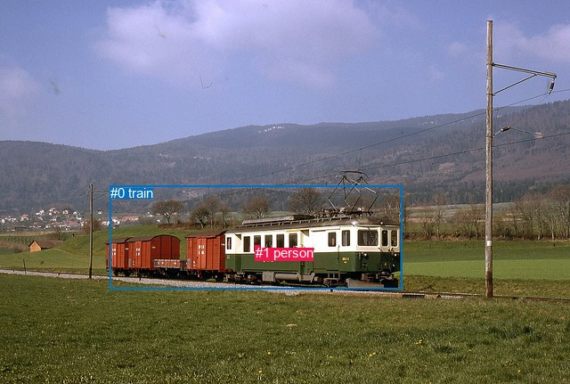
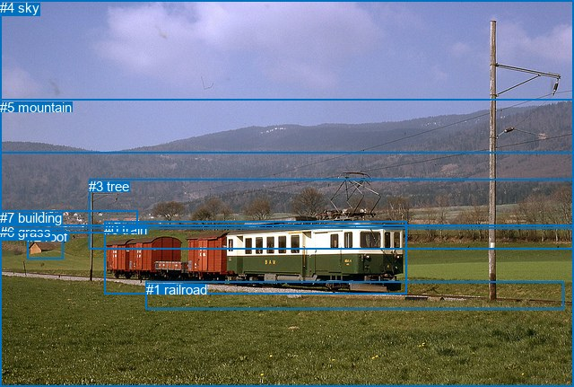

# 图片 0579：2341272.jpg

随机样本序号：169。图片 SHA256：`05045394108b6625e1032f812213ed369f187755fab7112a183fb21fcdfd05c4`。

红色框表示人，蓝色框表示其他物体。两个模式分别保留自身框编号，可依据位置比较对应对象。

## 自动检测框与输出

人的框编号：`[1]`。状态：`ok`。

### 自动检测全部物体框

| 编号 | 类别 | 是否为人 | 检测分数 | 像素坐标 xyxy |
|---|---|---|---|---|
| 0 | train | False | 0.9963 | 123.8, 208.1, 451.7, 324.0 |
| 1 | person | True | 0.7365 | 286.8, 275.3, 291.8, 282.2 |

### 自动检测 Top50 人相关候选

评分物体对：2；人相关物体对：2；输出关系：4。

| 排名 | 主语编号与类别 | 关系 | 宾语编号与类别 | 类型 | 人与人 | 排序分数 | 原始融合 logit |
|---|---|---|---|---|---|---|---|
| 1 | #1 person | on | #0 train | spatial | False | 0.97529 | 3.6756 |
| 2 | #1 person | riding | #0 train | semantic | False | 0.87666 | 1.9612 |
| 3 | #0 train | in | #1 person | spatial | False | 0.04561 | -3.0408 |
| 4 | #0 train | playing | #1 person | semantic | False | 0.00951 | -4.6454 |

### 自动检测逐条人相关 GT 核验

本图没有人相关 GT，R@50 无分母；预测候选继续展示。

## 真实框与输出

人的框编号：`[]`。

### 真实框全部物体框

| 编号 | 类别 | 是否为人 | 检测分数 | 像素坐标 xyxy |
|---|---|---|---|---|
| 0 | train | False | GT | 116.0, 247.0, 453.0, 328.0 |
| 1 | railroad | False | GT | 163.0, 314.0, 629.0, 345.0 |
| 2 | roof | False | GT | 30.0, 255.0, 70.0, 289.0 |
| 3 | tree | False | GT | 99.0, 199.0, 640.0, 277.0 |
| 4 | sky | False | GT | 0.0, 0.0, 640.0, 170.0 |
| 5 | mountain | False | GT | 0.0, 111.0, 640.0, 255.0 |
| 6 | grass | False | GT | 0.0, 250.0, 640.0, 431.0 |
| 7 | building | False | GT | 0.0, 234.0, 154.0, 259.0 |

### 真实框 Top50 人相关候选

评分物体对：0；人相关物体对：0；输出关系：0。

| 排名 | 主语编号与类别 | 关系 | 宾语编号与类别 | 类型 | 人与人 | 排序分数 | 原始融合 logit |
|---|---|---|---|---|---|---|---|

### 真实框逐条人相关 GT 核验

本图没有人相关 GT，R@50 无分母；预测候选继续展示。

## 全部人相关 GT

| 主语编号与类别 | 关系 | 宾语编号与类别 |
|---|---|---|

原始记录、全部人相关物体对的两项预测与分项分数见 [逐图证据 JSON](../evidence/cases/0579.json)。全部56类 logits 保留于本机 HOR/output/random500/logits/。

<!-- HOR_COMPLETE_RESULTS -->

## 六组条件的完整输出对照

以下保留同一图片三种框与候选模式、两种谓词输出规则的全部 Top50。框编号各自在所属模式内解释。

### 自动检测框完整枚举：空间与语义各保留一个谓词

| 排名 | 主语编号与类别 | 谓词 | 宾语编号与类别 | 分组 | 排序分数 | predicate logit | pair logit |
|---|---|---|---|---|---|---|---|
| 1 | #1 person | on | #0 train | spatial | 0.9752906 | 3.4482818 | 0.2272702 |
| 2 | #1 person | riding | #0 train | semantic | 0.8766579 | 1.7338848 | 0.2272702 |
| 3 | #0 train | in | #1 person | spatial | 0.0456145 | -2.7464199 | -0.2944228 |
| 4 | #0 train | playing | #1 person | semantic | 0.0095147 | -4.3509326 | -0.2944228 |

没有人相关 GT，本条件的召回率无分母。

### 自动检测框完整枚举：每对只保留一个谓词

| 排名 | 主语编号与类别 | 谓词 | 宾语编号与类别 | 分组 | 排序分数 | predicate logit | pair logit |
|---|---|---|---|---|---|---|---|
| 1 | #1 person | on | #0 train | single | 0.9752906 | 3.4482818 | 0.2272702 |
| 2 | #0 train | in | #1 person | single | 0.0456145 | -2.7464199 | -0.2944228 |

没有人相关 GT，本条件的召回率无分母。

### 真实框完整枚举：空间与语义各保留一个谓词

| 排名 | 主语编号与类别 | 谓词 | 宾语编号与类别 | 分组 | 排序分数 | predicate logit | pair logit |
|---|---|---|---|---|---|---|---|

没有人相关 GT，本条件的召回率无分母。

### 真实框完整枚举：每对只保留一个谓词

| 排名 | 主语编号与类别 | 谓词 | 宾语编号与类别 | 分组 | 排序分数 | predicate logit | pair logit |
|---|---|---|---|---|---|---|---|

没有人相关 GT，本条件的召回率无分母。

### 真实框400候选：空间与语义各保留一个谓词

| 排名 | 主语编号与类别 | 谓词 | 宾语编号与类别 | 分组 | 排序分数 | predicate logit | pair logit |
|---|---|---|---|---|---|---|---|

没有人相关 GT，本条件的召回率无分母。

### 真实框400候选：每对只保留一个谓词

| 排名 | 主语编号与类别 | 谓词 | 宾语编号与类别 | 分组 | 排序分数 | predicate logit | pair logit |
|---|---|---|---|---|---|---|---|

没有人相关 GT，本条件的召回率无分母。
