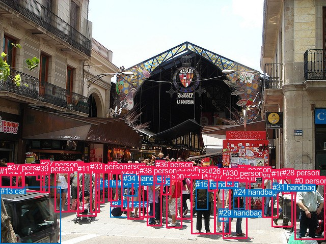
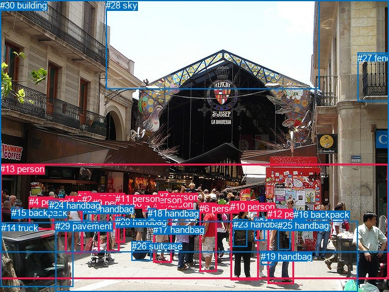

# 图片 0581：2341544.jpg

随机样本序号：380。图片 SHA256：`41f023e930039ac0be9173952f0942cf96be532cc5500f53a8bec2e9ef86bcd8`。

红色框表示人，蓝色框表示其他物体。两个模式分别保留自身框编号，可依据位置比较对应对象。

## 自动检测框与输出

人的框编号：`[0, 1, 2, 3, 4, 5, 6, 7, 9, 10, 11, 12, 14, 16, 17, 18, 21, 22, 23, 25, 26, 27, 28, 30, 32, 33, 35, 36, 37, 38, 39]`。状态：`ok`。

### 自动检测全部物体框

| 编号 | 类别 | 是否为人 | 检测分数 | 像素坐标 xyxy |
|---|---|---|---|---|
| 0 | person | True | 0.9954 | 578.8, 346.7, 638.1, 471.5 |
| 1 | person | True | 0.9882 | 375.9, 335.4, 422.1, 460.6 |
| 2 | person | True | 0.9875 | 437.8, 341.9, 486.0, 469.1 |
| 3 | person | True | 0.9838 | 107.1, 319.7, 136.5, 417.8 |
| 4 | person | True | 0.9704 | 515.2, 336.0, 546.1, 428.6 |
| 5 | person | True | 0.9677 | 467.2, 324.6, 491.5, 425.9 |
| 6 | person | True | 0.9646 | 326.4, 332.5, 357.4, 448.2 |
| 7 | person | True | 0.9634 | 421.5, 338.0, 452.9, 460.8 |
| 8 | suitcase | False | 0.9601 | 216.3, 393.8, 252.1, 427.4 |
| 9 | person | True | 0.9536 | 133.8, 317.9, 164.7, 416.4 |
| 10 | person | True | 0.9483 | 46.4, 322.9, 87.9, 377.8 |
| 11 | person | True | 0.9473 | 152.3, 323.4, 189.3, 425.7 |
| 12 | person | True | 0.9408 | 288.3, 336.9, 317.2, 444.2 |
| 13 | car | False | 0.9209 | 0.9, 367.1, 119.2, 480.0 |
| 14 | person | True | 0.9048 | 250.2, 328.5, 282.1, 431.6 |
| 15 | handbag | False | 0.8881 | 384.2, 354.4, 408.8, 412.8 |
| 16 | person | True | 0.8847 | 533.1, 332.9, 574.9, 446.5 |
| 17 | person | True | 0.8601 | 217.8, 325.2, 241.2, 406.5 |
| 18 | person | True | 0.8563 | 0.0, 328.3, 34.8, 368.9 |
| 19 | handbag | False | 0.8525 | 190.8, 351.3, 203.3, 372.8 |
| 20 | handbag | False | 0.8483 | 251.6, 347.7, 269.5, 386.1 |
| 21 | person | True | 0.8368 | 20.3, 328.0, 45.5, 370.7 |
| 22 | person | True | 0.8131 | 345.5, 325.6, 376.3, 431.4 |
| 23 | person | True | 0.8064 | 188.7, 321.0, 204.6, 399.2 |
| 24 | handbag | False | 0.7985 | 458.6, 369.2, 480.5, 410.2 |
| 25 | person | True | 0.7206 | 238.2, 327.8, 261.3, 414.1 |
| 26 | person | True | 0.6916 | 409.0, 328.0, 427.7, 376.3 |
| 27 | person | True | 0.6498 | 79.5, 314.8, 97.9, 379.4 |
| 28 | person | True | 0.6408 | 554.4, 331.5, 576.5, 381.6 |
| 29 | handbag | False | 0.5917 | 429.8, 410.5, 448.8, 435.3 |
| 30 | person | True | 0.5866 | 443.5, 331.6, 458.4, 366.6 |
| 31 | handbag | False | 0.5658 | 535.4, 359.7, 546.4, 380.5 |
| 32 | person | True | 0.5605 | 212.4, 318.2, 230.3, 395.6 |
| 33 | person | True | 0.5553 | 177.2, 319.2, 195.2, 418.1 |
| 34 | handbag | False | 0.5546 | 241.8, 342.3, 266.2, 385.9 |
| 35 | person | True | 0.5458 | 317.3, 323.2, 336.1, 383.9 |
| 36 | person | True | 0.5421 | 305.8, 315.0, 324.7, 362.8 |
| 37 | person | True | 0.5329 | 14.6, 320.6, 27.8, 346.8 |
| 38 | person | True | 0.5166 | 273.7, 326.8, 303.5, 427.2 |
| 39 | person | True | 0.5037 | 71.4, 323.2, 87.5, 354.8 |

### 自动检测 Top50 人相关候选

评分物体对：1560；人相关物体对：1488；输出关系：50。

| 排名 | 主语编号与类别 | 关系 | 宾语编号与类别 | 类型 | 人与人 | 排序分数 | 原始融合 logit |
|---|---|---|---|---|---|---|---|
| 1 | #1 person | wearing | #15 handbag | semantic | False | 0.98265 | 4.0369 |
| 2 | #14 person | wearing | #20 handbag | semantic | False | 0.97626 | 3.7165 |
| 3 | #25 person | wearing | #34 handbag | semantic | False | 0.97392 | 3.6201 |
| 4 | #23 person | carrying | #19 handbag | semantic | False | 0.97271 | 3.5734 |
| 5 | #4 person | wearing | #31 handbag | semantic | False | 0.97268 | 3.5723 |
| 6 | #16 person | wearing | #31 handbag | semantic | False | 0.96885 | 3.4372 |
| 7 | #2 person | wearing | #24 handbag | semantic | False | 0.96637 | 3.3580 |
| 8 | #7 person | holding | #29 handbag | semantic | False | 0.96026 | 3.1848 |
| 9 | #33 person | carrying | #19 handbag | semantic | False | 0.94556 | 2.8547 |
| 10 | #14 person | wearing | #34 handbag | semantic | False | 0.93774 | 2.7122 |
| 11 | #14 person | in | #20 handbag | spatial | False | 0.93526 | 2.6705 |
| 12 | #5 person | wearing | #24 handbag | semantic | False | 0.93398 | 2.6495 |
| 13 | #1 person | in | #15 handbag | spatial | False | 0.93299 | 2.6336 |
| 14 | #10 person | wearing | #39 person | semantic | True | 0.93281 | 2.6307 |
| 15 | #25 person | in | #34 handbag | spatial | False | 0.93149 | 2.6097 |
| 16 | #4 person | in | #31 handbag | spatial | False | 0.91467 | 2.3720 |
| 17 | #27 person | wearing | #39 person | semantic | True | 0.91181 | 2.3360 |
| 18 | #2 person | holding | #29 handbag | semantic | False | 0.91007 | 2.3145 |
| 19 | #16 person | wearing | #28 person | semantic | True | 0.90367 | 2.2386 |
| 20 | #23 person | in | #19 handbag | spatial | False | 0.89198 | 2.1111 |
| 21 | #16 person | in | #31 handbag | spatial | False | 0.89042 | 2.0950 |
| 22 | #25 person | wearing | #20 handbag | semantic | False | 0.88575 | 2.0480 |
| 23 | #2 person | in | #24 handbag | spatial | False | 0.88457 | 2.0365 |
| 24 | #16 person | in | #28 person | spatial | True | 0.86693 | 1.8741 |
| 25 | #10 person | in | #39 person | spatial | True | 0.85904 | 1.8073 |
| 26 | #18 person | wearing | #37 person | semantic | True | 0.85833 | 1.8015 |
| 27 | #14 person | in | #34 handbag | spatial | False | 0.85523 | 1.7762 |
| 28 | #17 person | pushing | #8 suitcase | semantic | False | 0.85433 | 1.7690 |
| 29 | #7 person | in | #29 handbag | spatial | False | 0.84433 | 1.6908 |
| 30 | #25 person | pushing | #8 suitcase | semantic | False | 0.84160 | 1.6702 |
| 31 | #21 person | wearing | #37 person | semantic | True | 0.83659 | 1.6331 |
| 32 | #18 person | in | #37 person | spatial | True | 0.82993 | 1.5851 |
| 33 | #33 person | pulling | #8 suitcase | semantic | False | 0.82910 | 1.5793 |
| 34 | #14 person | pushing | #8 suitcase | semantic | False | 0.82494 | 1.5502 |
| 35 | #11 person | pulling | #8 suitcase | semantic | False | 0.82436 | 1.5461 |
| 36 | #5 person | in | #24 handbag | spatial | False | 0.82216 | 1.5310 |
| 37 | #12 person | wearing | #36 person | semantic | True | 0.80191 | 1.3983 |
| 38 | #32 person | pushing | #8 suitcase | semantic | False | 0.77918 | 1.2609 |
| 39 | #33 person | pushing | #11 person | semantic | True | 0.77297 | 1.2252 |
| 40 | #6 person | wearing | #35 person | semantic | True | 0.76081 | 1.1571 |
| 41 | #25 person | in | #20 handbag | spatial | False | 0.75798 | 1.1416 |
| 42 | #2 person | in | #30 person | spatial | True | 0.74383 | 1.0660 |
| 43 | #9 person | pulling | #8 suitcase | semantic | False | 0.74241 | 1.0585 |
| 44 | #27 person | in | #39 person | spatial | True | 0.73975 | 1.0447 |
| 45 | #9 person | pushing | #11 person | semantic | True | 0.73456 | 1.0179 |
| 46 | #23 person | pulling | #8 suitcase | semantic | False | 0.73161 | 1.0028 |
| 47 | #7 person | in | #30 person | spatial | True | 0.73125 | 1.0010 |
| 48 | #21 person | wearing | #18 person | semantic | True | 0.72621 | 0.9755 |
| 49 | #21 person | in | #37 person | spatial | True | 0.68901 | 0.7955 |
| 50 | #38 person | pushing | #8 suitcase | semantic | False | 0.67402 | 0.7264 |

### 自动检测逐条人相关 GT 核验

R@50：0.00%；命中 0/2。

| GT 主语编号 | GT 关系 | GT 宾语编号 | 结果阶段 | 匹配预测主语编号 | 匹配预测宾语编号 |
|---|---|---|---|---|---|
| 6 | standing on | 29 | endpoint_missing_or_wrong_class | [6] | [] |
| 10 | carrying | 23 | wrong_predicate | [1] | [15] |

## 真实框与输出

人的框编号：`[0, 1, 2, 3, 4, 5, 6, 7, 8, 9, 10, 11, 12, 13]`。

### 真实框全部物体框

| 编号 | 类别 | 是否为人 | 检测分数 | 像素坐标 xyxy |
|---|---|---|---|---|
| 0 | person | True | GT | 128.0, 315.0, 148.0, 349.0 |
| 1 | person | True | GT | 107.0, 323.0, 135.0, 417.0 |
| 2 | person | True | GT | 135.0, 319.0, 164.0, 415.0 |
| 3 | person | True | GT | 252.0, 327.0, 283.0, 432.0 |
| 4 | person | True | GT | 48.0, 323.0, 89.0, 377.0 |
| 5 | person | True | GT | 176.0, 326.0, 196.0, 414.0 |
| 6 | person | True | GT | 328.0, 334.0, 356.0, 446.0 |
| 7 | person | True | GT | 261.0, 315.0, 277.0, 342.0 |
| 8 | person | True | GT | 234.0, 320.0, 250.0, 347.0 |
| 9 | person | True | GT | 152.0, 325.0, 189.0, 377.0 |
| 10 | person | True | GT | 379.0, 331.0, 425.0, 461.0 |
| 11 | person | True | GT | 190.0, 318.0, 205.0, 399.0 |
| 12 | person | True | GT | 440.0, 343.0, 483.0, 467.0 |
| 13 | person | True | GT | 0.0, 269.0, 640.0, 458.0 |
| 14 | truck | False | GT | 2.0, 366.0, 120.0, 472.0 |
| 15 | backpack | False | GT | 19.0, 341.0, 38.0, 359.0 |
| 16 | backpack | False | GT | 483.0, 344.0, 486.0, 366.0 |
| 17 | handbag | False | GT | 252.0, 369.0, 272.0, 386.0 |
| 18 | handbag | False | GT | 243.0, 342.0, 257.0, 370.0 |
| 19 | handbag | False | GT | 429.0, 413.0, 450.0, 436.0 |
| 20 | handbag | False | GT | 190.0, 356.0, 204.0, 374.0 |
| 21 | handbag | False | GT | 418.0, 357.0, 435.0, 395.0 |
| 22 | handbag | False | GT | 136.0, 335.0, 146.0, 363.0 |
| 23 | handbag | False | GT | 384.0, 360.0, 407.0, 405.0 |
| 24 | handbag | False | GT | 81.0, 329.0, 97.0, 352.0 |
| 25 | handbag | False | GT | 457.0, 362.0, 478.0, 410.0 |
| 26 | suitcase | False | GT | 217.0, 396.0, 249.0, 428.0 |
| 27 | fence | False | GT | 588.0, 87.0, 640.0, 167.0 |
| 28 | sky | False | GT | 174.0, 0.0, 525.0, 146.0 |
| 29 | pavement | False | GT | 91.0, 363.0, 589.0, 480.0 |
| 30 | building | False | GT | 0.0, 0.0, 640.0, 414.0 |

### 真实框 Top50 人相关候选

评分物体对：930；人相关物体对：658；输出关系：50。

| 排名 | 主语编号与类别 | 关系 | 宾语编号与类别 | 类型 | 人与人 | 排序分数 | 原始融合 logit |
|---|---|---|---|---|---|---|---|
| 1 | #13 person | walking on | #29 pavement | semantic | False | 0.98850 | 4.4534 |
| 2 | #10 person | wearing | #23 handbag | semantic | False | 0.98693 | 4.3244 |
| 3 | #11 person | carrying | #20 handbag | semantic | False | 0.98045 | 3.9148 |
| 4 | #3 person | wearing | #17 handbag | semantic | False | 0.97948 | 3.8657 |
| 5 | #12 person | wearing | #25 handbag | semantic | False | 0.97812 | 3.8002 |
| 6 | #5 person | carrying | #20 handbag | semantic | False | 0.97671 | 3.7363 |
| 7 | #6 person | standing on | #29 pavement | semantic | False | 0.97563 | 3.6897 |
| 8 | #10 person | walking on | #29 pavement | semantic | False | 0.97019 | 3.4826 |
| 9 | #2 person | wearing | #22 handbag | semantic | False | 0.96481 | 3.3112 |
| 10 | #3 person | standing on | #29 pavement | semantic | False | 0.96358 | 3.2755 |
| 11 | #12 person | standing on | #29 pavement | semantic | False | 0.96278 | 3.2530 |
| 12 | #12 person | holding | #19 handbag | semantic | False | 0.94705 | 2.8841 |
| 13 | #10 person | holding | #21 handbag | semantic | False | 0.94576 | 2.8586 |
| 14 | #2 person | walking on | #29 pavement | semantic | False | 0.93675 | 2.6954 |
| 15 | #9 person | walking on | #29 pavement | semantic | False | 0.93533 | 2.6715 |
| 16 | #13 person | on | #29 pavement | spatial | False | 0.93508 | 2.6675 |
| 17 | #1 person | walking on | #29 pavement | semantic | False | 0.93451 | 2.6582 |
| 18 | #5 person | pulling | #26 suitcase | semantic | False | 0.93034 | 2.5919 |
| 19 | #10 person | in | #23 handbag | spatial | False | 0.92571 | 2.5226 |
| 20 | #3 person | holding | #18 handbag | semantic | False | 0.91494 | 2.3756 |
| 21 | #3 person | in | #17 handbag | spatial | False | 0.90784 | 2.2876 |
| 22 | #8 person | carrying | #18 handbag | semantic | False | 0.90200 | 2.2196 |
| 23 | #5 person | walking on | #29 pavement | semantic | False | 0.89985 | 2.1955 |
| 24 | #3 person | pulling | #26 suitcase | semantic | False | 0.89456 | 2.1382 |
| 25 | #12 person | in | #25 handbag | spatial | False | 0.89378 | 2.1299 |
| 26 | #2 person | in | #22 handbag | spatial | False | 0.89176 | 2.1088 |
| 27 | #11 person | pulling | #26 suitcase | semantic | False | 0.88271 | 2.0183 |
| 28 | #11 person | in | #20 handbag | spatial | False | 0.88249 | 2.0162 |
| 29 | #11 person | walking on | #29 pavement | semantic | False | 0.87841 | 1.9775 |
| 30 | #4 person | carrying | #24 handbag | semantic | False | 0.87665 | 1.9611 |
| 31 | #2 person | pulling | #26 suitcase | semantic | False | 0.86511 | 1.8584 |
| 32 | #3 person | wearing | #7 person | semantic | True | 0.85393 | 1.7657 |
| 33 | #2 person | wearing | #0 person | semantic | True | 0.85197 | 1.7501 |
| 34 | #10 person | on | #29 pavement | spatial | False | 0.84868 | 1.7243 |
| 35 | #2 person | in | #0 person | spatial | True | 0.84414 | 1.6894 |
| 36 | #13 person | walking on | #30 building | semantic | False | 0.84411 | 1.6891 |
| 37 | #6 person | on | #29 pavement | spatial | False | 0.84306 | 1.6812 |
| 38 | #13 person | in front of | #30 building | spatial | False | 0.83525 | 1.6233 |
| 39 | #1 person | pulling | #26 suitcase | semantic | False | 0.83466 | 1.6190 |
| 40 | #11 person | pushing | #5 person | semantic | True | 0.82818 | 1.5728 |
| 41 | #12 person | on | #29 pavement | spatial | False | 0.82660 | 1.5617 |
| 42 | #8 person | in | #18 handbag | spatial | False | 0.79116 | 1.3319 |
| 43 | #3 person | in | #7 person | spatial | True | 0.78943 | 1.3215 |
| 44 | #9 person | pulling | #26 suitcase | semantic | False | 0.78526 | 1.2966 |
| 45 | #8 person | pulling | #26 suitcase | semantic | False | 0.78216 | 1.2783 |
| 46 | #3 person | on | #29 pavement | spatial | False | 0.77991 | 1.2651 |
| 47 | #9 person | carrying | #20 handbag | semantic | False | 0.77810 | 1.2546 |
| 48 | #4 person | walking on | #29 pavement | semantic | False | 0.76796 | 1.1968 |
| 49 | #0 person | wearing | #22 handbag | semantic | False | 0.76641 | 1.1882 |
| 50 | #3 person | in | #18 handbag | spatial | False | 0.76390 | 1.1742 |

### 真实框逐条人相关 GT 核验

R@50：50.00%；命中 1/2。

| GT 主语编号 | GT 关系 | GT 宾语编号 | 结果阶段 | 匹配预测主语编号 | 匹配预测宾语编号 |
|---|---|---|---|---|---|
| 6 | standing on | 29 | hit50 | [6] | [29] |
| 10 | carrying | 23 | wrong_predicate | [10] | [23] |

## 全部人相关 GT

| 主语编号与类别 | 关系 | 宾语编号与类别 |
|---|---|---|
| #6 person | standing on | #29 pavement |
| #10 person | carrying | #23 handbag |

原始记录、全部人相关物体对的两项预测与分项分数见 [逐图证据 JSON](../evidence/cases/0581.json)。全部56类 logits 保留于本机 HOR/output/random500/logits/。

<!-- HOR_COMPLETE_RESULTS -->

## 六组条件的完整输出对照

以下保留同一图片三种框与候选模式、两种谓词输出规则的全部 Top50。框编号各自在所属模式内解释。

### 自动检测框完整枚举：空间与语义各保留一个谓词

| 排名 | 主语编号与类别 | 谓词 | 宾语编号与类别 | 分组 | 排序分数 | predicate logit | pair logit |
|---|---|---|---|---|---|---|---|
| 1 | #1 person | wearing | #15 handbag | semantic | 0.9826544 | 3.7892251 | 0.2476901 |
| 2 | #14 person | wearing | #20 handbag | semantic | 0.9762581 | 3.7158036 | 0.0006796 |
| 3 | #25 person | wearing | #34 handbag | semantic | 0.9739177 | 3.6938357 | -0.0737672 |
| 4 | #23 person | carrying | #19 handbag | semantic | 0.9727052 | 3.5202823 | 0.0531042 |
| 5 | #4 person | wearing | #31 handbag | semantic | 0.9726759 | 3.2606764 | 0.3116055 |
| 6 | #16 person | wearing | #31 handbag | semantic | 0.9688470 | 3.1946268 | 0.2425711 |
| 7 | #2 person | wearing | #24 handbag | semantic | 0.9663662 | 3.3795381 | -0.0215261 |
| 8 | #7 person | holding | #29 handbag | semantic | 0.9602593 | 2.8019300 | 0.3828955 |
| 9 | #33 person | carrying | #19 handbag | semantic | 0.9455596 | 2.9328375 | -0.0781687 |
| 10 | #14 person | wearing | #34 handbag | semantic | 0.9377429 | 2.6999269 | 0.0122758 |
| 11 | #14 person | in | #20 handbag | spatial | 0.9352610 | 2.6697822 | 0.0006796 |
| 12 | #5 person | wearing | #24 handbag | semantic | 0.9339775 | 2.5515800 | 0.0978769 |
| 13 | #1 person | in | #15 handbag | spatial | 0.9329929 | 2.3859086 | 0.2476901 |
| 14 | #10 person | wearing | #39 person | semantic | 0.9328144 | 2.8070526 | -0.1763041 |
| 15 | #25 person | in | #34 handbag | spatial | 0.9314855 | 2.6835027 | -0.0737672 |
| 16 | #4 person | in | #31 handbag | spatial | 0.9146698 | 2.0604296 | 0.3116055 |
| 17 | #27 person | wearing | #39 person | semantic | 0.9118137 | 2.5193796 | -0.1833950 |
| 18 | #2 person | holding | #29 handbag | semantic | 0.9100727 | 1.9822502 | 0.3322723 |
| 19 | #16 person | wearing | #28 person | semantic | 0.9036666 | 2.2690234 | -0.0303776 |
| 20 | #23 person | in | #19 handbag | spatial | 0.8919779 | 2.0580010 | 0.0531042 |
| 21 | #16 person | in | #31 handbag | spatial | 0.8904175 | 1.8524418 | 0.2425711 |
| 22 | #25 person | wearing | #20 handbag | semantic | 0.8857492 | 2.1618972 | -0.1138597 |
| 23 | #2 person | in | #24 handbag | spatial | 0.8845738 | 2.0580010 | -0.0215261 |
| 24 | #16 person | in | #28 person | spatial | 0.8669263 | 1.9044280 | -0.0303776 |
| 25 | #10 person | in | #39 person | spatial | 0.8590412 | 1.9836531 | -0.1763041 |
| 26 | #18 person | wearing | #37 person | semantic | 0.8583254 | 1.7631941 | 0.0382563 |
| 27 | #14 person | in | #34 handbag | spatial | 0.8552301 | 1.7639489 | 0.0122758 |
| 28 | #17 person | pushing | #8 suitcase | semantic | 0.8543276 | 2.1622295 | -0.3932751 |
| 29 | #7 person | in | #29 handbag | spatial | 0.8443321 | 1.3079252 | 0.3828955 |
| 30 | #25 person | pushing | #8 suitcase | semantic | 0.8415973 | 2.0720196 | -0.4018588 |
| 31 | #21 person | wearing | #37 person | semantic | 0.8365919 | 1.6532068 | -0.0201213 |
| 32 | #18 person | in | #37 person | spatial | 0.8299299 | 1.5468745 | 0.0382563 |
| 33 | #33 person | pulling | #8 suitcase | semantic | 0.8291047 | 1.9220204 | -0.3427249 |
| 34 | #14 person | pushing | #8 suitcase | semantic | 0.8249411 | 1.8012037 | -0.2510147 |
| 35 | #11 person | pulling | #8 suitcase | semantic | 0.8243561 | 1.8919578 | -0.3458138 |
| 36 | #5 person | in | #24 handbag | spatial | 0.8221591 | 1.4331675 | 0.0978769 |
| 37 | #12 person | wearing | #36 person | semantic | 0.8019089 | 1.2135744 | 0.1846929 |
| 38 | #32 person | pushing | #8 suitcase | semantic | 0.7791848 | 1.6808801 | -0.4199581 |
| 39 | #33 person | pushing | #11 person | semantic | 0.7729738 | 2.1919475 | -0.9667677 |
| 40 | #6 person | wearing | #35 person | semantic | 0.7608134 | 1.0382156 | 0.1189287 |
| 41 | #25 person | in | #20 handbag | spatial | 0.7579795 | 1.2554936 | -0.1138597 |
| 42 | #2 person | in | #30 person | spatial | 0.7438281 | 1.1986094 | -0.1326477 |
| 43 | #9 person | pulling | #8 suitcase | semantic | 0.7424125 | 1.5007734 | -0.4422280 |
| 44 | #27 person | in | #39 person | spatial | 0.7397478 | 1.2280531 | -0.1833950 |
| 45 | #9 person | pushing | #11 person | semantic | 0.7345634 | 1.9512815 | -0.9333813 |
| 46 | #23 person | pulling | #8 suitcase | semantic | 0.7316094 | 1.3804679 | -0.3776644 |
| 47 | #7 person | in | #30 person | spatial | 0.7312461 | 1.0983791 | -0.0974253 |
| 48 | #21 person | wearing | #18 person | semantic | 0.7262106 | 1.2128224 | -0.2373418 |
| 49 | #21 person | in | #37 person | spatial | 0.6890106 | 0.8156190 | -0.0201213 |
| 50 | #38 person | pushing | #8 suitcase | semantic | 0.6740170 | 1.0187445 | -0.2923343 |

GT 命中：0/2，R@50=0.00%。

| GT主语 | GT谓词 | GT宾语 | 结果阶段 | 匹配主语框 | 匹配宾语框 |
|---|---|---|---|---|---|
| 6 | standing on | 29 | endpoint_missing_or_wrong_class | [6] | [] |
| 10 | carrying | 23 | wrong_predicate | [1] | [15] |

### 自动检测框完整枚举：每对只保留一个谓词

| 排名 | 主语编号与类别 | 谓词 | 宾语编号与类别 | 分组 | 排序分数 | predicate logit | pair logit |
|---|---|---|---|---|---|---|---|
| 1 | #1 person | wearing | #15 handbag | single | 0.9826544 | 3.7892251 | 0.2476901 |
| 2 | #14 person | wearing | #20 handbag | single | 0.9762581 | 3.7158036 | 0.0006796 |
| 3 | #25 person | wearing | #34 handbag | single | 0.9739177 | 3.6938357 | -0.0737672 |
| 4 | #23 person | carrying | #19 handbag | single | 0.9727052 | 3.5202823 | 0.0531042 |
| 5 | #4 person | wearing | #31 handbag | single | 0.9726759 | 3.2606764 | 0.3116055 |
| 6 | #16 person | wearing | #31 handbag | single | 0.9688470 | 3.1946268 | 0.2425711 |
| 7 | #2 person | wearing | #24 handbag | single | 0.9663662 | 3.3795381 | -0.0215261 |
| 8 | #7 person | holding | #29 handbag | single | 0.9602593 | 2.8019300 | 0.3828955 |
| 9 | #33 person | carrying | #19 handbag | single | 0.9455596 | 2.9328375 | -0.0781687 |
| 10 | #14 person | wearing | #34 handbag | single | 0.9377429 | 2.6999269 | 0.0122758 |
| 11 | #5 person | wearing | #24 handbag | single | 0.9339775 | 2.5515800 | 0.0978769 |
| 12 | #10 person | wearing | #39 person | single | 0.9328144 | 2.8070526 | -0.1763041 |
| 13 | #27 person | wearing | #39 person | single | 0.9118137 | 2.5193796 | -0.1833950 |
| 14 | #2 person | holding | #29 handbag | single | 0.9100727 | 1.9822502 | 0.3322723 |
| 15 | #16 person | wearing | #28 person | single | 0.9036666 | 2.2690234 | -0.0303776 |
| 16 | #25 person | wearing | #20 handbag | single | 0.8857492 | 2.1618972 | -0.1138597 |
| 17 | #18 person | wearing | #37 person | single | 0.8583254 | 1.7631941 | 0.0382563 |
| 18 | #17 person | pushing | #8 suitcase | single | 0.8543276 | 2.1622295 | -0.3932751 |
| 19 | #25 person | pushing | #8 suitcase | single | 0.8415973 | 2.0720196 | -0.4018588 |
| 20 | #21 person | wearing | #37 person | single | 0.8365919 | 1.6532068 | -0.0201213 |
| 21 | #33 person | pulling | #8 suitcase | single | 0.8291047 | 1.9220204 | -0.3427249 |
| 22 | #14 person | pushing | #8 suitcase | single | 0.8249411 | 1.8012037 | -0.2510147 |
| 23 | #11 person | pulling | #8 suitcase | single | 0.8243561 | 1.8919578 | -0.3458138 |
| 24 | #12 person | wearing | #36 person | single | 0.8019089 | 1.2135744 | 0.1846929 |
| 25 | #32 person | pushing | #8 suitcase | single | 0.7791848 | 1.6808801 | -0.4199581 |
| 26 | #33 person | pushing | #11 person | single | 0.7729738 | 2.1919475 | -0.9667677 |
| 27 | #6 person | wearing | #35 person | single | 0.7608134 | 1.0382156 | 0.1189287 |
| 28 | #2 person | in | #30 person | single | 0.7438281 | 1.1986094 | -0.1326477 |
| 29 | #9 person | pulling | #8 suitcase | single | 0.7424125 | 1.5007734 | -0.4422280 |
| 30 | #9 person | pushing | #11 person | single | 0.7345634 | 1.9512815 | -0.9333813 |
| 31 | #23 person | pulling | #8 suitcase | single | 0.7316094 | 1.3804679 | -0.3776644 |
| 32 | #7 person | in | #30 person | single | 0.7312461 | 1.0983791 | -0.0974253 |
| 33 | #21 person | wearing | #18 person | single | 0.7262106 | 1.2128224 | -0.2373418 |
| 34 | #38 person | pushing | #8 suitcase | single | 0.6740170 | 1.0187445 | -0.2923343 |
| 35 | #3 person | pulling | #8 suitcase | single | 0.6626471 | 1.1999068 | -0.5247936 |
| 36 | #1 person | wearing | #26 person | single | 0.6476473 | 0.9287620 | -0.3200482 |
| 37 | #17 person | wearing | #34 handbag | single | 0.5991032 | 0.4723501 | -0.0706204 |
| 38 | #28 person | wearing | #31 handbag | single | 0.5958194 | 0.4928875 | -0.1048117 |
| 39 | #38 person | wearing | #36 person | single | 0.5927870 | 0.1816697 | 0.1938291 |
| 40 | #18 person | wearing | #21 person | single | 0.5876157 | 0.5095940 | -0.1554766 |
| 41 | #32 person | carrying | #19 handbag | single | 0.5847562 | 0.3257837 | 0.0165455 |
| 42 | #38 person | wearing | #20 handbag | single | 0.5832986 | 0.2947359 | 0.0415934 |
| 43 | #12 person | pushing | #8 suitcase | single | 0.5604143 | 0.5674515 | -0.3246076 |
| 44 | #22 person | wearing | #15 handbag | single | 0.5527358 | 0.2683311 | -0.0566003 |
| 45 | #30 person | wearing | #24 handbag | single | 0.5512425 | 0.6990891 | -0.4933971 |
| 46 | #6 person | wearing | #36 person | single | 0.5426048 | -0.0252829 | 0.1961163 |
| 47 | #38 person | wearing | #34 handbag | single | 0.5367474 | 0.1053872 | 0.0418677 |
| 48 | #37 person | on | #18 person | single | 0.5248978 | 0.3755002 | -0.2758268 |
| 49 | #22 person | pulling | #8 suitcase | single | 0.5118769 | 0.7787309 | -0.7312143 |
| 50 | #26 person | wearing | #15 handbag | single | 0.5117393 | 0.3549190 | -0.3079534 |

GT 命中：0/2，R@50=0.00%。

| GT主语 | GT谓词 | GT宾语 | 结果阶段 | 匹配主语框 | 匹配宾语框 |
|---|---|---|---|---|---|
| 6 | standing on | 29 | endpoint_missing_or_wrong_class | [6] | [] |
| 10 | carrying | 23 | wrong_predicate | [1] | [15] |

### 真实框完整枚举：空间与语义各保留一个谓词

| 排名 | 主语编号与类别 | 谓词 | 宾语编号与类别 | 分组 | 排序分数 | predicate logit | pair logit |
|---|---|---|---|---|---|---|---|
| 1 | #13 person | walking on | #29 pavement | semantic | 0.9884951 | 4.4174504 | 0.0359546 |
| 2 | #10 person | wearing | #23 handbag | semantic | 0.9869320 | 4.0768991 | 0.2475374 |
| 3 | #11 person | carrying | #20 handbag | semantic | 0.9804457 | 3.8258538 | 0.0889548 |
| 4 | #3 person | wearing | #17 handbag | semantic | 0.9794815 | 3.7319045 | 0.1337963 |
| 5 | #12 person | wearing | #25 handbag | semantic | 0.9781235 | 3.7847161 | 0.0155054 |
| 6 | #5 person | carrying | #20 handbag | semantic | 0.9767120 | 3.6988988 | 0.0373530 |
| 7 | #6 person | standing on | #29 pavement | semantic | 0.9756294 | 3.7045999 | -0.0148958 |
| 8 | #10 person | walking on | #29 pavement | semantic | 0.9701896 | 3.5418363 | -0.0592021 |
| 9 | #2 person | wearing | #22 handbag | semantic | 0.9648106 | 3.3267264 | -0.0155407 |
| 10 | #3 person | standing on | #29 pavement | semantic | 0.9635803 | 3.2304850 | 0.0450596 |
| 11 | #12 person | standing on | #29 pavement | semantic | 0.9627798 | 3.3435063 | -0.0905347 |
| 12 | #12 person | holding | #19 handbag | semantic | 0.9470529 | 2.5091214 | 0.3749409 |
| 13 | #10 person | holding | #21 handbag | semantic | 0.9457609 | 2.7207279 | 0.1378608 |
| 14 | #2 person | walking on | #29 pavement | semantic | 0.9367534 | 2.6721997 | 0.0231788 |
| 15 | #9 person | walking on | #29 pavement | semantic | 0.9353253 | 2.6812177 | -0.0096941 |
| 16 | #13 person | on | #29 pavement | spatial | 0.9350789 | 2.6315036 | 0.0359546 |
| 17 | #1 person | walking on | #29 pavement | semantic | 0.9345123 | 2.6601720 | -0.0020107 |
| 18 | #5 person | pulling | #26 suitcase | semantic | 0.9303363 | 2.8848124 | -0.2929453 |
| 19 | #10 person | in | #23 handbag | spatial | 0.9257105 | 2.2750549 | 0.2475374 |
| 20 | #3 person | holding | #18 handbag | semantic | 0.9149444 | 2.2887311 | 0.0868263 |
| 21 | #3 person | in | #17 handbag | spatial | 0.9078444 | 2.1537991 | 0.1337963 |
| 22 | #8 person | carrying | #18 handbag | semantic | 0.9019970 | 2.4007149 | -0.1811021 |
| 23 | #5 person | walking on | #29 pavement | semantic | 0.8998488 | 2.1576524 | 0.0378932 |
| 24 | #3 person | pulling | #26 suitcase | semantic | 0.8945583 | 2.4335556 | -0.2953832 |
| 25 | #12 person | in | #25 handbag | spatial | 0.8937779 | 2.1144199 | 0.0155054 |
| 26 | #2 person | in | #22 handbag | spatial | 0.8917590 | 2.1243758 | -0.0155407 |
| 27 | #11 person | pulling | #26 suitcase | semantic | 0.8827094 | 2.4335046 | -0.4151631 |
| 28 | #11 person | in | #20 handbag | spatial | 0.8824865 | 1.9272351 | 0.0889548 |
| 29 | #11 person | walking on | #29 pavement | semantic | 0.8784106 | 1.9048944 | 0.0725700 |
| 30 | #4 person | carrying | #24 handbag | semantic | 0.8766477 | 2.1805563 | -0.2194959 |
| 31 | #2 person | pulling | #26 suitcase | semantic | 0.8651057 | 2.3131137 | -0.4547539 |
| 32 | #3 person | wearing | #7 person | semantic | 0.8539270 | 1.9041696 | -0.1384304 |
| 33 | #2 person | wearing | #0 person | semantic | 0.8519664 | 1.7045150 | 0.0455929 |
| 34 | #10 person | on | #29 pavement | spatial | 0.8486821 | 1.7835035 | -0.0592021 |
| 35 | #2 person | in | #0 person | spatial | 0.8441424 | 1.6437860 | 0.0455929 |
| 36 | #13 person | walking on | #30 building | semantic | 0.8441063 | 1.8928518 | -0.2037473 |
| 37 | #6 person | on | #29 pavement | spatial | 0.8430635 | 1.6960974 | -0.0148958 |
| 38 | #13 person | in front of | #30 building | spatial | 0.8352479 | 1.8270340 | -0.2037473 |
| 39 | #1 person | pulling | #26 suitcase | semantic | 0.8346599 | 2.1325951 | -0.5135751 |
| 40 | #11 person | pushing | #5 person | semantic | 0.8281789 | 2.3122368 | -0.7394610 |
| 41 | #12 person | on | #29 pavement | spatial | 0.8265993 | 1.6522493 | -0.0905347 |
| 42 | #8 person | in | #18 handbag | spatial | 0.7911609 | 1.5130396 | -0.1811021 |
| 43 | #3 person | in | #7 person | spatial | 0.7894294 | 1.4599199 | -0.1384304 |
| 44 | #9 person | pulling | #26 suitcase | semantic | 0.7852600 | 1.9219880 | -0.6254013 |
| 45 | #8 person | pulling | #26 suitcase | semantic | 0.7821579 | 2.0423102 | -0.7640243 |
| 46 | #3 person | on | #29 pavement | spatial | 0.7799099 | 1.2200818 | 0.0450596 |
| 47 | #9 person | carrying | #20 handbag | semantic | 0.7781023 | 1.2943292 | -0.0396875 |
| 48 | #4 person | walking on | #29 pavement | semantic | 0.7679621 | 1.1977568 | -0.0009172 |
| 49 | #0 person | wearing | #22 handbag | semantic | 0.7664137 | 1.5379581 | -0.3497877 |
| 50 | #3 person | in | #18 handbag | spatial | 0.7638956 | 1.0873308 | 0.0868263 |

GT 命中：1/2，R@50=50.00%。

| GT主语 | GT谓词 | GT宾语 | 结果阶段 | 匹配主语框 | 匹配宾语框 |
|---|---|---|---|---|---|
| 6 | standing on | 29 | hit50 | [6] | [29] |
| 10 | carrying | 23 | wrong_predicate | [10] | [23] |

### 真实框完整枚举：每对只保留一个谓词

| 排名 | 主语编号与类别 | 谓词 | 宾语编号与类别 | 分组 | 排序分数 | predicate logit | pair logit |
|---|---|---|---|---|---|---|---|
| 1 | #13 person | walking on | #29 pavement | single | 0.9884951 | 4.4174504 | 0.0359546 |
| 2 | #10 person | wearing | #23 handbag | single | 0.9869320 | 4.0768991 | 0.2475374 |
| 3 | #11 person | carrying | #20 handbag | single | 0.9804457 | 3.8258538 | 0.0889548 |
| 4 | #3 person | wearing | #17 handbag | single | 0.9794815 | 3.7319045 | 0.1337963 |
| 5 | #12 person | wearing | #25 handbag | single | 0.9781235 | 3.7847161 | 0.0155054 |
| 6 | #5 person | carrying | #20 handbag | single | 0.9767120 | 3.6988988 | 0.0373530 |
| 7 | #6 person | standing on | #29 pavement | single | 0.9756294 | 3.7045999 | -0.0148958 |
| 8 | #10 person | walking on | #29 pavement | single | 0.9701896 | 3.5418363 | -0.0592021 |
| 9 | #2 person | wearing | #22 handbag | single | 0.9648106 | 3.3267264 | -0.0155407 |
| 10 | #3 person | standing on | #29 pavement | single | 0.9635803 | 3.2304850 | 0.0450596 |
| 11 | #12 person | standing on | #29 pavement | single | 0.9627798 | 3.3435063 | -0.0905347 |
| 12 | #12 person | holding | #19 handbag | single | 0.9470529 | 2.5091214 | 0.3749409 |
| 13 | #10 person | holding | #21 handbag | single | 0.9457609 | 2.7207279 | 0.1378608 |
| 14 | #2 person | walking on | #29 pavement | single | 0.9367534 | 2.6721997 | 0.0231788 |
| 15 | #9 person | walking on | #29 pavement | single | 0.9353253 | 2.6812177 | -0.0096941 |
| 16 | #1 person | walking on | #29 pavement | single | 0.9345123 | 2.6601720 | -0.0020107 |
| 17 | #5 person | pulling | #26 suitcase | single | 0.9303363 | 2.8848124 | -0.2929453 |
| 18 | #3 person | holding | #18 handbag | single | 0.9149444 | 2.2887311 | 0.0868263 |
| 19 | #8 person | carrying | #18 handbag | single | 0.9019970 | 2.4007149 | -0.1811021 |
| 20 | #5 person | walking on | #29 pavement | single | 0.8998488 | 2.1576524 | 0.0378932 |
| 21 | #3 person | pulling | #26 suitcase | single | 0.8945583 | 2.4335556 | -0.2953832 |
| 22 | #11 person | pulling | #26 suitcase | single | 0.8827094 | 2.4335046 | -0.4151631 |
| 23 | #11 person | walking on | #29 pavement | single | 0.8784106 | 1.9048944 | 0.0725700 |
| 24 | #4 person | carrying | #24 handbag | single | 0.8766477 | 2.1805563 | -0.2194959 |
| 25 | #2 person | pulling | #26 suitcase | single | 0.8651057 | 2.3131137 | -0.4547539 |
| 26 | #3 person | wearing | #7 person | single | 0.8539270 | 1.9041696 | -0.1384304 |
| 27 | #2 person | wearing | #0 person | single | 0.8519664 | 1.7045150 | 0.0455929 |
| 28 | #13 person | walking on | #30 building | single | 0.8441063 | 1.8928518 | -0.2037473 |
| 29 | #1 person | pulling | #26 suitcase | single | 0.8346599 | 2.1325951 | -0.5135751 |
| 30 | #11 person | pushing | #5 person | single | 0.8281789 | 2.3122368 | -0.7394610 |
| 31 | #9 person | pulling | #26 suitcase | single | 0.7852600 | 1.9219880 | -0.6254013 |
| 32 | #8 person | pulling | #26 suitcase | single | 0.7821579 | 2.0423102 | -0.7640243 |
| 33 | #9 person | carrying | #20 handbag | single | 0.7781023 | 1.2943292 | -0.0396875 |
| 34 | #4 person | walking on | #29 pavement | single | 0.7679621 | 1.1977568 | -0.0009172 |
| 35 | #0 person | wearing | #22 handbag | single | 0.7664137 | 1.5379581 | -0.3497877 |
| 36 | #7 person | pulling | #26 suitcase | single | 0.7276664 | 1.8016057 | -0.8187909 |
| 37 | #0 person | pulling | #26 suitcase | single | 0.6816562 | 1.8015852 | -1.0401920 |
| 38 | #1 person | in | #0 person | single | 0.6446707 | 0.5441303 | 0.0515646 |
| 39 | #1 person | wearing | #22 handbag | single | 0.6245149 | 0.5266643 | -0.0179080 |
| 40 | #2 person | carrying | #9 person | single | 0.6179128 | 0.8753815 | -0.3946833 |
| 41 | #11 person | looking at | #30 building | single | 0.6037366 | 0.6719208 | -0.2508621 |
| 42 | #6 person | pulling | #26 suitcase | single | 0.5786820 | 0.9291358 | -0.6117706 |
| 43 | #7 person | wearing | #18 handbag | single | 0.5701564 | 0.5302777 | -0.2477886 |
| 44 | #5 person | carrying | #9 person | single | 0.5696000 | 0.8117042 | -0.5314851 |
| 45 | #7 person | standing on | #29 pavement | single | 0.5625187 | 0.4663777 | -0.2149873 |
| 46 | #2 person | in front of | #30 building | single | 0.5461517 | 0.6161847 | -0.4310509 |
| 47 | #1 person | in front of | #30 building | single | 0.5294635 | 0.5587597 | -0.4407688 |
| 48 | #7 person | wearing | #17 handbag | single | 0.5230653 | 0.5295982 | -0.4372715 |
| 49 | #4 person | pulling | #26 suitcase | single | 0.5145907 | 1.1998382 | -1.1414590 |
| 50 | #3 person | in front of | #30 building | single | 0.5114394 | 0.3184891 | -0.2727235 |

GT 命中：1/2，R@50=50.00%。

| GT主语 | GT谓词 | GT宾语 | 结果阶段 | 匹配主语框 | 匹配宾语框 |
|---|---|---|---|---|---|
| 6 | standing on | 29 | hit50 | [6] | [29] |
| 10 | carrying | 23 | wrong_predicate | [10] | [23] |

### 真实框400候选：空间与语义各保留一个谓词

| 排名 | 主语编号与类别 | 谓词 | 宾语编号与类别 | 分组 | 排序分数 | predicate logit | pair logit |
|---|---|---|---|---|---|---|---|
| 1 | #13 person | walking on | #29 pavement | semantic | 0.9890949 | 4.4716125 | 0.0359546 |
| 2 | #10 person | wearing | #23 handbag | semantic | 0.9867798 | 4.0651631 | 0.2475374 |
| 3 | #3 person | wearing | #17 handbag | semantic | 0.9812334 | 3.8229299 | 0.1337963 |
| 4 | #6 person | standing on | #29 pavement | semantic | 0.9807160 | 3.9439025 | -0.0148958 |
| 5 | #11 person | carrying | #20 handbag | semantic | 0.9802662 | 3.8165345 | 0.0889548 |
| 6 | #12 person | wearing | #25 handbag | semantic | 0.9788953 | 3.8214259 | 0.0155054 |
| 7 | #5 person | carrying | #20 handbag | semantic | 0.9778917 | 3.7520919 | 0.0373530 |
| 8 | #10 person | walking on | #29 pavement | semantic | 0.9771670 | 3.8156524 | -0.0592021 |
| 9 | #12 person | walking on | #29 pavement | semantic | 0.9736805 | 3.7013087 | -0.0905347 |
| 10 | #3 person | standing on | #29 pavement | semantic | 0.9725534 | 3.5226235 | 0.0450596 |
| 11 | #9 person | walking on | #29 pavement | semantic | 0.9713374 | 3.5327754 | -0.0096941 |
| 12 | #1 person | walking on | #29 pavement | semantic | 0.9672750 | 3.3883548 | -0.0020107 |
| 13 | #2 person | wearing | #22 handbag | semantic | 0.9662279 | 3.3693061 | -0.0155407 |
| 14 | #2 person | walking on | #29 pavement | semantic | 0.9639158 | 3.2619686 | 0.0231788 |
| 15 | #5 person | walking on | #29 pavement | semantic | 0.9450855 | 2.8076034 | 0.0378932 |
| 16 | #10 person | holding | #21 handbag | semantic | 0.9448445 | 2.7030025 | 0.1378608 |
| 17 | #12 person | holding | #19 handbag | semantic | 0.9221302 | 2.0967069 | 0.3749409 |
| 18 | #13 person | on | #29 pavement | spatial | 0.9179835 | 2.3793044 | 0.0359546 |
| 19 | #10 person | in | #23 handbag | spatial | 0.9156908 | 2.1376510 | 0.2475374 |
| 20 | #4 person | walking on | #29 pavement | semantic | 0.9145398 | 2.3712873 | -0.0009172 |
| 21 | #5 person | pulling | #26 suitcase | semantic | 0.9106059 | 2.6140003 | -0.2929453 |
| 22 | #3 person | holding | #18 handbag | semantic | 0.9059497 | 2.1783271 | 0.0868263 |
| 23 | #3 person | in | #17 handbag | spatial | 0.8993897 | 2.0566654 | 0.1337963 |
| 24 | #11 person | walking on | #29 pavement | semantic | 0.8978032 | 2.1004801 | 0.0725700 |
| 25 | #12 person | in | #25 handbag | spatial | 0.8908653 | 2.0841055 | 0.0155054 |
| 26 | #2 person | in | #22 handbag | spatial | 0.8871472 | 2.0774679 | -0.0155407 |
| 27 | #11 person | in | #20 handbag | spatial | 0.8789771 | 1.8938246 | 0.0889548 |
| 28 | #3 person | pulling | #26 suitcase | semantic | 0.8729741 | 2.2228980 | -0.2953832 |
| 29 | #8 person | carrying | #18 handbag | semantic | 0.8725128 | 2.1044631 | -0.1811021 |
| 30 | #4 person | carrying | #24 handbag | semantic | 0.8681349 | 2.1040630 | -0.2194959 |
| 31 | #10 person | on | #29 pavement | spatial | 0.8362890 | 1.6900735 | -0.0592021 |
| 32 | #13 person | in front of | #30 building | spatial | 0.8353743 | 1.8279524 | -0.2037473 |
| 33 | #2 person | in | #0 person | spatial | 0.8341703 | 1.5698833 | 0.0455929 |
| 34 | #2 person | wearing | #0 person | semantic | 0.8326837 | 1.5591750 | 0.0455929 |
| 35 | #11 person | pulling | #26 suitcase | semantic | 0.8316090 | 2.0122366 | -0.4151631 |
| 36 | #13 person | walking on | #30 building | semantic | 0.8276058 | 1.7725005 | -0.2037473 |
| 37 | #6 person | on | #29 pavement | spatial | 0.8263903 | 1.5751534 | -0.0148958 |
| 38 | #3 person | wearing | #7 person | semantic | 0.8262765 | 1.6978951 | -0.1384304 |
| 39 | #12 person | on | #29 pavement | spatial | 0.8233711 | 1.6298909 | -0.0905347 |
| 40 | #2 person | pulling | #26 suitcase | semantic | 0.8216237 | 1.9821410 | -0.4547539 |
| 41 | #3 person | in | #7 person | spatial | 0.7876951 | 1.4495182 | -0.1384304 |
| 42 | #3 person | on | #29 pavement | spatial | 0.7803024 | 1.2223697 | 0.0450596 |
| 43 | #11 person | pushing | #5 person | semantic | 0.7758759 | 1.9812536 | -0.7394610 |
| 44 | #1 person | in front of | #30 building | spatial | 0.7636079 | 1.6133313 | -0.4407688 |
| 45 | #1 person | pulling | #26 suitcase | semantic | 0.7627286 | 1.6812730 | -0.5135751 |
| 46 | #11 person | in front of | #30 building | spatial | 0.7614625 | 1.4115763 | -0.2508621 |
| 47 | #2 person | in front of | #30 building | spatial | 0.7484135 | 1.5212197 | -0.4310509 |
| 48 | #9 person | pulling | #26 suitcase | semantic | 0.7476168 | 1.7113433 | -0.6254013 |
| 49 | #5 person | in front of | #30 building | spatial | 0.7237176 | 1.3698449 | -0.4068675 |
| 50 | #11 person | walking on | #30 building | semantic | 0.7180615 | 1.1857285 | -0.2508621 |

GT 命中：1/2，R@50=50.00%。

| GT主语 | GT谓词 | GT宾语 | 结果阶段 | 匹配主语框 | 匹配宾语框 |
|---|---|---|---|---|---|
| 6 | standing on | 29 | hit50 | [6] | [29] |
| 10 | carrying | 23 | wrong_predicate | [10] | [23] |

### 真实框400候选：每对只保留一个谓词

| 排名 | 主语编号与类别 | 谓词 | 宾语编号与类别 | 分组 | 排序分数 | predicate logit | pair logit |
|---|---|---|---|---|---|---|---|
| 1 | #13 person | walking on | #29 pavement | single | 0.9890949 | 4.4716125 | 0.0359546 |
| 2 | #10 person | wearing | #23 handbag | single | 0.9867798 | 4.0651631 | 0.2475374 |
| 3 | #3 person | wearing | #17 handbag | single | 0.9812334 | 3.8229299 | 0.1337963 |
| 4 | #6 person | standing on | #29 pavement | single | 0.9807160 | 3.9439025 | -0.0148958 |
| 5 | #11 person | carrying | #20 handbag | single | 0.9802662 | 3.8165345 | 0.0889548 |
| 6 | #12 person | wearing | #25 handbag | single | 0.9788953 | 3.8214259 | 0.0155054 |
| 7 | #5 person | carrying | #20 handbag | single | 0.9778917 | 3.7520919 | 0.0373530 |
| 8 | #10 person | walking on | #29 pavement | single | 0.9771670 | 3.8156524 | -0.0592021 |
| 9 | #12 person | walking on | #29 pavement | single | 0.9736805 | 3.7013087 | -0.0905347 |
| 10 | #3 person | standing on | #29 pavement | single | 0.9725534 | 3.5226235 | 0.0450596 |
| 11 | #9 person | walking on | #29 pavement | single | 0.9713374 | 3.5327754 | -0.0096941 |
| 12 | #1 person | walking on | #29 pavement | single | 0.9672750 | 3.3883548 | -0.0020107 |
| 13 | #2 person | wearing | #22 handbag | single | 0.9662279 | 3.3693061 | -0.0155407 |
| 14 | #2 person | walking on | #29 pavement | single | 0.9639158 | 3.2619686 | 0.0231788 |
| 15 | #5 person | walking on | #29 pavement | single | 0.9450855 | 2.8076034 | 0.0378932 |
| 16 | #10 person | holding | #21 handbag | single | 0.9448445 | 2.7030025 | 0.1378608 |
| 17 | #12 person | holding | #19 handbag | single | 0.9221302 | 2.0967069 | 0.3749409 |
| 18 | #4 person | walking on | #29 pavement | single | 0.9145398 | 2.3712873 | -0.0009172 |
| 19 | #5 person | pulling | #26 suitcase | single | 0.9106059 | 2.6140003 | -0.2929453 |
| 20 | #3 person | holding | #18 handbag | single | 0.9059497 | 2.1783271 | 0.0868263 |
| 21 | #11 person | walking on | #29 pavement | single | 0.8978032 | 2.1004801 | 0.0725700 |
| 22 | #3 person | pulling | #26 suitcase | single | 0.8729741 | 2.2228980 | -0.2953832 |
| 23 | #8 person | carrying | #18 handbag | single | 0.8725128 | 2.1044631 | -0.1811021 |
| 24 | #4 person | carrying | #24 handbag | single | 0.8681349 | 2.1040630 | -0.2194959 |
| 25 | #13 person | in front of | #30 building | single | 0.8353743 | 1.8279524 | -0.2037473 |
| 26 | #2 person | in | #0 person | single | 0.8341703 | 1.5698833 | 0.0455929 |
| 27 | #11 person | pulling | #26 suitcase | single | 0.8316090 | 2.0122366 | -0.4151631 |
| 28 | #3 person | wearing | #7 person | single | 0.8262765 | 1.6978951 | -0.1384304 |
| 29 | #2 person | pulling | #26 suitcase | single | 0.8216237 | 1.9821410 | -0.4547539 |
| 30 | #11 person | pushing | #5 person | single | 0.7758759 | 1.9812536 | -0.7394610 |
| 31 | #1 person | in front of | #30 building | single | 0.7636079 | 1.6133313 | -0.4407688 |
| 32 | #1 person | pulling | #26 suitcase | single | 0.7627286 | 1.6812730 | -0.5135751 |
| 33 | #11 person | in front of | #30 building | single | 0.7614625 | 1.4115763 | -0.2508621 |
| 34 | #2 person | in front of | #30 building | single | 0.7484135 | 1.5212197 | -0.4310509 |
| 35 | #9 person | pulling | #26 suitcase | single | 0.7476168 | 1.7113433 | -0.6254013 |
| 36 | #5 person | in front of | #30 building | single | 0.7237176 | 1.3698449 | -0.4068675 |
| 37 | #3 person | in front of | #30 building | single | 0.6972558 | 1.1069875 | -0.2727235 |
| 38 | #9 person | carrying | #20 handbag | single | 0.6931577 | 0.8546109 | -0.0396875 |
| 39 | #0 person | in front of | #30 building | single | 0.6787937 | 1.6833167 | -0.9350831 |
| 40 | #9 person | in front of | #30 building | single | 0.6778045 | 1.2540746 | -0.5103741 |
| 41 | #4 person | in front of | #30 building | single | 0.6770465 | 1.2482543 | -0.5080225 |
| 42 | #8 person | in front of | #30 building | single | 0.6650188 | 1.3007078 | -0.6149671 |
| 43 | #10 person | in front of | #30 building | single | 0.6471355 | 1.0738339 | -0.4673623 |
| 44 | #13 person | pushing | #26 suitcase | single | 0.6334659 | 1.1995716 | -0.6524571 |
| 45 | #0 person | carrying | #22 handbag | single | 0.6317135 | 0.8893623 | -0.3497877 |
| 46 | #7 person | in front of | #30 building | single | 0.6277952 | 1.2116585 | -0.6888890 |
| 47 | #6 person | in front of | #30 building | single | 0.5713942 | 0.7486501 | -0.4611083 |
| 48 | #1 person | in | #0 person | single | 0.5326605 | 0.0792637 | 0.0515646 |
| 49 | #12 person | in front of | #30 building | single | 0.5094303 | 0.7115130 | -0.6737874 |
| 50 | #2 person | carrying | #9 person | single | 0.5015572 | 0.4009123 | -0.3946833 |

GT 命中：1/2，R@50=50.00%。

| GT主语 | GT谓词 | GT宾语 | 结果阶段 | 匹配主语框 | 匹配宾语框 |
|---|---|---|---|---|---|
| 6 | standing on | 29 | hit50 | [6] | [29] |
| 10 | carrying | 23 | wrong_predicate | [10] | [23] |
