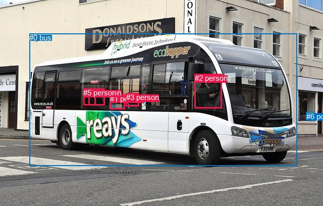
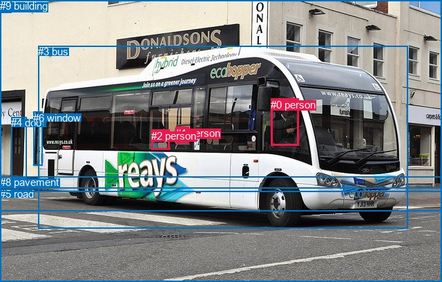

# 图片 0587：2341770.jpg

随机样本序号：457。图片 SHA256：`2c52fd5e534ee5c66268eac5c94f5ca16c27895d81461a0b664e776a235b2e02`。

红色框表示人，蓝色框表示其他物体。两个模式分别保留自身框编号，可依据位置比较对应对象。

## 自动检测框与输出

人的框编号：`[1, 2, 3, 4, 5]`。状态：`ok`。

### 自动检测全部物体框

| 编号 | 类别 | 是否为人 | 检测分数 | 像素坐标 xyxy |
|---|---|---|---|---|
| 0 | bus | False | 0.9998 | 58.4, 66.4, 588.1, 328.1 |
| 1 | person | True | 0.9879 | 218.2, 186.6, 247.6, 216.3 |
| 2 | person | True | 0.9858 | 385.9, 146.5, 439.2, 214.9 |
| 3 | person | True | 0.9352 | 249.9, 184.0, 275.4, 210.7 |
| 4 | person | True | 0.9091 | 175.2, 175.3, 207.9, 208.2 |
| 5 | person | True | 0.4202 | 165.0, 175.3, 189.8, 208.1 |
| 6 | potted plant | False | 0.3592 | 606.7, 221.8, 621.8, 238.8 |

### 自动检测 Top50 人相关候选

评分物体对：42；人相关物体对：40；输出关系：50。

| 排名 | 主语编号与类别 | 关系 | 宾语编号与类别 | 类型 | 人与人 | 排序分数 | 原始融合 logit |
|---|---|---|---|---|---|---|---|
| 1 | #2 person | driving on | #0 bus | semantic | False | 0.99641 | 5.6255 |
| 2 | #1 person | driving on | #0 bus | semantic | False | 0.98567 | 4.2310 |
| 3 | #3 person | riding | #0 bus | semantic | False | 0.98519 | 4.1975 |
| 4 | #5 person | riding | #0 bus | semantic | False | 0.97845 | 3.8155 |
| 5 | #4 person | riding | #0 bus | semantic | False | 0.97199 | 3.5469 |
| 6 | #2 person | in | #0 bus | spatial | False | 0.96810 | 3.4129 |
| 7 | #1 person | in | #0 bus | spatial | False | 0.96284 | 3.2547 |
| 8 | #3 person | in | #0 bus | spatial | False | 0.95969 | 3.1700 |
| 9 | #4 person | in | #0 bus | spatial | False | 0.93332 | 2.6388 |
| 10 | #5 person | in | #0 bus | spatial | False | 0.91837 | 2.4203 |
| 11 | #1 person | sitting on | #4 person | semantic | True | 0.46692 | -0.1325 |
| 12 | #4 person | in front of | #5 person | spatial | True | 0.38571 | -0.4654 |
| 13 | #3 person | beside | #1 person | spatial | True | 0.37277 | -0.5203 |
| 14 | #1 person | beside | #3 person | spatial | True | 0.30051 | -0.8449 |
| 15 | #1 person | sitting on | #5 person | semantic | True | 0.28080 | -0.9405 |
| 16 | #3 person | sitting on | #4 person | semantic | True | 0.25064 | -1.0952 |
| 17 | #0 bus | carrying | #3 person | semantic | False | 0.22180 | -1.2552 |
| 18 | #4 person | sitting on | #5 person | semantic | True | 0.22072 | -1.2615 |
| 19 | #0 bus | carrying | #1 person | semantic | False | 0.19570 | -1.4134 |
| 20 | #1 person | beside | #4 person | spatial | True | 0.17670 | -1.5389 |
| 21 | #0 bus | carrying | #2 person | semantic | False | 0.17379 | -1.5590 |
| 22 | #1 person | sitting on | #3 person | semantic | True | 0.16390 | -1.6295 |
| 23 | #5 person | in front of | #4 person | spatial | True | 0.15315 | -1.7101 |
| 24 | #3 person | sitting on | #5 person | semantic | True | 0.14375 | -1.7845 |
| 25 | #3 person | sitting on | #1 person | semantic | True | 0.12785 | -1.9201 |
| 26 | #5 person | sitting on | #4 person | semantic | True | 0.12540 | -1.9422 |
| 27 | #0 bus | carrying | #4 person | semantic | False | 0.11179 | -2.0726 |
| 28 | #1 person | beside | #5 person | spatial | True | 0.11104 | -2.0802 |
| 29 | #0 bus | carrying | #5 person | semantic | False | 0.09765 | -2.2236 |
| 30 | #4 person | beside | #1 person | spatial | True | 0.08662 | -2.3556 |
| 31 | #3 person | beside | #4 person | spatial | True | 0.04630 | -3.0252 |
| 32 | #2 person | looking at | #3 person | semantic | True | 0.04126 | -3.1458 |
| 33 | #2 person | looking at | #1 person | semantic | True | 0.03491 | -3.3194 |
| 34 | #5 person | beside | #1 person | spatial | True | 0.02532 | -3.6504 |
| 35 | #3 person | in | #5 person | spatial | True | 0.02506 | -3.6613 |
| 36 | #4 person | beside | #3 person | spatial | True | 0.02268 | -3.7634 |
| 37 | #3 person | sitting on | #6 potted plant | semantic | False | 0.02009 | -3.8874 |
| 38 | #1 person | sitting on | #6 potted plant | semantic | False | 0.01971 | -3.9068 |
| 39 | #3 person | looking at | #2 person | semantic | True | 0.01355 | -4.2880 |
| 40 | #4 person | sitting on | #1 person | semantic | True | 0.01243 | -4.3752 |
| 41 | #1 person | looking at | #2 person | semantic | True | 0.01039 | -4.5567 |
| 42 | #4 person | sitting on | #6 potted plant | semantic | False | 0.00988 | -4.6070 |
| 43 | #0 bus | beside | #5 person | spatial | False | 0.00950 | -4.6472 |
| 44 | #2 person | looking at | #4 person | semantic | True | 0.00875 | -4.7304 |
| 45 | #0 bus | beside | #2 person | spatial | False | 0.00819 | -4.7960 |
| 46 | #0 bus | beside | #4 person | spatial | False | 0.00729 | -4.9136 |
| 47 | #4 person | sitting on | #3 person | semantic | True | 0.00729 | -4.9137 |
| 48 | #5 person | sitting on | #6 potted plant | semantic | False | 0.00670 | -4.9992 |
| 49 | #2 person | beside | #3 person | spatial | True | 0.00638 | -5.0474 |
| 50 | #0 bus | on | #3 person | spatial | False | 0.00609 | -5.0958 |

### 自动检测逐条人相关 GT 核验

R@50：50.00%；命中 3/6。

| GT 主语编号 | GT 关系 | GT 宾语编号 | 结果阶段 | 匹配预测主语编号 | 匹配预测宾语编号 |
|---|---|---|---|---|---|
| 0 | in | 3 | hit50 | [2] | [0] |
| 0 | driving | 3 | wrong_predicate | [2] | [0] |
| 1 | in | 3 | hit50 | [3] | [0] |
| 1 | sitting on | 3 | wrong_predicate | [3] | [0] |
| 2 | in | 3 | hit50 | [1] | [0] |
| 2 | sitting on | 3 | wrong_predicate | [1] | [0] |

## 真实框与输出

人的框编号：`[0, 1, 2]`。

### 真实框全部物体框

| 编号 | 类别 | 是否为人 | 检测分数 | 像素坐标 xyxy |
|---|---|---|---|---|
| 0 | person | True | GT | 392.0, 143.0, 432.0, 211.0 |
| 1 | person | True | GT | 254.0, 184.0, 273.0, 207.0 |
| 2 | person | True | GT | 219.0, 188.0, 245.0, 217.0 |
| 3 | bus | False | GT | 55.0, 66.0, 590.0, 331.0 |
| 4 | door | False | GT | 16.0, 169.0, 38.0, 258.0 |
| 5 | road | False | GT | 0.0, 272.0, 640.0, 408.0 |
| 6 | window | False | GT | 48.0, 162.0, 62.0, 240.0 |
| 7 | sky | False | GT | 0.0, 0.0, 16.0, 18.0 |
| 8 | pavement | False | GT | 0.0, 255.0, 640.0, 305.0 |
| 9 | building | False | GT | 0.0, 0.0, 640.0, 278.0 |

### 真实框 Top50 人相关候选

评分物体对：90；人相关物体对：48；输出关系：50。

| 排名 | 主语编号与类别 | 关系 | 宾语编号与类别 | 类型 | 人与人 | 排序分数 | 原始融合 logit |
|---|---|---|---|---|---|---|---|
| 1 | #0 person | driving on | #3 bus | semantic | False | 0.99403 | 5.1150 |
| 2 | #2 person | driving on | #3 bus | semantic | False | 0.98744 | 4.3649 |
| 3 | #1 person | driving on | #3 bus | semantic | False | 0.98015 | 3.8996 |
| 4 | #0 person | in | #3 bus | spatial | False | 0.97931 | 3.8572 |
| 5 | #1 person | in | #3 bus | spatial | False | 0.97823 | 3.8050 |
| 6 | #2 person | in | #3 bus | spatial | False | 0.97708 | 3.7528 |
| 7 | #1 person | in | #9 building | spatial | False | 0.35292 | -0.6062 |
| 8 | #2 person | in | #9 building | spatial | False | 0.23147 | -1.2000 |
| 9 | #1 person | sitting on | #9 building | semantic | False | 0.22009 | -1.2652 |
| 10 | #2 person | sitting on | #1 person | semantic | True | 0.18489 | -1.4836 |
| 11 | #2 person | sitting on | #9 building | semantic | False | 0.16742 | -1.6040 |
| 12 | #1 person | walking on | #8 pavement | semantic | False | 0.15465 | -1.6986 |
| 13 | #0 person | walking on | #8 pavement | semantic | False | 0.12406 | -1.9546 |
| 14 | #2 person | walking on | #8 pavement | semantic | False | 0.12173 | -1.9762 |
| 15 | #0 person | in | #9 building | spatial | False | 0.11218 | -2.0687 |
| 16 | #3 bus | carrying | #0 person | semantic | False | 0.09655 | -2.2362 |
| 17 | #2 person | in | #1 person | spatial | True | 0.08077 | -2.4320 |
| 18 | #1 person | sitting on | #2 person | semantic | True | 0.07247 | -2.5493 |
| 19 | #3 bus | in | #1 person | spatial | False | 0.05992 | -2.7529 |
| 20 | #3 bus | in | #2 person | spatial | False | 0.05971 | -2.7567 |
| 21 | #0 person | crossing | #5 road | semantic | False | 0.05879 | -2.7732 |
| 22 | #2 person | driving on | #5 road | semantic | False | 0.05261 | -2.8909 |
| 23 | #1 person | on | #8 pavement | spatial | False | 0.05220 | -2.8991 |
| 24 | #3 bus | carrying | #1 person | semantic | False | 0.05125 | -2.9184 |
| 25 | #0 person | on | #8 pavement | spatial | False | 0.04611 | -3.0294 |
| 26 | #1 person | beside | #2 person | spatial | True | 0.04360 | -3.0882 |
| 27 | #0 person | sitting on | #9 building | semantic | False | 0.04124 | -3.1462 |
| 28 | #3 bus | carrying | #2 person | semantic | False | 0.03958 | -3.1891 |
| 29 | #2 person | on | #8 pavement | spatial | False | 0.03672 | -3.2670 |
| 30 | #1 person | crossing | #5 road | semantic | False | 0.03511 | -3.3136 |
| 31 | #0 person | on | #5 road | spatial | False | 0.03480 | -3.3227 |
| 32 | #0 person | looking at | #1 person | semantic | True | 0.03165 | -3.4210 |
| 33 | #2 person | in | #5 road | spatial | False | 0.02719 | -3.5774 |
| 34 | #1 person | on | #5 road | spatial | False | 0.02607 | -3.6205 |
| 35 | #0 person | looking at | #2 person | semantic | True | 0.02523 | -3.6541 |
| 36 | #3 bus | in | #0 person | spatial | False | 0.02342 | -3.7304 |
| 37 | #0 person | in | #1 person | spatial | True | 0.01630 | -4.1001 |
| 38 | #0 person | in | #2 person | spatial | True | 0.01379 | -4.2700 |
| 39 | #2 person | looking at | #0 person | semantic | True | 0.01294 | -4.3346 |
| 40 | #1 person | looking at | #0 person | semantic | True | 0.00981 | -4.6147 |
| 41 | #0 person | looking at | #7 sky | semantic | False | 0.00761 | -4.8709 |
| 42 | #0 person | standing on | #4 door | semantic | False | 0.00421 | -5.4662 |
| 43 | #1 person | on | #0 person | spatial | True | 0.00421 | -5.4669 |
| 44 | #0 person | in | #4 door | spatial | False | 0.00404 | -5.5075 |
| 45 | #2 person | in | #6 window | spatial | False | 0.00393 | -5.5364 |
| 46 | #2 person | sitting on | #4 door | semantic | False | 0.00381 | -5.5668 |
| 47 | #2 person | in | #0 person | spatial | True | 0.00344 | -5.6701 |
| 48 | #2 person | sitting on | #6 window | semantic | False | 0.00324 | -5.7297 |
| 49 | #0 person | in | #6 window | spatial | False | 0.00319 | -5.7455 |
| 50 | #1 person | in | #6 window | spatial | False | 0.00307 | -5.7823 |

### 真实框逐条人相关 GT 核验

R@50：50.00%；命中 3/6。

| GT 主语编号 | GT 关系 | GT 宾语编号 | 结果阶段 | 匹配预测主语编号 | 匹配预测宾语编号 |
|---|---|---|---|---|---|
| 0 | in | 3 | hit50 | [0] | [3] |
| 0 | driving | 3 | wrong_predicate | [0] | [3] |
| 1 | in | 3 | hit50 | [1] | [3] |
| 1 | sitting on | 3 | wrong_predicate | [1] | [3] |
| 2 | in | 3 | hit50 | [2] | [3] |
| 2 | sitting on | 3 | wrong_predicate | [2] | [3] |

## 全部人相关 GT

| 主语编号与类别 | 关系 | 宾语编号与类别 |
|---|---|---|
| #0 person | in | #3 bus |
| #0 person | driving | #3 bus |
| #1 person | in | #3 bus |
| #1 person | sitting on | #3 bus |
| #2 person | in | #3 bus |
| #2 person | sitting on | #3 bus |

原始记录、全部人相关物体对的两项预测与分项分数见 [逐图证据 JSON](../evidence/cases/0587.json)。全部56类 logits 保留于本机 HOR/output/random500/logits/。

<!-- HOR_COMPLETE_RESULTS -->

## 六组条件的完整输出对照

以下保留同一图片三种框与候选模式、两种谓词输出规则的全部 Top50。框编号各自在所属模式内解释。

### 自动检测框完整枚举：空间与语义各保留一个谓词

| 排名 | 主语编号与类别 | 谓词 | 宾语编号与类别 | 分组 | 排序分数 | predicate logit | pair logit |
|---|---|---|---|---|---|---|---|
| 1 | #2 person | driving on | #0 bus | semantic | 0.9964080 | 5.1078506 | 0.5176088 |
| 2 | #1 person | driving on | #0 bus | semantic | 0.9856706 | 3.8445334 | 0.3864742 |
| 3 | #3 person | riding | #0 bus | semantic | 0.9851901 | 3.7617631 | 0.4357764 |
| 4 | #5 person | riding | #0 bus | semantic | 0.9784479 | 3.6394439 | 0.1760464 |
| 5 | #4 person | riding | #0 bus | semantic | 0.9719937 | 3.3404860 | 0.2064342 |
| 6 | #2 person | in | #0 bus | spatial | 0.9681042 | 2.8952541 | 0.5176088 |
| 7 | #1 person | in | #0 bus | spatial | 0.9628428 | 2.8682590 | 0.3864742 |
| 8 | #3 person | in | #0 bus | spatial | 0.9596877 | 2.7341738 | 0.4357764 |
| 9 | #4 person | in | #0 bus | spatial | 0.9333177 | 2.4323711 | 0.2064342 |
| 10 | #5 person | in | #0 bus | spatial | 0.9183654 | 2.2442961 | 0.1760464 |
| 11 | #1 person | sitting on | #4 person | semantic | 0.4669231 | 0.2379870 | -0.3704882 |
| 12 | #4 person | in front of | #5 person | spatial | 0.3857132 | -0.0492744 | -0.4160935 |
| 13 | #3 person | beside | #1 person | spatial | 0.3727719 | 0.0322890 | -0.5526328 |
| 14 | #1 person | beside | #3 person | spatial | 0.3005080 | -0.4173450 | -0.4275352 |
| 15 | #1 person | sitting on | #5 person | semantic | 0.2807962 | -0.4646592 | -0.4758563 |
| 16 | #3 person | sitting on | #4 person | semantic | 0.2506446 | -0.5729747 | -0.5222028 |
| 17 | #0 bus | carrying | #3 person | semantic | 0.2218040 | -0.6186209 | -0.6365633 |
| 18 | #4 person | sitting on | #5 person | semantic | 0.2207206 | -0.8453782 | -0.4160935 |
| 19 | #0 bus | carrying | #1 person | semantic | 0.1956956 | -0.6159992 | -0.7974183 |
| 20 | #1 person | beside | #4 person | spatial | 0.1766953 | -1.1684117 | -0.3704882 |
| 21 | #0 bus | carrying | #2 person | semantic | 0.1737888 | -0.5074677 | -1.0515420 |
| 22 | #1 person | sitting on | #3 person | semantic | 0.1639008 | -1.2019506 | -0.4275352 |
| 23 | #5 person | in front of | #4 person | spatial | 0.1531518 | -1.2647121 | -0.4453795 |
| 24 | #3 person | sitting on | #5 person | semantic | 0.1437455 | -1.1582599 | -0.6262631 |
| 25 | #3 person | sitting on | #1 person | semantic | 0.1278547 | -1.3674285 | -0.5526328 |
| 26 | #5 person | sitting on | #4 person | semantic | 0.1254035 | -1.4968464 | -0.4453795 |
| 27 | #0 bus | carrying | #4 person | semantic | 0.1117863 | -1.5439775 | -0.5286462 |
| 28 | #1 person | beside | #5 person | spatial | 0.1110376 | -1.6043303 | -0.4758563 |
| 29 | #0 bus | carrying | #5 person | semantic | 0.0976538 | -1.7270555 | -0.4965141 |
| 30 | #4 person | beside | #1 person | spatial | 0.0866237 | -1.6223826 | -0.7331918 |
| 31 | #3 person | beside | #4 person | spatial | 0.0463019 | -2.5029619 | -0.5222028 |
| 32 | #2 person | looking at | #3 person | semantic | 0.0412567 | -2.0174770 | -1.1283338 |
| 33 | #2 person | looking at | #1 person | semantic | 0.0349102 | -2.1849833 | -1.1344584 |
| 34 | #5 person | beside | #1 person | spatial | 0.0253223 | -2.8081536 | -0.8422679 |
| 35 | #3 person | in | #5 person | spatial | 0.0250556 | -3.0350184 | -0.6262631 |
| 36 | #4 person | beside | #3 person | spatial | 0.0226776 | -3.0249562 | -0.7384843 |
| 37 | #3 person | sitting on | #6 potted plant | semantic | 0.0200872 | -2.5379188 | -1.3494601 |
| 38 | #1 person | sitting on | #6 potted plant | semantic | 0.0197078 | -2.6056201 | -1.3012179 |
| 39 | #3 person | looking at | #2 person | semantic | 0.0135469 | -3.1551104 | -1.1328487 |
| 40 | #4 person | sitting on | #1 person | semantic | 0.0124287 | -3.6420484 | -0.7331918 |
| 41 | #1 person | looking at | #2 person | semantic | 0.0103874 | -3.5137920 | -1.0429244 |
| 42 | #4 person | sitting on | #6 potted plant | semantic | 0.0098829 | -3.2917023 | -1.3153197 |
| 43 | #0 bus | beside | #5 person | spatial | 0.0094976 | -4.1506600 | -0.4965141 |
| 44 | #2 person | looking at | #4 person | semantic | 0.0087460 | -3.4441907 | -1.2861786 |
| 45 | #0 bus | beside | #2 person | spatial | 0.0081948 | -3.7444861 | -1.0515420 |
| 46 | #0 bus | beside | #4 person | spatial | 0.0072924 | -4.3849602 | -0.5286462 |
| 47 | #4 person | sitting on | #3 person | semantic | 0.0072917 | -4.1752138 | -0.7384843 |
| 48 | #5 person | sitting on | #6 potted plant | semantic | 0.0066980 | -3.6388822 | -1.3603400 |
| 49 | #2 person | beside | #3 person | spatial | 0.0063848 | -3.9190893 | -1.1283338 |
| 50 | #0 bus | on | #3 person | spatial | 0.0060852 | -4.4592352 | -0.6365633 |

GT 命中：3/6，R@50=50.00%。

| GT主语 | GT谓词 | GT宾语 | 结果阶段 | 匹配主语框 | 匹配宾语框 |
|---|---|---|---|---|---|
| 0 | in | 3 | hit50 | [2] | [0] |
| 0 | driving | 3 | wrong_predicate | [2] | [0] |
| 1 | in | 3 | hit50 | [3] | [0] |
| 1 | sitting on | 3 | wrong_predicate | [3] | [0] |
| 2 | in | 3 | hit50 | [1] | [0] |
| 2 | sitting on | 3 | wrong_predicate | [1] | [0] |

### 自动检测框完整枚举：每对只保留一个谓词

| 排名 | 主语编号与类别 | 谓词 | 宾语编号与类别 | 分组 | 排序分数 | predicate logit | pair logit |
|---|---|---|---|---|---|---|---|
| 1 | #2 person | driving on | #0 bus | single | 0.9964080 | 5.1078506 | 0.5176088 |
| 2 | #1 person | driving on | #0 bus | single | 0.9856706 | 3.8445334 | 0.3864742 |
| 3 | #3 person | riding | #0 bus | single | 0.9851901 | 3.7617631 | 0.4357764 |
| 4 | #5 person | riding | #0 bus | single | 0.9784479 | 3.6394439 | 0.1760464 |
| 5 | #4 person | riding | #0 bus | single | 0.9719937 | 3.3404860 | 0.2064342 |
| 6 | #1 person | sitting on | #4 person | single | 0.4669231 | 0.2379870 | -0.3704882 |
| 7 | #4 person | in front of | #5 person | single | 0.3857132 | -0.0492744 | -0.4160935 |
| 8 | #3 person | beside | #1 person | single | 0.3727719 | 0.0322890 | -0.5526328 |
| 9 | #1 person | beside | #3 person | single | 0.3005080 | -0.4173450 | -0.4275352 |
| 10 | #1 person | sitting on | #5 person | single | 0.2807962 | -0.4646592 | -0.4758563 |
| 11 | #3 person | sitting on | #4 person | single | 0.2506446 | -0.5729747 | -0.5222028 |
| 12 | #0 bus | carrying | #3 person | single | 0.2218040 | -0.6186209 | -0.6365633 |
| 13 | #0 bus | carrying | #1 person | single | 0.1956956 | -0.6159992 | -0.7974183 |
| 14 | #0 bus | carrying | #2 person | single | 0.1737888 | -0.5074677 | -1.0515420 |
| 15 | #5 person | in front of | #4 person | single | 0.1531518 | -1.2647121 | -0.4453795 |
| 16 | #3 person | sitting on | #5 person | single | 0.1437455 | -1.1582599 | -0.6262631 |
| 17 | #0 bus | carrying | #4 person | single | 0.1117863 | -1.5439775 | -0.5286462 |
| 18 | #0 bus | carrying | #5 person | single | 0.0976538 | -1.7270555 | -0.4965141 |
| 19 | #4 person | beside | #1 person | single | 0.0866237 | -1.6223826 | -0.7331918 |
| 20 | #2 person | looking at | #3 person | single | 0.0412567 | -2.0174770 | -1.1283338 |
| 21 | #2 person | looking at | #1 person | single | 0.0349102 | -2.1849833 | -1.1344584 |
| 22 | #5 person | beside | #1 person | single | 0.0253223 | -2.8081536 | -0.8422679 |
| 23 | #4 person | beside | #3 person | single | 0.0226776 | -3.0249562 | -0.7384843 |
| 24 | #3 person | sitting on | #6 potted plant | single | 0.0200872 | -2.5379188 | -1.3494601 |
| 25 | #1 person | sitting on | #6 potted plant | single | 0.0197078 | -2.6056201 | -1.3012179 |
| 26 | #3 person | looking at | #2 person | single | 0.0135469 | -3.1551104 | -1.1328487 |
| 27 | #1 person | looking at | #2 person | single | 0.0103874 | -3.5137920 | -1.0429244 |
| 28 | #4 person | sitting on | #6 potted plant | single | 0.0098829 | -3.2917023 | -1.3153197 |
| 29 | #2 person | looking at | #4 person | single | 0.0087460 | -3.4441907 | -1.2861786 |
| 30 | #5 person | sitting on | #6 potted plant | single | 0.0066980 | -3.6388822 | -1.3603400 |
| 31 | #2 person | looking at | #6 potted plant | single | 0.0057831 | -3.0226517 | -2.1243563 |
| 32 | #2 person | looking at | #5 person | single | 0.0048853 | -3.9238203 | -1.3928071 |
| 33 | #5 person | beside | #3 person | single | 0.0042778 | -4.6000514 | -0.8499850 |
| 34 | #6 potted plant | in | #5 person | single | 0.0042599 | -3.8340354 | -1.6202025 |
| 35 | #6 potted plant | in | #4 person | single | 0.0042435 | -3.8765161 | -1.5816011 |
| 36 | #6 potted plant | sitting on | #3 person | single | 0.0028573 | -4.2319779 | -1.6230270 |
| 37 | #6 potted plant | sitting on | #1 person | single | 0.0024731 | -4.3596907 | -1.6401186 |
| 38 | #4 person | looking at | #2 person | single | 0.0015669 | -5.0106845 | -1.4463954 |
| 39 | #6 potted plant | beside | #2 person | single | 0.0015239 | -4.3937492 | -2.0912280 |
| 40 | #5 person | looking at | #2 person | single | 0.0005804 | -5.9106598 | -1.5404855 |

GT 命中：0/6，R@50=0.00%。

| GT主语 | GT谓词 | GT宾语 | 结果阶段 | 匹配主语框 | 匹配宾语框 |
|---|---|---|---|---|---|
| 0 | in | 3 | wrong_predicate | [2] | [0] |
| 0 | driving | 3 | wrong_predicate | [2] | [0] |
| 1 | in | 3 | wrong_predicate | [3] | [0] |
| 1 | sitting on | 3 | wrong_predicate | [3] | [0] |
| 2 | in | 3 | wrong_predicate | [1] | [0] |
| 2 | sitting on | 3 | wrong_predicate | [1] | [0] |

### 真实框完整枚举：空间与语义各保留一个谓词

| 排名 | 主语编号与类别 | 谓词 | 宾语编号与类别 | 分组 | 排序分数 | predicate logit | pair logit |
|---|---|---|---|---|---|---|---|
| 1 | #0 person | driving on | #3 bus | semantic | 0.9940301 | 4.6270318 | 0.4880030 |
| 2 | #2 person | driving on | #3 bus | semantic | 0.9874440 | 3.9651961 | 0.3997225 |
| 3 | #1 person | driving on | #3 bus | semantic | 0.9801516 | 3.4840980 | 0.4154856 |
| 4 | #0 person | in | #3 bus | spatial | 0.9793098 | 3.3691859 | 0.4880030 |
| 5 | #1 person | in | #3 bus | spatial | 0.9782261 | 3.3895440 | 0.4154856 |
| 6 | #2 person | in | #3 bus | spatial | 0.9770846 | 3.3530374 | 0.3997225 |
| 7 | #1 person | in | #9 building | spatial | 0.3529179 | 0.3011947 | -0.9074326 |
| 8 | #2 person | in | #9 building | spatial | 0.2314666 | -0.2802730 | -0.9197755 |
| 9 | #1 person | sitting on | #9 building | semantic | 0.2200858 | -0.3577337 | -0.9074326 |
| 10 | #2 person | sitting on | #1 person | semantic | 0.1848857 | -1.0724928 | -0.4110974 |
| 11 | #2 person | sitting on | #9 building | semantic | 0.1674246 | -0.6842151 | -0.9197755 |
| 12 | #1 person | walking on | #8 pavement | semantic | 0.1546530 | -0.2903042 | -1.4082590 |
| 13 | #0 person | walking on | #8 pavement | semantic | 0.1240573 | -0.8228869 | -1.1316705 |
| 14 | #2 person | walking on | #8 pavement | semantic | 0.1217261 | -0.6408620 | -1.3353233 |
| 15 | #0 person | in | #9 building | spatial | 0.1121791 | -0.8480811 | -1.2205927 |
| 16 | #3 bus | carrying | #0 person | semantic | 0.0965454 | -1.1599376 | -1.0762753 |
| 17 | #2 person | in | #1 person | spatial | 0.0807665 | -2.0208809 | -0.4110974 |
| 18 | #1 person | sitting on | #2 person | semantic | 0.0724744 | -1.9737840 | -0.5755036 |
| 19 | #3 bus | in | #1 person | spatial | 0.0599205 | -2.1210349 | -0.6319116 |
| 20 | #3 bus | in | #2 person | spatial | 0.0597068 | -1.9812531 | -0.7754925 |
| 21 | #0 person | crossing | #5 road | semantic | 0.0587919 | -1.7617013 | -1.0114596 |
| 22 | #2 person | driving on | #5 road | semantic | 0.0526067 | -1.6605616 | -1.2303100 |
| 23 | #1 person | on | #8 pavement | spatial | 0.0522004 | -1.4907944 | -1.4082590 |
| 24 | #3 bus | carrying | #1 person | semantic | 0.0512511 | -2.2864947 | -0.6319116 |
| 25 | #0 person | on | #8 pavement | spatial | 0.0461130 | -1.8977795 | -1.1316705 |
| 26 | #1 person | beside | #2 person | spatial | 0.0435970 | -2.5126874 | -0.5755036 |
| 27 | #0 person | sitting on | #9 building | semantic | 0.0412430 | -1.9255629 | -1.2205927 |
| 28 | #3 bus | carrying | #2 person | semantic | 0.0395764 | -2.4136498 | -0.7754925 |
| 29 | #2 person | on | #8 pavement | spatial | 0.0367197 | -1.9317081 | -1.3353233 |
| 30 | #1 person | crossing | #5 road | semantic | 0.0351087 | -2.0041773 | -1.3093899 |
| 31 | #0 person | on | #5 road | spatial | 0.0348009 | -2.3112302 | -1.0114596 |
| 32 | #0 person | looking at | #1 person | semantic | 0.0316468 | -2.2805846 | -1.1403755 |
| 33 | #2 person | in | #5 road | spatial | 0.0271892 | -2.3470583 | -1.2303100 |
| 34 | #1 person | on | #5 road | spatial | 0.0260716 | -2.3111031 | -1.3093899 |
| 35 | #0 person | looking at | #2 person | semantic | 0.0252323 | -2.4925745 | -1.1615010 |
| 36 | #3 bus | in | #0 person | spatial | 0.0234206 | -2.6541629 | -1.0762753 |
| 37 | #0 person | in | #1 person | spatial | 0.0163008 | -2.9597297 | -1.1403755 |
| 38 | #0 person | in | #2 person | spatial | 0.0137886 | -3.1085267 | -1.1615010 |
| 39 | #2 person | looking at | #0 person | semantic | 0.0129371 | -3.2919698 | -1.0426680 |
| 40 | #1 person | looking at | #0 person | semantic | 0.0098085 | -3.4746363 | -1.1400162 |
| 41 | #0 person | looking at | #7 sky | semantic | 0.0076085 | -2.7723727 | -2.0984817 |
| 42 | #0 person | standing on | #4 door | semantic | 0.0042096 | -3.8059506 | -1.6602197 |
| 43 | #1 person | on | #0 person | spatial | 0.0042066 | -4.3268652 | -1.1400162 |
| 44 | #0 person | in | #4 door | spatial | 0.0040397 | -3.8473153 | -1.6602197 |
| 45 | #2 person | in | #6 window | spatial | 0.0039252 | -3.4580059 | -2.0784030 |
| 46 | #2 person | sitting on | #4 door | semantic | 0.0038080 | -3.4301491 | -2.1366861 |
| 47 | #2 person | in | #0 person | spatial | 0.0034357 | -4.6274290 | -1.0426680 |
| 48 | #2 person | sitting on | #6 window | semantic | 0.0032374 | -3.6513271 | -2.0784030 |
| 49 | #0 person | in | #6 window | spatial | 0.0031871 | -4.0519795 | -1.6934786 |
| 50 | #1 person | in | #6 window | spatial | 0.0030722 | -3.5670843 | -2.2151866 |

GT 命中：3/6，R@50=50.00%。

| GT主语 | GT谓词 | GT宾语 | 结果阶段 | 匹配主语框 | 匹配宾语框 |
|---|---|---|---|---|---|
| 0 | in | 3 | hit50 | [0] | [3] |
| 0 | driving | 3 | wrong_predicate | [0] | [3] |
| 1 | in | 3 | hit50 | [1] | [3] |
| 1 | sitting on | 3 | wrong_predicate | [1] | [3] |
| 2 | in | 3 | hit50 | [2] | [3] |
| 2 | sitting on | 3 | wrong_predicate | [2] | [3] |

### 真实框完整枚举：每对只保留一个谓词

| 排名 | 主语编号与类别 | 谓词 | 宾语编号与类别 | 分组 | 排序分数 | predicate logit | pair logit |
|---|---|---|---|---|---|---|---|
| 1 | #0 person | driving on | #3 bus | single | 0.9940301 | 4.6270318 | 0.4880030 |
| 2 | #2 person | driving on | #3 bus | single | 0.9874440 | 3.9651961 | 0.3997225 |
| 3 | #1 person | driving on | #3 bus | single | 0.9801516 | 3.4840980 | 0.4154856 |
| 4 | #1 person | in | #9 building | single | 0.3529179 | 0.3011947 | -0.9074326 |
| 5 | #2 person | in | #9 building | single | 0.2314666 | -0.2802730 | -0.9197755 |
| 6 | #2 person | sitting on | #1 person | single | 0.1848857 | -1.0724928 | -0.4110974 |
| 7 | #1 person | walking on | #8 pavement | single | 0.1546530 | -0.2903042 | -1.4082590 |
| 8 | #0 person | walking on | #8 pavement | single | 0.1240573 | -0.8228869 | -1.1316705 |
| 9 | #2 person | walking on | #8 pavement | single | 0.1217261 | -0.6408620 | -1.3353233 |
| 10 | #0 person | in | #9 building | single | 0.1121791 | -0.8480811 | -1.2205927 |
| 11 | #3 bus | carrying | #0 person | single | 0.0965454 | -1.1599376 | -1.0762753 |
| 12 | #1 person | sitting on | #2 person | single | 0.0724744 | -1.9737840 | -0.5755036 |
| 13 | #3 bus | in | #1 person | single | 0.0599205 | -2.1210349 | -0.6319116 |
| 14 | #3 bus | in | #2 person | single | 0.0597068 | -1.9812531 | -0.7754925 |
| 15 | #0 person | crossing | #5 road | single | 0.0587919 | -1.7617013 | -1.0114596 |
| 16 | #2 person | driving on | #5 road | single | 0.0526067 | -1.6605616 | -1.2303100 |
| 17 | #1 person | crossing | #5 road | single | 0.0351087 | -2.0041773 | -1.3093899 |
| 18 | #0 person | looking at | #1 person | single | 0.0316468 | -2.2805846 | -1.1403755 |
| 19 | #0 person | looking at | #2 person | single | 0.0252323 | -2.4925745 | -1.1615010 |
| 20 | #2 person | looking at | #0 person | single | 0.0129371 | -3.2919698 | -1.0426680 |
| 21 | #1 person | looking at | #0 person | single | 0.0098085 | -3.4746363 | -1.1400162 |
| 22 | #0 person | looking at | #7 sky | single | 0.0076085 | -2.7723727 | -2.0984817 |
| 23 | #0 person | standing on | #4 door | single | 0.0042096 | -3.8059506 | -1.6602197 |
| 24 | #2 person | in | #6 window | single | 0.0039252 | -3.4580059 | -2.0784030 |
| 25 | #2 person | sitting on | #4 door | single | 0.0038080 | -3.4301491 | -2.1366861 |
| 26 | #0 person | in | #6 window | single | 0.0031871 | -4.0519795 | -1.6934786 |
| 27 | #1 person | in | #6 window | single | 0.0030722 | -3.5670843 | -2.2151866 |
| 28 | #2 person | looking at | #7 sky | single | 0.0027766 | -3.3341432 | -2.5495992 |
| 29 | #1 person | sitting on | #4 door | single | 0.0027605 | -3.6580868 | -2.2314835 |
| 30 | #7 sky | over | #2 person | single | 0.0027325 | -4.0437565 | -1.8560309 |
| 31 | #1 person | looking at | #7 sky | single | 0.0023209 | -3.4790215 | -2.5844419 |
| 32 | #7 sky | over | #1 person | single | 0.0021670 | -4.1642151 | -1.9680314 |
| 33 | #7 sky | over | #0 person | single | 0.0019110 | -4.3641839 | -1.8940336 |
| 34 | #6 window | on | #0 person | single | 0.0008126 | -5.0450153 | -2.0694478 |
| 35 | #6 window | on | #2 person | single | 0.0006989 | -5.0909085 | -2.1744168 |
| 36 | #6 window | on | #1 person | single | 0.0006746 | -5.0392156 | -2.2615581 |
| 37 | #4 door | beside | #0 person | single | 0.0006494 | -5.3123183 | -2.0264781 |
| 38 | #9 building | in | #1 person | single | 0.0006107 | -5.7604418 | -1.6398120 |
| 39 | #9 building | beside | #0 person | single | 0.0005133 | -5.6268425 | -1.9473096 |
| 40 | #9 building | in | #2 person | single | 0.0004907 | -5.8790359 | -1.7401223 |
| 41 | #4 door | looking at | #2 person | single | 0.0003945 | -5.5515504 | -2.2858253 |
| 42 | #4 door | on | #1 person | single | 0.0003760 | -5.5420346 | -2.3435721 |
| 43 | #5 road | in | #1 person | single | 0.0003260 | -6.0928774 | -1.9354025 |
| 44 | #5 road | in | #2 person | single | 0.0002934 | -6.1669445 | -1.9667175 |
| 45 | #8 pavement | in | #1 person | single | 0.0002876 | -5.8814645 | -2.2722645 |
| 46 | #8 pavement | in | #2 person | single | 0.0002598 | -5.9457397 | -2.3095665 |
| 47 | #5 road | in | #0 person | single | 0.0001786 | -6.2899604 | -2.3399849 |
| 48 | #8 pavement | in | #0 person | single | 0.0001759 | -6.0689783 | -2.5766554 |

GT 命中：0/6，R@50=0.00%。

| GT主语 | GT谓词 | GT宾语 | 结果阶段 | 匹配主语框 | 匹配宾语框 |
|---|---|---|---|---|---|
| 0 | in | 3 | wrong_predicate | [0] | [3] |
| 0 | driving | 3 | wrong_predicate | [0] | [3] |
| 1 | in | 3 | wrong_predicate | [1] | [3] |
| 1 | sitting on | 3 | wrong_predicate | [1] | [3] |
| 2 | in | 3 | wrong_predicate | [2] | [3] |
| 2 | sitting on | 3 | wrong_predicate | [2] | [3] |

### 真实框400候选：空间与语义各保留一个谓词

| 排名 | 主语编号与类别 | 谓词 | 宾语编号与类别 | 分组 | 排序分数 | predicate logit | pair logit |
|---|---|---|---|---|---|---|---|
| 1 | #0 person | driving on | #3 bus | semantic | 0.9940301 | 4.6270318 | 0.4880030 |
| 2 | #2 person | driving on | #3 bus | semantic | 0.9866759 | 3.9050412 | 0.3997225 |
| 3 | #1 person | driving on | #3 bus | semantic | 0.9801516 | 3.4840980 | 0.4154856 |
| 4 | #0 person | in | #3 bus | spatial | 0.9793098 | 3.3691859 | 0.4880030 |
| 5 | #1 person | in | #3 bus | spatial | 0.9783670 | 3.3961816 | 0.4154856 |
| 6 | #2 person | in | #3 bus | spatial | 0.9770846 | 3.3530374 | 0.3997225 |
| 7 | #1 person | in | #9 building | spatial | 0.3598197 | 0.3312855 | -0.9074326 |
| 8 | #2 person | in | #9 building | spatial | 0.2261570 | -0.3103642 | -0.9197755 |
| 9 | #1 person | sitting on | #9 building | semantic | 0.2250324 | -0.3291445 | -0.9074326 |
| 10 | #2 person | sitting on | #1 person | semantic | 0.1817327 | -1.0935547 | -0.4110974 |
| 11 | #2 person | sitting on | #9 building | semantic | 0.1606174 | -0.7338662 | -0.9197755 |
| 12 | #1 person | walking on | #8 pavement | semantic | 0.1507598 | -0.3203950 | -1.4082590 |
| 13 | #2 person | walking on | #8 pavement | semantic | 0.1217261 | -0.6408620 | -1.3353233 |
| 14 | #0 person | walking on | #8 pavement | semantic | 0.1208242 | -0.8529782 | -1.1316705 |
| 15 | #0 person | in | #9 building | spatial | 0.1150421 | -0.8196490 | -1.2205927 |
| 16 | #3 bus | carrying | #0 person | semantic | 0.0965454 | -1.1599376 | -1.0762753 |
| 17 | #2 person | in | #1 person | spatial | 0.0796565 | -2.0359266 | -0.4110974 |
| 18 | #1 person | sitting on | #2 person | semantic | 0.0724744 | -1.9737840 | -0.5755036 |
| 19 | #3 bus | in | #1 person | spatial | 0.0615542 | -2.0923955 | -0.6319116 |
| 20 | #3 bus | in | #2 person | spatial | 0.0597534 | -1.9804235 | -0.7754925 |
| 21 | #0 person | crossing | #5 road | semantic | 0.0579670 | -1.7767072 | -1.0114596 |
| 22 | #2 person | driving on | #5 road | semantic | 0.0511276 | -1.6906393 | -1.2303100 |
| 23 | #1 person | on | #8 pavement | spatial | 0.0510603 | -1.5140798 | -1.4082590 |
| 24 | #3 bus | carrying | #1 person | semantic | 0.0506364 | -2.2992103 | -0.6319116 |
| 25 | #0 person | on | #8 pavement | spatial | 0.0457402 | -1.9062870 | -1.1316705 |
| 26 | #1 person | beside | #2 person | spatial | 0.0435970 | -2.5126874 | -0.5755036 |
| 27 | #0 person | sitting on | #9 building | semantic | 0.0420235 | -1.9060025 | -1.2205927 |
| 28 | #3 bus | carrying | #2 person | semantic | 0.0395764 | -2.4136498 | -0.7754925 |
| 29 | #2 person | on | #8 pavement | spatial | 0.0365515 | -1.9364722 | -1.3353233 |
| 30 | #1 person | crossing | #5 road | semantic | 0.0356195 | -1.9892027 | -1.3093899 |
| 31 | #0 person | on | #5 road | spatial | 0.0342991 | -2.3262756 | -1.0114596 |
| 32 | #0 person | looking at | #1 person | semantic | 0.0316521 | -2.2804101 | -1.1403755 |
| 33 | #2 person | in | #5 road | spatial | 0.0267941 | -2.3621037 | -1.2303100 |
| 34 | #1 person | on | #5 road | spatial | 0.0261538 | -2.3078704 | -1.3093899 |
| 35 | #0 person | looking at | #2 person | semantic | 0.0255985 | -2.4777901 | -1.1615010 |
| 36 | #3 bus | in | #0 person | spatial | 0.0234206 | -2.6541629 | -1.0762753 |
| 37 | #0 person | in | #1 person | spatial | 0.0164765 | -2.9488325 | -1.1403755 |
| 38 | #0 person | in | #2 person | spatial | 0.0138565 | -3.1035485 | -1.1615010 |
| 39 | #2 person | looking at | #0 person | semantic | 0.0130312 | -3.2846215 | -1.0426680 |
| 40 | #1 person | looking at | #0 person | semantic | 0.0098102 | -3.4744620 | -1.1400162 |
| 41 | #0 person | looking at | #7 sky | semantic | 0.0074983 | -2.7870698 | -2.0984817 |
| 42 | #1 person | on | #0 person | spatial | 0.0042470 | -4.3172641 | -1.1400162 |
| 43 | #0 person | standing on | #4 door | semantic | 0.0041892 | -3.8108339 | -1.6602197 |
| 44 | #0 person | in | #4 door | spatial | 0.0040464 | -3.8456559 | -1.6602197 |
| 45 | #2 person | sitting on | #4 door | semantic | 0.0038728 | -3.4132218 | -2.1366861 |
| 46 | #2 person | in | #6 window | spatial | 0.0038345 | -3.4814596 | -2.0784030 |
| 47 | #2 person | in | #0 person | spatial | 0.0035022 | -4.6081791 | -1.0426680 |
| 48 | #0 person | in | #6 window | spatial | 0.0032111 | -4.0444565 | -1.6934786 |
| 49 | #2 person | sitting on | #6 window | semantic | 0.0032000 | -3.6629887 | -2.0784030 |
| 50 | #1 person | in | #6 window | spatial | 0.0030851 | -3.5628800 | -2.2151866 |

GT 命中：3/6，R@50=50.00%。

| GT主语 | GT谓词 | GT宾语 | 结果阶段 | 匹配主语框 | 匹配宾语框 |
|---|---|---|---|---|---|
| 0 | in | 3 | hit50 | [0] | [3] |
| 0 | driving | 3 | wrong_predicate | [0] | [3] |
| 1 | in | 3 | hit50 | [1] | [3] |
| 1 | sitting on | 3 | wrong_predicate | [1] | [3] |
| 2 | in | 3 | hit50 | [2] | [3] |
| 2 | sitting on | 3 | wrong_predicate | [2] | [3] |

### 真实框400候选：每对只保留一个谓词

| 排名 | 主语编号与类别 | 谓词 | 宾语编号与类别 | 分组 | 排序分数 | predicate logit | pair logit |
|---|---|---|---|---|---|---|---|
| 1 | #0 person | driving on | #3 bus | single | 0.9940301 | 4.6270318 | 0.4880030 |
| 2 | #2 person | driving on | #3 bus | single | 0.9866759 | 3.9050412 | 0.3997225 |
| 3 | #1 person | driving on | #3 bus | single | 0.9801516 | 3.4840980 | 0.4154856 |
| 4 | #1 person | in | #9 building | single | 0.3598197 | 0.3312855 | -0.9074326 |
| 5 | #2 person | in | #9 building | single | 0.2261570 | -0.3103642 | -0.9197755 |
| 6 | #2 person | sitting on | #1 person | single | 0.1817327 | -1.0935547 | -0.4110974 |
| 7 | #1 person | walking on | #8 pavement | single | 0.1507598 | -0.3203950 | -1.4082590 |
| 8 | #2 person | walking on | #8 pavement | single | 0.1217261 | -0.6408620 | -1.3353233 |
| 9 | #0 person | walking on | #8 pavement | single | 0.1208242 | -0.8529782 | -1.1316705 |
| 10 | #0 person | in | #9 building | single | 0.1150421 | -0.8196490 | -1.2205927 |
| 11 | #3 bus | carrying | #0 person | single | 0.0965454 | -1.1599376 | -1.0762753 |
| 12 | #1 person | sitting on | #2 person | single | 0.0724744 | -1.9737840 | -0.5755036 |
| 13 | #3 bus | in | #1 person | single | 0.0615542 | -2.0923955 | -0.6319116 |
| 14 | #3 bus | in | #2 person | single | 0.0597534 | -1.9804235 | -0.7754925 |
| 15 | #0 person | crossing | #5 road | single | 0.0579670 | -1.7767072 | -1.0114596 |
| 16 | #2 person | driving on | #5 road | single | 0.0511276 | -1.6906393 | -1.2303100 |
| 17 | #1 person | crossing | #5 road | single | 0.0356195 | -1.9892027 | -1.3093899 |
| 18 | #0 person | looking at | #1 person | single | 0.0316521 | -2.2804101 | -1.1403755 |
| 19 | #0 person | looking at | #2 person | single | 0.0255985 | -2.4777901 | -1.1615010 |
| 20 | #2 person | looking at | #0 person | single | 0.0130312 | -3.2846215 | -1.0426680 |
| 21 | #1 person | looking at | #0 person | single | 0.0098102 | -3.4744620 | -1.1400162 |
| 22 | #0 person | looking at | #7 sky | single | 0.0074983 | -2.7870698 | -2.0984817 |
| 23 | #0 person | standing on | #4 door | single | 0.0041892 | -3.8108339 | -1.6602197 |
| 24 | #2 person | sitting on | #4 door | single | 0.0038728 | -3.4132218 | -2.1366861 |
| 25 | #2 person | in | #6 window | single | 0.0038345 | -3.4814596 | -2.0784030 |
| 26 | #0 person | in | #6 window | single | 0.0032111 | -4.0444565 | -1.6934786 |
| 27 | #1 person | in | #6 window | single | 0.0030851 | -3.5628800 | -2.2151866 |
| 28 | #2 person | looking at | #7 sky | single | 0.0027766 | -3.3341432 | -2.5495992 |
| 29 | #1 person | sitting on | #4 door | single | 0.0027605 | -3.6580868 | -2.2314835 |
| 30 | #7 sky | over | #2 person | single | 0.0026918 | -4.0588017 | -1.8560309 |
| 31 | #1 person | looking at | #7 sky | single | 0.0022527 | -3.5089383 | -2.5844419 |
| 32 | #7 sky | over | #1 person | single | 0.0021940 | -4.1518135 | -1.9680314 |
| 33 | #7 sky | over | #0 person | single | 0.0019042 | -4.3677406 | -1.8940336 |
| 34 | #6 window | on | #0 person | single | 0.0008244 | -5.0306139 | -2.0694478 |
| 35 | #6 window | on | #2 person | single | 0.0006984 | -5.0915532 | -2.1744168 |
| 36 | #4 door | beside | #0 person | single | 0.0006717 | -5.2785382 | -2.0264781 |
| 37 | #6 window | on | #1 person | single | 0.0006613 | -5.0590615 | -2.2615581 |
| 38 | #9 building | in | #1 person | single | 0.0006016 | -5.7754874 | -1.6398120 |
| 39 | #9 building | beside | #0 person | single | 0.0005133 | -5.6268425 | -1.9473096 |
| 40 | #9 building | in | #2 person | single | 0.0004922 | -5.8761044 | -1.7401223 |
| 41 | #4 door | looking at | #2 person | single | 0.0003991 | -5.5401793 | -2.2858253 |
| 42 | #4 door | on | #1 person | single | 0.0003682 | -5.5628252 | -2.3435721 |
| 43 | #5 road | in | #1 person | single | 0.0003230 | -6.1020594 | -1.9354025 |
| 44 | #5 road | in | #2 person | single | 0.0002891 | -6.1816030 | -1.9667175 |
| 45 | #8 pavement | in | #1 person | single | 0.0002866 | -5.8847833 | -2.2722645 |
| 46 | #8 pavement | in | #2 person | single | 0.0002606 | -5.9428082 | -2.3095665 |
| 47 | #5 road | in | #0 person | single | 0.0001766 | -6.3016872 | -2.3399849 |
| 48 | #8 pavement | in | #0 person | single | 0.0001753 | -6.0722971 | -2.5766554 |

GT 命中：0/6，R@50=0.00%。

| GT主语 | GT谓词 | GT宾语 | 结果阶段 | 匹配主语框 | 匹配宾语框 |
|---|---|---|---|---|---|
| 0 | in | 3 | wrong_predicate | [0] | [3] |
| 0 | driving | 3 | wrong_predicate | [0] | [3] |
| 1 | in | 3 | wrong_predicate | [1] | [3] |
| 1 | sitting on | 3 | wrong_predicate | [1] | [3] |
| 2 | in | 3 | wrong_predicate | [2] | [3] |
| 2 | sitting on | 3 | wrong_predicate | [2] | [3] |
