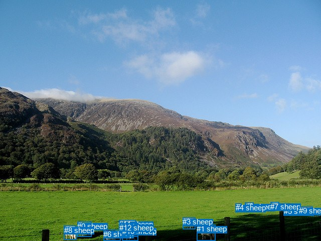
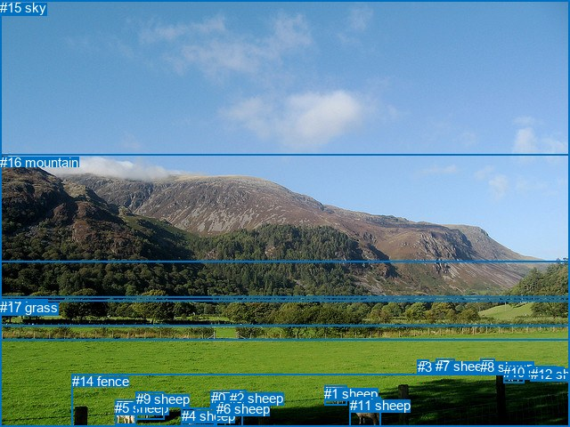

# 图片 0592：2341960.jpg

随机样本序号：111。图片 SHA256：`5d7b99aa59e8bf434b3f57bdca2da11ba4ccca26d81d2ace37846dfc3b25ad44`。

红色框表示人，蓝色框表示其他物体。两个模式分别保留自身框编号，可依据位置比较对应对象。

## 自动检测框与输出

人的框编号：`[]`。状态：`no_person`。

### 自动检测全部物体框

| 编号 | 类别 | 是否为人 | 检测分数 | 像素坐标 xyxy |
|---|---|---|---|---|
| 0 | sheep | False | 0.9961 | 154.4, 441.8, 182.4, 472.0 |
| 1 | sheep | False | 0.9941 | 392.2, 447.1, 429.1, 479.3 |
| 2 | sheep | False | 0.9856 | 488.9, 403.3, 505.3, 416.0 |
| 3 | sheep | False | 0.9846 | 364.3, 433.4, 389.2, 456.5 |
| 4 | sheep | False | 0.9826 | 469.6, 405.1, 481.7, 419.4 |
| 5 | sheep | False | 0.9732 | 565.5, 412.3, 586.7, 429.7 |
| 6 | sheep | False | 0.9730 | 206.5, 458.0, 240.7, 480.0 |
| 7 | sheep | False | 0.9720 | 539.5, 402.8, 556.5, 415.7 |
| 8 | sheep | False | 0.9539 | 127.7, 449.7, 152.8, 477.8 |
| 9 | sheep | False | 0.9403 | 595.8, 411.3, 623.2, 428.8 |
| 10 | sheep | False | 0.9189 | 243.5, 451.9, 275.7, 479.8 |
| 11 | sheep | False | 0.8934 | 237.0, 438.4, 270.6, 457.5 |
| 12 | sheep | False | 0.7945 | 238.3, 444.7, 275.7, 471.6 |

### 自动检测 Top50 人相关候选

评分物体对：0；人相关物体对：0；输出关系：0。

| 排名 | 主语编号与类别 | 关系 | 宾语编号与类别 | 类型 | 人与人 | 排序分数 | 原始融合 logit |
|---|---|---|---|---|---|---|---|

### 自动检测逐条人相关 GT 核验

本图没有人相关 GT，R@50 无分母；预测候选继续展示。

## 真实框与输出

人的框编号：`[]`。

### 真实框全部物体框

| 编号 | 类别 | 是否为人 | 检测分数 | 像素坐标 xyxy |
|---|---|---|---|---|
| 0 | sheep | False | GT | 237.0, 439.0, 269.0, 457.0 |
| 1 | sheep | False | GT | 364.0, 434.0, 389.0, 456.0 |
| 2 | sheep | False | GT | 258.0, 439.0, 277.0, 459.0 |
| 3 | sheep | False | GT | 469.0, 404.0, 482.0, 420.0 |
| 4 | sheep | False | GT | 204.0, 459.0, 241.0, 479.0 |
| 5 | sheep | False | GT | 129.0, 450.0, 152.0, 478.0 |
| 6 | sheep | False | GT | 243.0, 451.0, 272.0, 480.0 |
| 7 | sheep | False | GT | 489.0, 403.0, 510.0, 418.0 |
| 8 | sheep | False | GT | 539.0, 404.0, 555.0, 415.0 |
| 9 | sheep | False | GT | 153.0, 440.0, 185.0, 471.0 |
| 10 | sheep | False | GT | 565.0, 410.0, 588.0, 430.0 |
| 11 | sheep | False | GT | 393.0, 447.0, 428.0, 480.0 |
| 12 | sheep | False | GT | 596.0, 412.0, 625.0, 429.0 |
| 13 | tree | False | GT | 0.0, 334.0, 640.0, 383.0 |
| 14 | fence | False | GT | 81.0, 420.0, 640.0, 480.0 |
| 15 | sky | False | GT | 0.0, 0.0, 640.0, 294.0 |
| 16 | mountain | False | GT | 0.0, 174.0, 640.0, 366.0 |
| 17 | grass | False | GT | 0.0, 337.0, 640.0, 480.0 |

### 真实框 Top50 人相关候选

评分物体对：0；人相关物体对：0；输出关系：0。

| 排名 | 主语编号与类别 | 关系 | 宾语编号与类别 | 类型 | 人与人 | 排序分数 | 原始融合 logit |
|---|---|---|---|---|---|---|---|

### 真实框逐条人相关 GT 核验

本图没有人相关 GT，R@50 无分母；预测候选继续展示。

## 全部人相关 GT

| 主语编号与类别 | 关系 | 宾语编号与类别 |
|---|---|---|

原始记录、全部人相关物体对的两项预测与分项分数见 [逐图证据 JSON](../evidence/cases/0592.json)。全部56类 logits 保留于本机 HOR/output/random500/logits/。

<!-- HOR_COMPLETE_RESULTS -->

## 六组条件的完整输出对照

以下保留同一图片三种框与候选模式、两种谓词输出规则的全部 Top50。框编号各自在所属模式内解释。

### 自动检测框完整枚举：空间与语义各保留一个谓词

| 排名 | 主语编号与类别 | 谓词 | 宾语编号与类别 | 分组 | 排序分数 | predicate logit | pair logit |
|---|---|---|---|---|---|---|---|

没有人相关 GT，本条件的召回率无分母。

### 自动检测框完整枚举：每对只保留一个谓词

| 排名 | 主语编号与类别 | 谓词 | 宾语编号与类别 | 分组 | 排序分数 | predicate logit | pair logit |
|---|---|---|---|---|---|---|---|

没有人相关 GT，本条件的召回率无分母。

### 真实框完整枚举：空间与语义各保留一个谓词

| 排名 | 主语编号与类别 | 谓词 | 宾语编号与类别 | 分组 | 排序分数 | predicate logit | pair logit |
|---|---|---|---|---|---|---|---|

没有人相关 GT，本条件的召回率无分母。

### 真实框完整枚举：每对只保留一个谓词

| 排名 | 主语编号与类别 | 谓词 | 宾语编号与类别 | 分组 | 排序分数 | predicate logit | pair logit |
|---|---|---|---|---|---|---|---|

没有人相关 GT，本条件的召回率无分母。

### 真实框400候选：空间与语义各保留一个谓词

| 排名 | 主语编号与类别 | 谓词 | 宾语编号与类别 | 分组 | 排序分数 | predicate logit | pair logit |
|---|---|---|---|---|---|---|---|

没有人相关 GT，本条件的召回率无分母。

### 真实框400候选：每对只保留一个谓词

| 排名 | 主语编号与类别 | 谓词 | 宾语编号与类别 | 分组 | 排序分数 | predicate logit | pair logit |
|---|---|---|---|---|---|---|---|

没有人相关 GT，本条件的召回率无分母。
