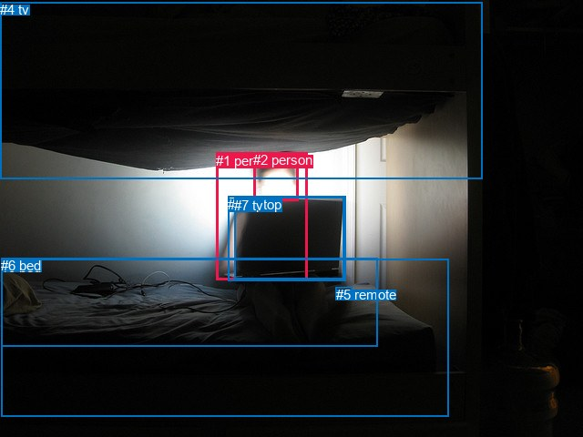
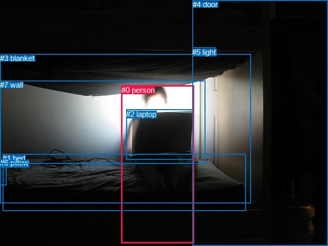

# 图片 0603：2342677.jpg

随机样本序号：244。图片 SHA256：`783b4f30e6556f21e41aa9aee177dfb102efd1cfce8cb08cf357ffdd44f361e1`。

红色框表示人，蓝色框表示其他物体。两个模式分别保留自身框编号，可依据位置比较对应对象。

## 自动检测框与输出

人的框编号：`[1, 2]`。状态：`ok`。

### 自动检测全部物体框

| 编号 | 类别 | 是否为人 | 检测分数 | 像素坐标 xyxy |
|---|---|---|---|---|
| 0 | bed | False | 0.9626 | 1.3, 284.6, 492.0, 458.0 |
| 1 | person | True | 0.9114 | 237.1, 167.9, 337.9, 307.8 |
| 2 | person | True | 0.8649 | 278.2, 167.0, 327.8, 220.3 |
| 3 | laptop | False | 0.8285 | 250.3, 215.5, 379.3, 308.2 |
| 4 | tv | False | 0.7977 | 0.0, 2.4, 529.0, 196.8 |
| 5 | remote | False | 0.7070 | 368.8, 315.2, 386.9, 322.1 |
| 6 | bed | False | 0.6787 | 1.4, 283.5, 414.1, 381.0 |
| 7 | tv | False | 0.5864 | 257.4, 216.6, 377.4, 306.8 |

### 自动检测 Top50 人相关候选

评分物体对：56；人相关物体对：26；输出关系：50。

| 排名 | 主语编号与类别 | 关系 | 宾语编号与类别 | 类型 | 人与人 | 排序分数 | 原始融合 logit |
|---|---|---|---|---|---|---|---|
| 1 | #1 person | on | #3 laptop | spatial | False | 0.95932 | 3.1606 |
| 2 | #1 person | on | #7 tv | spatial | False | 0.95705 | 3.1039 |
| 3 | #1 person | looking at | #7 tv | semantic | False | 0.93431 | 2.6549 |
| 4 | #2 person | on | #3 laptop | spatial | False | 0.93366 | 2.6444 |
| 5 | #1 person | looking at | #3 laptop | semantic | False | 0.93099 | 2.6021 |
| 6 | #2 person | on | #7 tv | spatial | False | 0.92677 | 2.5381 |
| 7 | #2 person | looking at | #3 laptop | semantic | False | 0.89062 | 2.0971 |
| 8 | #2 person | looking at | #7 tv | semantic | False | 0.88980 | 2.0887 |
| 9 | #2 person | on | #1 person | spatial | True | 0.88127 | 2.0045 |
| 10 | #1 person | on | #0 bed | spatial | False | 0.83648 | 1.6322 |
| 11 | #1 person | sitting on | #0 bed | semantic | False | 0.82869 | 1.5764 |
| 12 | #1 person | sitting on | #6 bed | semantic | False | 0.73406 | 1.0153 |
| 13 | #1 person | on | #6 bed | spatial | False | 0.73247 | 1.0072 |
| 14 | #1 person | in | #2 person | spatial | True | 0.68970 | 0.7987 |
| 15 | #4 tv | over | #1 person | spatial | False | 0.67948 | 0.7514 |
| 16 | #3 laptop | on | #1 person | spatial | False | 0.67828 | 0.7459 |
| 17 | #7 tv | on | #1 person | spatial | False | 0.65572 | 0.6443 |
| 18 | #2 person | hanging from | #4 tv | spatial | False | 0.65439 | 0.6384 |
| 19 | #1 person | in | #4 tv | spatial | False | 0.58284 | 0.3344 |
| 20 | #2 person | crossing | #1 person | semantic | True | 0.51004 | 0.0402 |
| 21 | #2 person | hanging from | #0 bed | spatial | False | 0.36160 | -0.5684 |
| 22 | #3 laptop | in | #2 person | spatial | False | 0.33236 | -0.6975 |
| 23 | #7 tv | in | #2 person | spatial | False | 0.31964 | -0.7554 |
| 24 | #4 tv | over | #2 person | spatial | False | 0.31427 | -0.7802 |
| 25 | #1 person | wearing | #2 person | semantic | True | 0.29665 | -0.8633 |
| 26 | #1 person | on | #5 remote | spatial | False | 0.21745 | -1.2806 |
| 27 | #3 laptop | holding | #1 person | semantic | False | 0.19466 | -1.4200 |
| 28 | #4 tv | holding | #1 person | semantic | False | 0.18471 | -1.4848 |
| 29 | #7 tv | holding | #1 person | semantic | False | 0.17973 | -1.5182 |
| 30 | #2 person | opening | #4 tv | semantic | False | 0.14675 | -1.7603 |
| 31 | #1 person | holding | #4 tv | semantic | False | 0.14353 | -1.7863 |
| 32 | #2 person | lying on | #0 bed | semantic | False | 0.12545 | -1.9418 |
| 33 | #5 remote | on | #1 person | spatial | False | 0.10516 | -2.1412 |
| 34 | #1 person | wearing | #5 remote | semantic | False | 0.10187 | -2.1766 |
| 35 | #3 laptop | looking at | #2 person | semantic | False | 0.08635 | -2.3590 |
| 36 | #7 tv | looking at | #2 person | semantic | False | 0.08264 | -2.4070 |
| 37 | #2 person | on | #6 bed | spatial | False | 0.08144 | -2.4229 |
| 38 | #6 bed | beside | #1 person | spatial | False | 0.07516 | -2.5100 |
| 39 | #0 bed | in | #1 person | spatial | False | 0.05852 | -2.7781 |
| 40 | #2 person | on | #5 remote | spatial | False | 0.03827 | -3.2241 |
| 41 | #4 tv | holding | #2 person | semantic | False | 0.03530 | -3.3078 |
| 42 | #2 person | lying on | #6 bed | semantic | False | 0.03070 | -3.4522 |
| 43 | #0 bed | holding | #1 person | semantic | False | 0.02063 | -3.8603 |
| 44 | #6 bed | holding | #1 person | semantic | False | 0.02030 | -3.8764 |
| 45 | #5 remote | holding | #1 person | semantic | False | 0.01544 | -4.1551 |
| 46 | #5 remote | on | #2 person | spatial | False | 0.01307 | -4.3244 |
| 47 | #2 person | wearing | #5 remote | semantic | False | 0.00921 | -4.6777 |
| 48 | #6 bed | in | #2 person | spatial | False | 0.00646 | -5.0351 |
| 49 | #0 bed | in | #2 person | spatial | False | 0.00635 | -5.0523 |
| 50 | #0 bed | holding | #2 person | semantic | False | 0.00202 | -6.2005 |

### 自动检测逐条人相关 GT 核验

R@50：0.00%；命中 0/6。

| GT 主语编号 | GT 关系 | GT 宾语编号 | 结果阶段 | 匹配预测主语编号 | 匹配预测宾语编号 |
|---|---|---|---|---|---|
| 0 | sitting on | 1 | endpoint_missing_or_wrong_class | [] | [0, 6] |
| 0 | looking at | 2 | endpoint_missing_or_wrong_class | [] | [3] |
| 0 | beside | 4 | endpoint_missing_or_wrong_class | [] | [] |
| 0 | holding | 7 | endpoint_missing_or_wrong_class | [] | [] |
| 3 | over | 0 | endpoint_missing_or_wrong_class | [] | [] |
| 7 | on back of | 0 | endpoint_missing_or_wrong_class | [] | [] |

## 真实框与输出

人的框编号：`[0]`。

### 真实框全部物体框

| 编号 | 类别 | 是否为人 | 检测分数 | 像素坐标 xyxy |
|---|---|---|---|---|
| 0 | person | True | GT | 237.0, 167.0, 379.0, 475.0 |
| 1 | bed | False | GT | 5.0, 300.0, 479.0, 411.0 |
| 2 | laptop | False | GT | 246.0, 214.0, 376.0, 311.0 |
| 3 | blanket | False | GT | 0.0, 105.0, 489.0, 396.0 |
| 4 | door | False | GT | 376.0, 0.0, 640.0, 480.0 |
| 5 | light | False | GT | 375.0, 93.0, 420.0, 108.0 |
| 6 | pillow | False | GT | 0.0, 309.0, 12.0, 361.0 |
| 7 | wall | False | GT | 0.0, 157.0, 401.0, 319.0 |

### 真实框 Top50 人相关候选

评分物体对：56；人相关物体对：14；输出关系：28。

| 排名 | 主语编号与类别 | 关系 | 宾语编号与类别 | 类型 | 人与人 | 排序分数 | 原始融合 logit |
|---|---|---|---|---|---|---|---|
| 1 | #0 person | looking at | #2 laptop | semantic | False | 0.96457 | 3.3042 |
| 2 | #0 person | in | #3 blanket | spatial | False | 0.95819 | 3.1318 |
| 3 | #0 person | on | #1 bed | spatial | False | 0.94997 | 2.9438 |
| 4 | #0 person | lying on | #1 bed | semantic | False | 0.94906 | 2.9248 |
| 5 | #0 person | on | #2 laptop | spatial | False | 0.91269 | 2.3469 |
| 6 | #2 laptop | on | #0 person | spatial | False | 0.87346 | 1.9319 |
| 7 | #0 person | lying on | #3 blanket | semantic | False | 0.86639 | 1.8694 |
| 8 | #0 person | on | #7 wall | spatial | False | 0.66774 | 0.6980 |
| 9 | #0 person | in | #4 door | spatial | False | 0.53381 | 0.1355 |
| 10 | #2 laptop | sitting on | #0 person | semantic | False | 0.51348 | 0.0539 |
| 11 | #3 blanket | over | #0 person | spatial | False | 0.41066 | -0.3612 |
| 12 | #0 person | looking at | #7 wall | semantic | False | 0.40529 | -0.3835 |
| 13 | #4 door | beside | #0 person | spatial | False | 0.38439 | -0.4710 |
| 14 | #5 light | on | #0 person | spatial | False | 0.36894 | -0.5368 |
| 15 | #0 person | sitting on | #4 door | semantic | False | 0.30835 | -0.8079 |
| 16 | #1 bed | on | #0 person | spatial | False | 0.28806 | -0.9048 |
| 17 | #7 wall | beside | #0 person | spatial | False | 0.22427 | -1.2409 |
| 18 | #3 blanket | holding | #0 person | semantic | False | 0.19468 | -1.4199 |
| 19 | #1 bed | holding | #0 person | semantic | False | 0.11514 | -2.0392 |
| 20 | #7 wall | looking at | #0 person | semantic | False | 0.08701 | -2.3506 |
| 21 | #0 person | in | #5 light | spatial | False | 0.07010 | -2.5851 |
| 22 | #6 pillow | on | #0 person | spatial | False | 0.06031 | -2.7461 |
| 23 | #5 light | holding | #0 person | semantic | False | 0.05986 | -2.7541 |
| 24 | #4 door | holding | #0 person | semantic | False | 0.05374 | -2.8685 |
| 25 | #0 person | looking at | #5 light | semantic | False | 0.03684 | -3.2637 |
| 26 | #0 person | on | #6 pillow | spatial | False | 0.01379 | -4.2699 |
| 27 | #6 pillow | holding | #0 person | semantic | False | 0.00611 | -5.0921 |
| 28 | #0 person | holding | #6 pillow | semantic | False | 0.00594 | -5.1202 |

### 真实框逐条人相关 GT 核验

R@50：33.33%；命中 2/6。

| GT 主语编号 | GT 关系 | GT 宾语编号 | 结果阶段 | 匹配预测主语编号 | 匹配预测宾语编号 |
|---|---|---|---|---|---|
| 0 | sitting on | 1 | wrong_predicate | [0] | [1] |
| 0 | looking at | 2 | hit50 | [0] | [2] |
| 0 | beside | 4 | wrong_predicate | [0] | [4] |
| 0 | holding | 7 | wrong_predicate | [0] | [7] |
| 3 | over | 0 | hit50 | [3] | [0] |
| 7 | on back of | 0 | wrong_predicate | [7] | [0] |

## 全部人相关 GT

| 主语编号与类别 | 关系 | 宾语编号与类别 |
|---|---|---|
| #0 person | sitting on | #1 bed |
| #0 person | looking at | #2 laptop |
| #0 person | beside | #4 door |
| #0 person | holding | #7 wall |
| #3 blanket | over | #0 person |
| #7 wall | on back of | #0 person |

原始记录、全部人相关物体对的两项预测与分项分数见 [逐图证据 JSON](../evidence/cases/0603.json)。全部56类 logits 保留于本机 HOR/output/random500/logits/。

<!-- HOR_COMPLETE_RESULTS -->

## 六组条件的完整输出对照

以下保留同一图片三种框与候选模式、两种谓词输出规则的全部 Top50。框编号各自在所属模式内解释。

### 自动检测框完整枚举：空间与语义各保留一个谓词

| 排名 | 主语编号与类别 | 谓词 | 宾语编号与类别 | 分组 | 排序分数 | predicate logit | pair logit |
|---|---|---|---|---|---|---|---|
| 1 | #1 person | on | #3 laptop | spatial | 0.9593232 | 3.2843018 | -0.1237315 |
| 2 | #1 person | on | #7 tv | spatial | 0.9570544 | 3.2350087 | -0.1310813 |
| 3 | #1 person | looking at | #7 tv | semantic | 0.9343122 | 2.7859783 | -0.1310813 |
| 4 | #2 person | on | #3 laptop | spatial | 0.9336632 | 2.6956830 | -0.0513122 |
| 5 | #1 person | looking at | #3 laptop | semantic | 0.9309942 | 2.7257953 | -0.1237315 |
| 6 | #2 person | on | #7 tv | spatial | 0.9267702 | 2.5970974 | -0.0589958 |
| 7 | #2 person | looking at | #3 laptop | semantic | 0.8906173 | 2.1483750 | -0.0513122 |
| 8 | #2 person | looking at | #7 tv | semantic | 0.8897983 | 2.1476779 | -0.0589958 |
| 9 | #2 person | on | #1 person | spatial | 0.8812657 | 2.2589397 | -0.2544681 |
| 10 | #1 person | on | #0 bed | spatial | 0.8364753 | 2.0451446 | -0.4129112 |
| 11 | #1 person | sitting on | #0 bed | semantic | 0.8286885 | 1.9892716 | -0.4129112 |
| 12 | #1 person | sitting on | #6 bed | semantic | 0.7340646 | 1.7033968 | -0.6880532 |
| 13 | #1 person | on | #6 bed | spatial | 0.7324671 | 1.6952286 | -0.6880532 |
| 14 | #1 person | in | #2 person | spatial | 0.6896989 | 1.0361934 | -0.2374812 |
| 15 | #4 tv | over | #1 person | spatial | 0.6794848 | 1.5915890 | -0.8401839 |
| 16 | #3 laptop | on | #1 person | spatial | 0.6782767 | 1.0750422 | -0.3291789 |
| 17 | #7 tv | on | #1 person | spatial | 0.6557229 | 0.9902134 | -0.3459219 |
| 18 | #2 person | hanging from | #4 tv | spatial | 0.6543873 | 1.5316696 | -0.8932889 |
| 19 | #1 person | in | #4 tv | spatial | 0.5828353 | 1.0638771 | -0.7294536 |
| 20 | #2 person | crossing | #1 person | semantic | 0.5100431 | 0.2946458 | -0.2544681 |
| 21 | #2 person | hanging from | #0 bed | spatial | 0.3615979 | 0.3580990 | -0.9265346 |
| 22 | #3 laptop | in | #2 person | spatial | 0.3323626 | -0.0641098 | -0.6334090 |
| 23 | #7 tv | in | #2 person | spatial | 0.3196398 | -0.1041570 | -0.6512704 |
| 24 | #4 tv | over | #2 person | spatial | 0.3142715 | 0.1663485 | -0.9465733 |
| 25 | #1 person | wearing | #2 person | semantic | 0.2966518 | -0.6258121 | -0.2374812 |
| 26 | #1 person | on | #5 remote | spatial | 0.2174517 | -0.5000420 | -0.7805368 |
| 27 | #3 laptop | holding | #1 person | semantic | 0.1946617 | -1.0908206 | -0.3291789 |
| 28 | #4 tv | holding | #1 person | semantic | 0.1847057 | -0.6446018 | -0.8401839 |
| 29 | #7 tv | holding | #1 person | semantic | 0.1797336 | -1.1722314 | -0.3459219 |
| 30 | #2 person | opening | #4 tv | semantic | 0.1467542 | -0.8669996 | -0.8932889 |
| 31 | #1 person | holding | #4 tv | semantic | 0.1435318 | -1.0568068 | -0.7294536 |
| 32 | #2 person | lying on | #0 bed | semantic | 0.1254526 | -1.0152442 | -0.9265346 |
| 33 | #5 remote | on | #1 person | spatial | 0.1051564 | -1.3803387 | -0.7608618 |
| 34 | #1 person | wearing | #5 remote | semantic | 0.1018707 | -1.3960729 | -0.7805368 |
| 35 | #3 laptop | looking at | #2 person | semantic | 0.0863510 | -1.7256174 | -0.6334090 |
| 36 | #7 tv | looking at | #2 person | semantic | 0.0826420 | -1.7557089 | -0.6512704 |
| 37 | #2 person | on | #6 bed | spatial | 0.0814412 | -1.2648931 | -1.1580317 |
| 38 | #6 bed | beside | #1 person | spatial | 0.0751576 | -1.3852000 | -1.1248363 |
| 39 | #0 bed | in | #1 person | spatial | 0.0585211 | -1.7862217 | -0.9918433 |
| 40 | #2 person | on | #5 remote | spatial | 0.0382693 | -2.0577633 | -1.1663243 |
| 41 | #4 tv | holding | #2 person | semantic | 0.0353041 | -2.3612401 | -0.9465733 |
| 42 | #2 person | lying on | #6 bed | semantic | 0.0307038 | -2.2941520 | -1.1580317 |
| 43 | #0 bed | holding | #1 person | semantic | 0.0206276 | -2.8684397 | -0.9918433 |
| 44 | #6 bed | holding | #1 person | semantic | 0.0203044 | -2.7515678 | -1.1248363 |
| 45 | #5 remote | holding | #1 person | semantic | 0.0154419 | -3.3942456 | -0.7608618 |
| 46 | #5 remote | on | #2 person | spatial | 0.0130689 | -2.6062274 | -1.7181375 |
| 47 | #2 person | wearing | #5 remote | semantic | 0.0092144 | -3.5114081 | -1.1663243 |
| 48 | #6 bed | in | #2 person | spatial | 0.0064632 | -3.5352173 | -1.4999269 |
| 49 | #0 bed | in | #2 person | spatial | 0.0063541 | -3.4990451 | -1.5532334 |
| 50 | #0 bed | holding | #2 person | semantic | 0.0020244 | -4.6472197 | -1.5532334 |

GT 命中：0/6，R@50=0.00%。

| GT主语 | GT谓词 | GT宾语 | 结果阶段 | 匹配主语框 | 匹配宾语框 |
|---|---|---|---|---|---|
| 0 | sitting on | 1 | endpoint_missing_or_wrong_class | [] | [0, 6] |
| 0 | looking at | 2 | endpoint_missing_or_wrong_class | [] | [3] |
| 0 | beside | 4 | endpoint_missing_or_wrong_class | [] | [] |
| 0 | holding | 7 | endpoint_missing_or_wrong_class | [] | [] |
| 3 | over | 0 | endpoint_missing_or_wrong_class | [] | [] |
| 7 | on back of | 0 | endpoint_missing_or_wrong_class | [] | [] |

### 自动检测框完整枚举：每对只保留一个谓词

| 排名 | 主语编号与类别 | 谓词 | 宾语编号与类别 | 分组 | 排序分数 | predicate logit | pair logit |
|---|---|---|---|---|---|---|---|
| 1 | #1 person | on | #3 laptop | single | 0.9593232 | 3.2843018 | -0.1237315 |
| 2 | #1 person | on | #7 tv | single | 0.9570544 | 3.2350087 | -0.1310813 |
| 3 | #2 person | on | #3 laptop | single | 0.9336632 | 2.6956830 | -0.0513122 |
| 4 | #2 person | on | #7 tv | single | 0.9267702 | 2.5970974 | -0.0589958 |
| 5 | #2 person | on | #1 person | single | 0.8812657 | 2.2589397 | -0.2544681 |
| 6 | #1 person | on | #0 bed | single | 0.8364753 | 2.0451446 | -0.4129112 |
| 7 | #1 person | sitting on | #6 bed | single | 0.7340646 | 1.7033968 | -0.6880532 |
| 8 | #1 person | in | #2 person | single | 0.6896989 | 1.0361934 | -0.2374812 |
| 9 | #4 tv | over | #1 person | single | 0.6794848 | 1.5915890 | -0.8401839 |
| 10 | #3 laptop | on | #1 person | single | 0.6782767 | 1.0750422 | -0.3291789 |
| 11 | #7 tv | on | #1 person | single | 0.6557229 | 0.9902134 | -0.3459219 |
| 12 | #2 person | hanging from | #4 tv | single | 0.6543873 | 1.5316696 | -0.8932889 |
| 13 | #1 person | in | #4 tv | single | 0.5828353 | 1.0638771 | -0.7294536 |
| 14 | #2 person | hanging from | #0 bed | single | 0.3615979 | 0.3580990 | -0.9265346 |
| 15 | #3 laptop | in | #2 person | single | 0.3323626 | -0.0641098 | -0.6334090 |
| 16 | #7 tv | in | #2 person | single | 0.3196398 | -0.1041570 | -0.6512704 |
| 17 | #4 tv | over | #2 person | single | 0.3142715 | 0.1663485 | -0.9465733 |
| 18 | #1 person | on | #5 remote | single | 0.2174517 | -0.5000420 | -0.7805368 |
| 19 | #5 remote | on | #1 person | single | 0.1051564 | -1.3803387 | -0.7608618 |
| 20 | #2 person | on | #6 bed | single | 0.0814412 | -1.2648931 | -1.1580317 |
| 21 | #6 bed | beside | #1 person | single | 0.0751576 | -1.3852000 | -1.1248363 |
| 22 | #0 bed | in | #1 person | single | 0.0585211 | -1.7862217 | -0.9918433 |
| 23 | #2 person | on | #5 remote | single | 0.0382693 | -2.0577633 | -1.1663243 |
| 24 | #5 remote | on | #2 person | single | 0.0130689 | -2.6062274 | -1.7181375 |
| 25 | #6 bed | in | #2 person | single | 0.0064632 | -3.5352173 | -1.4999269 |
| 26 | #0 bed | in | #2 person | single | 0.0063541 | -3.4990451 | -1.5532334 |

GT 命中：0/6，R@50=0.00%。

| GT主语 | GT谓词 | GT宾语 | 结果阶段 | 匹配主语框 | 匹配宾语框 |
|---|---|---|---|---|---|
| 0 | sitting on | 1 | endpoint_missing_or_wrong_class | [] | [0, 6] |
| 0 | looking at | 2 | endpoint_missing_or_wrong_class | [] | [3] |
| 0 | beside | 4 | endpoint_missing_or_wrong_class | [] | [] |
| 0 | holding | 7 | endpoint_missing_or_wrong_class | [] | [] |
| 3 | over | 0 | endpoint_missing_or_wrong_class | [] | [] |
| 7 | on back of | 0 | endpoint_missing_or_wrong_class | [] | [] |

### 真实框完整枚举：空间与语义各保留一个谓词

| 排名 | 主语编号与类别 | 谓词 | 宾语编号与类别 | 分组 | 排序分数 | predicate logit | pair logit |
|---|---|---|---|---|---|---|---|
| 1 | #0 person | looking at | #2 laptop | semantic | 0.9645729 | 3.3801332 | -0.0759252 |
| 2 | #0 person | in | #3 blanket | spatial | 0.9581872 | 3.4833589 | -0.3515177 |
| 3 | #0 person | on | #1 bed | spatial | 0.9499678 | 3.1404777 | -0.1967161 |
| 4 | #0 person | lying on | #1 bed | semantic | 0.9490597 | 3.1215339 | -0.1967161 |
| 5 | #0 person | on | #2 laptop | spatial | 0.9126860 | 2.4228067 | -0.0759252 |
| 6 | #2 laptop | on | #0 person | spatial | 0.8734564 | 2.4830456 | -0.5511746 |
| 7 | #0 person | lying on | #3 blanket | semantic | 0.8663916 | 2.2209420 | -0.3515177 |
| 8 | #0 person | on | #7 wall | spatial | 0.6677438 | 2.1311030 | -1.4331046 |
| 9 | #0 person | in | #4 door | spatial | 0.5338110 | 1.1902113 | -1.0547607 |
| 10 | #2 laptop | sitting on | #0 person | semantic | 0.5134836 | 0.6051221 | -0.5511746 |
| 11 | #3 blanket | over | #0 person | spatial | 0.4106598 | 0.8316317 | -1.1928699 |
| 12 | #0 person | looking at | #7 wall | semantic | 0.4052919 | 1.0496416 | -1.4331046 |
| 13 | #4 door | beside | #0 person | spatial | 0.3843913 | 0.8898787 | -1.3608291 |
| 14 | #5 light | on | #0 person | spatial | 0.3689412 | 0.1969800 | -0.7337418 |
| 15 | #0 person | sitting on | #4 door | semantic | 0.3083474 | 0.2469039 | -1.0547607 |
| 16 | #1 bed | on | #0 person | spatial | 0.2880629 | 0.1814857 | -1.0862964 |
| 17 | #7 wall | beside | #0 person | spatial | 0.2242735 | -0.3493199 | -0.8916139 |
| 18 | #3 blanket | holding | #0 person | semantic | 0.1946762 | -0.2270370 | -1.1928699 |
| 19 | #1 bed | holding | #0 person | semantic | 0.1151446 | -0.9529393 | -1.0862964 |
| 20 | #7 wall | looking at | #0 person | semantic | 0.0870143 | -1.4590342 | -0.8916139 |
| 21 | #0 person | in | #5 light | spatial | 0.0701005 | -1.5352118 | -1.0499349 |
| 22 | #6 pillow | on | #0 person | spatial | 0.0603095 | -1.1785581 | -1.5675020 |
| 23 | #5 light | holding | #0 person | semantic | 0.0598579 | -2.0203156 | -0.7337418 |
| 24 | #4 door | holding | #0 person | semantic | 0.0537351 | -1.5076268 | -1.3608291 |
| 25 | #0 person | looking at | #5 light | semantic | 0.0368369 | -2.2137887 | -1.0499349 |
| 26 | #0 person | on | #6 pillow | spatial | 0.0137900 | -2.5346332 | -1.7352915 |
| 27 | #6 pillow | holding | #0 person | semantic | 0.0061076 | -3.5245986 | -1.5675020 |
| 28 | #0 person | holding | #6 pillow | semantic | 0.0059394 | -3.3848989 | -1.7352915 |

GT 命中：2/6，R@50=33.33%。

| GT主语 | GT谓词 | GT宾语 | 结果阶段 | 匹配主语框 | 匹配宾语框 |
|---|---|---|---|---|---|
| 0 | sitting on | 1 | wrong_predicate | [0] | [1] |
| 0 | looking at | 2 | hit50 | [0] | [2] |
| 0 | beside | 4 | wrong_predicate | [0] | [4] |
| 0 | holding | 7 | wrong_predicate | [0] | [7] |
| 3 | over | 0 | hit50 | [3] | [0] |
| 7 | on back of | 0 | wrong_predicate | [7] | [0] |

### 真实框完整枚举：每对只保留一个谓词

| 排名 | 主语编号与类别 | 谓词 | 宾语编号与类别 | 分组 | 排序分数 | predicate logit | pair logit |
|---|---|---|---|---|---|---|---|
| 1 | #0 person | looking at | #2 laptop | single | 0.9645729 | 3.3801332 | -0.0759252 |
| 2 | #0 person | in | #3 blanket | single | 0.9581872 | 3.4833589 | -0.3515177 |
| 3 | #0 person | on | #1 bed | single | 0.9499678 | 3.1404777 | -0.1967161 |
| 4 | #2 laptop | on | #0 person | single | 0.8734564 | 2.4830456 | -0.5511746 |
| 5 | #0 person | on | #7 wall | single | 0.6677438 | 2.1311030 | -1.4331046 |
| 6 | #0 person | in | #4 door | single | 0.5338110 | 1.1902113 | -1.0547607 |
| 7 | #3 blanket | over | #0 person | single | 0.4106598 | 0.8316317 | -1.1928699 |
| 8 | #4 door | beside | #0 person | single | 0.3843913 | 0.8898787 | -1.3608291 |
| 9 | #5 light | on | #0 person | single | 0.3689412 | 0.1969800 | -0.7337418 |
| 10 | #1 bed | on | #0 person | single | 0.2880629 | 0.1814857 | -1.0862964 |
| 11 | #7 wall | beside | #0 person | single | 0.2242735 | -0.3493199 | -0.8916139 |
| 12 | #0 person | in | #5 light | single | 0.0701005 | -1.5352118 | -1.0499349 |
| 13 | #6 pillow | on | #0 person | single | 0.0603095 | -1.1785581 | -1.5675020 |
| 14 | #0 person | on | #6 pillow | single | 0.0137900 | -2.5346332 | -1.7352915 |

GT 命中：2/6，R@50=33.33%。

| GT主语 | GT谓词 | GT宾语 | 结果阶段 | 匹配主语框 | 匹配宾语框 |
|---|---|---|---|---|---|
| 0 | sitting on | 1 | wrong_predicate | [0] | [1] |
| 0 | looking at | 2 | hit50 | [0] | [2] |
| 0 | beside | 4 | wrong_predicate | [0] | [4] |
| 0 | holding | 7 | wrong_predicate | [0] | [7] |
| 3 | over | 0 | hit50 | [3] | [0] |
| 7 | on back of | 0 | wrong_predicate | [7] | [0] |

### 真实框400候选：空间与语义各保留一个谓词

| 排名 | 主语编号与类别 | 谓词 | 宾语编号与类别 | 分组 | 排序分数 | predicate logit | pair logit |
|---|---|---|---|---|---|---|---|
| 1 | #0 person | looking at | #2 laptop | semantic | 0.9645729 | 3.3801332 | -0.0759252 |
| 2 | #0 person | in | #3 blanket | spatial | 0.9559885 | 3.4298139 | -0.3515177 |
| 3 | #0 person | on | #1 bed | spatial | 0.9499678 | 3.1404777 | -0.1967161 |
| 4 | #0 person | lying on | #1 bed | semantic | 0.9490597 | 3.1215339 | -0.1967161 |
| 5 | #0 person | on | #2 laptop | spatial | 0.9126860 | 2.4228067 | -0.0759252 |
| 6 | #2 laptop | on | #0 person | spatial | 0.8734564 | 2.4830456 | -0.5511746 |
| 7 | #0 person | lying on | #3 blanket | semantic | 0.8663971 | 2.2209897 | -0.3515177 |
| 8 | #0 person | on | #7 wall | spatial | 0.6653235 | 2.1202135 | -1.4331046 |
| 9 | #0 person | in | #4 door | spatial | 0.5329850 | 1.1868925 | -1.0547607 |
| 10 | #2 laptop | sitting on | #0 person | semantic | 0.5187437 | 0.6261845 | -0.5511746 |
| 11 | #3 blanket | over | #0 person | spatial | 0.4100201 | 0.8289876 | -1.1928699 |
| 12 | #0 person | looking at | #7 wall | semantic | 0.4052919 | 1.0496416 | -1.4331046 |
| 13 | #4 door | beside | #0 person | spatial | 0.3843777 | 0.8898211 | -1.3608291 |
| 14 | #5 light | on | #0 person | spatial | 0.3676743 | 0.1915345 | -0.7337418 |
| 15 | #0 person | sitting on | #4 door | semantic | 0.3064251 | 0.2378750 | -1.0547607 |
| 16 | #1 bed | on | #0 person | spatial | 0.2880629 | 0.1814857 | -1.0862964 |
| 17 | #7 wall | beside | #0 person | spatial | 0.2242773 | -0.3492980 | -0.8916139 |
| 18 | #3 blanket | holding | #0 person | semantic | 0.1942135 | -0.2299910 | -1.1928699 |
| 19 | #1 bed | holding | #0 person | semantic | 0.1151446 | -0.9529393 | -1.0862964 |
| 20 | #7 wall | looking at | #0 person | semantic | 0.0882170 | -1.4439883 | -0.8916139 |
| 21 | #0 person | in | #5 light | spatial | 0.0691795 | -1.5494275 | -1.0499349 |
| 22 | #6 pillow | on | #0 person | spatial | 0.0613286 | -1.1607175 | -1.5675020 |
| 23 | #5 light | holding | #0 person | semantic | 0.0590989 | -2.0338843 | -0.7337418 |
| 24 | #4 door | holding | #0 person | semantic | 0.0542016 | -1.4984896 | -1.3608291 |
| 25 | #0 person | looking at | #5 light | semantic | 0.0368245 | -2.2141373 | -1.0499349 |
| 26 | #0 person | on | #6 pillow | spatial | 0.0137530 | -2.5373554 | -1.7352915 |
| 27 | #6 pillow | holding | #0 person | semantic | 0.0061053 | -3.5249679 | -1.5675020 |
| 28 | #0 person | holding | #6 pillow | semantic | 0.0059000 | -3.3915908 | -1.7352915 |

GT 命中：2/6，R@50=33.33%。

| GT主语 | GT谓词 | GT宾语 | 结果阶段 | 匹配主语框 | 匹配宾语框 |
|---|---|---|---|---|---|
| 0 | sitting on | 1 | wrong_predicate | [0] | [1] |
| 0 | looking at | 2 | hit50 | [0] | [2] |
| 0 | beside | 4 | wrong_predicate | [0] | [4] |
| 0 | holding | 7 | wrong_predicate | [0] | [7] |
| 3 | over | 0 | hit50 | [3] | [0] |
| 7 | on back of | 0 | wrong_predicate | [7] | [0] |

### 真实框400候选：每对只保留一个谓词

| 排名 | 主语编号与类别 | 谓词 | 宾语编号与类别 | 分组 | 排序分数 | predicate logit | pair logit |
|---|---|---|---|---|---|---|---|
| 1 | #0 person | looking at | #2 laptop | single | 0.9645729 | 3.3801332 | -0.0759252 |
| 2 | #0 person | in | #3 blanket | single | 0.9559885 | 3.4298139 | -0.3515177 |
| 3 | #0 person | on | #1 bed | single | 0.9499678 | 3.1404777 | -0.1967161 |
| 4 | #2 laptop | on | #0 person | single | 0.8734564 | 2.4830456 | -0.5511746 |
| 5 | #0 person | on | #7 wall | single | 0.6653235 | 2.1202135 | -1.4331046 |
| 6 | #0 person | in | #4 door | single | 0.5329850 | 1.1868925 | -1.0547607 |
| 7 | #3 blanket | over | #0 person | single | 0.4100201 | 0.8289876 | -1.1928699 |
| 8 | #4 door | beside | #0 person | single | 0.3843777 | 0.8898211 | -1.3608291 |
| 9 | #5 light | on | #0 person | single | 0.3676743 | 0.1915345 | -0.7337418 |
| 10 | #1 bed | on | #0 person | single | 0.2880629 | 0.1814857 | -1.0862964 |
| 11 | #7 wall | beside | #0 person | single | 0.2242773 | -0.3492980 | -0.8916139 |
| 12 | #0 person | in | #5 light | single | 0.0691795 | -1.5494275 | -1.0499349 |
| 13 | #6 pillow | on | #0 person | single | 0.0613286 | -1.1607175 | -1.5675020 |
| 14 | #0 person | on | #6 pillow | single | 0.0137530 | -2.5373554 | -1.7352915 |

GT 命中：2/6，R@50=33.33%。

| GT主语 | GT谓词 | GT宾语 | 结果阶段 | 匹配主语框 | 匹配宾语框 |
|---|---|---|---|---|---|
| 0 | sitting on | 1 | wrong_predicate | [0] | [1] |
| 0 | looking at | 2 | hit50 | [0] | [2] |
| 0 | beside | 4 | wrong_predicate | [0] | [4] |
| 0 | holding | 7 | wrong_predicate | [0] | [7] |
| 3 | over | 0 | hit50 | [3] | [0] |
| 7 | on back of | 0 | wrong_predicate | [7] | [0] |
