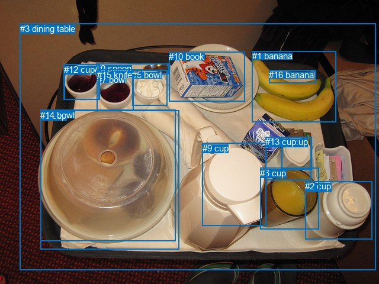
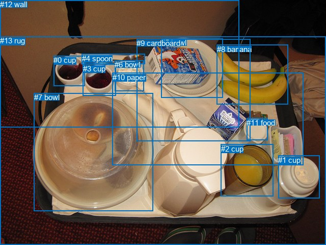

# 图片 0604：2342695.jpg

随机样本序号：245。图片 SHA256：`a02c348b83ed6cc7b4c3e9e445132751b1b01d1726819b233993177bd4a4f041`。

红色框表示人，蓝色框表示其他物体。两个模式分别保留自身框编号，可依据位置比较对应对象。

## 自动检测框与输出

人的框编号：`[]`。状态：`no_person`。

### 自动检测全部物体框

| 编号 | 类别 | 是否为人 | 检测分数 | 像素坐标 xyxy |
|---|---|---|---|---|
| 0 | spoon | False | 0.9979 | 162.3, 107.1, 284.2, 125.3 |
| 1 | banana | False | 0.9954 | 425.8, 86.5, 567.5, 206.7 |
| 2 | cup | False | 0.9765 | 515.3, 306.1, 628.2, 404.3 |
| 3 | dining table | False | 0.9642 | 33.9, 39.7, 634.2, 456.3 |
| 4 | cup | False | 0.9499 | 476.0, 231.4, 526.4, 286.8 |
| 5 | bowl | False | 0.8961 | 223.2, 118.4, 282.5, 178.4 |
| 6 | cup | False | 0.8942 | 439.4, 283.9, 538.4, 387.4 |
| 7 | bowl | False | 0.8548 | 164.0, 125.9, 225.4, 187.1 |
| 8 | cup | False | 0.7855 | 68.2, 186.8, 302.6, 421.6 |
| 9 | cup | False | 0.7262 | 341.8, 241.7, 449.4, 381.3 |
| 10 | book | False | 0.6775 | 285.2, 87.4, 413.1, 171.1 |
| 11 | bowl | False | 0.6755 | 108.6, 108.1, 168.6, 168.5 |
| 12 | cup | False | 0.6705 | 107.7, 108.8, 167.9, 168.8 |
| 13 | cup | False | 0.6523 | 448.3, 231.1, 525.9, 304.0 |
| 14 | bowl | False | 0.6489 | 68.0, 185.8, 296.3, 407.9 |
| 15 | knife | False | 0.3939 | 163.9, 117.6, 239.4, 128.5 |
| 16 | banana | False | 0.3701 | 454.2, 118.3, 533.5, 140.1 |

### 自动检测 Top50 人相关候选

评分物体对：0；人相关物体对：0；输出关系：0。

| 排名 | 主语编号与类别 | 关系 | 宾语编号与类别 | 类型 | 人与人 | 排序分数 | 原始融合 logit |
|---|---|---|---|---|---|---|---|

### 自动检测逐条人相关 GT 核验

本图没有人相关 GT，R@50 无分母；预测候选继续展示。

## 真实框与输出

人的框编号：`[]`。

### 真实框全部物体框

| 编号 | 类别 | 是否为人 | 检测分数 | 像素坐标 xyxy |
|---|---|---|---|---|
| 0 | cup | False | GT | 105.0, 109.0, 166.0, 168.0 |
| 1 | cup | False | GT | 546.0, 305.0, 627.0, 389.0 |
| 2 | cup | False | GT | 434.0, 283.0, 537.0, 385.0 |
| 3 | cup | False | GT | 163.0, 126.0, 227.0, 188.0 |
| 4 | spoon | False | GT | 161.0, 106.0, 284.0, 126.0 |
| 5 | bowl | False | GT | 316.0, 75.0, 437.0, 191.0 |
| 6 | bowl | False | GT | 225.0, 118.0, 282.0, 178.0 |
| 7 | bowl | False | GT | 67.0, 182.0, 301.0, 413.0 |
| 8 | banana | False | GT | 426.0, 88.0, 566.0, 205.0 |
| 9 | cardboard | False | GT | 268.0, 76.0, 491.0, 276.0 |
| 10 | paper | False | GT | 221.0, 143.0, 596.0, 324.0 |
| 11 | food | False | GT | 484.0, 232.0, 525.0, 275.0 |
| 12 | wall | False | GT | 0.0, 0.0, 469.0, 250.0 |
| 13 | rug | False | GT | 0.0, 71.0, 640.0, 480.0 |

### 真实框 Top50 人相关候选

评分物体对：0；人相关物体对：0；输出关系：0。

| 排名 | 主语编号与类别 | 关系 | 宾语编号与类别 | 类型 | 人与人 | 排序分数 | 原始融合 logit |
|---|---|---|---|---|---|---|---|

### 真实框逐条人相关 GT 核验

本图没有人相关 GT，R@50 无分母；预测候选继续展示。

## 全部人相关 GT

| 主语编号与类别 | 关系 | 宾语编号与类别 |
|---|---|---|

原始记录、全部人相关物体对的两项预测与分项分数见 [逐图证据 JSON](../evidence/cases/0604.json)。全部56类 logits 保留于本机 HOR/output/random500/logits/。

<!-- HOR_COMPLETE_RESULTS -->

## 六组条件的完整输出对照

以下保留同一图片三种框与候选模式、两种谓词输出规则的全部 Top50。框编号各自在所属模式内解释。

### 自动检测框完整枚举：空间与语义各保留一个谓词

| 排名 | 主语编号与类别 | 谓词 | 宾语编号与类别 | 分组 | 排序分数 | predicate logit | pair logit |
|---|---|---|---|---|---|---|---|

没有人相关 GT，本条件的召回率无分母。

### 自动检测框完整枚举：每对只保留一个谓词

| 排名 | 主语编号与类别 | 谓词 | 宾语编号与类别 | 分组 | 排序分数 | predicate logit | pair logit |
|---|---|---|---|---|---|---|---|

没有人相关 GT，本条件的召回率无分母。

### 真实框完整枚举：空间与语义各保留一个谓词

| 排名 | 主语编号与类别 | 谓词 | 宾语编号与类别 | 分组 | 排序分数 | predicate logit | pair logit |
|---|---|---|---|---|---|---|---|

没有人相关 GT，本条件的召回率无分母。

### 真实框完整枚举：每对只保留一个谓词

| 排名 | 主语编号与类别 | 谓词 | 宾语编号与类别 | 分组 | 排序分数 | predicate logit | pair logit |
|---|---|---|---|---|---|---|---|

没有人相关 GT，本条件的召回率无分母。

### 真实框400候选：空间与语义各保留一个谓词

| 排名 | 主语编号与类别 | 谓词 | 宾语编号与类别 | 分组 | 排序分数 | predicate logit | pair logit |
|---|---|---|---|---|---|---|---|

没有人相关 GT，本条件的召回率无分母。

### 真实框400候选：每对只保留一个谓词

| 排名 | 主语编号与类别 | 谓词 | 宾语编号与类别 | 分组 | 排序分数 | predicate logit | pair logit |
|---|---|---|---|---|---|---|---|

没有人相关 GT，本条件的召回率无分母。
