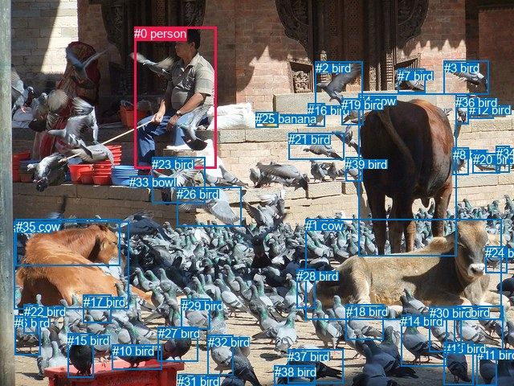
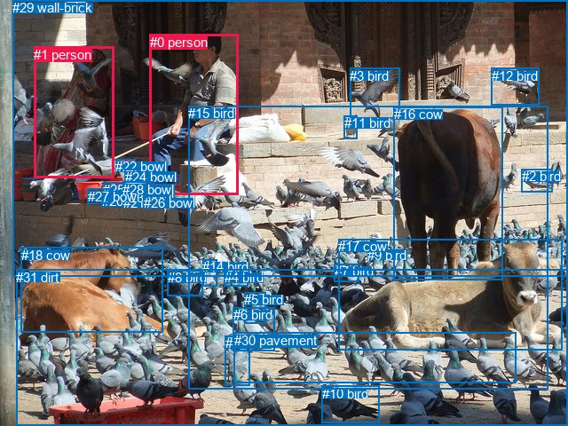

# 图片 0605：2342711.jpg

随机样本序号：473。图片 SHA256：`14c5d41fd1b2673c7d2697ead475b106d65dd9ae3ff6d089cf7b35a99e76fc26`。

红色框表示人，蓝色框表示其他物体。两个模式分别保留自身框编号，可依据位置比较对应对象。

## 自动检测框与输出

人的框编号：`[0]`。状态：`ok`。

### 自动检测全部物体框

| 编号 | 类别 | 是否为人 | 检测分数 | 像素坐标 xyxy |
|---|---|---|---|---|
| 0 | person | True | 0.9920 | 167.1, 33.5, 269.6, 209.6 |
| 1 | cow | False | 0.9899 | 380.2, 272.2, 625.0, 397.1 |
| 2 | bird | False | 0.9865 | 392.8, 76.5, 451.3, 134.3 |
| 3 | bird | False | 0.9789 | 552.6, 75.9, 608.7, 117.4 |
| 4 | cow | False | 0.9762 | 446.3, 116.5, 569.0, 318.5 |
| 5 | cow | False | 0.9753 | 17.0, 275.0, 160.0, 384.9 |
| 6 | bird | False | 0.9666 | 18.2, 392.6, 50.0, 441.9 |
| 7 | bird | False | 0.9570 | 495.1, 85.6, 529.3, 115.4 |
| 8 | bird | False | 0.9422 | 564.0, 183.8, 583.6, 217.8 |
| 9 | bird | False | 0.9365 | 565.5, 380.2, 626.5, 440.2 |
| 10 | bird | False | 0.9312 | 139.6, 428.1, 201.1, 459.9 |
| 11 | bird | False | 0.9161 | 593.5, 432.8, 619.0, 479.3 |
| 12 | bird | False | 0.9057 | 584.4, 128.2, 614.8, 147.7 |
| 13 | bird | False | 0.8991 | 552.9, 425.4, 589.1, 478.5 |
| 14 | bird | False | 0.8936 | 499.2, 391.0, 556.6, 455.2 |
| 15 | bird | False | 0.8925 | 84.3, 414.6, 116.9, 470.0 |
| 16 | bird | False | 0.8906 | 383.1, 128.8, 404.7, 157.5 |
| 17 | bird | False | 0.8875 | 103.5, 366.8, 138.2, 401.2 |
| 18 | bird | False | 0.8860 | 430.5, 378.7, 477.5, 422.5 |
| 19 | bird | False | 0.8830 | 425.2, 122.1, 452.4, 155.2 |
| 20 | bird | False | 0.8794 | 588.7, 190.0, 622.4, 215.1 |
| 21 | bird | False | 0.8757 | 359.5, 165.2, 428.9, 198.5 |
| 22 | bird | False | 0.8728 | 29.7, 378.6, 47.2, 414.7 |
| 23 | bird | False | 0.8609 | 189.2, 195.9, 255.6, 252.5 |
| 24 | bird | False | 0.8581 | 604.3, 306.1, 631.3, 339.8 |
| 25 | banana | False | 0.8428 | 318.3, 139.5, 346.1, 158.8 |
| 26 | bird | False | 0.8374 | 220.0, 233.0, 300.8, 282.0 |
| 27 | bird | False | 0.8361 | 196.8, 406.3, 246.5, 449.6 |
| 28 | bird | False | 0.8335 | 369.4, 334.9, 392.1, 383.1 |
| 29 | bird | False | 0.8334 | 225.6, 371.8, 261.6, 409.8 |
| 30 | bird | False | 0.8230 | 534.9, 381.4, 574.8, 437.2 |
| 31 | bird | False | 0.8216 | 221.3, 465.6, 273.6, 480.0 |
| 32 | bird | False | 0.8163 | 259.0, 416.6, 290.1, 466.2 |
| 33 | bowl | False | 0.8147 | 161.4, 218.5, 189.9, 232.2 |
| 34 | bird | False | 0.8087 | 617.5, 181.8, 634.9, 214.5 |
| 35 | cow | False | 0.8039 | 19.6, 272.7, 150.0, 330.6 |
| 36 | bird | False | 0.8036 | 567.4, 119.3, 583.7, 154.6 |
| 37 | bird | False | 0.7896 | 358.3, 434.9, 427.6, 476.3 |
| 38 | bird | False | 0.7760 | 341.6, 454.2, 392.9, 480.0 |
| 39 | bird | False | 0.7670 | 430.5, 195.8, 451.6, 225.2 |

### 自动检测 Top50 人相关候选

评分物体对：1560；人相关物体对：78；输出关系：50。

| 排名 | 主语编号与类别 | 关系 | 宾语编号与类别 | 类型 | 人与人 | 排序分数 | 原始融合 logit |
|---|---|---|---|---|---|---|---|
| 1 | #0 person | feeding | #23 bird | semantic | False | 0.83755 | 1.6401 |
| 2 | #0 person | feeding | #26 bird | semantic | False | 0.78134 | 1.2735 |
| 3 | #0 person | in | #23 bird | spatial | False | 0.67262 | 0.7201 |
| 4 | #0 person | looking at | #4 cow | semantic | False | 0.64592 | 0.6011 |
| 5 | #0 person | in | #26 bird | spatial | False | 0.60546 | 0.4283 |
| 6 | #0 person | feeding | #5 cow | semantic | False | 0.55591 | 0.2246 |
| 7 | #23 bird | on | #0 person | spatial | False | 0.48655 | -0.0538 |
| 8 | #0 person | in | #4 cow | spatial | False | 0.41828 | -0.3298 |
| 9 | #0 person | on | #33 bowl | spatial | False | 0.39401 | -0.4305 |
| 10 | #0 person | in | #5 cow | spatial | False | 0.38393 | -0.4729 |
| 11 | #0 person | looking at | #1 cow | semantic | False | 0.30210 | -0.8373 |
| 12 | #0 person | on | #25 banana | spatial | False | 0.25885 | -1.0519 |
| 13 | #0 person | looking at | #35 cow | semantic | False | 0.22793 | -1.2200 |
| 14 | #26 bird | on | #0 person | spatial | False | 0.21757 | -1.2799 |
| 15 | #0 person | holding | #33 bowl | semantic | False | 0.19859 | -1.3952 |
| 16 | #0 person | in | #35 cow | spatial | False | 0.17762 | -1.5325 |
| 17 | #0 person | standing on | #25 banana | semantic | False | 0.15709 | -1.6801 |
| 18 | #0 person | looking at | #21 bird | semantic | False | 0.13738 | -1.8372 |
| 19 | #23 bird | holding | #0 person | semantic | False | 0.11274 | -2.0630 |
| 20 | #0 person | holding | #19 bird | semantic | False | 0.10836 | -2.1076 |
| 21 | #25 banana | beside | #0 person | spatial | False | 0.10706 | -2.1211 |
| 22 | #0 person | in | #19 bird | spatial | False | 0.10300 | -2.1643 |
| 23 | #0 person | in | #21 bird | spatial | False | 0.09693 | -2.2318 |
| 24 | #0 person | in | #1 cow | spatial | False | 0.09650 | -2.2367 |
| 25 | #33 bowl | in | #0 person | spatial | False | 0.08486 | -2.3781 |
| 26 | #5 cow | beside | #0 person | spatial | False | 0.07760 | -2.4754 |
| 27 | #4 cow | beside | #0 person | spatial | False | 0.07450 | -2.5195 |
| 28 | #0 person | holding | #2 bird | semantic | False | 0.06990 | -2.5882 |
| 29 | #0 person | looking at | #29 bird | semantic | False | 0.06636 | -2.6440 |
| 30 | #33 bowl | holding | #0 person | semantic | False | 0.06428 | -2.6781 |
| 31 | #0 person | in | #2 bird | spatial | False | 0.06137 | -2.7276 |
| 32 | #0 person | in | #16 bird | spatial | False | 0.05253 | -2.8923 |
| 33 | #26 bird | holding | #0 person | semantic | False | 0.05030 | -2.9382 |
| 34 | #0 person | looking at | #17 bird | semantic | False | 0.04998 | -2.9448 |
| 35 | #0 person | holding | #3 bird | semantic | False | 0.04966 | -2.9516 |
| 36 | #0 person | holding | #16 bird | semantic | False | 0.04667 | -3.0169 |
| 37 | #2 bird | on | #0 person | spatial | False | 0.04568 | -3.0394 |
| 38 | #4 cow | standing on | #0 person | semantic | False | 0.04552 | -3.0431 |
| 39 | #5 cow | looking at | #0 person | semantic | False | 0.04366 | -3.0868 |
| 40 | #0 person | holding | #12 bird | semantic | False | 0.04173 | -3.1338 |
| 41 | #3 bird | flying over | #0 person | semantic | False | 0.03719 | -3.2537 |
| 42 | #0 person | holding | #36 bird | semantic | False | 0.03671 | -3.2673 |
| 43 | #19 bird | on | #0 person | spatial | False | 0.03658 | -3.2709 |
| 44 | #0 person | in | #3 bird | spatial | False | 0.03416 | -3.3420 |
| 45 | #35 cow | in | #0 person | spatial | False | 0.03342 | -3.3646 |
| 46 | #0 person | on | #15 bird | spatial | False | 0.03280 | -3.3840 |
| 47 | #2 bird | flying over | #0 person | semantic | False | 0.03280 | -3.3841 |
| 48 | #0 person | in | #17 bird | spatial | False | 0.03144 | -3.4276 |
| 49 | #21 bird | on | #0 person | spatial | False | 0.03025 | -3.4674 |
| 50 | #0 person | in | #29 bird | spatial | False | 0.02994 | -3.4783 |

### 自动检测逐条人相关 GT 核验

R@50：0.00%；命中 0/2。

| GT 主语编号 | GT 关系 | GT 宾语编号 | 结果阶段 | 匹配预测主语编号 | 匹配预测宾语编号 |
|---|---|---|---|---|---|
| 0 | looking at | 22 | endpoint_missing_or_wrong_class | [0] | [] |
| 1 | beside | 0 | endpoint_missing_or_wrong_class | [] | [0] |

## 真实框与输出

人的框编号：`[0, 1]`。

### 真实框全部物体框

| 编号 | 类别 | 是否为人 | 检测分数 | 像素坐标 xyxy |
|---|---|---|---|---|
| 0 | person | True | GT | 169.0, 39.0, 269.0, 220.0 |
| 1 | person | True | GT | 38.0, 53.0, 128.0, 201.0 |
| 2 | bird | False | GT | 588.0, 190.0, 623.0, 216.0 |
| 3 | bird | False | GT | 394.0, 77.0, 451.0, 133.0 |
| 4 | bird | False | GT | 253.0, 304.0, 280.0, 322.0 |
| 5 | bird | False | GT | 275.0, 329.0, 299.0, 364.0 |
| 6 | bird | False | GT | 263.0, 346.0, 310.0, 395.0 |
| 7 | bird | False | GT | 377.0, 297.0, 405.0, 318.0 |
| 8 | bird | False | GT | 189.0, 304.0, 229.0, 333.0 |
| 9 | bird | False | GT | 414.0, 279.0, 430.0, 289.0 |
| 10 | bird | False | GT | 363.0, 435.0, 427.0, 477.0 |
| 11 | bird | False | GT | 388.0, 130.0, 403.0, 156.0 |
| 12 | bird | False | GT | 554.0, 77.0, 608.0, 119.0 |
| 13 | bird | False | GT | 254.0, 378.0, 281.0, 434.0 |
| 14 | bird | False | GT | 228.0, 292.0, 244.0, 322.0 |
| 15 | bird | False | GT | 212.0, 119.0, 617.0, 438.0 |
| 16 | cow | False | GT | 444.0, 120.0, 567.0, 315.0 |
| 17 | cow | False | GT | 381.0, 269.0, 634.0, 394.0 |
| 18 | cow | False | GT | 24.0, 279.0, 184.0, 375.0 |
| 19 | bowl | False | GT | 139.0, 217.0, 170.0, 221.0 |
| 20 | bowl | False | GT | 115.0, 218.0, 138.0, 230.0 |
| 21 | bowl | False | GT | 139.0, 220.0, 164.0, 230.0 |
| 22 | bowl | False | GT | 130.0, 179.0, 152.0, 188.0 |
| 23 | bowl | False | GT | 138.0, 214.0, 174.0, 218.0 |
| 24 | bowl | False | GT | 141.0, 191.0, 152.0, 199.0 |
| 25 | bowl | False | GT | 116.0, 205.0, 140.0, 218.0 |
| 26 | bowl | False | GT | 162.0, 220.0, 189.0, 233.0 |
| 27 | bowl | False | GT | 99.0, 213.0, 124.0, 230.0 |
| 28 | bowl | False | GT | 138.0, 205.0, 173.0, 212.0 |
| 29 | wall-brick | False | GT | 14.0, 0.0, 640.0, 311.0 |
| 30 | pavement | False | GT | 264.0, 375.0, 582.0, 432.0 |
| 31 | dirt | False | GT | 18.0, 304.0, 640.0, 480.0 |

### 真实框 Top50 人相关候选

评分物体对：992；人相关物体对：122；输出关系：50。

| 排名 | 主语编号与类别 | 关系 | 宾语编号与类别 | 类型 | 人与人 | 排序分数 | 原始融合 logit |
|---|---|---|---|---|---|---|---|
| 1 | #0 person | in | #29 wall-brick | spatial | False | 0.96525 | 3.3243 |
| 2 | #1 person | in | #29 wall-brick | spatial | False | 0.94804 | 2.9038 |
| 3 | #0 person | in | #15 bird | spatial | False | 0.88754 | 2.0658 |
| 4 | #0 person | sitting on | #29 wall-brick | semantic | False | 0.86495 | 1.8571 |
| 5 | #0 person | holding | #1 person | semantic | True | 0.81224 | 1.4646 |
| 6 | #0 person | sitting on | #15 bird | semantic | False | 0.79617 | 1.3626 |
| 7 | #0 person | looking at | #16 cow | semantic | False | 0.74992 | 1.0982 |
| 8 | #1 person | sitting on | #29 wall-brick | semantic | False | 0.72021 | 0.9455 |
| 9 | #0 person | feeding | #18 cow | semantic | False | 0.60147 | 0.4116 |
| 10 | #1 person | on | #15 bird | spatial | False | 0.48422 | -0.0632 |
| 11 | #0 person | on | #31 dirt | spatial | False | 0.46603 | -0.1361 |
| 12 | #0 person | beside | #1 person | spatial | True | 0.46096 | -0.1565 |
| 13 | #1 person | beside | #0 person | spatial | True | 0.43456 | -0.2633 |
| 14 | #0 person | standing on | #31 dirt | semantic | False | 0.42432 | -0.3051 |
| 15 | #0 person | beside | #16 cow | spatial | False | 0.37089 | -0.5284 |
| 16 | #1 person | in | #22 bowl | spatial | False | 0.34006 | -0.6630 |
| 17 | #0 person | in | #18 cow | spatial | False | 0.32440 | -0.7336 |
| 18 | #1 person | sitting on | #0 person | semantic | True | 0.29158 | -0.8877 |
| 19 | #1 person | holding | #22 bowl | semantic | False | 0.28509 | -0.9193 |
| 20 | #1 person | standing on | #31 dirt | semantic | False | 0.27268 | -0.9811 |
| 21 | #1 person | standing on | #15 bird | semantic | False | 0.27092 | -0.9900 |
| 22 | #1 person | on | #31 dirt | spatial | False | 0.25215 | -1.0872 |
| 23 | #0 person | holding | #22 bowl | semantic | False | 0.23017 | -1.2074 |
| 24 | #1 person | looking at | #18 cow | semantic | False | 0.20746 | -1.3403 |
| 25 | #0 person | looking at | #17 cow | semantic | False | 0.18798 | -1.4632 |
| 26 | #1 person | in | #27 bowl | spatial | False | 0.18153 | -1.5060 |
| 27 | #1 person | beside | #18 cow | spatial | False | 0.15808 | -1.6726 |
| 28 | #1 person | in | #25 bowl | spatial | False | 0.14636 | -1.7634 |
| 29 | #0 person | on | #23 bowl | spatial | False | 0.13997 | -1.8155 |
| 30 | #0 person | on | #28 bowl | spatial | False | 0.13036 | -1.8978 |
| 31 | #18 cow | beside | #0 person | spatial | False | 0.12964 | -1.9042 |
| 32 | #1 person | in | #20 bowl | spatial | False | 0.11093 | -2.0813 |
| 33 | #0 person | looking at | #14 bird | semantic | False | 0.10659 | -2.1260 |
| 34 | #1 person | in | #24 bowl | spatial | False | 0.10644 | -2.1276 |
| 35 | #1 person | in | #28 bowl | spatial | False | 0.10513 | -2.1415 |
| 36 | #29 wall-brick | beside | #0 person | spatial | False | 0.09841 | -2.2150 |
| 37 | #18 cow | looking at | #0 person | semantic | False | 0.09719 | -2.2289 |
| 38 | #0 person | holding | #28 bowl | semantic | False | 0.09693 | -2.2318 |
| 39 | #0 person | on | #22 bowl | spatial | False | 0.09351 | -2.2715 |
| 40 | #0 person | looking at | #8 bird | semantic | False | 0.09230 | -2.2859 |
| 41 | #1 person | in | #26 bowl | spatial | False | 0.08122 | -2.4259 |
| 42 | #16 cow | beside | #0 person | spatial | False | 0.08078 | -2.4317 |
| 43 | #0 person | looking at | #4 bird | semantic | False | 0.08050 | -2.4356 |
| 44 | #0 person | holding | #23 bowl | semantic | False | 0.07977 | -2.4455 |
| 45 | #1 person | in | #23 bowl | spatial | False | 0.07740 | -2.4782 |
| 46 | #1 person | in | #21 bowl | spatial | False | 0.07644 | -2.4917 |
| 47 | #0 person | looking at | #12 bird | semantic | False | 0.07198 | -2.5566 |
| 48 | #1 person | in | #19 bowl | spatial | False | 0.07072 | -2.5757 |
| 49 | #16 cow | looking at | #0 person | semantic | False | 0.06875 | -2.6060 |
| 50 | #1 person | sitting on | #27 bowl | semantic | False | 0.06841 | -2.6113 |

### 真实框逐条人相关 GT 核验

R@50：50.00%；命中 1/2。

| GT 主语编号 | GT 关系 | GT 宾语编号 | 结果阶段 | 匹配预测主语编号 | 匹配预测宾语编号 |
|---|---|---|---|---|---|
| 0 | looking at | 22 | wrong_predicate | [0] | [22] |
| 1 | beside | 0 | hit50 | [1] | [0] |

## 全部人相关 GT

| 主语编号与类别 | 关系 | 宾语编号与类别 |
|---|---|---|
| #0 person | looking at | #22 bowl |
| #1 person | beside | #0 person |

原始记录、全部人相关物体对的两项预测与分项分数见 [逐图证据 JSON](../evidence/cases/0605.json)。全部56类 logits 保留于本机 HOR/output/random500/logits/。

<!-- HOR_COMPLETE_RESULTS -->

## 六组条件的完整输出对照

以下保留同一图片三种框与候选模式、两种谓词输出规则的全部 Top50。框编号各自在所属模式内解释。

### 自动检测框完整枚举：空间与语义各保留一个谓词

| 排名 | 主语编号与类别 | 谓词 | 宾语编号与类别 | 分组 | 排序分数 | predicate logit | pair logit |
|---|---|---|---|---|---|---|---|
| 1 | #0 person | feeding | #23 bird | semantic | 0.8375521 | 2.1328130 | -0.4926869 |
| 2 | #0 person | feeding | #26 bird | semantic | 0.7813437 | 2.0124192 | -0.7389055 |
| 3 | #0 person | in | #23 bird | spatial | 0.6726220 | 1.2127547 | -0.4926869 |
| 4 | #0 person | looking at | #4 cow | semantic | 0.6459178 | 1.0389853 | -0.4378423 |
| 5 | #0 person | in | #26 bird | spatial | 0.6054623 | 1.1671829 | -0.7389055 |
| 6 | #0 person | feeding | #5 cow | semantic | 0.5559117 | 0.9592748 | -0.7346889 |
| 7 | #23 bird | on | #0 person | spatial | 0.4865476 | 1.0985589 | -1.1523817 |
| 8 | #0 person | in | #4 cow | spatial | 0.4182837 | 0.1080194 | -0.4378423 |
| 9 | #0 person | on | #33 bowl | spatial | 0.3940092 | 0.6669421 | -1.0974326 |
| 10 | #0 person | in | #5 cow | spatial | 0.3839314 | 0.2617946 | -0.7346889 |
| 11 | #0 person | looking at | #1 cow | semantic | 0.3021033 | -0.0858526 | -0.7514492 |
| 12 | #0 person | on | #25 banana | spatial | 0.2588524 | -0.0979376 | -0.9540042 |
| 13 | #0 person | looking at | #35 cow | semantic | 0.2279320 | -0.2038641 | -1.0161614 |
| 14 | #26 bird | on | #0 person | spatial | 0.2175679 | -0.0970683 | -1.1828278 |
| 15 | #0 person | holding | #33 bowl | semantic | 0.1985850 | -0.2977290 | -1.0974326 |
| 16 | #0 person | in | #35 cow | spatial | 0.1776238 | -0.5163689 | -1.0161614 |
| 17 | #0 person | standing on | #25 banana | semantic | 0.1570885 | -0.7260482 | -0.9540042 |
| 18 | #0 person | looking at | #21 bird | semantic | 0.1373838 | -1.0658333 | -0.7713585 |
| 19 | #23 bird | holding | #0 person | semantic | 0.1127420 | -0.9106519 | -1.1523817 |
| 20 | #0 person | holding | #19 bird | semantic | 0.1083626 | -1.4565561 | -0.6510202 |
| 21 | #25 banana | beside | #0 person | spatial | 0.1070649 | -1.1735332 | -0.9475455 |
| 22 | #0 person | in | #19 bird | spatial | 0.1030047 | -1.5132554 | -0.6510202 |
| 23 | #0 person | in | #21 bird | spatial | 0.0969268 | -1.4604895 | -0.7713585 |
| 24 | #0 person | in | #1 cow | spatial | 0.0965013 | -1.4852688 | -0.7514492 |
| 25 | #33 bowl | in | #0 person | spatial | 0.0848610 | -1.3354094 | -1.0426525 |
| 26 | #5 cow | beside | #0 person | spatial | 0.0776026 | -1.2906961 | -1.1846792 |
| 27 | #4 cow | beside | #0 person | spatial | 0.0745036 | -1.4154558 | -1.1040264 |
| 28 | #0 person | holding | #2 bird | semantic | 0.0698994 | -1.5294838 | -1.0587513 |
| 29 | #0 person | looking at | #29 bird | semantic | 0.0663589 | -1.7557862 | -0.8882282 |
| 30 | #33 bowl | holding | #0 person | semantic | 0.0642791 | -1.6354306 | -1.0426525 |
| 31 | #0 person | in | #2 bird | spatial | 0.0613670 | -1.6688011 | -1.0587513 |
| 32 | #0 person | in | #16 bird | spatial | 0.0525342 | -2.1189556 | -0.7733705 |
| 33 | #26 bird | holding | #0 person | semantic | 0.0502988 | -1.7553380 | -1.1828278 |
| 34 | #0 person | looking at | #17 bird | semantic | 0.0499821 | -1.8427477 | -1.1020677 |
| 35 | #0 person | holding | #3 bird | semantic | 0.0496596 | -2.1499672 | -0.8016614 |
| 36 | #0 person | holding | #16 bird | semantic | 0.0466682 | -2.2435298 | -0.7733705 |
| 37 | #2 bird | on | #0 person | spatial | 0.0456785 | -1.9644275 | -1.0749445 |
| 38 | #4 cow | standing on | #0 person | semantic | 0.0455157 | -1.9390862 | -1.1040264 |
| 39 | #5 cow | looking at | #0 person | semantic | 0.0436558 | -1.9021015 | -1.1846792 |
| 40 | #0 person | holding | #12 bird | semantic | 0.0417335 | -2.3620131 | -0.7718080 |
| 41 | #3 bird | flying over | #0 person | semantic | 0.0371937 | -2.0689912 | -1.1847208 |
| 42 | #0 person | holding | #36 bird | semantic | 0.0367115 | -2.5288875 | -0.7383742 |
| 43 | #19 bird | on | #0 person | spatial | 0.0365816 | -2.0698268 | -1.2011145 |
| 44 | #0 person | in | #3 bird | spatial | 0.0341565 | -2.5403874 | -0.8016614 |
| 45 | #35 cow | in | #0 person | spatial | 0.0334211 | -2.1097884 | -1.2547877 |
| 46 | #0 person | on | #15 bird | spatial | 0.0327982 | -1.8704538 | -1.5135782 |
| 47 | #2 bird | flying over | #0 person | semantic | 0.0327957 | -2.3091662 | -1.0749445 |
| 48 | #0 person | in | #17 bird | spatial | 0.0314447 | -2.3255067 | -1.1020677 |
| 49 | #21 bird | on | #0 person | spatial | 0.0302529 | -2.1560168 | -1.3114275 |
| 50 | #0 person | in | #29 bird | spatial | 0.0299359 | -2.5900748 | -0.8882282 |

GT 命中：0/2，R@50=0.00%。

| GT主语 | GT谓词 | GT宾语 | 结果阶段 | 匹配主语框 | 匹配宾语框 |
|---|---|---|---|---|---|
| 0 | looking at | 22 | endpoint_missing_or_wrong_class | [0] | [] |
| 1 | beside | 0 | endpoint_missing_or_wrong_class | [] | [0] |

### 自动检测框完整枚举：每对只保留一个谓词

| 排名 | 主语编号与类别 | 谓词 | 宾语编号与类别 | 分组 | 排序分数 | predicate logit | pair logit |
|---|---|---|---|---|---|---|---|
| 1 | #0 person | feeding | #23 bird | single | 0.8375521 | 2.1328130 | -0.4926869 |
| 2 | #0 person | feeding | #26 bird | single | 0.7813437 | 2.0124192 | -0.7389055 |
| 3 | #0 person | looking at | #4 cow | single | 0.6459178 | 1.0389853 | -0.4378423 |
| 4 | #0 person | feeding | #5 cow | single | 0.5559117 | 0.9592748 | -0.7346889 |
| 5 | #23 bird | on | #0 person | single | 0.4865476 | 1.0985589 | -1.1523817 |
| 6 | #0 person | on | #33 bowl | single | 0.3940092 | 0.6669421 | -1.0974326 |
| 7 | #0 person | looking at | #1 cow | single | 0.3021033 | -0.0858526 | -0.7514492 |
| 8 | #0 person | on | #25 banana | single | 0.2588524 | -0.0979376 | -0.9540042 |
| 9 | #0 person | looking at | #35 cow | single | 0.2279320 | -0.2038641 | -1.0161614 |
| 10 | #26 bird | on | #0 person | single | 0.2175679 | -0.0970683 | -1.1828278 |
| 11 | #0 person | looking at | #21 bird | single | 0.1373838 | -1.0658333 | -0.7713585 |
| 12 | #0 person | holding | #19 bird | single | 0.1083626 | -1.4565561 | -0.6510202 |
| 13 | #25 banana | beside | #0 person | single | 0.1070649 | -1.1735332 | -0.9475455 |
| 14 | #33 bowl | in | #0 person | single | 0.0848610 | -1.3354094 | -1.0426525 |
| 15 | #5 cow | beside | #0 person | single | 0.0776026 | -1.2906961 | -1.1846792 |
| 16 | #4 cow | beside | #0 person | single | 0.0745036 | -1.4154558 | -1.1040264 |
| 17 | #0 person | holding | #2 bird | single | 0.0698994 | -1.5294838 | -1.0587513 |
| 18 | #0 person | looking at | #29 bird | single | 0.0663589 | -1.7557862 | -0.8882282 |
| 19 | #0 person | in | #16 bird | single | 0.0525342 | -2.1189556 | -0.7733705 |
| 20 | #0 person | looking at | #17 bird | single | 0.0499821 | -1.8427477 | -1.1020677 |
| 21 | #0 person | holding | #3 bird | single | 0.0496596 | -2.1499672 | -0.8016614 |
| 22 | #2 bird | on | #0 person | single | 0.0456785 | -1.9644275 | -1.0749445 |
| 23 | #0 person | holding | #12 bird | single | 0.0417335 | -2.3620131 | -0.7718080 |
| 24 | #3 bird | flying over | #0 person | single | 0.0371937 | -2.0689912 | -1.1847208 |
| 25 | #0 person | holding | #36 bird | single | 0.0367115 | -2.5288875 | -0.7383742 |
| 26 | #19 bird | on | #0 person | single | 0.0365816 | -2.0698268 | -1.2011145 |
| 27 | #35 cow | in | #0 person | single | 0.0334211 | -2.1097884 | -1.2547877 |
| 28 | #0 person | on | #15 bird | single | 0.0327982 | -1.8704538 | -1.5135782 |
| 29 | #21 bird | on | #0 person | single | 0.0302529 | -2.1560168 | -1.3114275 |
| 30 | #0 person | looking at | #20 bird | single | 0.0298555 | -2.5975451 | -0.8835307 |
| 31 | #0 person | looking at | #39 bird | single | 0.0282656 | -2.5484316 | -0.9890069 |
| 32 | #0 person | on | #31 bird | single | 0.0262413 | -2.1653171 | -1.4485108 |
| 33 | #0 person | looking at | #32 bird | single | 0.0262288 | -2.7334571 | -0.8808631 |
| 34 | #16 bird | on | #0 person | single | 0.0259355 | -2.4671094 | -1.1587551 |
| 35 | #0 person | looking at | #8 bird | single | 0.0256358 | -2.7168641 | -0.9209331 |
| 36 | #0 person | looking at | #22 bird | single | 0.0223994 | -2.5003970 | -1.2756699 |
| 37 | #0 person | on | #10 bird | single | 0.0205874 | -2.2598155 | -1.6024575 |
| 38 | #1 cow | looking at | #0 person | single | 0.0196650 | -2.6271131 | -1.2819413 |
| 39 | #32 bird | in | #0 person | single | 0.0196131 | -2.7916274 | -1.1201221 |
| 40 | #0 person | on | #27 bird | single | 0.0185799 | -2.7680361 | -1.1988852 |
| 41 | #0 person | looking at | #14 bird | single | 0.0178643 | -2.7392640 | -1.2676585 |
| 42 | #0 person | in | #7 bird | single | 0.0170224 | -2.9638579 | -1.0921988 |
| 43 | #0 person | looking at | #11 bird | single | 0.0167177 | -2.9377275 | -1.1366992 |
| 44 | #0 person | looking at | #37 bird | single | 0.0162612 | -2.7498975 | -1.3526834 |
| 45 | #0 person | in | #34 bird | single | 0.0156712 | -3.1872759 | -0.9528590 |
| 46 | #0 person | in | #6 bird | single | 0.0150388 | -2.7748718 | -1.4070934 |
| 47 | #22 bird | on | #0 person | single | 0.0147331 | -2.8718352 | -1.3309819 |
| 48 | #29 bird | on | #0 person | single | 0.0147080 | -3.0163541 | -1.1881955 |
| 49 | #27 bird | in | #0 person | single | 0.0146586 | -2.8496194 | -1.3583446 |
| 50 | #0 person | looking at | #9 bird | single | 0.0146415 | -3.1585040 | -1.0506442 |

GT 命中：0/2，R@50=0.00%。

| GT主语 | GT谓词 | GT宾语 | 结果阶段 | 匹配主语框 | 匹配宾语框 |
|---|---|---|---|---|---|
| 0 | looking at | 22 | endpoint_missing_or_wrong_class | [0] | [] |
| 1 | beside | 0 | endpoint_missing_or_wrong_class | [] | [0] |

### 真实框完整枚举：空间与语义各保留一个谓词

| 排名 | 主语编号与类别 | 谓词 | 宾语编号与类别 | 分组 | 排序分数 | predicate logit | pair logit |
|---|---|---|---|---|---|---|---|
| 1 | #0 person | in | #29 wall-brick | spatial | 0.9652520 | 3.7484126 | -0.4241447 |
| 2 | #1 person | in | #29 wall-brick | spatial | 0.9480361 | 3.4090114 | -0.5051698 |
| 3 | #0 person | in | #15 bird | spatial | 0.8875374 | 2.4248428 | -0.3590126 |
| 4 | #0 person | sitting on | #29 wall-brick | semantic | 0.8649537 | 2.2812033 | -0.4241447 |
| 5 | #0 person | holding | #1 person | semantic | 0.8122351 | 2.2413340 | -0.7767348 |
| 6 | #0 person | sitting on | #15 bird | semantic | 0.7961745 | 1.7215667 | -0.3590126 |
| 7 | #0 person | looking at | #16 cow | semantic | 0.7499224 | 1.5541973 | -0.4559990 |
| 8 | #1 person | sitting on | #29 wall-brick | semantic | 0.7202085 | 1.4506660 | -0.5051698 |
| 9 | #0 person | feeding | #18 cow | semantic | 0.6014731 | 1.1698580 | -0.7582511 |
| 10 | #1 person | on | #15 bird | spatial | 0.4842153 | 0.4766917 | -0.5398515 |
| 11 | #0 person | on | #31 dirt | spatial | 0.4660328 | 0.6758623 | -0.8119406 |
| 12 | #0 person | beside | #1 person | spatial | 0.4609638 | 0.6202717 | -0.7767348 |
| 13 | #1 person | beside | #0 person | spatial | 0.4345596 | 0.7088108 | -0.9720827 |
| 14 | #0 person | standing on | #31 dirt | semantic | 0.4243206 | 0.5068789 | -0.8119406 |
| 15 | #0 person | beside | #16 cow | spatial | 0.3708891 | -0.0724053 | -0.4559990 |
| 16 | #1 person | in | #22 bowl | spatial | 0.3400574 | -0.3820615 | -0.2809770 |
| 17 | #0 person | in | #18 cow | spatial | 0.3243952 | 0.0246053 | -0.7582511 |
| 18 | #1 person | sitting on | #0 person | semantic | 0.2915847 | 0.0843825 | -0.9720827 |
| 19 | #1 person | holding | #22 bowl | semantic | 0.2850943 | -0.6383538 | -0.2809770 |
| 20 | #1 person | standing on | #31 dirt | semantic | 0.2726822 | -0.0934172 | -0.8876392 |
| 21 | #1 person | standing on | #15 bird | semantic | 0.2709167 | -0.4501252 | -0.5398515 |
| 22 | #1 person | on | #31 dirt | spatial | 0.2521451 | -0.1995649 | -0.8876392 |
| 23 | #0 person | holding | #22 bowl | semantic | 0.2301702 | -0.9642076 | -0.2431428 |
| 24 | #1 person | looking at | #18 cow | semantic | 0.2074551 | -0.5699921 | -0.7703421 |
| 25 | #0 person | looking at | #17 cow | semantic | 0.1879839 | -0.6763902 | -0.7867739 |
| 26 | #1 person | in | #27 bowl | spatial | 0.1815326 | -0.9301186 | -0.5758795 |
| 27 | #1 person | beside | #18 cow | spatial | 0.1580838 | -0.9022131 | -0.7703421 |
| 28 | #1 person | in | #25 bowl | spatial | 0.1463637 | -1.1777084 | -0.5857024 |
| 29 | #0 person | on | #23 bowl | spatial | 0.1399743 | -0.8376203 | -0.9778828 |
| 30 | #0 person | on | #28 bowl | spatial | 0.1303631 | -1.0270586 | -0.8706932 |
| 31 | #18 cow | beside | #0 person | spatial | 0.1296378 | -0.7057672 | -1.1983982 |
| 32 | #1 person | in | #20 bowl | spatial | 0.1109263 | -1.4499667 | -0.6313468 |
| 33 | #0 person | looking at | #14 bird | semantic | 0.1065933 | -1.3098752 | -0.8161459 |
| 34 | #1 person | in | #24 bowl | spatial | 0.1064408 | -1.6524806 | -0.4751431 |
| 35 | #1 person | in | #28 bowl | spatial | 0.1051281 | -1.5377512 | -0.6037493 |
| 36 | #29 wall-brick | beside | #0 person | spatial | 0.0984090 | -1.2619345 | -0.9530939 |
| 37 | #18 cow | looking at | #0 person | semantic | 0.0971852 | -1.0305011 | -1.1983982 |
| 38 | #0 person | holding | #28 bowl | semantic | 0.0969322 | -1.3610926 | -0.8706932 |
| 39 | #0 person | on | #22 bowl | spatial | 0.0935077 | -2.0283959 | -0.2431428 |
| 40 | #0 person | looking at | #8 bird | semantic | 0.0922953 | -1.4865880 | -0.7993373 |
| 41 | #1 person | in | #26 bowl | spatial | 0.0812179 | -1.6734502 | -0.7524636 |
| 42 | #16 cow | beside | #0 person | spatial | 0.0807834 | -1.3401735 | -1.0915762 |
| 43 | #0 person | looking at | #4 bird | semantic | 0.0805009 | -1.6365211 | -0.7990397 |
| 44 | #0 person | holding | #23 bowl | semantic | 0.0797684 | -1.4676147 | -0.9778828 |
| 45 | #1 person | in | #23 bowl | spatial | 0.0774012 | -1.8168542 | -0.6613386 |
| 46 | #1 person | in | #21 bowl | spatial | 0.0764428 | -1.7932081 | -0.6984813 |
| 47 | #0 person | looking at | #12 bird | semantic | 0.0719813 | -1.7407832 | -0.8158620 |
| 48 | #1 person | in | #19 bowl | spatial | 0.0707183 | -1.8907082 | -0.6849986 |
| 49 | #16 cow | looking at | #0 person | semantic | 0.0687547 | -1.5144017 | -1.0915762 |
| 50 | #1 person | sitting on | #27 bowl | semantic | 0.0684116 | -2.0354686 | -0.5758795 |

GT 命中：1/2，R@50=50.00%。

| GT主语 | GT谓词 | GT宾语 | 结果阶段 | 匹配主语框 | 匹配宾语框 |
|---|---|---|---|---|---|
| 0 | looking at | 22 | wrong_predicate | [0] | [22] |
| 1 | beside | 0 | hit50 | [1] | [0] |

### 真实框完整枚举：每对只保留一个谓词

| 排名 | 主语编号与类别 | 谓词 | 宾语编号与类别 | 分组 | 排序分数 | predicate logit | pair logit |
|---|---|---|---|---|---|---|---|
| 1 | #0 person | in | #29 wall-brick | single | 0.9652520 | 3.7484126 | -0.4241447 |
| 2 | #1 person | in | #29 wall-brick | single | 0.9480361 | 3.4090114 | -0.5051698 |
| 3 | #0 person | in | #15 bird | single | 0.8875374 | 2.4248428 | -0.3590126 |
| 4 | #0 person | holding | #1 person | single | 0.8122351 | 2.2413340 | -0.7767348 |
| 5 | #0 person | looking at | #16 cow | single | 0.7499224 | 1.5541973 | -0.4559990 |
| 6 | #0 person | feeding | #18 cow | single | 0.6014731 | 1.1698580 | -0.7582511 |
| 7 | #1 person | on | #15 bird | single | 0.4842153 | 0.4766917 | -0.5398515 |
| 8 | #0 person | on | #31 dirt | single | 0.4660328 | 0.6758623 | -0.8119406 |
| 9 | #1 person | beside | #0 person | single | 0.4345596 | 0.7088108 | -0.9720827 |
| 10 | #1 person | in | #22 bowl | single | 0.3400574 | -0.3820615 | -0.2809770 |
| 11 | #1 person | standing on | #31 dirt | single | 0.2726822 | -0.0934172 | -0.8876392 |
| 12 | #0 person | holding | #22 bowl | single | 0.2301702 | -0.9642076 | -0.2431428 |
| 13 | #1 person | looking at | #18 cow | single | 0.2074551 | -0.5699921 | -0.7703421 |
| 14 | #0 person | looking at | #17 cow | single | 0.1879839 | -0.6763902 | -0.7867739 |
| 15 | #1 person | in | #27 bowl | single | 0.1815326 | -0.9301186 | -0.5758795 |
| 16 | #1 person | in | #25 bowl | single | 0.1463637 | -1.1777084 | -0.5857024 |
| 17 | #0 person | on | #23 bowl | single | 0.1399743 | -0.8376203 | -0.9778828 |
| 18 | #0 person | on | #28 bowl | single | 0.1303631 | -1.0270586 | -0.8706932 |
| 19 | #18 cow | beside | #0 person | single | 0.1296378 | -0.7057672 | -1.1983982 |
| 20 | #1 person | in | #20 bowl | single | 0.1109263 | -1.4499667 | -0.6313468 |
| 21 | #0 person | looking at | #14 bird | single | 0.1065933 | -1.3098752 | -0.8161459 |
| 22 | #1 person | in | #24 bowl | single | 0.1064408 | -1.6524806 | -0.4751431 |
| 23 | #1 person | in | #28 bowl | single | 0.1051281 | -1.5377512 | -0.6037493 |
| 24 | #29 wall-brick | beside | #0 person | single | 0.0984090 | -1.2619345 | -0.9530939 |
| 25 | #0 person | looking at | #8 bird | single | 0.0922953 | -1.4865880 | -0.7993373 |
| 26 | #1 person | in | #26 bowl | single | 0.0812179 | -1.6734502 | -0.7524636 |
| 27 | #16 cow | beside | #0 person | single | 0.0807834 | -1.3401735 | -1.0915762 |
| 28 | #0 person | looking at | #4 bird | single | 0.0805009 | -1.6365211 | -0.7990397 |
| 29 | #1 person | in | #23 bowl | single | 0.0774012 | -1.8168542 | -0.6613386 |
| 30 | #1 person | in | #21 bowl | single | 0.0764428 | -1.7932081 | -0.6984813 |
| 31 | #0 person | looking at | #12 bird | single | 0.0719813 | -1.7407832 | -0.8158620 |
| 32 | #1 person | in | #19 bowl | single | 0.0707183 | -1.8907082 | -0.6849986 |
| 33 | #3 bird | beside | #0 person | single | 0.0681976 | -1.5218737 | -1.0928376 |
| 34 | #0 person | looking at | #6 bird | single | 0.0663176 | -1.6142743 | -1.0304066 |
| 35 | #0 person | looking at | #5 bird | single | 0.0549789 | -1.9416173 | -0.9026410 |
| 36 | #22 bowl | on | #0 person | single | 0.0549178 | -2.0314088 | -0.8140261 |
| 37 | #18 cow | beside | #1 person | single | 0.0529035 | -1.9247139 | -0.9602172 |
| 38 | #22 bowl | on | #1 person | single | 0.0419176 | -2.1471260 | -0.9821019 |
| 39 | #29 wall-brick | holding | #1 person | single | 0.0396176 | -1.8782179 | -1.3098404 |
| 40 | #0 person | looking at | #13 bird | single | 0.0377834 | -2.1994848 | -1.0378852 |
| 41 | #0 person | looking at | #11 bird | single | 0.0375103 | -2.4611971 | -0.7837109 |
| 42 | #0 person | on | #19 bowl | single | 0.0370169 | -2.2415259 | -1.0171362 |
| 43 | #1 person | looking at | #16 cow | single | 0.0301921 | -2.5736964 | -0.8958216 |
| 44 | #11 bird | on | #0 person | single | 0.0280036 | -2.3869433 | -1.1600753 |
| 45 | #15 bird | in | #0 person | single | 0.0273274 | -1.9859731 | -1.5861852 |
| 46 | #0 person | playing | #24 bowl | single | 0.0268726 | -2.9150283 | -0.6743786 |
| 47 | #17 cow | looking at | #0 person | single | 0.0256968 | -2.3563356 | -1.2790209 |
| 48 | #24 bowl | on | #0 person | single | 0.0236797 | -2.7529831 | -0.9661897 |
| 49 | #0 person | in | #3 bird | single | 0.0236438 | -2.6505370 | -1.0701880 |
| 50 | #27 bowl | holding | #1 person | single | 0.0225661 | -2.6217110 | -1.1467732 |

GT 命中：1/2，R@50=50.00%。

| GT主语 | GT谓词 | GT宾语 | 结果阶段 | 匹配主语框 | 匹配宾语框 |
|---|---|---|---|---|---|
| 0 | looking at | 22 | wrong_predicate | [0] | [22] |
| 1 | beside | 0 | hit50 | [1] | [0] |

### 真实框400候选：空间与语义各保留一个谓词

| 排名 | 主语编号与类别 | 谓词 | 宾语编号与类别 | 分组 | 排序分数 | predicate logit | pair logit |
|---|---|---|---|---|---|---|---|
| 1 | #0 person | in | #29 wall-brick | spatial | 0.9676334 | 3.8218703 | -0.4241447 |
| 2 | #1 person | in | #29 wall-brick | spatial | 0.9542584 | 3.5430970 | -0.5051698 |
| 3 | #0 person | in | #15 bird | spatial | 0.8927295 | 2.4779429 | -0.3590126 |
| 4 | #0 person | sitting on | #29 wall-brick | semantic | 0.8806380 | 2.4226303 | -0.4241447 |
| 5 | #0 person | feeding | #1 person | semantic | 0.8397970 | 2.4334536 | -0.7767348 |
| 6 | #0 person | sitting on | #15 bird | semantic | 0.8345657 | 1.9773498 | -0.3590126 |
| 7 | #0 person | feeding | #18 cow | semantic | 0.8212541 | 2.2831187 | -0.7582511 |
| 8 | #1 person | sitting on | #29 wall-brick | semantic | 0.8101557 | 1.9561920 | -0.5051698 |
| 9 | #0 person | looking at | #16 cow | semantic | 0.8073198 | 1.8886871 | -0.4559990 |
| 10 | #1 person | on | #15 bird | spatial | 0.6219150 | 1.0375361 | -0.5398515 |
| 11 | #1 person | beside | #0 person | spatial | 0.4868303 | 0.9193916 | -0.9720827 |
| 12 | #1 person | standing on | #31 dirt | semantic | 0.4816270 | 0.8141141 | -0.8876392 |
| 13 | #0 person | on | #31 dirt | spatial | 0.4584809 | 0.6454806 | -0.8119406 |
| 14 | #0 person | standing on | #31 dirt | semantic | 0.4544120 | 0.6290808 | -0.8119406 |
| 15 | #1 person | standing on | #15 bird | semantic | 0.4501015 | 0.3395910 | -0.5398515 |
| 16 | #0 person | beside | #1 person | spatial | 0.4166201 | 0.4400711 | -0.7767348 |
| 17 | #1 person | sitting on | #0 person | semantic | 0.3804938 | 0.4846296 | -0.9720827 |
| 18 | #0 person | beside | #16 cow | spatial | 0.3297474 | -0.2533288 | -0.4559990 |
| 19 | #1 person | on | #31 dirt | spatial | 0.3243649 | 0.1538553 | -0.8876392 |
| 20 | #0 person | in | #18 cow | spatial | 0.2928772 | -0.1231999 | -0.7582511 |
| 21 | #0 person | looking at | #17 cow | semantic | 0.2900558 | -0.1083393 | -0.7867739 |
| 22 | #1 person | looking at | #18 cow | semantic | 0.2621542 | -0.2644601 | -0.7703421 |
| 23 | #1 person | on | #22 bowl | spatial | 0.2416722 | -0.8625562 | -0.2809770 |
| 24 | #1 person | holding | #22 bowl | semantic | 0.2343885 | -0.9027176 | -0.2809770 |
| 25 | #1 person | beside | #18 cow | spatial | 0.1770118 | -0.7663832 | -0.7703421 |
| 26 | #18 cow | beside | #0 person | spatial | 0.1674146 | -0.4056644 | -1.1983982 |
| 27 | #0 person | looking at | #14 bird | semantic | 0.1502037 | -0.9168587 | -0.8161459 |
| 28 | #18 cow | looking at | #0 person | semantic | 0.1326825 | -0.6790481 | -1.1983982 |
| 29 | #1 person | in | #27 bowl | spatial | 0.1289725 | -1.3341951 | -0.5758795 |
| 30 | #0 person | holding | #22 bowl | semantic | 0.1232673 | -1.7187042 | -0.2431428 |
| 31 | #0 person | looking at | #6 bird | semantic | 0.1194518 | -0.9672251 | -1.0304066 |
| 32 | #0 person | looking at | #4 bird | semantic | 0.1162563 | -1.2293305 | -0.7990397 |
| 33 | #0 person | looking at | #8 bird | semantic | 0.1101596 | -1.2897744 | -0.7993373 |
| 34 | #0 person | feeding | #5 bird | semantic | 0.1081443 | -1.2071967 | -0.9026410 |
| 35 | #1 person | in | #25 bowl | spatial | 0.1042477 | -1.5651917 | -0.5857024 |
| 36 | #0 person | on | #23 bowl | spatial | 0.1030570 | -1.1858270 | -0.9778828 |
| 37 | #16 cow | looking at | #0 person | semantic | 0.1026854 | -1.0761609 | -1.0915762 |
| 38 | #0 person | looking at | #13 bird | semantic | 0.0982447 | -1.1789970 | -1.0378852 |
| 39 | #16 cow | beside | #0 person | spatial | 0.0901789 | -1.2198761 | -1.0915762 |
| 40 | #0 person | on | #28 bowl | spatial | 0.0859793 | -1.4930530 | -0.8706932 |
| 41 | #29 wall-brick | beside | #0 person | spatial | 0.0823750 | -1.4574122 | -0.9530939 |
| 42 | #1 person | in | #20 bowl | spatial | 0.0740788 | -1.8943131 | -0.6313468 |
| 43 | #0 person | holding | #28 bowl | semantic | 0.0732400 | -1.6672602 | -0.8706932 |
| 44 | #0 person | looking at | #12 bird | semantic | 0.0724368 | -1.7339849 | -0.8158620 |
| 45 | #3 bird | beside | #0 person | spatial | 0.0682187 | -1.5215411 | -1.0928376 |
| 46 | #1 person | in | #28 bowl | spatial | 0.0651764 | -2.0595117 | -0.6037493 |
| 47 | #0 person | holding | #23 bowl | semantic | 0.0644837 | -1.6968024 | -0.9778828 |
| 48 | #3 bird | looking at | #0 person | semantic | 0.0621093 | -1.6218998 | -1.0928376 |
| 49 | #1 person | sitting on | #27 bowl | semantic | 0.0612136 | -2.1543393 | -0.5758795 |
| 50 | #18 cow | beside | #1 person | spatial | 0.0600710 | -1.7900605 | -0.9602172 |

GT 命中：1/2，R@50=50.00%。

| GT主语 | GT谓词 | GT宾语 | 结果阶段 | 匹配主语框 | 匹配宾语框 |
|---|---|---|---|---|---|
| 0 | looking at | 22 | wrong_predicate | [0] | [22] |
| 1 | beside | 0 | hit50 | [1] | [0] |

### 真实框400候选：每对只保留一个谓词

| 排名 | 主语编号与类别 | 谓词 | 宾语编号与类别 | 分组 | 排序分数 | predicate logit | pair logit |
|---|---|---|---|---|---|---|---|
| 1 | #0 person | in | #29 wall-brick | single | 0.9676334 | 3.8218703 | -0.4241447 |
| 2 | #1 person | in | #29 wall-brick | single | 0.9542584 | 3.5430970 | -0.5051698 |
| 3 | #0 person | in | #15 bird | single | 0.8927295 | 2.4779429 | -0.3590126 |
| 4 | #0 person | feeding | #1 person | single | 0.8397970 | 2.4334536 | -0.7767348 |
| 5 | #0 person | feeding | #18 cow | single | 0.8212541 | 2.2831187 | -0.7582511 |
| 6 | #0 person | looking at | #16 cow | single | 0.8073198 | 1.8886871 | -0.4559990 |
| 7 | #1 person | on | #15 bird | single | 0.6219150 | 1.0375361 | -0.5398515 |
| 8 | #1 person | beside | #0 person | single | 0.4868303 | 0.9193916 | -0.9720827 |
| 9 | #1 person | standing on | #31 dirt | single | 0.4816270 | 0.8141141 | -0.8876392 |
| 10 | #0 person | on | #31 dirt | single | 0.4584809 | 0.6454806 | -0.8119406 |
| 11 | #0 person | looking at | #17 cow | single | 0.2900558 | -0.1083393 | -0.7867739 |
| 12 | #1 person | looking at | #18 cow | single | 0.2621542 | -0.2644601 | -0.7703421 |
| 13 | #1 person | on | #22 bowl | single | 0.2416722 | -0.8625562 | -0.2809770 |
| 14 | #18 cow | beside | #0 person | single | 0.1674146 | -0.4056644 | -1.1983982 |
| 15 | #0 person | looking at | #14 bird | single | 0.1502037 | -0.9168587 | -0.8161459 |
| 16 | #1 person | in | #27 bowl | single | 0.1289725 | -1.3341951 | -0.5758795 |
| 17 | #0 person | holding | #22 bowl | single | 0.1232673 | -1.7187042 | -0.2431428 |
| 18 | #0 person | looking at | #6 bird | single | 0.1194518 | -0.9672251 | -1.0304066 |
| 19 | #0 person | looking at | #4 bird | single | 0.1162563 | -1.2293305 | -0.7990397 |
| 20 | #0 person | looking at | #8 bird | single | 0.1101596 | -1.2897744 | -0.7993373 |
| 21 | #0 person | feeding | #5 bird | single | 0.1081443 | -1.2071967 | -0.9026410 |
| 22 | #1 person | in | #25 bowl | single | 0.1042477 | -1.5651917 | -0.5857024 |
| 23 | #0 person | on | #23 bowl | single | 0.1030570 | -1.1858270 | -0.9778828 |
| 24 | #16 cow | looking at | #0 person | single | 0.1026854 | -1.0761609 | -1.0915762 |
| 25 | #0 person | looking at | #13 bird | single | 0.0982447 | -1.1789970 | -1.0378852 |
| 26 | #0 person | on | #28 bowl | single | 0.0859793 | -1.4930530 | -0.8706932 |
| 27 | #29 wall-brick | beside | #0 person | single | 0.0823750 | -1.4574122 | -0.9530939 |
| 28 | #1 person | in | #20 bowl | single | 0.0740788 | -1.8943131 | -0.6313468 |
| 29 | #0 person | looking at | #12 bird | single | 0.0724368 | -1.7339849 | -0.8158620 |
| 30 | #3 bird | beside | #0 person | single | 0.0682187 | -1.5215411 | -1.0928376 |
| 31 | #1 person | in | #28 bowl | single | 0.0651764 | -2.0595117 | -0.6037493 |
| 32 | #18 cow | beside | #1 person | single | 0.0600710 | -1.7900605 | -0.9602172 |
| 33 | #1 person | looking at | #16 cow | single | 0.0552495 | -1.9432399 | -0.8958216 |
| 34 | #1 person | in | #26 bowl | single | 0.0527887 | -2.1347616 | -0.7524636 |
| 35 | #12 bird | flying over | #0 person | single | 0.0519843 | -1.7080016 | -1.1954277 |
| 36 | #1 person | in | #21 bowl | single | 0.0509956 | -2.2251928 | -0.6984813 |
| 37 | #0 person | looking at | #30 pavement | single | 0.0503468 | -1.9681344 | -0.9690279 |
| 38 | #1 person | looking at | #17 cow | single | 0.0401417 | -1.8802691 | -1.2941003 |
| 39 | #29 wall-brick | holding | #1 person | single | 0.0395336 | -1.8804286 | -1.3098404 |
| 40 | #27 bowl | holding | #1 person | single | 0.0363761 | -2.1300156 | -1.1467732 |
| 41 | #17 cow | looking at | #0 person | single | 0.0355680 | -2.0210719 | -1.2790209 |
| 42 | #15 bird | in | #0 person | single | 0.0320692 | -1.8210785 | -1.5861852 |
| 43 | #25 bowl | holding | #1 person | single | 0.0283107 | -2.3497915 | -1.1860042 |
| 44 | #30 pavement | in | #1 person | single | 0.0219666 | -1.7740948 | -2.0219259 |
| 45 | #0 person | eating | #3 bird | single | 0.0214245 | -2.7513766 | -1.0701880 |
| 46 | #28 bowl | in | #0 person | single | 0.0161086 | -3.0978520 | -1.0143105 |
| 47 | #30 pavement | looking at | #0 person | single | 0.0142983 | -2.9257598 | -1.3074504 |
| 48 | #0 person | on | #26 bowl | single | 0.0134943 | -3.2358401 | -1.0560589 |
| 49 | #15 bird | in | #1 person | single | 0.0131636 | -2.8148613 | -1.5021853 |
| 50 | #31 dirt | in | #0 person | single | 0.0131359 | -3.0523624 | -1.2668234 |

GT 命中：1/2，R@50=50.00%。

| GT主语 | GT谓词 | GT宾语 | 结果阶段 | 匹配主语框 | 匹配宾语框 |
|---|---|---|---|---|---|
| 0 | looking at | 22 | wrong_predicate | [0] | [22] |
| 1 | beside | 0 | hit50 | [1] | [0] |
