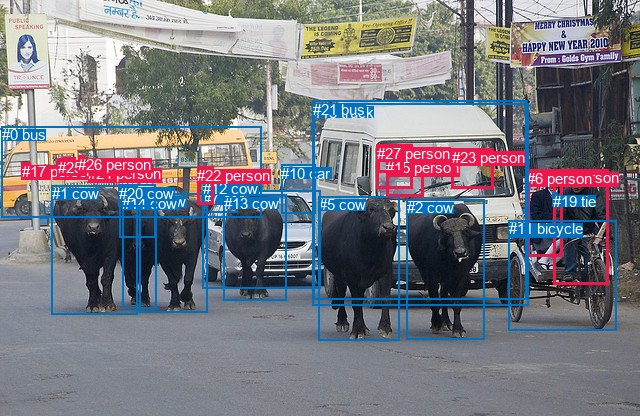
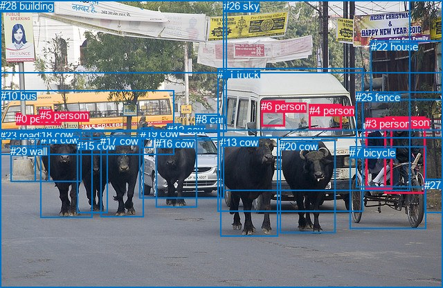

# 图片 0610：2342847.jpg

随机样本序号：489。图片 SHA256：`92d4db8b8ea208bddba73c0c89331960e194cf87eb5841e3050f62796131a60e`。

红色框表示人，蓝色框表示其他物体。两个模式分别保留自身框编号，可依据位置比较对应对象。

## 自动检测框与输出

人的框编号：`[4, 6, 8, 9, 15, 17, 22, 23, 24, 25, 26, 27]`。状态：`ok`。

### 自动检测全部物体框

| 编号 | 类别 | 是否为人 | 检测分数 | 像素坐标 xyxy |
|---|---|---|---|---|
| 0 | bus | False | 0.9985 | 2.0, 126.5, 261.3, 217.3 |
| 1 | cow | False | 0.9984 | 51.8, 185.4, 137.4, 314.5 |
| 2 | cow | False | 0.9974 | 406.6, 199.3, 484.1, 339.4 |
| 3 | cow | False | 0.9972 | 139.0, 193.0, 207.8, 312.5 |
| 4 | person | True | 0.9969 | 553.9, 169.1, 608.6, 284.3 |
| 5 | cow | False | 0.9958 | 318.9, 196.1, 399.4, 341.0 |
| 6 | person | True | 0.9908 | 527.1, 169.8, 562.9, 256.9 |
| 7 | car | False | 0.9857 | 202.5, 190.3, 320.8, 288.5 |
| 8 | person | True | 0.9576 | 376.8, 144.2, 412.4, 188.8 |
| 9 | person | True | 0.9543 | 63.2, 157.9, 75.0, 175.0 |
| 10 | car | False | 0.9338 | 281.1, 165.0, 316.0, 213.9 |
| 11 | bicycle | False | 0.9012 | 508.8, 220.3, 616.7, 330.2 |
| 12 | cow | False | 0.8963 | 203.1, 180.2, 237.3, 212.8 |
| 13 | cow | False | 0.8787 | 223.9, 195.0, 286.2, 300.1 |
| 14 | cow | False | 0.8666 | 122.3, 195.0, 156.8, 308.5 |
| 15 | person | True | 0.8209 | 386.1, 159.3, 423.2, 196.7 |
| 16 | cow | False | 0.8169 | 118.7, 184.3, 155.9, 206.8 |
| 17 | person | True | 0.8084 | 21.7, 162.7, 30.5, 175.3 |
| 18 | truck | False | 0.7713 | 312.8, 103.5, 528.8, 305.3 |
| 19 | tie | False | 0.7667 | 552.8, 192.7, 557.4, 201.6 |
| 20 | cow | False | 0.7295 | 119.4, 184.8, 155.8, 237.6 |
| 21 | bus | False | 0.6160 | 313.4, 101.0, 526.7, 300.0 |
| 22 | person | True | 0.5948 | 197.1, 166.6, 213.9, 204.3 |
| 23 | person | True | 0.5091 | 451.8, 148.8, 493.2, 189.0 |
| 24 | person | True | 0.4969 | 88.1, 165.5, 95.5, 173.9 |
| 25 | person | True | 0.4134 | 57.6, 158.9, 71.3, 175.4 |
| 26 | person | True | 0.4130 | 78.4, 155.6, 84.3, 173.9 |
| 27 | person | True | 0.3909 | 377.2, 144.6, 403.3, 172.9 |

### 自动检测 Top50 人相关候选

评分物体对：756；人相关物体对：516；输出关系：50。

| 排名 | 主语编号与类别 | 关系 | 宾语编号与类别 | 类型 | 人与人 | 排序分数 | 原始融合 logit |
|---|---|---|---|---|---|---|---|
| 1 | #15 person | driving on | #18 truck | semantic | False | 0.99068 | 4.6659 |
| 2 | #4 person | riding | #11 bicycle | semantic | False | 0.99066 | 4.6641 |
| 3 | #15 person | driving on | #21 bus | semantic | False | 0.99003 | 4.5986 |
| 4 | #23 person | driving on | #18 truck | semantic | False | 0.98987 | 4.5823 |
| 5 | #23 person | driving on | #21 bus | semantic | False | 0.98980 | 4.5753 |
| 6 | #8 person | driving on | #18 truck | semantic | False | 0.98900 | 4.4984 |
| 7 | #8 person | driving on | #21 bus | semantic | False | 0.98893 | 4.4924 |
| 8 | #24 person | riding | #0 bus | semantic | False | 0.98661 | 4.3000 |
| 9 | #27 person | driving on | #18 truck | semantic | False | 0.98524 | 4.2011 |
| 10 | #27 person | driving on | #21 bus | semantic | False | 0.98519 | 4.1976 |
| 11 | #4 person | on | #11 bicycle | spatial | False | 0.98403 | 4.1209 |
| 12 | #6 person | wearing | #19 tie | semantic | False | 0.98242 | 4.0230 |
| 13 | #26 person | riding | #0 bus | semantic | False | 0.98091 | 3.9394 |
| 14 | #4 person | wearing | #19 tie | semantic | False | 0.97741 | 3.7672 |
| 15 | #9 person | riding | #0 bus | semantic | False | 0.97279 | 3.5767 |
| 16 | #25 person | riding | #0 bus | semantic | False | 0.96732 | 3.3877 |
| 17 | #6 person | riding | #11 bicycle | semantic | False | 0.96553 | 3.3326 |
| 18 | #24 person | on | #0 bus | spatial | False | 0.96392 | 3.2852 |
| 19 | #23 person | in | #18 truck | spatial | False | 0.95513 | 3.0581 |
| 20 | #23 person | in | #21 bus | spatial | False | 0.95454 | 3.0445 |
| 21 | #6 person | on | #11 bicycle | spatial | False | 0.95238 | 2.9957 |
| 22 | #8 person | in | #18 truck | spatial | False | 0.94515 | 2.8467 |
| 23 | #8 person | in | #21 bus | spatial | False | 0.94449 | 2.8340 |
| 24 | #15 person | in | #18 truck | spatial | False | 0.94086 | 2.7669 |
| 25 | #15 person | in | #21 bus | spatial | False | 0.94028 | 2.7565 |
| 26 | #17 person | riding | #0 bus | semantic | False | 0.93978 | 2.7476 |
| 27 | #27 person | in | #18 truck | spatial | False | 0.93893 | 2.7327 |
| 28 | #27 person | in | #21 bus | spatial | False | 0.93854 | 2.7259 |
| 29 | #26 person | on | #0 bus | spatial | False | 0.93708 | 2.7008 |
| 30 | #8 person | wearing | #27 person | semantic | True | 0.93338 | 2.6398 |
| 31 | #17 person | on | #0 bus | spatial | False | 0.92928 | 2.5757 |
| 32 | #25 person | in | #0 bus | spatial | False | 0.92310 | 2.4852 |
| 33 | #9 person | in | #0 bus | spatial | False | 0.92278 | 2.4808 |
| 34 | #9 person | wearing | #25 person | semantic | True | 0.88986 | 2.0893 |
| 35 | #22 person | walking on | #12 cow | semantic | False | 0.88773 | 2.0678 |
| 36 | #6 person | in | #19 tie | spatial | False | 0.86960 | 1.8974 |
| 37 | #4 person | in | #19 tie | spatial | False | 0.84460 | 1.6929 |
| 38 | #9 person | in | #25 person | spatial | True | 0.83635 | 1.6313 |
| 39 | #25 person | wearing | #9 person | semantic | True | 0.75585 | 1.1301 |
| 40 | #25 person | in | #9 person | spatial | True | 0.73969 | 1.0443 |
| 41 | #8 person | in | #27 person | spatial | True | 0.72886 | 0.9888 |
| 42 | #26 person | wearing | #24 person | semantic | True | 0.72816 | 0.9853 |
| 43 | #11 bicycle | carrying | #4 person | semantic | False | 0.72518 | 0.9703 |
| 44 | #27 person | in | #8 person | spatial | True | 0.71635 | 0.9264 |
| 45 | #26 person | on | #24 person | spatial | True | 0.71154 | 0.9029 |
| 46 | #22 person | standing on | #0 bus | semantic | False | 0.71102 | 0.9004 |
| 47 | #22 person | in | #12 cow | spatial | False | 0.69425 | 0.8201 |
| 48 | #23 person | driving on | #11 bicycle | semantic | False | 0.66768 | 0.6977 |
| 49 | #6 person | looking at | #2 cow | semantic | False | 0.62787 | 0.5231 |
| 50 | #23 person | looking at | #2 cow | semantic | False | 0.61183 | 0.4550 |

### 自动检测逐条人相关 GT 核验

R@50：33.33%；命中 1/3。

| GT 主语编号 | GT 关系 | GT 宾语编号 | 结果阶段 | 匹配预测主语编号 | 匹配预测宾语编号 |
|---|---|---|---|---|---|
| 2 | riding | 7 | hit50 | [4] | [11] |
| 2 | walking on | 23 | endpoint_missing_or_wrong_class | [4] | [] |
| 6 | driving | 11 | wrong_predicate | [8, 27] | [18] |

## 真实框与输出

人的框编号：`[0, 1, 2, 3, 4, 5, 6]`。

### 真实框全部物体框

| 编号 | 类别 | 是否为人 | 检测分数 | 像素坐标 xyxy |
|---|---|---|---|---|
| 0 | person | True | GT | 23.0, 163.0, 30.0, 176.0 |
| 1 | person | True | GT | 63.0, 158.0, 75.0, 174.0 |
| 2 | person | True | GT | 555.0, 168.0, 614.0, 279.0 |
| 3 | person | True | GT | 528.0, 170.0, 566.0, 273.0 |
| 4 | person | True | GT | 447.0, 151.0, 494.0, 187.0 |
| 5 | person | True | GT | 58.0, 158.0, 64.0, 175.0 |
| 6 | person | True | GT | 377.0, 145.0, 411.0, 182.0 |
| 7 | bicycle | False | GT | 505.0, 212.0, 615.0, 331.0 |
| 8 | car | False | GT | 283.0, 164.0, 318.0, 202.0 |
| 9 | car | False | GT | 202.0, 188.0, 324.0, 287.0 |
| 10 | bus | False | GT | 1.0, 130.0, 252.0, 223.0 |
| 11 | truck | False | GT | 314.0, 99.0, 524.0, 305.0 |
| 12 | cow | False | GT | 242.0, 179.0, 261.0, 191.0 |
| 13 | cow | False | GT | 318.0, 197.0, 402.0, 341.0 |
| 14 | cow | False | GT | 59.0, 193.0, 134.0, 315.0 |
| 15 | cow | False | GT | 112.0, 202.0, 156.0, 307.0 |
| 16 | cow | False | GT | 225.0, 199.0, 284.0, 299.0 |
| 17 | cow | False | GT | 145.0, 195.0, 207.0, 313.0 |
| 18 | cow | False | GT | 51.0, 186.0, 118.0, 262.0 |
| 19 | cow | False | GT | 203.0, 184.0, 221.0, 213.0 |
| 20 | cow | False | GT | 404.0, 203.0, 484.0, 337.0 |
| 21 | banner | False | GT | 0.0, 0.0, 640.0, 105.0 |
| 22 | house | False | GT | 536.0, 59.0, 640.0, 145.0 |
| 23 | road | False | GT | 0.0, 187.0, 640.0, 416.0 |
| 24 | tree | False | GT | 0.0, 0.0, 640.0, 200.0 |
| 25 | fence | False | GT | 514.0, 132.0, 640.0, 271.0 |
| 26 | sky | False | GT | 323.0, 0.0, 593.0, 275.0 |
| 27 | dirt | False | GT | 613.0, 259.0, 640.0, 308.0 |
| 28 | building | False | GT | 0.0, 0.0, 328.0, 191.0 |
| 29 | wall | False | GT | 15.0, 210.0, 71.0, 262.0 |

### 真实框 Top50 人相关候选

评分物体对：870；人相关物体对：364；输出关系：50。

| 排名 | 主语编号与类别 | 关系 | 宾语编号与类别 | 类型 | 人与人 | 排序分数 | 原始融合 logit |
|---|---|---|---|---|---|---|---|
| 1 | #2 person | riding | #7 bicycle | semantic | False | 0.99147 | 4.7551 |
| 2 | #6 person | driving on | #11 truck | semantic | False | 0.99135 | 4.7417 |
| 3 | #4 person | driving on | #11 truck | semantic | False | 0.98808 | 4.4173 |
| 4 | #3 person | riding | #7 bicycle | semantic | False | 0.98401 | 4.1198 |
| 5 | #2 person | on | #7 bicycle | spatial | False | 0.98226 | 4.0143 |
| 6 | #4 person | in | #11 truck | spatial | False | 0.97444 | 3.6410 |
| 7 | #6 person | in | #11 truck | spatial | False | 0.97401 | 3.6239 |
| 8 | #3 person | on | #7 bicycle | spatial | False | 0.97126 | 3.5203 |
| 9 | #1 person | riding | #10 bus | semantic | False | 0.96994 | 3.4740 |
| 10 | #5 person | riding | #10 bus | semantic | False | 0.96090 | 3.2018 |
| 11 | #1 person | in | #10 bus | spatial | False | 0.94930 | 2.9297 |
| 12 | #5 person | in | #10 bus | spatial | False | 0.93479 | 2.6627 |
| 13 | #0 person | on | #10 bus | spatial | False | 0.93360 | 2.6433 |
| 14 | #4 person | in | #26 sky | spatial | False | 0.92788 | 2.5545 |
| 15 | #0 person | riding | #10 bus | semantic | False | 0.88872 | 2.0777 |
| 16 | #4 person | driving on | #26 sky | semantic | False | 0.88207 | 2.0121 |
| 17 | #3 person | looking at | #13 cow | semantic | False | 0.82139 | 1.5258 |
| 18 | #6 person | in | #26 sky | spatial | False | 0.79782 | 1.3727 |
| 19 | #6 person | driving | #26 sky | semantic | False | 0.79444 | 1.3519 |
| 20 | #3 person | looking at | #20 cow | semantic | False | 0.79147 | 1.3338 |
| 21 | #3 person | looking at | #17 cow | semantic | False | 0.78428 | 1.2908 |
| 22 | #7 bicycle | carrying | #2 person | semantic | False | 0.76465 | 1.1784 |
| 23 | #3 person | looking at | #14 cow | semantic | False | 0.75804 | 1.1420 |
| 24 | #5 person | in | #1 person | spatial | True | 0.75558 | 1.1286 |
| 25 | #5 person | pushing | #1 person | semantic | True | 0.75094 | 1.1036 |
| 26 | #3 person | looking at | #15 cow | semantic | False | 0.73962 | 1.0440 |
| 27 | #4 person | driving on | #7 bicycle | semantic | False | 0.72986 | 0.9939 |
| 28 | #5 person | in | #28 building | spatial | False | 0.58168 | 0.3297 |
| 29 | #1 person | in | #24 tree | spatial | False | 0.56751 | 0.2717 |
| 30 | #4 person | looking at | #20 cow | semantic | False | 0.56487 | 0.2610 |
| 31 | #2 person | looking at | #17 cow | semantic | False | 0.55750 | 0.2310 |
| 32 | #1 person | in | #28 building | spatial | False | 0.55319 | 0.2136 |
| 33 | #5 person | in | #24 tree | spatial | False | 0.52777 | 0.1112 |
| 34 | #2 person | looking at | #14 cow | semantic | False | 0.52589 | 0.1037 |
| 35 | #2 person | looking at | #15 cow | semantic | False | 0.51774 | 0.0710 |
| 36 | #7 bicycle | carrying | #3 person | semantic | False | 0.49379 | -0.0248 |
| 37 | #6 person | driving | #13 cow | semantic | False | 0.47351 | -0.1061 |
| 38 | #3 person | talking to | #2 person | semantic | True | 0.45524 | -0.1795 |
| 39 | #3 person | sitting on | #11 truck | semantic | False | 0.43914 | -0.2447 |
| 40 | #6 person | driving | #20 cow | semantic | False | 0.43659 | -0.2550 |
| 41 | #10 bus | carrying | #1 person | semantic | False | 0.42887 | -0.2865 |
| 42 | #1 person | in | #5 person | spatial | True | 0.40982 | -0.3647 |
| 43 | #2 person | in | #25 fence | spatial | False | 0.40520 | -0.3838 |
| 44 | #11 truck | in | #6 person | spatial | False | 0.39625 | -0.4211 |
| 45 | #5 person | looking at | #14 cow | semantic | False | 0.38795 | -0.4559 |
| 46 | #2 person | looking at | #20 cow | semantic | False | 0.37458 | -0.5126 |
| 47 | #2 person | sitting on | #25 fence | semantic | False | 0.37436 | -0.5135 |
| 48 | #11 truck | carrying | #4 person | semantic | False | 0.37161 | -0.5253 |
| 49 | #3 person | in | #25 fence | spatial | False | 0.36710 | -0.5447 |
| 50 | #14 cow | pulling | #2 person | semantic | False | 0.36675 | -0.5462 |

### 真实框逐条人相关 GT 核验

R@50：33.33%；命中 1/3。

| GT 主语编号 | GT 关系 | GT 宾语编号 | 结果阶段 | 匹配预测主语编号 | 匹配预测宾语编号 |
|---|---|---|---|---|---|
| 2 | riding | 7 | hit50 | [2] | [7] |
| 2 | walking on | 23 | wrong_predicate | [2] | [23] |
| 6 | driving | 11 | wrong_predicate | [6] | [11] |

## 全部人相关 GT

| 主语编号与类别 | 关系 | 宾语编号与类别 |
|---|---|---|
| #2 person | riding | #7 bicycle |
| #2 person | walking on | #23 road |
| #6 person | driving | #11 truck |

原始记录、全部人相关物体对的两项预测与分项分数见 [逐图证据 JSON](../evidence/cases/0610.json)。全部56类 logits 保留于本机 HOR/output/random500/logits/。

<!-- HOR_COMPLETE_RESULTS -->

## 六组条件的完整输出对照

以下保留同一图片三种框与候选模式、两种谓词输出规则的全部 Top50。框编号各自在所属模式内解释。

### 自动检测框完整枚举：空间与语义各保留一个谓词

| 排名 | 主语编号与类别 | 谓词 | 宾语编号与类别 | 分组 | 排序分数 | predicate logit | pair logit |
|---|---|---|---|---|---|---|---|
| 1 | #15 person | driving on | #18 truck | semantic | 0.9906770 | 4.5667672 | 0.0991349 |
| 2 | #4 person | riding | #11 bicycle | semantic | 0.9906604 | 3.8378291 | 0.8262734 |
| 3 | #15 person | driving on | #21 bus | semantic | 0.9900346 | 4.5066400 | 0.0919816 |
| 4 | #23 person | driving on | #18 truck | semantic | 0.9898719 | 4.5667949 | 0.0154698 |
| 5 | #23 person | driving on | #21 bus | semantic | 0.9898019 | 4.5667949 | 0.0085115 |
| 6 | #8 person | driving on | #18 truck | semantic | 0.9889961 | 4.3863473 | 0.1120938 |
| 7 | #8 person | driving on | #21 bus | semantic | 0.9889300 | 4.3863654 | 0.1060231 |
| 8 | #24 person | riding | #0 bus | semantic | 0.9866128 | 4.0090919 | 0.2908885 |
| 9 | #27 person | driving on | #18 truck | semantic | 0.9852412 | 4.0854621 | 0.1155900 |
| 10 | #27 person | driving on | #21 bus | semantic | 0.9851909 | 4.0854888 | 0.1121024 |
| 11 | #4 person | on | #11 bicycle | spatial | 0.9840300 | 3.2946696 | 0.8262734 |
| 12 | #6 person | wearing | #19 tie | semantic | 0.9824158 | 3.7862191 | 0.2367975 |
| 13 | #26 person | riding | #0 bus | semantic | 0.9809108 | 3.7671390 | 0.1722183 |
| 14 | #4 person | wearing | #19 tie | semantic | 0.9774064 | 3.2269726 | 0.5402629 |
| 15 | #9 person | riding | #0 bus | semantic | 0.9727923 | 3.4647613 | 0.1119089 |
| 16 | #25 person | riding | #0 bus | semantic | 0.9673194 | 3.2847023 | 0.1030439 |
| 17 | #6 person | riding | #11 bicycle | semantic | 0.9655318 | 3.3571019 | -0.0244609 |
| 18 | #24 person | on | #0 bus | spatial | 0.9639184 | 2.9943361 | 0.2908885 |
| 19 | #23 person | in | #18 truck | spatial | 0.9551302 | 3.0426149 | 0.0154698 |
| 20 | #23 person | in | #21 bus | spatial | 0.9545440 | 3.0359774 | 0.0085115 |
| 21 | #6 person | on | #11 bicycle | spatial | 0.9523773 | 3.0201125 | -0.0244609 |
| 22 | #8 person | in | #18 truck | spatial | 0.9451485 | 2.7346196 | 0.1120938 |
| 23 | #8 person | in | #21 bus | spatial | 0.9444860 | 2.7279820 | 0.1060231 |
| 24 | #15 person | in | #18 truck | spatial | 0.9408627 | 2.6677990 | 0.0991349 |
| 25 | #15 person | in | #21 bus | spatial | 0.9402772 | 2.6644802 | 0.0919816 |
| 26 | #17 person | riding | #0 bus | semantic | 0.9397784 | 2.7552767 | -0.0076630 |
| 27 | #27 person | in | #18 truck | spatial | 0.9389299 | 2.6171279 | 0.1155900 |
| 28 | #27 person | in | #21 bus | spatial | 0.9385385 | 2.6138091 | 0.1121024 |
| 29 | #26 person | on | #0 bus | spatial | 0.9370767 | 2.5286317 | 0.1722183 |
| 30 | #8 person | wearing | #27 person | semantic | 0.9333776 | 2.8333855 | -0.1936160 |
| 31 | #17 person | on | #0 bus | spatial | 0.9292816 | 2.5833688 | -0.0076630 |
| 32 | #25 person | in | #0 bus | spatial | 0.9230970 | 2.3821449 | 0.1030439 |
| 33 | #9 person | in | #0 bus | spatial | 0.9227833 | 2.3688698 | 0.1119089 |
| 34 | #9 person | wearing | #25 person | semantic | 0.8898593 | 2.8407564 | -0.7514520 |
| 35 | #22 person | walking on | #12 cow | semantic | 0.8877349 | 2.0613570 | 0.0064533 |
| 36 | #6 person | in | #19 tie | spatial | 0.8695970 | 1.6606021 | 0.2367975 |
| 37 | #4 person | in | #19 tie | spatial | 0.8445992 | 1.1525922 | 0.5402629 |
| 38 | #9 person | in | #25 person | spatial | 0.8363532 | 2.3827920 | -0.7514520 |
| 39 | #25 person | wearing | #9 person | semantic | 0.7558543 | 1.8667068 | -0.7366234 |
| 40 | #25 person | in | #9 person | spatial | 0.7396874 | 1.7809677 | -0.7366234 |
| 41 | #8 person | in | #27 person | spatial | 0.7288597 | 1.1824608 | -0.1936160 |
| 42 | #26 person | wearing | #24 person | semantic | 0.7281645 | 1.6515574 | -0.6662275 |
| 43 | #11 bicycle | carrying | #4 person | semantic | 0.7251762 | 1.4997077 | -0.5294231 |
| 44 | #27 person | in | #8 person | spatial | 0.7163467 | 1.2446470 | -0.3182355 |
| 45 | #26 person | on | #24 person | spatial | 0.7115395 | 1.5691004 | -0.6662275 |
| 46 | #22 person | standing on | #0 bus | semantic | 0.7110230 | 1.3169909 | -0.4166329 |
| 47 | #22 person | in | #12 cow | spatial | 0.6942509 | 0.8136153 | 0.0064533 |
| 48 | #23 person | driving on | #11 bicycle | semantic | 0.6676766 | 1.5287266 | -0.8310312 |
| 49 | #6 person | looking at | #2 cow | semantic | 0.6278693 | 0.8809242 | -0.3578371 |
| 50 | #23 person | looking at | #2 cow | semantic | 0.6118348 | 0.7281365 | -0.2731050 |

GT 命中：1/3，R@50=33.33%。

| GT主语 | GT谓词 | GT宾语 | 结果阶段 | 匹配主语框 | 匹配宾语框 |
|---|---|---|---|---|---|
| 2 | riding | 7 | hit50 | [4] | [11] |
| 2 | walking on | 23 | endpoint_missing_or_wrong_class | [4] | [] |
| 6 | driving | 11 | wrong_predicate | [8, 27] | [18] |

### 自动检测框完整枚举：每对只保留一个谓词

| 排名 | 主语编号与类别 | 谓词 | 宾语编号与类别 | 分组 | 排序分数 | predicate logit | pair logit |
|---|---|---|---|---|---|---|---|
| 1 | #15 person | driving on | #18 truck | single | 0.9906770 | 4.5667672 | 0.0991349 |
| 2 | #4 person | riding | #11 bicycle | single | 0.9906604 | 3.8378291 | 0.8262734 |
| 3 | #15 person | driving on | #21 bus | single | 0.9900346 | 4.5066400 | 0.0919816 |
| 4 | #23 person | driving on | #18 truck | single | 0.9898719 | 4.5667949 | 0.0154698 |
| 5 | #23 person | driving on | #21 bus | single | 0.9898019 | 4.5667949 | 0.0085115 |
| 6 | #8 person | driving on | #18 truck | single | 0.9889961 | 4.3863473 | 0.1120938 |
| 7 | #8 person | driving on | #21 bus | single | 0.9889300 | 4.3863654 | 0.1060231 |
| 8 | #24 person | riding | #0 bus | single | 0.9866128 | 4.0090919 | 0.2908885 |
| 9 | #27 person | driving on | #18 truck | single | 0.9852412 | 4.0854621 | 0.1155900 |
| 10 | #27 person | driving on | #21 bus | single | 0.9851909 | 4.0854888 | 0.1121024 |
| 11 | #6 person | wearing | #19 tie | single | 0.9824158 | 3.7862191 | 0.2367975 |
| 12 | #26 person | riding | #0 bus | single | 0.9809108 | 3.7671390 | 0.1722183 |
| 13 | #4 person | wearing | #19 tie | single | 0.9774064 | 3.2269726 | 0.5402629 |
| 14 | #9 person | riding | #0 bus | single | 0.9727923 | 3.4647613 | 0.1119089 |
| 15 | #25 person | riding | #0 bus | single | 0.9673194 | 3.2847023 | 0.1030439 |
| 16 | #6 person | riding | #11 bicycle | single | 0.9655318 | 3.3571019 | -0.0244609 |
| 17 | #17 person | riding | #0 bus | single | 0.9397784 | 2.7552767 | -0.0076630 |
| 18 | #8 person | wearing | #27 person | single | 0.9333776 | 2.8333855 | -0.1936160 |
| 19 | #9 person | wearing | #25 person | single | 0.8898593 | 2.8407564 | -0.7514520 |
| 20 | #22 person | walking on | #12 cow | single | 0.8877349 | 2.0613570 | 0.0064533 |
| 21 | #25 person | wearing | #9 person | single | 0.7558543 | 1.8667068 | -0.7366234 |
| 22 | #26 person | wearing | #24 person | single | 0.7281645 | 1.6515574 | -0.6662275 |
| 23 | #11 bicycle | carrying | #4 person | single | 0.7251762 | 1.4997077 | -0.5294231 |
| 24 | #27 person | in | #8 person | single | 0.7163467 | 1.2446470 | -0.3182355 |
| 25 | #22 person | standing on | #0 bus | single | 0.7110230 | 1.3169909 | -0.4166329 |
| 26 | #23 person | driving on | #11 bicycle | single | 0.6676766 | 1.5287266 | -0.8310312 |
| 27 | #6 person | looking at | #2 cow | single | 0.6278693 | 0.8809242 | -0.3578371 |
| 28 | #23 person | looking at | #2 cow | single | 0.6118348 | 0.7281365 | -0.2731050 |
| 29 | #27 person | driving | #15 person | single | 0.5444300 | 0.6286478 | -0.4504581 |
| 30 | #8 person | driving | #15 person | single | 0.5316390 | 0.4481883 | -0.3214629 |
| 31 | #22 person | pushing | #11 bicycle | single | 0.5052316 | 1.1999040 | -1.1789767 |
| 32 | #6 person | looking at | #5 cow | single | 0.5042334 | 0.9148512 | -0.8979171 |
| 33 | #6 person | looking at | #3 cow | single | 0.4996089 | 0.7668352 | -0.7683994 |
| 34 | #4 person | looking at | #3 cow | single | 0.4860597 | 0.4723067 | -0.5280825 |
| 35 | #4 person | looking at | #2 cow | single | 0.4815710 | 0.1762753 | -0.2500246 |
| 36 | #15 person | looking at | #2 cow | single | 0.4656896 | 0.0075698 | -0.1450273 |
| 37 | #22 person | looking at | #7 car | single | 0.4647712 | 0.4603658 | -0.6015149 |
| 38 | #26 person | in | #9 person | single | 0.4414148 | 0.5104971 | -0.7459192 |
| 39 | #15 person | driving on | #11 bicycle | single | 0.4263844 | 0.7467384 | -1.0433569 |
| 40 | #8 person | driving | #5 cow | single | 0.4259840 | 0.1470218 | -0.4452773 |
| 41 | #4 person | wearing | #6 person | single | 0.4144535 | -0.0796709 | -0.2659139 |
| 42 | #6 person | looking at | #4 person | single | 0.4089721 | 0.4834628 | -0.8516792 |
| 43 | #8 person | looking at | #2 cow | single | 0.3894457 | -0.1671705 | -0.2824726 |
| 44 | #15 person | looking at | #5 cow | single | 0.3842110 | -0.1180792 | -0.3536334 |
| 45 | #4 person | looking at | #14 cow | single | 0.3830765 | -0.0078454 | -0.4686648 |
| 46 | #6 person | looking at | #14 cow | single | 0.3760792 | 0.2168250 | -0.7230486 |
| 47 | #8 person | driving on | #11 bicycle | single | 0.3756580 | 0.6865916 | -1.1946110 |
| 48 | #6 person | on | #18 truck | single | 0.3657607 | 0.2820692 | -0.8325163 |
| 49 | #26 person | in | #25 person | single | 0.3603278 | 0.1965327 | -0.7704743 |
| 50 | #22 person | looking at | #3 cow | single | 0.3452719 | 0.0134425 | -0.6533303 |

GT 命中：1/3，R@50=33.33%。

| GT主语 | GT谓词 | GT宾语 | 结果阶段 | 匹配主语框 | 匹配宾语框 |
|---|---|---|---|---|---|
| 2 | riding | 7 | hit50 | [4] | [11] |
| 2 | walking on | 23 | endpoint_missing_or_wrong_class | [4] | [] |
| 6 | driving | 11 | wrong_predicate | [8, 27] | [18] |

### 真实框完整枚举：空间与语义各保留一个谓词

| 排名 | 主语编号与类别 | 谓词 | 宾语编号与类别 | 分组 | 排序分数 | predicate logit | pair logit |
|---|---|---|---|---|---|---|---|
| 1 | #2 person | riding | #7 bicycle | semantic | 0.9914657 | 3.9586825 | 0.7964100 |
| 2 | #6 person | driving on | #11 truck | semantic | 0.9913517 | 4.6272674 | 0.1144403 |
| 3 | #4 person | driving on | #11 truck | semantic | 0.9880767 | 4.3866181 | 0.0306492 |
| 4 | #3 person | riding | #7 bicycle | semantic | 0.9840121 | 3.6580157 | 0.4617911 |
| 5 | #2 person | on | #7 bicycle | spatial | 0.9822642 | 3.2178626 | 0.7964100 |
| 6 | #4 person | in | #11 truck | spatial | 0.9744444 | 3.6103616 | 0.0306492 |
| 7 | #6 person | in | #11 truck | spatial | 0.9740149 | 3.5094638 | 0.1144403 |
| 8 | #3 person | on | #7 bicycle | spatial | 0.9712601 | 3.0585155 | 0.4617911 |
| 9 | #1 person | riding | #10 bus | semantic | 0.9699395 | 3.4045777 | 0.0694449 |
| 10 | #5 person | riding | #10 bus | semantic | 0.9609026 | 3.1648259 | 0.0369919 |
| 11 | #1 person | in | #10 bus | spatial | 0.9492967 | 2.8602858 | 0.0694449 |
| 12 | #5 person | in | #10 bus | spatial | 0.9347920 | 2.6257486 | 0.0369919 |
| 13 | #0 person | on | #10 bus | spatial | 0.9335969 | 2.6647515 | -0.0214509 |
| 14 | #4 person | in | #26 sky | spatial | 0.9278779 | 2.9740133 | -0.4194742 |
| 15 | #0 person | riding | #10 bus | semantic | 0.8887150 | 2.0991340 | -0.0214509 |
| 16 | #4 person | driving on | #26 sky | semantic | 0.8820654 | 2.4316092 | -0.4194742 |
| 17 | #3 person | looking at | #13 cow | semantic | 0.8213924 | 2.1202440 | -0.5944341 |
| 18 | #6 person | in | #26 sky | spatial | 0.7978176 | 1.8829784 | -0.5102684 |
| 19 | #6 person | driving | #26 sky | semantic | 0.7944388 | 1.8621607 | -0.5102684 |
| 20 | #3 person | looking at | #20 cow | semantic | 0.7914733 | 1.3987513 | -0.0649222 |
| 21 | #3 person | looking at | #17 cow | semantic | 0.7842757 | 1.7542682 | -0.4635090 |
| 22 | #7 bicycle | carrying | #2 person | semantic | 0.7646540 | 1.7012262 | -0.5228596 |
| 23 | #3 person | looking at | #14 cow | semantic | 0.7580413 | 1.5723262 | -0.4303551 |
| 24 | #5 person | in | #1 person | spatial | 0.7555842 | 1.8570757 | -0.7284551 |
| 25 | #5 person | pushing | #1 person | semantic | 0.7509370 | 1.8320708 | -0.7284551 |
| 26 | #3 person | looking at | #15 cow | semantic | 0.7396227 | 1.4218698 | -0.3778615 |
| 27 | #4 person | driving on | #7 bicycle | semantic | 0.7298582 | 1.7393565 | -0.7454534 |
| 28 | #5 person | in | #28 building | spatial | 0.5816820 | 0.7890692 | -0.4593873 |
| 29 | #1 person | in | #24 tree | spatial | 0.5675066 | 0.8523479 | -0.5806626 |
| 30 | #4 person | looking at | #20 cow | semantic | 0.5648705 | 0.5180206 | -0.2570676 |
| 31 | #2 person | looking at | #17 cow | semantic | 0.5575009 | 0.8095865 | -0.5785608 |
| 32 | #1 person | in | #28 building | spatial | 0.5531878 | 0.6456957 | -0.4321365 |
| 33 | #5 person | in | #24 tree | spatial | 0.5277691 | 0.7083068 | -0.5971159 |
| 34 | #2 person | looking at | #14 cow | semantic | 0.5258895 | 0.6316533 | -0.5280025 |
| 35 | #2 person | looking at | #15 cow | semantic | 0.5177368 | 0.5429482 | -0.4719713 |
| 36 | #7 bicycle | carrying | #3 person | semantic | 0.4937901 | 0.8019838 | -0.8268244 |
| 37 | #6 person | driving | #13 cow | semantic | 0.4735113 | 0.3576131 | -0.4636672 |
| 38 | #3 person | talking to | #2 person | semantic | 0.4552407 | 0.5182791 | -0.6977968 |
| 39 | #3 person | sitting on | #11 truck | semantic | 0.4391384 | 0.3162112 | -0.5608709 |
| 40 | #6 person | driving | #20 cow | semantic | 0.4365892 | 0.0567508 | -0.3117672 |
| 41 | #10 bus | carrying | #1 person | semantic | 0.4288668 | 0.3071432 | -0.5936191 |
| 42 | #1 person | in | #5 person | spatial | 0.4098222 | 0.3797307 | -0.7444310 |
| 43 | #2 person | in | #25 fence | spatial | 0.4052002 | 0.3675690 | -0.7514125 |
| 44 | #11 truck | in | #6 person | spatial | 0.3962473 | 0.1285996 | -0.5497257 |
| 45 | #5 person | looking at | #14 cow | semantic | 0.3879484 | 0.1303868 | -0.5863312 |
| 46 | #2 person | looking at | #20 cow | semantic | 0.3745808 | -0.1712232 | -0.3413916 |
| 47 | #2 person | sitting on | #25 fence | semantic | 0.3743646 | 0.2378750 | -0.7514125 |
| 48 | #11 truck | carrying | #4 person | semantic | 0.3716055 | 0.0945745 | -0.6199101 |
| 49 | #3 person | in | #25 fence | spatial | 0.3670951 | 0.2426715 | -0.7873705 |
| 50 | #14 cow | pulling | #2 person | semantic | 0.3667479 | 1.2298141 | -1.7760079 |

GT 命中：1/3，R@50=33.33%。

| GT主语 | GT谓词 | GT宾语 | 结果阶段 | 匹配主语框 | 匹配宾语框 |
|---|---|---|---|---|---|
| 2 | riding | 7 | hit50 | [2] | [7] |
| 2 | walking on | 23 | wrong_predicate | [2] | [23] |
| 6 | driving | 11 | wrong_predicate | [6] | [11] |

### 真实框完整枚举：每对只保留一个谓词

| 排名 | 主语编号与类别 | 谓词 | 宾语编号与类别 | 分组 | 排序分数 | predicate logit | pair logit |
|---|---|---|---|---|---|---|---|
| 1 | #2 person | riding | #7 bicycle | single | 0.9914657 | 3.9586825 | 0.7964100 |
| 2 | #6 person | driving on | #11 truck | single | 0.9913517 | 4.6272674 | 0.1144403 |
| 3 | #4 person | driving on | #11 truck | single | 0.9880767 | 4.3866181 | 0.0306492 |
| 4 | #3 person | riding | #7 bicycle | single | 0.9840121 | 3.6580157 | 0.4617911 |
| 5 | #1 person | riding | #10 bus | single | 0.9699395 | 3.4045777 | 0.0694449 |
| 6 | #5 person | riding | #10 bus | single | 0.9609026 | 3.1648259 | 0.0369919 |
| 7 | #0 person | on | #10 bus | single | 0.9335969 | 2.6647515 | -0.0214509 |
| 8 | #4 person | in | #26 sky | single | 0.9278779 | 2.9740133 | -0.4194742 |
| 9 | #3 person | looking at | #13 cow | single | 0.8213924 | 2.1202440 | -0.5944341 |
| 10 | #6 person | in | #26 sky | single | 0.7978176 | 1.8829784 | -0.5102684 |
| 11 | #3 person | looking at | #20 cow | single | 0.7914733 | 1.3987513 | -0.0649222 |
| 12 | #3 person | looking at | #17 cow | single | 0.7842757 | 1.7542682 | -0.4635090 |
| 13 | #7 bicycle | carrying | #2 person | single | 0.7646540 | 1.7012262 | -0.5228596 |
| 14 | #3 person | looking at | #14 cow | single | 0.7580413 | 1.5723262 | -0.4303551 |
| 15 | #5 person | in | #1 person | single | 0.7555842 | 1.8570757 | -0.7284551 |
| 16 | #3 person | looking at | #15 cow | single | 0.7396227 | 1.4218698 | -0.3778615 |
| 17 | #4 person | driving on | #7 bicycle | single | 0.7298582 | 1.7393565 | -0.7454534 |
| 18 | #5 person | in | #28 building | single | 0.5816820 | 0.7890692 | -0.4593873 |
| 19 | #1 person | in | #24 tree | single | 0.5675066 | 0.8523479 | -0.5806626 |
| 20 | #4 person | looking at | #20 cow | single | 0.5648705 | 0.5180206 | -0.2570676 |
| 21 | #2 person | looking at | #17 cow | single | 0.5575009 | 0.8095865 | -0.5785608 |
| 22 | #1 person | in | #28 building | single | 0.5531878 | 0.6456957 | -0.4321365 |
| 23 | #5 person | in | #24 tree | single | 0.5277691 | 0.7083068 | -0.5971159 |
| 24 | #2 person | looking at | #14 cow | single | 0.5258895 | 0.6316533 | -0.5280025 |
| 25 | #2 person | looking at | #15 cow | single | 0.5177368 | 0.5429482 | -0.4719713 |
| 26 | #7 bicycle | carrying | #3 person | single | 0.4937901 | 0.8019838 | -0.8268244 |
| 27 | #6 person | driving | #13 cow | single | 0.4735113 | 0.3576131 | -0.4636672 |
| 28 | #3 person | talking to | #2 person | single | 0.4552407 | 0.5182791 | -0.6977968 |
| 29 | #3 person | sitting on | #11 truck | single | 0.4391384 | 0.3162112 | -0.5608709 |
| 30 | #6 person | driving | #20 cow | single | 0.4365892 | 0.0567508 | -0.3117672 |
| 31 | #10 bus | carrying | #1 person | single | 0.4288668 | 0.3071432 | -0.5936191 |
| 32 | #1 person | in | #5 person | single | 0.4098222 | 0.3797307 | -0.7444310 |
| 33 | #2 person | in | #25 fence | single | 0.4052002 | 0.3675690 | -0.7514125 |
| 34 | #11 truck | in | #6 person | single | 0.3962473 | 0.1285996 | -0.5497257 |
| 35 | #5 person | looking at | #14 cow | single | 0.3879484 | 0.1303868 | -0.5863312 |
| 36 | #2 person | looking at | #20 cow | single | 0.3745808 | -0.1712232 | -0.3413916 |
| 37 | #11 truck | carrying | #4 person | single | 0.3716055 | 0.0945745 | -0.6199101 |
| 38 | #3 person | in | #25 fence | single | 0.3670951 | 0.2426715 | -0.7873705 |
| 39 | #14 cow | pulling | #2 person | single | 0.3667479 | 1.2298141 | -1.7760079 |
| 40 | #15 cow | pulling | #2 person | single | 0.3659575 | 1.2599115 | -1.8095105 |
| 41 | #2 person | looking at | #13 cow | single | 0.3635064 | 0.2663746 | -0.8265521 |
| 42 | #10 bus | carrying | #5 person | single | 0.3618881 | 0.0363221 | -0.6035006 |
| 43 | #1 person | looking at | #14 cow | single | 0.3468686 | -0.0219870 | -0.6108454 |
| 44 | #5 person | walking on | #23 road | single | 0.3381234 | 0.1987662 | -0.8704343 |
| 45 | #3 person | looking at | #16 cow | single | 0.3316970 | 0.4262438 | -1.1267636 |
| 46 | #4 person | driving | #10 bus | single | 0.3260937 | 0.2372460 | -0.9631522 |
| 47 | #0 person | on | #23 road | single | 0.3057252 | -0.0967503 | -0.7234311 |
| 48 | #1 person | walking on | #23 road | single | 0.2959750 | 0.0152221 | -0.8817607 |
| 49 | #0 person | in | #28 building | single | 0.2950290 | -0.3873630 | -0.4837202 |
| 50 | #3 person | sitting on | #26 sky | single | 0.2885998 | -0.1562362 | -0.7459581 |

GT 命中：1/3，R@50=33.33%。

| GT主语 | GT谓词 | GT宾语 | 结果阶段 | 匹配主语框 | 匹配宾语框 |
|---|---|---|---|---|---|
| 2 | riding | 7 | hit50 | [2] | [7] |
| 2 | walking on | 23 | wrong_predicate | [2] | [23] |
| 6 | driving | 11 | wrong_predicate | [6] | [11] |

### 真实框400候选：空间与语义各保留一个谓词

| 排名 | 主语编号与类别 | 谓词 | 宾语编号与类别 | 分组 | 排序分数 | predicate logit | pair logit |
|---|---|---|---|---|---|---|---|
| 1 | #2 person | riding | #7 bicycle | semantic | 0.9914595 | 3.9579501 | 0.7964100 |
| 2 | #6 person | driving on | #11 truck | semantic | 0.9883496 | 4.3262553 | 0.1144403 |
| 3 | #4 person | driving on | #11 truck | semantic | 0.9848788 | 4.1457715 | 0.0306492 |
| 4 | #3 person | riding | #7 bicycle | semantic | 0.9840006 | 3.6572814 | 0.4617911 |
| 5 | #2 person | on | #7 bicycle | spatial | 0.9797131 | 3.0808735 | 0.7964100 |
| 6 | #4 person | in | #11 truck | spatial | 0.9718322 | 3.5103545 | 0.0306492 |
| 7 | #6 person | in | #11 truck | spatial | 0.9709885 | 3.3961816 | 0.1144403 |
| 8 | #3 person | on | #7 bicycle | spatial | 0.9644753 | 2.8395648 | 0.4617911 |
| 9 | #3 person | looking at | #13 cow | semantic | 0.9411302 | 3.3661876 | -0.5944341 |
| 10 | #1 person | riding | #10 bus | semantic | 0.9187492 | 2.3560276 | 0.0694449 |
| 11 | #1 person | in | #10 bus | spatial | 0.8747205 | 1.8739123 | 0.0694449 |
| 12 | #3 person | looking at | #20 cow | semantic | 0.8719668 | 1.9833846 | -0.0649222 |
| 13 | #4 person | in | #26 sky | spatial | 0.8350002 | 2.0409617 | -0.4194742 |
| 14 | #5 person | riding | #10 bus | semantic | 0.7933440 | 1.3082094 | 0.0369919 |
| 15 | #4 person | driving on | #26 sky | semantic | 0.7406493 | 1.4688201 | -0.4194742 |
| 16 | #5 person | in | #10 bus | spatial | 0.7285668 | 0.9503717 | 0.0369919 |
| 17 | #7 bicycle | carrying | #2 person | semantic | 0.7043990 | 1.3911939 | -0.5228596 |
| 18 | #2 person | looking at | #13 cow | semantic | 0.6502594 | 1.4467316 | -0.8265521 |
| 19 | #2 person | guiding | #20 cow | semantic | 0.6061707 | 0.7726355 | -0.3413916 |
| 20 | #3 person | sitting on | #11 truck | semantic | 0.5999677 | 0.9662013 | -0.5608709 |
| 21 | #6 person | in | #26 sky | spatial | 0.5848576 | 0.8530154 | -0.5102684 |
| 22 | #6 person | driving | #26 sky | semantic | 0.5814794 | 0.8391180 | -0.5102684 |
| 23 | #2 person | crossing | #23 road | semantic | 0.5638824 | 0.7894578 | -0.5325240 |
| 24 | #4 person | looking at | #20 cow | semantic | 0.5596097 | 0.4966459 | -0.2570676 |
| 25 | #2 person | looking at | #16 cow | semantic | 0.5438793 | 1.4222188 | -1.2462488 |
| 26 | #6 person | driving | #13 cow | semantic | 0.5336012 | 0.5982747 | -0.4636672 |
| 27 | #5 person | in | #1 person | spatial | 0.5297188 | 0.8474708 | -0.7284551 |
| 28 | #2 person | in | #23 road | spatial | 0.5133857 | 0.5860796 | -0.5325240 |
| 29 | #0 person | on | #10 bus | spatial | 0.4988901 | 0.0170112 | -0.0214509 |
| 30 | #2 person | driving | #10 bus | semantic | 0.4920205 | 1.0496578 | -1.0815785 |
| 31 | #6 person | driving | #20 cow | semantic | 0.4888954 | 0.2673416 | -0.3117672 |
| 32 | #3 person | crossing | #23 road | semantic | 0.4870139 | 0.4893270 | -0.5412831 |
| 33 | #5 person | walking on | #1 person | semantic | 0.4796646 | 0.6470685 | -0.7284551 |
| 34 | #3 person | in | #23 road | spatial | 0.4651777 | 0.4017682 | -0.5412831 |
| 35 | #5 person | in | #28 building | spatial | 0.4512028 | 0.2635751 | -0.4593873 |
| 36 | #2 person | sitting on | #11 truck | semantic | 0.4468606 | 0.5298543 | -0.7432177 |
| 37 | #3 person | looking at | #9 car | semantic | 0.4421386 | 1.1131787 | -1.3456661 |
| 38 | #3 person | in | #25 fence | spatial | 0.4406348 | 0.5487843 | -0.7873705 |
| 39 | #2 person | in | #25 fence | spatial | 0.4353791 | 0.4914751 | -0.7514125 |
| 40 | #3 person | on | #11 truck | spatial | 0.4284980 | 0.2728891 | -0.5608709 |
| 41 | #2 person | sitting on | #25 fence | semantic | 0.4241189 | 0.4455252 | -0.7514125 |
| 42 | #7 bicycle | carrying | #3 person | semantic | 0.4147910 | 0.4826303 | -0.8268244 |
| 43 | #1 person | in | #28 building | spatial | 0.4048269 | 0.0467439 | -0.4321365 |
| 44 | #2 person | pushing | #9 car | semantic | 0.4036782 | 1.1094260 | -1.4995885 |
| 45 | #3 person | talking to | #2 person | semantic | 0.3822687 | 0.2178669 | -0.6977968 |
| 46 | #3 person | sitting on | #26 sky | semantic | 0.3665358 | 0.1988506 | -0.7459581 |
| 47 | #3 person | sitting on | #25 fence | semantic | 0.3625104 | 0.2228856 | -0.7873705 |
| 48 | #2 person | on | #11 truck | spatial | 0.3545711 | 0.1442118 | -0.7432177 |
| 49 | #20 cow | pulling | #2 person | semantic | 0.3402895 | 0.8086762 | -1.4706806 |
| 50 | #3 person | in | #26 sky | spatial | 0.3249121 | 0.0146699 | -0.7459581 |

GT 命中：1/3，R@50=33.33%。

| GT主语 | GT谓词 | GT宾语 | 结果阶段 | 匹配主语框 | 匹配宾语框 |
|---|---|---|---|---|---|
| 2 | riding | 7 | hit50 | [2] | [7] |
| 2 | walking on | 23 | wrong_predicate | [2] | [23] |
| 6 | driving | 11 | wrong_predicate | [6] | [11] |

### 真实框400候选：每对只保留一个谓词

| 排名 | 主语编号与类别 | 谓词 | 宾语编号与类别 | 分组 | 排序分数 | predicate logit | pair logit |
|---|---|---|---|---|---|---|---|
| 1 | #2 person | riding | #7 bicycle | single | 0.9914595 | 3.9579501 | 0.7964100 |
| 2 | #6 person | driving on | #11 truck | single | 0.9883496 | 4.3262553 | 0.1144403 |
| 3 | #4 person | driving on | #11 truck | single | 0.9848788 | 4.1457715 | 0.0306492 |
| 4 | #3 person | riding | #7 bicycle | single | 0.9840006 | 3.6572814 | 0.4617911 |
| 5 | #3 person | looking at | #13 cow | single | 0.9411302 | 3.3661876 | -0.5944341 |
| 6 | #1 person | riding | #10 bus | single | 0.9187492 | 2.3560276 | 0.0694449 |
| 7 | #3 person | looking at | #20 cow | single | 0.8719668 | 1.9833846 | -0.0649222 |
| 8 | #4 person | in | #26 sky | single | 0.8350002 | 2.0409617 | -0.4194742 |
| 9 | #5 person | riding | #10 bus | single | 0.7933440 | 1.3082094 | 0.0369919 |
| 10 | #7 bicycle | carrying | #2 person | single | 0.7043990 | 1.3911939 | -0.5228596 |
| 11 | #2 person | looking at | #13 cow | single | 0.6502594 | 1.4467316 | -0.8265521 |
| 12 | #2 person | guiding | #20 cow | single | 0.6061707 | 0.7726355 | -0.3413916 |
| 13 | #3 person | sitting on | #11 truck | single | 0.5999677 | 0.9662013 | -0.5608709 |
| 14 | #6 person | in | #26 sky | single | 0.5848576 | 0.8530154 | -0.5102684 |
| 15 | #2 person | crossing | #23 road | single | 0.5638824 | 0.7894578 | -0.5325240 |
| 16 | #4 person | looking at | #20 cow | single | 0.5596097 | 0.4966459 | -0.2570676 |
| 17 | #2 person | looking at | #16 cow | single | 0.5438793 | 1.4222188 | -1.2462488 |
| 18 | #6 person | driving | #13 cow | single | 0.5336012 | 0.5982747 | -0.4636672 |
| 19 | #5 person | in | #1 person | single | 0.5297188 | 0.8474708 | -0.7284551 |
| 20 | #0 person | on | #10 bus | single | 0.4988901 | 0.0170112 | -0.0214509 |
| 21 | #2 person | driving | #10 bus | single | 0.4920205 | 1.0496578 | -1.0815785 |
| 22 | #6 person | driving | #20 cow | single | 0.4888954 | 0.2673416 | -0.3117672 |
| 23 | #3 person | crossing | #23 road | single | 0.4870139 | 0.4893270 | -0.5412831 |
| 24 | #5 person | in | #28 building | single | 0.4512028 | 0.2635751 | -0.4593873 |
| 25 | #2 person | sitting on | #11 truck | single | 0.4468606 | 0.5298543 | -0.7432177 |
| 26 | #3 person | looking at | #9 car | single | 0.4421386 | 1.1131787 | -1.3456661 |
| 27 | #3 person | in | #25 fence | single | 0.4406348 | 0.5487843 | -0.7873705 |
| 28 | #2 person | in | #25 fence | single | 0.4353791 | 0.4914751 | -0.7514125 |
| 29 | #7 bicycle | carrying | #3 person | single | 0.4147910 | 0.4826303 | -0.8268244 |
| 30 | #1 person | in | #28 building | single | 0.4048269 | 0.0467439 | -0.4321365 |
| 31 | #2 person | pushing | #9 car | single | 0.4036782 | 1.1094260 | -1.4995885 |
| 32 | #3 person | talking to | #2 person | single | 0.3822687 | 0.2178669 | -0.6977968 |
| 33 | #3 person | sitting on | #26 sky | single | 0.3665358 | 0.1988506 | -0.7459581 |
| 34 | #20 cow | pulling | #2 person | single | 0.3402895 | 0.8086762 | -1.4706806 |
| 35 | #11 truck | in | #6 person | single | 0.2920296 | -0.3358216 | -0.5497257 |
| 36 | #11 truck | carrying | #4 person | single | 0.2703564 | -0.3729053 | -0.6199101 |
| 37 | #4 person | in | #24 tree | single | 0.2382676 | 0.3239808 | -1.4861815 |
| 38 | #5 person | in | #24 tree | single | 0.2373337 | -0.5702376 | -0.5971159 |
| 39 | #25 fence | looking at | #2 person | single | 0.2281354 | -0.5948539 | -0.6240161 |
| 40 | #13 cow | pulling | #2 person | single | 0.2256949 | 0.5679369 | -1.8007187 |
| 41 | #1 person | in | #24 tree | single | 0.2145704 | -0.7169302 | -0.5806626 |
| 42 | #1 person | in | #5 person | single | 0.2111702 | -0.5734553 | -0.7444310 |
| 43 | #0 person | in | #28 building | single | 0.2029557 | -0.8842025 | -0.4837202 |
| 44 | #3 person | in | #24 tree | single | 0.1948062 | -0.0001636 | -1.4189143 |
| 45 | #2 person | sitting on | #26 sky | single | 0.1872276 | -0.5684843 | -0.8996416 |
| 46 | #2 person | looking at | #3 person | single | 0.1571586 | -1.1204917 | -0.5590315 |
| 47 | #6 person | in | #24 tree | single | 0.1511592 | -0.3683414 | -1.3571968 |
| 48 | #2 person | sitting on | #27 dirt | single | 0.1448866 | -1.0484102 | -0.7268728 |
| 49 | #2 person | in | #24 tree | single | 0.1445122 | -0.3110323 | -1.4672759 |
| 50 | #25 fence | looking at | #3 person | single | 0.1418837 | -1.1693110 | -0.6304206 |

GT 命中：1/3，R@50=33.33%。

| GT主语 | GT谓词 | GT宾语 | 结果阶段 | 匹配主语框 | 匹配宾语框 |
|---|---|---|---|---|---|
| 2 | riding | 7 | hit50 | [2] | [7] |
| 2 | walking on | 23 | wrong_predicate | [2] | [23] |
| 6 | driving | 11 | wrong_predicate | [6] | [11] |
