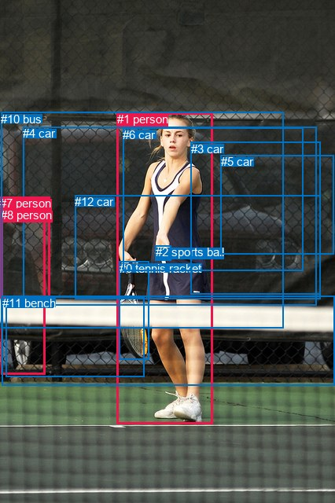
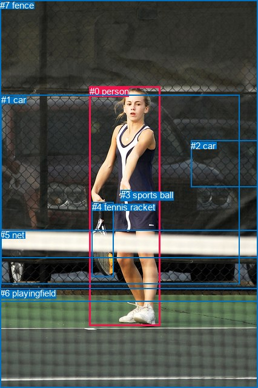

# 图片 0617：2343155.jpg

随机样本序号：58。图片 SHA256：`35d973039e8d5c69e56c5ae70484a41026c473796b5bbaddbff5ab969079bd2b`。

红色框表示人，蓝色框表示其他物体。两个模式分别保留自身框编号，可依据位置比较对应对象。

## 自动检测框与输出

人的框编号：`[1, 7, 8]`。状态：`ok`。

### 自动检测全部物体框

| 编号 | 类别 | 是否为人 | 检测分数 | 像素坐标 xyxy |
|---|---|---|---|---|
| 0 | tennis racket | False | 0.9991 | 151.8, 332.9, 189.6, 457.0 |
| 1 | person | True | 0.9988 | 148.7, 143.4, 270.2, 539.2 |
| 2 | sports ball | False | 0.9974 | 197.7, 312.1, 217.5, 331.2 |
| 3 | car | False | 0.9414 | 242.9, 180.6, 407.3, 374.9 |
| 4 | car | False | 0.8937 | 29.5, 161.2, 402.2, 388.5 |
| 5 | car | False | 0.8207 | 281.0, 197.5, 424.6, 323.8 |
| 6 | car | False | 0.5822 | 156.2, 162.8, 385.2, 344.9 |
| 7 | person | True | 0.5776 | 0.3, 250.0, 63.1, 379.3 |
| 8 | person | True | 0.4980 | 1.1, 265.4, 57.4, 476.2 |
| 9 | bench | False | 0.4407 | 7.4, 377.3, 183.6, 479.2 |
| 10 | bus | False | 0.4273 | 1.2, 142.5, 360.6, 418.0 |
| 11 | bench | False | 0.3971 | 2.6, 376.6, 426.0, 490.3 |
| 12 | car | False | 0.3571 | 95.1, 248.3, 407.6, 380.7 |

### 自动检测 Top50 人相关候选

评分物体对：156；人相关物体对：66；输出关系：50。

| 排名 | 主语编号与类别 | 关系 | 宾语编号与类别 | 类型 | 人与人 | 排序分数 | 原始融合 logit |
|---|---|---|---|---|---|---|---|
| 1 | #1 person | holding | #0 tennis racket | semantic | False | 0.99405 | 5.1176 |
| 2 | #1 person | holding | #2 sports ball | semantic | False | 0.99098 | 4.6992 |
| 3 | #1 person | playing | #11 bench | semantic | False | 0.91532 | 2.3804 |
| 4 | #7 person | on | #8 person | spatial | True | 0.90905 | 2.3021 |
| 5 | #1 person | playing | #10 bus | semantic | False | 0.85834 | 1.8016 |
| 6 | #7 person | in | #10 bus | spatial | False | 0.85714 | 1.7917 |
| 7 | #1 person | playing | #4 car | semantic | False | 0.84359 | 1.6852 |
| 8 | #8 person | looking at | #1 person | semantic | True | 0.83467 | 1.6191 |
| 9 | #7 person | looking at | #1 person | semantic | True | 0.78870 | 1.3171 |
| 10 | #8 person | in | #7 person | spatial | True | 0.78579 | 1.2997 |
| 11 | #1 person | playing | #9 bench | semantic | False | 0.78348 | 1.2861 |
| 12 | #8 person | holding | #7 person | semantic | True | 0.74564 | 1.0755 |
| 13 | #1 person | in | #0 tennis racket | spatial | False | 0.73208 | 1.0052 |
| 14 | #1 person | in | #2 sports ball | spatial | False | 0.72802 | 0.9846 |
| 15 | #11 bench | in front of | #1 person | spatial | False | 0.71437 | 0.9167 |
| 16 | #1 person | playing | #6 car | semantic | False | 0.68302 | 0.7677 |
| 17 | #8 person | in | #10 bus | spatial | False | 0.67855 | 0.7471 |
| 18 | #8 person | leaning on | #9 bench | spatial | False | 0.66581 | 0.6893 |
| 19 | #1 person | on | #11 bench | spatial | False | 0.63346 | 0.5471 |
| 20 | #1 person | in front of | #10 bus | spatial | False | 0.59755 | 0.3953 |
| 21 | #1 person | in front of | #4 car | spatial | False | 0.57172 | 0.2889 |
| 22 | #7 person | sitting on | #8 person | semantic | True | 0.56953 | 0.2799 |
| 23 | #0 tennis racket | holding | #1 person | semantic | False | 0.51768 | 0.0707 |
| 24 | #1 person | playing | #12 car | semantic | False | 0.50479 | 0.0192 |
| 25 | #4 car | parked on | #1 person | semantic | False | 0.48238 | -0.0705 |
| 26 | #7 person | on | #4 car | spatial | False | 0.46344 | -0.1465 |
| 27 | #10 bus | beside | #1 person | spatial | False | 0.43832 | -0.2480 |
| 28 | #2 sports ball | in | #1 person | spatial | False | 0.43781 | -0.2501 |
| 29 | #4 car | beside | #1 person | spatial | False | 0.42952 | -0.2838 |
| 30 | #1 person | in front of | #6 car | spatial | False | 0.42212 | -0.3141 |
| 31 | #7 person | standing on | #10 bus | semantic | False | 0.42031 | -0.3215 |
| 32 | #1 person | on | #9 bench | spatial | False | 0.39978 | -0.4064 |
| 33 | #6 car | parked on | #1 person | semantic | False | 0.36911 | -0.5361 |
| 34 | #6 car | beside | #1 person | spatial | False | 0.36789 | -0.5413 |
| 35 | #8 person | standing on | #9 bench | semantic | False | 0.36640 | -0.5477 |
| 36 | #2 sports ball | holding | #1 person | semantic | False | 0.36363 | -0.5597 |
| 37 | #0 tennis racket | on | #1 person | spatial | False | 0.36114 | -0.5704 |
| 38 | #8 person | on | #4 car | spatial | False | 0.35936 | -0.5782 |
| 39 | #9 bench | beside | #1 person | spatial | False | 0.35714 | -0.5878 |
| 40 | #8 person | standing on | #10 bus | semantic | False | 0.32906 | -0.7124 |
| 41 | #8 person | on | #11 bench | spatial | False | 0.31783 | -0.7638 |
| 42 | #8 person | playing | #2 sports ball | semantic | False | 0.31724 | -0.7665 |
| 43 | #1 person | playing | #3 car | semantic | False | 0.31145 | -0.7933 |
| 44 | #1 person | playing | #8 person | semantic | True | 0.30784 | -0.8102 |
| 45 | #10 bus | parked on | #1 person | semantic | False | 0.30666 | -0.8158 |
| 46 | #12 car | beside | #1 person | spatial | False | 0.30189 | -0.8383 |
| 47 | #7 person | on | #9 bench | spatial | False | 0.29311 | -0.8803 |
| 48 | #11 bench | holding | #1 person | semantic | False | 0.29057 | -0.8926 |
| 49 | #8 person | beside | #1 person | spatial | True | 0.27691 | -0.9598 |
| 50 | #3 car | beside | #1 person | spatial | False | 0.27277 | -0.9806 |

### 自动检测逐条人相关 GT 核验

R@50：25.00%；命中 1/4。

| GT 主语编号 | GT 关系 | GT 宾语编号 | 结果阶段 | 匹配预测主语编号 | 匹配预测宾语编号 |
|---|---|---|---|---|---|
| 0 | throwing | 3 | wrong_predicate | [1] | [2] |
| 0 | about to hit | 3 | wrong_predicate | [1] | [2] |
| 0 | holding | 4 | hit50 | [1] | [0] |
| 0 | standing on | 6 | endpoint_missing_or_wrong_class | [1] | [] |

## 真实框与输出

人的框编号：`[0]`。

### 真实框全部物体框

| 编号 | 类别 | 是否为人 | 检测分数 | 像素坐标 xyxy |
|---|---|---|---|---|
| 0 | person | True | GT | 148.0, 142.0, 265.0, 538.0 |
| 1 | car | False | GT | 2.0, 156.0, 395.0, 469.0 |
| 2 | car | False | GT | 315.0, 232.0, 426.0, 309.0 |
| 3 | sports ball | False | GT | 199.0, 313.0, 217.0, 331.0 |
| 4 | tennis racket | False | GT | 152.0, 333.0, 188.0, 456.0 |
| 5 | net | False | GT | 0.0, 379.0, 426.0, 426.0 |
| 6 | playingfield | False | GT | 0.0, 475.0, 426.0, 640.0 |
| 7 | fence | False | GT | 0.0, 0.0, 426.0, 497.0 |

### 真实框 Top50 人相关候选

评分物体对：56；人相关物体对：14；输出关系：28。

| 排名 | 主语编号与类别 | 关系 | 宾语编号与类别 | 类型 | 人与人 | 排序分数 | 原始融合 logit |
|---|---|---|---|---|---|---|---|
| 1 | #0 person | holding | #4 tennis racket | semantic | False | 0.99402 | 5.1133 |
| 2 | #0 person | holding | #3 sports ball | semantic | False | 0.99110 | 4.7124 |
| 3 | #0 person | on | #6 playingfield | spatial | False | 0.96653 | 3.3631 |
| 4 | #0 person | standing on | #6 playingfield | semantic | False | 0.95271 | 3.0031 |
| 5 | #0 person | playing | #1 car | semantic | False | 0.89096 | 2.1005 |
| 6 | #0 person | playing | #7 fence | semantic | False | 0.88006 | 1.9930 |
| 7 | #5 net | in front of | #0 person | spatial | False | 0.86248 | 1.8360 |
| 8 | #0 person | in front of | #1 car | spatial | False | 0.75865 | 1.1453 |
| 9 | #0 person | in front of | #7 fence | spatial | False | 0.75023 | 1.0999 |
| 10 | #0 person | playing | #5 net | semantic | False | 0.74740 | 1.0848 |
| 11 | #0 person | in | #4 tennis racket | spatial | False | 0.73967 | 1.0443 |
| 12 | #0 person | in | #3 sports ball | spatial | False | 0.69455 | 0.8215 |
| 13 | #1 car | parked on | #0 person | semantic | False | 0.68898 | 0.7953 |
| 14 | #7 fence | beside | #0 person | spatial | False | 0.65998 | 0.6632 |
| 15 | #1 car | beside | #0 person | spatial | False | 0.61394 | 0.4639 |
| 16 | #0 person | on | #5 net | spatial | False | 0.57201 | 0.2901 |
| 17 | #4 tennis racket | holding | #0 person | semantic | False | 0.50938 | 0.0375 |
| 18 | #3 sports ball | in | #0 person | spatial | False | 0.49404 | -0.0238 |
| 19 | #6 playingfield | beside | #0 person | spatial | False | 0.43908 | -0.2449 |
| 20 | #4 tennis racket | on | #0 person | spatial | False | 0.37739 | -0.5006 |
| 21 | #3 sports ball | holding | #0 person | semantic | False | 0.37076 | -0.5290 |
| 22 | #2 car | beside | #0 person | spatial | False | 0.32497 | -0.7310 |
| 23 | #5 net | holding | #0 person | semantic | False | 0.28325 | -0.9284 |
| 24 | #0 person | looking at | #2 car | semantic | False | 0.21588 | -1.2899 |
| 25 | #2 car | parked on | #0 person | semantic | False | 0.20472 | -1.3570 |
| 26 | #7 fence | looking at | #0 person | semantic | False | 0.19017 | -1.4489 |
| 27 | #6 playingfield | holding | #0 person | semantic | False | 0.18610 | -1.4755 |
| 28 | #0 person | in front of | #2 car | spatial | False | 0.16057 | -1.6540 |

### 真实框逐条人相关 GT 核验

R@50：50.00%；命中 2/4。

| GT 主语编号 | GT 关系 | GT 宾语编号 | 结果阶段 | 匹配预测主语编号 | 匹配预测宾语编号 |
|---|---|---|---|---|---|
| 0 | throwing | 3 | wrong_predicate | [0] | [3] |
| 0 | about to hit | 3 | wrong_predicate | [0] | [3] |
| 0 | holding | 4 | hit50 | [0] | [4] |
| 0 | standing on | 6 | hit50 | [0] | [6] |

## 全部人相关 GT

| 主语编号与类别 | 关系 | 宾语编号与类别 |
|---|---|---|
| #0 person | throwing | #3 sports ball |
| #0 person | about to hit | #3 sports ball |
| #0 person | holding | #4 tennis racket |
| #0 person | standing on | #6 playingfield |

原始记录、全部人相关物体对的两项预测与分项分数见 [逐图证据 JSON](../evidence/cases/0617.json)。全部56类 logits 保留于本机 HOR/output/random500/logits/。

<!-- HOR_COMPLETE_RESULTS -->

## 六组条件的完整输出对照

以下保留同一图片三种框与候选模式、两种谓词输出规则的全部 Top50。框编号各自在所属模式内解释。

### 自动检测框完整枚举：空间与语义各保留一个谓词

| 排名 | 主语编号与类别 | 谓词 | 宾语编号与类别 | 分组 | 排序分数 | predicate logit | pair logit |
|---|---|---|---|---|---|---|---|
| 1 | #1 person | holding | #0 tennis racket | semantic | 0.9940455 | 4.7211823 | 0.3964618 |
| 2 | #1 person | holding | #2 sports ball | semantic | 0.9909797 | 4.0613713 | 0.6378556 |
| 3 | #1 person | playing | #11 bench | semantic | 0.9153222 | 3.0138559 | -0.6334329 |
| 4 | #7 person | on | #8 person | spatial | 0.9090502 | 2.2661223 | 0.0359705 |
| 5 | #1 person | playing | #10 bus | semantic | 0.8583422 | 2.5360560 | -0.7344670 |
| 6 | #7 person | in | #10 bus | spatial | 0.8571386 | 1.7338576 | 0.0578671 |
| 7 | #1 person | playing | #4 car | semantic | 0.8435920 | 2.4661784 | -0.7809777 |
| 8 | #8 person | looking at | #1 person | semantic | 0.8346730 | 2.0547237 | -0.4356090 |
| 9 | #7 person | looking at | #1 person | semantic | 0.7886965 | 1.8084154 | -0.4913291 |
| 10 | #8 person | in | #7 person | spatial | 0.7857860 | 1.3300438 | -0.0303349 |
| 11 | #1 person | playing | #9 bench | semantic | 0.7834838 | 2.1662717 | -0.8801869 |
| 12 | #8 person | holding | #7 person | semantic | 0.7456425 | 1.1058407 | -0.0303349 |
| 13 | #1 person | in | #0 tennis racket | spatial | 0.7320770 | 0.6087241 | 0.3964618 |
| 14 | #1 person | in | #2 sports ball | spatial | 0.7280203 | 0.3467460 | 0.6378556 |
| 15 | #11 bench | in front of | #1 person | spatial | 0.7143676 | 1.1744733 | -0.2577812 |
| 16 | #1 person | playing | #6 car | semantic | 0.6830168 | 1.5555758 | -0.7879052 |
| 17 | #8 person | in | #10 bus | spatial | 0.6785477 | 0.7904053 | -0.0432998 |
| 18 | #8 person | leaning on | #9 bench | spatial | 0.6658086 | 0.9948301 | -0.3055419 |
| 19 | #1 person | on | #11 bench | spatial | 0.6334596 | 1.1805205 | -0.6334329 |
| 20 | #1 person | in front of | #10 bus | spatial | 0.5975484 | 1.1297274 | -0.7344670 |
| 21 | #1 person | in front of | #4 car | spatial | 0.5717204 | 1.0698514 | -0.7809777 |
| 22 | #7 person | sitting on | #8 person | semantic | 0.5695261 | 0.2439475 | 0.0359705 |
| 23 | #0 tennis racket | holding | #1 person | semantic | 0.5176770 | 0.7532692 | -0.6825317 |
| 24 | #1 person | playing | #12 car | semantic | 0.5047937 | 0.9438744 | -0.9246989 |
| 25 | #4 car | parked on | #1 person | semantic | 0.4823802 | -0.0065603 | -0.0639482 |
| 26 | #7 person | on | #4 car | spatial | 0.4634359 | -0.0225506 | -0.1239676 |
| 27 | #10 bus | beside | #1 person | spatial | 0.4383155 | -0.1600766 | -0.0879250 |
| 28 | #2 sports ball | in | #1 person | spatial | 0.4378097 | 0.3722029 | -0.6222588 |
| 29 | #4 car | beside | #1 person | spatial | 0.4295218 | -0.2198544 | -0.0639482 |
| 30 | #1 person | in front of | #6 car | spatial | 0.4221244 | 0.4738464 | -0.7879052 |
| 31 | #7 person | standing on | #10 bus | semantic | 0.4203138 | -0.3793526 | 0.0578671 |
| 32 | #1 person | on | #9 bench | spatial | 0.3997780 | 0.4737968 | -0.8801869 |
| 33 | #6 car | parked on | #1 person | semantic | 0.3691063 | -0.4273343 | -0.1087185 |
| 34 | #6 car | beside | #1 person | spatial | 0.3678868 | -0.4325747 | -0.1087185 |
| 35 | #8 person | standing on | #9 bench | semantic | 0.3663987 | -0.2421560 | -0.3055419 |
| 36 | #2 sports ball | holding | #1 person | semantic | 0.3636281 | 0.0626073 | -0.6222588 |
| 37 | #0 tennis racket | on | #1 person | spatial | 0.3611358 | 0.1120939 | -0.6825317 |
| 38 | #8 person | on | #4 car | spatial | 0.3593560 | -0.3550019 | -0.2231584 |
| 39 | #9 bench | beside | #1 person | spatial | 0.3571379 | -0.1004725 | -0.4873358 |
| 40 | #8 person | standing on | #10 bus | semantic | 0.3290579 | -0.6691494 | -0.0432998 |
| 41 | #8 person | on | #11 bench | spatial | 0.3178284 | -0.0939121 | -0.6698576 |
| 42 | #8 person | playing | #2 sports ball | semantic | 0.3172373 | 0.9214659 | -1.6879632 |
| 43 | #1 person | playing | #3 car | semantic | 0.3114533 | 0.2327971 | -1.0261309 |
| 44 | #1 person | playing | #8 person | semantic | 0.3078423 | 0.1041551 | -0.9143813 |
| 45 | #10 bus | parked on | #1 person | semantic | 0.3066594 | -0.7278585 | -0.0879250 |
| 46 | #12 car | beside | #1 person | spatial | 0.3018949 | -0.7338057 | -0.1044850 |
| 47 | #7 person | on | #9 bench | spatial | 0.2931057 | -0.5005641 | -0.3797837 |
| 48 | #11 bench | holding | #1 person | semantic | 0.2905670 | -0.6348505 | -0.2577812 |
| 49 | #8 person | beside | #1 person | spatial | 0.2769091 | -0.5242367 | -0.4356090 |
| 50 | #3 car | beside | #1 person | spatial | 0.2727711 | -0.7640414 | -0.2165668 |

GT 命中：1/4，R@50=25.00%。

| GT主语 | GT谓词 | GT宾语 | 结果阶段 | 匹配主语框 | 匹配宾语框 |
|---|---|---|---|---|---|
| 0 | throwing | 3 | wrong_predicate | [1] | [2] |
| 0 | about to hit | 3 | wrong_predicate | [1] | [2] |
| 0 | holding | 4 | hit50 | [1] | [0] |
| 0 | standing on | 6 | endpoint_missing_or_wrong_class | [1] | [] |

### 自动检测框完整枚举：每对只保留一个谓词

| 排名 | 主语编号与类别 | 谓词 | 宾语编号与类别 | 分组 | 排序分数 | predicate logit | pair logit |
|---|---|---|---|---|---|---|---|
| 1 | #1 person | holding | #0 tennis racket | single | 0.9940455 | 4.7211823 | 0.3964618 |
| 2 | #1 person | holding | #2 sports ball | single | 0.9909797 | 4.0613713 | 0.6378556 |
| 3 | #1 person | playing | #11 bench | single | 0.9153222 | 3.0138559 | -0.6334329 |
| 4 | #7 person | on | #8 person | single | 0.9090502 | 2.2661223 | 0.0359705 |
| 5 | #1 person | playing | #10 bus | single | 0.8583422 | 2.5360560 | -0.7344670 |
| 6 | #7 person | in | #10 bus | single | 0.8571386 | 1.7338576 | 0.0578671 |
| 7 | #1 person | playing | #4 car | single | 0.8435920 | 2.4661784 | -0.7809777 |
| 8 | #8 person | looking at | #1 person | single | 0.8346730 | 2.0547237 | -0.4356090 |
| 9 | #7 person | looking at | #1 person | single | 0.7886965 | 1.8084154 | -0.4913291 |
| 10 | #8 person | in | #7 person | single | 0.7857860 | 1.3300438 | -0.0303349 |
| 11 | #1 person | playing | #9 bench | single | 0.7834838 | 2.1662717 | -0.8801869 |
| 12 | #11 bench | in front of | #1 person | single | 0.7143676 | 1.1744733 | -0.2577812 |
| 13 | #1 person | playing | #6 car | single | 0.6830168 | 1.5555758 | -0.7879052 |
| 14 | #8 person | in | #10 bus | single | 0.6785477 | 0.7904053 | -0.0432998 |
| 15 | #8 person | leaning on | #9 bench | single | 0.6658086 | 0.9948301 | -0.3055419 |
| 16 | #0 tennis racket | holding | #1 person | single | 0.5176770 | 0.7532692 | -0.6825317 |
| 17 | #1 person | playing | #12 car | single | 0.5047937 | 0.9438744 | -0.9246989 |
| 18 | #4 car | parked on | #1 person | single | 0.4823802 | -0.0065603 | -0.0639482 |
| 19 | #7 person | on | #4 car | single | 0.4634359 | -0.0225506 | -0.1239676 |
| 20 | #10 bus | beside | #1 person | single | 0.4383155 | -0.1600766 | -0.0879250 |
| 21 | #2 sports ball | in | #1 person | single | 0.4378097 | 0.3722029 | -0.6222588 |
| 22 | #6 car | parked on | #1 person | single | 0.3691063 | -0.4273343 | -0.1087185 |
| 23 | #8 person | on | #4 car | single | 0.3593560 | -0.3550019 | -0.2231584 |
| 24 | #9 bench | beside | #1 person | single | 0.3571379 | -0.1004725 | -0.4873358 |
| 25 | #8 person | on | #11 bench | single | 0.3178284 | -0.0939121 | -0.6698576 |
| 26 | #8 person | playing | #2 sports ball | single | 0.3172373 | 0.9214659 | -1.6879632 |
| 27 | #1 person | playing | #3 car | single | 0.3114533 | 0.2327971 | -1.0261309 |
| 28 | #1 person | playing | #8 person | single | 0.3078423 | 0.1041551 | -0.9143813 |
| 29 | #12 car | beside | #1 person | single | 0.3018949 | -0.7338057 | -0.1044850 |
| 30 | #7 person | on | #9 bench | single | 0.2931057 | -0.5005641 | -0.3797837 |
| 31 | #3 car | beside | #1 person | single | 0.2727711 | -0.7640414 | -0.2165668 |
| 32 | #7 person | holding | #0 tennis racket | single | 0.2436508 | 0.4830871 | -1.6158544 |
| 33 | #8 person | holding | #0 tennis racket | single | 0.2433757 | 0.3671532 | -1.5014136 |
| 34 | #7 person | playing | #2 sports ball | single | 0.2329506 | 0.5272622 | -1.7189869 |
| 35 | #10 bus | in | #7 person | single | 0.2313989 | -0.9797986 | -0.2206307 |
| 36 | #1 person | playing | #7 person | single | 0.1799226 | -0.4730201 | -1.0438519 |
| 37 | #1 person | looking at | #5 car | single | 0.1749044 | -0.3428149 | -1.2084447 |
| 38 | #10 bus | in | #8 person | single | 0.1654471 | -1.3719761 | -0.2462684 |
| 39 | #8 person | on | #12 car | single | 0.1405149 | -1.2876856 | -0.5233339 |
| 40 | #5 car | beside | #1 person | single | 0.1334732 | -1.2599974 | -0.6105947 |
| 41 | #7 person | on | #11 bench | single | 0.1215163 | -1.2794318 | -0.6987175 |
| 42 | #7 person | on | #12 car | single | 0.1048309 | -1.6887481 | -0.4559158 |
| 43 | #4 car | in | #7 person | single | 0.0864855 | -2.0650971 | -0.2922257 |
| 44 | #9 bench | in | #8 person | single | 0.0794766 | -1.7935483 | -0.6559318 |
| 45 | #8 person | in | #5 car | single | 0.0631137 | -1.7991018 | -0.8985221 |
| 46 | #7 person | in | #6 car | single | 0.0601146 | -2.2890308 | -0.4604748 |
| 47 | #4 car | in | #8 person | single | 0.0553944 | -2.5214133 | -0.3148758 |
| 48 | #7 person | in | #5 car | single | 0.0531706 | -2.1437147 | -0.7358980 |
| 49 | #8 person | in | #6 car | single | 0.0518509 | -2.2806225 | -0.6255162 |
| 50 | #8 person | in | #3 car | single | 0.0503647 | -2.2493680 | -0.6874195 |

GT 命中：1/4，R@50=25.00%。

| GT主语 | GT谓词 | GT宾语 | 结果阶段 | 匹配主语框 | 匹配宾语框 |
|---|---|---|---|---|---|
| 0 | throwing | 3 | wrong_predicate | [1] | [2] |
| 0 | about to hit | 3 | wrong_predicate | [1] | [2] |
| 0 | holding | 4 | hit50 | [1] | [0] |
| 0 | standing on | 6 | endpoint_missing_or_wrong_class | [1] | [] |

### 真实框完整枚举：空间与语义各保留一个谓词

| 排名 | 主语编号与类别 | 谓词 | 宾语编号与类别 | 分组 | 排序分数 | predicate logit | pair logit |
|---|---|---|---|---|---|---|---|
| 1 | #0 person | holding | #4 tennis racket | semantic | 0.9940201 | 4.7211823 | 0.3921607 |
| 2 | #0 person | holding | #3 sports ball | semantic | 0.9910972 | 4.0801940 | 0.6322537 |
| 3 | #0 person | on | #6 playingfield | spatial | 0.9665326 | 3.5462890 | -0.1831472 |
| 4 | #0 person | standing on | #6 playingfield | semantic | 0.9527128 | 3.1862216 | -0.1831472 |
| 5 | #0 person | playing | #1 car | semantic | 0.8909565 | 2.7767859 | -0.6762378 |
| 6 | #0 person | playing | #7 fence | semantic | 0.8800586 | 2.5291967 | -0.5362112 |
| 7 | #5 net | in front of | #0 person | spatial | 0.8624772 | 2.1626215 | -0.3266021 |
| 8 | #0 person | in front of | #1 car | spatial | 0.7586481 | 1.8215199 | -0.6762378 |
| 9 | #0 person | in front of | #7 fence | spatial | 0.7502339 | 1.6360712 | -0.5362112 |
| 10 | #0 person | playing | #5 net | semantic | 0.7474029 | 1.6585622 | -0.5737536 |
| 11 | #0 person | in | #4 tennis racket | spatial | 0.7396692 | 0.6520896 | 0.3921607 |
| 12 | #0 person | in | #3 sports ball | spatial | 0.6945462 | 0.1892066 | 0.6322537 |
| 13 | #1 car | parked on | #0 person | semantic | 0.6889774 | 0.8954530 | -0.1001100 |
| 14 | #7 fence | beside | #0 person | spatial | 0.6599791 | 0.7974653 | -0.1342643 |
| 15 | #1 car | beside | #0 person | spatial | 0.6139417 | 0.5640216 | -0.1001100 |
| 16 | #0 person | on | #5 net | spatial | 0.5720134 | 0.8638244 | -0.5737536 |
| 17 | #4 tennis racket | holding | #0 person | semantic | 0.5093813 | 0.6995440 | -0.6620144 |
| 18 | #3 sports ball | in | #0 person | spatial | 0.4940400 | 0.5830646 | -0.6069056 |
| 19 | #6 playingfield | beside | #0 person | spatial | 0.4390837 | 0.4385104 | -0.6833919 |
| 20 | #4 tennis racket | on | #0 person | spatial | 0.3773931 | 0.1613865 | -0.6620144 |
| 21 | #3 sports ball | holding | #0 person | semantic | 0.3707553 | 0.0779276 | -0.6069056 |
| 22 | #2 car | beside | #0 person | spatial | 0.3249697 | -0.0713062 | -0.6597192 |
| 23 | #5 net | holding | #0 person | semantic | 0.2832479 | -0.6018052 | -0.3266021 |
| 24 | #0 person | looking at | #2 car | semantic | 0.2158769 | -0.0170403 | -1.2728176 |
| 25 | #2 car | parked on | #0 person | semantic | 0.2047223 | -0.6973174 | -0.6597192 |
| 26 | #7 fence | looking at | #0 person | semantic | 0.1901743 | -1.3146133 | -0.1342643 |
| 27 | #6 playingfield | holding | #0 person | semantic | 0.1861028 | -0.7921431 | -0.6833919 |
| 28 | #0 person | in front of | #2 car | spatial | 0.1605679 | -0.3811913 | -1.2728176 |

GT 命中：2/4，R@50=50.00%。

| GT主语 | GT谓词 | GT宾语 | 结果阶段 | 匹配主语框 | 匹配宾语框 |
|---|---|---|---|---|---|
| 0 | throwing | 3 | wrong_predicate | [0] | [3] |
| 0 | about to hit | 3 | wrong_predicate | [0] | [3] |
| 0 | holding | 4 | hit50 | [0] | [4] |
| 0 | standing on | 6 | hit50 | [0] | [6] |

### 真实框完整枚举：每对只保留一个谓词

| 排名 | 主语编号与类别 | 谓词 | 宾语编号与类别 | 分组 | 排序分数 | predicate logit | pair logit |
|---|---|---|---|---|---|---|---|
| 1 | #0 person | holding | #4 tennis racket | single | 0.9940201 | 4.7211823 | 0.3921607 |
| 2 | #0 person | holding | #3 sports ball | single | 0.9910972 | 4.0801940 | 0.6322537 |
| 3 | #0 person | on | #6 playingfield | single | 0.9665326 | 3.5462890 | -0.1831472 |
| 4 | #0 person | playing | #1 car | single | 0.8909565 | 2.7767859 | -0.6762378 |
| 5 | #0 person | playing | #7 fence | single | 0.8800586 | 2.5291967 | -0.5362112 |
| 6 | #5 net | in front of | #0 person | single | 0.8624772 | 2.1626215 | -0.3266021 |
| 7 | #0 person | playing | #5 net | single | 0.7474029 | 1.6585622 | -0.5737536 |
| 8 | #1 car | parked on | #0 person | single | 0.6889774 | 0.8954530 | -0.1001100 |
| 9 | #7 fence | beside | #0 person | single | 0.6599791 | 0.7974653 | -0.1342643 |
| 10 | #4 tennis racket | holding | #0 person | single | 0.5093813 | 0.6995440 | -0.6620144 |
| 11 | #3 sports ball | in | #0 person | single | 0.4940400 | 0.5830646 | -0.6069056 |
| 12 | #6 playingfield | beside | #0 person | single | 0.4390837 | 0.4385104 | -0.6833919 |
| 13 | #2 car | beside | #0 person | single | 0.3249697 | -0.0713062 | -0.6597192 |
| 14 | #0 person | looking at | #2 car | single | 0.2158769 | -0.0170403 | -1.2728176 |

GT 命中：1/4，R@50=25.00%。

| GT主语 | GT谓词 | GT宾语 | 结果阶段 | 匹配主语框 | 匹配宾语框 |
|---|---|---|---|---|---|
| 0 | throwing | 3 | wrong_predicate | [0] | [3] |
| 0 | about to hit | 3 | wrong_predicate | [0] | [3] |
| 0 | holding | 4 | hit50 | [0] | [4] |
| 0 | standing on | 6 | wrong_predicate | [0] | [6] |

### 真实框400候选：空间与语义各保留一个谓词

| 排名 | 主语编号与类别 | 谓词 | 宾语编号与类别 | 分组 | 排序分数 | predicate logit | pair logit |
|---|---|---|---|---|---|---|---|
| 1 | #0 person | holding | #4 tennis racket | semantic | 0.9940201 | 4.7211823 | 0.3921607 |
| 2 | #0 person | holding | #3 sports ball | semantic | 0.9910450 | 4.0742850 | 0.6322537 |
| 3 | #0 person | on | #6 playingfield | spatial | 0.9665326 | 3.5462890 | -0.1831472 |
| 4 | #0 person | standing on | #6 playingfield | semantic | 0.9523808 | 3.1788769 | -0.1831472 |
| 5 | #0 person | playing | #1 car | semantic | 0.8909565 | 2.7767859 | -0.6762378 |
| 6 | #0 person | playing | #7 fence | semantic | 0.8826978 | 2.5544405 | -0.5362112 |
| 7 | #5 net | in front of | #0 person | spatial | 0.8624772 | 2.1626215 | -0.3266021 |
| 8 | #0 person | in front of | #1 car | spatial | 0.7586481 | 1.8215199 | -0.6762378 |
| 9 | #0 person | playing | #5 net | semantic | 0.7521389 | 1.6838059 | -0.5737536 |
| 10 | #0 person | in front of | #7 fence | spatial | 0.7502339 | 1.6360712 | -0.5362112 |
| 11 | #0 person | in | #4 tennis racket | spatial | 0.7383892 | 0.6454525 | 0.3921607 |
| 12 | #0 person | in | #3 sports ball | spatial | 0.6895480 | 0.1657534 | 0.6322537 |
| 13 | #1 car | parked on | #0 person | semantic | 0.6824977 | 0.8653841 | -0.1001100 |
| 14 | #7 fence | beside | #0 person | spatial | 0.6599532 | 0.7973499 | -0.1342643 |
| 15 | #1 car | beside | #0 person | spatial | 0.6139417 | 0.5640216 | -0.1001100 |
| 16 | #0 person | on | #5 net | spatial | 0.5733460 | 0.8692694 | -0.5737536 |
| 17 | #4 tennis racket | holding | #0 person | semantic | 0.5093813 | 0.6995440 | -0.6620144 |
| 18 | #3 sports ball | in | #0 person | spatial | 0.4940400 | 0.5830646 | -0.6069056 |
| 19 | #6 playingfield | beside | #0 person | spatial | 0.4317150 | 0.4085345 | -0.6833919 |
| 20 | #4 tennis racket | on | #0 person | spatial | 0.3761146 | 0.1559415 | -0.6620144 |
| 21 | #3 sports ball | holding | #0 person | semantic | 0.3700664 | 0.0749736 | -0.6069056 |
| 22 | #2 car | beside | #0 person | spatial | 0.3249697 | -0.0713062 | -0.6597192 |
| 23 | #5 net | holding | #0 person | semantic | 0.2881831 | -0.5776224 | -0.3266021 |
| 24 | #0 person | looking at | #2 car | semantic | 0.2158179 | -0.0173888 | -1.2728176 |
| 25 | #2 car | parked on | #0 person | semantic | 0.2047223 | -0.6973174 | -0.6597192 |
| 26 | #7 fence | looking at | #0 person | semantic | 0.1856886 | -1.3440073 | -0.1342643 |
| 27 | #6 playingfield | holding | #0 person | semantic | 0.1822474 | -0.8178031 | -0.6833919 |
| 28 | #0 person | in front of | #2 car | spatial | 0.1645284 | -0.3520956 | -1.2728176 |

GT 命中：2/4，R@50=50.00%。

| GT主语 | GT谓词 | GT宾语 | 结果阶段 | 匹配主语框 | 匹配宾语框 |
|---|---|---|---|---|---|
| 0 | throwing | 3 | wrong_predicate | [0] | [3] |
| 0 | about to hit | 3 | wrong_predicate | [0] | [3] |
| 0 | holding | 4 | hit50 | [0] | [4] |
| 0 | standing on | 6 | hit50 | [0] | [6] |

### 真实框400候选：每对只保留一个谓词

| 排名 | 主语编号与类别 | 谓词 | 宾语编号与类别 | 分组 | 排序分数 | predicate logit | pair logit |
|---|---|---|---|---|---|---|---|
| 1 | #0 person | holding | #4 tennis racket | single | 0.9940201 | 4.7211823 | 0.3921607 |
| 2 | #0 person | holding | #3 sports ball | single | 0.9910450 | 4.0742850 | 0.6322537 |
| 3 | #0 person | on | #6 playingfield | single | 0.9665326 | 3.5462890 | -0.1831472 |
| 4 | #0 person | playing | #1 car | single | 0.8909565 | 2.7767859 | -0.6762378 |
| 5 | #0 person | playing | #7 fence | single | 0.8826978 | 2.5544405 | -0.5362112 |
| 6 | #5 net | in front of | #0 person | single | 0.8624772 | 2.1626215 | -0.3266021 |
| 7 | #0 person | playing | #5 net | single | 0.7521389 | 1.6838059 | -0.5737536 |
| 8 | #1 car | parked on | #0 person | single | 0.6824977 | 0.8653841 | -0.1001100 |
| 9 | #7 fence | beside | #0 person | single | 0.6599532 | 0.7973499 | -0.1342643 |
| 10 | #4 tennis racket | holding | #0 person | single | 0.5093813 | 0.6995440 | -0.6620144 |
| 11 | #3 sports ball | in | #0 person | single | 0.4940400 | 0.5830646 | -0.6069056 |
| 12 | #6 playingfield | beside | #0 person | single | 0.4317150 | 0.4085345 | -0.6833919 |
| 13 | #2 car | beside | #0 person | single | 0.3249697 | -0.0713062 | -0.6597192 |
| 14 | #0 person | looking at | #2 car | single | 0.2158179 | -0.0173888 | -1.2728176 |

GT 命中：1/4，R@50=25.00%。

| GT主语 | GT谓词 | GT宾语 | 结果阶段 | 匹配主语框 | 匹配宾语框 |
|---|---|---|---|---|---|
| 0 | throwing | 3 | wrong_predicate | [0] | [3] |
| 0 | about to hit | 3 | wrong_predicate | [0] | [3] |
| 0 | holding | 4 | hit50 | [0] | [4] |
| 0 | standing on | 6 | wrong_predicate | [0] | [6] |
