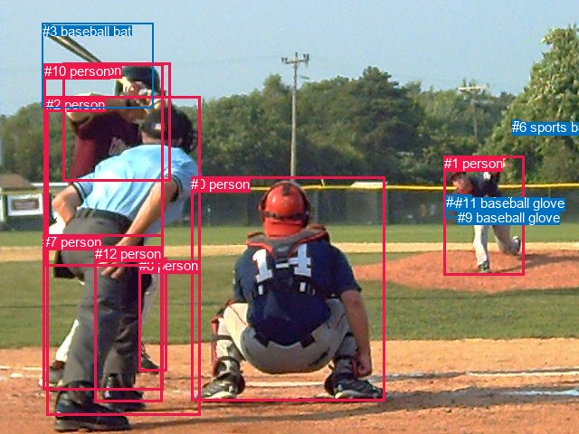
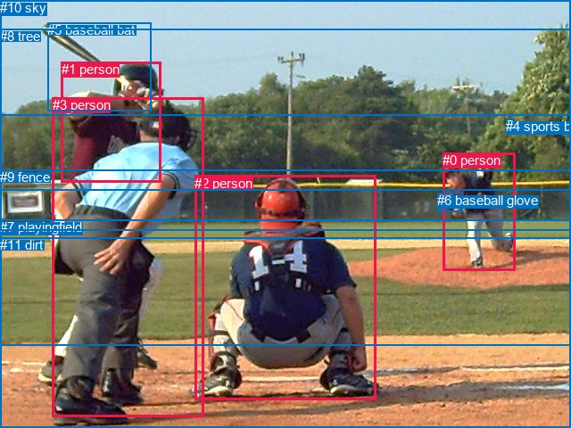

# 图片 0621：2343341.jpg

随机样本序号：262。图片 SHA256：`3535201a7c9ec8aab07ad195809c3f2b30e54df8546dfd4adb5d20f8aa366009`。

红色框表示人，蓝色框表示其他物体。两个模式分别保留自身框编号，可依据位置比较对应对象。

## 自动检测框与输出

人的框编号：`[0, 1, 2, 5, 7, 8, 10, 12]`。状态：`ok`。

### 自动检测全部物体框

| 编号 | 类别 | 是否为人 | 检测分数 | 像素坐标 xyxy |
|---|---|---|---|---|
| 0 | person | True | 0.9996 | 211.1, 195.3, 425.5, 443.6 |
| 1 | person | True | 0.9995 | 490.5, 172.3, 579.5, 304.7 |
| 2 | person | True | 0.9993 | 51.1, 106.9, 221.9, 459.7 |
| 3 | baseball bat | False | 0.9841 | 46.5, 25.6, 169.0, 119.3 |
| 4 | baseball glove | False | 0.9785 | 493.0, 215.3, 521.7, 240.6 |
| 5 | person | True | 0.9771 | 69.1, 69.1, 188.0, 200.3 |
| 6 | sports ball | False | 0.9714 | 566.4, 132.4, 575.5, 141.8 |
| 7 | person | True | 0.8874 | 47.0, 259.2, 180.8, 431.9 |
| 8 | person | True | 0.7607 | 153.6, 285.1, 184.9, 410.5 |
| 9 | baseball glove | False | 0.6660 | 505.6, 231.9, 521.1, 246.3 |
| 10 | person | True | 0.6472 | 48.8, 70.4, 180.6, 294.2 |
| 11 | baseball glove | False | 0.6413 | 503.2, 216.3, 520.9, 232.4 |
| 12 | person | True | 0.5472 | 104.8, 272.3, 179.0, 444.3 |

### 自动检测 Top50 人相关候选

评分物体对：156；人相关物体对：136；输出关系：50。

| 排名 | 主语编号与类别 | 关系 | 宾语编号与类别 | 类型 | 人与人 | 排序分数 | 原始融合 logit |
|---|---|---|---|---|---|---|---|
| 1 | #10 person | swinging | #3 baseball bat | semantic | False | 0.99760 | 6.0297 |
| 2 | #1 person | throwing | #6 sports ball | semantic | False | 0.99555 | 5.4113 |
| 3 | #1 person | throwing | #9 baseball glove | semantic | False | 0.99523 | 5.3407 |
| 4 | #1 person | throwing | #11 baseball glove | semantic | False | 0.99421 | 5.1467 |
| 5 | #5 person | holding | #3 baseball bat | semantic | False | 0.99405 | 5.1185 |
| 6 | #2 person | swinging | #3 baseball bat | semantic | False | 0.99297 | 4.9502 |
| 7 | #1 person | holding | #4 baseball glove | semantic | False | 0.99188 | 4.8055 |
| 8 | #1 person | throwing | #3 baseball bat | semantic | False | 0.97612 | 3.7107 |
| 9 | #2 person | wearing | #7 person | semantic | True | 0.96220 | 3.2368 |
| 10 | #10 person | wearing | #5 person | semantic | True | 0.96166 | 3.2222 |
| 11 | #2 person | throwing | #6 sports ball | semantic | False | 0.93811 | 2.7184 |
| 12 | #12 person | holding | #8 person | semantic | True | 0.92128 | 2.4598 |
| 13 | #0 person | swinging | #3 baseball bat | semantic | False | 0.90245 | 2.2247 |
| 14 | #0 person | throwing | #6 sports ball | semantic | False | 0.88821 | 2.0726 |
| 15 | #10 person | throwing | #6 sports ball | semantic | False | 0.88667 | 2.0572 |
| 16 | #1 person | in | #4 baseball glove | spatial | False | 0.83357 | 1.6112 |
| 17 | #2 person | in | #7 person | spatial | True | 0.83123 | 1.5944 |
| 18 | #0 person | looking at | #1 person | semantic | True | 0.82998 | 1.5855 |
| 19 | #5 person | throwing | #6 sports ball | semantic | False | 0.82635 | 1.5600 |
| 20 | #1 person | in | #9 baseball glove | spatial | False | 0.82414 | 1.5446 |
| 21 | #10 person | in | #5 person | spatial | True | 0.80118 | 1.3937 |
| 22 | #1 person | in | #11 baseball glove | spatial | False | 0.79237 | 1.3393 |
| 23 | #10 person | in | #3 baseball bat | spatial | False | 0.77071 | 1.2123 |
| 24 | #2 person | beside | #0 person | spatial | True | 0.76835 | 1.1990 |
| 25 | #2 person | holding | #12 person | semantic | True | 0.76435 | 1.1767 |
| 26 | #2 person | looking at | #1 person | semantic | True | 0.74644 | 1.0797 |
| 27 | #2 person | looking at | #0 person | semantic | True | 0.73912 | 1.0414 |
| 28 | #5 person | in | #3 baseball bat | spatial | False | 0.71899 | 0.9394 |
| 29 | #12 person | wearing | #7 person | semantic | True | 0.69136 | 0.8065 |
| 30 | #2 person | holding | #8 person | semantic | True | 0.66893 | 0.7033 |
| 31 | #12 person | on | #7 person | spatial | True | 0.65939 | 0.6606 |
| 32 | #8 person | holding | #9 baseball glove | semantic | False | 0.65235 | 0.6294 |
| 33 | #8 person | throwing | #6 sports ball | semantic | False | 0.64266 | 0.5869 |
| 34 | #6 sports ball | flying over | #1 person | semantic | False | 0.63689 | 0.5619 |
| 35 | #0 person | beside | #2 person | spatial | True | 0.63109 | 0.5369 |
| 36 | #7 person | swinging | #3 baseball bat | semantic | False | 0.62619 | 0.5159 |
| 37 | #8 person | standing on | #7 person | semantic | True | 0.62390 | 0.5061 |
| 38 | #12 person | throwing | #6 sports ball | semantic | False | 0.62204 | 0.4982 |
| 39 | #7 person | holding | #8 person | semantic | True | 0.61631 | 0.4739 |
| 40 | #12 person | holding | #4 baseball glove | semantic | False | 0.61064 | 0.4500 |
| 41 | #12 person | swinging | #3 baseball bat | semantic | False | 0.60036 | 0.4070 |
| 42 | #8 person | holding | #4 baseball glove | semantic | False | 0.59737 | 0.3945 |
| 43 | #8 person | holding | #11 baseball glove | semantic | False | 0.56531 | 0.2627 |
| 44 | #8 person | swinging | #3 baseball bat | semantic | False | 0.55860 | 0.2355 |
| 45 | #5 person | throwing | #11 baseball glove | semantic | False | 0.55131 | 0.2060 |
| 46 | #12 person | holding | #9 baseball glove | semantic | False | 0.55004 | 0.2008 |
| 47 | #3 baseball bat | holding | #10 person | semantic | False | 0.54852 | 0.1947 |
| 48 | #10 person | beside | #2 person | spatial | True | 0.53897 | 0.1562 |
| 49 | #12 person | holding | #11 baseball glove | semantic | False | 0.53018 | 0.1209 |
| 50 | #2 person | beside | #10 person | spatial | True | 0.52892 | 0.1158 |

### 自动检测逐条人相关 GT 核验

R@50：33.33%；命中 1/3。

| GT 主语编号 | GT 关系 | GT 宾语编号 | 结果阶段 | 匹配预测主语编号 | 匹配预测宾语编号 |
|---|---|---|---|---|---|
| 0 | throwing | 4 | hit50 | [1] | [6] |
| 1 | about to hit | 4 | wrong_predicate | [5] | [6] |
| 1 | standing on | 11 | endpoint_missing_or_wrong_class | [5] | [] |

## 真实框与输出

人的框编号：`[0, 1, 2, 3]`。

### 真实框全部物体框

| 编号 | 类别 | 是否为人 | 检测分数 | 像素坐标 xyxy |
|---|---|---|---|---|
| 0 | person | True | GT | 496.0, 171.0, 577.0, 303.0 |
| 1 | person | True | GT | 69.0, 69.0, 180.0, 204.0 |
| 2 | person | True | GT | 218.0, 197.0, 422.0, 448.0 |
| 3 | person | True | GT | 59.0, 109.0, 229.0, 468.0 |
| 4 | sports ball | False | GT | 567.0, 133.0, 576.0, 142.0 |
| 5 | baseball bat | False | GT | 53.0, 25.0, 169.0, 125.0 |
| 6 | baseball glove | False | GT | 490.0, 216.0, 518.0, 237.0 |
| 7 | playingfield | False | GT | 0.0, 246.0, 640.0, 388.0 |
| 8 | tree | False | GT | 0.0, 32.0, 640.0, 213.0 |
| 9 | fence | False | GT | 0.0, 190.0, 640.0, 258.0 |
| 10 | sky | False | GT | 0.0, 0.0, 640.0, 129.0 |
| 11 | dirt | False | GT | 0.0, 266.0, 640.0, 480.0 |

### 真实框 Top50 人相关候选

评分物体对：132；人相关物体对：76；输出关系：50。

| 排名 | 主语编号与类别 | 关系 | 宾语编号与类别 | 类型 | 人与人 | 排序分数 | 原始融合 logit |
|---|---|---|---|---|---|---|---|
| 1 | #0 person | throwing | #4 sports ball | semantic | False | 0.99881 | 6.7321 |
| 2 | #1 person | holding | #5 baseball bat | semantic | False | 0.99603 | 5.5250 |
| 3 | #3 person | swinging | #5 baseball bat | semantic | False | 0.99359 | 5.0433 |
| 4 | #0 person | holding | #6 baseball glove | semantic | False | 0.98936 | 4.5324 |
| 5 | #0 person | throwing | #5 baseball bat | semantic | False | 0.98899 | 4.4981 |
| 6 | #3 person | throwing | #4 sports ball | semantic | False | 0.97377 | 3.6143 |
| 7 | #0 person | standing on | #11 dirt | semantic | False | 0.96564 | 3.3360 |
| 8 | #0 person | standing on | #7 playingfield | semantic | False | 0.96051 | 3.1914 |
| 9 | #2 person | throwing | #4 sports ball | semantic | False | 0.95907 | 3.1541 |
| 10 | #3 person | standing on | #11 dirt | semantic | False | 0.95814 | 3.1306 |
| 11 | #0 person | on | #7 playingfield | spatial | False | 0.95102 | 2.9661 |
| 12 | #0 person | on | #11 dirt | spatial | False | 0.94262 | 2.7989 |
| 13 | #2 person | on | #11 dirt | spatial | False | 0.93467 | 2.6607 |
| 14 | #1 person | throwing | #4 sports ball | semantic | False | 0.93235 | 2.6233 |
| 15 | #2 person | swinging | #5 baseball bat | semantic | False | 0.91990 | 2.4410 |
| 16 | #3 person | standing on | #7 playingfield | semantic | False | 0.91676 | 2.3992 |
| 17 | #0 person | in | #6 baseball glove | spatial | False | 0.91015 | 2.3155 |
| 18 | #2 person | sitting on | #11 dirt | semantic | False | 0.90518 | 2.2561 |
| 19 | #2 person | on | #7 playingfield | spatial | False | 0.89459 | 2.1385 |
| 20 | #3 person | on | #11 dirt | spatial | False | 0.89335 | 2.1254 |
| 21 | #3 person | beside | #2 person | spatial | True | 0.88907 | 2.0813 |
| 22 | #2 person | looking at | #0 person | semantic | True | 0.88020 | 1.9943 |
| 23 | #3 person | looking at | #0 person | semantic | True | 0.86620 | 1.8678 |
| 24 | #2 person | sitting on | #7 playingfield | semantic | False | 0.86438 | 1.8522 |
| 25 | #3 person | on | #7 playingfield | spatial | False | 0.85773 | 1.7966 |
| 26 | #0 person | beside | #9 fence | spatial | False | 0.83520 | 1.6230 |
| 27 | #6 baseball glove | on | #0 person | spatial | False | 0.81421 | 1.4776 |
| 28 | #3 person | looking at | #2 person | semantic | True | 0.81309 | 1.4702 |
| 29 | #0 person | looking at | #2 person | semantic | True | 0.80995 | 1.4497 |
| 30 | #2 person | beside | #3 person | spatial | True | 0.79896 | 1.3798 |
| 31 | #1 person | on | #5 baseball bat | spatial | False | 0.79206 | 1.3374 |
| 32 | #0 person | standing on | #9 fence | semantic | False | 0.78498 | 1.2949 |
| 33 | #5 baseball bat | holding | #1 person | semantic | False | 0.73669 | 1.0288 |
| 34 | #1 person | beside | #3 person | spatial | True | 0.72179 | 0.9533 |
| 35 | #0 person | beside | #2 person | spatial | True | 0.69232 | 0.8110 |
| 36 | #2 person | looking at | #3 person | semantic | True | 0.67232 | 0.7187 |
| 37 | #3 person | on | #5 baseball bat | spatial | False | 0.67127 | 0.7139 |
| 38 | #0 person | throwing | #10 sky | semantic | False | 0.60699 | 0.4347 |
| 39 | #1 person | in | #7 playingfield | spatial | False | 0.60175 | 0.4128 |
| 40 | #1 person | leaning on | #9 fence | spatial | False | 0.58857 | 0.3581 |
| 41 | #1 person | beside | #2 person | spatial | True | 0.57837 | 0.3161 |
| 42 | #1 person | looking at | #2 person | semantic | True | 0.57116 | 0.2866 |
| 43 | #0 person | in | #4 sports ball | spatial | False | 0.56386 | 0.2568 |
| 44 | #1 person | in | #11 dirt | spatial | False | 0.56376 | 0.2564 |
| 45 | #3 person | beside | #1 person | spatial | True | 0.55016 | 0.2013 |
| 46 | #1 person | looking at | #3 person | semantic | True | 0.52234 | 0.0894 |
| 47 | #3 person | leaning on | #9 fence | spatial | False | 0.51667 | 0.0667 |
| 48 | #2 person | beside | #0 person | spatial | True | 0.49572 | -0.0171 |
| 49 | #5 baseball bat | holding | #3 person | semantic | False | 0.49435 | -0.0226 |
| 50 | #0 person | looking at | #3 person | semantic | True | 0.48197 | -0.0721 |

### 真实框逐条人相关 GT 核验

R@50：33.33%；命中 1/3。

| GT 主语编号 | GT 关系 | GT 宾语编号 | 结果阶段 | 匹配预测主语编号 | 匹配预测宾语编号 |
|---|---|---|---|---|---|
| 0 | throwing | 4 | hit50 | [0] | [4] |
| 1 | about to hit | 4 | wrong_predicate | [1] | [4] |
| 1 | standing on | 11 | rank_below50 | [1] | [11] |

## 全部人相关 GT

| 主语编号与类别 | 关系 | 宾语编号与类别 |
|---|---|---|
| #0 person | throwing | #4 sports ball |
| #1 person | about to hit | #4 sports ball |
| #1 person | standing on | #11 dirt |

原始记录、全部人相关物体对的两项预测与分项分数见 [逐图证据 JSON](../evidence/cases/0621.json)。全部56类 logits 保留于本机 HOR/output/random500/logits/。

<!-- HOR_COMPLETE_RESULTS -->

## 六组条件的完整输出对照

以下保留同一图片三种框与候选模式、两种谓词输出规则的全部 Top50。框编号各自在所属模式内解释。

### 自动检测框完整枚举：空间与语义各保留一个谓词

| 排名 | 主语编号与类别 | 谓词 | 宾语编号与类别 | 分组 | 排序分数 | predicate logit | pair logit |
|---|---|---|---|---|---|---|---|
| 1 | #10 person | swinging | #3 baseball bat | semantic | 0.9975997 | 5.1725593 | 0.8571608 |
| 2 | #1 person | throwing | #6 sports ball | semantic | 0.9955539 | 5.1998763 | 0.2113866 |
| 3 | #1 person | throwing | #9 baseball glove | semantic | 0.9952302 | 4.4246430 | 0.9160116 |
| 4 | #1 person | throwing | #11 baseball glove | semantic | 0.9942150 | 4.2452855 | 0.9013847 |
| 5 | #5 person | holding | #3 baseball bat | semantic | 0.9940508 | 4.4977593 | 0.6207821 |
| 6 | #2 person | swinging | #3 baseball bat | semantic | 0.9929680 | 4.0892844 | 0.8609375 |
| 7 | #1 person | holding | #4 baseball glove | semantic | 0.9918818 | 3.8933187 | 0.9121780 |
| 8 | #1 person | throwing | #3 baseball bat | semantic | 0.9761246 | 3.6374269 | 0.0733139 |
| 9 | #2 person | wearing | #7 person | semantic | 0.9621976 | 3.2326946 | 0.0041535 |
| 10 | #10 person | wearing | #5 person | semantic | 0.9616616 | 3.4324956 | -0.2102835 |
| 11 | #2 person | throwing | #6 sports ball | semantic | 0.9381059 | 3.0978236 | -0.3793858 |
| 12 | #12 person | holding | #8 person | semantic | 0.9212775 | 2.7930675 | -0.3332359 |
| 13 | #0 person | swinging | #3 baseball bat | semantic | 0.9024450 | 2.0431271 | 0.1815644 |
| 14 | #0 person | throwing | #6 sports ball | semantic | 0.8882089 | 2.5555863 | -0.4830118 |
| 15 | #10 person | throwing | #6 sports ball | semantic | 0.8866739 | 2.5265999 | -0.4693923 |
| 16 | #1 person | in | #4 baseball glove | spatial | 0.8335746 | 0.6989980 | 0.9121780 |
| 17 | #2 person | in | #7 person | spatial | 0.8312335 | 1.5902410 | 0.0041535 |
| 18 | #0 person | looking at | #1 person | semantic | 0.8299813 | 1.6201978 | -0.0347033 |
| 19 | #5 person | throwing | #6 sports ball | semantic | 0.8263515 | 1.9588609 | -0.3988741 |
| 20 | #1 person | in | #9 baseball glove | spatial | 0.8241394 | 0.6286364 | 0.9160116 |
| 21 | #10 person | in | #5 person | spatial | 0.8011786 | 1.6039610 | -0.2102835 |
| 22 | #1 person | in | #11 baseball glove | spatial | 0.7923740 | 0.4379101 | 0.9013847 |
| 23 | #10 person | in | #3 baseball bat | spatial | 0.7707101 | 0.3551641 | 0.8571608 |
| 24 | #2 person | beside | #0 person | spatial | 0.7683473 | 0.9750061 | 0.2239962 |
| 25 | #2 person | holding | #12 person | semantic | 0.7643464 | 1.3438768 | -0.1672189 |
| 26 | #2 person | looking at | #1 person | semantic | 0.7464403 | 1.2048469 | -0.1251307 |
| 27 | #2 person | looking at | #0 person | semantic | 0.7391169 | 0.8173876 | 0.2239962 |
| 28 | #5 person | in | #3 baseball bat | spatial | 0.7189866 | 0.3186579 | 0.6207821 |
| 29 | #12 person | wearing | #7 person | semantic | 0.6913604 | 1.0223565 | -0.2158692 |
| 30 | #2 person | holding | #8 person | semantic | 0.6689279 | 0.9215012 | -0.2181611 |
| 31 | #12 person | on | #7 person | spatial | 0.6593912 | 0.8764515 | -0.2158692 |
| 32 | #8 person | holding | #9 baseball glove | semantic | 0.6523468 | 1.4472351 | -0.8178638 |
| 33 | #8 person | throwing | #6 sports ball | semantic | 0.6426608 | 1.5655923 | -0.9786608 |
| 34 | #6 sports ball | flying over | #1 person | semantic | 0.6368858 | 1.1959724 | -0.6340996 |
| 35 | #0 person | beside | #2 person | spatial | 0.6310856 | 0.6137662 | -0.0768892 |
| 36 | #7 person | swinging | #3 baseball bat | semantic | 0.6261936 | 1.2908401 | -0.7749183 |
| 37 | #8 person | standing on | #7 person | semantic | 0.6238999 | 0.8590922 | -0.3529577 |
| 38 | #12 person | throwing | #6 sports ball | semantic | 0.6220427 | 1.4758706 | -0.9776430 |
| 39 | #7 person | holding | #8 person | semantic | 0.6163080 | 0.9961152 | -0.5222086 |
| 40 | #12 person | holding | #4 baseball glove | semantic | 0.6106390 | 1.2607794 | -0.8107805 |
| 41 | #12 person | swinging | #3 baseball bat | semantic | 0.6003644 | 1.1103077 | -0.7033243 |
| 42 | #8 person | holding | #4 baseball glove | semantic | 0.5973716 | 1.2079821 | -0.8134565 |
| 43 | #8 person | holding | #11 baseball glove | semantic | 0.5653114 | 1.0841141 | -0.8213674 |
| 44 | #8 person | swinging | #3 baseball bat | semantic | 0.5585960 | 1.1704936 | -0.9350278 |
| 45 | #5 person | throwing | #11 baseball glove | semantic | 0.5513098 | 0.4945030 | -0.2885390 |
| 46 | #12 person | holding | #9 baseball glove | semantic | 0.5500388 | 1.0259571 | -0.8251296 |
| 47 | #3 baseball bat | holding | #10 person | semantic | 0.5485227 | 0.5782113 | -0.3835078 |
| 48 | #10 person | beside | #2 person | spatial | 0.5389659 | 0.3759561 | -0.2197758 |
| 49 | #12 person | holding | #11 baseball glove | semantic | 0.5301788 | 0.9366117 | -0.8157494 |
| 50 | #2 person | beside | #10 person | spatial | 0.5289195 | 0.2569218 | -0.1411145 |

GT 命中：1/3，R@50=33.33%。

| GT主语 | GT谓词 | GT宾语 | 结果阶段 | 匹配主语框 | 匹配宾语框 |
|---|---|---|---|---|---|
| 0 | throwing | 4 | hit50 | [1] | [6] |
| 1 | about to hit | 4 | wrong_predicate | [5] | [6] |
| 1 | standing on | 11 | endpoint_missing_or_wrong_class | [5] | [] |

### 自动检测框完整枚举：每对只保留一个谓词

| 排名 | 主语编号与类别 | 谓词 | 宾语编号与类别 | 分组 | 排序分数 | predicate logit | pair logit |
|---|---|---|---|---|---|---|---|
| 1 | #10 person | swinging | #3 baseball bat | single | 0.9975997 | 5.1725593 | 0.8571608 |
| 2 | #1 person | throwing | #6 sports ball | single | 0.9955539 | 5.1998763 | 0.2113866 |
| 3 | #1 person | throwing | #9 baseball glove | single | 0.9952302 | 4.4246430 | 0.9160116 |
| 4 | #1 person | throwing | #11 baseball glove | single | 0.9942150 | 4.2452855 | 0.9013847 |
| 5 | #5 person | holding | #3 baseball bat | single | 0.9940508 | 4.4977593 | 0.6207821 |
| 6 | #2 person | swinging | #3 baseball bat | single | 0.9929680 | 4.0892844 | 0.8609375 |
| 7 | #1 person | holding | #4 baseball glove | single | 0.9918818 | 3.8933187 | 0.9121780 |
| 8 | #1 person | throwing | #3 baseball bat | single | 0.9761246 | 3.6374269 | 0.0733139 |
| 9 | #2 person | wearing | #7 person | single | 0.9621976 | 3.2326946 | 0.0041535 |
| 10 | #10 person | wearing | #5 person | single | 0.9616616 | 3.4324956 | -0.2102835 |
| 11 | #2 person | throwing | #6 sports ball | single | 0.9381059 | 3.0978236 | -0.3793858 |
| 12 | #12 person | holding | #8 person | single | 0.9212775 | 2.7930675 | -0.3332359 |
| 13 | #0 person | swinging | #3 baseball bat | single | 0.9024450 | 2.0431271 | 0.1815644 |
| 14 | #0 person | throwing | #6 sports ball | single | 0.8882089 | 2.5555863 | -0.4830118 |
| 15 | #10 person | throwing | #6 sports ball | single | 0.8866739 | 2.5265999 | -0.4693923 |
| 16 | #0 person | looking at | #1 person | single | 0.8299813 | 1.6201978 | -0.0347033 |
| 17 | #5 person | throwing | #6 sports ball | single | 0.8263515 | 1.9588609 | -0.3988741 |
| 18 | #2 person | beside | #0 person | single | 0.7683473 | 0.9750061 | 0.2239962 |
| 19 | #2 person | holding | #12 person | single | 0.7643464 | 1.3438768 | -0.1672189 |
| 20 | #2 person | looking at | #1 person | single | 0.7464403 | 1.2048469 | -0.1251307 |
| 21 | #12 person | wearing | #7 person | single | 0.6913604 | 1.0223565 | -0.2158692 |
| 22 | #2 person | holding | #8 person | single | 0.6689279 | 0.9215012 | -0.2181611 |
| 23 | #8 person | holding | #9 baseball glove | single | 0.6523468 | 1.4472351 | -0.8178638 |
| 24 | #8 person | throwing | #6 sports ball | single | 0.6426608 | 1.5655923 | -0.9786608 |
| 25 | #6 sports ball | flying over | #1 person | single | 0.6368858 | 1.1959724 | -0.6340996 |
| 26 | #0 person | beside | #2 person | single | 0.6310856 | 0.6137662 | -0.0768892 |
| 27 | #7 person | swinging | #3 baseball bat | single | 0.6261936 | 1.2908401 | -0.7749183 |
| 28 | #8 person | standing on | #7 person | single | 0.6238999 | 0.8590922 | -0.3529577 |
| 29 | #12 person | throwing | #6 sports ball | single | 0.6220427 | 1.4758706 | -0.9776430 |
| 30 | #7 person | holding | #8 person | single | 0.6163080 | 0.9961152 | -0.5222086 |
| 31 | #12 person | holding | #4 baseball glove | single | 0.6106390 | 1.2607794 | -0.8107805 |
| 32 | #12 person | swinging | #3 baseball bat | single | 0.6003644 | 1.1103077 | -0.7033243 |
| 33 | #8 person | holding | #4 baseball glove | single | 0.5973716 | 1.2079821 | -0.8134565 |
| 34 | #8 person | holding | #11 baseball glove | single | 0.5653114 | 1.0841141 | -0.8213674 |
| 35 | #8 person | swinging | #3 baseball bat | single | 0.5585960 | 1.1704936 | -0.9350278 |
| 36 | #5 person | throwing | #11 baseball glove | single | 0.5513098 | 0.4945030 | -0.2885390 |
| 37 | #12 person | holding | #9 baseball glove | single | 0.5500388 | 1.0259571 | -0.8251296 |
| 38 | #3 baseball bat | holding | #10 person | single | 0.5485227 | 0.5782113 | -0.3835078 |
| 39 | #10 person | beside | #2 person | single | 0.5389659 | 0.3759561 | -0.2197758 |
| 40 | #12 person | holding | #11 baseball glove | single | 0.5301788 | 0.9366117 | -0.8157494 |
| 41 | #2 person | beside | #10 person | single | 0.5289195 | 0.2569218 | -0.1411145 |
| 42 | #8 person | standing on | #12 person | single | 0.5254562 | 0.5266595 | -0.4247464 |
| 43 | #5 person | throwing | #9 baseball glove | single | 0.5234767 | 0.4343209 | -0.3403449 |
| 44 | #8 person | looking at | #1 person | single | 0.5196478 | 0.8787241 | -0.8000923 |
| 45 | #3 baseball bat | holding | #5 person | single | 0.5177212 | 0.6655302 | -0.5946159 |
| 46 | #0 person | holding | #4 baseball glove | single | 0.5116083 | 0.2755723 | -0.2291308 |
| 47 | #1 person | looking at | #0 person | single | 0.5115594 | -0.1972394 | 0.2434851 |
| 48 | #10 person | throwing | #9 baseball glove | single | 0.5105295 | 0.3431120 | -0.3009877 |
| 49 | #12 person | looking at | #1 person | single | 0.5074325 | 0.6953878 | -0.6656554 |
| 50 | #5 person | holding | #4 baseball glove | single | 0.4935591 | 0.2761016 | -0.3018667 |

GT 命中：1/3，R@50=33.33%。

| GT主语 | GT谓词 | GT宾语 | 结果阶段 | 匹配主语框 | 匹配宾语框 |
|---|---|---|---|---|---|
| 0 | throwing | 4 | hit50 | [1] | [6] |
| 1 | about to hit | 4 | wrong_predicate | [5] | [6] |
| 1 | standing on | 11 | endpoint_missing_or_wrong_class | [5] | [] |

### 真实框完整枚举：空间与语义各保留一个谓词

| 排名 | 主语编号与类别 | 谓词 | 宾语编号与类别 | 分组 | 排序分数 | predicate logit | pair logit |
|---|---|---|---|---|---|---|---|
| 1 | #0 person | throwing | #4 sports ball | semantic | 0.9988095 | 6.5155625 | 0.2165327 |
| 2 | #1 person | holding | #5 baseball bat | semantic | 0.9960299 | 4.9238467 | 0.6011302 |
| 3 | #3 person | swinging | #5 baseball bat | semantic | 0.9935892 | 4.2096591 | 0.8336775 |
| 4 | #0 person | holding | #6 baseball glove | semantic | 0.9893599 | 3.6186557 | 0.9137714 |
| 5 | #0 person | throwing | #5 baseball bat | semantic | 0.9889920 | 4.4220929 | 0.0759679 |
| 6 | #3 person | throwing | #4 sports ball | semantic | 0.9737701 | 3.9960570 | -0.3817786 |
| 7 | #0 person | standing on | #11 dirt | semantic | 0.9656441 | 3.2608938 | 0.0751282 |
| 8 | #0 person | standing on | #7 playingfield | semantic | 0.9605103 | 2.9938436 | 0.1975811 |
| 9 | #2 person | throwing | #4 sports ball | semantic | 0.9590691 | 3.6336875 | -0.4796107 |
| 10 | #3 person | standing on | #11 dirt | semantic | 0.9581389 | 3.3312783 | -0.2006403 |
| 11 | #0 person | on | #7 playingfield | spatial | 0.9510177 | 2.7684927 | 0.1975811 |
| 12 | #0 person | on | #11 dirt | spatial | 0.9426166 | 2.7237754 | 0.0751282 |
| 13 | #2 person | on | #11 dirt | spatial | 0.9346662 | 2.6226411 | 0.0380397 |
| 14 | #1 person | throwing | #4 sports ball | semantic | 0.9323481 | 3.0365367 | -0.4132058 |
| 15 | #2 person | swinging | #5 baseball bat | semantic | 0.9198985 | 2.2838345 | 0.1571351 |
| 16 | #3 person | standing on | #7 playingfield | semantic | 0.9167635 | 2.7692318 | -0.3700675 |
| 17 | #0 person | in | #6 baseball glove | spatial | 0.9101520 | 1.4017205 | 0.9137714 |
| 18 | #2 person | sitting on | #11 dirt | semantic | 0.9051772 | 2.2180805 | 0.0380397 |
| 19 | #2 person | on | #7 playingfield | spatial | 0.8945917 | 2.3088121 | -0.1702862 |
| 20 | #3 person | on | #11 dirt | spatial | 0.8933451 | 2.3260150 | -0.2006403 |
| 21 | #3 person | beside | #2 person | spatial | 0.8890694 | 1.8497334 | 0.2315374 |
| 22 | #2 person | looking at | #0 person | semantic | 0.8801955 | 2.0540261 | -0.0597439 |
| 23 | #3 person | looking at | #0 person | semantic | 0.8661985 | 2.0001192 | -0.1323617 |
| 24 | #2 person | sitting on | #7 playingfield | semantic | 0.8643844 | 2.0224791 | -0.1702862 |
| 25 | #3 person | on | #7 playingfield | spatial | 0.8577346 | 2.1666679 | -0.3700675 |
| 26 | #0 person | beside | #9 fence | spatial | 0.8352019 | 1.4573331 | 0.1656198 |
| 27 | #6 baseball glove | on | #0 person | spatial | 0.8142061 | 2.1924438 | -0.7148679 |
| 28 | #3 person | looking at | #2 person | semantic | 0.8130881 | 1.2386646 | 0.2315374 |
| 29 | #0 person | looking at | #2 person | semantic | 0.8099478 | 1.2212329 | 0.2284384 |
| 30 | #2 person | beside | #3 person | spatial | 0.7989584 | 1.4589524 | -0.0791557 |
| 31 | #1 person | on | #5 baseball bat | spatial | 0.7920632 | 0.7362771 | 0.6011302 |
| 32 | #0 person | standing on | #9 fence | semantic | 0.7849784 | 1.1292982 | 0.1656198 |
| 33 | #5 baseball bat | holding | #1 person | semantic | 0.7366904 | 1.6609468 | -0.6321099 |
| 34 | #1 person | beside | #3 person | spatial | 0.7217880 | 1.3108091 | -0.3574608 |
| 35 | #0 person | beside | #2 person | spatial | 0.6923195 | 0.5825472 | 0.2284384 |
| 36 | #2 person | looking at | #3 person | semantic | 0.6723225 | 0.7978640 | -0.0791557 |
| 37 | #3 person | on | #5 baseball bat | spatial | 0.6712695 | -0.1197448 | 0.8336775 |
| 38 | #0 person | throwing | #10 sky | semantic | 0.6069927 | 1.1428485 | -0.7081602 |
| 39 | #1 person | in | #7 playingfield | spatial | 0.6017475 | 1.1034794 | -0.6907277 |
| 40 | #1 person | leaning on | #9 fence | spatial | 0.5885706 | 0.8305306 | -0.4724714 |
| 41 | #1 person | beside | #2 person | spatial | 0.5783742 | 0.6482239 | -0.3321208 |
| 42 | #1 person | looking at | #2 person | semantic | 0.5711610 | 0.6187105 | -0.3321208 |
| 43 | #0 person | in | #4 sports ball | spatial | 0.5638598 | 0.0403090 | 0.2165327 |
| 44 | #1 person | in | #11 dirt | spatial | 0.5637599 | 0.9525776 | -0.6961422 |
| 45 | #3 person | beside | #1 person | spatial | 0.5501556 | 0.3787322 | -0.1774327 |
| 46 | #1 person | looking at | #3 person | semantic | 0.5223398 | 0.4468794 | -0.3574608 |
| 47 | #3 person | leaning on | #9 fence | spatial | 0.5166696 | 0.6406574 | -0.5739545 |
| 48 | #2 person | beside | #0 person | spatial | 0.4957205 | 0.0426254 | -0.0597439 |
| 49 | #5 baseball bat | holding | #3 person | semantic | 0.4943502 | 0.5765643 | -0.5991646 |
| 50 | #0 person | looking at | #3 person | semantic | 0.4819732 | 0.1123891 | -0.1845275 |

GT 命中：1/3，R@50=33.33%。

| GT主语 | GT谓词 | GT宾语 | 结果阶段 | 匹配主语框 | 匹配宾语框 |
|---|---|---|---|---|---|
| 0 | throwing | 4 | hit50 | [0] | [4] |
| 1 | about to hit | 4 | wrong_predicate | [1] | [4] |
| 1 | standing on | 11 | rank_below50 | [1] | [11] |

### 真实框完整枚举：每对只保留一个谓词

| 排名 | 主语编号与类别 | 谓词 | 宾语编号与类别 | 分组 | 排序分数 | predicate logit | pair logit |
|---|---|---|---|---|---|---|---|
| 1 | #0 person | throwing | #4 sports ball | single | 0.9988095 | 6.5155625 | 0.2165327 |
| 2 | #1 person | holding | #5 baseball bat | single | 0.9960299 | 4.9238467 | 0.6011302 |
| 3 | #3 person | swinging | #5 baseball bat | single | 0.9935892 | 4.2096591 | 0.8336775 |
| 4 | #0 person | holding | #6 baseball glove | single | 0.9893599 | 3.6186557 | 0.9137714 |
| 5 | #0 person | throwing | #5 baseball bat | single | 0.9889920 | 4.4220929 | 0.0759679 |
| 6 | #3 person | throwing | #4 sports ball | single | 0.9737701 | 3.9960570 | -0.3817786 |
| 7 | #0 person | standing on | #11 dirt | single | 0.9656441 | 3.2608938 | 0.0751282 |
| 8 | #0 person | standing on | #7 playingfield | single | 0.9605103 | 2.9938436 | 0.1975811 |
| 9 | #2 person | throwing | #4 sports ball | single | 0.9590691 | 3.6336875 | -0.4796107 |
| 10 | #3 person | standing on | #11 dirt | single | 0.9581389 | 3.3312783 | -0.2006403 |
| 11 | #2 person | on | #11 dirt | single | 0.9346662 | 2.6226411 | 0.0380397 |
| 12 | #1 person | throwing | #4 sports ball | single | 0.9323481 | 3.0365367 | -0.4132058 |
| 13 | #2 person | swinging | #5 baseball bat | single | 0.9198985 | 2.2838345 | 0.1571351 |
| 14 | #3 person | standing on | #7 playingfield | single | 0.9167635 | 2.7692318 | -0.3700675 |
| 15 | #2 person | on | #7 playingfield | single | 0.8945917 | 2.3088121 | -0.1702862 |
| 16 | #3 person | beside | #2 person | single | 0.8890694 | 1.8497334 | 0.2315374 |
| 17 | #2 person | looking at | #0 person | single | 0.8801955 | 2.0540261 | -0.0597439 |
| 18 | #3 person | looking at | #0 person | single | 0.8661985 | 2.0001192 | -0.1323617 |
| 19 | #0 person | beside | #9 fence | single | 0.8352019 | 1.4573331 | 0.1656198 |
| 20 | #6 baseball glove | on | #0 person | single | 0.8142061 | 2.1924438 | -0.7148679 |
| 21 | #0 person | looking at | #2 person | single | 0.8099478 | 1.2212329 | 0.2284384 |
| 22 | #2 person | beside | #3 person | single | 0.7989584 | 1.4589524 | -0.0791557 |
| 23 | #5 baseball bat | holding | #1 person | single | 0.7366904 | 1.6609468 | -0.6321099 |
| 24 | #1 person | beside | #3 person | single | 0.7217880 | 1.3108091 | -0.3574608 |
| 25 | #0 person | throwing | #10 sky | single | 0.6069927 | 1.1428485 | -0.7081602 |
| 26 | #1 person | in | #7 playingfield | single | 0.6017475 | 1.1034794 | -0.6907277 |
| 27 | #1 person | leaning on | #9 fence | single | 0.5885706 | 0.8305306 | -0.4724714 |
| 28 | #1 person | beside | #2 person | single | 0.5783742 | 0.6482239 | -0.3321208 |
| 29 | #1 person | in | #11 dirt | single | 0.5637599 | 0.9525776 | -0.6961422 |
| 30 | #3 person | beside | #1 person | single | 0.5501556 | 0.3787322 | -0.1774327 |
| 31 | #3 person | leaning on | #9 fence | single | 0.5166696 | 0.6406574 | -0.5739545 |
| 32 | #5 baseball bat | holding | #3 person | single | 0.4943502 | 0.5765643 | -0.5991646 |
| 33 | #0 person | looking at | #3 person | single | 0.4819732 | 0.1123891 | -0.1845275 |
| 34 | #0 person | in | #8 tree | single | 0.4669338 | -0.0683188 | -0.0641394 |
| 35 | #1 person | looking at | #0 person | single | 0.4438643 | 0.3461466 | -0.5716401 |
| 36 | #2 person | beside | #9 fence | single | 0.4286892 | 0.3150225 | -0.6022235 |
| 37 | #0 person | throwing | #1 person | single | 0.4080536 | 0.0877004 | -0.4597180 |
| 38 | #1 person | in | #10 sky | single | 0.3933184 | 0.4967775 | -0.9301622 |
| 39 | #1 person | throwing | #6 baseball glove | single | 0.3164563 | -0.4655275 | -0.3045777 |
| 40 | #9 fence | beside | #2 person | single | 0.3092636 | -0.3724508 | -0.4311137 |
| 41 | #4 sports ball | over | #0 person | single | 0.2994425 | -0.2024226 | -0.6475314 |
| 42 | #1 person | in | #8 tree | single | 0.2801827 | -0.1349163 | -0.8086395 |
| 43 | #2 person | looking at | #10 sky | single | 0.2800781 | 0.1880202 | -1.1320944 |
| 44 | #7 playingfield | beside | #2 person | single | 0.2684317 | -0.4650950 | -0.5374990 |
| 45 | #3 person | looking at | #10 sky | single | 0.2590238 | -0.1626153 | -0.8884335 |
| 46 | #9 fence | beside | #3 person | single | 0.2487927 | -0.5238605 | -0.5812012 |
| 47 | #3 person | throwing | #6 baseball glove | single | 0.2431105 | -0.7363484 | -0.3993525 |
| 48 | #10 sky | over | #3 person | single | 0.2396700 | -0.1900296 | -0.9644600 |
| 49 | #9 fence | beside | #0 person | single | 0.2032691 | -0.8687246 | -0.4972615 |
| 50 | #2 person | wearing | #6 baseball glove | single | 0.1901111 | -1.2018123 | -0.2474760 |

GT 命中：1/3，R@50=33.33%。

| GT主语 | GT谓词 | GT宾语 | 结果阶段 | 匹配主语框 | 匹配宾语框 |
|---|---|---|---|---|---|
| 0 | throwing | 4 | hit50 | [0] | [4] |
| 1 | about to hit | 4 | wrong_predicate | [1] | [4] |
| 1 | standing on | 11 | wrong_predicate | [1] | [11] |

### 真实框400候选：空间与语义各保留一个谓词

| 排名 | 主语编号与类别 | 谓词 | 宾语编号与类别 | 分组 | 排序分数 | predicate logit | pair logit |
|---|---|---|---|---|---|---|---|
| 1 | #0 person | throwing | #4 sports ball | semantic | 0.9988787 | 6.5755754 | 0.2165327 |
| 2 | #1 person | holding | #5 baseball bat | semantic | 0.9960299 | 4.9238467 | 0.6011302 |
| 3 | #3 person | swinging | #5 baseball bat | semantic | 0.9935892 | 4.2096591 | 0.8336775 |
| 4 | #0 person | throwing | #5 baseball bat | semantic | 0.9896248 | 4.4819360 | 0.0759679 |
| 5 | #0 person | holding | #6 baseball glove | semantic | 0.9893599 | 3.6186557 | 0.9137714 |
| 6 | #3 person | throwing | #4 sports ball | semantic | 0.9737680 | 3.9959722 | -0.3817786 |
| 7 | #0 person | standing on | #11 dirt | semantic | 0.9656441 | 3.2608938 | 0.0751282 |
| 8 | #0 person | standing on | #7 playingfield | semantic | 0.9605103 | 2.9938436 | 0.1975811 |
| 9 | #2 person | throwing | #4 sports ball | semantic | 0.9590691 | 3.6336875 | -0.4796107 |
| 10 | #3 person | standing on | #11 dirt | semantic | 0.9581389 | 3.3312783 | -0.2006403 |
| 11 | #0 person | on | #7 playingfield | spatial | 0.9510177 | 2.7684927 | 0.1975811 |
| 12 | #0 person | on | #11 dirt | spatial | 0.9426166 | 2.7237754 | 0.0751282 |
| 13 | #2 person | on | #11 dirt | spatial | 0.9349979 | 2.6280861 | 0.0380397 |
| 14 | #1 person | throwing | #4 sports ball | semantic | 0.9284688 | 2.9766088 | -0.4132058 |
| 15 | #2 person | swinging | #5 baseball bat | semantic | 0.9220879 | 2.3139248 | 0.1571351 |
| 16 | #3 person | standing on | #7 playingfield | semantic | 0.9201699 | 2.8147259 | -0.3700675 |
| 17 | #0 person | in | #6 baseball glove | spatial | 0.9101520 | 1.4017205 | 0.9137714 |
| 18 | #2 person | sitting on | #11 dirt | semantic | 0.9069696 | 2.2391429 | 0.0380397 |
| 19 | #2 person | on | #7 playingfield | spatial | 0.8956141 | 2.3197012 | -0.1702862 |
| 20 | #3 person | on | #11 dirt | spatial | 0.8933451 | 2.3260150 | -0.2006403 |
| 21 | #3 person | beside | #2 person | spatial | 0.8890694 | 1.8497334 | 0.2315374 |
| 22 | #2 person | looking at | #0 person | semantic | 0.8832606 | 2.0834203 | -0.0597439 |
| 23 | #2 person | sitting on | #7 playingfield | semantic | 0.8668345 | 2.0435414 | -0.1702862 |
| 24 | #3 person | looking at | #0 person | semantic | 0.8661985 | 2.0001192 | -0.1323617 |
| 25 | #3 person | on | #7 playingfield | spatial | 0.8590583 | 2.1775575 | -0.3700675 |
| 26 | #0 person | beside | #9 fence | spatial | 0.8310184 | 1.4272423 | 0.1656198 |
| 27 | #6 baseball glove | on | #0 person | spatial | 0.8158479 | 2.2033339 | -0.7148679 |
| 28 | #3 person | looking at | #2 person | semantic | 0.8129821 | 1.2379675 | 0.2315374 |
| 29 | #0 person | looking at | #2 person | semantic | 0.8099478 | 1.2212329 | 0.2284384 |
| 30 | #2 person | beside | #3 person | spatial | 0.7989584 | 1.4589524 | -0.0791557 |
| 31 | #1 person | in | #5 baseball bat | spatial | 0.7942603 | 0.7496691 | 0.6011302 |
| 32 | #0 person | standing on | #9 fence | semantic | 0.7811141 | 1.1065512 | 0.1656198 |
| 33 | #5 baseball bat | holding | #1 person | semantic | 0.7366904 | 1.6609468 | -0.6321099 |
| 34 | #1 person | beside | #3 person | spatial | 0.7217765 | 1.3107514 | -0.3574608 |
| 35 | #0 person | beside | #2 person | spatial | 0.6923319 | 0.5826054 | 0.2284384 |
| 36 | #2 person | looking at | #3 person | semantic | 0.6722456 | 0.7975149 | -0.0791557 |
| 37 | #3 person | on | #5 baseball bat | spatial | 0.6712695 | -0.1197448 | 0.8336775 |
| 38 | #0 person | throwing | #10 sky | semantic | 0.6070029 | 1.1428914 | -0.7081602 |
| 39 | #1 person | in | #7 playingfield | spatial | 0.6017475 | 1.1034794 | -0.6907277 |
| 40 | #1 person | leaning on | #9 fence | spatial | 0.5885108 | 0.8302836 | -0.4724714 |
| 41 | #1 person | beside | #2 person | spatial | 0.5856663 | 0.6781993 | -0.3321208 |
| 42 | #1 person | looking at | #2 person | semantic | 0.5785153 | 0.6488023 | -0.3321208 |
| 43 | #0 person | in | #4 sports ball | spatial | 0.5688049 | 0.0604439 | 0.2165327 |
| 44 | #1 person | in | #11 dirt | spatial | 0.5645759 | 0.9558964 | -0.6961422 |
| 45 | #3 person | beside | #1 person | spatial | 0.5501556 | 0.3787322 | -0.1774327 |
| 46 | #3 person | leaning on | #9 fence | spatial | 0.5240563 | 0.6702538 | -0.5739545 |
| 47 | #1 person | looking at | #3 person | semantic | 0.5150015 | 0.4174848 | -0.3574608 |
| 48 | #2 person | beside | #0 person | spatial | 0.5032178 | 0.0726151 | -0.0597439 |
| 49 | #5 baseball bat | holding | #3 person | semantic | 0.4943502 | 0.5765643 | -0.5991646 |
| 50 | #0 person | looking at | #3 person | semantic | 0.4820603 | 0.1127377 | -0.1845275 |

GT 命中：1/3，R@50=33.33%。

| GT主语 | GT谓词 | GT宾语 | 结果阶段 | 匹配主语框 | 匹配宾语框 |
|---|---|---|---|---|---|
| 0 | throwing | 4 | hit50 | [0] | [4] |
| 1 | about to hit | 4 | wrong_predicate | [1] | [4] |
| 1 | standing on | 11 | rank_below50 | [1] | [11] |

### 真实框400候选：每对只保留一个谓词

| 排名 | 主语编号与类别 | 谓词 | 宾语编号与类别 | 分组 | 排序分数 | predicate logit | pair logit |
|---|---|---|---|---|---|---|---|
| 1 | #0 person | throwing | #4 sports ball | single | 0.9988787 | 6.5755754 | 0.2165327 |
| 2 | #1 person | holding | #5 baseball bat | single | 0.9960299 | 4.9238467 | 0.6011302 |
| 3 | #3 person | swinging | #5 baseball bat | single | 0.9935892 | 4.2096591 | 0.8336775 |
| 4 | #0 person | throwing | #5 baseball bat | single | 0.9896248 | 4.4819360 | 0.0759679 |
| 5 | #0 person | holding | #6 baseball glove | single | 0.9893599 | 3.6186557 | 0.9137714 |
| 6 | #3 person | throwing | #4 sports ball | single | 0.9737680 | 3.9959722 | -0.3817786 |
| 7 | #0 person | standing on | #11 dirt | single | 0.9656441 | 3.2608938 | 0.0751282 |
| 8 | #0 person | standing on | #7 playingfield | single | 0.9605103 | 2.9938436 | 0.1975811 |
| 9 | #2 person | throwing | #4 sports ball | single | 0.9590691 | 3.6336875 | -0.4796107 |
| 10 | #3 person | standing on | #11 dirt | single | 0.9581389 | 3.3312783 | -0.2006403 |
| 11 | #2 person | on | #11 dirt | single | 0.9349979 | 2.6280861 | 0.0380397 |
| 12 | #1 person | throwing | #4 sports ball | single | 0.9284688 | 2.9766088 | -0.4132058 |
| 13 | #2 person | swinging | #5 baseball bat | single | 0.9220879 | 2.3139248 | 0.1571351 |
| 14 | #3 person | standing on | #7 playingfield | single | 0.9201699 | 2.8147259 | -0.3700675 |
| 15 | #2 person | on | #7 playingfield | single | 0.8956141 | 2.3197012 | -0.1702862 |
| 16 | #3 person | beside | #2 person | single | 0.8890694 | 1.8497334 | 0.2315374 |
| 17 | #2 person | looking at | #0 person | single | 0.8832606 | 2.0834203 | -0.0597439 |
| 18 | #3 person | looking at | #0 person | single | 0.8661985 | 2.0001192 | -0.1323617 |
| 19 | #0 person | beside | #9 fence | single | 0.8310184 | 1.4272423 | 0.1656198 |
| 20 | #6 baseball glove | on | #0 person | single | 0.8158479 | 2.2033339 | -0.7148679 |
| 21 | #0 person | looking at | #2 person | single | 0.8099478 | 1.2212329 | 0.2284384 |
| 22 | #2 person | beside | #3 person | single | 0.7989584 | 1.4589524 | -0.0791557 |
| 23 | #5 baseball bat | holding | #1 person | single | 0.7366904 | 1.6609468 | -0.6321099 |
| 24 | #1 person | beside | #3 person | single | 0.7217765 | 1.3107514 | -0.3574608 |
| 25 | #0 person | throwing | #10 sky | single | 0.6070029 | 1.1428914 | -0.7081602 |
| 26 | #1 person | in | #7 playingfield | single | 0.6017475 | 1.1034794 | -0.6907277 |
| 27 | #1 person | leaning on | #9 fence | single | 0.5885108 | 0.8302836 | -0.4724714 |
| 28 | #1 person | beside | #2 person | single | 0.5856663 | 0.6781993 | -0.3321208 |
| 29 | #1 person | in | #11 dirt | single | 0.5645759 | 0.9558964 | -0.6961422 |
| 30 | #3 person | beside | #1 person | single | 0.5501556 | 0.3787322 | -0.1774327 |
| 31 | #3 person | leaning on | #9 fence | single | 0.5240563 | 0.6702538 | -0.5739545 |
| 32 | #5 baseball bat | holding | #3 person | single | 0.4943502 | 0.5765643 | -0.5991646 |
| 33 | #0 person | looking at | #3 person | single | 0.4820603 | 0.1127377 | -0.1845275 |
| 34 | #0 person | in | #8 tree | single | 0.4602762 | -0.0950913 | -0.0641394 |
| 35 | #1 person | looking at | #0 person | single | 0.4365350 | 0.3164034 | -0.5716401 |
| 36 | #2 person | beside | #9 fence | single | 0.4287104 | 0.3151088 | -0.6022235 |
| 37 | #0 person | throwing | #1 person | single | 0.4153107 | 0.1176643 | -0.4597180 |
| 38 | #1 person | in | #10 sky | single | 0.3997247 | 0.5235500 | -0.9301622 |
| 39 | #1 person | throwing | #6 baseball glove | single | 0.3036562 | -0.5253696 | -0.3045777 |
| 40 | #9 fence | beside | #2 person | single | 0.3028971 | -0.4024262 | -0.4311137 |
| 41 | #4 sports ball | over | #0 person | single | 0.2988881 | -0.2050667 | -0.6475314 |
| 42 | #2 person | looking at | #10 sky | single | 0.2800781 | 0.1880202 | -1.1320944 |
| 43 | #1 person | in | #8 tree | single | 0.2741542 | -0.1650076 | -0.8086395 |
| 44 | #7 playingfield | beside | #2 person | single | 0.2684260 | -0.4651241 | -0.5374990 |
| 45 | #3 person | looking at | #10 sky | single | 0.2533562 | -0.1923585 | -0.8884335 |
| 46 | #9 fence | beside | #3 person | single | 0.2487873 | -0.5238895 | -0.5812012 |
| 47 | #3 person | throwing | #6 baseball glove | single | 0.2431105 | -0.7363484 | -0.3993525 |
| 48 | #10 sky | over | #3 person | single | 0.2403935 | -0.1860633 | -0.9644600 |
| 49 | #9 fence | beside | #0 person | single | 0.2057119 | -0.8537080 | -0.4972615 |
| 50 | #2 person | wearing | #6 baseball glove | single | 0.1903371 | -1.2003453 | -0.2474760 |

GT 命中：1/3，R@50=33.33%。

| GT主语 | GT谓词 | GT宾语 | 结果阶段 | 匹配主语框 | 匹配宾语框 |
|---|---|---|---|---|---|
| 0 | throwing | 4 | hit50 | [0] | [4] |
| 1 | about to hit | 4 | wrong_predicate | [1] | [4] |
| 1 | standing on | 11 | wrong_predicate | [1] | [11] |
