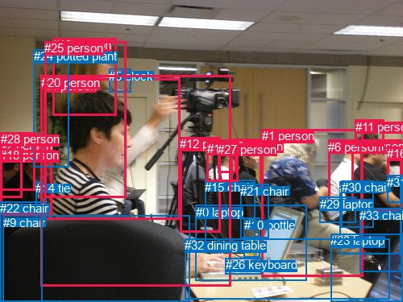
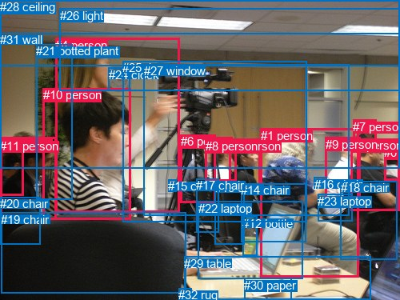

# 图片 0629：2343942.jpg

随机样本序号：454。图片 SHA256：`f90159f0241e3358ef8eed729247385f2e682eb48e803ddad9134f41b9d558f3`。

红色框表示人，蓝色框表示其他物体。两个模式分别保留自身框编号，可依据位置比较对应对象。

## 自动检测框与输出

人的框编号：`[1, 2, 3, 4, 6, 8, 11, 12, 13, 16, 17, 18, 19, 20, 25, 27, 28]`。状态：`ok`。

### 自动检测全部物体框

| 编号 | 类别 | 是否为人 | 检测分数 | 像素坐标 xyxy |
|---|---|---|---|---|
| 0 | laptop | False | 0.9994 | 242.6, 254.9, 380.4, 348.8 |
| 1 | person | True | 0.9978 | 324.5, 160.4, 450.3, 343.6 |
| 2 | person | True | 0.9934 | 0.1, 172.4, 65.0, 266.7 |
| 3 | person | True | 0.9910 | 54.8, 98.0, 224.0, 272.2 |
| 4 | person | True | 0.9815 | 436.8, 173.1, 499.0, 261.7 |
| 5 | clock | False | 0.9796 | 135.1, 85.8, 163.0, 114.2 |
| 6 | person | True | 0.9795 | 407.2, 173.7, 449.9, 250.2 |
| 7 | chair | False | 0.9774 | 421.5, 225.3, 497.4, 315.4 |
| 8 | person | True | 0.9701 | 286.4, 172.5, 324.7, 233.7 |
| 9 | chair | False | 0.9680 | 3.9, 267.6, 235.3, 374.7 |
| 10 | bottle | False | 0.9608 | 302.6, 270.8, 322.1, 320.0 |
| 11 | person | True | 0.9353 | 440.5, 148.9, 476.6, 181.1 |
| 12 | person | True | 0.9122 | 223.3, 170.1, 273.9, 288.2 |
| 13 | person | True | 0.8746 | 65.1, 47.3, 144.4, 143.9 |
| 14 | tie | False | 0.8705 | 44.1, 225.4, 57.4, 272.4 |
| 15 | chair | False | 0.8557 | 254.4, 223.8, 316.3, 312.1 |
| 16 | person | True | 0.8528 | 480.0, 182.3, 500.0, 227.3 |
| 17 | person | True | 0.8198 | 256.9, 175.5, 296.0, 225.3 |
| 18 | person | True | 0.8140 | 0.0, 184.3, 27.6, 245.1 |
| 19 | person | True | 0.7443 | 0.2, 164.8, 43.9, 236.8 |
| 20 | person | True | 0.7344 | 50.9, 93.9, 286.3, 355.4 |
| 21 | chair | False | 0.7310 | 298.5, 228.5, 334.0, 295.2 |
| 22 | chair | False | 0.7217 | 0.0, 250.4, 53.0, 374.7 |
| 23 | laptop | False | 0.6670 | 410.4, 290.4, 499.7, 375.0 |
| 24 | potted plant | False | 0.5877 | 42.0, 61.4, 85.1, 207.1 |
| 25 | person | True | 0.5810 | 55.4, 51.3, 156.8, 245.3 |
| 26 | keyboard | False | 0.5553 | 279.8, 320.2, 324.8, 340.4 |
| 27 | person | True | 0.5367 | 270.2, 176.8, 293.5, 214.7 |
| 28 | person | True | 0.5065 | 0.8, 164.0, 44.7, 194.9 |
| 29 | laptop | False | 0.4761 | 396.8, 244.6, 441.0, 276.1 |
| 30 | chair | False | 0.4222 | 423.8, 224.3, 463.2, 282.8 |
| 31 | chair | False | 0.4174 | 480.5, 217.9, 499.8, 251.6 |
| 32 | dining table | False | 0.4158 | 229.5, 296.4, 483.8, 371.5 |
| 33 | chair | False | 0.3754 | 446.1, 258.9, 498.9, 337.3 |

### 自动检测 Top50 人相关候选

评分物体对：1122；人相关物体对：850；输出关系：50。

| 排名 | 主语编号与类别 | 关系 | 宾语编号与类别 | 类型 | 人与人 | 排序分数 | 原始融合 logit |
|---|---|---|---|---|---|---|---|
| 1 | #4 person | sitting on | #7 chair | semantic | False | 0.98441 | 4.1456 |
| 2 | #2 person | wearing | #14 tie | semantic | False | 0.98284 | 4.0479 |
| 3 | #6 person | sitting on | #7 chair | semantic | False | 0.97652 | 3.7278 |
| 4 | #1 person | holding | #29 laptop | semantic | False | 0.97471 | 3.6516 |
| 5 | #2 person | sitting on | #22 chair | semantic | False | 0.96738 | 3.3897 |
| 6 | #6 person | sitting on | #30 chair | semantic | False | 0.96414 | 3.2917 |
| 7 | #1 person | sitting on | #7 chair | semantic | False | 0.96393 | 3.2857 |
| 8 | #4 person | sitting on | #30 chair | semantic | False | 0.95933 | 3.1608 |
| 9 | #4 person | wearing | #31 chair | semantic | False | 0.95343 | 3.0190 |
| 10 | #8 person | sitting on | #21 chair | semantic | False | 0.95020 | 2.9487 |
| 11 | #17 person | sitting on | #15 chair | semantic | False | 0.94176 | 2.7832 |
| 12 | #16 person | sitting on | #7 chair | semantic | False | 0.94014 | 2.7541 |
| 13 | #6 person | looking at | #29 laptop | semantic | False | 0.93856 | 2.7262 |
| 14 | #20 person | sitting on | #9 chair | semantic | False | 0.93749 | 2.7078 |
| 15 | #4 person | sitting on | #33 chair | semantic | False | 0.93456 | 2.6589 |
| 16 | #4 person | on | #7 chair | spatial | False | 0.93135 | 2.6075 |
| 17 | #6 person | on | #30 chair | spatial | False | 0.92963 | 2.5810 |
| 18 | #3 person | sitting on | #9 chair | semantic | False | 0.92859 | 2.5652 |
| 19 | #4 person | on | #30 chair | spatial | False | 0.92183 | 2.4675 |
| 20 | #8 person | sitting on | #15 chair | semantic | False | 0.91880 | 2.4261 |
| 21 | #19 person | in | #28 person | spatial | True | 0.90467 | 2.2503 |
| 22 | #2 person | in | #14 tie | spatial | False | 0.90191 | 2.2186 |
| 23 | #16 person | wearing | #31 chair | semantic | False | 0.89724 | 2.1669 |
| 24 | #1 person | on | #29 laptop | spatial | False | 0.89524 | 2.1455 |
| 25 | #17 person | in | #27 person | spatial | True | 0.89496 | 2.1425 |
| 26 | #4 person | in | #31 chair | spatial | False | 0.89035 | 2.0943 |
| 27 | #18 person | sitting on | #22 chair | semantic | False | 0.88445 | 2.0353 |
| 28 | #2 person | in | #22 chair | spatial | False | 0.87422 | 1.9388 |
| 29 | #2 person | in | #28 person | spatial | True | 0.87336 | 1.9310 |
| 30 | #1 person | sitting on | #30 chair | semantic | False | 0.87045 | 1.9049 |
| 31 | #6 person | on | #7 chair | spatial | False | 0.86932 | 1.8950 |
| 32 | #1 person | sitting on | #32 dining table | semantic | False | 0.86828 | 1.8858 |
| 33 | #28 person | on | #19 person | spatial | True | 0.86696 | 1.8744 |
| 34 | #19 person | sitting on | #22 chair | semantic | False | 0.86543 | 1.8612 |
| 35 | #4 person | looking at | #29 laptop | semantic | False | 0.86316 | 1.8418 |
| 36 | #3 person | holding | #25 person | semantic | True | 0.86316 | 1.8418 |
| 37 | #20 person | holding | #0 laptop | semantic | False | 0.86307 | 1.8410 |
| 38 | #6 person | on | #29 laptop | spatial | False | 0.86145 | 1.8274 |
| 39 | #17 person | wearing | #27 person | semantic | True | 0.85750 | 1.7947 |
| 40 | #13 person | on | #25 person | spatial | True | 0.85597 | 1.7822 |
| 41 | #20 person | wearing | #3 person | semantic | True | 0.85563 | 1.7795 |
| 42 | #16 person | in | #31 chair | spatial | False | 0.85177 | 1.7486 |
| 43 | #4 person | on | #33 chair | spatial | False | 0.85006 | 1.7351 |
| 44 | #20 person | on | #32 dining table | spatial | False | 0.84970 | 1.7322 |
| 45 | #25 person | in | #13 person | spatial | True | 0.84653 | 1.7077 |
| 46 | #3 person | sitting on | #22 chair | semantic | False | 0.84065 | 1.6630 |
| 47 | #20 person | on | #9 chair | spatial | False | 0.83243 | 1.6029 |
| 48 | #2 person | in | #18 person | spatial | True | 0.82305 | 1.5372 |
| 49 | #1 person | on | #7 chair | spatial | False | 0.81942 | 1.5124 |
| 50 | #1 person | on | #30 chair | spatial | False | 0.81401 | 1.4763 |

### 自动检测逐条人相关 GT 核验

R@50：25.00%；命中 1/4。

| GT 主语编号 | GT 关系 | GT 宾语编号 | 结果阶段 | 匹配预测主语编号 | 匹配预测宾语编号 |
|---|---|---|---|---|---|
| 1 | looking at | 23 | wrong_predicate | [1] | [29] |
| 3 | sitting on | 18 | hit50 | [4] | [7] |
| 3 | wearing | 18 | wrong_predicate | [4] | [7] |
| 19 | in front of | 10 | rank_below50 | [9] | [3, 25] |

## 真实框与输出

人的框编号：`[0, 1, 2, 3, 4, 5, 6, 7, 8, 9, 10, 11]`。

### 真实框全部物体框

| 编号 | 类别 | 是否为人 | 检测分数 | 像素坐标 xyxy |
|---|---|---|---|---|
| 0 | person | True | GT | 480.0, 182.0, 500.0, 225.0 |
| 1 | person | True | GT | 326.0, 161.0, 449.0, 346.0 |
| 2 | person | True | GT | 286.0, 174.0, 325.0, 235.0 |
| 3 | person | True | GT | 438.0, 173.0, 500.0, 263.0 |
| 4 | person | True | GT | 69.0, 48.0, 224.0, 265.0 |
| 5 | person | True | GT | 0.0, 171.0, 70.0, 275.0 |
| 6 | person | True | GT | 226.0, 168.0, 270.0, 253.0 |
| 7 | person | True | GT | 441.0, 150.0, 471.0, 176.0 |
| 8 | person | True | GT | 257.0, 174.0, 296.0, 226.0 |
| 9 | person | True | GT | 407.0, 172.0, 451.0, 250.0 |
| 10 | person | True | GT | 54.0, 110.0, 164.0, 274.0 |
| 11 | person | True | GT | 0.0, 174.0, 30.0, 245.0 |
| 12 | bottle | False | GT | 303.0, 271.0, 322.0, 320.0 |
| 13 | chair | False | GT | 269.0, 226.0, 306.0, 305.0 |
| 14 | chair | False | GT | 301.0, 229.0, 382.0, 302.0 |
| 15 | chair | False | GT | 210.0, 224.0, 220.0, 239.0 |
| 16 | chair | False | GT | 393.0, 222.0, 409.0, 234.0 |
| 17 | chair | False | GT | 245.0, 223.0, 273.0, 290.0 |
| 18 | chair | False | GT | 426.0, 226.0, 497.0, 324.0 |
| 19 | chair | False | GT | 1.0, 266.0, 233.0, 367.0 |
| 20 | chair | False | GT | 0.0, 246.0, 50.0, 306.0 |
| 21 | potted plant | False | GT | 45.0, 55.0, 90.0, 249.0 |
| 22 | laptop | False | GT | 248.0, 252.0, 379.0, 349.0 |
| 23 | laptop | False | GT | 397.0, 243.0, 440.0, 277.0 |
| 24 | clock | False | GT | 136.0, 85.0, 163.0, 114.0 |
| 25 | door | False | GT | 153.0, 76.0, 383.0, 277.0 |
| 26 | light | False | GT | 75.0, 11.0, 500.0, 113.0 |
| 27 | window | False | GT | 180.0, 80.0, 437.0, 269.0 |
| 28 | ceiling | False | GT | 0.0, 0.0, 500.0, 82.0 |
| 29 | table | False | GT | 230.0, 321.0, 463.0, 375.0 |
| 30 | paper | False | GT | 305.0, 348.0, 364.0, 375.0 |
| 31 | wall | False | GT | 0.0, 41.0, 500.0, 210.0 |
| 32 | rug | False | GT | 223.0, 360.0, 239.0, 375.0 |

### 真实框 Top50 人相关候选

评分物体对：1056；人相关物体对：636；输出关系：50。

| 排名 | 主语编号与类别 | 关系 | 宾语编号与类别 | 类型 | 人与人 | 排序分数 | 原始融合 logit |
|---|---|---|---|---|---|---|---|
| 1 | #3 person | sitting on | #18 chair | semantic | False | 0.98613 | 4.2644 |
| 2 | #5 person | sitting on | #20 chair | semantic | False | 0.98411 | 4.1262 |
| 3 | #1 person | holding | #23 laptop | semantic | False | 0.98063 | 3.9246 |
| 4 | #9 person | sitting on | #18 chair | semantic | False | 0.97938 | 3.8607 |
| 5 | #1 person | sitting on | #18 chair | semantic | False | 0.96616 | 3.3518 |
| 6 | #2 person | sitting on | #13 chair | semantic | False | 0.96435 | 3.2977 |
| 7 | #11 person | sitting on | #20 chair | semantic | False | 0.96251 | 3.2454 |
| 8 | #1 person | wearing | #16 chair | semantic | False | 0.96189 | 3.2285 |
| 9 | #8 person | sitting on | #13 chair | semantic | False | 0.95725 | 3.1087 |
| 10 | #10 person | sitting on | #19 chair | semantic | False | 0.95215 | 2.9907 |
| 11 | #9 person | looking at | #23 laptop | semantic | False | 0.94998 | 2.9441 |
| 12 | #5 person | in | #20 chair | spatial | False | 0.94827 | 2.9087 |
| 13 | #1 person | sitting on | #14 chair | semantic | False | 0.94738 | 2.8905 |
| 14 | #3 person | on | #18 chair | spatial | False | 0.94182 | 2.7842 |
| 15 | #10 person | sitting on | #20 chair | semantic | False | 0.93776 | 2.7125 |
| 16 | #9 person | holding | #16 chair | semantic | False | 0.93716 | 2.7023 |
| 17 | #1 person | on | #23 laptop | spatial | False | 0.91048 | 2.3195 |
| 18 | #4 person | touching | #24 clock | semantic | False | 0.90398 | 2.2423 |
| 19 | #9 person | on | #23 laptop | spatial | False | 0.89898 | 2.1860 |
| 20 | #1 person | on | #14 chair | spatial | False | 0.89434 | 2.1358 |
| 21 | #9 person | on | #18 chair | spatial | False | 0.89044 | 2.0952 |
| 22 | #11 person | in | #20 chair | spatial | False | 0.88623 | 2.0528 |
| 23 | #10 person | on | #19 chair | spatial | False | 0.87760 | 1.9699 |
| 24 | #9 person | in | #16 chair | spatial | False | 0.87627 | 1.9576 |
| 25 | #4 person | holding | #25 door | semantic | False | 0.86785 | 1.8820 |
| 26 | #0 person | sitting on | #18 chair | semantic | False | 0.86740 | 1.8782 |
| 27 | #1 person | looking at | #22 laptop | semantic | False | 0.86328 | 1.8428 |
| 28 | #5 person | sitting on | #19 chair | semantic | False | 0.85771 | 1.7964 |
| 29 | #1 person | on | #16 chair | spatial | False | 0.85747 | 1.7944 |
| 30 | #3 person | looking at | #23 laptop | semantic | False | 0.85607 | 1.7830 |
| 31 | #2 person | in | #13 chair | spatial | False | 0.85412 | 1.7673 |
| 32 | #3 person | holding | #0 person | semantic | True | 0.84246 | 1.6767 |
| 33 | #1 person | on | #18 chair | spatial | False | 0.84079 | 1.6641 |
| 34 | #10 person | in | #20 chair | spatial | False | 0.83784 | 1.6422 |
| 35 | #8 person | in | #13 chair | spatial | False | 0.83195 | 1.5995 |
| 36 | #6 person | holding | #17 chair | semantic | False | 0.82914 | 1.5795 |
| 37 | #3 person | in | #0 person | spatial | True | 0.82847 | 1.5748 |
| 38 | #2 person | sitting on | #14 chair | semantic | False | 0.81714 | 1.4971 |
| 39 | #11 person | talking to | #5 person | semantic | True | 0.80229 | 1.4007 |
| 40 | #6 person | sitting on | #13 chair | semantic | False | 0.79397 | 1.3490 |
| 41 | #6 person | on | #25 door | spatial | False | 0.78540 | 1.2974 |
| 42 | #8 person | looking at | #27 window | semantic | False | 0.77476 | 1.2354 |
| 43 | #8 person | looking at | #25 door | semantic | False | 0.77460 | 1.2345 |
| 44 | #2 person | looking at | #27 window | semantic | False | 0.77335 | 1.2273 |
| 45 | #5 person | in | #11 person | spatial | True | 0.76993 | 1.2079 |
| 46 | #6 person | on | #17 chair | spatial | False | 0.76520 | 1.1814 |
| 47 | #17 chair | attached to | #6 person | spatial | False | 0.75875 | 1.1459 |
| 48 | #10 person | beside | #4 person | spatial | True | 0.75654 | 1.1338 |
| 49 | #8 person | holding | #17 chair | semantic | False | 0.75416 | 1.1209 |
| 50 | #1 person | sitting on | #29 table | semantic | False | 0.75232 | 1.1110 |

### 真实框逐条人相关 GT 核验

R@50：25.00%；命中 1/4。

| GT 主语编号 | GT 关系 | GT 宾语编号 | 结果阶段 | 匹配预测主语编号 | 匹配预测宾语编号 |
|---|---|---|---|---|---|
| 1 | looking at | 23 | wrong_predicate | [1] | [23] |
| 3 | sitting on | 18 | hit50 | [3] | [18] |
| 3 | wearing | 18 | wrong_predicate | [3] | [18] |
| 19 | in front of | 10 | rank_below50 | [19] | [10] |

## 全部人相关 GT

| 主语编号与类别 | 关系 | 宾语编号与类别 |
|---|---|---|
| #1 person | looking at | #23 laptop |
| #3 person | sitting on | #18 chair |
| #3 person | wearing | #18 chair |
| #19 chair | in front of | #10 person |

原始记录、全部人相关物体对的两项预测与分项分数见 [逐图证据 JSON](../evidence/cases/0629.json)。全部56类 logits 保留于本机 HOR/output/random500/logits/。

<!-- HOR_COMPLETE_RESULTS -->

## 六组条件的完整输出对照

以下保留同一图片三种框与候选模式、两种谓词输出规则的全部 Top50。框编号各自在所属模式内解释。

### 自动检测框完整枚举：空间与语义各保留一个谓词

| 排名 | 主语编号与类别 | 谓词 | 宾语编号与类别 | 分组 | 排序分数 | predicate logit | pair logit |
|---|---|---|---|---|---|---|---|
| 1 | #4 person | sitting on | #7 chair | semantic | 0.9844134 | 3.6835542 | 0.4620807 |
| 2 | #2 person | wearing | #14 tie | semantic | 0.9828399 | 3.6923327 | 0.3555233 |
| 3 | #6 person | sitting on | #7 chair | semantic | 0.9765190 | 3.5120206 | 0.2157850 |
| 4 | #1 person | holding | #29 laptop | semantic | 0.9747071 | 3.4930606 | 0.1585504 |
| 5 | #2 person | sitting on | #22 chair | semantic | 0.9673803 | 3.2833071 | 0.1063669 |
| 6 | #6 person | sitting on | #30 chair | semantic | 0.9641445 | 2.8830919 | 0.4086524 |
| 7 | #1 person | sitting on | #7 chair | semantic | 0.9639342 | 3.2412148 | 0.0444660 |
| 8 | #4 person | sitting on | #30 chair | semantic | 0.9593310 | 2.6664605 | 0.4943104 |
| 9 | #4 person | wearing | #31 chair | semantic | 0.9534264 | 2.7893033 | 0.2297255 |
| 10 | #8 person | sitting on | #21 chair | semantic | 0.9502003 | 2.6995411 | 0.2491241 |
| 11 | #17 person | sitting on | #15 chair | semantic | 0.9417586 | 2.7085533 | 0.0745990 |
| 12 | #16 person | sitting on | #7 chair | semantic | 0.9401437 | 2.5491004 | 0.2049863 |
| 13 | #6 person | looking at | #29 laptop | semantic | 0.9385578 | 2.5430245 | 0.1832235 |
| 14 | #20 person | sitting on | #9 chair | semantic | 0.9374875 | 2.9522877 | -0.2444510 |
| 15 | #4 person | sitting on | #33 chair | semantic | 0.9345564 | 2.4768686 | 0.1820145 |
| 16 | #4 person | on | #7 chair | spatial | 0.9313458 | 2.1454673 | 0.4620807 |
| 17 | #6 person | on | #30 chair | spatial | 0.9296285 | 2.1723452 | 0.4086524 |
| 18 | #3 person | sitting on | #9 chair | semantic | 0.9285909 | 2.7567186 | -0.1914760 |
| 19 | #4 person | on | #30 chair | spatial | 0.9218307 | 1.9731750 | 0.4943104 |
| 20 | #8 person | sitting on | #15 chair | semantic | 0.9187953 | 2.3474584 | 0.0786321 |
| 21 | #19 person | in | #28 person | spatial | 0.9046746 | 1.9168129 | 0.3334663 |
| 22 | #2 person | in | #14 tie | spatial | 0.9019065 | 1.8630662 | 0.3555233 |
| 23 | #16 person | wearing | #31 chair | semantic | 0.8972395 | 2.3283076 | -0.1613863 |
| 24 | #1 person | on | #29 laptop | spatial | 0.8952431 | 1.9869032 | 0.1585504 |
| 25 | #17 person | in | #27 person | spatial | 0.8949629 | 1.8438005 | 0.2986685 |
| 26 | #4 person | in | #31 chair | spatial | 0.8903508 | 1.8646035 | 0.2297255 |
| 27 | #18 person | sitting on | #22 chair | semantic | 0.8844526 | 2.0886707 | -0.0533819 |
| 28 | #2 person | in | #22 chair | spatial | 0.8742219 | 1.8324480 | 0.1063669 |
| 29 | #2 person | in | #28 person | spatial | 0.8733566 | 1.6623631 | 0.2686061 |
| 30 | #1 person | sitting on | #30 chair | semantic | 0.8704506 | 1.8329186 | 0.0720297 |
| 31 | #6 person | on | #7 chair | spatial | 0.8693210 | 1.6791835 | 0.2157850 |
| 32 | #1 person | sitting on | #32 dining table | semantic | 0.8682795 | 2.3203874 | -0.4345564 |
| 33 | #28 person | on | #19 person | spatial | 0.8669631 | 2.0995927 | -0.2252235 |
| 34 | #19 person | sitting on | #22 chair | semantic | 0.8654310 | 1.9562564 | -0.0951055 |
| 35 | #4 person | looking at | #29 laptop | semantic | 0.8631614 | 1.6891389 | 0.1526613 |
| 36 | #3 person | holding | #25 person | semantic | 0.8631569 | 2.2488894 | -0.4071277 |
| 37 | #20 person | holding | #0 laptop | semantic | 0.8630664 | 1.9776487 | -0.1366534 |
| 38 | #6 person | on | #29 laptop | spatial | 0.8614509 | 1.6441698 | 0.1832235 |
| 39 | #17 person | wearing | #27 person | semantic | 0.8574970 | 1.4959855 | 0.2986685 |
| 40 | #13 person | on | #25 person | spatial | 0.8559689 | 1.9568686 | -0.1746639 |
| 41 | #20 person | wearing | #3 person | semantic | 0.8556334 | 2.8171391 | -1.0376529 |
| 42 | #16 person | in | #31 chair | spatial | 0.8517746 | 1.9099736 | -0.1613863 |
| 43 | #4 person | on | #33 chair | spatial | 0.8500598 | 1.5530558 | 0.1820145 |
| 44 | #20 person | on | #32 dining table | spatial | 0.8496951 | 2.2979221 | -0.5657105 |
| 45 | #25 person | in | #13 person | spatial | 0.8465336 | 1.6959953 | 0.0116733 |
| 46 | #3 person | sitting on | #22 chair | semantic | 0.8406457 | 2.1609020 | -0.4978614 |
| 47 | #20 person | on | #9 chair | spatial | 0.8324292 | 1.8473935 | -0.2444510 |
| 48 | #2 person | in | #18 person | spatial | 0.8230533 | 1.7876048 | -0.2504321 |
| 49 | #1 person | on | #7 chair | spatial | 0.8194214 | 1.4679661 | 0.0444660 |
| 50 | #1 person | on | #30 chair | spatial | 0.8140146 | 1.4042802 | 0.0720297 |

GT 命中：1/4，R@50=25.00%。

| GT主语 | GT谓词 | GT宾语 | 结果阶段 | 匹配主语框 | 匹配宾语框 |
|---|---|---|---|---|---|
| 1 | looking at | 23 | wrong_predicate | [1] | [29] |
| 3 | sitting on | 18 | hit50 | [4] | [7] |
| 3 | wearing | 18 | wrong_predicate | [4] | [7] |
| 19 | in front of | 10 | rank_below50 | [9] | [3, 25] |

### 自动检测框完整枚举：每对只保留一个谓词

| 排名 | 主语编号与类别 | 谓词 | 宾语编号与类别 | 分组 | 排序分数 | predicate logit | pair logit |
|---|---|---|---|---|---|---|---|
| 1 | #4 person | sitting on | #7 chair | single | 0.9844134 | 3.6835542 | 0.4620807 |
| 2 | #2 person | wearing | #14 tie | single | 0.9828399 | 3.6923327 | 0.3555233 |
| 3 | #6 person | sitting on | #7 chair | single | 0.9765190 | 3.5120206 | 0.2157850 |
| 4 | #1 person | holding | #29 laptop | single | 0.9747071 | 3.4930606 | 0.1585504 |
| 5 | #2 person | sitting on | #22 chair | single | 0.9673803 | 3.2833071 | 0.1063669 |
| 6 | #6 person | sitting on | #30 chair | single | 0.9641445 | 2.8830919 | 0.4086524 |
| 7 | #1 person | sitting on | #7 chair | single | 0.9639342 | 3.2412148 | 0.0444660 |
| 8 | #4 person | sitting on | #30 chair | single | 0.9593310 | 2.6664605 | 0.4943104 |
| 9 | #4 person | wearing | #31 chair | single | 0.9534264 | 2.7893033 | 0.2297255 |
| 10 | #8 person | sitting on | #21 chair | single | 0.9502003 | 2.6995411 | 0.2491241 |
| 11 | #17 person | sitting on | #15 chair | single | 0.9417586 | 2.7085533 | 0.0745990 |
| 12 | #16 person | sitting on | #7 chair | single | 0.9401437 | 2.5491004 | 0.2049863 |
| 13 | #6 person | looking at | #29 laptop | single | 0.9385578 | 2.5430245 | 0.1832235 |
| 14 | #20 person | sitting on | #9 chair | single | 0.9374875 | 2.9522877 | -0.2444510 |
| 15 | #4 person | sitting on | #33 chair | single | 0.9345564 | 2.4768686 | 0.1820145 |
| 16 | #3 person | sitting on | #9 chair | single | 0.9285909 | 2.7567186 | -0.1914760 |
| 17 | #8 person | sitting on | #15 chair | single | 0.9187953 | 2.3474584 | 0.0786321 |
| 18 | #19 person | in | #28 person | single | 0.9046746 | 1.9168129 | 0.3334663 |
| 19 | #16 person | wearing | #31 chair | single | 0.8972395 | 2.3283076 | -0.1613863 |
| 20 | #17 person | in | #27 person | single | 0.8949629 | 1.8438005 | 0.2986685 |
| 21 | #18 person | sitting on | #22 chair | single | 0.8844526 | 2.0886707 | -0.0533819 |
| 22 | #2 person | in | #28 person | single | 0.8733566 | 1.6623631 | 0.2686061 |
| 23 | #1 person | sitting on | #30 chair | single | 0.8704506 | 1.8329186 | 0.0720297 |
| 24 | #1 person | sitting on | #32 dining table | single | 0.8682795 | 2.3203874 | -0.4345564 |
| 25 | #28 person | on | #19 person | single | 0.8669631 | 2.0995927 | -0.2252235 |
| 26 | #19 person | sitting on | #22 chair | single | 0.8654310 | 1.9562564 | -0.0951055 |
| 27 | #4 person | looking at | #29 laptop | single | 0.8631614 | 1.6891389 | 0.1526613 |
| 28 | #3 person | holding | #25 person | single | 0.8631569 | 2.2488894 | -0.4071277 |
| 29 | #20 person | holding | #0 laptop | single | 0.8630664 | 1.9776487 | -0.1366534 |
| 30 | #13 person | on | #25 person | single | 0.8559689 | 1.9568686 | -0.1746639 |
| 31 | #20 person | wearing | #3 person | single | 0.8556334 | 2.8171391 | -1.0376529 |
| 32 | #20 person | on | #32 dining table | single | 0.8496951 | 2.2979221 | -0.5657105 |
| 33 | #25 person | in | #13 person | single | 0.8465336 | 1.6959953 | 0.0116733 |
| 34 | #3 person | sitting on | #22 chair | single | 0.8406457 | 2.1609020 | -0.4978614 |
| 35 | #2 person | in | #18 person | single | 0.8230533 | 1.7876048 | -0.2504321 |
| 36 | #1 person | looking at | #0 laptop | single | 0.8113073 | 1.8714957 | -0.4129686 |
| 37 | #17 person | sitting on | #21 chair | single | 0.8107349 | 1.3243556 | 0.1304370 |
| 38 | #3 person | holding | #20 person | single | 0.8102773 | 2.2433205 | -0.7915074 |
| 39 | #2 person | in | #19 person | single | 0.8031523 | 1.6061668 | -0.2000528 |
| 40 | #19 person | in | #18 person | single | 0.7748179 | 1.3995147 | -0.1637958 |
| 41 | #18 person | in | #19 person | single | 0.7597873 | 1.3293762 | -0.1778629 |
| 42 | #4 person | talking to | #16 person | single | 0.7574841 | 1.3852983 | -0.2463629 |
| 43 | #18 person | in | #28 person | single | 0.7529689 | 0.8908372 | 0.2236726 |
| 44 | #20 person | sitting on | #22 chair | single | 0.7367704 | 1.7275753 | -0.6983258 |
| 45 | #1 person | sitting on | #33 chair | single | 0.7171346 | 1.4838409 | -0.5535486 |
| 46 | #2 person | sitting on | #9 chair | single | 0.7111124 | 1.6342816 | -0.7334885 |
| 47 | #20 person | holding | #25 person | single | 0.7089289 | 1.5602937 | -0.6701057 |
| 48 | #19 person | wearing | #14 tie | single | 0.6929740 | 0.8371305 | -0.0230707 |
| 49 | #4 person | looking at | #23 laptop | single | 0.6823078 | 1.2788439 | -0.5144457 |
| 50 | #1 person | sitting on | #21 chair | single | 0.6668833 | 1.0686040 | -0.3744818 |

GT 命中：1/4，R@50=25.00%。

| GT主语 | GT谓词 | GT宾语 | 结果阶段 | 匹配主语框 | 匹配宾语框 |
|---|---|---|---|---|---|
| 1 | looking at | 23 | wrong_predicate | [1] | [29] |
| 3 | sitting on | 18 | hit50 | [4] | [7] |
| 3 | wearing | 18 | wrong_predicate | [4] | [7] |
| 19 | in front of | 10 | rank_below50 | [9] | [3, 25] |

### 真实框完整枚举：空间与语义各保留一个谓词

| 排名 | 主语编号与类别 | 谓词 | 宾语编号与类别 | 分组 | 排序分数 | predicate logit | pair logit |
|---|---|---|---|---|---|---|---|
| 1 | #3 person | sitting on | #18 chair | semantic | 0.9861348 | 3.8279853 | 0.4364267 |
| 2 | #5 person | sitting on | #20 chair | semantic | 0.9841120 | 3.7737803 | 0.3523968 |
| 3 | #1 person | holding | #23 laptop | semantic | 0.9806325 | 3.7673850 | 0.1572182 |
| 4 | #9 person | sitting on | #18 chair | semantic | 0.9793811 | 3.6745095 | 0.1862066 |
| 5 | #1 person | sitting on | #18 chair | semantic | 0.9661640 | 3.3224597 | 0.0293505 |
| 6 | #2 person | sitting on | #13 chair | semantic | 0.9643502 | 3.1719556 | 0.1257539 |
| 7 | #11 person | sitting on | #20 chair | semantic | 0.9625087 | 2.9191761 | 0.3262582 |
| 8 | #1 person | wearing | #16 chair | semantic | 0.9618944 | 3.1886129 | 0.0399303 |
| 9 | #8 person | sitting on | #13 chair | semantic | 0.9572485 | 2.9793582 | 0.1293011 |
| 10 | #10 person | sitting on | #19 chair | semantic | 0.9521516 | 3.1358390 | -0.1451519 |
| 11 | #9 person | looking at | #23 laptop | semantic | 0.9499832 | 2.7550578 | 0.1890278 |
| 12 | #5 person | in | #20 chair | spatial | 0.9482745 | 2.5562973 | 0.3523968 |
| 13 | #1 person | sitting on | #14 chair | semantic | 0.9473768 | 2.8258824 | 0.0646575 |
| 14 | #3 person | on | #18 chair | spatial | 0.9418172 | 2.3477941 | 0.4364267 |
| 15 | #10 person | sitting on | #20 chair | semantic | 0.9377586 | 3.1147766 | -0.4023039 |
| 16 | #9 person | holding | #16 chair | semantic | 0.9371616 | 2.5498018 | 0.1524863 |
| 17 | #1 person | on | #23 laptop | spatial | 0.9104804 | 2.1622958 | 0.1572182 |
| 18 | #4 person | touching | #24 clock | semantic | 0.9039811 | 2.7215886 | -0.4793259 |
| 19 | #9 person | on | #23 laptop | spatial | 0.8989835 | 1.9969530 | 0.1890278 |
| 20 | #1 person | on | #14 chair | spatial | 0.8943380 | 2.0711813 | 0.0646575 |
| 21 | #9 person | on | #18 chair | spatial | 0.8904387 | 1.9090238 | 0.1862066 |
| 22 | #11 person | in | #20 chair | spatial | 0.8862333 | 1.7265725 | 0.3262582 |
| 23 | #10 person | on | #19 chair | spatial | 0.8776011 | 2.1150584 | -0.1451519 |
| 24 | #9 person | in | #16 chair | spatial | 0.8762703 | 1.8050890 | 0.1524863 |
| 25 | #4 person | holding | #25 door | semantic | 0.8678463 | 2.5106387 | -0.6285898 |
| 26 | #0 person | sitting on | #18 chair | semantic | 0.8674023 | 1.7336164 | 0.1445661 |
| 27 | #1 person | looking at | #22 laptop | semantic | 0.8632795 | 2.2346826 | -0.3918822 |
| 28 | #5 person | sitting on | #19 chair | semantic | 0.8577063 | 2.3985963 | -0.6022276 |
| 29 | #1 person | on | #16 chair | spatial | 0.8574678 | 1.7544856 | 0.0399303 |
| 30 | #3 person | looking at | #23 laptop | semantic | 0.8560701 | 1.6364522 | 0.1465740 |
| 31 | #2 person | in | #13 chair | spatial | 0.8541157 | 1.6414995 | 0.1257539 |
| 32 | #3 person | holding | #0 person | semantic | 0.8424606 | 1.8597689 | -0.1831179 |
| 33 | #1 person | on | #18 chair | spatial | 0.8407885 | 1.6347566 | 0.0293505 |
| 34 | #10 person | in | #20 chair | spatial | 0.8378368 | 2.0445237 | -0.4023039 |
| 35 | #8 person | in | #13 chair | spatial | 0.8319542 | 1.4702401 | 0.1293011 |
| 36 | #6 person | holding | #17 chair | semantic | 0.8291359 | 1.6382017 | -0.0586866 |
| 37 | #3 person | in | #0 person | spatial | 0.8284727 | 1.7579589 | -0.1831179 |
| 38 | #2 person | sitting on | #14 chair | semantic | 0.8171378 | 1.4868135 | 0.0102613 |
| 39 | #11 person | talking to | #5 person | semantic | 0.8022912 | 1.9806204 | -0.5799442 |
| 40 | #6 person | sitting on | #13 chair | semantic | 0.7939729 | 1.3634124 | -0.0143707 |
| 41 | #6 person | on | #25 door | spatial | 0.7853994 | 1.6100817 | -0.3126678 |
| 42 | #8 person | looking at | #27 window | semantic | 0.7747560 | 1.5955758 | -0.3602124 |
| 43 | #8 person | looking at | #25 door | semantic | 0.7746047 | 1.5941815 | -0.3596842 |
| 44 | #2 person | looking at | #27 window | semantic | 0.7733487 | 1.4647522 | -0.2374346 |
| 45 | #5 person | in | #11 person | spatial | 0.7699252 | 1.6805148 | -0.4726255 |
| 46 | #6 person | on | #17 chair | spatial | 0.7652010 | 1.2400951 | -0.0586866 |
| 47 | #17 chair | attached to | #6 person | spatial | 0.7587523 | 1.7832708 | -0.6374195 |
| 48 | #10 person | beside | #4 person | spatial | 0.7565424 | 2.0655770 | -0.9317610 |
| 49 | #8 person | holding | #17 chair | semantic | 0.7541556 | 1.2747011 | -0.1538011 |
| 50 | #1 person | sitting on | #29 table | semantic | 0.7523203 | 1.6102147 | -0.4991891 |

GT 命中：1/4，R@50=25.00%。

| GT主语 | GT谓词 | GT宾语 | 结果阶段 | 匹配主语框 | 匹配宾语框 |
|---|---|---|---|---|---|
| 1 | looking at | 23 | wrong_predicate | [1] | [23] |
| 3 | sitting on | 18 | hit50 | [3] | [18] |
| 3 | wearing | 18 | wrong_predicate | [3] | [18] |
| 19 | in front of | 10 | rank_below50 | [19] | [10] |

### 真实框完整枚举：每对只保留一个谓词

| 排名 | 主语编号与类别 | 谓词 | 宾语编号与类别 | 分组 | 排序分数 | predicate logit | pair logit |
|---|---|---|---|---|---|---|---|
| 1 | #3 person | sitting on | #18 chair | single | 0.9861348 | 3.8279853 | 0.4364267 |
| 2 | #5 person | sitting on | #20 chair | single | 0.9841120 | 3.7737803 | 0.3523968 |
| 3 | #1 person | holding | #23 laptop | single | 0.9806325 | 3.7673850 | 0.1572182 |
| 4 | #9 person | sitting on | #18 chair | single | 0.9793811 | 3.6745095 | 0.1862066 |
| 5 | #1 person | sitting on | #18 chair | single | 0.9661640 | 3.3224597 | 0.0293505 |
| 6 | #2 person | sitting on | #13 chair | single | 0.9643502 | 3.1719556 | 0.1257539 |
| 7 | #11 person | sitting on | #20 chair | single | 0.9625087 | 2.9191761 | 0.3262582 |
| 8 | #1 person | wearing | #16 chair | single | 0.9618944 | 3.1886129 | 0.0399303 |
| 9 | #8 person | sitting on | #13 chair | single | 0.9572485 | 2.9793582 | 0.1293011 |
| 10 | #10 person | sitting on | #19 chair | single | 0.9521516 | 3.1358390 | -0.1451519 |
| 11 | #9 person | looking at | #23 laptop | single | 0.9499832 | 2.7550578 | 0.1890278 |
| 12 | #1 person | sitting on | #14 chair | single | 0.9473768 | 2.8258824 | 0.0646575 |
| 13 | #10 person | sitting on | #20 chair | single | 0.9377586 | 3.1147766 | -0.4023039 |
| 14 | #9 person | holding | #16 chair | single | 0.9371616 | 2.5498018 | 0.1524863 |
| 15 | #4 person | touching | #24 clock | single | 0.9039811 | 2.7215886 | -0.4793259 |
| 16 | #4 person | holding | #25 door | single | 0.8678463 | 2.5106387 | -0.6285898 |
| 17 | #0 person | sitting on | #18 chair | single | 0.8674023 | 1.7336164 | 0.1445661 |
| 18 | #1 person | looking at | #22 laptop | single | 0.8632795 | 2.2346826 | -0.3918822 |
| 19 | #5 person | sitting on | #19 chair | single | 0.8577063 | 2.3985963 | -0.6022276 |
| 20 | #3 person | looking at | #23 laptop | single | 0.8560701 | 1.6364522 | 0.1465740 |
| 21 | #3 person | holding | #0 person | single | 0.8424606 | 1.8597689 | -0.1831179 |
| 22 | #6 person | holding | #17 chair | single | 0.8291359 | 1.6382017 | -0.0586866 |
| 23 | #2 person | sitting on | #14 chair | single | 0.8171378 | 1.4868135 | 0.0102613 |
| 24 | #11 person | talking to | #5 person | single | 0.8022912 | 1.9806204 | -0.5799442 |
| 25 | #6 person | sitting on | #13 chair | single | 0.7939729 | 1.3634124 | -0.0143707 |
| 26 | #6 person | on | #25 door | single | 0.7853994 | 1.6100817 | -0.3126678 |
| 27 | #8 person | looking at | #27 window | single | 0.7747560 | 1.5955758 | -0.3602124 |
| 28 | #8 person | looking at | #25 door | single | 0.7746047 | 1.5941815 | -0.3596842 |
| 29 | #2 person | looking at | #27 window | single | 0.7733487 | 1.4647522 | -0.2374346 |
| 30 | #5 person | in | #11 person | single | 0.7699252 | 1.6805148 | -0.4726255 |
| 31 | #17 chair | attached to | #6 person | single | 0.7587523 | 1.7832708 | -0.6374195 |
| 32 | #10 person | beside | #4 person | single | 0.7565424 | 2.0655770 | -0.9317610 |
| 33 | #8 person | holding | #17 chair | single | 0.7541556 | 1.2747011 | -0.1538011 |
| 34 | #1 person | sitting on | #29 table | single | 0.7523203 | 1.6102147 | -0.4991891 |
| 35 | #2 person | looking at | #25 door | single | 0.7517924 | 1.4228072 | -0.3146125 |
| 36 | #4 person | sitting on | #20 chair | single | 0.7451391 | 1.7817173 | -0.7088641 |
| 37 | #7 person | in | #31 wall | single | 0.7192714 | 1.4700990 | -0.5292486 |
| 38 | #4 person | looking at | #10 person | single | 0.7157398 | 1.7902865 | -0.8668599 |
| 39 | #8 person | talking to | #2 person | single | 0.7018452 | 1.1663437 | -0.3102434 |
| 40 | #9 person | talking to | #3 person | single | 0.7014815 | 1.7709823 | -0.9166198 |
| 41 | #6 person | in | #27 window | single | 0.6755280 | 1.2342453 | -0.5009499 |
| 42 | #4 person | holding | #21 potted plant | single | 0.6620239 | 1.4632230 | -0.7908967 |
| 43 | #8 person | talking to | #6 person | single | 0.6442978 | 0.7780337 | -0.1839664 |
| 44 | #0 person | talking to | #3 person | single | 0.6371590 | 1.0204515 | -0.4573970 |
| 45 | #9 person | talking to | #1 person | single | 0.6230429 | 1.4436049 | -0.9411211 |
| 46 | #3 person | talking to | #9 person | single | 0.5914989 | 1.1147265 | -0.7445617 |
| 47 | #21 potted plant | beside | #4 person | single | 0.5853844 | 0.7095046 | -0.3645875 |
| 48 | #10 person | looking at | #22 laptop | single | 0.5805769 | 0.8441010 | -0.5189590 |
| 49 | #5 person | looking at | #10 person | single | 0.5763308 | 1.1128302 | -0.8051012 |
| 50 | #2 person | talking to | #8 person | single | 0.5597330 | 0.1197147 | 0.1203639 |

GT 命中：1/4，R@50=25.00%。

| GT主语 | GT谓词 | GT宾语 | 结果阶段 | 匹配主语框 | 匹配宾语框 |
|---|---|---|---|---|---|
| 1 | looking at | 23 | wrong_predicate | [1] | [23] |
| 3 | sitting on | 18 | hit50 | [3] | [18] |
| 3 | wearing | 18 | wrong_predicate | [3] | [18] |
| 19 | in front of | 10 | rank_below50 | [19] | [10] |

### 真实框400候选：空间与语义各保留一个谓词

| 排名 | 主语编号与类别 | 谓词 | 宾语编号与类别 | 分组 | 排序分数 | predicate logit | pair logit |
|---|---|---|---|---|---|---|---|
| 1 | #3 person | sitting on | #18 chair | semantic | 0.9843890 | 3.7076211 | 0.4364267 |
| 2 | #5 person | sitting on | #20 chair | semantic | 0.9827396 | 3.6895308 | 0.3523968 |
| 3 | #1 person | holding | #23 laptop | semantic | 0.9808556 | 3.7792020 | 0.1572182 |
| 4 | #9 person | sitting on | #18 chair | semantic | 0.9712706 | 3.3344769 | 0.1862066 |
| 5 | #2 person | sitting on | #13 chair | semantic | 0.9679865 | 3.2833071 | 0.1257539 |
| 6 | #8 person | sitting on | #13 chair | semantic | 0.9643688 | 3.1689506 | 0.1293011 |
| 7 | #1 person | wearing | #16 chair | semantic | 0.9618944 | 3.1886129 | 0.0399303 |
| 8 | #1 person | sitting on | #14 chair | semantic | 0.9558126 | 3.0094657 | 0.0646575 |
| 9 | #9 person | looking at | #23 laptop | semantic | 0.9516512 | 2.7907276 | 0.1890278 |
| 10 | #11 person | sitting on | #20 chair | semantic | 0.9508547 | 2.6363215 | 0.3262582 |
| 11 | #1 person | sitting on | #18 chair | semantic | 0.9493353 | 2.9011822 | 0.0293505 |
| 12 | #10 person | sitting on | #19 chair | semantic | 0.9459003 | 3.0064611 | -0.1451519 |
| 13 | #10 person | sitting on | #20 chair | semantic | 0.9311287 | 3.0064611 | -0.4023039 |
| 14 | #5 person | in | #20 chair | spatial | 0.9273303 | 2.1939888 | 0.3523968 |
| 15 | #3 person | on | #18 chair | spatial | 0.9248769 | 2.0741062 | 0.4364267 |
| 16 | #1 person | on | #23 laptop | spatial | 0.8940914 | 1.9760137 | 0.1572182 |
| 17 | #1 person | on | #14 chair | spatial | 0.8882589 | 2.0084214 | 0.0646575 |
| 18 | #9 person | on | #23 laptop | spatial | 0.8752096 | 1.7588005 | 0.1890278 |
| 19 | #1 person | looking at | #22 laptop | semantic | 0.8745104 | 2.3333235 | -0.3918822 |
| 20 | #1 person | on | #16 chair | spatial | 0.8646662 | 1.8146682 | 0.0399303 |
| 21 | #8 person | looking at | #27 window | semantic | 0.8571293 | 2.1518612 | -0.3602124 |
| 22 | #8 person | in | #27 window | spatial | 0.8565528 | 2.1471615 | -0.3602124 |
| 23 | #4 person | touching | #24 clock | semantic | 0.8534461 | 2.2412152 | -0.4793259 |
| 24 | #8 person | looking at | #25 door | semantic | 0.8525088 | 2.1141000 | -0.3596842 |
| 25 | #2 person | sitting on | #14 chair | semantic | 0.8488728 | 1.7155266 | 0.0102613 |
| 26 | #6 person | holding | #17 chair | semantic | 0.8470562 | 1.7703834 | -0.0586866 |
| 27 | #9 person | on | #18 chair | spatial | 0.8449765 | 1.5095263 | 0.1862066 |
| 28 | #10 person | on | #19 chair | spatial | 0.8436471 | 1.8307700 | -0.1451519 |
| 29 | #2 person | in | #27 window | spatial | 0.8373861 | 1.8763409 | -0.2374346 |
| 30 | #2 person | looking at | #27 window | semantic | 0.8366955 | 1.8712783 | -0.2374346 |
| 31 | #2 person | on | #13 chair | spatial | 0.8276927 | 1.4436088 | 0.1257539 |
| 32 | #8 person | on | #13 chair | spatial | 0.8169925 | 1.3668017 | 0.1293011 |
| 33 | #3 person | looking at | #23 laptop | semantic | 0.8152070 | 1.3376317 | 0.1465740 |
| 34 | #9 person | holding | #16 chair | semantic | 0.8138999 | 1.3230667 | 0.1524863 |
| 35 | #3 person | in | #0 person | spatial | 0.8136560 | 1.6570611 | -0.1831179 |
| 36 | #6 person | on | #25 door | spatial | 0.8121307 | 1.7765827 | -0.3126678 |
| 37 | #4 person | holding | #25 door | semantic | 0.8099543 | 2.0783029 | -0.6285898 |
| 38 | #3 person | holding | #0 person | semantic | 0.8086529 | 1.6243987 | -0.1831179 |
| 39 | #6 person | sitting on | #13 chair | semantic | 0.8074185 | 1.4476933 | -0.0143707 |
| 40 | #5 person | sitting on | #19 chair | semantic | 0.8067868 | 2.0314927 | -0.6022276 |
| 41 | #11 person | in | #20 chair | spatial | 0.8015522 | 1.0697656 | 0.3262582 |
| 42 | #2 person | looking at | #25 door | semantic | 0.8008423 | 1.7061791 | -0.3146125 |
| 43 | #8 person | holding | #17 chair | semantic | 0.7931314 | 1.4977059 | -0.1538011 |
| 44 | #6 person | in | #27 window | spatial | 0.7699264 | 1.7088451 | -0.5009499 |
| 45 | #1 person | on | #18 chair | spatial | 0.7668608 | 1.1613193 | 0.0293505 |
| 46 | #4 person | sitting on | #20 chair | semantic | 0.7635345 | 1.8810201 | -0.7088641 |
| 47 | #10 person | in | #20 chair | spatial | 0.7613200 | 1.5622339 | -0.4023039 |
| 48 | #8 person | in | #25 door | spatial | 0.7604442 | 1.5148005 | -0.3596842 |
| 49 | #6 person | on | #17 chair | spatial | 0.7562292 | 1.1908026 | -0.0586866 |
| 50 | #5 person | in | #11 person | spatial | 0.7528051 | 1.5862546 | -0.4726255 |

GT 命中：1/4，R@50=25.00%。

| GT主语 | GT谓词 | GT宾语 | 结果阶段 | 匹配主语框 | 匹配宾语框 |
|---|---|---|---|---|---|
| 1 | looking at | 23 | wrong_predicate | [1] | [23] |
| 3 | sitting on | 18 | hit50 | [3] | [18] |
| 3 | wearing | 18 | wrong_predicate | [3] | [18] |
| 19 | in front of | 10 | rank_below50 | [19] | [10] |

### 真实框400候选：每对只保留一个谓词

| 排名 | 主语编号与类别 | 谓词 | 宾语编号与类别 | 分组 | 排序分数 | predicate logit | pair logit |
|---|---|---|---|---|---|---|---|
| 1 | #3 person | sitting on | #18 chair | single | 0.9843890 | 3.7076211 | 0.4364267 |
| 2 | #5 person | sitting on | #20 chair | single | 0.9827396 | 3.6895308 | 0.3523968 |
| 3 | #1 person | holding | #23 laptop | single | 0.9808556 | 3.7792020 | 0.1572182 |
| 4 | #9 person | sitting on | #18 chair | single | 0.9712706 | 3.3344769 | 0.1862066 |
| 5 | #2 person | sitting on | #13 chair | single | 0.9679865 | 3.2833071 | 0.1257539 |
| 6 | #8 person | sitting on | #13 chair | single | 0.9643688 | 3.1689506 | 0.1293011 |
| 7 | #1 person | wearing | #16 chair | single | 0.9618944 | 3.1886129 | 0.0399303 |
| 8 | #1 person | sitting on | #14 chair | single | 0.9558126 | 3.0094657 | 0.0646575 |
| 9 | #9 person | looking at | #23 laptop | single | 0.9516512 | 2.7907276 | 0.1890278 |
| 10 | #11 person | sitting on | #20 chair | single | 0.9508547 | 2.6363215 | 0.3262582 |
| 11 | #1 person | sitting on | #18 chair | single | 0.9493353 | 2.9011822 | 0.0293505 |
| 12 | #10 person | sitting on | #19 chair | single | 0.9459003 | 3.0064611 | -0.1451519 |
| 13 | #10 person | sitting on | #20 chair | single | 0.9311287 | 3.0064611 | -0.4023039 |
| 14 | #1 person | looking at | #22 laptop | single | 0.8745104 | 2.3333235 | -0.3918822 |
| 15 | #8 person | looking at | #27 window | single | 0.8571293 | 2.1518612 | -0.3602124 |
| 16 | #4 person | touching | #24 clock | single | 0.8534461 | 2.2412152 | -0.4793259 |
| 17 | #8 person | looking at | #25 door | single | 0.8525088 | 2.1141000 | -0.3596842 |
| 18 | #2 person | sitting on | #14 chair | single | 0.8488728 | 1.7155266 | 0.0102613 |
| 19 | #6 person | holding | #17 chair | single | 0.8470562 | 1.7703834 | -0.0586866 |
| 20 | #2 person | in | #27 window | single | 0.8373861 | 1.8763409 | -0.2374346 |
| 21 | #3 person | looking at | #23 laptop | single | 0.8152070 | 1.3376317 | 0.1465740 |
| 22 | #9 person | holding | #16 chair | single | 0.8138999 | 1.3230667 | 0.1524863 |
| 23 | #3 person | in | #0 person | single | 0.8136560 | 1.6570611 | -0.1831179 |
| 24 | #6 person | on | #25 door | single | 0.8121307 | 1.7765827 | -0.3126678 |
| 25 | #4 person | holding | #25 door | single | 0.8099543 | 2.0783029 | -0.6285898 |
| 26 | #6 person | sitting on | #13 chair | single | 0.8074185 | 1.4476933 | -0.0143707 |
| 27 | #5 person | sitting on | #19 chair | single | 0.8067868 | 2.0314927 | -0.6022276 |
| 28 | #2 person | looking at | #25 door | single | 0.8008423 | 1.7061791 | -0.3146125 |
| 29 | #8 person | holding | #17 chair | single | 0.7931314 | 1.4977059 | -0.1538011 |
| 30 | #6 person | in | #27 window | single | 0.7699264 | 1.7088451 | -0.5009499 |
| 31 | #4 person | sitting on | #20 chair | single | 0.7635345 | 1.8810201 | -0.7088641 |
| 32 | #5 person | in | #11 person | single | 0.7528051 | 1.5862546 | -0.4726255 |
| 33 | #1 person | sitting on | #29 table | single | 0.7368734 | 1.5289702 | -0.4991891 |
| 34 | #0 person | sitting on | #18 chair | single | 0.7339125 | 0.8699989 | 0.1445661 |
| 35 | #11 person | talking to | #5 person | single | 0.7212023 | 1.5303774 | -0.5799442 |
| 36 | #10 person | in | #4 person | single | 0.6795816 | 1.6836109 | -0.9317610 |
| 37 | #9 person | talking to | #3 person | single | 0.6138266 | 1.3800459 | -0.9166198 |
| 38 | #4 person | looking at | #10 person | single | 0.6030406 | 1.2850108 | -0.8668599 |
| 39 | #9 person | talking to | #1 person | single | 0.6016777 | 1.3535814 | -0.9411211 |
| 40 | #8 person | talking to | #2 person | single | 0.5932891 | 0.6878223 | -0.3102434 |
| 41 | #8 person | sitting on | #14 chair | single | 0.5765804 | 0.4847732 | -0.1760221 |
| 42 | #4 person | sitting on | #19 chair | single | 0.5761588 | 0.9391303 | -0.6321060 |
| 43 | #17 chair | hanging from | #6 person | single | 0.5652080 | 0.8997455 | -0.6374195 |
| 44 | #10 person | looking at | #22 laptop | single | 0.5597377 | 0.7590566 | -0.5189590 |
| 45 | #8 person | talking to | #6 person | single | 0.5582277 | 0.4179387 | -0.1839664 |
| 46 | #11 person | looking at | #27 window | single | 0.5497781 | 0.8636250 | -0.6638508 |
| 47 | #1 person | wearing | #9 person | single | 0.5455847 | 1.0695915 | -0.8867451 |
| 48 | #0 person | on | #3 person | single | 0.5438169 | 0.6331153 | -0.4573970 |
| 49 | #4 person | in | #31 wall | single | 0.5325531 | 1.0216036 | -0.8912067 |
| 50 | #8 person | in | #31 wall | single | 0.5307069 | 1.4703217 | -1.3473392 |

GT 命中：1/4，R@50=25.00%。

| GT主语 | GT谓词 | GT宾语 | 结果阶段 | 匹配主语框 | 匹配宾语框 |
|---|---|---|---|---|---|
| 1 | looking at | 23 | wrong_predicate | [1] | [23] |
| 3 | sitting on | 18 | hit50 | [3] | [18] |
| 3 | wearing | 18 | wrong_predicate | [3] | [18] |
| 19 | in front of | 10 | rank_below50 | [19] | [10] |
