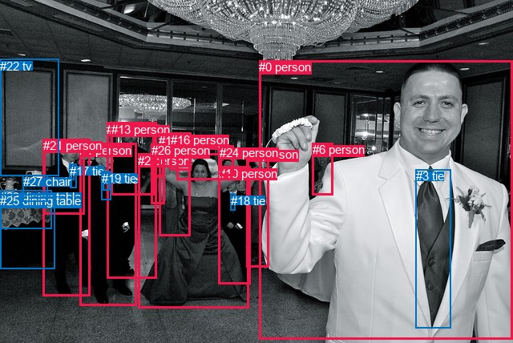
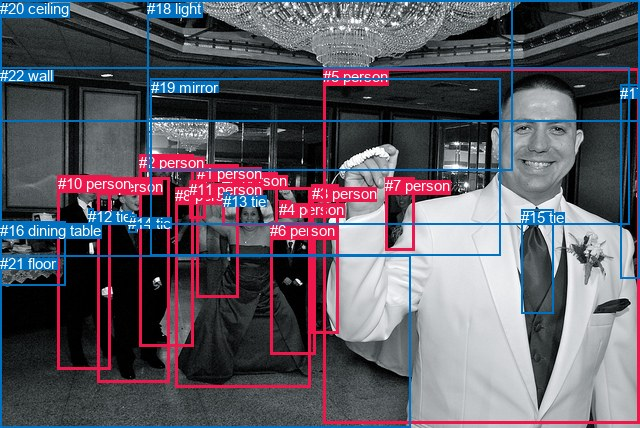

# 图片 0630：2343959.jpg

随机样本序号：396。图片 SHA256：`5dc30fc8cef779e2e4905235a08bddf1116dadc659356238293e2ac90792a7ed`。

红色框表示人，蓝色框表示其他物体。两个模式分别保留自身框编号，可依据位置比较对应对象。

## 自动检测框与输出

人的框编号：`[0, 1, 2, 4, 5, 6, 7, 8, 10, 13, 14, 16, 20, 21, 24, 26]`。状态：`ok`。

### 自动检测全部物体框

| 编号 | 类别 | 是否为人 | 检测分数 | 像素坐标 xyxy |
|---|---|---|---|---|
| 0 | person | True | 0.9996 | 323.2, 75.2, 640.0, 423.9 |
| 1 | person | True | 0.9960 | 54.0, 173.9, 112.2, 369.0 |
| 2 | person | True | 0.9952 | 172.2, 191.7, 310.5, 384.1 |
| 3 | tie | False | 0.9948 | 518.9, 211.5, 562.2, 409.2 |
| 4 | person | True | 0.9945 | 99.3, 178.9, 170.8, 381.0 |
| 5 | person | True | 0.9903 | 133.4, 152.8, 195.8, 347.1 |
| 6 | person | True | 0.9685 | 389.8, 178.2, 415.0, 243.4 |
| 7 | person | True | 0.9603 | 307.4, 184.3, 335.3, 333.9 |
| 8 | person | True | 0.9576 | 220.5, 169.5, 274.6, 224.5 |
| 9 | tie | False | 0.9407 | 87.4, 204.8, 95.7, 234.4 |
| 10 | person | True | 0.9223 | 273.0, 207.9, 312.0, 354.0 |
| 11 | tie | False | 0.9088 | 128.8, 214.4, 136.9, 237.4 |
| 12 | tie | False | 0.8947 | 287.5, 241.6, 293.3, 262.3 |
| 13 | person | True | 0.8639 | 138.5, 153.1, 192.2, 243.9 |
| 14 | person | True | 0.8593 | 198.1, 166.8, 237.2, 294.9 |
| 15 | tie | False | 0.7659 | 128.9, 214.9, 134.1, 229.4 |
| 16 | person | True | 0.7633 | 212.6, 166.0, 238.0, 212.8 |
| 17 | tie | False | 0.7393 | 86.6, 204.7, 92.2, 225.0 |
| 18 | tie | False | 0.7201 | 287.9, 242.0, 292.8, 254.0 |
| 19 | tie | False | 0.5792 | 126.9, 213.8, 138.4, 249.2 |
| 20 | person | True | 0.5123 | 188.5, 180.3, 204.4, 220.4 |
| 21 | person | True | 0.3932 | 54.4, 173.3, 105.6, 267.4 |
| 22 | tv | False | 0.3750 | 0.0, 73.5, 73.1, 219.3 |
| 23 | dining table | False | 0.3736 | 0.2, 237.4, 65.0, 285.2 |
| 24 | person | True | 0.3614 | 274.4, 181.6, 291.8, 219.1 |
| 25 | dining table | False | 0.3552 | 0.3, 242.4, 68.6, 335.5 |
| 26 | person | True | 0.3543 | 188.8, 179.4, 205.2, 255.0 |
| 27 | chair | False | 0.3537 | 29.0, 218.5, 59.7, 251.0 |

### 自动检测 Top50 人相关候选

评分物体对：756；人相关物体对：624；输出关系：50。

| 排名 | 主语编号与类别 | 关系 | 宾语编号与类别 | 类型 | 人与人 | 排序分数 | 原始融合 logit |
|---|---|---|---|---|---|---|---|
| 1 | #0 person | wearing | #3 tie | semantic | False | 0.99438 | 5.1757 |
| 2 | #4 person | wearing | #19 tie | semantic | False | 0.99063 | 4.6609 |
| 3 | #4 person | wearing | #11 tie | semantic | False | 0.99034 | 4.6303 |
| 4 | #4 person | wearing | #15 tie | semantic | False | 0.98921 | 4.5179 |
| 5 | #1 person | wearing | #9 tie | semantic | False | 0.98480 | 4.1714 |
| 6 | #1 person | wearing | #21 person | semantic | True | 0.98190 | 3.9937 |
| 7 | #1 person | wearing | #17 tie | semantic | False | 0.98183 | 3.9895 |
| 8 | #21 person | wearing | #9 tie | semantic | False | 0.97812 | 3.7998 |
| 9 | #21 person | wearing | #17 tie | semantic | False | 0.97375 | 3.6133 |
| 10 | #26 person | wearing | #20 person | semantic | True | 0.97198 | 3.5465 |
| 11 | #10 person | wearing | #18 tie | semantic | False | 0.95400 | 3.0320 |
| 12 | #10 person | wearing | #12 tie | semantic | False | 0.94847 | 2.9126 |
| 13 | #2 person | holding | #12 tie | semantic | False | 0.94255 | 2.7976 |
| 14 | #5 person | wearing | #11 tie | semantic | False | 0.94199 | 2.7874 |
| 15 | #26 person | in | #20 person | spatial | True | 0.93817 | 2.7195 |
| 16 | #2 person | holding | #18 tie | semantic | False | 0.93766 | 2.7107 |
| 17 | #2 person | wearing | #10 person | semantic | True | 0.93366 | 2.6443 |
| 18 | #5 person | wearing | #19 tie | semantic | False | 0.93300 | 2.6338 |
| 19 | #0 person | in | #3 tie | spatial | False | 0.93248 | 2.6255 |
| 20 | #1 person | standing on | #25 dining table | semantic | False | 0.92781 | 2.5535 |
| 21 | #1 person | in | #21 person | spatial | True | 0.92505 | 2.5130 |
| 22 | #4 person | in | #19 tie | spatial | False | 0.90206 | 2.2203 |
| 23 | #2 person | in | #10 person | spatial | True | 0.89763 | 2.1712 |
| 24 | #4 person | in | #11 tie | spatial | False | 0.89196 | 2.1109 |
| 25 | #21 person | wearing | #1 person | semantic | True | 0.88357 | 2.0266 |
| 26 | #4 person | in | #15 tie | spatial | False | 0.86983 | 1.8994 |
| 27 | #5 person | in | #13 person | spatial | True | 0.86917 | 1.8936 |
| 28 | #1 person | in | #9 tie | spatial | False | 0.85906 | 1.8075 |
| 29 | #21 person | standing on | #25 dining table | semantic | False | 0.84559 | 1.7004 |
| 30 | #21 person | in | #9 tie | spatial | False | 0.84366 | 1.6857 |
| 31 | #5 person | wearing | #13 person | semantic | True | 0.84260 | 1.6777 |
| 32 | #5 person | wearing | #15 tie | semantic | False | 0.84238 | 1.6760 |
| 33 | #14 person | in | #16 person | spatial | True | 0.84204 | 1.6735 |
| 34 | #14 person | holding | #16 person | semantic | True | 0.84135 | 1.6683 |
| 35 | #2 person | holding | #24 person | semantic | True | 0.83432 | 1.6166 |
| 36 | #10 person | in | #12 tie | spatial | False | 0.82213 | 1.5308 |
| 37 | #21 person | on | #23 dining table | spatial | False | 0.81374 | 1.4745 |
| 38 | #1 person | standing on | #23 dining table | semantic | False | 0.81295 | 1.4693 |
| 39 | #21 person | on | #25 dining table | spatial | False | 0.80828 | 1.4389 |
| 40 | #3 tie | on | #0 person | spatial | False | 0.80250 | 1.4020 |
| 41 | #10 person | in | #18 tie | spatial | False | 0.80083 | 1.3915 |
| 42 | #1 person | in | #17 tie | spatial | False | 0.79914 | 1.3809 |
| 43 | #21 person | in | #17 tie | spatial | False | 0.79204 | 1.3373 |
| 44 | #21 person | standing on | #23 dining table | semantic | False | 0.78456 | 1.2924 |
| 45 | #4 person | standing on | #25 dining table | semantic | False | 0.77246 | 1.2222 |
| 46 | #21 person | in | #1 person | spatial | True | 0.77140 | 1.2162 |
| 47 | #1 person | on | #25 dining table | spatial | False | 0.73757 | 1.0334 |
| 48 | #8 person | holding | #16 person | semantic | True | 0.72871 | 0.9881 |
| 49 | #2 person | in | #12 tie | spatial | False | 0.67708 | 0.7404 |
| 50 | #2 person | holding | #8 person | semantic | True | 0.67596 | 0.7353 |

### 自动检测逐条人相关 GT 核验

R@50：22.22%；命中 2/9。

| GT 主语编号 | GT 关系 | GT 宾语编号 | 结果阶段 | 匹配预测主语编号 | 匹配预测宾语编号 |
|---|---|---|---|---|---|
| 5 | in front of | 8 | wrong_predicate | [0] | [2] |
| 5 | wearing | 15 | endpoint_missing_or_wrong_class | [0] | [] |
| 8 | in front of | 19 | endpoint_missing_or_wrong_class | [2] | [] |
| 9 | looking at | 8 | rank_below50 | [4] | [2] |
| 9 | beside | 10 | wrong_predicate | [4] | [1] |
| 9 | wearing | 14 | hit50 | [4] | [11] |
| 10 | wearing | 12 | hit50 | [1] | [17] |
| 10 | beside | 16 | wrong_predicate | [1] | [23] |
| 18 | over | 8 | endpoint_missing_or_wrong_class | [] | [2] |

## 真实框与输出

人的框编号：`[0, 1, 2, 3, 4, 5, 6, 7, 8, 9, 10, 11]`。

### 真实框全部物体框

| 编号 | 类别 | 是否为人 | 检测分数 | 像素坐标 xyxy |
|---|---|---|---|---|
| 0 | person | True | GT | 222.0, 172.0, 277.0, 225.0 |
| 1 | person | True | GT | 197.0, 165.0, 239.0, 298.0 |
| 2 | person | True | GT | 139.0, 154.0, 193.0, 346.0 |
| 3 | person | True | GT | 312.0, 185.0, 339.0, 334.0 |
| 4 | person | True | GT | 279.0, 201.0, 290.0, 218.0 |
| 5 | person | True | GT | 323.0, 68.0, 640.0, 423.0 |
| 6 | person | True | GT | 270.0, 222.0, 315.0, 354.0 |
| 7 | person | True | GT | 385.0, 177.0, 414.0, 250.0 |
| 8 | person | True | GT | 175.0, 187.0, 310.0, 387.0 |
| 9 | person | True | GT | 98.0, 178.0, 170.0, 383.0 |
| 10 | person | True | GT | 58.0, 175.0, 111.0, 369.0 |
| 11 | person | True | GT | 189.0, 181.0, 205.0, 219.0 |
| 12 | tie | False | GT | 88.0, 208.0, 93.0, 225.0 |
| 13 | tie | False | GT | 223.0, 193.0, 229.0, 200.0 |
| 14 | tie | False | GT | 128.0, 215.0, 137.0, 233.0 |
| 15 | tie | False | GT | 521.0, 209.0, 553.0, 313.0 |
| 16 | dining table | False | GT | 0.0, 222.0, 65.0, 286.0 |
| 17 | door | False | GT | 620.0, 85.0, 640.0, 279.0 |
| 18 | light | False | GT | 147.0, 0.0, 513.0, 171.0 |
| 19 | mirror | False | GT | 151.0, 79.0, 501.0, 256.0 |
| 20 | ceiling | False | GT | 0.0, 0.0, 640.0, 121.0 |
| 21 | floor | False | GT | 0.0, 255.0, 410.0, 428.0 |
| 22 | wall | False | GT | 0.0, 67.0, 629.0, 225.0 |

### 真实框 Top50 人相关候选

评分物体对：506；人相关物体对：396；输出关系：50。

| 排名 | 主语编号与类别 | 关系 | 宾语编号与类别 | 类型 | 人与人 | 排序分数 | 原始融合 logit |
|---|---|---|---|---|---|---|---|
| 1 | #9 person | wearing | #14 tie | semantic | False | 0.99046 | 4.6424 |
| 2 | #5 person | wearing | #15 tie | semantic | False | 0.99009 | 4.6043 |
| 3 | #10 person | wearing | #12 tie | semantic | False | 0.98596 | 4.2514 |
| 4 | #8 person | wearing | #6 person | semantic | True | 0.97744 | 3.7689 |
| 5 | #9 person | standing on | #21 floor | semantic | False | 0.97432 | 3.6360 |
| 6 | #2 person | standing on | #21 floor | semantic | False | 0.97116 | 3.5168 |
| 7 | #8 person | wearing | #4 person | semantic | True | 0.96835 | 3.4210 |
| 8 | #10 person | standing on | #21 floor | semantic | False | 0.96750 | 3.3933 |
| 9 | #8 person | standing on | #21 floor | semantic | False | 0.96470 | 3.3081 |
| 10 | #1 person | holding | #13 tie | semantic | False | 0.96417 | 3.2926 |
| 11 | #0 person | holding | #13 tie | semantic | False | 0.95252 | 2.9989 |
| 12 | #8 person | wearing | #13 tie | semantic | False | 0.93853 | 2.7258 |
| 13 | #8 person | on | #21 floor | spatial | False | 0.93311 | 2.6355 |
| 14 | #5 person | standing on | #21 floor | semantic | False | 0.91607 | 2.3902 |
| 15 | #8 person | in | #6 person | spatial | True | 0.90727 | 2.2807 |
| 16 | #1 person | standing on | #21 floor | semantic | False | 0.90183 | 2.2177 |
| 17 | #10 person | standing on | #16 dining table | semantic | False | 0.89984 | 2.1954 |
| 18 | #9 person | in | #14 tie | spatial | False | 0.89563 | 2.1496 |
| 19 | #5 person | in | #15 tie | spatial | False | 0.88195 | 2.0110 |
| 20 | #7 person | in | #19 mirror | spatial | False | 0.86349 | 1.8446 |
| 21 | #0 person | in | #19 mirror | spatial | False | 0.85982 | 1.8138 |
| 22 | #8 person | holding | #0 person | semantic | True | 0.85018 | 1.7360 |
| 23 | #10 person | in | #12 tie | spatial | False | 0.83531 | 1.6238 |
| 24 | #3 person | standing on | #21 floor | semantic | False | 0.82720 | 1.5659 |
| 25 | #9 person | on | #21 floor | spatial | False | 0.82341 | 1.5396 |
| 26 | #15 tie | on | #5 person | spatial | False | 0.82259 | 1.5340 |
| 27 | #8 person | in | #4 person | spatial | True | 0.81772 | 1.5010 |
| 28 | #1 person | in | #13 tie | spatial | False | 0.81580 | 1.4881 |
| 29 | #9 person | talking to | #2 person | semantic | True | 0.80557 | 1.4215 |
| 30 | #10 person | on | #21 floor | spatial | False | 0.80270 | 1.4033 |
| 31 | #1 person | in | #19 mirror | spatial | False | 0.79936 | 1.3823 |
| 32 | #1 person | holding | #0 person | semantic | True | 0.78524 | 1.2965 |
| 33 | #2 person | on | #21 floor | spatial | False | 0.78191 | 1.2768 |
| 34 | #5 person | holding | #7 person | semantic | True | 0.76954 | 1.2057 |
| 35 | #11 person | in | #19 mirror | spatial | False | 0.76648 | 1.1885 |
| 36 | #1 person | holding | #11 person | semantic | True | 0.76458 | 1.1780 |
| 37 | #0 person | on | #13 tie | spatial | False | 0.76190 | 1.1631 |
| 38 | #5 person | holding | #3 person | semantic | True | 0.74570 | 1.0758 |
| 39 | #5 person | on | #21 floor | spatial | False | 0.73950 | 1.0434 |
| 40 | #8 person | on | #13 tie | spatial | False | 0.73857 | 1.0386 |
| 41 | #10 person | beside | #16 dining table | spatial | False | 0.72667 | 0.9778 |
| 42 | #9 person | standing on | #16 dining table | semantic | False | 0.72406 | 0.9647 |
| 43 | #1 person | on | #21 floor | spatial | False | 0.71895 | 0.9392 |
| 44 | #2 person | holding | #11 person | semantic | True | 0.71865 | 0.9378 |
| 45 | #2 person | wearing | #14 tie | semantic | False | 0.71103 | 0.9004 |
| 46 | #0 person | looking at | #8 person | semantic | True | 0.70897 | 0.8904 |
| 47 | #2 person | talking to | #9 person | semantic | True | 0.70721 | 0.8819 |
| 48 | #10 person | talking to | #9 person | semantic | True | 0.70255 | 0.8595 |
| 49 | #11 person | in | #22 wall | spatial | False | 0.69883 | 0.8417 |
| 50 | #14 tie | on | #9 person | spatial | False | 0.69127 | 0.8061 |

### 真实框逐条人相关 GT 核验

R@50：44.44%；命中 4/9。

| GT 主语编号 | GT 关系 | GT 宾语编号 | 结果阶段 | 匹配预测主语编号 | 匹配预测宾语编号 |
|---|---|---|---|---|---|
| 5 | in front of | 8 | wrong_predicate | [5] | [8] |
| 5 | wearing | 15 | hit50 | [5] | [15] |
| 8 | in front of | 19 | wrong_predicate | [8] | [19] |
| 9 | looking at | 8 | rank_below50 | [9] | [8] |
| 9 | beside | 10 | rank_below50 | [9] | [10] |
| 9 | wearing | 14 | hit50 | [9] | [14] |
| 10 | wearing | 12 | hit50 | [10] | [12] |
| 10 | beside | 16 | hit50 | [10] | [16] |
| 18 | over | 8 | rank_below50 | [18] | [8] |

## 全部人相关 GT

| 主语编号与类别 | 关系 | 宾语编号与类别 |
|---|---|---|
| #5 person | in front of | #8 person |
| #5 person | wearing | #15 tie |
| #8 person | in front of | #19 mirror |
| #9 person | looking at | #8 person |
| #9 person | beside | #10 person |
| #9 person | wearing | #14 tie |
| #10 person | wearing | #12 tie |
| #10 person | beside | #16 dining table |
| #18 light | over | #8 person |

原始记录、全部人相关物体对的两项预测与分项分数见 [逐图证据 JSON](../evidence/cases/0630.json)。全部56类 logits 保留于本机 HOR/output/random500/logits/。

<!-- HOR_COMPLETE_RESULTS -->

## 六组条件的完整输出对照

以下保留同一图片三种框与候选模式、两种谓词输出规则的全部 Top50。框编号各自在所属模式内解释。

### 自动检测框完整枚举：空间与语义各保留一个谓词

| 排名 | 主语编号与类别 | 谓词 | 宾语编号与类别 | 分组 | 排序分数 | predicate logit | pair logit |
|---|---|---|---|---|---|---|---|
| 1 | #0 person | wearing | #3 tie | semantic | 0.9943795 | 4.5055480 | 0.6701370 |
| 2 | #4 person | wearing | #19 tie | semantic | 0.9906306 | 4.2589507 | 0.4019322 |
| 3 | #4 person | wearing | #11 tie | semantic | 0.9903421 | 4.2105031 | 0.4197788 |
| 4 | #4 person | wearing | #15 tie | semantic | 0.9892062 | 4.0651631 | 0.4527695 |
| 5 | #1 person | wearing | #9 tie | semantic | 0.9848032 | 3.7436395 | 0.4277195 |
| 6 | #1 person | wearing | #21 person | semantic | 0.9819013 | 3.9315591 | 0.0620937 |
| 7 | #1 person | wearing | #17 tie | semantic | 0.9818272 | 3.5865645 | 0.4029282 |
| 8 | #21 person | wearing | #9 tie | semantic | 0.9781155 | 3.5572248 | 0.2426226 |
| 9 | #21 person | wearing | #17 tie | semantic | 0.9737453 | 3.3810410 | 0.2322673 |
| 10 | #26 person | wearing | #20 person | semantic | 0.9719822 | 3.7598863 | -0.2133867 |
| 11 | #10 person | wearing | #18 tie | semantic | 0.9540001 | 3.2165947 | -0.1845703 |
| 12 | #10 person | wearing | #12 tie | semantic | 0.9484668 | 3.0888581 | -0.1762378 |
| 13 | #2 person | holding | #12 tie | semantic | 0.9425466 | 2.5508995 | 0.2467108 |
| 14 | #5 person | wearing | #11 tie | semantic | 0.9419924 | 2.4020214 | 0.3854020 |
| 15 | #26 person | in | #20 person | spatial | 0.9381656 | 2.9328532 | -0.2133867 |
| 16 | #2 person | holding | #18 tie | semantic | 0.9376557 | 2.5036321 | 0.2070786 |
| 17 | #2 person | wearing | #10 person | semantic | 0.9336579 | 2.6426053 | 0.0016797 |
| 18 | #5 person | wearing | #19 tie | semantic | 0.9330043 | 2.2992601 | 0.3345211 |
| 19 | #0 person | in | #3 tie | spatial | 0.9324822 | 1.9553223 | 0.6701370 |
| 20 | #1 person | standing on | #25 dining table | semantic | 0.9278063 | 2.5641904 | -0.0107212 |
| 21 | #1 person | in | #21 person | spatial | 0.9250510 | 2.4509478 | 0.0620937 |
| 22 | #4 person | in | #19 tie | spatial | 0.9020573 | 1.8183637 | 0.4019322 |
| 23 | #2 person | in | #10 person | spatial | 0.8976317 | 2.1695027 | 0.0016797 |
| 24 | #4 person | in | #11 tie | spatial | 0.8919598 | 1.6911387 | 0.4197788 |
| 25 | #21 person | wearing | #1 person | semantic | 0.8835653 | 2.4853840 | -0.4587494 |
| 26 | #4 person | in | #15 tie | spatial | 0.8698253 | 1.4466453 | 0.4527695 |
| 27 | #5 person | in | #13 person | spatial | 0.8691696 | 2.2389736 | -0.3453372 |
| 28 | #1 person | in | #9 tie | spatial | 0.8590648 | 1.3798246 | 0.4277195 |
| 29 | #21 person | standing on | #25 dining table | semantic | 0.8455887 | 1.8962674 | -0.1958540 |
| 30 | #21 person | in | #9 tie | spatial | 0.8436613 | 1.4431038 | 0.2426226 |
| 31 | #5 person | wearing | #13 person | semantic | 0.8425989 | 2.0230308 | -0.3453372 |
| 32 | #5 person | wearing | #15 tie | semantic | 0.8423755 | 1.2460666 | 0.4299432 |
| 33 | #14 person | in | #16 person | spatial | 0.8420432 | 1.8402591 | -0.1667501 |
| 34 | #14 person | holding | #16 person | semantic | 0.8413472 | 1.8350368 | -0.1667501 |
| 35 | #2 person | holding | #24 person | semantic | 0.8343192 | 1.6679530 | -0.0514002 |
| 36 | #10 person | in | #12 tie | spatial | 0.8221272 | 1.7070646 | -0.1762378 |
| 37 | #21 person | on | #23 dining table | spatial | 0.8137419 | 1.8155937 | -0.3410841 |
| 38 | #1 person | standing on | #23 dining table | semantic | 0.8129528 | 1.6576819 | -0.1883696 |
| 39 | #21 person | on | #25 dining table | spatial | 0.8082847 | 1.6347566 | -0.1958540 |
| 40 | #3 tie | on | #0 person | spatial | 0.8025020 | 1.8505788 | -0.4485727 |
| 41 | #10 person | in | #18 tie | spatial | 0.8008325 | 1.5760756 | -0.1845703 |
| 42 | #1 person | in | #17 tie | spatial | 0.7991425 | 0.9780149 | 0.4029282 |
| 43 | #21 person | in | #17 tie | spatial | 0.7920430 | 1.1050167 | 0.2322673 |
| 44 | #21 person | standing on | #23 dining table | semantic | 0.7845566 | 1.6335049 | -0.3410841 |
| 45 | #4 person | standing on | #25 dining table | semantic | 0.7724584 | 1.5491467 | -0.3269016 |
| 46 | #21 person | in | #1 person | spatial | 0.7714013 | 1.6749902 | -0.4587494 |
| 47 | #1 person | on | #25 dining table | spatial | 0.7375669 | 1.0440822 | -0.0107212 |
| 48 | #8 person | holding | #16 person | semantic | 0.7287080 | 1.3546748 | -0.3665976 |
| 49 | #2 person | in | #12 tie | spatial | 0.6770815 | 0.4936810 | 0.2467108 |
| 50 | #2 person | holding | #8 person | semantic | 0.6759573 | 0.8828359 | -0.1475816 |

GT 命中：2/9，R@50=22.22%。

| GT主语 | GT谓词 | GT宾语 | 结果阶段 | 匹配主语框 | 匹配宾语框 |
|---|---|---|---|---|---|
| 5 | in front of | 8 | wrong_predicate | [0] | [2] |
| 5 | wearing | 15 | endpoint_missing_or_wrong_class | [0] | [] |
| 8 | in front of | 19 | endpoint_missing_or_wrong_class | [2] | [] |
| 9 | looking at | 8 | rank_below50 | [4] | [2] |
| 9 | beside | 10 | wrong_predicate | [4] | [1] |
| 9 | wearing | 14 | hit50 | [4] | [11] |
| 10 | wearing | 12 | hit50 | [1] | [17] |
| 10 | beside | 16 | wrong_predicate | [1] | [23] |
| 18 | over | 8 | endpoint_missing_or_wrong_class | [] | [2] |

### 自动检测框完整枚举：每对只保留一个谓词

| 排名 | 主语编号与类别 | 谓词 | 宾语编号与类别 | 分组 | 排序分数 | predicate logit | pair logit |
|---|---|---|---|---|---|---|---|
| 1 | #0 person | wearing | #3 tie | single | 0.9943795 | 4.5055480 | 0.6701370 |
| 2 | #4 person | wearing | #19 tie | single | 0.9906306 | 4.2589507 | 0.4019322 |
| 3 | #4 person | wearing | #11 tie | single | 0.9903421 | 4.2105031 | 0.4197788 |
| 4 | #4 person | wearing | #15 tie | single | 0.9892062 | 4.0651631 | 0.4527695 |
| 5 | #1 person | wearing | #9 tie | single | 0.9848032 | 3.7436395 | 0.4277195 |
| 6 | #1 person | wearing | #21 person | single | 0.9819013 | 3.9315591 | 0.0620937 |
| 7 | #1 person | wearing | #17 tie | single | 0.9818272 | 3.5865645 | 0.4029282 |
| 8 | #21 person | wearing | #9 tie | single | 0.9781155 | 3.5572248 | 0.2426226 |
| 9 | #21 person | wearing | #17 tie | single | 0.9737453 | 3.3810410 | 0.2322673 |
| 10 | #26 person | wearing | #20 person | single | 0.9719822 | 3.7598863 | -0.2133867 |
| 11 | #10 person | wearing | #18 tie | single | 0.9540001 | 3.2165947 | -0.1845703 |
| 12 | #10 person | wearing | #12 tie | single | 0.9484668 | 3.0888581 | -0.1762378 |
| 13 | #2 person | holding | #12 tie | single | 0.9425466 | 2.5508995 | 0.2467108 |
| 14 | #5 person | wearing | #11 tie | single | 0.9419924 | 2.4020214 | 0.3854020 |
| 15 | #2 person | holding | #18 tie | single | 0.9376557 | 2.5036321 | 0.2070786 |
| 16 | #2 person | wearing | #10 person | single | 0.9336579 | 2.6426053 | 0.0016797 |
| 17 | #5 person | wearing | #19 tie | single | 0.9330043 | 2.2992601 | 0.3345211 |
| 18 | #1 person | standing on | #25 dining table | single | 0.9278063 | 2.5641904 | -0.0107212 |
| 19 | #21 person | wearing | #1 person | single | 0.8835653 | 2.4853840 | -0.4587494 |
| 20 | #5 person | in | #13 person | single | 0.8691696 | 2.2389736 | -0.3453372 |
| 21 | #21 person | standing on | #25 dining table | single | 0.8455887 | 1.8962674 | -0.1958540 |
| 22 | #5 person | wearing | #15 tie | single | 0.8423755 | 1.2460666 | 0.4299432 |
| 23 | #14 person | in | #16 person | single | 0.8420432 | 1.8402591 | -0.1667501 |
| 24 | #2 person | holding | #24 person | single | 0.8343192 | 1.6679530 | -0.0514002 |
| 25 | #21 person | on | #23 dining table | single | 0.8137419 | 1.8155937 | -0.3410841 |
| 26 | #1 person | standing on | #23 dining table | single | 0.8129528 | 1.6576819 | -0.1883696 |
| 27 | #3 tie | on | #0 person | single | 0.8025020 | 1.8505788 | -0.4485727 |
| 28 | #4 person | standing on | #25 dining table | single | 0.7724584 | 1.5491467 | -0.3269016 |
| 29 | #8 person | holding | #16 person | single | 0.7287080 | 1.3546748 | -0.3665976 |
| 30 | #2 person | holding | #8 person | single | 0.6759573 | 0.8828359 | -0.1475816 |
| 31 | #5 person | holding | #20 person | single | 0.6732587 | 0.8082223 | -0.0852616 |
| 32 | #13 person | holding | #20 person | single | 0.6709260 | 0.6572165 | 0.0551597 |
| 33 | #10 person | holding | #24 person | single | 0.6695189 | 1.3662825 | -0.6602728 |
| 34 | #8 person | looking at | #2 person | single | 0.6652454 | 1.1719670 | -0.4852087 |
| 35 | #4 person | talking to | #5 person | single | 0.6609325 | 1.1737838 | -0.5063312 |
| 36 | #4 person | standing on | #23 dining table | single | 0.6473318 | 1.0940065 | -0.4866752 |
| 37 | #4 person | wearing | #21 person | single | 0.6437678 | 0.6601963 | -0.0684411 |
| 38 | #5 person | standing on | #25 dining table | single | 0.6368425 | 1.0309658 | -0.4692798 |
| 39 | #7 person | holding | #12 tie | single | 0.6355716 | 0.0708418 | 0.4853526 |
| 40 | #5 person | holding | #26 person | single | 0.6258960 | 0.6478047 | -0.1331544 |
| 41 | #1 person | wearing | #19 tie | single | 0.6233884 | 0.2448587 | 0.2590965 |
| 42 | #13 person | talking to | #5 person | single | 0.6220914 | 1.1992483 | -0.7008134 |
| 43 | #20 person | in | #26 person | single | 0.6190151 | 0.7481313 | -0.2627612 |
| 44 | #1 person | talking to | #4 person | single | 0.6179599 | 0.9625201 | -0.4816222 |
| 45 | #14 person | holding | #20 person | single | 0.6102680 | 0.5841198 | -0.1356812 |
| 46 | #14 person | holding | #8 person | single | 0.6019502 | 0.4215069 | -0.0079093 |
| 47 | #1 person | wearing | #11 tie | single | 0.5853772 | 0.0701799 | 0.2747073 |
| 48 | #5 person | talking to | #4 person | single | 0.5790306 | 0.7854738 | -0.4666784 |
| 49 | #24 person | holding | #12 tie | single | 0.5788010 | 0.6285629 | -0.3107098 |
| 50 | #5 person | standing on | #2 person | single | 0.5661398 | 0.8584766 | -0.5923583 |

GT 命中：2/9，R@50=22.22%。

| GT主语 | GT谓词 | GT宾语 | 结果阶段 | 匹配主语框 | 匹配宾语框 |
|---|---|---|---|---|---|
| 5 | in front of | 8 | wrong_predicate | [0] | [2] |
| 5 | wearing | 15 | endpoint_missing_or_wrong_class | [0] | [] |
| 8 | in front of | 19 | endpoint_missing_or_wrong_class | [2] | [] |
| 9 | looking at | 8 | rank_below50 | [4] | [2] |
| 9 | beside | 10 | wrong_predicate | [4] | [1] |
| 9 | wearing | 14 | hit50 | [4] | [11] |
| 10 | wearing | 12 | hit50 | [1] | [17] |
| 10 | beside | 16 | wrong_predicate | [1] | [23] |
| 18 | over | 8 | endpoint_missing_or_wrong_class | [] | [2] |

### 真实框完整枚举：空间与语义各保留一个谓词

| 排名 | 主语编号与类别 | 谓词 | 宾语编号与类别 | 分组 | 排序分数 | predicate logit | pair logit |
|---|---|---|---|---|---|---|---|
| 1 | #9 person | wearing | #14 tie | semantic | 0.9904573 | 4.2105031 | 0.4318894 |
| 2 | #5 person | wearing | #15 tie | semantic | 0.9900906 | 4.2574458 | 0.3468718 |
| 3 | #10 person | wearing | #12 tie | semantic | 0.9859560 | 3.8464017 | 0.4050089 |
| 4 | #8 person | wearing | #6 person | semantic | 0.9774433 | 3.4838033 | 0.2851064 |
| 5 | #9 person | standing on | #21 floor | semantic | 0.9743202 | 4.2301259 | -0.5940886 |
| 6 | #2 person | standing on | #21 floor | semantic | 0.9711627 | 4.1713729 | -0.6545474 |
| 7 | #8 person | wearing | #4 person | semantic | 0.9683535 | 3.2885132 | 0.1324549 |
| 8 | #10 person | standing on | #21 floor | semantic | 0.9674953 | 4.0744691 | -0.6811426 |
| 9 | #8 person | standing on | #21 floor | semantic | 0.9647043 | 3.4140897 | -0.1060276 |
| 10 | #1 person | holding | #13 tie | semantic | 0.9641737 | 3.1597309 | 0.1328561 |
| 11 | #0 person | holding | #13 tie | semantic | 0.9525232 | 3.2188148 | -0.2199419 |
| 12 | #8 person | wearing | #13 tie | semantic | 0.9385300 | 2.8642282 | -0.1384643 |
| 13 | #8 person | on | #21 floor | spatial | 0.9331135 | 2.7415576 | -0.1060276 |
| 14 | #5 person | standing on | #21 floor | semantic | 0.9160742 | 3.1672463 | -0.7770818 |
| 15 | #8 person | in | #6 person | spatial | 0.9072658 | 1.9955926 | 0.2851064 |
| 16 | #1 person | standing on | #21 floor | semantic | 0.9018317 | 2.8487868 | -0.6310422 |
| 17 | #10 person | standing on | #16 dining table | semantic | 0.8998375 | 2.4980927 | -0.3026727 |
| 18 | #9 person | in | #14 tie | spatial | 0.8956293 | 1.7176890 | 0.4318894 |
| 19 | #5 person | in | #15 tie | spatial | 0.8819488 | 1.6641436 | 0.3468718 |
| 20 | #7 person | in | #19 mirror | spatial | 0.8634923 | 2.4491668 | -0.6045629 |
| 21 | #0 person | in | #19 mirror | spatial | 0.8598163 | 2.7359142 | -0.9221486 |
| 22 | #8 person | holding | #0 person | semantic | 0.8501768 | 1.7802143 | -0.0442256 |
| 23 | #10 person | in | #12 tie | spatial | 0.8353121 | 1.2187448 | 0.4050089 |
| 24 | #3 person | standing on | #21 floor | semantic | 0.8271982 | 1.9827700 | -0.4168708 |
| 25 | #9 person | on | #21 floor | spatial | 0.8234095 | 2.1337090 | -0.5940886 |
| 26 | #15 tie | on | #5 person | spatial | 0.8225919 | 2.1185331 | -0.5845256 |
| 27 | #8 person | in | #4 person | spatial | 0.8177218 | 1.3685331 | 0.1324549 |
| 28 | #1 person | in | #13 tie | spatial | 0.8157950 | 1.3552580 | 0.1328561 |
| 29 | #9 person | talking to | #2 person | semantic | 0.8055733 | 1.9239392 | -0.5024405 |
| 30 | #10 person | on | #21 floor | spatial | 0.8027028 | 2.0844159 | -0.6811426 |
| 31 | #1 person | in | #19 mirror | spatial | 0.7993553 | 2.1411719 | -0.7589022 |
| 32 | #1 person | holding | #0 person | semantic | 0.7852445 | 1.2734733 | 0.0230219 |
| 33 | #2 person | on | #21 floor | spatial | 0.7819106 | 1.9313827 | -0.6545474 |
| 34 | #5 person | holding | #7 person | semantic | 0.7695426 | 2.3659601 | -1.1602297 |
| 35 | #11 person | in | #19 mirror | spatial | 0.7664796 | 1.9141617 | -0.7256235 |
| 36 | #1 person | holding | #11 person | semantic | 0.7645800 | 1.2880349 | -0.1100798 |
| 37 | #0 person | on | #13 tie | spatial | 0.7619025 | 1.3830800 | -0.2199419 |
| 38 | #5 person | holding | #3 person | semantic | 0.7456971 | 2.1359491 | -1.0601554 |
| 39 | #5 person | on | #21 floor | spatial | 0.7395011 | 1.8204589 | -0.7770818 |
| 40 | #8 person | on | #13 tie | spatial | 0.7385707 | 1.1770172 | -0.1384643 |
| 41 | #10 person | beside | #16 dining table | spatial | 0.7266742 | 1.2804866 | -0.3026727 |
| 42 | #9 person | standing on | #16 dining table | semantic | 0.7240610 | 1.5344582 | -0.5697628 |
| 43 | #1 person | on | #21 floor | spatial | 0.7189472 | 1.5702877 | -0.6310422 |
| 44 | #2 person | holding | #11 person | semantic | 0.7186491 | 1.0153575 | -0.0775869 |
| 45 | #2 person | wearing | #14 tie | semantic | 0.7110327 | 0.4805460 | 0.4198592 |
| 46 | #0 person | looking at | #8 person | semantic | 0.7089750 | 1.3598356 | -0.4694248 |
| 47 | #2 person | talking to | #9 person | semantic | 0.7072125 | 1.3554573 | -0.4735731 |
| 48 | #10 person | talking to | #9 person | semantic | 0.7025486 | 1.3228645 | -0.4634013 |
| 49 | #11 person | in | #22 wall | spatial | 0.6988255 | 1.5021729 | -0.6604615 |
| 50 | #14 tie | on | #9 person | spatial | 0.6912736 | 1.6571150 | -0.8510349 |

GT 命中：4/9，R@50=44.44%。

| GT主语 | GT谓词 | GT宾语 | 结果阶段 | 匹配主语框 | 匹配宾语框 |
|---|---|---|---|---|---|
| 5 | in front of | 8 | wrong_predicate | [5] | [8] |
| 5 | wearing | 15 | hit50 | [5] | [15] |
| 8 | in front of | 19 | wrong_predicate | [8] | [19] |
| 9 | looking at | 8 | rank_below50 | [9] | [8] |
| 9 | beside | 10 | rank_below50 | [9] | [10] |
| 9 | wearing | 14 | hit50 | [9] | [14] |
| 10 | wearing | 12 | hit50 | [10] | [12] |
| 10 | beside | 16 | hit50 | [10] | [16] |
| 18 | over | 8 | rank_below50 | [18] | [8] |

### 真实框完整枚举：每对只保留一个谓词

| 排名 | 主语编号与类别 | 谓词 | 宾语编号与类别 | 分组 | 排序分数 | predicate logit | pair logit |
|---|---|---|---|---|---|---|---|
| 1 | #9 person | wearing | #14 tie | single | 0.9904573 | 4.2105031 | 0.4318894 |
| 2 | #5 person | wearing | #15 tie | single | 0.9900906 | 4.2574458 | 0.3468718 |
| 3 | #10 person | wearing | #12 tie | single | 0.9859560 | 3.8464017 | 0.4050089 |
| 4 | #8 person | wearing | #6 person | single | 0.9774433 | 3.4838033 | 0.2851064 |
| 5 | #9 person | standing on | #21 floor | single | 0.9743202 | 4.2301259 | -0.5940886 |
| 6 | #2 person | standing on | #21 floor | single | 0.9711627 | 4.1713729 | -0.6545474 |
| 7 | #8 person | wearing | #4 person | single | 0.9683535 | 3.2885132 | 0.1324549 |
| 8 | #10 person | standing on | #21 floor | single | 0.9674953 | 4.0744691 | -0.6811426 |
| 9 | #8 person | standing on | #21 floor | single | 0.9647043 | 3.4140897 | -0.1060276 |
| 10 | #1 person | holding | #13 tie | single | 0.9641737 | 3.1597309 | 0.1328561 |
| 11 | #0 person | holding | #13 tie | single | 0.9525232 | 3.2188148 | -0.2199419 |
| 12 | #8 person | wearing | #13 tie | single | 0.9385300 | 2.8642282 | -0.1384643 |
| 13 | #5 person | standing on | #21 floor | single | 0.9160742 | 3.1672463 | -0.7770818 |
| 14 | #1 person | standing on | #21 floor | single | 0.9018317 | 2.8487868 | -0.6310422 |
| 15 | #10 person | standing on | #16 dining table | single | 0.8998375 | 2.4980927 | -0.3026727 |
| 16 | #7 person | in | #19 mirror | single | 0.8634923 | 2.4491668 | -0.6045629 |
| 17 | #0 person | in | #19 mirror | single | 0.8598163 | 2.7359142 | -0.9221486 |
| 18 | #8 person | holding | #0 person | single | 0.8501768 | 1.7802143 | -0.0442256 |
| 19 | #3 person | standing on | #21 floor | single | 0.8271982 | 1.9827700 | -0.4168708 |
| 20 | #15 tie | on | #5 person | single | 0.8225919 | 2.1185331 | -0.5845256 |
| 21 | #9 person | talking to | #2 person | single | 0.8055733 | 1.9239392 | -0.5024405 |
| 22 | #1 person | in | #19 mirror | single | 0.7993553 | 2.1411719 | -0.7589022 |
| 23 | #1 person | holding | #0 person | single | 0.7852445 | 1.2734733 | 0.0230219 |
| 24 | #5 person | holding | #7 person | single | 0.7695426 | 2.3659601 | -1.1602297 |
| 25 | #11 person | in | #19 mirror | single | 0.7664796 | 1.9141617 | -0.7256235 |
| 26 | #1 person | holding | #11 person | single | 0.7645800 | 1.2880349 | -0.1100798 |
| 27 | #5 person | holding | #3 person | single | 0.7456971 | 2.1359491 | -1.0601554 |
| 28 | #9 person | standing on | #16 dining table | single | 0.7240610 | 1.5344582 | -0.5697628 |
| 29 | #2 person | holding | #11 person | single | 0.7186491 | 1.0153575 | -0.0775869 |
| 30 | #2 person | wearing | #14 tie | single | 0.7110327 | 0.4805460 | 0.4198592 |
| 31 | #0 person | looking at | #8 person | single | 0.7089750 | 1.3598356 | -0.4694248 |
| 32 | #2 person | talking to | #9 person | single | 0.7072125 | 1.3554573 | -0.4735731 |
| 33 | #10 person | talking to | #9 person | single | 0.7025486 | 1.3228645 | -0.4634013 |
| 34 | #11 person | in | #22 wall | single | 0.6988255 | 1.5021729 | -0.6604615 |
| 35 | #14 tie | on | #9 person | single | 0.6912736 | 1.6571150 | -0.8510349 |
| 36 | #5 person | holding | #8 person | single | 0.6854401 | 1.7130256 | -0.9341389 |
| 37 | #2 person | in | #19 mirror | single | 0.6488256 | 1.3528299 | -0.7389488 |
| 38 | #11 person | talking to | #1 person | single | 0.6367772 | 1.4141388 | -0.8527352 |
| 39 | #12 tie | on | #10 person | single | 0.6365133 | 1.5055003 | -0.9452378 |
| 40 | #2 person | standing on | #8 person | single | 0.6218277 | 1.0977778 | -0.6004646 |
| 41 | #10 person | wearing | #14 tie | single | 0.6183793 | 0.1795607 | 0.3031140 |
| 42 | #6 person | on | #8 person | single | 0.5709575 | 1.1527176 | -0.8669587 |
| 43 | #8 person | holding | #1 person | single | 0.5537921 | 1.0150180 | -0.7990138 |
| 44 | #1 person | looking at | #8 person | single | 0.5522211 | 0.6418295 | -0.4321808 |
| 45 | #7 person | looking at | #5 person | single | 0.5326889 | 1.0603175 | -0.9293751 |
| 46 | #0 person | in | #22 wall | single | 0.5278459 | 1.4052620 | -1.2937628 |
| 47 | #2 person | standing on | #16 dining table | single | 0.5270215 | 0.7528000 | -0.6446085 |
| 48 | #13 tie | on | #1 person | single | 0.5233814 | 0.8217134 | -0.7281195 |
| 49 | #8 person | in | #19 mirror | single | 0.5102459 | 0.9448276 | -0.9038383 |
| 50 | #9 person | standing on | #10 person | single | 0.5053157 | 0.3653855 | -0.3441218 |

GT 命中：3/9，R@50=33.33%。

| GT主语 | GT谓词 | GT宾语 | 结果阶段 | 匹配主语框 | 匹配宾语框 |
|---|---|---|---|---|---|
| 5 | in front of | 8 | wrong_predicate | [5] | [8] |
| 5 | wearing | 15 | hit50 | [5] | [15] |
| 8 | in front of | 19 | wrong_predicate | [8] | [19] |
| 9 | looking at | 8 | wrong_predicate | [9] | [8] |
| 9 | beside | 10 | wrong_predicate | [9] | [10] |
| 9 | wearing | 14 | hit50 | [9] | [14] |
| 10 | wearing | 12 | hit50 | [10] | [12] |
| 10 | beside | 16 | wrong_predicate | [10] | [16] |
| 18 | over | 8 | rank_below50 | [18] | [8] |

### 真实框400候选：空间与语义各保留一个谓词

| 排名 | 主语编号与类别 | 谓词 | 宾语编号与类别 | 分组 | 排序分数 | predicate logit | pair logit |
|---|---|---|---|---|---|---|---|
| 1 | #9 person | wearing | #14 tie | semantic | 0.9899884 | 4.1620564 | 0.4318894 |
| 2 | #5 person | wearing | #15 tie | semantic | 0.9899748 | 4.2457099 | 0.3468718 |
| 3 | #10 person | wearing | #12 tie | semantic | 0.9844596 | 3.7436395 | 0.4050089 |
| 4 | #8 person | wearing | #6 person | semantic | 0.9773136 | 3.4779353 | 0.2851064 |
| 5 | #9 person | standing on | #21 floor | semantic | 0.9731570 | 4.1846318 | -0.5940886 |
| 6 | #8 person | wearing | #4 person | semantic | 0.9711917 | 3.3854060 | 0.1324549 |
| 7 | #2 person | standing on | #21 floor | semantic | 0.9696455 | 4.1185336 | -0.6545474 |
| 8 | #10 person | standing on | #21 floor | semantic | 0.9657919 | 4.0216308 | -0.6811426 |
| 9 | #1 person | wearing | #13 tie | semantic | 0.9654552 | 3.1974874 | 0.1328561 |
| 10 | #8 person | standing on | #21 floor | semantic | 0.9611987 | 3.3157563 | -0.1060276 |
| 11 | #0 person | holding | #13 tie | semantic | 0.9527897 | 3.2247233 | -0.2199419 |
| 12 | #8 person | wearing | #13 tie | semantic | 0.9438879 | 2.9611216 | -0.1384643 |
| 13 | #8 person | on | #21 floor | spatial | 0.9337900 | 2.7524476 | -0.1060276 |
| 14 | #8 person | in | #6 person | spatial | 0.9135441 | 2.0725913 | 0.2851064 |
| 15 | #5 person | standing on | #21 floor | semantic | 0.9075841 | 3.0615687 | -0.7770818 |
| 16 | #9 person | in | #14 tie | spatial | 0.8927828 | 1.6875973 | 0.4318894 |
| 17 | #10 person | standing on | #16 dining table | semantic | 0.8876538 | 2.3696694 | -0.3026727 |
| 18 | #1 person | standing on | #21 floor | semantic | 0.8861380 | 2.6829276 | -0.6310422 |
| 19 | #5 person | in | #15 tie | spatial | 0.8816028 | 1.6608248 | 0.3468718 |
| 20 | #7 person | in | #19 mirror | spatial | 0.8799037 | 2.5960822 | -0.6045629 |
| 21 | #0 person | in | #19 mirror | spatial | 0.8676784 | 2.8027344 | -0.9221486 |
| 22 | #8 person | holding | #0 person | semantic | 0.8415622 | 1.7141228 | -0.0442256 |
| 23 | #10 person | in | #12 tie | spatial | 0.8301971 | 1.1820159 | 0.4050089 |
| 24 | #9 person | on | #21 floor | spatial | 0.8234095 | 2.1337090 | -0.5940886 |
| 25 | #8 person | in | #4 person | spatial | 0.8231326 | 1.4052620 | 0.1324549 |
| 26 | #9 person | talking to | #2 person | semantic | 0.8192867 | 2.0139627 | -0.5024405 |
| 27 | #1 person | in | #13 tie | spatial | 0.8177816 | 1.3685331 | 0.1328561 |
| 28 | #15 tie | on | #5 person | spatial | 0.8085887 | 2.0253921 | -0.5845256 |
| 29 | #10 person | on | #21 floor | spatial | 0.8018391 | 2.0789714 | -0.6811426 |
| 30 | #3 person | standing on | #21 floor | semantic | 0.8010224 | 1.8095670 | -0.4168708 |
| 31 | #1 person | in | #19 mirror | spatial | 0.7955672 | 2.1177182 | -0.7589022 |
| 32 | #2 person | on | #21 floor | spatial | 0.7828376 | 1.9368277 | -0.6545474 |
| 33 | #5 person | holding | #7 person | semantic | 0.7810544 | 2.4320512 | -1.1602297 |
| 34 | #1 person | holding | #0 person | semantic | 0.7663736 | 1.1649251 | 0.0230219 |
| 35 | #11 person | in | #19 mirror | spatial | 0.7586280 | 1.8707957 | -0.7256235 |
| 36 | #0 person | on | #13 tie | spatial | 0.7564007 | 1.3529887 | -0.2199419 |
| 37 | #5 person | holding | #3 person | semantic | 0.7524634 | 2.1719494 | -1.0601554 |
| 38 | #1 person | holding | #11 person | semantic | 0.7513744 | 1.2160358 | -0.1100798 |
| 39 | #5 person | holding | #8 person | semantic | 0.7383367 | 1.9714804 | -0.9341389 |
| 40 | #5 person | on | #21 floor | spatial | 0.7352837 | 1.7986798 | -0.7770818 |
| 41 | #8 person | on | #13 tie | spatial | 0.7343438 | 1.1552386 | -0.1384643 |
| 42 | #10 person | beside | #16 dining table | spatial | 0.7326213 | 1.3106356 | -0.3026727 |
| 43 | #2 person | holding | #11 person | semantic | 0.7174529 | 1.0094490 | -0.0775869 |
| 44 | #1 person | on | #21 floor | spatial | 0.7134137 | 1.5430636 | -0.6310422 |
| 45 | #2 person | talking to | #9 person | semantic | 0.7133018 | 1.3850479 | -0.4735731 |
| 46 | #10 person | talking to | #9 person | semantic | 0.7087724 | 1.3528309 | -0.4634013 |
| 47 | #9 person | standing on | #16 dining table | semantic | 0.6993764 | 1.4140930 | -0.5697628 |
| 48 | #11 person | in | #22 wall | spatial | 0.6831431 | 1.4287157 | -0.6604615 |
| 49 | #14 tie | on | #9 person | spatial | 0.6674346 | 1.5476398 | -0.8510349 |
| 50 | #0 person | looking at | #8 person | semantic | 0.6644655 | 1.1526833 | -0.4694248 |

GT 命中：4/9，R@50=44.44%。

| GT主语 | GT谓词 | GT宾语 | 结果阶段 | 匹配主语框 | 匹配宾语框 |
|---|---|---|---|---|---|
| 5 | in front of | 8 | wrong_predicate | [5] | [8] |
| 5 | wearing | 15 | hit50 | [5] | [15] |
| 8 | in front of | 19 | wrong_predicate | [8] | [19] |
| 9 | looking at | 8 | rank_below50 | [9] | [8] |
| 9 | beside | 10 | rank_below50 | [9] | [10] |
| 9 | wearing | 14 | hit50 | [9] | [14] |
| 10 | wearing | 12 | hit50 | [10] | [12] |
| 10 | beside | 16 | hit50 | [10] | [16] |
| 18 | over | 8 | rank_below50 | [18] | [8] |

### 真实框400候选：每对只保留一个谓词

| 排名 | 主语编号与类别 | 谓词 | 宾语编号与类别 | 分组 | 排序分数 | predicate logit | pair logit |
|---|---|---|---|---|---|---|---|
| 1 | #9 person | wearing | #14 tie | single | 0.9899884 | 4.1620564 | 0.4318894 |
| 2 | #5 person | wearing | #15 tie | single | 0.9899748 | 4.2457099 | 0.3468718 |
| 3 | #10 person | wearing | #12 tie | single | 0.9844596 | 3.7436395 | 0.4050089 |
| 4 | #8 person | wearing | #6 person | single | 0.9773136 | 3.4779353 | 0.2851064 |
| 5 | #9 person | standing on | #21 floor | single | 0.9731570 | 4.1846318 | -0.5940886 |
| 6 | #8 person | wearing | #4 person | single | 0.9711917 | 3.3854060 | 0.1324549 |
| 7 | #2 person | standing on | #21 floor | single | 0.9696455 | 4.1185336 | -0.6545474 |
| 8 | #10 person | standing on | #21 floor | single | 0.9657919 | 4.0216308 | -0.6811426 |
| 9 | #1 person | wearing | #13 tie | single | 0.9654552 | 3.1974874 | 0.1328561 |
| 10 | #8 person | standing on | #21 floor | single | 0.9611987 | 3.3157563 | -0.1060276 |
| 11 | #0 person | holding | #13 tie | single | 0.9527897 | 3.2247233 | -0.2199419 |
| 12 | #8 person | wearing | #13 tie | single | 0.9438879 | 2.9611216 | -0.1384643 |
| 13 | #5 person | standing on | #21 floor | single | 0.9075841 | 3.0615687 | -0.7770818 |
| 14 | #10 person | standing on | #16 dining table | single | 0.8876538 | 2.3696694 | -0.3026727 |
| 15 | #1 person | standing on | #21 floor | single | 0.8861380 | 2.6829276 | -0.6310422 |
| 16 | #7 person | in | #19 mirror | single | 0.8799037 | 2.5960822 | -0.6045629 |
| 17 | #0 person | in | #19 mirror | single | 0.8676784 | 2.8027344 | -0.9221486 |
| 18 | #8 person | holding | #0 person | single | 0.8415622 | 1.7141228 | -0.0442256 |
| 19 | #9 person | talking to | #2 person | single | 0.8192867 | 2.0139627 | -0.5024405 |
| 20 | #15 tie | on | #5 person | single | 0.8085887 | 2.0253921 | -0.5845256 |
| 21 | #3 person | standing on | #21 floor | single | 0.8010224 | 1.8095670 | -0.4168708 |
| 22 | #1 person | in | #19 mirror | single | 0.7955672 | 2.1177182 | -0.7589022 |
| 23 | #5 person | holding | #7 person | single | 0.7810544 | 2.4320512 | -1.1602297 |
| 24 | #1 person | holding | #0 person | single | 0.7663736 | 1.1649251 | 0.0230219 |
| 25 | #11 person | in | #19 mirror | single | 0.7586280 | 1.8707957 | -0.7256235 |
| 26 | #5 person | holding | #3 person | single | 0.7524634 | 2.1719494 | -1.0601554 |
| 27 | #1 person | holding | #11 person | single | 0.7513744 | 1.2160358 | -0.1100798 |
| 28 | #5 person | holding | #8 person | single | 0.7383367 | 1.9714804 | -0.9341389 |
| 29 | #2 person | holding | #11 person | single | 0.7174529 | 1.0094490 | -0.0775869 |
| 30 | #2 person | talking to | #9 person | single | 0.7133018 | 1.3850479 | -0.4735731 |
| 31 | #10 person | talking to | #9 person | single | 0.7087724 | 1.3528309 | -0.4634013 |
| 32 | #9 person | standing on | #16 dining table | single | 0.6993764 | 1.4140930 | -0.5697628 |
| 33 | #11 person | in | #22 wall | single | 0.6831431 | 1.4287157 | -0.6604615 |
| 34 | #14 tie | on | #9 person | single | 0.6674346 | 1.5476398 | -0.8510349 |
| 35 | #0 person | looking at | #8 person | single | 0.6644655 | 1.1526833 | -0.4694248 |
| 36 | #11 person | talking to | #1 person | single | 0.6504086 | 1.4735708 | -0.8527352 |
| 37 | #2 person | in | #19 mirror | single | 0.6303139 | 1.2725124 | -0.7389488 |
| 38 | #2 person | wearing | #14 tie | single | 0.6197871 | 0.0687857 | 0.4198592 |
| 39 | #2 person | standing on | #8 person | single | 0.6164639 | 1.0750308 | -0.6004646 |
| 40 | #12 tie | on | #10 person | single | 0.6069365 | 1.3796906 | -0.9452378 |
| 41 | #8 person | holding | #1 person | single | 0.5818714 | 1.1294742 | -0.7990138 |
| 42 | #6 person | on | #8 person | single | 0.5595493 | 1.1062918 | -0.8669587 |
| 43 | #0 person | in | #22 wall | single | 0.5535557 | 1.5088105 | -1.2937628 |
| 44 | #7 person | looking at | #5 person | single | 0.5404315 | 1.0914550 | -0.9293751 |
| 45 | #1 person | in | #8 person | single | 0.5393544 | 0.5899248 | -0.4321808 |
| 46 | #10 person | wearing | #14 tie | single | 0.5098377 | -0.2637582 | 0.3031140 |
| 47 | #8 person | in | #19 mirror | single | 0.5043837 | 0.9213734 | -0.9038383 |
| 48 | #2 person | standing on | #16 dining table | single | 0.5006288 | 0.6471238 | -0.6446085 |
| 49 | #13 tie | on | #1 person | single | 0.5001858 | 0.7288628 | -0.7281195 |
| 50 | #5 person | holding | #1 person | single | 0.4929027 | 1.1643763 | -1.1927674 |

GT 命中：3/9，R@50=33.33%。

| GT主语 | GT谓词 | GT宾语 | 结果阶段 | 匹配主语框 | 匹配宾语框 |
|---|---|---|---|---|---|
| 5 | in front of | 8 | wrong_predicate | [5] | [8] |
| 5 | wearing | 15 | hit50 | [5] | [15] |
| 8 | in front of | 19 | wrong_predicate | [8] | [19] |
| 9 | looking at | 8 | wrong_predicate | [9] | [8] |
| 9 | beside | 10 | wrong_predicate | [9] | [10] |
| 9 | wearing | 14 | hit50 | [9] | [14] |
| 10 | wearing | 12 | hit50 | [10] | [12] |
| 10 | beside | 16 | wrong_predicate | [10] | [16] |
| 18 | over | 8 | rank_below50 | [18] | [8] |
