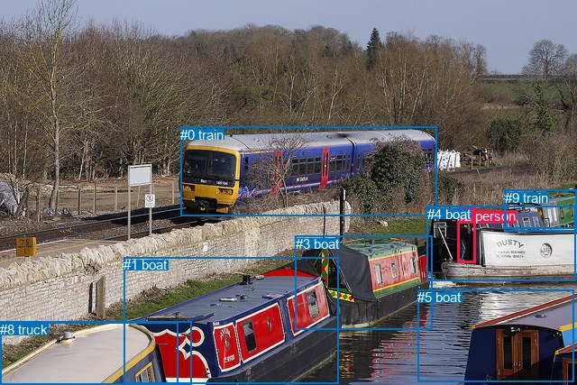
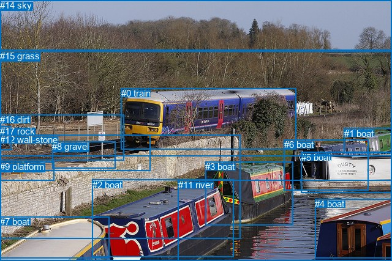

# 图片 0641：2344291.jpg

随机样本序号：475。图片 SHA256：`84cc0e75770f49df4ef6ba2abb374870ee8ad54d95f5f1d08dc94012191edf26`。

红色框表示人，蓝色框表示其他物体。两个模式分别保留自身框编号，可依据位置比较对应对象。

## 自动检测框与输出

人的框编号：`[2]`。状态：`ok`。

### 自动检测全部物体框

| 编号 | 类别 | 是否为人 | 检测分数 | 像素坐标 xyxy |
|---|---|---|---|---|
| 0 | train | False | 0.9940 | 200.5, 140.9, 484.7, 239.1 |
| 1 | boat | False | 0.9884 | 137.4, 285.4, 375.9, 425.5 |
| 2 | person | True | 0.9883 | 507.3, 231.0, 527.5, 291.7 |
| 3 | boat | False | 0.9636 | 328.0, 261.9, 479.6, 365.4 |
| 4 | boat | False | 0.9558 | 473.7, 228.6, 638.5, 311.8 |
| 5 | boat | False | 0.9084 | 463.2, 321.3, 636.8, 423.6 |
| 6 | boat | False | 0.7634 | 559.3, 210.2, 640.0, 256.9 |
| 7 | boat | False | 0.6587 | 0.0, 357.4, 197.9, 426.9 |
| 8 | truck | False | 0.4838 | 0.4, 356.5, 212.6, 427.0 |
| 9 | train | False | 0.3558 | 560.0, 210.8, 639.9, 253.3 |

### 自动检测 Top50 人相关候选

评分物体对：90；人相关物体对：18；输出关系：36。

| 排名 | 主语编号与类别 | 关系 | 宾语编号与类别 | 类型 | 人与人 | 排序分数 | 原始融合 logit |
|---|---|---|---|---|---|---|---|
| 1 | #2 person | on | #4 boat | spatial | False | 0.96866 | 3.4310 |
| 2 | #2 person | standing on | #4 boat | semantic | False | 0.86687 | 1.8736 |
| 3 | #4 boat | carrying | #2 person | semantic | False | 0.83696 | 1.6358 |
| 4 | #2 person | beside | #6 boat | spatial | False | 0.55962 | 0.2396 |
| 5 | #2 person | beside | #9 train | spatial | False | 0.55623 | 0.2259 |
| 6 | #2 person | pushing | #9 train | semantic | False | 0.53072 | 0.1230 |
| 7 | #2 person | pushing | #6 boat | semantic | False | 0.52664 | 0.1067 |
| 8 | #4 boat | beside | #2 person | spatial | False | 0.23686 | -1.1700 |
| 9 | #2 person | beside | #3 boat | spatial | False | 0.18794 | -1.4635 |
| 10 | #0 train | pulling | #2 person | semantic | False | 0.17639 | -1.5410 |
| 11 | #2 person | beside | #5 boat | spatial | False | 0.17589 | -1.5445 |
| 12 | #2 person | pushing | #3 boat | semantic | False | 0.12683 | -1.9293 |
| 13 | #6 boat | pulling | #2 person | semantic | False | 0.07548 | -2.5054 |
| 14 | #2 person | on | #0 train | spatial | False | 0.07496 | -2.5128 |
| 15 | #9 train | pulling | #2 person | semantic | False | 0.07111 | -2.5698 |
| 16 | #3 boat | carrying | #2 person | semantic | False | 0.06981 | -2.5897 |
| 17 | #2 person | looking at | #0 train | semantic | False | 0.06186 | -2.7191 |
| 18 | #6 boat | beside | #2 person | spatial | False | 0.05649 | -2.8156 |
| 19 | #3 boat | beside | #2 person | spatial | False | 0.05539 | -2.8364 |
| 20 | #9 train | beside | #2 person | spatial | False | 0.05391 | -2.8650 |
| 21 | #2 person | pushing | #5 boat | semantic | False | 0.04167 | -3.1355 |
| 22 | #0 train | on | #2 person | spatial | False | 0.03845 | -3.2192 |
| 23 | #2 person | beside | #1 boat | spatial | False | 0.03666 | -3.2689 |
| 24 | #5 boat | beside | #2 person | spatial | False | 0.03004 | -3.4748 |
| 25 | #5 boat | pushing | #2 person | semantic | False | 0.02956 | -3.4915 |
| 26 | #1 boat | pushing | #2 person | semantic | False | 0.01181 | -4.4270 |
| 27 | #1 boat | beside | #2 person | spatial | False | 0.01005 | -4.5902 |
| 28 | #2 person | pushing | #1 boat | semantic | False | 0.00927 | -4.6718 |
| 29 | #2 person | beside | #8 truck | spatial | False | 0.00538 | -5.2203 |
| 30 | #2 person | on | #7 boat | spatial | False | 0.00523 | -5.2479 |
| 31 | #2 person | pushing | #8 truck | semantic | False | 0.00387 | -5.5516 |
| 32 | #2 person | pushing | #7 boat | semantic | False | 0.00341 | -5.6768 |
| 33 | #8 truck | pushing | #2 person | semantic | False | 0.00274 | -5.8984 |
| 34 | #7 boat | pushing | #2 person | semantic | False | 0.00250 | -5.9881 |
| 35 | #8 truck | in | #2 person | spatial | False | 0.00138 | -6.5839 |
| 36 | #7 boat | in | #2 person | spatial | False | 0.00132 | -6.6260 |

### 自动检测逐条人相关 GT 核验

本图没有人相关 GT，R@50 无分母；预测候选继续展示。

## 真实框与输出

人的框编号：`[]`。

### 真实框全部物体框

| 编号 | 类别 | 是否为人 | 检测分数 | 像素坐标 xyxy |
|---|---|---|---|---|
| 0 | train | False | GT | 198.0, 144.0, 484.0, 244.0 |
| 1 | boat | False | GT | 562.0, 210.0, 640.0, 251.0 |
| 2 | boat | False | GT | 151.0, 294.0, 382.0, 421.0 |
| 3 | boat | False | GT | 335.0, 264.0, 478.0, 368.0 |
| 4 | boat | False | GT | 514.0, 325.0, 640.0, 422.0 |
| 5 | boat | False | GT | 492.0, 249.0, 640.0, 316.0 |
| 6 | boat | False | GT | 464.0, 228.0, 602.0, 311.0 |
| 7 | boat | False | GT | 0.0, 354.0, 179.0, 422.0 |
| 8 | gravel | False | GT | 85.0, 231.0, 189.0, 275.0 |
| 9 | platform | False | GT | 0.0, 264.0, 88.0, 295.0 |
| 10 | railroad | False | GT | 0.0, 221.0, 245.0, 279.0 |
| 11 | river | False | GT | 291.0, 294.0, 640.0, 427.0 |
| 12 | wall-stone | False | GT | 0.0, 220.0, 393.0, 390.0 |
| 13 | tree | False | GT | 0.0, 0.0, 640.0, 255.0 |
| 14 | sky | False | GT | 0.0, 0.0, 640.0, 83.0 |
| 15 | grass | False | GT | 0.0, 83.0, 640.0, 427.0 |
| 16 | dirt | False | GT | 0.0, 187.0, 203.0, 262.0 |
| 17 | rock | False | GT | 0.0, 206.0, 19.0, 245.0 |

### 真实框 Top50 人相关候选

评分物体对：0；人相关物体对：0；输出关系：0。

| 排名 | 主语编号与类别 | 关系 | 宾语编号与类别 | 类型 | 人与人 | 排序分数 | 原始融合 logit |
|---|---|---|---|---|---|---|---|

### 真实框逐条人相关 GT 核验

本图没有人相关 GT，R@50 无分母；预测候选继续展示。

## 全部人相关 GT

| 主语编号与类别 | 关系 | 宾语编号与类别 |
|---|---|---|

原始记录、全部人相关物体对的两项预测与分项分数见 [逐图证据 JSON](../evidence/cases/0641.json)。全部56类 logits 保留于本机 HOR/output/random500/logits/。

<!-- HOR_COMPLETE_RESULTS -->

## 六组条件的完整输出对照

以下保留同一图片三种框与候选模式、两种谓词输出规则的全部 Top50。框编号各自在所属模式内解释。

### 自动检测框完整枚举：空间与语义各保留一个谓词

| 排名 | 主语编号与类别 | 谓词 | 宾语编号与类别 | 分组 | 排序分数 | predicate logit | pair logit |
|---|---|---|---|---|---|---|---|
| 1 | #2 person | on | #4 boat | spatial | 0.9686601 | 3.4866862 | -0.0556650 |
| 2 | #2 person | standing on | #4 boat | semantic | 0.8668688 | 1.9292173 | -0.0556650 |
| 3 | #4 boat | carrying | #2 person | semantic | 0.8369558 | 2.0640521 | -0.4283019 |
| 4 | #2 person | beside | #6 boat | spatial | 0.5596179 | 0.7913938 | -0.5517823 |
| 5 | #2 person | beside | #9 train | spatial | 0.5562309 | 0.7913938 | -0.5655147 |
| 6 | #2 person | pushing | #9 train | semantic | 0.5307158 | 0.6885328 | -0.5655147 |
| 7 | #2 person | pushing | #6 boat | semantic | 0.5266441 | 0.6584597 | -0.5517823 |
| 8 | #4 boat | beside | #2 person | spatial | 0.2368575 | -0.7416842 | -0.4283019 |
| 9 | #2 person | beside | #3 boat | spatial | 0.1879364 | -0.9961300 | -0.4673452 |
| 10 | #0 train | pulling | #2 person | semantic | 0.1763855 | -1.0262778 | -0.5147526 |
| 11 | #2 person | beside | #5 boat | spatial | 0.1758872 | -0.7436073 | -0.8008573 |
| 12 | #2 person | pushing | #3 boat | semantic | 0.1268275 | -1.4619598 | -0.4673452 |
| 13 | #6 boat | pulling | #2 person | semantic | 0.0754821 | -1.7487273 | -0.7566490 |
| 14 | #2 person | on | #0 train | spatial | 0.0749628 | -2.1703873 | -0.3424552 |
| 15 | #9 train | pulling | #2 person | semantic | 0.0711074 | -1.8089087 | -0.7608924 |
| 16 | #3 boat | carrying | #2 person | semantic | 0.0698069 | -1.7577384 | -0.8319209 |
| 17 | #2 person | looking at | #0 train | semantic | 0.0618570 | -2.3766215 | -0.3424552 |
| 18 | #6 boat | beside | #2 person | spatial | 0.0564866 | -2.0589590 | -0.7566490 |
| 19 | #3 boat | beside | #2 person | spatial | 0.0553880 | -2.0044901 | -0.8319209 |
| 20 | #9 train | beside | #2 person | spatial | 0.0539122 | -2.1040866 | -0.7608924 |
| 21 | #2 person | pushing | #5 boat | semantic | 0.0416672 | -2.3346236 | -0.8008573 |
| 22 | #0 train | on | #2 person | spatial | 0.0384500 | -2.7044358 | -0.5147526 |
| 23 | #2 person | beside | #1 boat | spatial | 0.0366551 | -2.3081784 | -0.9606804 |
| 24 | #5 boat | beside | #2 person | spatial | 0.0300378 | -2.5294099 | -0.9453906 |
| 25 | #5 boat | pushing | #2 person | semantic | 0.0295558 | -2.5460837 | -0.9453906 |
| 26 | #1 boat | pushing | #2 person | semantic | 0.0118096 | -3.3137460 | -1.1132178 |
| 27 | #1 boat | beside | #2 person | spatial | 0.0100493 | -3.4769375 | -1.1132178 |
| 28 | #2 person | pushing | #1 boat | semantic | 0.0092683 | -3.7111673 | -0.9606804 |
| 29 | #2 person | beside | #8 truck | spatial | 0.0053768 | -3.8048306 | -1.4154353 |
| 30 | #2 person | on | #7 boat | spatial | 0.0052308 | -3.8182034 | -1.4297425 |
| 31 | #2 person | pushing | #8 truck | semantic | 0.0038663 | -4.1361403 | -1.4154353 |
| 32 | #2 person | pushing | #7 boat | semantic | 0.0034128 | -4.2470503 | -1.4297425 |
| 33 | #8 truck | pushing | #2 person | semantic | 0.0027364 | -4.2162271 | -1.6821359 |
| 34 | #7 boat | pushing | #2 person | semantic | 0.0025022 | -4.2876544 | -1.7004240 |
| 35 | #8 truck | in | #2 person | spatial | 0.0013806 | -4.9017181 | -1.6821359 |
| 36 | #7 boat | in | #2 person | spatial | 0.0013237 | -4.9255590 | -1.7004240 |

没有人相关 GT，本条件的召回率无分母。

### 自动检测框完整枚举：每对只保留一个谓词

| 排名 | 主语编号与类别 | 谓词 | 宾语编号与类别 | 分组 | 排序分数 | predicate logit | pair logit |
|---|---|---|---|---|---|---|---|
| 1 | #2 person | on | #4 boat | single | 0.9686601 | 3.4866862 | -0.0556650 |
| 2 | #4 boat | carrying | #2 person | single | 0.8369558 | 2.0640521 | -0.4283019 |
| 3 | #2 person | beside | #6 boat | single | 0.5596179 | 0.7913938 | -0.5517823 |
| 4 | #2 person | beside | #9 train | single | 0.5562309 | 0.7913938 | -0.5655147 |
| 5 | #2 person | beside | #3 boat | single | 0.1879364 | -0.9961300 | -0.4673452 |
| 6 | #0 train | pulling | #2 person | single | 0.1763855 | -1.0262778 | -0.5147526 |
| 7 | #2 person | beside | #5 boat | single | 0.1758872 | -0.7436073 | -0.8008573 |
| 8 | #6 boat | pulling | #2 person | single | 0.0754821 | -1.7487273 | -0.7566490 |
| 9 | #2 person | on | #0 train | single | 0.0749628 | -2.1703873 | -0.3424552 |
| 10 | #9 train | pulling | #2 person | single | 0.0711074 | -1.8089087 | -0.7608924 |
| 11 | #3 boat | carrying | #2 person | single | 0.0698069 | -1.7577384 | -0.8319209 |
| 12 | #2 person | beside | #1 boat | single | 0.0366551 | -2.3081784 | -0.9606804 |
| 13 | #5 boat | beside | #2 person | single | 0.0300378 | -2.5294099 | -0.9453906 |
| 14 | #1 boat | pushing | #2 person | single | 0.0118096 | -3.3137460 | -1.1132178 |
| 15 | #2 person | beside | #8 truck | single | 0.0053768 | -3.8048306 | -1.4154353 |
| 16 | #2 person | on | #7 boat | single | 0.0052308 | -3.8182034 | -1.4297425 |
| 17 | #8 truck | pushing | #2 person | single | 0.0027364 | -4.2162271 | -1.6821359 |
| 18 | #7 boat | pushing | #2 person | single | 0.0025022 | -4.2876544 | -1.7004240 |

没有人相关 GT，本条件的召回率无分母。

### 真实框完整枚举：空间与语义各保留一个谓词

| 排名 | 主语编号与类别 | 谓词 | 宾语编号与类别 | 分组 | 排序分数 | predicate logit | pair logit |
|---|---|---|---|---|---|---|---|

没有人相关 GT，本条件的召回率无分母。

### 真实框完整枚举：每对只保留一个谓词

| 排名 | 主语编号与类别 | 谓词 | 宾语编号与类别 | 分组 | 排序分数 | predicate logit | pair logit |
|---|---|---|---|---|---|---|---|

没有人相关 GT，本条件的召回率无分母。

### 真实框400候选：空间与语义各保留一个谓词

| 排名 | 主语编号与类别 | 谓词 | 宾语编号与类别 | 分组 | 排序分数 | predicate logit | pair logit |
|---|---|---|---|---|---|---|---|

没有人相关 GT，本条件的召回率无分母。

### 真实框400候选：每对只保留一个谓词

| 排名 | 主语编号与类别 | 谓词 | 宾语编号与类别 | 分组 | 排序分数 | predicate logit | pair logit |
|---|---|---|---|---|---|---|---|

没有人相关 GT，本条件的召回率无分母。
