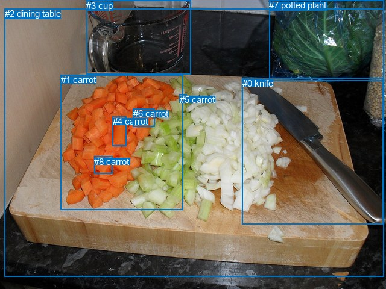
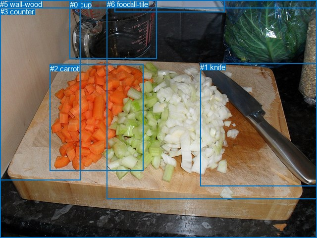

# 图片 0645：2344408.jpg

随机样本序号：307。图片 SHA256：`6b8d7a8a664ddf50ee23c1efb3bc6fb64d875ed2332e965baddd6ff9249fb3bd`。

红色框表示人，蓝色框表示其他物体。两个模式分别保留自身框编号，可依据位置比较对应对象。

## 自动检测框与输出

人的框编号：`[]`。状态：`no_person`。

### 自动检测全部物体框

| 编号 | 类别 | 是否为人 | 检测分数 | 像素坐标 xyxy |
|---|---|---|---|---|
| 0 | knife | False | 0.9993 | 401.5, 129.5, 635.2, 372.4 |
| 1 | carrot | False | 0.9946 | 100.8, 124.0, 304.0, 348.5 |
| 2 | dining table | False | 0.7909 | 8.0, 14.1, 636.4, 460.0 |
| 3 | cup | False | 0.7296 | 143.3, 0.7, 316.7, 123.5 |
| 4 | carrot | False | 0.6712 | 186.6, 193.2, 209.9, 242.9 |
| 5 | carrot | False | 0.4615 | 297.7, 156.6, 309.5, 168.2 |
| 6 | carrot | False | 0.4292 | 220.8, 180.2, 256.1, 210.2 |
| 7 | potted plant | False | 0.4277 | 446.4, 0.0, 636.7, 134.5 |
| 8 | carrot | False | 0.3929 | 156.4, 259.5, 186.7, 288.5 |

### 自动检测 Top50 人相关候选

评分物体对：0；人相关物体对：0；输出关系：0。

| 排名 | 主语编号与类别 | 关系 | 宾语编号与类别 | 类型 | 人与人 | 排序分数 | 原始融合 logit |
|---|---|---|---|---|---|---|---|

### 自动检测逐条人相关 GT 核验

本图没有人相关 GT，R@50 无分母；预测候选继续展示。

## 真实框与输出

人的框编号：`[]`。

### 真实框全部物体框

| 编号 | 类别 | 是否为人 | 检测分数 | 像素坐标 xyxy |
|---|---|---|---|---|
| 0 | cup | False | GT | 141.0, 1.0, 317.0, 118.0 |
| 1 | knife | False | GT | 404.0, 127.0, 640.0, 375.0 |
| 2 | carrot | False | GT | 101.0, 130.0, 290.0, 345.0 |
| 3 | counter | False | GT | 0.0, 15.0, 640.0, 480.0 |
| 4 | wall-tile | False | GT | 231.0, 0.0, 454.0, 24.0 |
| 5 | wall-wood | False | GT | 0.0, 0.0, 162.0, 363.0 |
| 6 | food | False | GT | 216.0, 0.0, 640.0, 401.0 |

### 真实框 Top50 人相关候选

评分物体对：0；人相关物体对：0；输出关系：0。

| 排名 | 主语编号与类别 | 关系 | 宾语编号与类别 | 类型 | 人与人 | 排序分数 | 原始融合 logit |
|---|---|---|---|---|---|---|---|

### 真实框逐条人相关 GT 核验

本图没有人相关 GT，R@50 无分母；预测候选继续展示。

## 全部人相关 GT

| 主语编号与类别 | 关系 | 宾语编号与类别 |
|---|---|---|

原始记录、全部人相关物体对的两项预测与分项分数见 [逐图证据 JSON](../evidence/cases/0645.json)。全部56类 logits 保留于本机 HOR/output/random500/logits/。

<!-- HOR_COMPLETE_RESULTS -->

## 六组条件的完整输出对照

以下保留同一图片三种框与候选模式、两种谓词输出规则的全部 Top50。框编号各自在所属模式内解释。

### 自动检测框完整枚举：空间与语义各保留一个谓词

| 排名 | 主语编号与类别 | 谓词 | 宾语编号与类别 | 分组 | 排序分数 | predicate logit | pair logit |
|---|---|---|---|---|---|---|---|

没有人相关 GT，本条件的召回率无分母。

### 自动检测框完整枚举：每对只保留一个谓词

| 排名 | 主语编号与类别 | 谓词 | 宾语编号与类别 | 分组 | 排序分数 | predicate logit | pair logit |
|---|---|---|---|---|---|---|---|

没有人相关 GT，本条件的召回率无分母。

### 真实框完整枚举：空间与语义各保留一个谓词

| 排名 | 主语编号与类别 | 谓词 | 宾语编号与类别 | 分组 | 排序分数 | predicate logit | pair logit |
|---|---|---|---|---|---|---|---|

没有人相关 GT，本条件的召回率无分母。

### 真实框完整枚举：每对只保留一个谓词

| 排名 | 主语编号与类别 | 谓词 | 宾语编号与类别 | 分组 | 排序分数 | predicate logit | pair logit |
|---|---|---|---|---|---|---|---|

没有人相关 GT，本条件的召回率无分母。

### 真实框400候选：空间与语义各保留一个谓词

| 排名 | 主语编号与类别 | 谓词 | 宾语编号与类别 | 分组 | 排序分数 | predicate logit | pair logit |
|---|---|---|---|---|---|---|---|

没有人相关 GT，本条件的召回率无分母。

### 真实框400候选：每对只保留一个谓词

| 排名 | 主语编号与类别 | 谓词 | 宾语编号与类别 | 分组 | 排序分数 | predicate logit | pair logit |
|---|---|---|---|---|---|---|---|

没有人相关 GT，本条件的召回率无分母。
